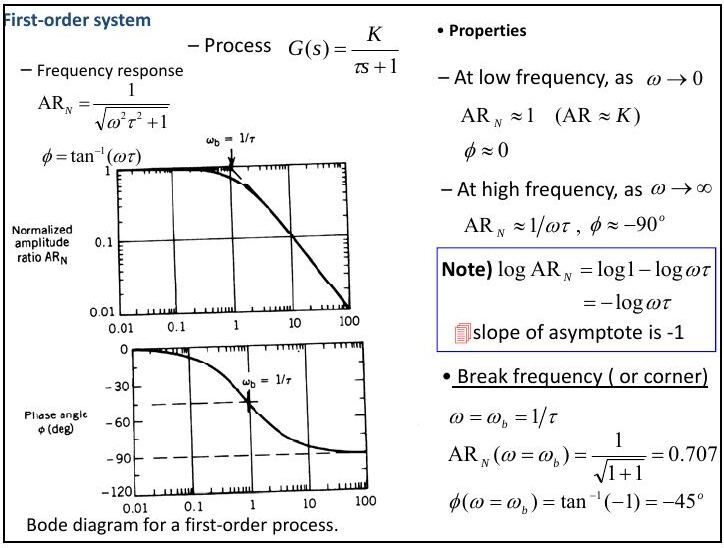
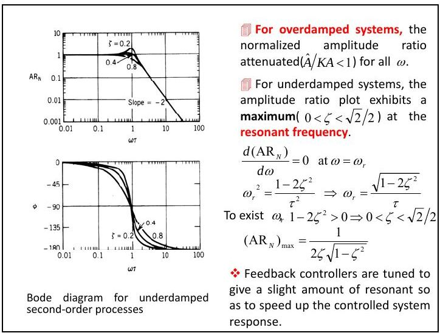
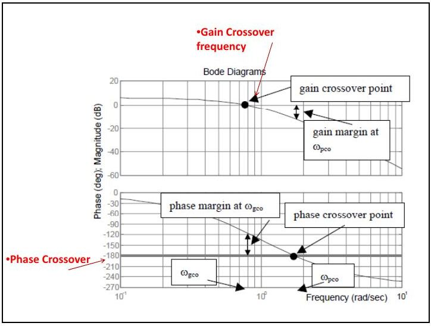
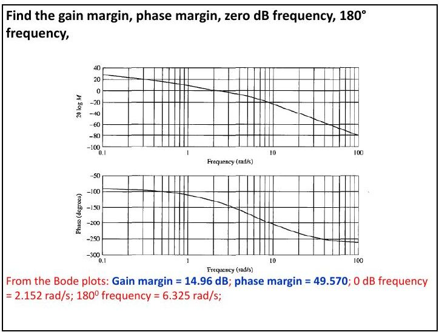

Bu yazı, Başkent Üniversitesi **EEM322 Denetim Sistemleri** dersinin **9. ders notudur** ("EEM322: Lecture 9 – Frequency Domain Analysis, Frequency Response Techniques, Bode Diagrams"). Notlar dersi veren **Hamit Erdem**'e ait; sayfa başlarında 07.08.2013 tarihi var. Sayfa başına iki slayt yerleştirilmiş 16 sayfalık, büyük kısmı İngilizce bir PDF; [Ders 7](/arsiv/eem322-ders-07-surekli-hal-hatalari/) ve [Ders 8](/arsiv/eem322-ders-08-kok-yer-egrisi/) notlarının devamıdır. Aşağıda içerik Türkçe olarak aktarıldı, formüller ve örnekler yazıya döküldü. Orijinal PDF yazının sonunda indirilebilir.

## Frekans bölgesinde analiz

Bir denetim sisteminin başarımı genellikle zaman bölgesi özellikleriyle ölçülür; ama doğrusal sistemlerde zaman ve frekans bölgesi başarımları arasında ilişki olduğundan aynı ölçüm frekans bölgesinde de yapılabilir ve zaman bölgesi özellikleri frekans analizinden kestirilebilir. Frekans bölgesi yaklaşımı, karmaşık analiz ve tasarım problemlerine zaman bölgesi çalışmalarına ek bir bakış açısı sağlar. Frekans bölgesinde analiz için dört temel grafik yöntem vardır:

1. Kök yer eğrisi (root locus) yöntemi
1. Bode diyagramları
1. Nyquist diyagramları
1. Nichols diyagramları

Bir sistemin **frekans yanıtı**, sinüzoidal (harmonik) bir girişe verdiği **sürekli hal yanıtıdır**. Doğrusal sistemlerde çıkış da sinüzoidaldir ve girişten yalnız **genlik ve faz** bakımından farklıdır: A sin(ωt) girişi βA sin(ωt + φ) çıkışını verir. β genlik çarpanıdır (β > 1 ise sistem girişi yükseltir, β < 1 ise zayıflatır), φ giriş ile çıkış arasındaki faz kaymasıdır. Sistem kazancı = çıkış genliği / giriş genliği = B/A; faz: φ₂ = φ₁ + faz kayması.

Kararsız bir sürecin frekans yanıtı yoktur, çünkü sinüzoidal giriş kararsız bir çıkış üretir. Frekans yanıtı yöntemleri 1930'larda Nyquist ve Bode tarafından geliştirilmiştir ve 1948'de Evans'ın bulduğu kök yer eğrisi yönteminden eskidir (Nyquist, 1932; Bode, 1945).

### Neden sinüs sinyali?

Sinüs sinyali her yerde ortak kullanıldığı için seçilmez (ABD'de şebeke 60 Hz, başka yerlerde 50 Hz). Önemi **Fourier teorisinden** gelir: bir devreye uygulanan sinyal, çözümlemenin kolay olması için farklı genlik ve frekanslardaki sinüs sinyallerinin toplamı olarak ifade edilebilir (notta bir üçgen dalganın Fourier bileşenleri örneği var).

**Karmaşık sayılar:** z = a + jb, Re(z) = a, Im(z) = b, j = √−1. Üstel/kutupsal biçim: z = re^(jθ), r = |z| = √(a² + b²), θ = atan(b/a).

**Desibel:** V₂/V₁, I₂/I₁, P₂/P₁ birimsizdir; logaritmaları alındığında desibel (dB) birimi verilir:

- 20 log₁₀|V₂/V₁|: gerilim kazancının log-genliği (dB)
- 20 log₁₀|I₂/I₁|: akım kazancının log-genliği (dB)
- 10 log₁₀|P₂/P₁|: güç kazancının log-genliği (dB)
- Kazanç_dB = 20 log₁₀(Kazanç); 20 log(K × 10) = 20 log K + 20; 20 log(K × 10ⁿ) = 20 log K + 20n; 20 log K = −20 log(1/K)

## Transfer fonksiyonundan frekans yanıtı

Doğrusal bir sistemin transfer fonksiyonu G(s) biliniyorsa genlik karakteristiği |G(jω)| ve faz karakteristiği ∠G(jω), sinüzoidal giriş için sürekli hal başarımını tamamen tanımlar. Kapalı çevrim sistemin genlik ve faz karakteristikleri aşım, yükselme süresi ve sürekli hal başarımı gibi zaman bölgesi özelliklerini kestirmekte kullanılabilir.

**Kapalı çevrim sistemin frekans yanıtı:** M(s) = Y(s)/R(s) = G(s)/(1 + G(s)H(s)); sinüzoidal sürekli halde s = jω:

- M(jω) = G(jω)/(1 + G(jω)H(jω)) = |M(jω)| ∠M(jω)
- |M(jω)| = |G(jω)| / |1 + G(jω)H(jω)|
- ∠M(jω) = φ_M(jω) = ∠G(jω) − ∠[1 + G(jω)H(jω)]

Genel olarak s = σ + jω'dır; kararlı bir sistemde sürekli halde gerçel kısmın katkısı söneceği için sinüzoidal sürekli hal analizinde s yerine yalnız jω konur: Y(jω) = G(jω)R(jω). Buradan:

- Genlik ilişkisi: |Y(jω)| = |G(jω)| · |R(jω)|
- Faz ilişkisi: ∠Y(jω) = ∠G(jω) + ∠R(jω)
- r(t) = R sin ω₀t girişi için çıkış y(t) = Y sin(ω₀t + φ), Y = R|G(jω₀)|, φ = ∠G(jω₀)

**Kısa yol:**

1. G(s)'de s = jω koyarak G(jω)'yı elde et.
1. G(jω)'yı pay ve paydayı paydanın eşleniğiyle çarparak G(jω) = R + jI biçimine getir (R ve I, ω'nın fonksiyonlarıdır).
1. Genlik oranı AR = √(R² + I²), faz açısı φ = tan⁻¹(I/R).

*Not: Notta adım 3'teki faz açısı φ = tan⁻¹(R/I) olarak yazılmış; doğrusu φ = tan⁻¹(I/R)'dir (aşağıdaki birinci derece örneğinde de φ = tan⁻¹(−ωτ) bu bağıntıdan çıkar).*

### Örnekler

**Birinci dereceden sistem:** G(s) = 1/(τs + 1). G(jω) = 1/(jωτ + 1); pay ve payda (−jωτ + 1) ile çarpılırsa:

- G(jω) = (1 − jωτ)/(ω²τ² + 1) = 1/(ω²τ² + 1) + j(−ωτ)/(ω²τ² + 1) = R + jI

**Örnek:** G(s) = 3/(s + 2) ⇒ G(jω) = 3/(jω + 2), |G(jω)| = 3/(ω² + 4)^(1/2), ∠G(jω) = −tan⁻¹(ω/2).

**Örnek:** G(s) = K/(Ts + 1), giriş x(t) = X sin ωt:

- |G(jω)| = K/√(1 + T²ω²), φ = ∠G(jω) = −tan⁻¹(Tω)
- y_ss(t) = [XK/√(1 + T²ω²)] sin(ωt − tan⁻¹Tω)

**Örnek:** G(s) = (s + 1/T₁)/(s + 1/T₂), giriş x(t) = X sin ωt:

- G(jω) = T₂(1 + T₁jω) / [T₁(1 + T₂jω)], |G(jω)| = T₂√(1 + T₁²ω²) / [T₁√(1 + T₂²ω²)]
- φ = tan⁻¹(T₁ω) − tan⁻¹(T₂ω)
- y_ss(t) = [XT₂√(1 + T₁²ω²) / (T₁√(1 + T₂²ω²))] sin(ωt + tan⁻¹T₁ω − tan⁻¹T₂ω)

**Örnek (RC devresi):** H(s) = V_o(s)/V_i(s) = 1/(1 + sRC); R = 1, C = 0,1 için H(jω) = 1/(1 + j0,1ω). Giriş ve transfer fonksiyonu fazör olarak yazılırsa çarpım kolaydır (genlikler çarpılır, fazlar toplanır). V_i = 3 sin(30t) = 3∠0° için:

- H(j30) = 1/(1 + j3) = 0,1 − j0,3 = 0,316∠−71,6°
- V_o = V_i · H = (3∠0°)(0,316∠−71,6°) = 0,95∠−71,6°, yani v_o(t) = 0,95 sin(30t − 71,6°)

## Bode diyagramı

Kararlı bir doğrusal sisteme sinüzoidal bir giriş uygulandığında sürekli halde çıkış da sinüzoidaldir; genliği girişin bir katıdır ve bir faz kayması olabilir. Giriş genliği sabit tutulup frekans değiştirildikçe başka bir çıkış genliği ve faz kayması bulunur. Böylece geniş bir frekans aralığı için kazanç ve faz değerleri çizilebilir. Kazanç, giriş genliğine bağlı olmadığı için çıkış genliği yerine kullanılır.

**Bode diyagramı**, frekans yanıtının yarı-logaritmik eksenlerde grafik gösterimidir ve iki çizimden oluşur:

- **Kazanç çizimi:** sistemin kazancı (genellikle dB) – frekans (logaritmik eksen)
- **Faz çizimi:** sistemin getirdiği faz kayması (derece, doğrusal eksen) – frekans (logaritmik eksen)

ω çok geniş bir aralıkta incelendiğinden genlik de çok büyük değişir; bu yüzden genlik desibel olarak (dB(x) = 20 log₁₀ x), frekans logaritmik ölçekte çizilir. Notta H(s) = 1/(s + 1) ve G(s) = 1/(s + 2) için genlik ve faz çizimleri örnek olarak veriliyor.

### Birinci dereceden süreç

G(s) = K/(τs + 1); normalize genlik oranı AR_N = AR/K = 1/√(ω²τ² + 1), φ = −tan⁻¹(ωτ).

- Düşük frekansta (ω → 0): AR_N ≈ 1 (AR ≈ K), φ ≈ 0.
- Yüksek frekansta (ω → ∞): AR_N ≈ 1/(ωτ), φ ≈ −90°. log AR_N = log 1 − log ωτ = −log ωτ, yani asimptotun eğimi −1'dir (−20 dB/dekad).
- **Kırılma (köşe) frekansı:** ω_b = 1/τ; AR_N(ω_b) = 1/√2 = 0,707; φ(ω_b) = tan⁻¹(−1) = −45°.

Çizim adımları:

1. Kırılma frekansı ω_b = 1/τ'yu bul; bu noktada AR = 0,707K.
1. Düşük frekans bölgesi için (ω ≤ ω_b) AR = K yatay asimptotunu çiz.
1. Eğimi −1 olan yüksek frekans asimptotunu, ω = ω_b'de AR = K ile kesişecek şekilde çiz.
1. Gerçek frekans yanıtını bu biçime göre çiz.
1. ω = ω_b'de φ = −45° noktasını işaretle, φ = 0° ve −90°'de yatay asimptotları çiz ve faz eğrisini aşağıdaki tabloya göre çiz.

| ωτ | 0,01 | 0,1 | 0,5 | 1,0 | 2,0 | 10,0 | 100,0 |
|---|---|---|---|---|---|---|---|
| φ (°) | −0,6 | −5,7 | −26,6 | −45,0 | −63,4 | −84,3 | −89,4 |

*Not: Notun birinci derece slaytında faz φ = tan⁻¹(ωτ) yazılmış; çizimden ve tablodan da görüldüğü gibi doğrusu φ = −tan⁻¹(ωτ)'dir.*

### İkinci dereceden süreç

G(s) = K/(τ²s² + 2ζτs + 1):

- AR = K / √[(1 − ω²τ²)² + (2ωτζ)²], φ = tan⁻¹[−2ωτζ/(1 − ω²τ²)]
- Düşük frekansta AR ≈ K, φ ≈ 0; yüksek frekansta AR_N ≈ 1/(ωτ)², φ ≈ −180°. log AR_N = −2 log ωτ, yani asimptot eğimi −2'dir (−40 dB/dekad).
- Aşırı sönümlü sistemlerde normalize genlik oranı bütün ω'lar için 1'den küçüktür (zayıflatma).
- Az sönümlü sistemlerde (0 < ζ < √2/2) genlik oranı **rezonans frekansında** bir tepe yapar: d(AR_N)/dω = 0 ⇒ ω_r² = (1 − 2ζ²)/τ², ω_r = √(1 − 2ζ²)/τ; tepe için 1 − 2ζ² > 0, yani 0 < ζ < √2/2. **(AR_N)max = 1/(2ζ√(1 − ζ²))**.
- Geri beslemeli denetleyiciler, denetlenen sistemin yanıtını hızlandırmak için hafif bir rezonans verecek şekilde ayarlanır.

**Aşırı sönümlü sistemde AR çizimi:** (1) K'da düşük frekans asimptotunu çiz; (2) ω_b1 = 1/τ₁'de (τ₁ büyük zaman sabiti) eğim −1'e döner; (3) ω_b2 = 1/τ₂'de eğim −2'ye döner; (4) gerçek eğri üzerinde birkaç nokta hesaplayıp asimptotlara göre çiz.

**Az sönümlü sistemde AR çizimi:** (1) K'da düşük frekans asimptotunu çiz; (2) ω_b = 1/τ'da eğim −2'ye döner; (3) birkaç nokta hesaplayıp çiz. AR'deki tepe yalnız 0 < ζ < √2/2 ise görülür.

**Saf integratör:** G(s) = 1/s, G(jω) = 1/(jω) = −j(1/ω); AR = 1/ω, φ = −90°.

**Saf türevleyici:** G(s) = s, G(jω) = jω; AR = ω, φ = +90°.

## Frekans bölgesi başarım ölçütleri

1. **Rezonans tepesi M_r:** M genliğinin en büyük değeridir ve **göreli kararlılığın** bir ölçüsüdür. Büyük M_r, geçici yanıtta büyük aşımla ilişkilidir; kapalı çevrim için önerilen değer 1,1–1,5 aralığıdır.
1. **Rezonans frekansı ω_r:** M_r tepesinin oluştuğu frekans.
1. **Bant genişliği (BW):** |M(jω)|'nın sıfır frekans değerinin %70,7'sine, yani 3 dB altına düştüğü frekans. Büyük bant genişliği daha hızlı yükselme süresine karşılık gelir (yüksek frekanslı işaretler çıkışa kolayca geçer); küçük bant genişliğinde yalnız düşük frekanslar geçer ve zaman yanıtı ağırlaşır.
1. **Kesim hızı (cutoff rate):** M(jω)'nın yüksek frekans ucundaki eğimi. İki sistemin bant genişliği aynı olsa da kesim hızları farklı olabilir.

İkinci dereceden ve ζ < 0,707 olan bir sistemde rezonans frekansı ve rezonans genliği şu bağıntılarla kestirilebilir:

- ω_r = ω_n √(1 − 2ζ²)
- M_r = [2ζ√(1 − ζ²)]⁻¹

Bu frekans bölgesi özellikleri zaman bölgesi davranışıyla ilişkilidir: M_r göreli kararlılığı gösterir; büyük M_r düşük sönüm, salınımlı yanıt ve büyük aşım demektir. Bant genişliği büyük sistemler daha hızlı yanıt verir ama gürültüye daha duyarlı olabilir; gürültü duyarlılığı bant genişliği ile yüksek frekanslardaki genlik azalma hızının birlikte etkisiyle belirlenir.

**İşaret bant genişliği:** (i) orta bant bölgesi ya da tepesi olan işaretlerde ve (ii) sabit dc kazançlı işaretlerde, kazancın 0,707G'den büyük olduğu frekans aralığıdır; 0,707 = −3 dB.

## Kazanç ve faz payı

- **Kazanç kesim frekansı ω_gco:** kazancın 0 dB'yi kestiği frekans.
- **Faz kesim frekansı ω_pco:** fazın −180°'yi kestiği frekans.

**Minimum fazlı sistem:** çevrim transfer fonksiyonu GH(s)'nin sağ yarı s-düzleminde sıfırı ya da kutbu yoktur. Sağ yarı düzlemde kutbu ya da sıfırı olan sistemlere minimum fazlı olmayan sistem denir. Minimum fazlı bir sistemin kazanç ve faz payları, GH(s)'nin Bode diyagramı çizilerek bulunur:

- **Kazanç payı:** GM = 0 dB − |G(jω_pco)| (dB)
- **Faz payı:** kazancın 0 dB çizgisini kestiği frekansta faz açısını −180°'ye getirmek için gereken ek faz gecikmesi: PM = φ(ω_gco) − (−180°)

Minimum fazlı bir sistem, iki pay da pozitifse kararlı, negatifse kararsızdır. Kararlılık derecesi yüksek sistemlerin payları büyük, daha az kararlı sistemlerin payları küçüktür. PM negatifse ya da GM negatifse sistem kararsızdır.

**Örnek:** GH(s) = 100(s + 2) / [(s + 5)(s + 10)(s² + 2s + 2)] için faz payı **PM = +68°** (2,2 rad/s'de) ve kazanç payı **GM = +17,4 dB** (7,15 rad/s'de) bulunur; kapalı çevrim sistem kararlıdır.

**Örnek:** Verilen Bode çizimlerinden kazanç payı, faz payı, 0 dB frekansı ve 180° frekansını bulun.

Bode çizimlerinden: kazanç payı = **14,96 dB**, faz payı = **49,57°**, 0 dB frekansı = **2,152 rad/s**, 180° frekansı = **6,325 rad/s**.
