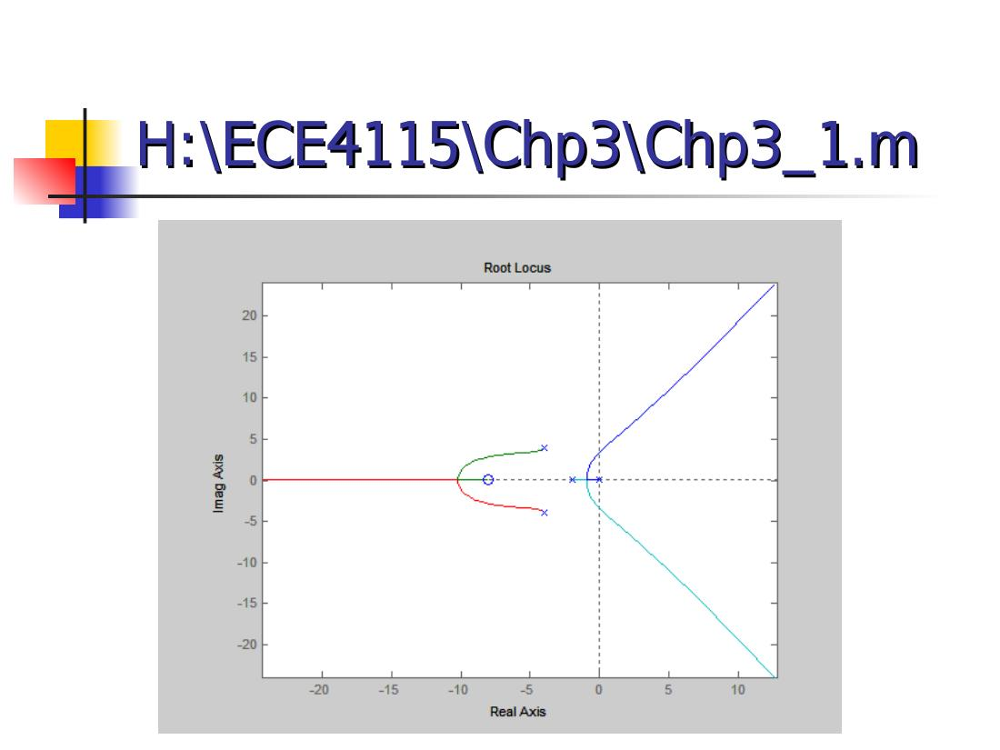
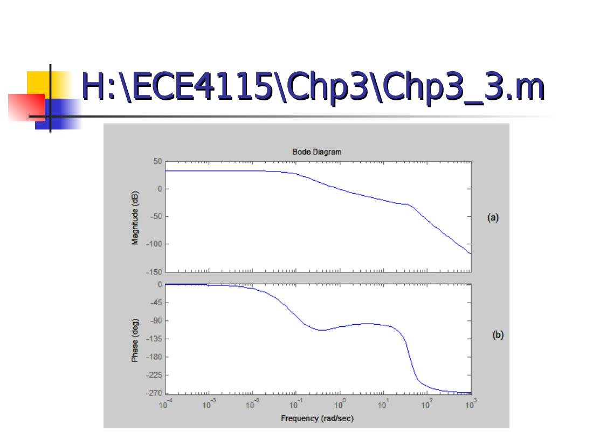
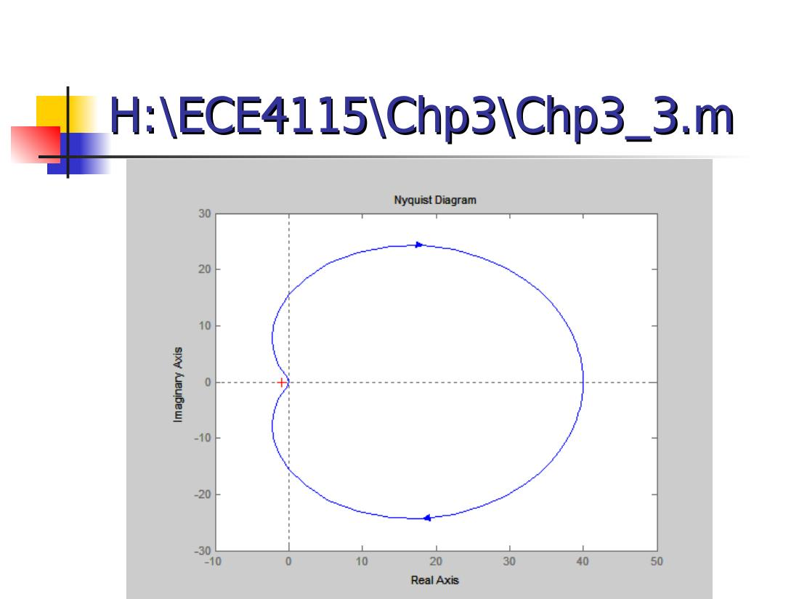
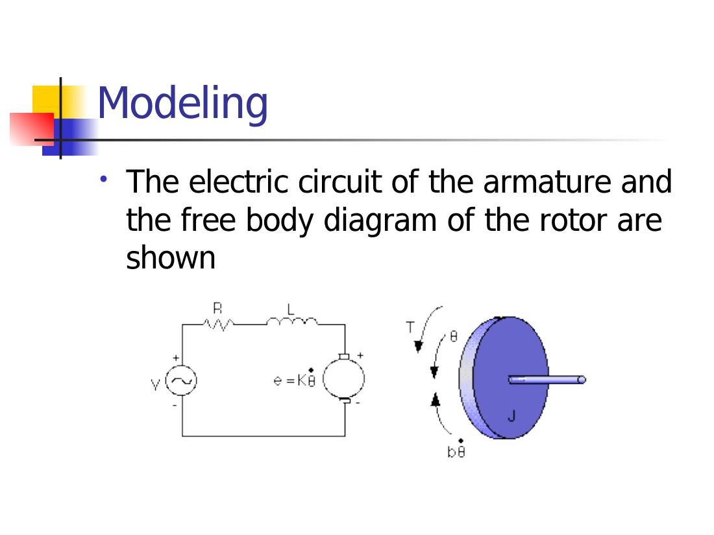
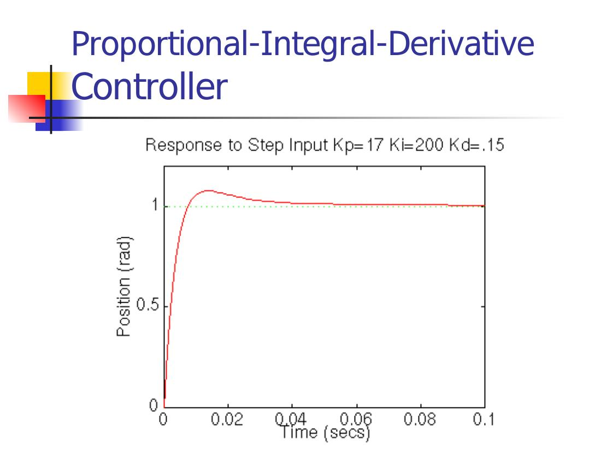

Bu yazı, EEM322 Denetim Sistemleri dersi klasöründe "kontrol sistemleri farklı yerlerden indirilenler" başlığıyla saklanmış **üçüncü taraf** dört sunumu bir araya getiriyor: **University of Houston**, **ECE 4115 Control Systems Lab 1** dersinin **Bahar 2005** dönemi MATLAB laboratuvar sunumları (Chapter 1–4). Sunumları **Nisarg Mehta** hazırlamış ("Prepared by: Nisarg Mehta"); dosyalar Şubat–Nisan 2005 tarihli. Klasördeki not dosyası kaynağı **http://www.egr.uh.edu/courses/ECE/ECE4115/** olarak gösteriyor. Sunumlar İngilizce olduğundan içerik özgün dilinde aktarıldı; denklemler düz metne çevrildi. Dört PowerPoint dosyası ve kaynak notu yazının sonunda ZIP olarak indirilebilir.

*Bu içerik üçüncü taraf bir kaynağa aittir; arşiv ve nostalji amacıyla kaynak belirtilerek paylaşılmıştır. Hak sahibinin talebi hâlinde kaldırılır.*

Laboratuvarda MATLAB, ağ sürücüsünden açılıyordu: *Start → Run → \\laser\apps*, ardından MatlabR14 klasöründe MATLAB 7.0.1. Her bölümün sonunda bir ödev vardı; dönem, model indirgeme ve kontrol sistemi tasarımı üzerine bir projeyle bitiyordu.

## Chapter 1: System Models

The Control System Toolbox has **4 basic types of LTI models**: Transfer Function (TF), Zero-pole-gain model (ZPK), State-Space models (SS) and Frequency response data model (FRD). The chapter also covers conversion between models and model dynamics.

### Transfer function models

Consider a linear time invariant (LTI) single-input/single-output system:

> y'' + 6y' + 5y = 4u' + 3u

Applying the Laplace transform to both sides with zero initial conditions:

> G(s) = Y(s)/U(s) = (4s + 3)/(s² + 6s + 5)

**tf** – creation of transfer functions. `sys=tf(num,den)` creates a continuous-time transfer function sys with numerator(s) num and denominator(s) den. For SISO models, num and den are row vectors listing the numerator and denominator coefficients in descending powers of s.

**tfdata** – quick access to transfer function data. `[num,den]=tfdata(sys,'v')` returns the numerator and denominator as row vectors (if sys is not a transfer function, it is first converted).

```matlab
>> num = [4 3];
>> den = [1 6 5];
>> sys = tf(num,den)
Transfer function:
    4 s + 3
-------------
s^2 + 6 s + 5
>> [num,den] = tfdata(sys,'v')
num =
     0     4     3
den =
     1     6     5
```

"My first program", Chp1_1.m:

```matlab
%Program to write a Transfer function
%Author: Firstname Lastname
clear all
close all
clc
num = [4 3];
den = [1 6 5];
sys = tf(num,den) %transfer function model
[num1,den1] = tfdata(sys,'v')
```

### Zero-pole-gain models

The same system in zero-pole-gain form: G(s) = (4s + 3)/(s² + 6s + 5) = 4(s + 0.75)/((s + 1)(s + 5)).

**zpk** – `sys=zpk(z,p,k)` creates a continuous-time zero-pole-gain model with zeros z, poles p and gain k (set z=[ ] if there are no zeros). **zpkdata** – `[z,p,k]=zpkdata(sys,'v')` returns the zeros and poles as column vectors and the gain k.

```matlab
%Program to write a Zero-Pole-Gain Model  (Chp1_2.m)
z = -0.75;
p = [-1 -5];
g = 4;
sys1 = zpk(z,p,g)
disp('The zeros, poles and gain corresponding to the system are')
[ze,po,k]=zpkdata(sys1,'v')
```

```
Zero/pole/gain:
 4 (s+0.75)
-----------
(s+1) (s+5)
ze = -0.7500
po = -1
     -5
k  = 4
```

### State-space models

A state-space model for the same system is

> [x1'; x2'] = [0 1; −5 −6]·[x1; x2] + [0; 1]·u,  y = [3 4]·[x1; x2],  x1(0) = x2(0) = 0

```matlab
%Program to write a State-space Model  (Chp1_3.m)
A = [0 1; -5 -6];
B = [0; 1];
C = [3 4];
D = 0;
sys = ss(A,B,C,D)
[A,B,C,D] = ssdata(sys)
```

### Frequency response data models

```matlab
freq = [1000; 2000; 3000];
resp = [1;2;3];
H = frd(resp,freq)
```

### Conversion between models and model dynamics

- `sys_tf = tf(sys)`, `sys_zpk = zpk(sys)`, `sys_ss = ss(sys)` convert an arbitrary LTI model to transfer function, zero-pole-gain and state-space representation respectively.
- **pzmap** – pole-zero map of LTI models; poles are plotted as x's and zeros as o's. `[p,z]=pzmap(sys)` returns them without a plot.
- **pole**, **eig** – compute the poles of LTI models.
- **zero** – transmission zeros; `[z,gain]=zero(sys)` also returns the gain.
- **dcgain** – steady-state (DC or low-frequency, i.e. G(0)) gain.

```matlab
%Program to write a State-space Model and understand model dynamics
num = [4 3];
den = [1 6 5];
sys = tf(num,den)   %sys in transfer function model
sys_ss = ss(sys)    %sys_ss in state space model
pzmap(sys)          %plot pole-zero map
p = pole(sys)       %determine poles
po = eig(sys)       %determine poles
z = zero(sys)       %determine zeros
k = dcgain(sys)     %determine DC gain
```

HW #1: one submission per team (HW1_1.m, HW1_2.m, HW1_3.m).

## Chapter 2: Time Response of Systems

Once a model of a system has been defined, we might be interested in knowing the time response of the system to a certain input. Objectives: impulse response (`impulse`), step response (`step`), general time response (`lsim`), polynomial multiplication (`conv`), polynomial division (`deconv`) and partial fraction expansion (`residue`).

- The **impulse response** of a system is its output when the input is a unit impulse. `impulse(sys)` plots it; `impulse(sys,tfinal)` simulates from t = 0 to tfinal; `impulse(sys,t)` uses a user-supplied time vector; `[y,t]=impulse(sys)` returns the response without plotting (for state-space models `[y,t,x]` also returns the state trajectory).
- The **step response** is the output for a unit step input; `step` has the same calling forms.
- The general response to any input is computed with **lsim**: `lsim(sys,u,t)` plots the response to the input samples u at times t; `lsim(sys,u,t,x0)` specifies the initial state (state-space models only).

**Problem 1:** Given the LTI system G(s) = (3s + 2)/(2s³ + 4s² + 5s + 1), plot (a) the impulse response, (b) the step response, (c) the response to the input u(t) = sin(0.5t), using both `lsim` and `residue`.

```matlab
%Chp2_1.m
A=[3 2];
B=[2 4 5 1];
sys=tf(A,B);
t=0:0.01:10;
%Impulse response
impulse(sys,t);
%Step response
figure
step(sys,t);
%Response to a sinusoidal input
u=sin(0.5*t);
figure
lsim(sys,u,t);
```

### conv, deconv and residue

- `C=conv(A,B)` multiplies two polynomials: (s² + 3s − 1)(2s² − 4s + 3) = 2s⁴ + 2s³ − 11s² + 13s − 3, i.e. `C=conv([1 3 -1],[2 -4 3])` gives `2 2 -11 13 -3`.
- `[Q,R]=deconv(B,A)` divides polynomials so that B = conv(A,Q) + R: (s³ + 6s² + 11s + 6)/(s + 2) → `[Q,R]=deconv([1 6 11 6],[1 2])` gives Q = `1 4 3`, R = `0 0 0 0`.
- `[r,p,k]=residue(B,A)` finds the residues, poles and direct term of the partial fraction expansion of B(s)/A(s). If P(j) = … = P(j+m−1) is a pole of multiplicity m, the expansion includes the terms R(j)/(s − P(j)) + R(j+1)/(s − P(j))² + … + R(j+m−1)/(s − P(j))^m. `[b,a]=residue(r,p,k)` converts back to polynomials.

**Problem 2:** Given G(s) = (3s + 2)/(s³ + 5s² + 8s + 4), find the step response using the residue command. With U(s) = 1/s, Y(s) = G(s)U(s) = (3s + 2)/(s³ + 5s² + 8s + 4) · 1/s and y(t) = L⁻¹{Y(s)}: a partial fraction expansion is performed first, then each fraction is inverted and the individual inverse transforms are added up.

```matlab
%Chp2_2.m
A=[3 2];
B=[1 5 8 4];
Bu=conv(B,[1 0]);
[r,p,k]=residue(A,Bu)
```

```
r = -1.5000   -2.0000    1.0000    0.5000
p = -2.0000   -2.0000   -1.0000         0
k = []
```

Y(s) has four poles, one of them repeated, so

> y(t) = r(1)·e^(p(1)t) + r(2)·t·e^(p(1)t) + r(3)·e^(p(2)t) + r(4)·e^(p(3)t)

*Not: Slayttaki ifadede üstel terimlerin indisleri p vektörünün sırasına göre kaymış; Chp2_3.m'deki kodda doğru biçimi var: y(t) = r(1)e^(p(1)t) + r(2)·t·e^(p(2)t) + r(3)e^(p(3)t) + r(4)e^(p(4)t). Sayısal olarak y(t) = 0,5 + e^(−t) − 1,5e^(−2t) − 2t·e^(−2t) olur (sağlaması: t = 0'da y = 0, son değer G(0) = 2/4 = 0,5).*

```matlab
%Chp2_3.m
A=[3 2];
B=[1 5 8 4];
sys=tf(A,B);
t=0:0.01:10;
%Step response
[ystep,t]=step(sys,t);
%Step response via the Inverse Laplace Transform
Bu = conv(B,[1,0]);
[r,p] = residue(A,Bu);
ystep_res=r(1)*exp(p(1)*t)+r(2)*t.*exp(p(2)*t)...
    +r(3)*exp(p(3)*t)+r(4)*exp(p(4)*t);
%Figures
subplot(2,1,1),plot(t,ystep_res,'k')
xlabel('t')
ylabel('y')
subplot(2,1,2),plot(t,ystep,'k:')
xlabel('t')
ylabel('y')
```

 ve step komutu (b) ile basamak yanıtı")

## Chapter 3: Frequency Domain Analysis and Design

Topics: root locus analysis; frequency response plots (Bode, Nyquist); gain margin and phase margin.

### Root locus

The root locus is a plot in the s-plane of all possible locations of the poles of a closed-loop system, as one parameter, usually the gain, is varied from 0 to ∞. By examining that plot the designer can choose values of the controller's parameters and infer the performance of the closed-loop system.

- `rlocus(sys)` computes and plots the root locus of the SISO model for the negative feedback loop as the feedback gain K varies from 0 to Inf; `rlocus(sys,k)` uses user-specified gains; `[r,k]=rlocus(sys)` returns the root locations.
- `[k,poles]=rlocfind(sys)` puts up a crosshair cursor on an existing root locus; the gain at the selected point and all closed-loop poles for that gain are returned. `[k,poles]=rlocfind(sys,p)` computes a gain for each desired root location in p.

**Problem 1:** Plot the root locus of G(s) = K(s + 8)/(s(s + 2)(s² + 8s + 32)).

```matlab
%Chp3_1.m
num=[1 8];
den=conv(conv([1 0],[1 2]),[1 8 32]);
Gsys=tf(num,den)
rlocus(Gsys)
[k,pol]=rlocfind(Gsys)
```

```
Transfer function:
           s + 8
----------------------------
s^4 + 10 s^3 + 48 s^2 + 64 s
Select a point in the graphics window
selected_point =
  -8.2929 - 2.7551i
k =
  775.1330
pol =
   3.2999 + 8.3727i
   3.2999 - 8.3727i
  -8.2999 + 2.7705i
  -8.2999 - 2.7705i
```



### Bode and Nyquist plots

The MATLAB Control System Toolbox provides functions for the two most common frequency response plots: `bode` and `nyquist`. `logspace(d1,d2,N)` generates N logarithmically equally spaced points between 10^d1 and 10^d2 (e.g. `logspace(-1,2,100)`: 100 points from 0.1 to 100). `bode(sys)`, `bode(sys,{wmin,wmax})`, `bode(sys,w)`; `[mag,phase]=bode(sys,w)` returns magnitudes and phases (degrees) without plotting. `nyquist` has the same calling forms; `[re,im]=nyquist(sys,w)` returns the real and imaginary parts.

**Problem 2:** Given G(s) = 1/(s(s + 1)), draw the Bode diagram for 100 frequencies in the interval [10⁻¹, 10].

```matlab
%Chp3_2.m
A=[1];
B=[1 1 0];
w=logspace(-1,1,100);
sys=tf(A,B);
bode(sys,w);
[mag, phase] = bode(sys,w);
for i=1:length(w)
    magnitude(i)=mag(1,1,i);
    phase_wolag(i)=phase(1,1,i);
end
magdB=20*log10(magnitude);
phase_wlag=-57.3*0.2.*w;
phase_total=phase_wolag+phase_wlag;
figure;
subplot(2,1,1),semilogx(w,magdB)
subplot(2,1,2),semilogx(w,phase_wlag)
```

*Not: Kodun ikinci kısmı, problemde sözü edilmeyen 0,2 s'lik bir ölü zamanın (e^(−0,2s)) faz katkısını, −57,3·0,2·ω derece, ekliyor. Son satırda büyük olasılıkla `phase_total` çizdirilmek istenmiş; yazılan `phase_wlag` yalnız gecikmenin fazını çizer.*

### Gain margin and phase margin

For the loop gain transfer function L(s):

- The **gain margin** is the multiplicative amount that the magnitude of L(s) can be increased before the closed-loop system goes unstable.
- The **phase margin** is the amount of additional phase lag that can be associated with L(s) before the closed-loop system goes unstable.

`[Gm,Pm,Wcg,Wcp]=margin(sys)` computes the gain margin Gm, the phase margin Pm (degrees) and the associated crossover frequencies for the SISO open-loop model. Gm is defined as 1/G, where G is the gain at the −180° phase crossing; in dB, Gm_dB = 20·log10(Gm). Gm_dB < 0 means stability is most sensitive to loop gain reduction. With several crossover points, margin returns the smallest margins.

**Problem 3:** Given G(s) = (1280s + 640)/(s⁴ + 24.2s³ + 1604.81s² + 320.24s + 16), draw the Bode and Nyquist plots for 100 frequencies in [10⁻⁴, 10³] and find the gain and phase margins.

```matlab
%Chp3_3.m
A=[1280 640];
B=[1 24.2 1604.81 320.24 16];
w=logspace(-4,3,100);
sys=tf(A,B);
%Bode plot
bode(sys,w)
gtext('(a)')
gtext('(b)')
[Gm,Pm,Wcg,Wcp]=margin(sys)
%Nyquist plot
figure
nyquist(sys,w)
axis([-10 50 -30 30])
```

```
Gm  = 29.8637
Pm  = 72.8960
Wcg = 39.9099
Wcp = 0.9036
```

So the gain margin is about 29.9 (≈ 29.5 dB) at 39.9 rad/s and the phase margin about 72.9° at 0.90 rad/s.





HW3 was due on April 20th, 2005.

## Chapter 4: Case Study – Motor Speed Control

The course summary: introduction to MATLAB; Chapter 1 system models; Chapter 2 time response; Chapter 3 frequency domain analysis and design; and a case study of motor speed control covering modeling, time response, PID controller design, root locus controller design and frequency based controller design. The programs used: Open_loop_response, P_response, PI_response, PID_response, Open_loop_rootlocus, PID_rootlocus, Open_loop_bode, PID_bode.

### Modeling

A DC motor has second order speed dynamics: mechanical properties such as inertia (J) and damping (b), electrical properties such as inductance (L) and resistance (R). The controller's objective is to maintain the speed of rotation of the motor shaft with a particular step response.



Parameters:

| Parameter | Value |
| --- | --- |
| Moment of inertia of the rotor (J) | 0.01 kg·m²/s² |
| Damping ratio of the mechanical system (b) | 0.1 Nms |
| Electromotive force constant (K = Ke = Kt) | 0.01 Nm/A |
| Electric resistance (R) | 1 Ω |
| Electric inductance (L) | 0.5 H |
| Input (V) | source voltage |
| Output (θ) | position of shaft |

The rotor and shaft are assumed to be rigid. The motor torque is related to the armature current by T = Kt·i; the back EMF is related to the rotational velocity by e = Ke·θ̇. Based on Newton's law combined with Kirchhoff's law:

> J·θ̈ + b·θ̇ = K·i
> L·(di/dt) + R·i = V − K·θ̇

Using Laplace transforms:

> (Ls + R)·I(s) = V − Ks·Θ(s)
> s(Js + b)·Θ(s) = K·I(s)
> θ̇/V = K / ((Js + b)(Ls + R) + K²)
> θ/V = K / (s((Js + b)(Ls + R) + K²))

*Not: Slaytta ilk oran da "θ/V" diye yazılmış; K/((Js + b)(Ls + R) + K²) aslında hızın (θ̇) gerilime oranıdır, yukarıda öyle düzeltildi.*

### Open loop response and PID design

When 1 volt is applied to the system, the motor position changes by 70 radians in 2 seconds; the motor doesn't reach a steady state. With a 1 rad/sec step input, the design criteria are: settling time less than 0.04 seconds, overshoot less than 16%, no steady-state error.

PID controller: Kp + Ki/s + Kd·s = (Kd·s² + Kp·s + Ki)/s. Tuning steps on the slide:

1. Proportional controller with gain Kp = 100
1. PID controller with gains Kp = 100, Ki = 1 and Kd = 1
1. Tune the gain Ki = 200
1. Increase Kd to reduce overshoot, Kd = 10

The plots that follow show the step response with a proportional gain Kp = 1.7, PI control with Kp = 1.7, Ki = 20, and PID control (plot title Kp = 17, Ki = 200, Kd = 0.15).



*Not: Ayar adımlarındaki kazançlar (Kp = 100, Ki = 200, Kd = 10) ile grafik başlıklarındaki değerler (Kp = 1,7 / 17, Ki = 20 / 200, Kd = 0,15) birbirini tutmuyor; grafikler farklı bir örnekten alınmış görünüyor. Sunum, University of Michigan'ın "Control Tutorials for MATLAB" DC motor örneklerine çok benziyor.*

### Root locus and frequency design

The remaining slides show the open-loop root locus (P control), finding the gain on the root locus with the same design criteria (settling time < 0.04 s, overshoot < 16%, no steady-state error), the step response with PID and K = 0.13, the original Bode plot and the step response obtained with the frequency design method.

The course ended with a final project, "Model Reduction and Control Systems Design", with the sections Abstract, Introduction, Theoretical Development, Illustrative Examples, Model Reduction, Control System Design, Conclusion and Discussion, References (Homework #3 and the final project were due on April 20th).
