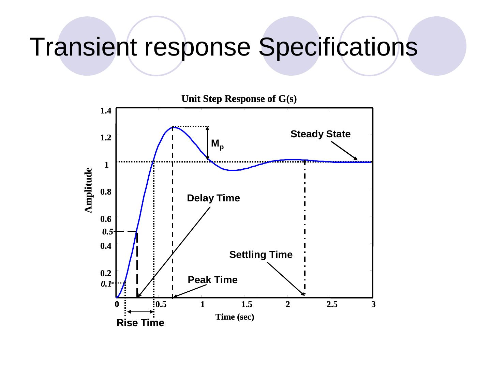

Bu yazı, EEM322 Denetim Sistemleri klasöründe "3723-lecture-18.ppt" adıyla saklanan **üçüncü taraf** bir sunumdur: **ECEN/MAE 3723 – Systems I** dersinin **MATLAB Lecture 3** slaytları (41 slayt). Sunumda kurum ya da hoca adı yazmıyor; dosya özelliklerine göre yazarı **"Luwang"**, tarihi **Ekim 2006**. Sunumun kendisi model oluşturma kısmının **http://techteach.no/publications/control_system_toolbox/** adresindeki materyalden alındığını belirtiyor. İçerik İngilizce olduğundan özgün dilinde aktarıldı; orijinal PowerPoint dosyası yazının sonunda indirilebilir.

*Bu içerik üçüncü taraf bir kaynağa aittir; arşiv ve nostalji amacıyla kaynak belirtilerek paylaşılmıştır. Hak sahibinin talebi hâlinde kaldırılır.*

Lecture overview: building models for LTI systems (continuous time and discrete time models), combining models, transient response analysis, frequency response analysis, stability analysis based on frequency response, other information.

## Building models for LTI systems

The Control System Toolbox supports continuous time and discrete time models of three types: transfer function, zero-pole-gain and state space.

### Continuous time models

**Transfer function** with `tf`, e.g. H(s) = (2s + 1)/(s² + 3s + 2):

```matlab
>> num = [2 1];
>> den = [1 3 2];
>> H = tf(num,den)
Transfer function:
   2 s + 1
-------------
s^2 + 3 s + 2
```

A delay is included with the `'inputdelay'` property; `H=tf(num,den,'inputdelay',2)` gives exp(−2s)·(2s + 1)/(s² + 3s + 2).

**Zero-pole-gain** with `zpk`:

```matlab
>> num = [-0.5];
>> den = [-1 -2];
>> k = 2;
>> H = zpk(num,den,k)
Zero/pole/gain:
 2 (s+0.5)
-----------
(s+1) (s+2)
```

**State space** model: ẋ = Ax + Bu, y = Cx + Du, where A is the state matrix, B the input matrix, C the output matrix and D the direct transmission matrix; x is the state vector, u the input vector and y the output vector (only for linear time invariant systems).

```matlab
>> A = [0 1;-5 -2];
>> B = [0;3];
>> C = [0 1];
>> D = [0];
>> sys = ss(A,B,C,D)
```

### Conversion between models

| From | To | MATLAB function |
| --- | --- | --- |
| Transfer function | Zero-pole-gain | `[z,p,k]=tf2zp(num,den)` |
| Transfer function | State space | `[A,B,C,D]=tf2ss(num,den)` |
| Zero-pole-gain | Transfer function | `[num,den]=zp2tf(z,p,k)` |
| Zero-pole-gain | State space | `[A,B,C,D]=zp2ss(z,p,k)` |
| State space | Transfer function | `[num,den]=ss2tf(A,B,C,D)` |
| State space | Zero-pole-gain | `[z,p,k]=ss2zp(A,B,C,D)` |

### Discrete time models

The same functions take a sampling time Ts as the last argument. With Ts = 0.4:

```matlab
>> H = tf([2 1],[1 3 2],0.4)      % (2z + 1)/(z^2 + 3z + 2), Sampling time: 0.4
>> H = zpk([-0.5],[-1 -2],2,0.4)  % 2(z+0.5)/((z+1)(z+2)), Sampling time: 0.4
>> sys = ss(A,B,C,D,0.4)
```

The discrete state space model is x[n + 1] = Ax[n] + Bu[n], y[n] = Cx[n] + Du[n], where n is the discrete time index.

*Not: Ayrık durum uzayı slaytındaki "MATLAB output" kutularından biri önceki slayttan kopyalanmış bir transfer fonksiyonu çıktısı gösteriyor; ss komutunun çıktısı yalnızca a, b, c, d matrisleri ve örnekleme zamanıdır.*

## Combining models

A model can be thought of as a block with inputs and outputs containing a transfer function or a state-space model. Basic block diagram manipulations:

| Combination | MATLAB command |
| --- | --- |
| G1 and G2 in series | `sys = series(G1,G2)` |
| G1 and G2 in parallel (summed) | `sys = parallel(G1,G2)` |
| G1 with G2 in the negative feedback path | `sys = feedback(G1,G2)` |
| Addition | `sys = G1+G2;` |
| Multiplication | `sys = G1*G2;` |
| Inversion | `sys = inv(G1);` |

## Transient response analysis

Transient response is the process from the initial state to the final state; it is used to investigate the time-domain characteristics of dynamic systems. Common responses are step, impulse and ramp responses. Example system: H(s) = 25/(s² + 4s + 25).

```matlab
num = [0 0 25]; den = [1 4 25];
t = 0:0.1:7;
step(num,den,t)        % unit step response
grid
title('Unit Step Response of H(s)')
```

 = 25/(s² + 4s + 25) birim basamak yanıtı")

Alternatively `H=tf(num,den); step(H)`, and for a step of height 10, `step(10*H)`. The impulse response is obtained in the same way with `impulse(num,den,t)`.

**Ramp response:** there is no ramp function in MATLAB. For a unit ramp U(s) = 1/s², Y(s) = (1/s²)·25/(s² + 4s + 25) = (1/s)·[25/(s(s² + 4s + 25))], i.e. the step response of the new H(s) = 25/(s(s² + 4s + 25)):

```matlab
num = [0 0 0 25]; den = [1 4 25 0];
t = 0:0.1:7;
y = step(num,den,t);
plot(t,y,'.',t,t,'b-')
grid
title('Unit Ramp Response Curve of H(s)')
```

## Frequency response analysis

In transient response analysis it can be hard to determine an accurate model (noise, limited input signal size). Alternatively, the frequency response approach characterizes how the system behaves in the frequency domain, and the frequency response can be adjusted by tuning parameters to obtain acceptable transient characteristics. A Bode diagram consists of the log-magnitude plot and the phase-angle plot (degrees):

```matlab
num = [0 0 25]; den = [1 4 25];
bode(num,den)
title('Bode plot of H(s)')
```

 = 25/(s² + 4s + 25) Bode diyagramı")

## Stability analysis based on frequency response

Stability can also be analysed with a Nyquist plot: it shows whether the system is stable, the degree of stability and how stability may be improved, based on the Nyquist stability criterion. Example for H(s) = 1/(s² + 0.8s + 1):

```matlab
num = [0 0 1];
den = [1 0.8 1];
nyquist(num,den)
grid
title('Nyquist Plot of H(s)')
```

## Other information and the design procedure

Use `help` to learn more about these functions and check the Control System Toolbox for others. The design procedure on the final slides: start from the system and the required design specifications, build a mathematical model, test the system with (1) transient response analysis and (2) frequency response analysis, check how stable or robust it is with stability analysis based on frequency response; if the requirements are satisfied, end; otherwise revisit the design (e.g. combine models).

Transient response specifications are read from the unit step response: delay time, rise time, peak time, maximum overshoot M_p and settling time. Frequency domain questions: What is the bandwidth of the system? What are the cutoff frequencies and the cutoff rate? Is the system sensitive to disturbance? How does the system behave in the frequency domain?


