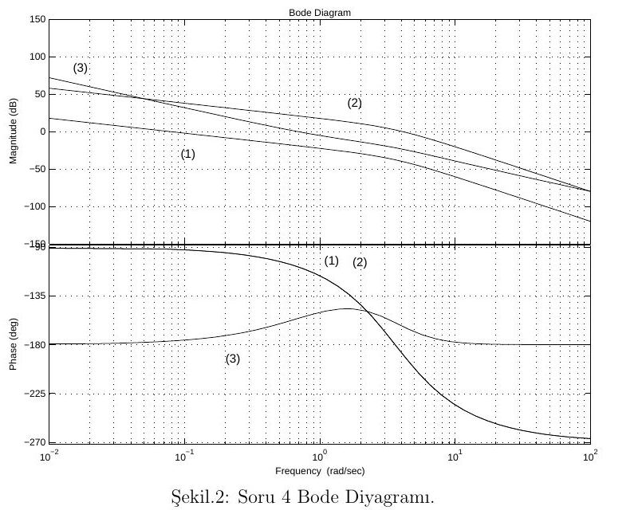

This post is a **third-party** exam paper kept in the "exams" section of the EEM322 Control Systems course folder: the **EEM719 Control Systems** course, **Fall 2007 Midterm #1** questions (duration 100 minutes). The course code does not belong to Başkent University; the document does not state at which university or by which instructor the exam was given. The PDF was prepared with LaTeX on **6 December 2007**. It was probably collected as an example while preparing for EEM322 exams. The questions have been transcribed, the figures have been added; the original PDF can be downloaded at the end of the post. The document does not contain a solution.

*This content belongs to a third-party source; it is shared for archival and nostalgic purposes with the source credited. It will be removed at the request of the rights holder.*

> State your comments in your answers and pay attention to neatness and organization. Show your results clearly.
> NOTE: For Mp = 5%, ξ ≅ 0.7 can be taken, and for Mp = 25%, ξ ≅ 0.4. GOOD LUCK...

The system in the questions is a **unity-feedback control system** with a controller C(s) and a plant G(s) in series in the forward path: R(s) → summing junction (−Y) → C(s) → G(s) → Y(s).

## Question 1 (30 points)

Answer the following questions.

1. What is the system type? Define it. (5 points)
1. What are root loci and Bode diagrams? For what purpose are they used in control systems? (10 points)
1. In a unity-feedback control system with a controller C(s) = K(s + 1)/(s + 2) and, in series with it, G(s) = 1/[s(s + 3)], find the position, velocity and acceleration error constants and determine the steady-state error. (15 points)

## Question 2 (25 points)

Write down the effects of adding zeros and poles to a dynamic system. Compare the maximum overshoot Mp, rise time and settling time of the systems whose transfer functions are given below, based on their unit step responses.

> H₁(s) = 12/[(s² + 3s + 4)(s + 3)],  H₂(s) = 4/(s² + 3s + 4)
> H₃(s) = 4(s + 4)/(s² + 3s + 16),  H₄(s) = 16/(s² + 3s + 16)

(H₁ is H₂ with an added pole; H₃ is H₄ with an added zero. All four have a DC gain of 1.)

## Question 3 (20 points)

The figure shows the root locus for the unity-feedback system with a proportional controller.

1. Based on the unit step response, what is the region in the s-plane where the poles of a system with the required Mp < 5%, t_r < 1.2 s and t_s < 3.6 s must lie? (10 points)
1. List the controller types and discuss their advantages over one another. Does the proportional controller satisfy the requirements? (10 points)

")

In the drawing on the left, the open-loop poles are at 0, −2 and −4, and the zero is at −3; two branches leave the real axis around −1 and rise along vertical asymptotes close to about −1.5. The empty grid of the same scale on the right is provided for drawing the required region.

## Question 4 (25 points)

The figure gives the Bode diagram of two open-loop systems. Considering these systems in a unity-feedback configuration, determine the system type and investigate the steady-state errors to a step input and the stability analysis by finding the gain margin (GM) and phase margin (PM) values.

*Note: The question text says "two open-loop systems", but the figure has three curves marked (1), (2) and (3). The phase of (1) and (2) starts at −90° (type 1), while the phase of (3) starts at −180° and its magnitude falls with a slope of −40 dB/decade (type 2).*
