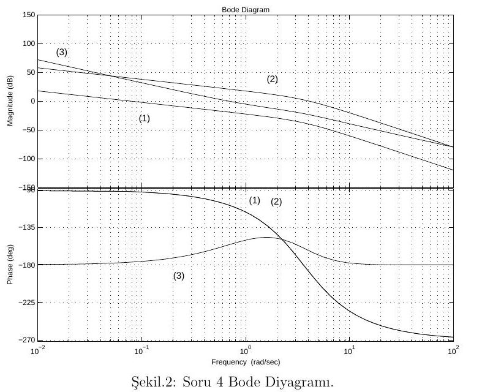

Bu yazı, EEM322 Denetim Sistemleri ders klasörünün "sınavlar" bölümünde saklanan **üçüncü taraf** bir sınav kâğıdıdır: **EEM719 Kontrol Sistemleri** dersinin **Güz 2007 Arasınav #1** soruları (süre 100 dakika). Ders kodu Başkent Üniversitesi'ne ait değil; sınavın hangi üniversitede ve hangi hoca tarafından verildiği belgede yazmıyor. PDF, LaTeX ile **6 Aralık 2007**'de hazırlanmış. Muhtemelen EEM322 sınavlarına hazırlanırken örnek olarak toplanmıştır. Sorular yazıya aktarıldı, şekiller eklendi; orijinal PDF yazının sonunda indirilebilir. Çözüm belgede yok.

*Bu içerik üçüncü taraf bir kaynağa aittir; arşiv ve nostalji amacıyla kaynak belirtilerek paylaşılmıştır. Hak sahibinin talebi hâlinde kaldırılır.*

> Cevaplarınızda yorumlarınızı belirtin ve tertip-düzene önem verin. Sonuçlarınızı açıkça gösterin.
> NOT: Mp = %5 için ξ ≅ 0.7 ve Mp = %25 için de ξ ≅ 0.4 alınabilir. BAŞARILAR...

Sorulardaki sistem, ileri yolda seri bağlı C(s) denetleyicisi ve G(s) süreci bulunan **birim geri beslemeli kontrol sistemi**dir: R(s) → toplama noktası (−Y) → C(s) → G(s) → Y(s).

## Soru 1 (30 puan)

Aşağıdaki soruları cevaplayınız.

1. Sistem tipi nedir, tanımlayınız? (5 puan)
1. Kök-yer eğrileri ve Bode diyagramları nedir? Kontrol sistemlerinde ne amaçla kullanılırlar? (10 puan)
1. Denetleyici C(s) = K(s + 1)/(s + 2) ve ona seri G(s) = 1/[s(s + 3)] olan birim geri beslemeli bir kontrol sisteminde konum, hız ve ivme hatası katsayılarını bularak kalıcı durum hatasını belirleyiniz. (15 puan)

## Soru 2 (25 puan)

Bir dinamik sisteme sıfır ve kutup eklemenin etkilerini yazınız. Transfer fonksiyonları aşağıda verilen sistemlerin birim basamak yanıtlarına göre en yüksek aşım Mp, yükselme ve yerleşme zamanlarını kıyaslayınız.

> H₁(s) = 12/[(s² + 3s + 4)(s + 3)],  H₂(s) = 4/(s² + 3s + 4)
> H₃(s) = 4(s + 4)/(s² + 3s + 16),  H₄(s) = 16/(s² + 3s + 16)

(H₁, H₂'ye bir kutup eklenmiş; H₃ ise H₄'e bir sıfır eklenmiş hâlidir. Dördünün de DC kazancı 1'dir.)

## Soru 3 (20 puan)

Şekilde birim geri beslemeli sistem için oransal denetleyici ile kök-yer eğrisi verilmiştir.

1. Birim basamak cevabına göre Mp < %5, t_r < 1.2 sn ve t_s < 3.6 sn olarak istenen bir sistemin kutuplarının yer alacağı s düzlemindeki bölge nedir? (10 puan)
1. Denetleyici türlerini sıralayarak birbirlerine üstünlüklerini tartışınız. Oransal denetleyici istenenleri sağlar mı? (10 puan)

")

Soldaki çizimde açık çevrim kutupları 0, −2 ve −4'te, sıfır −3'tedir; iki kol −1 civarında reel eksenden ayrılıp yaklaşık −1,5'e yakın düşey asimptotlar boyunca yükselir. Sağdaki aynı ölçekli boş ızgara, istenen bölgeyi çizmek için verilmiş.

## Soru 4 (25 puan)

Şekilde iki açık çevrim sistemin Bode diyagramı verilmektedir. Bu sistemleri birim geri beslemeli sistemde ele alırsak sistem tipini belirleyerek basamak girişe kalıcı durum hatalarını ve kararlılık analizini, kazanç sınırı (GM) ve faz sınırı (PM) değerlerini bularak araştırınız.

*Not: Soru metninde "iki açık-çevrim sistem" deniyor, ama şekilde (1), (2) ve (3) olarak işaretlenmiş üç eğri var. (1) ve (2)'nin fazı −90°'den başlıyor (tip 1), (3)'ün fazı ise −180°'den başlıyor ve genliği −40 dB/dekad eğimle iniyor (tip 2).*
