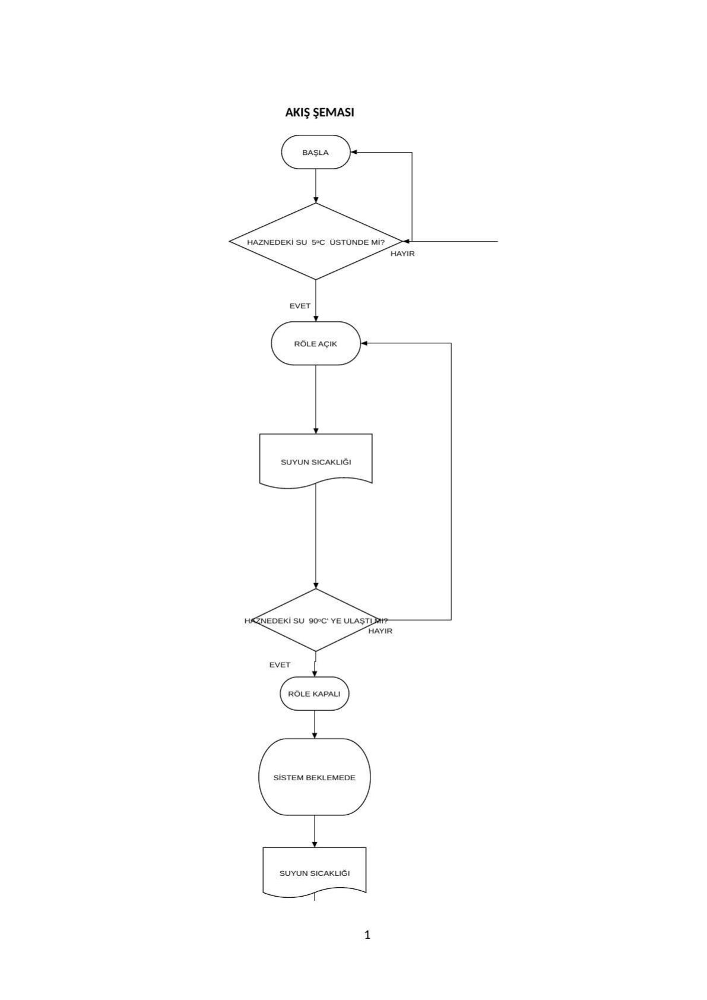
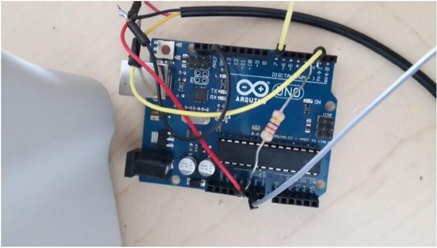
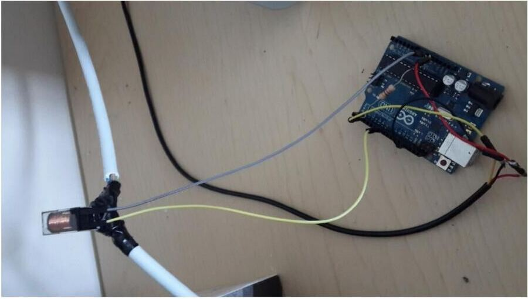
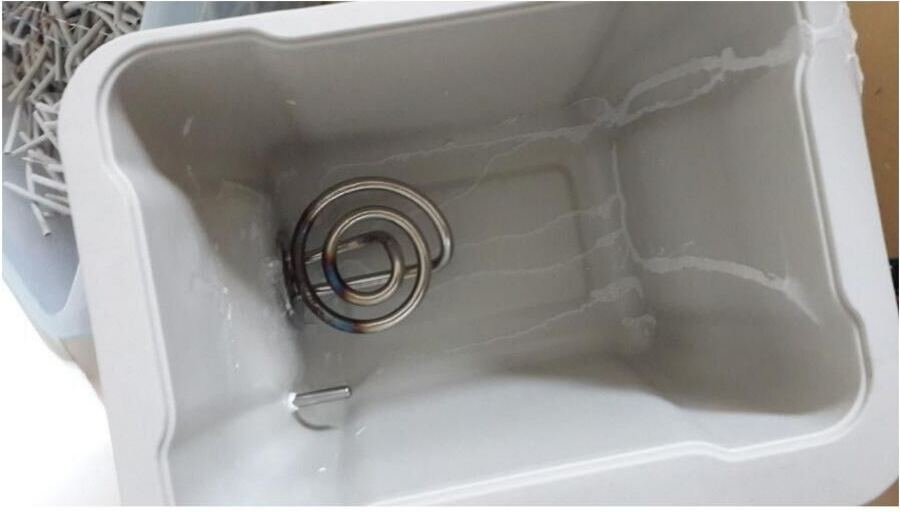
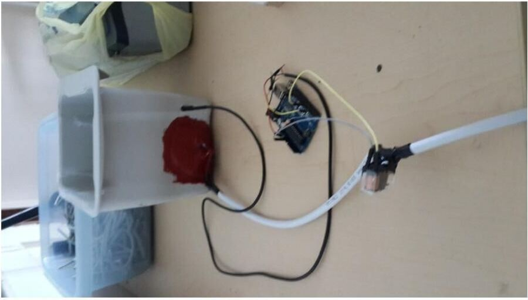

This post is the report of one of the projects from the spring 2015 semester of the **EEM322 Control Systems** course at Başkent University. According to the list announced on 11 March 2015 by the course instructor **Assoc. Prof. Dr. Mustafa Doğan**, the projects were prepared in groups and submitted on 15 May 2015 as a report, code, experiment and presentation. This report belongs to the **"Kettle Control"** project prepared by four friends (15/05/2015); the names and student numbers on the cover have been masked, and the manufacturer's datasheet at the end of the report (DS18B20 datasheet, APPENDIX-2) has been removed. The masked report can be downloaded as a PDF at the end of the post.

## Project description

With the kettle control project, the temperature of the water in the tank is measured and the water is kept at a set temperature for a period of time. The system is an example of **on-off control** that switches a 220 V heating element on and off through a relay, based on the measurement of a temperature sensor.



## Project components

- **Arduino UNO:** A type of Arduino with an ATmega328 processor. It has 14 digital input/output pins (6 of which can be used as PWM outputs), 6 analog inputs, a 16 MHz crystal oscillator, a USB connection, a 2.1 mm power jack, an ICSP header and a reset button. Connecting it to a DC 7–12 V supply is enough; it has 1 kB of EEPROM memory.
- **Heating element:** The general name for resistance wires that convert electrical energy into heat energy. It is resistant to high temperatures; it contains nickel, iron, chromium and aluminum alloys.
- **Temperature sensor (DS18B20 digital temperature sensor):** A waterproof digital sensor. Its operating voltage is 3.0–5.0 V; it can be read with 12 bits and can measure with 0.5 °C accuracy; its response time is shorter than 750 ms.
- **Relay:** An electrical switch that opens and closes another electrical circuit. When a suitable voltage is applied to its coil, the coil becomes magnetized and pulls the metal armature opposite it, connecting the contacts to each other.
- **Water tank:** A plastic container.
- **Jumpers and cables:** Male-to-female jumpers for connecting the sensor and relay to the Arduino.

*Note: The report states that the sensor measures "between −10 °C and 125 °C" with 0.5 °C accuracy. According to the DS18B20 datasheet, the measurement range is −55 °C to +125 °C, and the ±0.5 °C accuracy is valid between −10 °C and +85 °C.*

## How the project works

The temperature of the water placed in the tank is measured with the sensor. If the measured temperature is above 0 °C, the signal from the Arduino triggers the relay; the relay applies 220 V mains voltage to the heating element and starts heating the water. The temperature continues to be measured; when the water reaches 90 °C, the Arduino cuts the relay, the heating element turns off, and the word "Kaynama" (boiling) appears on the serial port monitor. The system puts itself on standby for a set time. When the time is up, the water temperature is measured again; if it is below 90 °C, the Arduino switches the relay on and the heating element heats the water again. In this way, the water in the tank is kept hot continuously.

## System modeling

### Software

The system software was written as an Arduino program. The **1-Wire** interface was used for the temperature sensor; the waiting times were implemented with `delay` commands.

### Hardware

The connections of the digital temperature sensor, the relay and the heating element were made. Thanks to the 1-Wire interface, the sensor communication used only a single data pin (digital pin 2), 5 V supply and ground (GND). For the relay, one digital output pin (digital pin 7) and GND were used. The wiring of the heating element was made to operate at 220 V; so that the heating element can be operated by the signal from the Arduino, the relay was connected to one of the phase lines coming from the mains. The relay closes with the signal from the Arduino and delivers 220 V to the heating element. The operations can be monitored from the serial port monitor in the Arduino program.

After the software and connections were completed, the tank was drilled, the heating element and sensor were placed inside the tank, insulation was applied and the 220 V cable was connected, making the system ready to operate.









## Simulation results (serial port monitor output)

The report gives the output taken from the serial port monitor while the system was running. The temperature first drops from around 82 °C to about 70 °C, then rises once the relay engages and reaches 91.25 °C; at this point the words "Kaynama" (boiling) and "Beklemede" (on standby) appear:

```
Sicaklik: 81.44
Sicaklik: 82.44
Sicaklik: 82.12
Sicaklik: 81.12
Sicaklik: 79.75
Sicaklik: 78.12
Sicaklik: 76.44
Sicaklik: 74.75
Sicaklik: 73.12
Sicaklik: 72.00
Sicaklik: 71.62
Sicaklik: 70.81
Sicaklik: 70.56
Sicaklik: 71.06
Sicaklik: 70.69
Sicaklik: 70.31
Sicaklik: 70.44
Sicaklik: 70.87
Sicaklik: 70.87
Sicaklik: 70.62
Sicaklik: 70.50
Sicaklik: 71.06
Sicaklik: 71.19
Sicaklik: 70.87
Sicaklik: 70.94
Sicaklik: 70.69
Sicaklik: 70.06
Sicaklik: 69.56
Sicaklik: 69.56
Sicaklik: 69.87
Sicaklik: 70.81
Sicaklik: 71.19
Sicaklik: 70.94
Sicaklik: 70.44
Sicaklik: 69.87
Sicaklik: 69.25
Sicaklik: 69.81
Sicaklik: 71.94
Sicaklik: 74.75
Sicaklik: 79.12
Sicaklik: 85.25
Sicaklik: 91.25
Sicaklik: 91.25
Kaynama
Beklemede
```

## Arduino code (APPENDIX-1)

```cpp
#include <OneWire.h> // We include the OneWire library.

// We set the digital pin to which we connected the temperature sensor as 2.
int DS18S20_Pin = 2; 

// Temperature Sensor Input-Output
OneWire ds(DS18S20_Pin);  // On digital pin 2.

// Pin 7 is assigned for the relay.
int role = 7;

void setup(void) {
  Serial.begin(9600); // We start the serial communication.
  pinMode(role,OUTPUT);
}

void loop(void) {
  // We bind the temperature variable to the function that gets the temperature value.
  float temperature = getTemp();
  // We print the temperature value from the sensor on the Serial monitor.
  Serial.print("Sicaklik: ");
  Serial.println(temperature);
  // We wait 1 second. The monitor will continue to print 1 temperature value per second.
  delay(1000);
  
   if(temperature > 0 && temperature <= 90) // if the temperature measured by the sensor is greater than 0 degrees and not greater than 90 degrees, we activate the relay.
  {
    digitalWrite(role,HIGH); // the relay was activated by setting the relevant pin HIGH.
  }
  
  if(temperature >= 91) // when the water temperature reaches 91 degrees, we keep the relay running for 10 more seconds.
  {
    digitalWrite(role,HIGH);
    Serial.print("Sicaklik: "); // the temperature value is printed on the serial monitor
    Serial.println(temperature);
    Serial.print("Kaynama\n");  // ''kaynama'' is printed on the serial monitor.
    delay(10000);
    
    digitalWrite(role,LOW);  // when the set time is over, we turn off the relay and put the system on standby
    Serial.print("Beklemede\n"); // ''beklemede'' is printed on the serial monitor.
    delay(60000);    
  }
}

//  **We convert the data from the sensor into temperature values in Celsius
float getTemp(){
  // we get the water temperature in Celsius from the sensor with this function

  byte data[12];
  byte addr[8];

  if ( !ds.search(addr)) {
      // we use a single sensor, at this point we reset the search
      ds.reset_search();
      return -1000;
  }

  if ( OneWire::crc8( addr, 7) != addr[7]) {
      Serial.println("CRC is not valid!");
      return -1000;
  }

  if ( addr[0] != 0x10 && addr[0] != 0x28) {
      Serial.print("Device is not recognized");
      return -1000;
  }

  ds.reset();
  ds.select(addr);
  ds.write(0x44,1); // 

  byte present = ds.reset();
  ds.select(addr);    
  ds.write(0xBE); // 

  for (int i = 0; i < 9; i++) { // 9 bytes will be used
    data[i] = ds.read();
  }

  ds.reset_search();

  byte MSB = data[1];
  byte LSB = data[0];

  float tempRead = ((MSB << 8) | LSB); // we take the two's complement 
  float TemperatureSum = tempRead / 16;

  return TemperatureSum;

}```

In the code, the `getTemp()` function searches for the sensor on the 1-Wire line, checks the CRC of the address and the device type (0x10 or 0x28), starts the temperature conversion with the 0x44 command, reads the 9-byte scratchpad with the 0xBE command, and returns the temperature in °C by dividing the raw value formed from the first two bytes by 16 (at the DS18B20's 12-bit resolution, 1 LSB = 0.0625 °C).

*Note: There are small differences between the code and the text and flowchart. In the flowchart the first condition is "is the water in the tank above 5 °C?", whereas in the code it is 0 °C. In the text the relay is cut at 90 °C; in the code the relay is kept on up to 90 °C, and when the temperature reaches 91 °C or above the relay is kept running for 10 more seconds, then switched off and the system waits for 60 seconds. For measurements between 90 and 91 °C no condition is met, so the relay keeps its previous state. In the first sentence of the report the project is written as "Cattle control"; the correct form is "Kettle (water heater) control".*
