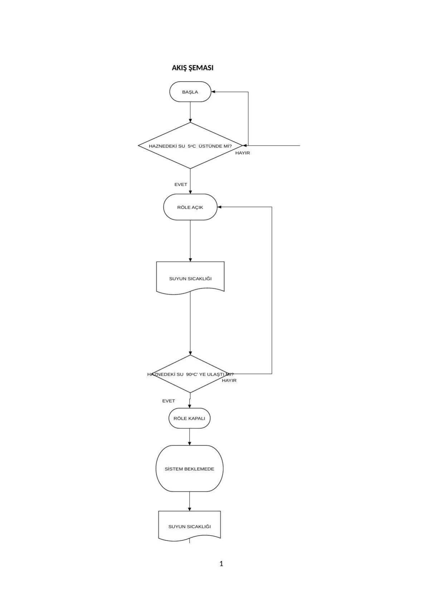
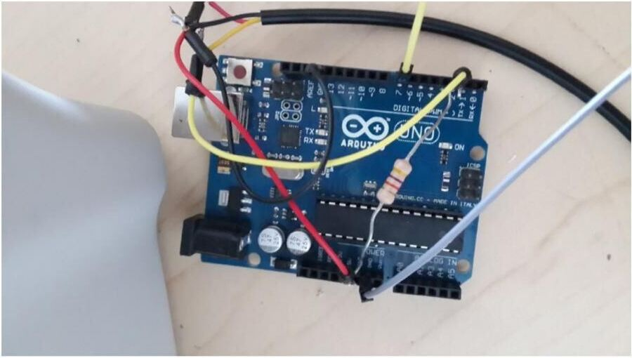
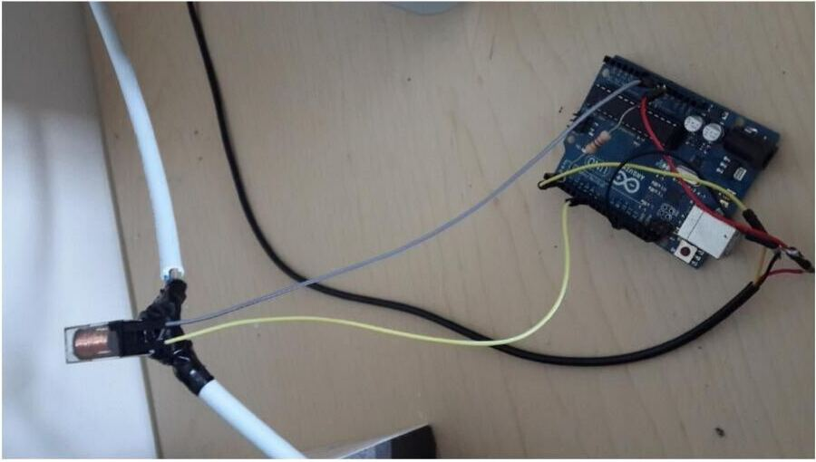
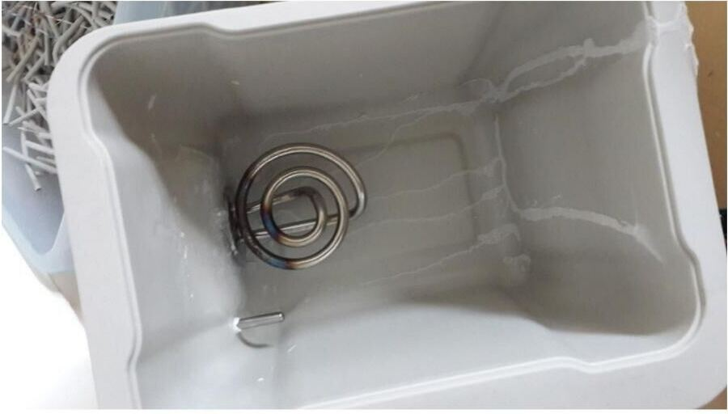
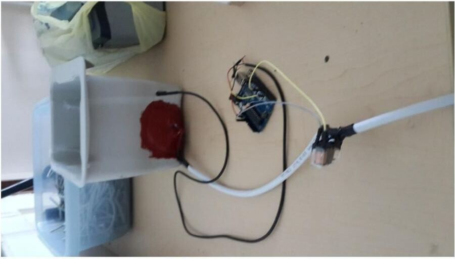

Bu yazı, Başkent Üniversitesi **EEM322 Denetim Sistemleri** dersinin 2015 bahar dönemi projelerinden birinin raporudur. Projeler dersin öğretim üyesi **Doç. Dr. Mustafa Doğan**'ın 11 Mart 2015'te açıkladığı listeye göre gruplar hâlinde hazırlanıp 15 Mayıs 2015'te rapor, kod, deney ve sunum olarak teslim edilmişti. Bu rapor, dört arkadaşın hazırladığı **"Kettle Kontrol"** projesine ait (15/05/2015); kapaktaki ad ve öğrenci numaraları kapatıldı, raporun sonundaki üretici veri sayfası (DS18B20 datasheet, EK-2) çıkarıldı. Maskelenmiş rapor PDF olarak yazının sonunda indirilebilir.

## Projenin tanımı

Kettle kontrol projesiyle haznedeki suyun sıcaklığı ölçülüyor ve su belirlenen sıcaklıkta bir süre tutuluyor. Sistem, bir sıcaklık sensörünün ölçümüne göre bir röle üzerinden 220 V'luk bir rezistansı açıp kapatan **aç-kapa (on-off) denetim** örneğidir.



## Proje elemanları

- **Arduino UNO:** ATmega328 işlemcili Arduino çeşidi. 14 dijital giriş/çıkış pini (6'sı PWM çıkışı olarak kullanılabilir), 6 analog giriş, 16 MHz kristal osilatör, USB bağlantısı, 2.1 mm güç girişi, ICSP başlığı ve reset butonu var. DC 7–12 V'luk bir kaynağa bağlamak yeterli; 1 kB EEPROM hafızası var.
- **Rezistans:** Elektrik enerjisini ısı enerjisine dönüştüren direnç tellerine verilen genel ad. Yüksek sıcaklıklara dayanıklıdır; içinde nikel, demir, krom ve alüminyum alaşımları bulunur.
- **Sıcaklık sensörü (DS18B20 dijital sıcaklık sensörü):** Su geçirmez dijital sensör. Çalışma gerilimi 3.0–5.0 V; 12 bitlik okuma yapılabiliyor, 0.5 °C hassasiyetle ölçüm yapabiliyor; tepki süresi 750 ms'den kısa.
- **Röle:** Başka bir elektrik devresini açıp kapatan elektriksel anahtar. Bobinine uygun gerilim uygulandığında bobin mıknatıslanır, karşısındaki metal paleti çekerek kontakları birbirine bağlar.
- **Su haznesi:** Plastik bir kap.
- **Jumper ve kablolar:** Sensör ve röleyi Arduino'ya bağlamak için erkek-dişi jumper'lar.

*Not: Raporda sensörün "−10 °C ile 125 °C arasında" 0.5 °C hassasiyetle ölçüm yaptığı yazıyor. DS18B20 veri sayfasına göre ölçüm aralığı −55 °C ile +125 °C, ±0.5 °C doğruluk ise −10 °C ile +85 °C arasında geçerlidir.*

## Projenin işleyişi

Hazneye konan suyun sıcaklığı sensörle ölçülür. Ölçülen sıcaklık 0 °C'nin üstündeyse Arduino'dan gelen sinyal röleyi tetikler; röle 220 V şehir şebekesini rezistansa vererek suyu ısıtmaya başlar. Sıcaklık ölçülmeye devam eder; su 90 °C'ye ulaştığında Arduino röleyi keser, rezistans kapanır ve seri port ekranında "Kaynama" yazısı görülür. Sistem belirlenen süre kadar kendini beklemeye alır. Süre bitince suyun sıcaklığı yeniden ölçülür; 90 °C'nin altındaysa Arduino röleyi açar ve rezistans suyu yeniden ısıtır. Böylece haznedeki su sürekli sıcak tutulur.

## Sistem modelleme

### Yazılım

Sistem yazılımı Arduino programıyla yazıldı. Sıcaklık sensörü için **1-Wire** arayüzü kullanıldı; bekleme süreleri `delay` komutlarıyla gerçekleştirildi.

### Donanım

Dijital sıcaklık sensörü, röle ve rezistansın bağlantıları yapıldı. Sensör için 1-Wire arayüzü sayesinde haberleşmede tek bir veri pini (dijital pin 2), 5 V besleme ve toprak (GND) kullanıldı. Röle için bir dijital çıkış pini (dijital pin 7) ve GND kullanıldı. Rezistansın kablo bağlantıları 220 V ile çalışacak şekilde yapıldı; Arduino'dan gelen sinyalle rezistansın çalışabilmesi için şebekeden gelen fazlardan birine röle bağlandı. Röle Arduino'dan gelen sinyalle kapanıp 220 V'u rezistansa iletiyor. İşlemler Arduino programındaki seri port ekranından izlenebiliyor.

Yazılım ve bağlantılar tamamlandıktan sonra hazne delinerek rezistans ve sensör haznenin içine yerleştirildi; yalıtım yapılıp 220 V kablosu çekilerek sistem çalışmaya hazır hâle getirildi.









## Benzetim sonuçları (seri port ekran çıktısı)

Raporda sistemin çalışması sırasında seri port ekranından alınan çıktı veriliyor. Sıcaklık önce 82 °C civarından yaklaşık 70 °C'ye kadar düşüyor, ardından röle devreye girince yükselip 91.25 °C'ye ulaşıyor; bu noktada "Kaynama" ve "Beklemede" yazıları görülüyor:

```
Sicaklik: 81.44
Sicaklik: 82.44
Sicaklik: 82.12
Sicaklik: 81.12
Sicaklik: 79.75
Sicaklik: 78.12
Sicaklik: 76.44
Sicaklik: 74.75
Sicaklik: 73.12
Sicaklik: 72.00
Sicaklik: 71.62
Sicaklik: 70.81
Sicaklik: 70.56
Sicaklik: 71.06
Sicaklik: 70.69
Sicaklik: 70.31
Sicaklik: 70.44
Sicaklik: 70.87
Sicaklik: 70.87
Sicaklik: 70.62
Sicaklik: 70.50
Sicaklik: 71.06
Sicaklik: 71.19
Sicaklik: 70.87
Sicaklik: 70.94
Sicaklik: 70.69
Sicaklik: 70.06
Sicaklik: 69.56
Sicaklik: 69.56
Sicaklik: 69.87
Sicaklik: 70.81
Sicaklik: 71.19
Sicaklik: 70.94
Sicaklik: 70.44
Sicaklik: 69.87
Sicaklik: 69.25
Sicaklik: 69.81
Sicaklik: 71.94
Sicaklik: 74.75
Sicaklik: 79.12
Sicaklik: 85.25
Sicaklik: 91.25
Sicaklik: 91.25
Kaynama
Beklemede
```

## Arduino kodu (EK-1)

```cpp
#include <OneWire.h> // OneWire kütüphanesini ekliyoruz.

// Sıcaklık sensörünü bağladığımız dijital pini 2 olarak belirliyoruz.
int DS18S20_Pin = 2; 

// Sıcaklık Sensörü Giriş-Çıkışı
OneWire ds(DS18S20_Pin);  // 2. Dijital pinde.

// Role için 7 numaralı pin belirlenmiştir.
int role = 7;

void setup(void) {
  Serial.begin(9600); // Seri iletişimi başlatıyoruz.
  pinMode(role,OUTPUT);
}

void loop(void) {
  // temperature değişkenini sıcaklık değerini alma fonksiyonuna bağlıyoruz.
  float temperature = getTemp();
  // Sensörden gelen sıcaklık değerini Serial monitörde yazdırıyoruz.
  Serial.print("Sicaklik: ");
  Serial.println(temperature);
  // 1 saniye bekliyoruz. Monitörde saniyede 1 sıcaklık değeri yazmaya devam edecek.
  delay(1000);
  
   if(temperature > 0 && temperature <= 90) // sensörden ölçülen sıcaklık 0 dereceden büyük 90 dereceden küçükse röleyi aktifleştiriyoruz.
  {
    digitalWrite(role,HIGH); // ilgili pin HIGH yapılarak röle aktifleştirildi.
  }
  
  if(temperature >= 91) // suyun sıcaklığı 91 dereceye ulaştığında röleyi 10 saniye daha çalıştırıyoruz.
  {
    digitalWrite(role,HIGH);
    Serial.print("Sicaklik: "); // serial monitörde sıcaklık değeri yazdırılıyor
    Serial.println(temperature);
    Serial.print("Kaynama\n");  // serial monitorde ''kaynama'' yazdırılıyor.
    delay(10000);
    
    digitalWrite(role,LOW);  // belirlenen süre bittiğinde röleyi kapatarak sistemi beklemeye alıyoruz
    Serial.print("Beklemede\n"); // serial monitorde ''beklemede'' yazdırılıyor.
    delay(60000);    
  }
}

//  **Sensörden gelen verileri Celcius cinsinden sıcaklık değerlerine çeviriyoruz
float getTemp(){
  // suyun sıcaklığını Celcius cinsinden sensörden bu fonksiyonla alıyoruz

  byte data[12];
  byte addr[8];

  if ( !ds.search(addr)) {
      // tek sensör kullanıyoruz bu noktada aramayı resetliyoruz
      ds.reset_search();
      return -1000;
  }

  if ( OneWire::crc8( addr, 7) != addr[7]) {
      Serial.println("CRC is not valid!");
      return -1000;
  }

  if ( addr[0] != 0x10 && addr[0] != 0x28) {
      Serial.print("Device is not recognized");
      return -1000;
  }

  ds.reset();
  ds.select(addr);
  ds.write(0x44,1); // 

  byte present = ds.reset();
  ds.select(addr);    
  ds.write(0xBE); // 

  for (int i = 0; i < 9; i++) { // 9 byte kullanılacak
    data[i] = ds.read();
  }

  ds.reset_search();

  byte MSB = data[1];
  byte LSB = data[0];

  float tempRead = ((MSB << 8) | LSB); // iki komplimentini alıyoruz 
  float TemperatureSum = tempRead / 16;

  return TemperatureSum;

}```

Kodda `getTemp()` fonksiyonu 1-Wire hattındaki sensörü arar, adresin CRC'sini ve aygıt türünü (0x10 ya da 0x28) denetler, 0x44 komutuyla sıcaklık dönüşümünü başlatır, 0xBE komutuyla 9 baytlık scratchpad'i okur ve ilk iki bayttan oluşan ham değeri 16'ya bölerek °C cinsinden sıcaklığı döndürür (DS18B20'nin 12 bit çözünürlüğünde 1 LSB = 0.0625 °C).

*Not: Kod ile metin ve akış şeması arasında küçük farklar var. Akış şemasında ilk koşul "haznedeki su 5 °C üstünde mi?", kodda ise 0 °C'dir. Metinde röle 90 °C'de kesiliyor; kodda ise röle 90 °C'ye kadar açık tutuluyor, sıcaklık 91 °C ve üstüne çıkınca röle 10 saniye daha çalıştırılıp sonra kapatılıyor ve sistem 60 saniye bekliyor. 90 ile 91 °C arasındaki ölçümlerde hiçbir koşul sağlanmadığından röle önceki durumunu koruyor. Raporun ilk cümlesinde proje "Cattle kontrol" diye yazılmış; doğrusu "Kettle (su ısıtıcı) kontrol"dür.*
