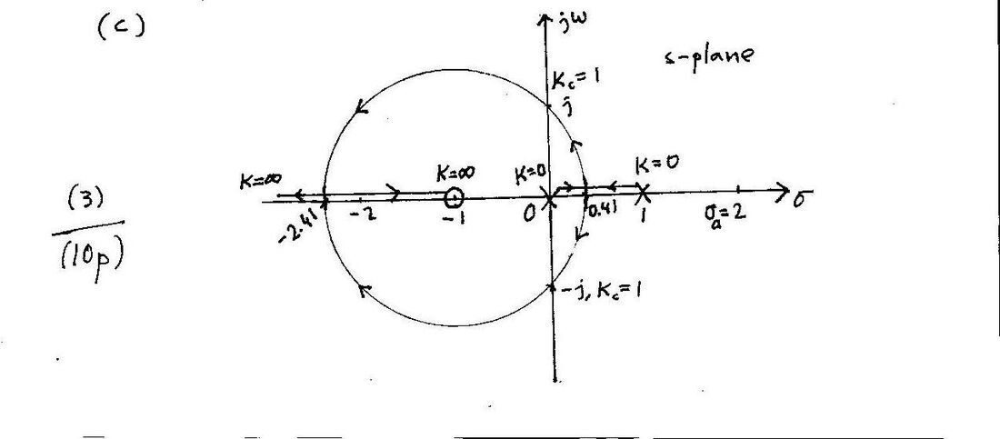

This post collects **quiz questions and solution keys** from different years of the **EEM322 Control Systems** course at Başkent University. The questions and handwritten solutions were prepared by the course instructor **Prof. Dr. Alper Uraz**. The 2004–2005 spring semester exams are in English, the 2007–2008 and 2012 exams are in Turkish; the solutions are in English. The numbers to the left of the solutions are step points; each quiz is worth 10 points.

The scanned solution keys (2004–2005 Quiz 3 and an undated "KS3" solution) can be downloaded as a ZIP at the end of the post. 2004–2005 Quiz 1, 2007–2008 Quiz 3 and 2012 Quiz 3 were **transcribed from photographed pages**; the photographs were not published, and student names and numbers were removed.

## 2004–2005 Quiz 1 (18.03.2005, 20 minutes): Field-controlled DC servo motor

**Question:** A field-controlled DC servo motor delivers a torque T to a load with moment of inertia J and rotational viscous friction B. The field circuit has resistance Rf and inductance Lf, voltage ef and current if; the armature circuit has resistance Ra and a constant armature current (ia = constant). Write all the mathematical relations (in the time domain); find the transfer function between the angular position of the load θ(s) and the applied input voltage Ef(s). Draw the detailed block diagram.

**Solution:**

| Time domain | s domain (with zero initial conditions) |
|---|---|
| Lf·dif/dt + Rf·if = ef | (Lf·s + Rf)·If(s) = Ef(s) |
| T = K₂·if | T(s) = K₂·If(s) |
| J·d²θ/dt² + B·dθ/dt = T | (J·s² + B·s)·θ(s) = K₂·If(s) |

Transfer function:

> θ(s)/Ef(s) = K₂ / [s(Lf·s + Rf)(J·s + B)] = Km / [s(Tf·s + 1)(Tm·s + 1)]

where Km = K₂/(Rf·B), Tf = Lf/Rf (field time constant), Tm = J/B (mechanical time constant).

Block diagram: Ef(s) → [1/(Lf·s + Rf)] → If(s) → [K₂/(s(J·s + B))] → θ(s).

## 2004–2005 Quiz 3 (23.05.2005, 30 minutes): Bode plots for two gains

**Question:** In a unity-feedback system, G(s) = K / [s(s + 1)(s + 4)]. Using the straight-line approximation, draw the Bode plots for K₁ = 8 and K₂ = 40 (10 dB/cm on the magnitude plot, 45°/cm on the phase plot). Show the gain and phase crossover frequencies and the gain and phase margins on the diagram and read off their approximate values. Discuss the closed-loop stability for both values of K.

**Solution:**

1. For K₁ = 8, time-constant form: G(s) = 2 / [s(1 + s)(1 + s/4)], G(jω) = 2 / [jω(1 + jω)(1 + jω/4)] = M∠φ. The corner frequencies are 1 and 4 rad/s.
1. 20 log M = 20 log 2 − 20 log ω − 20 log √(1 + ω²) − 20 log √(1 + ω²/16)
1. φ = −90° − tan⁻¹ω − tan⁻¹(0.25ω)
1. From the diagrams (K₁ = 8): gain crossover frequency ωg = 1.4 rad/s, phase crossover frequency ωp = 2 rad/s; gain margin gm = 6 dB, phase margin pm = 14°.
1. For K₂ = 40 the phase curve does not change (ωp = 2). The magnitude curve shifts up by 20 log 10 − 20 log 2 = 14 dB: the new ωg′ = 3.2 rad/s, gm′ = −8 dB, pm′ = −18°.
1. The closed-loop system is **stable for K₁ = 8 and unstable for K₂ = 40**.

: Bode plots for two gain values")

*Note: The values were read from the asymptotic diagram. By exact calculation, |G| = 0.4 at ωp = 2 rad/s, so for K = 8 gm ≈ 8 dB, ωg ≈ 1.22 rad/s and pm ≈ 22°; for K = 40, gm ≈ −6 dB. The stability conclusion is the same (by Routh, the critical gain is K = 20).*

## Undated "KS3" solution key: Root locus with an open-loop unstable pole

The same scan was present as a copy in two separate folders ("control 2" and "denetim"). There is no question sheet; from the solution it is understood that the system is G(s) = K(s + 1) / [s(s − 1)].

1. **(a)** Closed-loop characteristic equation: Δ(s) = s(s − 1) + K(s + 1) = s² + (K − 1)s + K = 0. Routh table: s²: 1, K; s¹: K − 1; s⁰: K ⇒ the closed loop is **stable for K > 1**. Critical gain Kc = 1; auxiliary equation s² + 1 = 0 ⇒ s₁,₂ = ±j.
1. **(b)** The open-loop poles are 0 and 1 (n = 2), the zero is −1 (m = 1) ⇒ number of asymptotes n − m = 1. Asymptote centroid σa = (Σpi − Σzi)/(n − m) = (1 − (−1))/1 = 2, angle θk = (2k + 1)π/(n − m) = π.
1. Breakaway points: K = −s(s − 1)/(s + 1) ⇒ dK/ds = −[(2s − 1)(s + 1) − (s² − s)]/(s + 1)² = 0 ⇒ s² + 2s − 1 = 0 ⇒ roots −2.41 and 0.41.
1. **(c)** Root locus: the branches start at the poles at 0 and 1 (K = 0), leave the real axis at 0.41, cross the imaginary axis at ±j for Kc = 1, return to the real axis at −2.41 along a circle centered at −1; one goes to the zero at −1, the other to −∞ (K = ∞).

## 2007–2008 Quiz 3 (01.05.2008): Root locus of a fourth-order system

In the photograph of this paper, only the question and the beginning of the student's solution are legible.

**Question (from the Turkish original):** The open-loop transfer function (OLTF) of a unity-feedback control system is given as

> G(s) = K / [s(s + 1)(s + 3)(s + 4)]

- (a) Using the closed-loop characteristic equation (CLCE), examine the closed-loop stability for all values of K; find the critical value of K and the critical points.
- (b) Give and use the formulas for the centroid and angles of the asymptotes. Calculate the possible breakaway points for sketching the root locus. One of the roots of (dK/ds), −2, is not a breakaway point.
- (c) Sketch the root locus for 0 ≤ K < ∞, indicating all details.

The student's solution begins by expanding the characteristic equation: Δ(s) = K + s(s + 1)(s + 3)(s + 4) = K + (s³ + 3s² + s² + 3s)(s + 4) = K + s⁴ + 8s³ + 19s² + 12s = 0. At the top corner of the paper, the asymptote formulas are visible (σ = (Σpj − Σzi)/(n − m), θk = (2k + 1)π/(n − m)).

*Note: The photograph does not show the rest of the solution; for checking, the computed results are: from the Routh table, the closed loop is stable for 0 < K < 26.25, the critical gain is Kc = 26.25 and the critical points are s = ±j1.22; the asymptote centroid is σa = (0 − 1 − 3 − 4)/4 = −2, with angles ±45° and ±135°; the roots of dK/ds = 0 are −2, −0.42 and −3.58, and the breakaway points are −0.42 and −3.58 (−2 is not a breakaway point because it is not on the root locus on the real axis).*

## 2012 Quiz 3: System with a zero and an unstable pole

**Question (from the Turkish original):** The open-loop transfer function (OLTF) of a unity-feedback control system is given as G(s) = K(s + 2) / [(s + 1)(s − 1)]. (a) Using the CLCE, examine the closed-loop stability for all values of K; find the critical value of K and the critical points. (b) Give and use the formulas for the centroid and angles of the asymptotes; calculate the possible breakaway points. (c) Sketch the root locus for 0 ≤ K < ∞, indicating all details.

**Solution key:**

1. **(a)** Δ(s) = s² − 1 + K(s + 2) = s² + Ks + 2K − 1 = 0. Routh table: s²: 1, 2K − 1; s¹: K; s⁰: 2K − 1 ⇒ the closed loop is **stable for K > 1/2**. Kc = 0.5 ⇒ s² + 0.5s = 0 ⇒ critical point s₁ = 0.
1. **(b)** The open-loop poles are −1 and 1 (n = 2), the zero is −2 (m = 1) ⇒ one asymptote. Centroid σa = (1 − 1 − (−2))/1 = 2, angle θk = (2k + 1)π/(n − m) = π.
1. Breakaway points: K = (1 − s²)/(s + 2) ⇒ dK/ds = [−2s(s + 2) − (1 − s²)]/(s + 2)² = 0 ⇒ s² + 4s + 1 = 0 ⇒ roots −0.27 and −3.73.
1. **(c)** The root locus draws a circle around the zero at −2, leaving the real axis at −0.27 and returning to it at −3.73.

On one student paper from the same exam, Δ(s) = (s + 1)(s − 1) + K(s + 2) = s² + Ks + 2K − 1 was also written, and Kc = 1/2 was found from the Routh table; the asymptote angles were calculated with θk = (2k + 1)π/(n − m) for k = 0 and k = 1 as 180° and 540° (i.e., again 180°).
