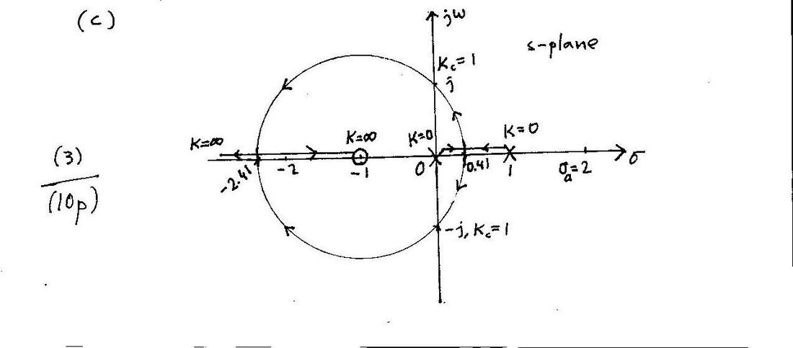

Bu yazı, Başkent Üniversitesi **EEM322 Denetim Sistemleri** dersinin farklı yıllardan kalma **kısa sınav (quiz) soru ve çözüm anahtarlarını** bir araya getiriyor. Soruları ve el yazısı çözümleri dersin öğretim üyesi **Prof. Dr. Alper Uraz** hazırlamış. 2004–2005 bahar dönemi sınavları İngilizce, 2007–2008 ve 2012 sınavları Türkçe; çözümler İngilizce. Çözümlerin solundaki sayılar adım puanları, her sınav 10 puan.

Taranmış çözüm anahtarları (2004–2005 Kısa Sınav 3 ve tarihsiz bir "KS3" çözümü) yazının sonunda ZIP olarak indirilebilir. 2004–2005 Kısa Sınav 1, 2007–2008 Kısa Sınav 3 ve 2012 Kısa Sınav 3 ise **fotoğraflanmış sayfalardan metne aktarıldı**; fotoğraflar yayınlanmadı, öğrenci adları ve numaraları çıkarıldı.

## 2004–2005 Kısa Sınav 1 (18.03.2005, 20 dakika): Alan kontrollü DC servo motor

**Soru:** Alan (field) kontrollü bir DC servo motor, eylemsizlik momenti J ve dönel viskoz sürtünmesi B olan bir yüke T torku iletmektedir. Alan devresinde Rf direnci ve Lf endüktansı, ef gerilimi ve if akımı; endüvi devresinde Ra direnci ve sabit endüvi akımı (ia = sabit) var. Bütün matematiksel bağıntıları (zaman bölgesinde) yazın; yükün açısal konumu θ(s) ile uygulanan giriş gerilimi Ef(s) arasındaki transfer fonksiyonunu bulun. Ayrıntılı blok diyagramını çizin.

**Çözüm:**

| Zaman bölgesi | s bölgesi (sıfır başlangıç koşullarıyla) |
|---|---|
| Lf·dif/dt + Rf·if = ef | (Lf·s + Rf)·If(s) = Ef(s) |
| T = K₂·if | T(s) = K₂·If(s) |
| J·d²θ/dt² + B·dθ/dt = T | (J·s² + B·s)·θ(s) = K₂·If(s) |

Transfer fonksiyonu:

> θ(s)/Ef(s) = K₂ / [s(Lf·s + Rf)(J·s + B)] = Km / [s(Tf·s + 1)(Tm·s + 1)]

burada Km = K₂/(Rf·B), Tf = Lf/Rf (alan zaman sabiti), Tm = J/B (mekanik zaman sabiti).

Blok diyagramı: Ef(s) → [1/(Lf·s + Rf)] → If(s) → [K₂/(s(J·s + B))] → θ(s).

## 2004–2005 Kısa Sınav 3 (23.05.2005, 30 dakika): İki kazanç için Bode çizimi

**Soru:** Birim geri beslemeli sistemde G(s) = K / [s(s + 1)(s + 4)]. Düz çizgi yaklaşımıyla K₁ = 8 ve K₂ = 40 için Bode diyagramlarını çizin (genlikte 10 dB/cm, fazda 45°/cm). Kazanç ve faz kesim frekanslarını, kazanç ve faz paylarını diyagramda gösterip yaklaşık değerlerini okuyun. Her iki K değeri için kapalı döngü kararlılığını tartışın.

**Çözüm:**

1. K₁ = 8 için zaman sabiti biçimi: G(s) = 2 / [s(1 + s)(1 + s/4)], G(jω) = 2 / [jω(1 + jω)(1 + jω/4)] = M∠φ. Köşe frekansları 1 ve 4 rad/s.
1. 20 log M = 20 log 2 − 20 log ω − 20 log √(1 + ω²) − 20 log √(1 + ω²/16)
1. φ = −90° − tan⁻¹ω − tan⁻¹(0.25ω)
1. Diyagramlardan (K₁ = 8): kazanç kesim frekansı ωg = 1.4 rad/s, faz kesim frekansı ωp = 2 rad/s; kazanç payı gm = 6 dB, faz payı pm = 14°.
1. K₂ = 40 için faz eğrisi değişmez (ωp = 2). Genlik eğrisi 20 log 10 − 20 log 2 = 14 dB yukarı kayar: yeni ωg′ = 3.2 rad/s, gm′ = −8 dB, pm′ = −18°.
1. Kapalı döngü sistem **K₁ = 8 için kararlı, K₂ = 40 için kararsızdır**.

: iki kazanç değeri için Bode diyagramı")

*Not: Değerler asimptot diyagramından okunmuştur. Tam hesapla ωp = 2 rad/s'de |G| = 0.4 olduğundan K = 8 için gm ≈ 8 dB, ωg ≈ 1.22 rad/s ve pm ≈ 22°; K = 40 için gm ≈ −6 dB'dir. Kararlılık sonucu aynıdır (Routh ile kritik kazanç K = 20).*

## Tarihsiz "KS3" çözüm anahtarı: Açık döngüde kararsız kutuplu kök yer eğrisi

Aynı tarama iki ayrı klasörde ("control 2" ve "denetim") birer kopya hâlinde duruyordu. Soru kâğıdı yok; çözümden sistemin G(s) = K(s + 1) / [s(s − 1)] olduğu anlaşılıyor.

1. **(a)** Kapalı döngü karakteristik denklemi: Δ(s) = s(s − 1) + K(s + 1) = s² + (K − 1)s + K = 0. Routh tablosu: s²: 1, K; s¹: K − 1; s⁰: K ⇒ kapalı döngü **K > 1 için kararlı**. Kritik kazanç Kc = 1; yardımcı denklem s² + 1 = 0 ⇒ s₁,₂ = ±j.
1. **(b)** Açık döngü kutupları 0 ve 1 (n = 2), sıfırı −1 (m = 1) ⇒ asimptot sayısı n − m = 1. Asimptot merkezi σa = (Σpi − Σzi)/(n − m) = (1 − (−1))/1 = 2, açısı θk = (2k + 1)π/(n − m) = π.
1. Ayrılma noktaları: K = −s(s − 1)/(s + 1) ⇒ dK/ds = −[(2s − 1)(s + 1) − (s² − s)]/(s + 1)² = 0 ⇒ s² + 2s − 1 = 0 ⇒ kökler −2.41 ve 0.41.
1. **(c)** Kök yer eğrisi: kollar 0 ve 1'deki kutuplardan (K = 0) çıkıp 0.41'de gerçek eksenden ayrılıyor, Kc = 1'de sanal ekseni ±j'de kesiyor, −1 merkezli bir çember üzerinden −2.41'de gerçek eksene dönüyor; biri −1'deki sıfıra, diğeri −∞'a (K = ∞) gidiyor.

## 2007–2008 Kısa Sınav 3 (01.05.2008): Dördüncü dereceden sistemin kök yer eğrisi

Bu kâğıdın fotoğrafında yalnız soru ve öğrencinin çözümünün başı okunabiliyor.

**Soru (Türkçe aslından):** Birim geribeslemeli bir denetim sisteminin açık döngü aktarım işlevi (OLTF)

> G(s) = K / [s(s + 1)(s + 3)(s + 4)]

olarak verilmiştir.

- (a) Kapalı döngü karakteristik denklemden (CLCE) yararlanarak K'nın tüm değerleri için kapalı döngü kararlılığını irdeleyiniz; kritik K değerini ve kritik noktaları bulunuz.
- (b) Asimtotların merkezi (centroid) ve açıları için kullanılan formülleri veriniz ve kullanınız. Kökyereğrisi (root-locus) çiziminde olası ayrılma (breakaway) noktalarını hesaplayınız. (dK/ds)'nin köklerinden biri olan −2 ayrılma noktası değildir.
- (c) 0 ≤ K < ∞ aralığı için tüm ayrıntıları belirterek kökyereğrisini çiziniz.

Öğrencinin çözümü karakteristik denklemi açarak başlıyor: Δ(s) = K + s(s + 1)(s + 3)(s + 4) = K + (s³ + 3s² + s² + 3s)(s + 4) = K + s⁴ + 8s³ + 19s² + 12s = 0. Kâğıdın üst köşesinde asimptot formülleri (σ = (Σpj − Σzi)/(n − m), θk = (2k + 1)π/(n − m)) görülüyor.

*Not: Fotoğrafta çözümün devamı yok; kontrol için hesaplanan sonuçlar: Routh tablosundan kapalı döngü 0 < K < 26.25 için kararlı, kritik kazanç Kc = 26.25 ve kritik noktalar s = ±j1.22; asimptot merkezi σa = (0 − 1 − 3 − 4)/4 = −2, açıları ±45° ve ±135°; dK/ds = 0 denkleminin kökleri −2, −0.42 ve −3.58 olup ayrılma noktaları −0.42 ve −3.58'dir (−2 gerçek eksende kök yer eğrisi üzerinde olmadığından ayrılma noktası değildir).*

## 2012 Kısa Sınav 3: Sıfırlı ve kararsız kutuplu sistem

**Soru (Türkçe aslından):** Birim geribeslemeli bir denetim sisteminin açık döngü aktarım işlevi (OLTF) G(s) = K(s + 2) / [(s + 1)(s − 1)] olarak verilmiştir. (a) CLCE'den yararlanarak K'nın tüm değerleri için kapalı döngü kararlılığını irdeleyiniz; kritik K değerini ve kritik noktaları bulunuz. (b) Asimtotların merkezi ve açıları için kullanılan formülleri veriniz ve kullanınız; olası ayrılma noktalarını hesaplayınız. (c) 0 ≤ K < ∞ için tüm ayrıntıları belirterek kökyereğrisini çiziniz.

**Çözüm anahtarı:**

1. **(a)** Δ(s) = s² − 1 + K(s + 2) = s² + Ks + 2K − 1 = 0. Routh tablosu: s²: 1, 2K − 1; s¹: K; s⁰: 2K − 1 ⇒ kapalı döngü **K > 1/2 için kararlı**. Kc = 0.5 ⇒ s² + 0.5s = 0 ⇒ kritik nokta s₁ = 0.
1. **(b)** Açık döngü kutupları −1 ve 1 (n = 2), sıfırı −2 (m = 1) ⇒ bir asimptot. Merkez σa = (1 − 1 − (−2))/1 = 2, açı θk = (2k + 1)π/(n − m) = π.
1. Ayrılma noktaları: K = (1 − s²)/(s + 2) ⇒ dK/ds = [−2s(s + 2) − (1 − s²)]/(s + 2)² = 0 ⇒ s² + 4s + 1 = 0 ⇒ kökler −0.27 ve −3.73.
1. **(c)** Kök yer eğrisi, −2'deki sıfır çevresinde bir çember çizerek −0.27'de ayrılıp −3.73'te gerçek eksene döner.

Aynı sınavın bir öğrenci kâğıdında da Δ(s) = (s + 1)(s − 1) + K(s + 2) = s² + Ks + 2K − 1 yazılmış, Routh tablosundan Kc = 1/2 bulunmuş; asimptot açıları θk = (2k + 1)π/(n − m) ile k = 0 ve k = 1 için 180° ve 540° (yani yine 180°) hesaplanmış.
