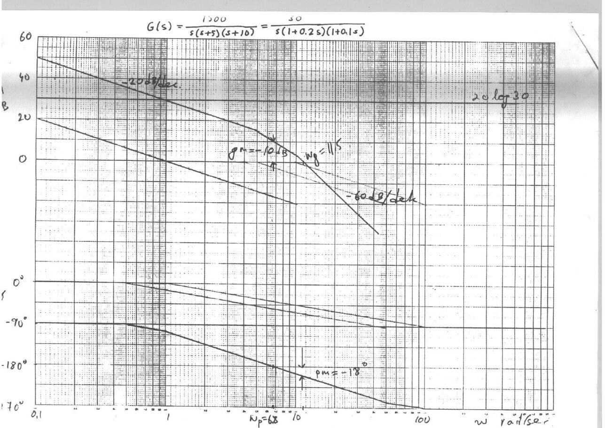
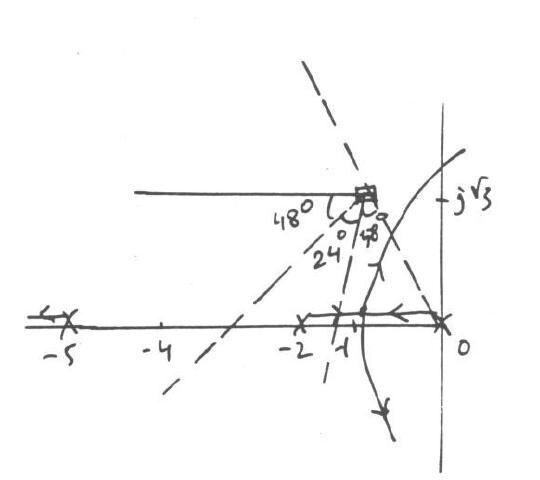

This post collects the **quiz papers and solution keys** found in the "Control" subfolder of the EEM322 Control Systems folder. The course code on the documents is **EEM417**; in other words, these are exams from the advanced control course that follows EEM322, but they are included here because they were stored in the same folder. The questions and handwritten solutions were prepared by the course instructor **Prof. Dr. Alper Uraz** ("Good luck, Uraz"). Each quiz is worth 10 points; the numbers to the left of the solutions are the step points.

There are two semesters:

- **2004–2005 fall** (14.10.2004 – 30.12.2004): five quizzes, questions in English. Quizzes 1 and 2 are scans embedded in a Word document, and quizzes 3–5 are scanned pages; these can be downloaded as a ZIP at the end of the post.
- **2007–2008 fall** (17.10.2007 and 07.11.2007): two quizzes, questions in Turkish, solutions in English. These papers, along with a student's study notes re-solving the same questions with Turkish explanations, were **transcribed from photographed pages**; the photographs were not published, and personal information was removed.

The "quizler" (quizzes) subfolder in the folder also contained photographs of the 2004–2005 quizzes taken from a computer screen; since they are copies of the scans below, they were not transcribed separately.

## 2004–2005 Quiz 1 (14.10.2004): Asymptotic Bode plotting

**Question:** The open-loop transfer function of a unity-feedback control system is

> G(s) = 1500 / [s(s + 5)(s + 10)]

Sketch the Bode diagrams using the straight-line (asymptote) approximation (10 dB/cm on the magnitude axis and 45°/cm on the phase axis). Show the gain and phase crossover frequencies and the gain and phase margins on the diagrams, and read off their approximate values.

**Solution:**

1. Time-constant form: G(s) = 30 / [s(1 + 0.2s)(1 + 0.1s)] ⇒ G(jω) = 30 / [jω(1 + j0.2ω)(1 + j0.1ω)]. Corner frequencies are 5 and 10 rad/s.
1. 20 log M = 20 log 30 − 20 log ω − 20 log √(1 + 0.04ω²) − 20 log √(1 + 0.01ω²)
1. φ = −90° − tan⁻¹(0.2ω) − tan⁻¹(0.1ω)
1. The magnitude and phase diagrams are drawn (the magnitude slope is first −20 dB/dec, then −40, and finally −60 dB/dec).
1. From the diagrams: gain crossover frequency ωg = 11.5 rad/s, phase crossover frequency ωp = 6.8 rad/s; gain margin gm = −10 dB, phase margin pm = −18°.
1. The negative gain and phase margins show that the closed-loop system is **unstable**.

*Note: These values are approximate readings from the asymptotic diagram. With exact calculation, the phase crossover frequency is ωp = √50 ≈ 7.07 rad/s and |G(jωp)| = 0.5, i.e. gm ≈ −6 dB; the gain crossover frequency is ωg ≈ 9.7 rad/s and pm ≈ −17°. On the asymptotic diagram, the magnitude at ω = 6.8 is ≈ +10 dB and the crossover is ≈ 11.5 rad/s; the conclusion (instability) does not change.*

## 2004–2005 Quiz 2 (11.11.2004): Lead compensator via root locus

**Question:** In a unity-feedback system, G(s) = K / [s(s + 2)(s + 5)]. The closed-loop system must have a settling time Ts ≤ 4 s (2% criterion) and a damping ratio ζ ≥ 0.5. Design a compensator that satisfies these specifications.

**Solution:**

1. Design specifications: Ts = 4/(ζωn) = 4 ⇒ ζωn = 1; ζ = 0.5 ⇒ ωn = 2. The desired closed-loop poles are s = −1 ± j√3 (−1 ± j1.73).
1. Angle condition: ∠K/[s(s + 2)(s + 5)] (at s = −1 + j√3) = −120° − 60° − 23.4° = −203.4°.
1. The angle deficiency is φ ≈ 24°; therefore a **lead** compensator is required.
1. The zero and pole are placed by the bisector method: tan 18° = y/√3 ⇒ y = 0.56, tan 42° = (x + y)/√3 ⇒ x + y = 1.56. Thus Gc(s) = (s + 1/T)/(s + 1/(αT)) = (s + 1.56)/(s + 2.56).
1. Magnitude condition |Kc Gc(s) G(s)| = 1 (at s = −1 + j√3) ⇒ **Kc = 22.33**.

## 2004–2005 Quiz 3 (09.12.2004): Ziegler-Nichols PID tuning

**Question:** A series PID controller is to be applied to a unity-feedback system with G(s) = K / [s(s + 2)(s + 10)]. Find the tuning parameters for P, PI, and PID control.

**Solution:**

1. Closed-loop characteristic equation: Δ(s) = s³ + 12s² + 20s + K.
1. Routh table: s³: 1, 20; s²: 12, K; s¹: (240 − K)/12; s⁰: K ⇒ critical gain **Ku = 240**.
1. Auxiliary equation 12s² + 240 = 0 ⇒ s = ±j√20 ⇒ ωu = 4.47 rad/s, Tu = 2π/ωu = 1.41 s.
1. Ziegler-Nichols tuning parameters:

| Control | Kp | Ti | Td |
|---|---|---|---|
| P | 0.5Ku = 120 | – | – |
| PI | 0.4Ku = 96 | 0.8Tu = 1.128 | – |
| PID | 0.6Ku = 144 | 0.5Tu = 0.705 | 0.12Tu = 0.169 |

*Note: The source uses 0.4Ku, 0.8Tu, and 0.12Tu for the PI and PID coefficients; in many textbooks the Ziegler-Nichols table is given as 0.45Ku, Tu/1.2, and 0.125Tu (in which case Kp = 108 and Ti ≈ 1.17 for PI, and Td ≈ 0.176 for PID).*

## 2004–2005 Quiz 4 (23.12.2004): Deadbeat response and robust stability

**Question:** The third-order closed-loop transfer function that gives an optimal deadbeat response with settling time Ts = 4.04/ω0, and the plant, are given as

> T(s) = ω0³ / (s³ + 1.9ω0 s² + 2.2ω0² s + ω0³), G(s) = K / [s(s + 1)]

and the desired Ts = 2 s. Find a first-order series compensator C(s) = (s + z)/(s + p) and a suitable prefilter P(s) so that the unity-feedback closed loop gives a deadbeat response. Discuss the closed-loop stability for K ∈ [5, 8].

**Solution:**

1. Without the prefilter: T₁(s) = C(s)G(s) / [1 + C(s)G(s)] = K(s + z) / [s³ + (1 + p)s² + (K + p)s + Kz].
1. If P(s) = z/(s + z) is chosen, then T(s) = P(s)T₁(s) = Kz / [s³ + (1 + p)s² + (K + p)s + Kz] and the steady-state error is zero.
1. For Ts = 2, ω0·Ts = 4.04 ⇒ ω0 = 2.02. The desired characteristic equation is Δ(s) = s³ + 3.84s² + 8.98s + 8.24.
1. Equating coefficients gives K = 6.14, p = 2.84, z = 1.34. Hence **C(s) = (s + 1.34)/(s + 2.84)**, **P(s) = 1.34/(s + 1.34)**.
1. For K ∈ [5, 8], Δ(s) = s³ + 3.84s² + (K + 2.84)s + 1.34K. Since n = 3, it suffices to check only the first Kharitonov polynomial: P₁⁺⁻(s) = s³ + 3.84s² + 7.84s + 10.72.
1. Routh table: 1, 7.84 / 3.84, 10.72 / 5.05 / 10.72 — there is no sign change in the first column, so the polynomial is Hurwitz; the closed-loop system is **robustly stable** for K ∈ [5, 8].

## 2004–2005 Quiz 5 (30.12.2004): PD controller via root locus

**Question:** In a unity-feedback system with G(s) = 1 / [s(s + 2)(s + 10)], the closed-loop poles are required to be at −2 ± j2. Design a PD controller using the root locus.

**Solution:**

1. Angle condition (at s = −2 + j2): −135° − 90° − 14° = −239° ⇒ angle deficiency φ ≈ 59°.
1. PD controller: C(s) = Kp + Kd·s = Kd(s + Kp/Kd). The zero is placed where it contributes a 59° angle to the desired pole: tan 59° = 2/x = 1.66 ⇒ x = 1.2, and the zero location is Kp/Kd = 2 + 1.2 = 3.2.
1. Magnitude condition: |Kd(s + 3.2) / [s(s + 2)(s + 10)]| = 1 (at s = −2 + j2) ⇒ Kd = 20, Kp = 3.2 × 20 = 64.
1. Result: **C(s) = 64 + 20s**.

## 2007–2008 Quiz 1 (17.10.2007): Lag controller

**Question (from the Turkish original):** The open-loop transfer function of a unity-feedback control system is given as G(s) = K / [s(s + 1)(s + 4)]. The design specifications are: steady-state error ess ≤ 0.2 and dominant closed-loop poles at −0.33 ± j1.02. Examine whether these are satisfied and, if they are not, carry out the design with a series phase-lag controller.

**Solution (Q1):**

1. Angle condition (at s = −0.33 + j1.02): −107.9° − 56.7° − 15.5° = −180°. The desired closed-loop poles lie on the branches of the root locus.
1. Magnitude condition: K₁ = |s(s + 1)(s + 4)| = 1.07 × 1.22 × 3.80 ≈ 5.
1. Error condition: ess = 4/K ≤ 0.2 ⇒ K₂ = 20, b = K₂/K₁ = 20/5 = 4. That is, with K₁ = 5 the poles are satisfied but the error condition is not.
1. T = 10 is chosen (1/T = 0.1), 1/(bT) = 0.025.
1. Lag compensator: Gc(s) = (1/b)(s + 1/T)/(s + 1/(bT)) = (1/4)(s + 0.1)/(s + 0.025) = **(1 + 10s)/(1 + 40s)**; Kc = 1/b = 0.25 and the final gain is set to K = K₂ = 20.

## 2007–2008 Quiz 2 (07.11.2007): Lag compensator via Bode

**Question (from the Turkish original):** The open-loop transfer function of a unity-feedback control system is given as G(s) = K / [s(s + 2)(s + 10)]. The closed-loop system must have a phase margin pm = 40° and a velocity error constant Kv = 12. Examine whether these are satisfied and, if they are not, design a series phase-lag compensator (lag compensator) using Bode plots. Give the gain/phase (gm/pm) margins before and after the design.

**Solution:**

1. Design specifications: pm = 40°, Kv = 12.
1. Kv = lim(s→0) sG(s) = K/20 = 12 ⇒ K₁ = 240. This is equal to the system's critical gain (Kc = 240).
1. With a 5° safety margin, the required pm = 40° + 5° = 45° ⇒ new gain crossover frequency ωg′ = 1.4 rad/s.
1. At ωg′ = 1.4, 18 dB of attenuation is needed ⇒ b = 10^(18/20) = 7.94; the corner frequency is placed one decade below ωg′: 1/T = ωg′/10 = 0.14, 1/(bT) = 0.018.
1. Compensator: C(s) = (1/b)(s + 1/T)/(s + 1/(bT)) = (1/7.94)(s + 0.14)/(s + 0.018) = **(1 + 7.14s)/(1 + 56.71s)**.
1. Before design: pm = 0°, ωg = 4.8; gm = 0, ωp = 4.8 (the system is at the stability limit). After design: pm = 45°, ωg′ = 1.4; gm = 18 dB, ωp = 4.5.

On the Bode diagrams, the starting level of the magnitude curve is marked as 20 log 12; the uncompensated system has pm = 0 and ωg = 4.8, and at ω = 1.4 an 18 dB difference is seen.

*Note: With exact calculation, the crossover frequencies of the uncompensated system are ωg = ωp = √20 ≈ 4.47 rad/s (4.8 was read from the asymptotic diagram). For pm = 45°, the exact ωg′ ≈ 1.48 rad/s and the actual magnitude at this frequency is ≈ 16 dB; the solution read 18 dB from the asymptotic diagram.*

## Student study notes

The same folder also contained colored-pen pages in which a student re-solved these questions with Turkish explanations while preparing for the exams:

- **"Ex 1"**: The Bode solution of 2004–2005 Quiz 1. It first writes G(s) = 30/[s(1 + 0.2s)(1 + 0.1s)], saying "I convert to time constant form"; the 20 log 30 ≈ 30 dB line, the −20 log ω line (20 dB at ω = 0.1, 0 dB at ω = 1), and the corner frequencies 5 and 10 are drawn separately and summed. It notes that terms with ωT ≪ 1 have no effect ("they have no effect"), and that for ωT ≫ 1 they behave like −20 log ωT. Result: ωg = 11.5 rad/s, ωp = 6.8 rad/s, gm = −10 dB, pm = −18°.
- **"Ex 2"**: The lag compensator solution of 2007–2008 Quiz 2 (b = 7.94, C(s) = (1 + 7.14s)/(1 + 56.71s)); with the explanation "Whether we draw the Bode plot ourselves or the instructor provides it, the required pm = 45° → in this case we look at the Bode plot, the upper part at the 18 dB level; from this I find it."
- **"Ex 3"**: The lead compensator solution of 2004–2005 Quiz 2; the angles in the bisector construction (α = 48°, 18°, 30°) are found step by step using the parallelism relation: 180° − (90° + a) = α + 24°, α − a = 30°, α + a = 66° ⇒ α = 48°, a = 18°.
- **"Quiz 1 – 419"**: The solution of 2007–2008 Quiz 1; with reminders of the angle of a complex number θ = tan⁻¹(b/a) and its magnitude |a| = √(α² + β²). The magnitudes of the factors are taken as 1.07, 1.22, and 3.80, giving K₁ ≈ 4.96 ≈ 5.
