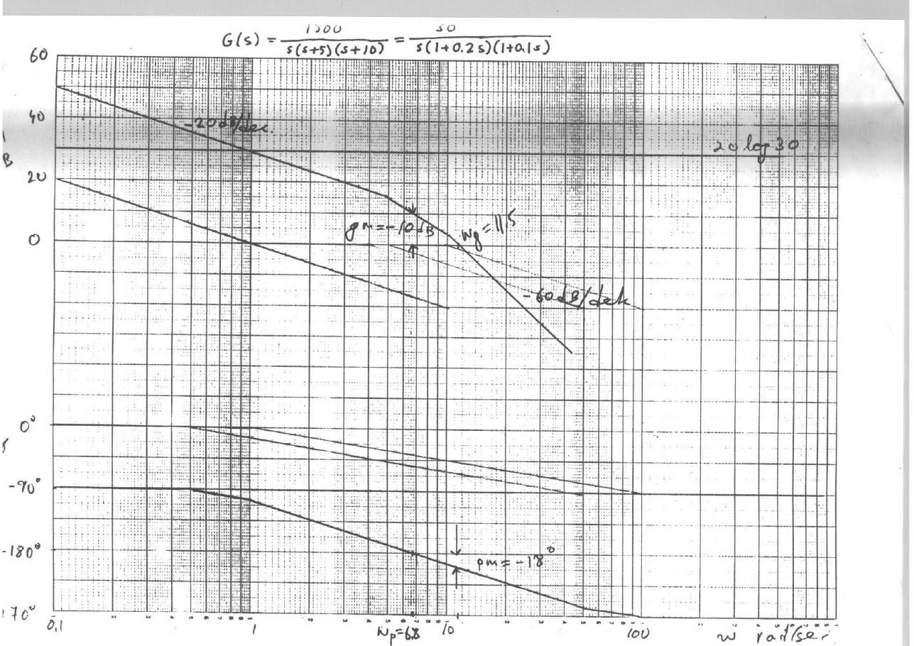
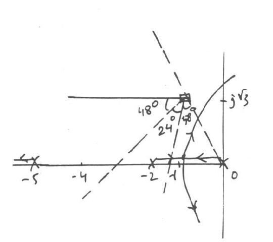

Bu yazı, EEM322 Denetim Sistemleri klasörünün "Control" alt klasöründe duran **kısa sınav (quiz) kâğıtlarını ve çözüm anahtarlarını** bir araya getiriyor. Belgelerin üzerinde ders kodu **EEM417** yazıyor; yani bunlar EEM322'nin devamı niteliğindeki ileri denetim dersinin sınavları, ama aynı klasörde saklandıkları için burada yer alıyorlar. Soruları ve el yazısı çözümleri dersin öğretim üyesi **Prof. Dr. Alper Uraz** hazırlamış ("Good luck, Uraz"). Her sınav 10 puan; çözümlerin solundaki sayılar adım puanları.

İki dönem var:

- **2004–2005 güz** (14.10.2004 – 30.12.2004): beş kısa sınav, sorular İngilizce. Kısa Sınav 1 ve 2 Word belgesine yerleştirilmiş taramalar, 3–5 taranmış sayfalar; bunlar yazının sonunda ZIP olarak indirilebilir.
- **2007–2008 güz** (17.10.2007 ve 07.11.2007): iki kısa sınav, sorular Türkçe, çözümler İngilizce. Bu kâğıtlar ve bir öğrencinin aynı soruları Türkçe açıklamalarla yeniden çözdüğü çalışma notları **fotoğraflanmış sayfalardan metne aktarıldı**; fotoğraflar yayınlanmadı, kişisel bilgiler çıkarıldı.

Klasördeki "quizler" alt klasöründe 2004–2005 sınavlarının bilgisayar ekranından çekilmiş fotoğrafları da vardı; bunlar aşağıdaki taramaların kopyası olduğu için ayrıca aktarılmadı.

## 2004–2005 Kısa Sınav 1 (14.10.2004): Asimptotik Bode çizimi

**Soru:** Birim geri beslemeli bir denetim sisteminin açık döngü transfer fonksiyonu

> G(s) = 1500 / [s(s + 5)(s + 10)]

Düz çizgi (asimptot) yaklaşımıyla Bode diyagramlarını çizin (genlikte 10 dB/cm, fazda 45°/cm). Kazanç ve faz kesim frekanslarını, kazanç ve faz paylarını diyagram üzerinde gösterip yaklaşık değerlerini okuyun.

**Çözüm:**

1. Zaman sabiti biçimi: G(s) = 30 / [s(1 + 0.2s)(1 + 0.1s)] ⇒ G(jω) = 30 / [jω(1 + j0.2ω)(1 + j0.1ω)]. Köşe frekansları 5 ve 10 rad/s.
1. 20 log M = 20 log 30 − 20 log ω − 20 log √(1 + 0.04ω²) − 20 log √(1 + 0.01ω²)
1. φ = −90° − tan⁻¹(0.2ω) − tan⁻¹(0.1ω)
1. Genlik ve faz diyagramları çizilir (genlik eğimi önce −20 dB/dek, sonra −40, en sonda −60 dB/dek).
1. Diyagramlardan: kazanç kesim frekansı ωg = 11.5 rad/s, faz kesim frekansı ωp = 6.8 rad/s; kazanç payı gm = −10 dB, faz payı pm = −18°.
1. Negatif kazanç ve faz payı, kapalı döngü sistemin **kararsız** olduğunu gösterir.

*Not: Bu değerler asimptot diyagramından okunmuş yaklaşık değerlerdir. Tam hesapla faz kesim frekansı ωp = √50 ≈ 7.07 rad/s ve |G(jωp)| = 0.5, yani gm ≈ −6 dB; kazanç kesim frekansı ωg ≈ 9.7 rad/s ve pm ≈ −17° çıkar. Asimptot diyagramında ise ω = 6.8'de genlik ≈ +10 dB, kesim ≈ 11.5 rad/s'dir; sonuç (kararsızlık) değişmez.*

## 2004–2005 Kısa Sınav 2 (11.11.2004): Kök yer eğrisiyle faz ilerleten dengeleyici

**Soru:** Birim geri beslemeli sistemde G(s) = K / [s(s + 2)(s + 5)]. Kapalı döngü sistemin yerleşme süresi Ts ≤ 4 s (%2 ölçütü) ve sönüm oranı ζ ≥ 0.5 olmalıdır. Bu özellikleri sağlayan bir dengeleyici tasarlayın.

**Çözüm:**

1. Tasarım özellikleri: Ts = 4/(ζωn) = 4 ⇒ ζωn = 1; ζ = 0.5 ⇒ ωn = 2. İstenen kapalı döngü kutupları s = −1 ± j√3 (−1 ± j1.73).
1. Açı koşulu: ∠K/[s(s + 2)(s + 5)] (s = −1 + j√3'te) = −120° − 60° − 23.4° = −203.4°.
1. Açı eksiği φ ≈ 24°; dolayısıyla **faz ilerleten (lead)** dengeleyici gerekir.
1. Açıortay yöntemiyle sıfır ve kutup yerleştirilir: tan 18° = y/√3 ⇒ y = 0.56, tan 42° = (x + y)/√3 ⇒ x + y = 1.56. Böylece Gc(s) = (s + 1/T)/(s + 1/(αT)) = (s + 1.56)/(s + 2.56).
1. Genlik koşulu |Kc Gc(s) G(s)| = 1 (s = −1 + j√3'te) ⇒ **Kc = 22.33**.

## 2004–2005 Kısa Sınav 3 (09.12.2004): Ziegler-Nichols PID ayarı

**Soru:** G(s) = K / [s(s + 2)(s + 10)] olan birim geri beslemeli sisteme seri bir PID denetleç uygulanacaktır. P, PI ve PID denetimleri için ayar parametrelerini bulun.

**Çözüm:**

1. Kapalı döngü karakteristik denklemi: Δ(s) = s³ + 12s² + 20s + K.
1. Routh tablosu: s³: 1, 20; s²: 12, K; s¹: (240 − K)/12; s⁰: K ⇒ kritik kazanç **Ku = 240**.
1. Yardımcı denklem 12s² + 240 = 0 ⇒ s = ±j√20 ⇒ ωu = 4.47 rad/s, Tu = 2π/ωu = 1.41 s.
1. Ziegler-Nichols ayar parametreleri:

| Denetim | Kp | Ti | Td |
|---|---|---|---|
| P | 0.5Ku = 120 | – | – |
| PI | 0.4Ku = 96 | 0.8Tu = 1.128 | – |
| PID | 0.6Ku = 144 | 0.5Tu = 0.705 | 0.12Tu = 0.169 |

*Not: PI ve PID katsayıları kaynakta 0.4Ku, 0.8Tu ve 0.12Tu olarak kullanılmış; Ziegler-Nichols tablosu birçok kitapta 0.45Ku, Tu/1.2 ve 0.125Tu biçiminde verilir (o zaman PI için Kp = 108, Ti ≈ 1.17; PID için Td ≈ 0.176 olur).*

## 2004–2005 Kısa Sınav 4 (23.12.2004): Deadbeat yanıt ve dayanıklı kararlılık

**Soru:** Yerleşme süresi Ts = 4.04/ω0 olan, optimal deadbeat yanıt veren üçüncü dereceden kapalı döngü transfer fonksiyonu ve sistem

> T(s) = ω0³ / (s³ + 1.9ω0 s² + 2.2ω0² s + ω0³), G(s) = K / [s(s + 1)]

olarak veriliyor; istenen Ts = 2 s. Birim geri beslemeli kapalı döngünün deadbeat yanıt vermesi için birinci dereceden seri dengeleyici C(s) = (s + z)/(s + p) ve uygun bir ön filtre P(s) bulun. K ∈ [5, 8] için kapalı döngü kararlılığını tartışın.

**Çözüm:**

1. Ön filtresiz: T₁(s) = C(s)G(s) / [1 + C(s)G(s)] = K(s + z) / [s³ + (1 + p)s² + (K + p)s + Kz].
1. P(s) = z/(s + z) seçilirse T(s) = P(s)T₁(s) = Kz / [s³ + (1 + p)s² + (K + p)s + Kz] olur ve kalıcı durum hatası sıfırdır.
1. Ts = 2 için ω0·Ts = 4.04 ⇒ ω0 = 2.02. İstenen karakteristik denklem Δ(s) = s³ + 3.84s² + 8.98s + 8.24.
1. Katsayılar eşitlenince K = 6.14, p = 2.84, z = 1.34. Dolayısıyla **C(s) = (s + 1.34)/(s + 2.84)**, **P(s) = 1.34/(s + 1.34)**.
1. K ∈ [5, 8] için Δ(s) = s³ + 3.84s² + (K + 2.84)s + 1.34K. n = 3 olduğundan yalnız birinci Kharitonov polinomuna bakmak yeter: P₁⁺⁻(s) = s³ + 3.84s² + 7.84s + 10.72.
1. Routh tablosu: 1, 7.84 / 3.84, 10.72 / 5.05 / 10.72 — ilk sütunda işaret değişimi yok, polinom Hurwitz'dir; kapalı döngü sistem K ∈ [5, 8] için **dayanıklı kararlıdır** (robust stable).

## 2004–2005 Kısa Sınav 5 (30.12.2004): Kök yer eğrisiyle PD denetleç

**Soru:** G(s) = 1 / [s(s + 2)(s + 10)] olan birim geri beslemeli sistemde kapalı döngü kutuplarının −2 ± j2'de olması isteniyor. Kök yer eğrisinden yararlanarak bir PD denetleç tasarlayın.

**Çözüm:**

1. Açı koşulu (s = −2 + j2'de): −135° − 90° − 14° = −239° ⇒ açı eksiği φ ≈ 59°.
1. PD denetleç: C(s) = Kp + Kd·s = Kd(s + Kp/Kd). Sıfır, istenen kutuba 59° açı katacak yere konur: tan 59° = 2/x = 1.66 ⇒ x = 1.2, sıfırın yeri Kp/Kd = 2 + 1.2 = 3.2.
1. Genlik koşulu: |Kd(s + 3.2) / [s(s + 2)(s + 10)]| = 1 (s = −2 + j2'de) ⇒ Kd = 20, Kp = 3.2 × 20 = 64.
1. Sonuç: **C(s) = 64 + 20s**.

## 2007–2008 Kısa Sınav 1 (17.10.2007): Faz geciktiren denetleç

**Soru (Türkçe aslından):** Birim geri beslemeli bir denetim sisteminin açık döngü aktarım işlevi G(s) = K / [s(s + 1)(s + 4)] olarak verilmiştir. Tasarım belirtimleri: kalıcı durum hatası ess ≤ 0.2 ve baskın kapalı döngü kutupları −0.33 ± j1.02 olmalıdır. Bunların sağlanıp sağlanmadığını irdeleyiniz ve eğer sağlanmıyorsa bir seri evre geriletici denetleç ile tasarımı gerçekleştiriniz.

**Çözüm (KS1):**

1. Açı koşulu (s = −0.33 + j1.02'de): −107.9° − 56.7° − 15.5° = −180°. İstenen kapalı döngü kutupları kök yer eğrisinin kolları üzerindedir.
1. Genlik koşulu: K₁ = |s(s + 1)(s + 4)| = 1.07 × 1.22 × 3.80 ≈ 5.
1. Hata koşulu: ess = 4/K ≤ 0.2 ⇒ K₂ = 20, b = K₂/K₁ = 20/5 = 4. Yani K₁ = 5 ile kutuplar sağlanıyor ama hata koşulu sağlanmıyor.
1. T = 10 seçilir (1/T = 0.1), 1/(bT) = 0.025.
1. Faz geciktiren dengeleyici: Gc(s) = (1/b)(s + 1/T)/(s + 1/(bT)) = (1/4)(s + 0.1)/(s + 0.025) = **(1 + 10s)/(1 + 40s)**; Kc = 1/b = 0.25 ve son kazanç K = K₂ = 20 olarak ayarlanır.

## 2007–2008 Kısa Sınav 2 (07.11.2007): Bode ile faz geciktiren dengeleyici

**Soru (Türkçe aslından):** Birim geri beslemeli bir denetim sisteminin açık döngü aktarım işlevi G(s) = K / [s(s + 2)(s + 10)] olarak verilmiştir. Kapalı döngü sisteminin evre payı pm = 40° ve hız hata sabitesi Kv = 12 değerlerinde olmalıdır. Bunların sağlanıp sağlanmadığını irdeleyiniz ve eğer sağlanmıyorsa bir seri evre geriletici dengeleyici (lag compensator) tasarımını, Bode çizimleri kullanarak gerçekleştiriniz. Tasarım öncesi ve sonrasındaki kazanç/evre (gm/pm) paylarını veriniz.

**Çözüm:**

1. Tasarım özellikleri: pm = 40°, Kv = 12.
1. Kv = lim(s→0) sG(s) = K/20 = 12 ⇒ K₁ = 240. Bu, sistemin kritik kazancına (Kc = 240) eşittir.
1. 5° güvenlik payıyla istenen pm = 40° + 5° = 45° ⇒ yeni kazanç kesim frekansı ωg′ = 1.4 rad/s.
1. ωg′ = 1.4'te 18 dB zayıflatma gerekir ⇒ b = 10^(18/20) = 7.94; köşe frekansı ωg′'nün bir dekad altına: 1/T = ωg′/10 = 0.14, 1/(bT) = 0.018.
1. Dengeleyici: C(s) = (1/b)(s + 1/T)/(s + 1/(bT)) = (1/7.94)(s + 0.14)/(s + 0.018) = **(1 + 7.14s)/(1 + 56.71s)**.
1. Tasarım öncesi: pm = 0°, ωg = 4.8; gm = 0, ωp = 4.8 (sistem kararlılık sınırında). Tasarım sonrası: pm = 45°, ωg′ = 1.4; gm = 18 dB, ωp = 4.5.

Bode diyagramlarında genlik eğrisinin başlangıç seviyesi 20 log 12 olarak işaretlenmiş; dengelenmemiş sistemde pm = 0 ve ωg = 4.8, ω = 1.4'te ise 18 dB'lik fark görülüyor.

*Not: Tam hesapla dengelenmemiş sistemin kesim frekansları ωg = ωp = √20 ≈ 4.47 rad/s'dir (4.8 asimptot diyagramından okunmuş). pm = 45° için kesin ωg′ ≈ 1.48 rad/s ve bu frekansta gerçek genlik ≈ 16 dB çıkar; çözüm asimptot diyagramından 18 dB okumuş.*

## Öğrenci çalışma notları

Aynı klasörde bir öğrencinin bu soruları sınava hazırlanırken Türkçe açıklamalarla yeniden çözdüğü renkli kalemle yazılmış sayfaları da vardı:

- **"Ex 1"**: 2004–2005 Kısa Sınav 1'in Bode çözümü. Önce "time constant forma geçiriyorum" diyerek G(s) = 30/[s(1 + 0.2s)(1 + 0.1s)] yazılmış; 20 log 30 ≈ 30 dB doğrusu, −20 log ω doğrusu (ω = 0.1'de 20 dB, ω = 1'de 0 dB) ve köşe frekansları 5 ile 10 ayrı ayrı çizilip toplanmış. ωT ≪ 1 olan terimlerin etkisiz olduğu ("etkileri yok"), ωT ≫ 1 olduğunda −20 log ωT gibi davrandığı not edilmiş. Sonuç: ωg = 11.5 rad/s, ωp = 6.8 rad/s, gm = −10 dB, pm = −18°.
- **"Ex 2"**: 2007–2008 Kısa Sınav 2'nin faz geciktiren dengeleyici çözümü (b = 7.94, C(s) = (1 + 7.14s)/(1 + 56.71s)); "Bode'yi biz de çizsek, hoca da verse, istenen pm = 45° → bu durumda Bode plottan bakıyoruz, 18 dB seviyesinde üst kısım; buradan buluyorum" açıklamasıyla.
- **"Ex 3"**: 2004–2005 Kısa Sınav 2'nin faz ilerleten dengeleyici çözümü; açıortay yapısındaki açılar (α = 48°, 18°, 30°) paralellik ilişkisiyle adım adım bulunmuş: 180° − (90° + a) = α + 24°, α − a = 30°, α + a = 66° ⇒ α = 48°, a = 18°.
- **"Quiz 1 – 419"**: 2007–2008 Kısa Sınav 1'in çözümü; karmaşık sayının açısı θ = tan⁻¹(b/a) ve genliği |a| = √(α² + β²) hatırlatmalarıyla. Çarpanların genlikleri 1.07, 1.22 ve 3.80 alınıp K₁ ≈ 4.96 ≈ 5 bulunmuş.
