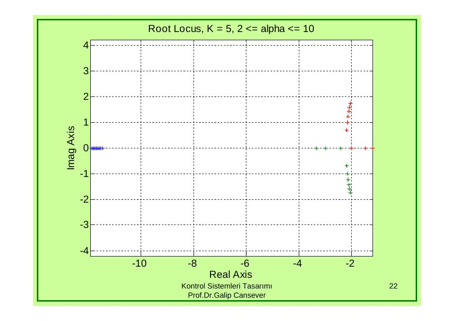
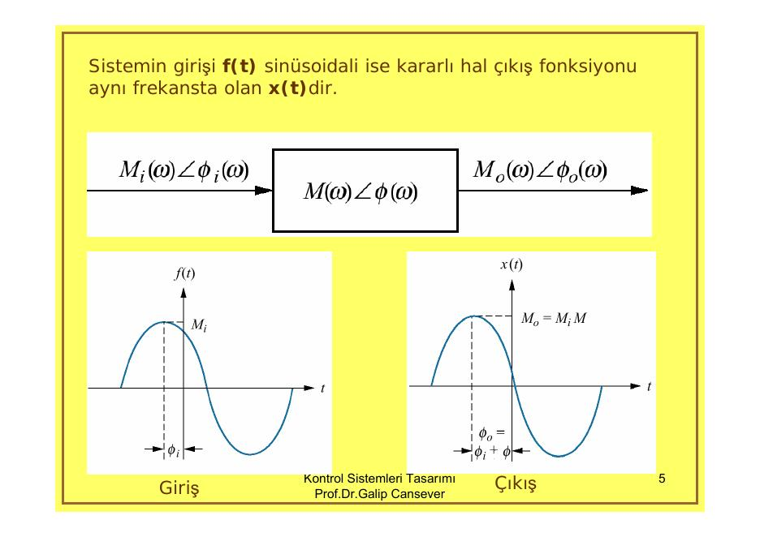
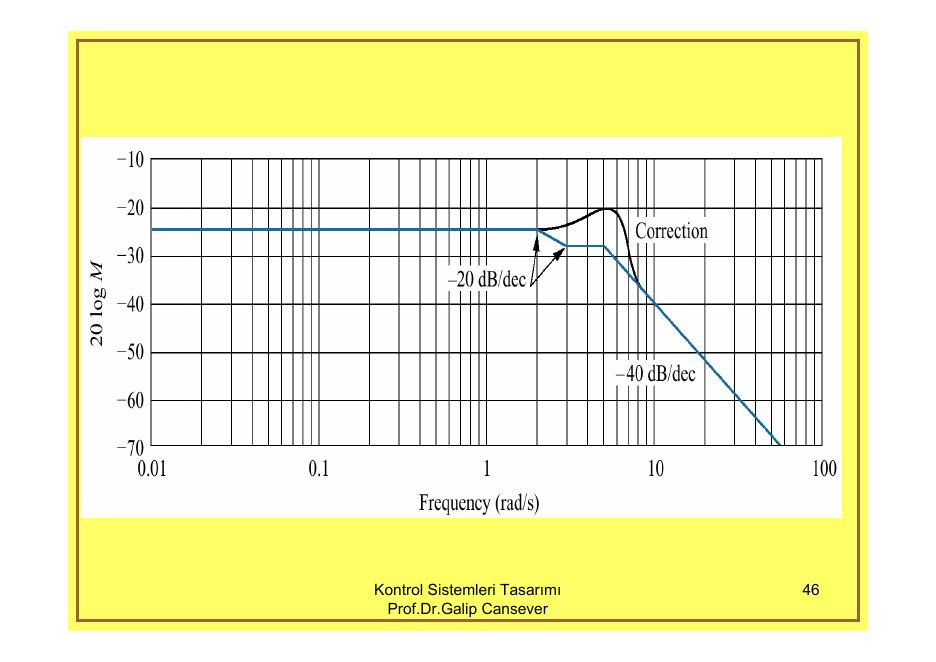

This post brings together two **third-party** presentations kept in the EEM322 Control Systems folder, both from **Prof. Dr. Galip Cansever**'s **"Control Systems Design"** course: *"Root Locus with MATLAB"* (23 slides, rlocus.pdf) and *"Frequency Analysis Methods I – Bode Plots"* (48 slides, D6.PDF). The PDFs are dated **17 October 2006**; the presentations do not state an institution. The slide text and formulas are transcribed below as text, with the necessary graphics added; the two original PDFs can be downloaded as a ZIP at the end of the post.

*This content belongs to a third-party source; it is shared for archival and nostalgic purposes with attribution. It will be removed at the request of the rights holder.*

## Root locus with MATLAB

To draw the root locus with MATLAB we will use the form

> 1 + K·num/den = 0

where

> num = (s − z₁)(s − z₂)…(s − z_m) = s^m + b₁s^(m−1) + … + b_m
> den = (s − p₁)(s − p₂)…(s − p_n) = s^n + a₁s^(n−1) + … + a_n

| Task | MATLAB command |
| --- | --- |
| Root locus (gain K is assigned automatically) | `rlocus(num,den)` |
| If state-space matrices are given | `rlocus(A,B,C,D)` |
| If limits for the gain K are specified | `rlocus(num,den,K)`, `rlocus(A,B,C,D,K)` |
| If the roots are requested as a vector | `[r,K]=rlocus(num,den,K)`, `[r,K]=rlocus(A,B,C,D,K)` |
| Plotting in this case | `plot(r)` |

### Example 1: G(s) = K(s² + 2s + 4)/[s(s + 4)(s + 6)(s² + 1.4s + 1)]

The denominator polynomial is built with `conv`: a = s(s + 4) = s² + 4s → `a=[1 4 0]`, b = s + 6 → `b=[1 6]`, c = s² + 1.4s + 1 → `c=[1 1.4 1]`; `d=conv(a,b)=[1 10 24 0]`, `e=conv(c,d)=[1 11.4 39 43.6 24 0]`. The open-loop zeros are `roots([1 2 4])` = −1 ± 1.732j; the open-loop poles are `roots(den)` = −0.7 ± 0.7141j, 0, −4, −6.

```matlab
num=[0 0 0 1 2 4];
den=[1 11.4 39 43.6 24 0];
rlocus(num,den)
v=[-10 10 -10 10];axis(v)
grid
title('Root-Locus Plot of G(s)=K(s^2+2s+4)/[s(s+4)(s+6)(s^2+1.4s+1)]')
```

![MATLAB root locus of K(s²+2s+4)/[s(s+4)(s+6)(s²+1.4s+1)]](kok-yer-ornek1.jpg "Root locus of Example 1")

### Other examples

- G(s)H(s) = K(s + 0.2)/[s²(s + 3.6)]: `num=[0 0 1 0.2]; den=[1 3.6 0 0]; rlocus(num,den); v=[-4 2 -4 4]; axis(v)`.
- G(s) = K(s + 1)/[s(s − 1)(s² + 4s + 16)] (unstable pole in the open loop): `num=[0 0 0 1 1]; den=[1 3 12 -16 0]; rlocus(num,den); v=[-6 6 -6 6]; axis(v); axis('square')`.
- G(s)H(s) = K/[s(s + 0.5)(s² + 0.6s + 10)] = K/(s⁴ + 1.1s³ + 10.3s² + 5s); open-loop poles −0.3 ± 3.148j, −0.5, 0: `num=[0 0 0 0 1]; den=[1 1.1 10.3 5 0]; rlocus(num,den)`.
- System given in state space: ẋ = Ax + Bu, y = Cx + Du, u = r − y; A = [0 1 0; 0 0 1; −160 −56 −14], B = [0; 1; −14], C = [1 0 0], D = 0 → `rlocus(A,B,C,D)`. The transfer function can also be obtained with `[num,den]=ss2tf(A,B,C,D)`: num = [0 0 1 0], den = [1 14 56 160].

### Roots over a given range of K: G(s) = 6K/[(s + 2)(s + 1)s]

A unity-feedback system consisting of the series blocks K, 3/(s + 2), 2/(s + 1) and 1/s:

```matlab
num=[0 0 0 6];
a=[1 2]; b=[1 1]; c=[1 0];
d=conv(a,b);
den=conv(d,c)            % [1 3 2 0]
k=0:0.01:20;
r=rlocus(num,den,k);
plot(r,'.'),xlabel('Real'),ylabel('Imaginary')
```

![Closed-loop roots of 6K/[s(s+1)(s+2)] for 0 ≤ K ≤ 20 plotted point by point](kok-yer-k6.jpg "Closed-loop roots for 0 ≤ K ≤ 20")

### rlocfind and sgrid: G(s) = K(s + 5)/[(s + 1)(s + 3)(s + 12)]

```matlab
zOL = -5;
pOL = [-1; -3; -12];
G = zpk(zOL,pOL,1)
rlocus(G)
axis equal
axis([-20 10 -15 15])
[kk,clroots] = rlocfind(G)
sgrid(0.5,0)
```

### Parameter variation instead of gain: G(s) = 5(s + α)/[(s + 1)(s + 3)(s + 12)], 2 ≤ α ≤ 10

It resembles the previous example, but this time K = 5 is fixed, and instead of being fixed at −5 the zero varies between −2 and −10. For each α the closed-loop characteristic polynomial is formed as num + den and its roots are found:

```matlab
temp = conv([1 1],[1 3]);
den = conv(temp,[1 12])
K=5
clpoles = []; param = [];
for alpha = 2.0:10,
    num = [0 0 K K*alpha];
    clpoly = num + den;
    clp = roots(clpoly);
    clpoles = [clpoles; clp'];
    param = [param; alpha];
end
disp(' alpha                      closed-loop poles ')
disp([param clpoles])
plot(clpoles,'*')
axis('equal')
grid;title('Ex 5.3: Root Locus, K = 5, 2 <= alpha <= 10')
xlabel('Real Axis'); ylabel('Imag Axis')
```



### Commands used

- **rlocus:** plots the root locus containing the roots in the s-plane.
- **axis:** sets the plot area.
- **conv:** gives the coefficients of the product of two polynomials from their coefficient vectors.
- **rlocfind:** gives the gain and poles for a point selected with the mouse on the root locus.
- **roots:** gives the roots of the equation P(s) = 0 for a given coefficient vector.
- **zpk:** creates the transfer function for the given zeros, poles and gain.
- **plot:** the vector plotting command.
- **sgrid:** draws lines of constant damping ratio and natural frequency in the s-plane.

## Frequency analysis methods: Bode plots

Frequency response analysis was developed by Nyquist and Bode in the 1930s and 1940s, and predates the root locus developed by Evans in 1948. The frequency method has distinct advantages over time-domain methods:

1. Modeling the transfer function from physical data
1. Meeting the steady-state error and transient response requirements when designing a phase-lead compensator
1. Determining the stability of nonlinear systems
1. Robustness against the uncertainties in drawing the root locus

As an example, the presentation shows the HP 35670A dynamic signal analyzer, which collects frequency response information from a physical system; the information obtained can be used in analysis, in design, or in deriving the mathematical model.

### Frequency response

When a sinusoidal input is applied to a linear system in steady state, the system produces a sinusoid of the same frequency. The output differs from the input in amplitude and phase angle, and these differences are functions of frequency. The signal M₁cos(ωt + φ₁) is denoted by M₁∠φ₁. If f(t) = M_i cos(ωt + φ_i) is applied to a spring–mass–damper system, the steady-state output is x(t) = M_o cos(ωt + φ_o):

> M_o(ω)∠φ_o(ω) = M_i(ω)M(ω)∠[φ_i(ω) + φ(ω)]
> M(ω) = M_o(ω)/M_i(ω),  φ(ω) = φ_o(ω) − φ_i(ω)



The input is r(t) = A cos ωt + B sin ωt = √(A² + B²)·cos(ωt − tan⁻¹(B/A)), that is, M_i = √(A² + B²), φ_i = −tan⁻¹(B/A); as a phasor, A − jB = M_i e^(jφ_i). The output

> C(s) = (As + Bω)/(s² + ω²) · G(s) = K₁/(s + jω) + K₂/(s − jω) + (natural solution terms)

is expanded into partial fractions; the forced solution is

> c_ss = (M_i M_G/2)·e^(−j(φ_i+φ_G))/(s + jω) + (M_i M_G/2)·e^(j(φ_i+φ_G))/(s − jω)

and taking the inverse Laplace transform gives

> c(t) = M_i M_G·[e^(−j(ωt+φ_i+φ_G)) + e^(j(ωt+φ_i+φ_G))]/2 = M_i M_G cos(ωt + φ_i + φ_G)

That is, M_o∠φ_o = M_i∠φ_i · M_G∠φ_G, and the frequency response is G(jω) = M_G∠φ_G = G(s)|s→jω.

### Plotting the frequency response

The frequency response of a system G(s) can be plotted in two ways: (1) plotting magnitude and phase separately as functions of frequency, (2) plotting magnitude and phase together on the same curve in polar form.

**Example:** G(s) = 1/(s + 2). For s = jω, G(jω) = 1/(jω + 2) = (2 − jω)/(ω² + 4). The magnitude is M(ω) = 1/√(ω² + 4) and the phase is φ(ω) = −tan⁻¹(ω/2). In Bode plots the magnitude is usually given in decibels (the dB value of a gain M is 20 log M) and the frequency axis is logarithmic: 20 log M(ω) = 20 log[1/√(ω² + 4)] and φ(ω) = −tan⁻¹(ω/2) are plotted against the log ω axis. In the polar plot, M(ω)∠φ(ω) = [1/√(ω² + 4)]∠−tan⁻¹(ω/2).

**Advantages of logarithmic plotting:** it can be sketched quickly by hand; very wide ranges of magnitude and frequency can be shown easily; for very complicated transfer functions, products and quotients of terms turn into graphical addition and subtraction; each time the value doubles, the dB value increases by 6 dB.

### Asymptotic approximations

The magnitude response of a system G(s) = K(s + z₁)(s + z₂)…(s + z_k)/[s^m(s + p₁)(s + p₂)…(s + p_n)] is the product of the magnitude responses of each term. Working logarithmically, the factors in the numerator are added and those in the denominator are subtracted:

> 20 log|G(jω)| = 20 log K + 20 log|s + z₁| + 20 log|s + z₂| + … − 20 log|s^m| − 20 log|s + p₁| − …  (s → jω)

If the straight-line approximation of each term is known, the plot is easily drawn by adding and subtracting these lines.

**G(s) = s + a:** G(jω) = a(1 + jω/a). At low frequencies G(jω) ≈ a, i.e. 20 log M = 20 log a, constant. At high frequencies (ω ≫ a), G(jω) ≈ a(ω/a)∠90° = ω∠90°, and 20 log M = 20 log a + 20 log(ω/a) = 20 log ω. If 20 log M is plotted against log ω, this is the line y = 20x: the slope is 20 dB/decade; each doubling of frequency raises the magnitude by 6 dB, i.e. 6 dB/octave (octave: a doubling of frequency, 2, 4, 8, 16, …). These straight lines are called **asymptotes** (low-frequency and high-frequency asymptotes), and the frequency a is called the **corner frequency**. Phase: 0° at low frequencies, 45° at the corner frequency (G(ja) = a + ja), and 90° at high frequencies; the asymptotic phase rises between 0.1a and 10a with a slope of 45°/decade.

**G(s) = 1/(s + a) = 1/[a(s/a + 1)]:** the low-frequency asymptote is 20 log(1/a); it is constant up to the corner frequency a, after which G ≈ (1/ω)∠−90° and 20 log M = 20 log(1/a) − 20 log(ω/a) = −20 log ω, i.e. −20 dB/decade (−6 dB/octave). The phase falls from 0° to −90°.

**G(s) = s:** it has only a high-frequency asymptote: a line with a slope of +20 dB/decade (+6 dB/octave) passing through 0 dB at ω = 1; the phase is a constant +90°. **G(s) = 1/s:** a line with a slope of −20 dB/decade (−6 dB/octave) passing through 0 dB at ω = 1; the phase is a constant −90°.

### Example: G(s) = K(s + 3)/[s(s + 1)(s + 2)]

The corner frequencies are 1, 2 and 3. The magnitude plot should start 1 decade before the smallest corner frequency and extend to 1 decade after the largest; 0.1–100 rad/s is a suitable choice. ω = 0.1 is considered low frequency for all the (s + a) terms:

> G(j0.1) ≈ 3K/[(0.1)(1)(2)] = 15K

K shifts the magnitude plot up or down (the plot below is for K = 1). The plot starts at 20 log 15 = 23.52 dB at ω = 0.1 and immediately falls at −6 dB/octave (−20 dB/decade) because of the s in the denominator. At ω = 1 the (s + 1) term adds another −6 dB/octave (total −12 dB/octave), at ω = 2 the (s + 2) term adds one more (−18 dB/octave); at ω = 3 the (s + 3) term adds +6 dB/octave and the slope returns to −12 dB/octave, and since there are no other corner frequencies it continues with this slope. The phase plot is obtained similarly; the breaks occurring 1 decade before and after each corner frequency require a bit more care.

![Asymptotic Bode magnitude of (s+3)/[s(s+1)(s+2)]: −20, −40, −60 and −40 dB/dec segments](bode-ornek1.jpg "Asymptotic magnitude plot of the example")

### Second-order terms

**G(s) = s² + 2ζω_n s + ω_n²:** unlike first-order systems, for some values of ζ the difference between the actual frequency response and the asymptotic approximation can be too large to neglect.

- At low frequencies G(s) ≈ ω_n² = ω_n²∠0°, 20 log M = 20 log ω_n².
- At high frequencies G(s) ≈ s², G(jω) ≈ −ω² = ω²∠180°, 20 log M = 20 log ω² = 40 log ω: the slope is 40 dB/decade (12 dB/octave).
- The two asymptotes intersect at ω = ω_n; ω_n is the corner frequency of the second-order term.
- The phase is 0° at low frequencies and 180° at high frequencies. Since G(jω) = (ω_n² − ω²) + j2ζω_nω, at ω = ω_n the result is j2ζω_n² and the angle is 90°; the asymptotic phase rises between 0.1ω_n and 10ω_n at 90°/decade.

**G(s) = ω_n²/(s² + 2ζω_n s + ω_n²):** the magnitude plot breaks at the natural frequency and decreases with a slope of −40 dB/decade (−12 dB/octave). The phase is 0° at low frequencies, decreases between 0.1ω_n and 10ω_n at −90°/decade, and stays at −180° after 10ω_n. In the presentation, the actual magnitude and phase plots for varying values of ζ (0.1–1.5) are compared with the asymptotes for both terms: for small ζ, a pronounced resonance peak forms around ω_n.

*Note: The slide states the high-frequency slope as "40 dB/octave or 40 dB/decade"; the correct value is 40 dB/decade = 12 dB/octave. Likewise, for 1/s, in the statement "−6 dB/octave (20 dB/decade)" the decade value should be −20 dB/decade.*

### Example: G(s) = (s + 3)/[(s + 2)(s² + 2s + 25)]

The low-frequency value of G(s) is found by taking s = 0: 3/50, i.e. −24.44 dB. The Bode plot starts with this value and stays constant until the first corner frequency, 2. The pole at 2 introduces a slope of −20 dB/decade; the zero at 3 adds +20 dB/decade, cancelling the net slope. At 5 rad/s (ω_n = 5) the second-order term comes into play and the slope becomes −40 dB/decade thereafter. Since 2ζω_n = 2, ζ = 0.1, and a resonance correction is applied over the asymptote around ω_n.

*Note: The slide gives the 3/50 value as "24.44 dB"; 20 log(0.06) = −24.44 dB. Also, since the second-order term is in the denominator, it brings a slope of −40, not +40 dB/decade; the graphs on the slide also show the curve falling at −40 dB/decade after 5 rad/s.*

![Asymptotes of each term of (s+3)/[(s+2)(s²+2s+25)] and their sum](bode-ornek2.jpg "Asymptotes of the terms and their sum")


