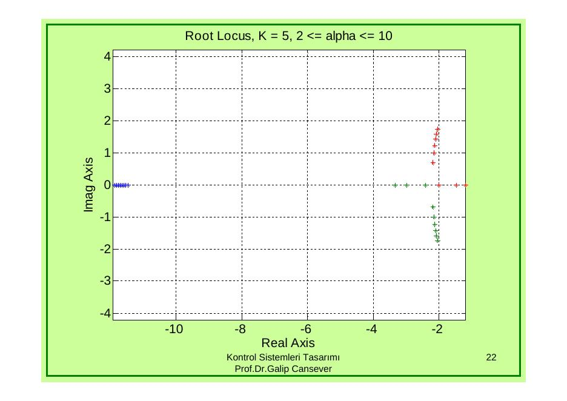
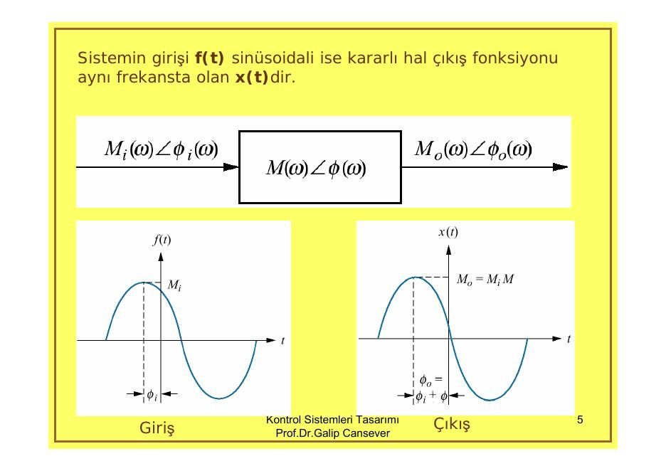
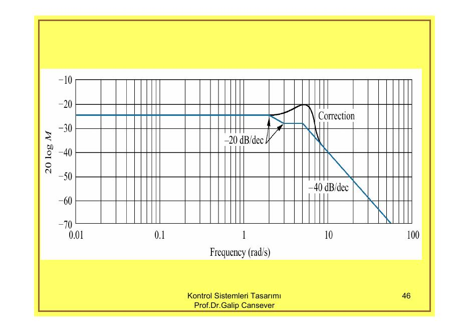

Bu yazı, EEM322 Denetim Sistemleri klasöründe saklanan iki **üçüncü taraf** sunumu bir araya getiriyor: **Prof. Dr. Galip Cansever**'in **"Kontrol Sistemleri Tasarımı"** dersine ait *"Mat-Lab ile Kök Yer Eğrileri"* (23 slayt, rlocus.pdf) ve *"Frekans Analiz Yöntemleri I – Bode Eğrileri"* (48 slayt, D6.PDF) sunumları. PDF'ler **17 Ekim 2006** tarihli; sunumlarda kurum adı yazmıyor. Slayt metinleri ve formüller aşağıya yazı olarak aktarıldı, gerekli grafikler eklendi; iki orijinal PDF yazının sonunda ZIP olarak indirilebilir.

*Bu içerik üçüncü taraf bir kaynağa aittir; arşiv ve nostalji amacıyla kaynak belirtilerek paylaşılmıştır. Hak sahibinin talebi hâlinde kaldırılır.*

## MATLAB ile kök yer eğrileri

MATLAB ile kök yer eğrisi çiziminde

> 1 + K·num/den = 0

formunu kullanacağız. Burada

> num = (s − z₁)(s − z₂)…(s − z_m) = s^m + b₁s^(m−1) + … + b_m
> den = (s − p₁)(s − p₂)…(s − p_n) = s^n + a₁s^(n−1) + … + a_n

| İş | MATLAB komutu |
| --- | --- |
| Kök yer eğrisi (K kazancı otomatik atanır) | `rlocus(num,den)` |
| Durum uzay matrisleri verilmişse | `rlocus(A,B,C,D)` |
| K kazanç sınırları tanımlanırsa | `rlocus(num,den,K)`, `rlocus(A,B,C,D,K)` |
| Kökler vektör olarak istenirse | `[r,K]=rlocus(num,den,K)`, `[r,K]=rlocus(A,B,C,D,K)` |
| Bu durumda çizim | `plot(r)` |

### Örnek 1: G(s) = K(s² + 2s + 4)/[s(s + 4)(s + 6)(s² + 1.4s + 1)]

Payda polinomu `conv` ile kurulur: a = s(s + 4) = s² + 4s → `a=[1 4 0]`, b = s + 6 → `b=[1 6]`, c = s² + 1.4s + 1 → `c=[1 1.4 1]`; `d=conv(a,b)=[1 10 24 0]`, `e=conv(c,d)=[1 11.4 39 43.6 24 0]`. Açık döngü sıfırları `roots([1 2 4])` = −1 ± 1.732j; açık döngü kutupları `roots(den)` = −0.7 ± 0.7141j, 0, −4, −6.

```matlab
num=[0 0 0 1 2 4];
den=[1 11.4 39 43.6 24 0];
rlocus(num,den)
v=[-10 10 -10 10];axis(v)
grid
title('Root-Locus Plot of G(s)=K(s^2+2s+4)/[s(s+4)(s+6)(s^2+1.4s+1)]')
```

![MATLAB root locus of K(s²+2s+4)/[s(s+4)(s+6)(s²+1.4s+1)]](kok-yer-ornek1.jpg "Örnek 1'in kök yer eğrisi")

### Diğer örnekler

- G(s)H(s) = K(s + 0.2)/[s²(s + 3.6)]: `num=[0 0 1 0.2]; den=[1 3.6 0 0]; rlocus(num,den); v=[-4 2 -4 4]; axis(v)`.
- G(s) = K(s + 1)/[s(s − 1)(s² + 4s + 16)] (açık döngüde kararsız kutup): `num=[0 0 0 1 1]; den=[1 3 12 -16 0]; rlocus(num,den); v=[-6 6 -6 6]; axis(v); axis('square')`.
- G(s)H(s) = K/[s(s + 0.5)(s² + 0.6s + 10)] = K/(s⁴ + 1.1s³ + 10.3s² + 5s); açık döngü kutupları −0.3 ± 3.148j, −0.5, 0: `num=[0 0 0 0 1]; den=[1 1.1 10.3 5 0]; rlocus(num,den)`.
- Durum uzayında verilen sistem: ẋ = Ax + Bu, y = Cx + Du, u = r − y; A = [0 1 0; 0 0 1; −160 −56 −14], B = [0; 1; −14], C = [1 0 0], D = 0 → `rlocus(A,B,C,D)`. Ayrıca `[num,den]=ss2tf(A,B,C,D)` ile transfer fonksiyonu elde edilebilir: num = [0 0 1 0], den = [1 14 56 160].

### K'nın verilen aralığında kökler: G(s) = 6K/[(s + 2)(s + 1)s]

Seri K, 3/(s + 2), 2/(s + 1) ve 1/s bloklarından oluşan birim geri beslemeli sistem:

```matlab
num=[0 0 0 6];
a=[1 2]; b=[1 1]; c=[1 0];
d=conv(a,b);
den=conv(d,c)            % [1 3 2 0]
k=0:0.01:20;
r=rlocus(num,den,k);
plot(r,'.'),xlabel('Real'),ylabel('Imaginary')
```

![Closed-loop roots of 6K/[s(s+1)(s+2)] for 0 ≤ K ≤ 20 plotted point by point](kok-yer-k6.jpg "0 ≤ K ≤ 20 için kapalı döngü kökleri")

### rlocfind ve sgrid: G(s) = K(s + 5)/[(s + 1)(s + 3)(s + 12)]

```matlab
zOL = -5;
pOL = [-1; -3; -12];
G = zpk(zOL,pOL,1)
rlocus(G)
axis equal
axis([-20 10 -15 15])
[kk,clroots] = rlocfind(G)
sgrid(0.5,0)
```

### Kazanç yerine parametre değişimi: G(s) = 5(s + α)/[(s + 1)(s + 3)(s + 12)], 2 ≤ α ≤ 10

Önceki örneğe benziyor; ama bu kez K = 5 sabit, sıfır ise −5'te sabit olmak yerine −2 ile −10 arasında değişiyor. Kapalı döngü karakteristik polinomu her α için num + den olarak kurulur ve kökleri bulunur:

```matlab
temp = conv([1 1],[1 3]);
den = conv(temp,[1 12])
K=5
clpoles = []; param = [];
for alpha = 2.0:10,
    num = [0 0 K K*alpha];
    clpoly = num + den;
    clp = roots(clpoly);
    clpoles = [clpoles; clp'];
    param = [param; alpha];
end
disp(' alpha                      closed-loop poles ')
disp([param clpoles])
plot(clpoles,'*')
axis('equal')
grid;title('Ex 5.3: Root Locus, K = 5, 2 <= alpha <= 10')
xlabel('Real Axis'); ylabel('Imag Axis')
```



### Kullanılan komutlar

- **rlocus:** s düzleminde kökleri içeren kök yer eğrisini çizdirir.
- **axis:** çizim alanını belirler.
- **conv:** iki polinomun katsayı vektörlerinin çarpımının katsayılarını verir.
- **rlocfind:** kök yer eğrisi üzerinde fareyle seçilen noktanın kazancını ve kutuplarını verir.
- **roots:** katsayı vektörü verilen P(s) = 0 denkleminin köklerini verir.
- **zpk:** verilen sıfır, kutup ve kazanç için transfer fonksiyonunu oluşturur.
- **plot:** vektör çizim komutudur.
- **sgrid:** s düzleminde sabit sönüm katsayısı ve doğal frekans çizgilerini verir.

## Frekans analiz yöntemleri: Bode eğrileri

Frekans cevabı analizi 1930 ve 1940'lı yıllarda Nyquist ve Bode tarafından geliştirilmiştir ve 1948'de Evans tarafından geliştirilen kök yer eğrilerinden öncedir. Frekans metodunun zaman tanım aralığındaki metotlara göre belirgin avantajları vardır:

1. Fiziksel verilerden transfer fonksiyonunun modellenmesi
1. Faz ilerletici kompansatör tasarlarken kararlı hal hatasının ve geçici cevap şartlarının karşılanması
1. Doğrusal olmayan sistemlerin kararlılığının bulunması
1. Kök yer eğrisi çizimindeki belirsizliklere karşı

Sunumda örnek olarak, fiziksel sistemden frekans cevabı bilgilerini toplayan HP 35670A dinamik sinyal analizörü gösteriliyor; elde edilen bilgi analizde, tasarımda veya matematiksel modelin çıkarılmasında kullanılabilir.

### Frekans cevabı

Kararlı halde doğrusal bir sisteme sinüzoidal bir giriş uygulandığında sistem aynı frekansta bir sinüzoidal üretir. Çıkış, girişten genlik ve faz açısı bakımından farklıdır ve bu farklar frekansın fonksiyonudur. M₁cos(ωt + φ₁) sinyali M₁∠φ₁ ile gösterilir. Yay–kütle–sönümleyici sistemine f(t) = M_i cos(ωt + φ_i) uygulanırsa kararlı hal çıkışı x(t) = M_o cos(ωt + φ_o) olur:

> M_o(ω)∠φ_o(ω) = M_i(ω)M(ω)∠[φ_i(ω) + φ(ω)]
> M(ω) = M_o(ω)/M_i(ω),  φ(ω) = φ_o(ω) − φ_i(ω)



Giriş r(t) = A cos ωt + B sin ωt = √(A² + B²)·cos(ωt − tan⁻¹(B/A)), yani M_i = √(A² + B²), φ_i = −tan⁻¹(B/A); fazör olarak A − jB = M_i e^(jφ_i). Çıkış

> C(s) = (As + Bω)/(s² + ω²) · G(s) = K₁/(s + jω) + K₂/(s − jω) + (doğal çözüm terimleri)

kısmi kesirlere ayrılır; zorlanmış çözüm

> c_ss = (M_i M_G/2)·e^(−j(φ_i+φ_G))/(s + jω) + (M_i M_G/2)·e^(j(φ_i+φ_G))/(s − jω)

olur ve ters Laplace alınınca

> c(t) = M_i M_G·[e^(−j(ωt+φ_i+φ_G)) + e^(j(ωt+φ_i+φ_G))]/2 = M_i M_G cos(ωt + φ_i + φ_G)

elde edilir. Yani M_o∠φ_o = M_i∠φ_i · M_G∠φ_G ve frekans cevabı G(jω) = M_G∠φ_G = G(s)|s→jω'dır.

### Frekans cevabının çizilmesi

Bir G(s) sisteminin frekans yanıtı iki şekilde çizilebilir: (1) genlik ve fazın frekansın fonksiyonu olarak ayrı ayrı çizilmesi, (2) kutupsal olarak genlik ve fazın aynı eğri üzerinde çizilmesi.

**Örnek:** G(s) = 1/(s + 2). s = jω için G(jω) = 1/(jω + 2) = (2 − jω)/(ω² + 4). Genlik M(ω) = 1/√(ω² + 4), faz φ(ω) = −tan⁻¹(ω/2). Bode eğrilerinde genlik genelde desibel cinsinden verilir (M kazancının dB değeri 20 log M) ve frekans ekseni logaritmiktir: 20 log M(ω) = 20 log[1/√(ω² + 4)] ve φ(ω) = −tan⁻¹(ω/2), log ω eksenine göre çizilir. Kutupsal çizimde ise M(ω)∠φ(ω) = [1/√(ω² + 4)]∠−tan⁻¹(ω/2).

**Logaritmik çizimin avantajları:** elle hızlıca çizilebilir; genlik ve frekansın çok geniş aralıkları kolayca gösterilebilir; çok karmaşık transfer fonksiyonlarında çarpım ve bölüm halindeki terimler grafiksel toplama ve çıkarmaya dönüşür; değer iki katına çıktıkça dB değeri 6 dB artar.

### Asimptotik yaklaşımlar

G(s) = K(s + z₁)(s + z₂)…(s + z_k)/[s^m(s + p₁)(s + p₂)…(s + p_n)] sisteminin genlik cevabı, her terimin genlik cevaplarının çarpımıdır. Logaritmik çalışılırsa paydaki çarpımlar toplanır, paydadakiler çıkarılır:

> 20 log|G(jω)| = 20 log K + 20 log|s + z₁| + 20 log|s + z₂| + … − 20 log|s^m| − 20 log|s + p₁| − …  (s → jω)

Her terimin düz çizgi yaklaşımı biliniyorsa grafik bu çizgilerin toplanıp çıkarılmasıyla kolayca çizilir.

**G(s) = s + a:** G(jω) = a(1 + jω/a). Düşük frekanslarda G(jω) ≈ a, yani 20 log M = 20 log a ve sabit. Yüksek frekanslarda (ω ≫ a) G(jω) ≈ a(ω/a)∠90° = ω∠90°, 20 log M = 20 log a + 20 log(ω/a) = 20 log ω. 20 log M, log ω'ya göre çizilirse bu y = 20x doğrusudur: eğim 20 dB/dekad; frekansın her iki katına çıkışında 6 dB artış, yani 6 dB/oktav (oktav: frekansın iki katı, 2, 4, 8, 16, …). Bu düz çizgilere **asimptot** (düşük ve yüksek frekans asimptotu), a frekansına **köşe frekansı** denir. Faz: düşük frekanslarda 0°, köşe frekansında (G(ja) = a + ja) 45°, yüksek frekanslarda 90°; asimptotik faz 0.1a ile 10a arasında 45°/dekad eğimle yükselir.

**G(s) = 1/(s + a) = 1/[a(s/a + 1)]:** düşük frekans asimptotu 20 log(1/a); köşe frekansı a'ya kadar sabit, sonra G ≈ (1/ω)∠−90° ve 20 log M = 20 log(1/a) − 20 log(ω/a) = −20 log ω, yani −20 dB/dekad (−6 dB/oktav). Faz 0°'den −90°'ye iner.

**G(s) = s:** yalnız yüksek frekans asimptotu vardır: +20 dB/dekad (+6 dB/oktav) eğimli, ω = 1'de 0 dB'den geçen doğru; faz sabit +90°. **G(s) = 1/s:** −20 dB/dekad (−6 dB/oktav) eğimli, ω = 1'de 0 dB'den geçen doğru; faz sabit −90°.

### Örnek: G(s) = K(s + 3)/[s(s + 1)(s + 2)]

Köşe frekansları 1, 2 ve 3. Genlik eğrisi en küçük köşe frekansından 1 dekad önce başlamalı ve en büyüğünden 1 dekad sonraya kadar sürmelidir; 0.1–100 rad/s uygun bir seçimdir. ω = 0.1 bütün (s + a) terimleri için düşük frekans sayılır:

> G(j0.1) ≈ 3K/[(0.1)(1)(2)] = 15K

K, genlik eğrisini yukarı veya aşağı kaydırır (aşağıdaki çizim K = 1 içindir). Eğri ω = 0.1'de 20 log 15 = 23.52 dB ile başlar ve paydadaki s nedeniyle hemen −6 dB/oktav (−20 dB/dekad) ile düşer. ω = 1'de (s + 1) terimi bir −6 dB/oktav daha ekler (toplam −12 dB/oktav), ω = 2'de (s + 2) bir tane daha (−18 dB/oktav); ω = 3'te (s + 3) +6 dB/oktav ekler ve eğim −12 dB/oktav'a döner, başka köşe frekansı olmadığından bu eğimle sürer. Faz eğrisi de benzer şekilde elde edilir; kırılmaların köşe frekansının 1 dekad öncesi ve sonrasında olması biraz daha dikkat gerektirir.

![Asymptotic Bode magnitude of (s+3)/[s(s+1)(s+2)]: −20, −40, −60 and −40 dB/dec segments](bode-ornek1.jpg "Örneğin asimptotik genlik eğrisi")

### İkinci dereceden terimler

**G(s) = s² + 2ζω_n s + ω_n²:** birinci derece sistemlerin aksine, ζ'nin bazı değerleri için gerçek frekans cevabı ile asimptotik yaklaşım arasındaki fark ihmal edilemeyecek kadar büyük olabilir.

- Düşük frekanslarda G(s) ≈ ω_n² = ω_n²∠0°, 20 log M = 20 log ω_n².
- Yüksek frekanslarda G(s) ≈ s², G(jω) ≈ −ω² = ω²∠180°, 20 log M = 20 log ω² = 40 log ω: eğim 40 dB/dekad (12 dB/oktav).
- ω = ω_n'de iki asimptot kesişir; ω_n ikinci derece terimin köşe frekansıdır.
- Faz düşük frekanslarda 0°, yüksek frekanslarda 180°. G(jω) = (ω_n² − ω²) + j2ζω_nω olduğundan ω = ω_n'de sonuç j2ζω_n² ve açı 90°'dir; asimptotik faz 0.1ω_n ile 10ω_n arasında 90°/dekad ile yükselir.

**G(s) = ω_n²/(s² + 2ζω_n s + ω_n²):** genlik eğrisi doğal frekansta kırılır ve −40 dB/dekad (−12 dB/oktav) eğimle azalır. Faz düşük frekanslarda 0°'dir, 0.1ω_n ile 10ω_n arasında −90°/dekad ile azalır ve 10ω_n'den sonra −180°'de kalır. Sunumda her iki terim için değişen ζ değerlerinde (0.1–1.5) gerçek genlik ve faz eğrileri asimptotlarla karşılaştırılıyor: küçük ζ'de ω_n çevresinde belirgin bir rezonans tepesi oluşur.

*Not: Slaytta yüksek frekans eğimi "40 dB/oktav yada 40 dB/dekad" diye yazılmış; doğrusu 40 dB/dekad = 12 dB/oktav'dır. Aynı şekilde 1/s için "−6 dB/oktav (20 dB/dekad)" ifadesindeki dekad değeri −20 dB/dekad olmalıdır.*

### Örnek: G(s) = (s + 3)/[(s + 2)(s² + 2s + 25)]

G(s)'nin düşük frekans değeri s = 0 alınarak 3/50, yani −24.44 dB bulunur. Bode eğrisi bu değerle başlar ve ilk köşe frekansı 2'ye kadar sabit kalır. 2'deki kutup −20 dB/dekad'lık bir eğim getirir; 3'teki sıfır +20 dB/dekad ekleyerek net eğimi sıfırlar. 5 rad/s'de (ω_n = 5) ikinci derece terim devreye girer ve eğim bundan sonra −40 dB/dekad olur. 2ζω_n = 2 olduğundan ζ = 0.1'dir ve ω_n civarında asimptot üzerine bir rezonans düzeltmesi yapılır.

*Not: Slaytta 3/50 değeri "24.44 dB" olarak yazılmış; 20 log(0,06) = −24,44 dB'dir. Ayrıca ikinci derece terim paydada olduğundan +40 değil −40 dB/dekad eğim getirir; slayttaki grafikler de eğrinin 5 rad/s'den sonra −40 dB/dekad ile düştüğünü gösteriyor.*

![Asymptotes of each term of (s+3)/[(s+2)(s²+2s+25)] and their sum](bode-ornek2.jpg "Terimlerin asimptotları ve toplamı")


