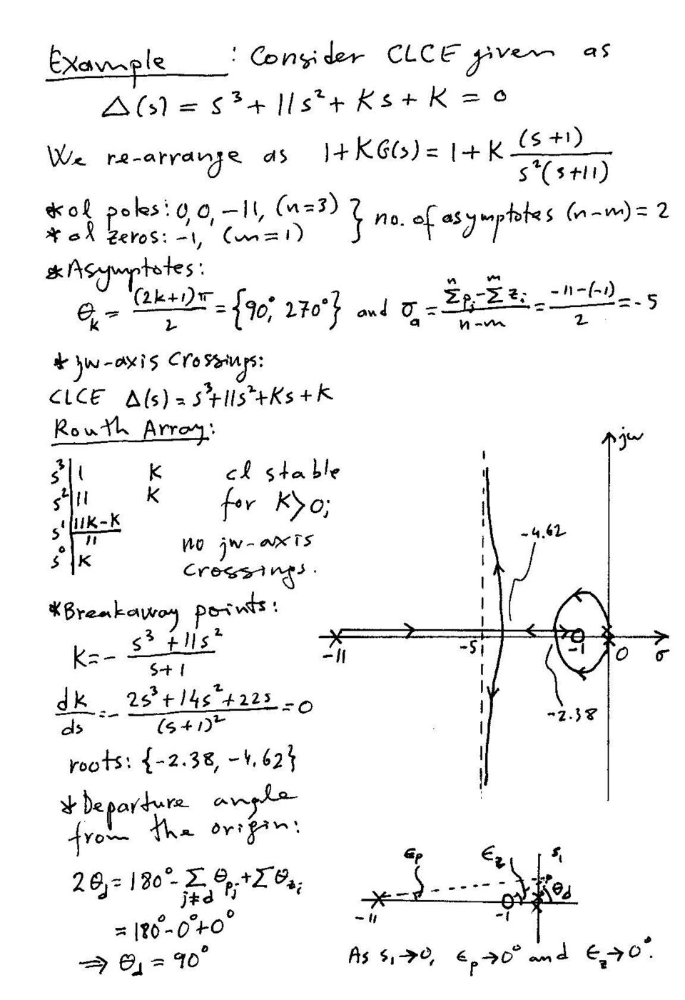
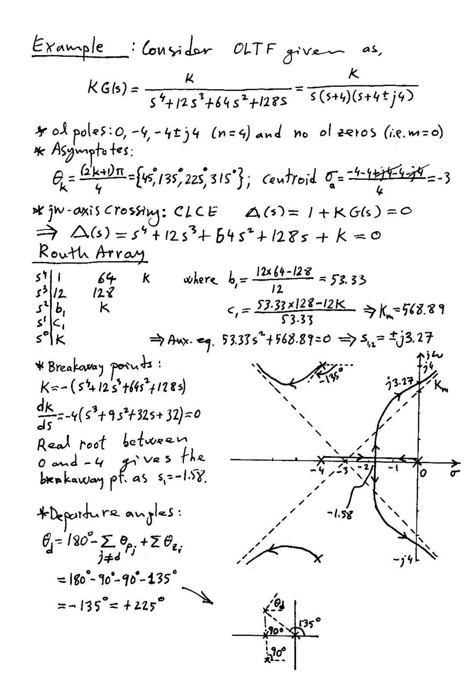

This post collects **two root locus pages from the Alper Uraz example set** in the EEM322 archive, together with a friend's root locus lecture notes dated 20 April 2009. The instructor's two scanned pages can be downloaded as a ZIP at the end of the post. The student notes were **transcribed to text from photographed pages**; those photographs have not been published. A general treatment of the topic can be found in the [Lecture 8 post](/arsiv/eem322-ders-08-kok-yer-egrisi/).

## Characteristic Equation and Plotting Rules

The notebook's "Golden rule" heading is the characteristic equation **1 + KG(s)H(s) = 0**. The root locus shows how the roots of this equation move as K varies.

- For K = 0, the branches start at the open-loop poles.
- Branches that do not end at finite zeros go to infinity.
- For n poles and m zeros there are n − m asymptotes; when n = m, no branch goes to infinity along an asymptote.
- The locus is symmetric about the real axis.
- On the real axis, the segments to the right of which the total number of real poles and zeros is odd belong to the locus.
- Asymptote angles: θ_k = (2k + 1)π/(n − m).
- Asymptote centroid: σ_a = (Σp_i − Σz_i)/(n − m).
- At a point on the locus, the gain magnitude is |K| = 1/|G(s)H(s)|.

The angle of departure from a complex pole is found from the angle contributions of the other poles and zeros: **θ_d = 180° − Σθ_p + Σθ_z**. The angle of arrival at a zero is derived from the same angle condition. The notebook illustrates the "breakaway" and "break-in" points with separate sketches.

## Uraz Example: s³ + 11s² + Ks + K = 0

The equation is rearranged as 1 + K(s + 1)/[s²(s + 11)] = 0.

- Open-loop poles: 0, 0, −11.
- Open-loop zero: −1.
- Number of asymptotes: 2; angles 90° and 270°.
- Asymptote centroid: [−11 − (−1)]/2 = **−5**.

Routh table:

| Row | First element | Second element |
|---|---|---|
| s³ | 1 | K |
| s² | 11 | K |
| s¹ | 10K/11 | 0 |
| s⁰ | K | 0 |

**For K > 0 the system is stable**; there is no imaginary-axis crossing in this range.

K = −(s³ + 11s²)/(s + 1)

dK/ds = −(2s³ + 14s² + 22s)/(s + 1)² = 0

The candidates other than the origin are **s ≈ −2.38 and −4.62**. The departure angles from the double pole at the origin are ±90°. The real branch proceeds from −11 toward −1; the complex branches meet at this real-axis point and then break away again.

## Uraz Example: Fourth-Order Open Loop

KG(s) = K/[s⁴ + 12s³ + 64s² + 128s]

The denominator factors as s(s + 4)[(s + 4)² + 16]. The poles are 0, −4, −4 ± j4; there are no finite zeros. The four asymptote angles are **45°, 135°, 225°, 315°**, with centroid **−3**.

Characteristic equation:

Δ(s) = s⁴ + 12s³ + 64s² + 128s + K = 0

Routh table:

| Row | First element | Second element | Third element |
|---|---|---|---|
| s⁴ | 1 | 64 | K |
| s³ | 12 | 128 | 0 |
| s² | 160/3 ≈ 53.33 | K | 0 |
| s¹ | 128 − 9K/40 | 0 | 0 |
| s⁰ | K | 0 | 0 |

The limiting gain is **K_m = 5120/9 ≈ 568.89**. Since the auxiliary equation is (160/3)s² + 5120/9 = 0, the imaginary-axis crossing is at **s = ±j√(32/3) ≈ ±j3.27**. The stable gain range is **0 < K < 568.89**.

For the breakaway point:

K = −(s⁴ + 12s³ + 64s² + 128s)

dK/ds = −4(s³ + 9s² + 32s + 32) = 0

The real root between −4 and 0 is approximately **−1.58**. The angle of departure from the upper complex pole is:

θ_d = 180° − 90° − 90° − 135° = **−135° = 225°**.

## 2009 Notebook: K/[s(s + 1)(s + 3)]

The characteristic equation is written as s³ + 4s² + 3s + K = 0. For the breakaway, K = −s³ − 4s² − 3s and **3s² + 8s + 3 = 0** are solved. The notes state that the breakaway point on the root locus is to be chosen between −1 and 0.

*Note: The two roots of the equation are (−4 ± √7)/3. The root at approximately −0.451 lies on the valid real-axis segment; the candidate at approximately −2.215 falls between −3 and −1, so it does not belong to the root locus for K > 0.*

## 2009 Notebook: K/[s(s + 1)(s + 2)]

In the sketch titled "Example 5-4", the poles are 0, −1, −2; the asymptote centroid is given as −1 and the asymptote angles as 60°, 180°, 300°. The point where the locus leaves the real axis is **s ≈ −0.423**. The critical gain is **K_c = 6**, and the imaginary-axis crossing is **±j√2**.

These values are consistent with the characteristic equation s³ + 3s² + 2s + K = 0. The photographed sketches of the asymptotes and the directions of pole movement are described in the text.

## 2009 Notebook: s³ + 7s² + 16s + K + 10 = 0

Open-loop form:

1 + K/[(s + 1)(s² + 6s + 10)] = 0

The poles are −1 and −3 ± j; there are no finite zeros. The three asymptote angles are 60°, 180°, 300°; the centroid is **−7/3 ≈ −2.33**.

The first column of the Routh table is 1, 7, [112 − (K + 10)]/7, K + 10. Hence the critical gain is **K_m = 102**. The auxiliary equation is 7s² + 112 = 0, with crossing at **±j4**.

*Note: In the notebook's first sketch, K_m = 112 is written next to the crossing, while the Routh calculation on the following page gives 102. The value 112 is K + 10; the critical K is 102.*

The breakaway candidates from dK/ds = −(3s² + 14s + 16) = 0 are **−2 and −8/3 ≈ −2.67**. The departure angle from the upper pole is computed in the notes as 180° − 90° − 153° ≈ **−63°**.

### Pole Selection for Approximately ζ = 0.7

The notebook assumes poles −a ± ja on the line at about 45° and a third pole at −b:

Δ(s) = (s + b)(s² + 2as + 2a²)

Coefficient matching:

- 2a + b = 7
- 2a² + 2ab = 16
- 2a²b = 10 + K

From this, a² − 7a + 8 = 0; the appropriate root is approximately a = 1.44, b = 4.12. The notebook gives **K ≈ 7.09**, with poles **−4.12 and −1.44 ± j1.44**.

*Note: The 45° line corresponds exactly to ζ = 1/√2 ≈ 0.7071. If a = (7 − √17)/2 is used without rounding, K ≈ 7.0625 results; the 7.09 in the notebook comes from rounding the intermediate values to two digits.*
