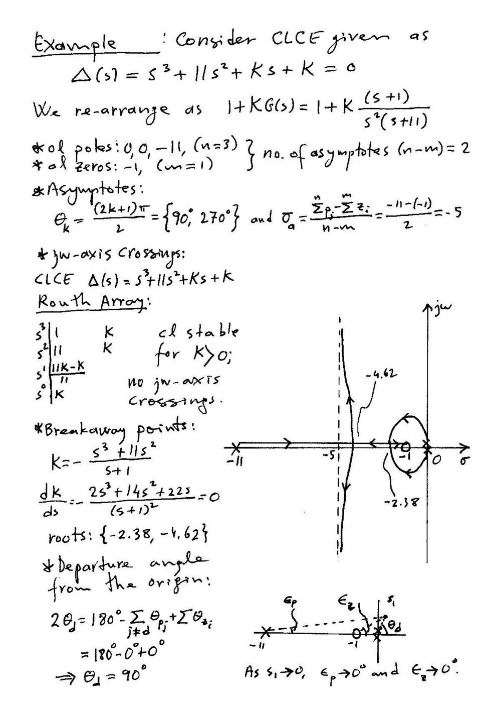
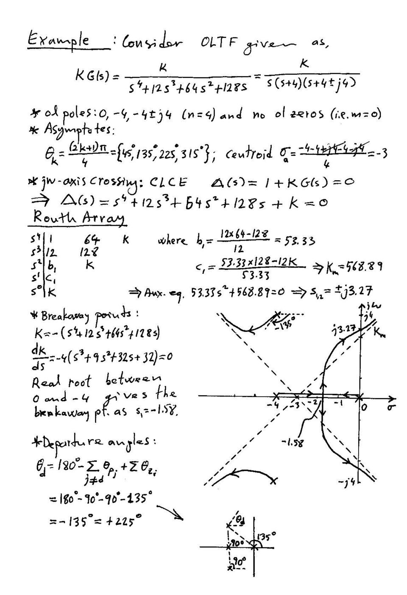

EEM322 arşivindeki **Alper Uraz örnek setinin iki kök yer sayfası** ile bir arkadaşın 20 Nisan 2009 tarihli kök yer ders notları bu yazıda toplandı. Öğretim üyesinin taranmış iki sayfası yazının sonunda ZIP olarak indirilebilir. Öğrenci notları **fotoğraflanmış sayfalardan metne aktarıldı**; bu fotoğraflar yayımlanmadı. Genel konu anlatımı [Ders 8 yazısında](/arsiv/eem322-ders-08-kok-yer-egrisi/) bulunuyor.

## Karakteristik denklem ve çizim kuralları

Defterin “Golden rule” başlığı **1 + KG(s)H(s) = 0** karakteristik denklemidir. Kök yer eğrisi K değişirken bu denklemin köklerinin hareketini gösterir.

- K = 0 için dallar açık döngü kutuplarından başlar.
- Sonlu sıfırlarda bitmeyen dallar sonsuza gider.
- n kutup, m sıfır için n − m asimptot vardır; n = m olduğunda sonsuza giden asimptot yoktur.
- Eğri gerçek eksene göre simetriktir.
- Gerçek eksen üzerinde, sağında kalan gerçek kutup ve sıfırların toplam sayısı tek olan parçalar eğriye aittir.
- Asimptot açıları θ_k = (2k + 1)π/(n − m).
- Asimptot merkezi σ_a = (Σp_i − Σz_i)/(n − m).
- Eğri üzerindeki bir noktada kazanç büyüklüğü |K| = 1/|G(s)H(s)|.

Bir karmaşık kutuptan ayrılma açısı, diğer kutup ve sıfırların açı katkılarıyla bulunur: **θ_d = 180° − Σθ_p + Σθ_z**. Sıfıra varış açısı aynı açı koşulundan türetilir. Defterde “ayrılma” ve “birleşme” noktaları ayrı çizimlerle gösterilmiş.

## Uraz örneği: s³ + 11s² + Ks + K = 0

Denklem 1 + K(s + 1)/[s²(s + 11)] = 0 olarak düzenlenir.

- Açık döngü kutupları: 0, 0, −11.
- Açık döngü sıfırı: −1.
- Asimptot sayısı: 2; açılar 90° ve 270°.
- Asimptot merkezi: [−11 − (−1)]/2 = **−5**.

Routh tablosu:

| Satır | İlk eleman | İkinci eleman |
|---|---|---|
| s³ | 1 | K |
| s² | 11 | K |
| s¹ | 10K/11 | 0 |
| s⁰ | K | 0 |

**K > 0 için sistem kararlıdır**; bu aralıkta sanal eksen kesişimi yoktur.

K = −(s³ + 11s²)/(s + 1)

dK/ds = −(2s³ + 14s² + 22s)/(s + 1)² = 0

Orijin dışındaki adaylar **s ≈ −2.38 ve −4.62**. Orijindeki çift kutuptan ayrılma açıları ±90°’dir. Gerçek dal −11’den −1’e doğru ilerler; karmaşık dallar bu gerçek eksen kesimiyle birleşip yeniden ayrılır.

## Uraz örneği: dördüncü dereceden açık döngü

KG(s) = K/[s⁴ + 12s³ + 64s² + 128s]

Payda s(s + 4)[(s + 4)² + 16] biçiminde ayrılır. Kutuplar 0, −4, −4 ± j4; sonlu sıfır yoktur. Dört asimptotun açıları **45°, 135°, 225°, 315°**, merkezi **−3**.

Karakteristik denklem:

Δ(s) = s⁴ + 12s³ + 64s² + 128s + K = 0

Routh tablosu:

| Satır | İlk eleman | İkinci eleman | Üçüncü eleman |
|---|---|---|---|
| s⁴ | 1 | 64 | K |
| s³ | 12 | 128 | 0 |
| s² | 160/3 ≈ 53.33 | K | 0 |
| s¹ | 128 − 9K/40 | 0 | 0 |
| s⁰ | K | 0 | 0 |

Sınır kazanç **K_m = 5120/9 ≈ 568.89**. Yardımcı denklem (160/3)s² + 5120/9 = 0 olduğundan sanal eksen kesişimi **s = ±j√(32/3) ≈ ±j3.27**. Kararlı kazanç aralığı **0 < K < 568.89**.

Ayrılma noktası için:

K = −(s⁴ + 12s³ + 64s² + 128s)

dK/ds = −4(s³ + 9s² + 32s + 32) = 0

−4 ile 0 arasındaki gerçek kök yaklaşık **−1.58**. Üst karmaşık kutuptan ayrılma açısı:

θ_d = 180° − 90° − 90° − 135° = **−135° = 225°**.

## 2009 defteri: K/[s(s + 1)(s + 3)]

Karakteristik denklem s³ + 4s² + 3s + K = 0 olarak yazılmış. Ayrılma için K = −s³ − 4s² − 3s ve **3s² + 8s + 3 = 0** çözülür. Notta, kök yer eğrisindeki ayrılma noktasının −1 ile 0 arasında seçileceği belirtilmiş.

*Not: Denklemin iki kökü (−4 ± √7)/3’tür. Yaklaşık −0.451 olan kök uygun gerçek eksen parçasındadır; yaklaşık −2.215 olan aday −3 ile −1 arasına düştüğünden K > 0 kök yer eğrisine ait değildir.*

## 2009 defteri: K/[s(s + 1)(s + 2)]

“Example 5-4” başlıklı çizimde kutuplar 0, −1, −2; asimptot merkezi −1 ve asimptot açıları 60°, 180°, 300° olarak verilmiş. Eğrinin gerçek eksenden ayrılma noktası **s ≈ −0.423**. Kritik kazanç **K_c = 6**, sanal eksen kesişimi **±j√2**.

Bu değerler s³ + 3s² + 2s + K = 0 karakteristik denklemiyle tutarlıdır. Asimptotlara ve kutupların hareket yönlerine ait fotoğraf çizimleri metinle anlatıldı.

## 2009 defteri: s³ + 7s² + 16s + K + 10 = 0

Açık döngü biçimi:

1 + K/[(s + 1)(s² + 6s + 10)] = 0

Kutuplar −1 ve −3 ± j; sonlu sıfır yoktur. Üç asimptotun açıları 60°, 180°, 300°; merkez **−7/3 ≈ −2.33**.

Routh ilk sütunu 1, 7, [112 − (K + 10)]/7, K + 10’dur. Dolayısıyla kritik kazanç **K_m = 102**. Yardımcı denklem 7s² + 112 = 0, kesişim **±j4**.

*Not: Defterin ilk çiziminde kesişimin yanına K_m = 112 yazılmış, sonraki sayfadaki Routh hesabında 102 bulunmuştur. 112 değeri K + 10’dur; kritik K = 102’dir.*

Ayrılma adayları dK/ds = −(3s² + 14s + 16) = 0 denkleminden **−2 ve −8/3 ≈ −2.67**. Üst kutuptan ayrılma açısı notta 180° − 90° − 153° ≈ **−63°** olarak hesaplanır.

### Yaklaşık ζ = 0.7 için kutup seçimi

Defterde yaklaşık 45° doğrusu üzerinde −a ± ja kutupları ve üçüncü kutup −b kabul edilmiş:

Δ(s) = (s + b)(s² + 2as + 2a²)

Katsayı eşleştirme:

- 2a + b = 7
- 2a² + 2ab = 16
- 2a²b = 10 + K

Buradan a² − 7a + 8 = 0; uygun kök yaklaşık a = 1.44, b = 4.12. Defterde **K ≈ 7.09**, kutuplar **−4.12 ve −1.44 ± j1.44** verilmiş.

*Not: 45° doğrusu tam olarak ζ = 1/√2 ≈ 0.7071’e karşılık gelir. Yuvarlamadan a = (7 − √17)/2 kullanılırsa K ≈ 7.0625 çıkar; defterdeki 7.09 ara değerlerin iki basamağa yuvarlanmasından kaynaklanır.*
