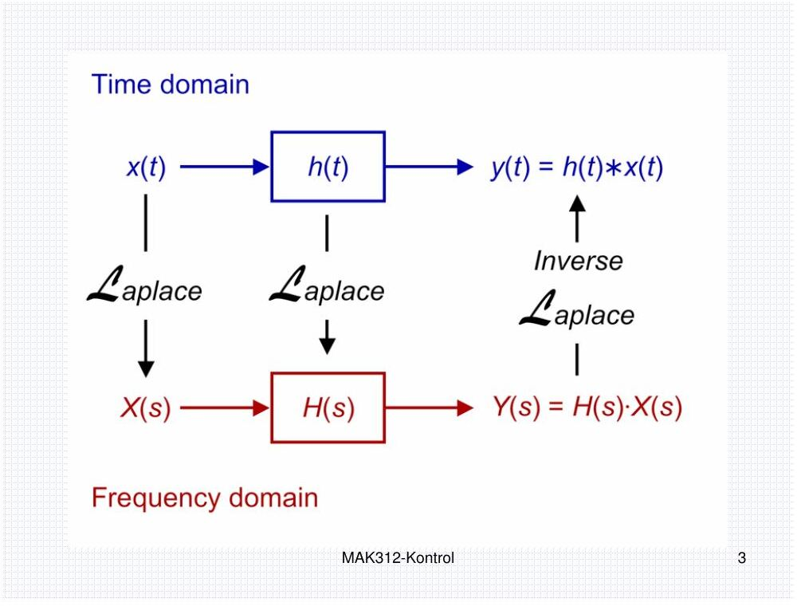
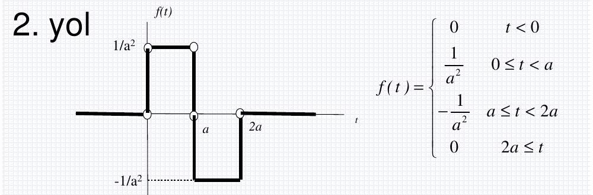

This post is a **third-party** presentation stored in the "eem322_kontrol_alper_siteden" subfolder of the EEM322 Control Systems folder: the "Laplace Transform" slides of the **MAK312 System Dynamics and Control** course, **2007–2008 Fall semester**. Judging by the folder name, it was downloaded from a website; the presentation does not name the instructor or the university. The PDF has 31 pages (62 slides) with two slides per page and is dated **5 March 2008**. The slide text and formulas are transcribed below as text; the original PDF can be downloaded at the end of the post.

*This content belongs to a third-party source; it is shared for archival and nostalgic purposes with the source credited. It will be removed at the request of the rights holder.*

## Laplace transform

One of the most important tools for modeling and analyzing linear systems is the Laplace transform. Its power lies in **converting linear differential equations into algebraic equations**; since it is used heavily in system dynamics courses, it is the first topic that should be studied.



The Laplace transform of a function f(t) is found by multiplying f(t) by e^(−st) and integrating from t = 0 to ∞. The result is a function of the complex Laplace variable s:

> F(s) = L[f(t)] = ∫₀^∞ f(t)·e^(−st) dt

**Linearity:** L[a·f(t) + b·g(t)] = a·F(s) + b·G(s).

## Transforms of basic functions

| Function | f(t) (t ≥ 0) | F(s) |
| --- | --- | --- |
| Exponential | A·e^(−αt) | A/(s + α)  (s > −α) |
| Unit step | h(t) = 1(t) | 1/s |
| Shifted unit step | 1(t − t₀) | e^(−st₀)/s |
| Ramp | a·t | a/s² |
| Sine | A·sin(ωt) | Aω/(s² + ω²) |
| Cosine | A·cos(ωt) | As/(s² + ω²) |
| Pulse, height A/t₀, duration t₀ | (A/t₀)[1(t) − 1(t − t₀)] | (A/(s·t₀))(1 − e^(−st₀)) |
| Impulse | A·δ(t) | A |

- **Ramp:** the integral is solved by integration by parts (∫u dv = uv − ∫v du, u = t, dv = e^(−st)dt, v = −e^(−st)/s): L[a·t] = a·∫₀^∞ e^(−st)dt/s = a/s².
- **Sine:** writing sin(ωt) = (e^(iωt) − e^(−iωt))/(2i) gives L = (A/2i)[1/(s − iω) − 1/(s + iω)] = Aω/(s² + ω²); the cosine is found similarly.
- **Impulse:** take the limit t₀ → 0 in the pulse function; the 0/0 indeterminate form is resolved with L'Hôpital's rule: lim A(1 − e^(−st₀))/(st₀) = As/s = A. If the area underneath is 1, it is called the unit impulse (Dirac delta). The unit impulse at t = t₀, δ(t − t₀), is 0 for t ≠ t₀, ∞ at t = t₀, and ∫δ(t − t₀)dt = 1. The unit impulse is the derivative of the unit step; the unit step is likewise the integral of the unit impulse.

Computing integrals as in these examples is not always practical; instead, prepared Laplace transform tables are used.

## Transform rules

- **Shifting in the time axis:** for a > 0, L[f(t − a)] = e^(−as)·F(s). (Proof: change of variable τ = t − a; time-dependent functions are taken to be zero for t < 0.)
- **Multiplication by e^(−αt):** L[e^(−αt)·f(t)] = F(s + α). Example: L[sin ωt] = ω/(s² + ω²) ⇒ L[e^(−αt) sin ωt] = ω/((s + α)² + ω²).
- **Derivatives:** L[df/dt] = sF(s) − f(0); L[d²f/dt²] = s²F(s) − s·f(0) − ḟ(0); in general L[f⁽ⁿ⁾(t)] = sⁿF(s) − s^(n−1)f(0) − s^(n−2)ḟ(0) − … − f⁽ⁿ⁻¹⁾(0).
- **Example:** for g(t) = sin ωt, L[ġ(t)]: method I, ġ = ω cos ωt ⇒ sω/(s² + ω²); method II, s·ω/(s² + ω²) − g(0) = sω/(s² + ω²).
- **Integral:** L[∫f(t)dt] = F(s)/s + f⁻¹(0)/s, where f⁻¹(0) = (∫f(t)dt) at t = 0; for a definite integral, L[∫₀ᵗ f(t)dt] = F(s)/s.
- **Complex differentiation theorem:** L[t·f(t)] = −dF(s)/ds, L[t²f(t)] = d²F(s)/ds², L[tⁿf(t)] = (−1)ⁿ dⁿF(s)/dsⁿ.
- **Convolution:** f₁(t)∗f₂(t) = ∫₀ᵗ f₁(t − τ)f₂(τ)dτ = f₂(t)∗f₁(t) and L[f₁∗f₂] = F₁(s)·F₂(s).
- **Product of two functions:** L[f(t)·g(t)] = (1/2πj)∫_(c−j∞)^(c+j∞) F(ρ)G(s − ρ)dρ.

*Note: In the slide, the derivatives in the complex differentiation theorem are written with d/dt; since F(s) is a function of s, the derivative is with respect to s (d/ds).*

## Final value and initial value theorems

The final value theorem gives the steady-state behavior of a function and is valid only if lim(t→∞) f(t) exists. If all poles of sF(s) lie in the left half of the s-plane, f(t) settles to a bounded value. If the poles are on the imaginary axis or in the right half-plane, f(t) oscillates or grows exponentially and the limit does not exist; for example, for f(t) = sin ωt, F(s) = ω/(s² + ω²), the poles are s = ∓jω, and the final value theorem cannot be applied.

> **Theorem:** If the Laplace transforms of f(t) and df/dt exist and lim(t→∞) f(t) exists, then lim(t→∞) f(t) = lim(s→0) sF(s).

Proof: taking the limit s → 0 in the derivative rule gives lim ∫₀^∞ (df/dt)e^(−st)dt = lim[sF(s) − f(0)]; since e^(−st) → 1, the left side becomes ∫₀^∞ (df/dt)dt = lim f(t) − f(0), and the result follows from the two equalities.

**Example:** F(s) = 1/(s(s + 1)). sF(s) = 1/(s + 1); the pole s = −1 is in the left half-plane, so the limit exists: lim f(t) = lim(s→0) 1/(s + 1) = 1.

**Initial value theorem:** f(0+) = lim(s→∞) sF(s) (its proof is left as homework).

## Example: doublet pulse and the limit a → 0



f(t) is written as a sum of steps: f(t) = (1/a²)1(t) − (2/a²)1(t − a) + (1/a²)1(t − 2a). Thus

> F(s) = (1/(a²s))·(1 − 2e^(−as) + e^(−2as))

The same result is also found by integration (method 2). The limit a → 0 is a 0/0 indeterminate form; applying L'Hôpital's rule twice gives lim F(s) = −s + 2s = s (the transform of the derivative of the unit impulse, i.e., the unit doublet).

## Periodic functions

For an f(t) with period T,

> L[f(t)] = (1/(1 − e^(−Ts)))·∫₀ᵀ f(t)e^(−st)dt

Proof: the integral is split into periods, τ = t − nT gives Σ e^(−nTs)·∫₀ᵀ f(τ)e^(−sτ)dτ, and the geometric series Σ e^(−nTs) = 1/(1 − e^(−Ts)) is used.

**Example:** for a square wave that is +1 over 0–T/2 and −1 over T/2–T,

> L[f(t)] = (1/(1 − e^(−Ts)))·(1/s)·(1 − e^(−sT/2))² = (1/s)·(1 − e^(−sT/2))/(1 + e^(−sT/2))

## Inverse Laplace transform and partial fractions

> L⁻¹[F(s)] = f(t) = (1/2πj)∫_(c−j∞)^(c+j∞) F(s)e^(st) ds

Here the constant c is chosen greater than all poles of F(s). This integral is very rarely used; instead, F(s) is decomposed into components whose transforms are known, and each is inverse transformed separately: F(s) = F₁(s) + … + Fₙ(s) ⇒ f(t) = f₁(t) + … + fₙ(t).

*Note: In the slide, the exponential term in the inverse transform integral is written as e^(−sτ); the correct form is e^(st).*

**Partial fraction expansion:** F(s) = B(s)/A(s) must be a proper fraction, i.e., deg A(s) > deg B(s). If not, division is performed first: (s + 1)/s = 1 + 1/s.

### (i) Distinct poles

> F(s) = K(s + z₁)…(s + z_m)/[(s + p₁)…(s + p_n)] = a₁/(s + p₁) + a₂/(s + p₂) + … + aₙ/(s + pₙ), m < n

The constants a_k are called residues. Multiplying both sides of the equality by (s + p_k) and setting s = −p_k gives a_k = [(s + p_k)F(s)] (s = −p_k). Using L⁻¹[a_k/(s + p_k)] = a_k·e^(−p_k t), we obtain f(t) = a₁e^(−p₁t) + a₂e^(−p₂t) + … + aₙe^(−pₙt).

Exercises: F(s) = 4(s + 1)(s + 2)/[s(s + 1)(s + 2)]; F(s) = (s⁴ + 3s² + 5s + 1)/[s(s + 1)(s + 2)]; F(s) = (s + 4)/(s² + s + 1).

### (ii) Repeated poles

F(s) = (s² + 2s + 3)/(s + 1)³ = b₁/(s + 1) + b₂/(s + 1)² + b₃/(s + 1)³. Multiplying both sides by (s + 1)³ gives (s + 1)³F(s) = (s + 1)²b₁ + (s + 1)b₂ + b₃:

- At s = −1: b₃ = (s² + 2s + 3) = 2
- First derivative at s = −1: b₂ = (2s + 2) = 0
- Second derivative at s = −1: 2b₁ = 2 ⇒ b₁ = 1

> F(s) = 1/(s + 1) + 2/(s + 1)³,  L⁻¹[1/(s + a)ⁿ] = tⁿ⁻¹e^(−at)/(n − 1)!
> f(t) = e^(−t) + 2·t²e^(−t)/2! = e^(−t)(1 + t²)

### Partial fractions with MATLAB

For F(s) = B(s)/A(s) = (b(1)s^m + … + b(m))/(a(1)s^n + … + a(n)), with coefficient vectors `num` and `den`, `[r,p,k] = residue(num,den)` returns the residues (r), poles (p), and the direct term (k). Example:

```matlab
num = [1 -8 17 -6 -2];
den = [1 -10 31 -30];
[r,p,k] = residue(num,den)
% r = 3, 1, 2   p = 5, 3, 2   k = 1 2
[num,den] = residue([3 1 2],[5 3 2],[1 2])   % reverse direction: from fractions to polynomials
```

> F(s) = (s⁴ − 8s³ + 17s² − 6s − 2)/(s³ − 10s² + 31s − 30) = s + 2 + 3/(s − 5) + 1/(s − 3) + 2/(s − 2)

*Note: In the slide the result is written as "3/(s + 5) + 1/(s + 3) + 2/(s + 2)"; the poles in the MATLAB screenshot are p = 5, 3, 2, and the denominator factors as (s − 2)(s − 3)(s − 5), so the denominators should be s − 5, s − 3, s − 2.*

## Solving linear time-invariant differential equations

Two steps are followed: (1) the Laplace transform of each term of the differential equation is taken, giving an algebraic equation in s, and the dependent variable X(s) is isolated; (2) the inverse Laplace transform is applied to X(s) to obtain the time function. The transforms of the derivatives are:

> L[x(t)] = X(s), L[ẋ(t)] = sX(s) − x(0), L[ẍ(t)] = s²X(s) − s·x(0) − ẋ(0)
> L[x⁽ⁿ⁾(t)] = sⁿX(s) − Σ(k=1…n) s^(n−k)·x⁽ᵏ⁻¹⁾(0)

Exercises:

- Example 4: y⃛ + 6ÿ + 11ẏ + 6y = 2t, y(0) = ẏ(0) = ÿ(0) = 0
- Example 5: ẍ + 2ẋ + 5x = 1, x(0) = 0, ẋ(0) = 2
