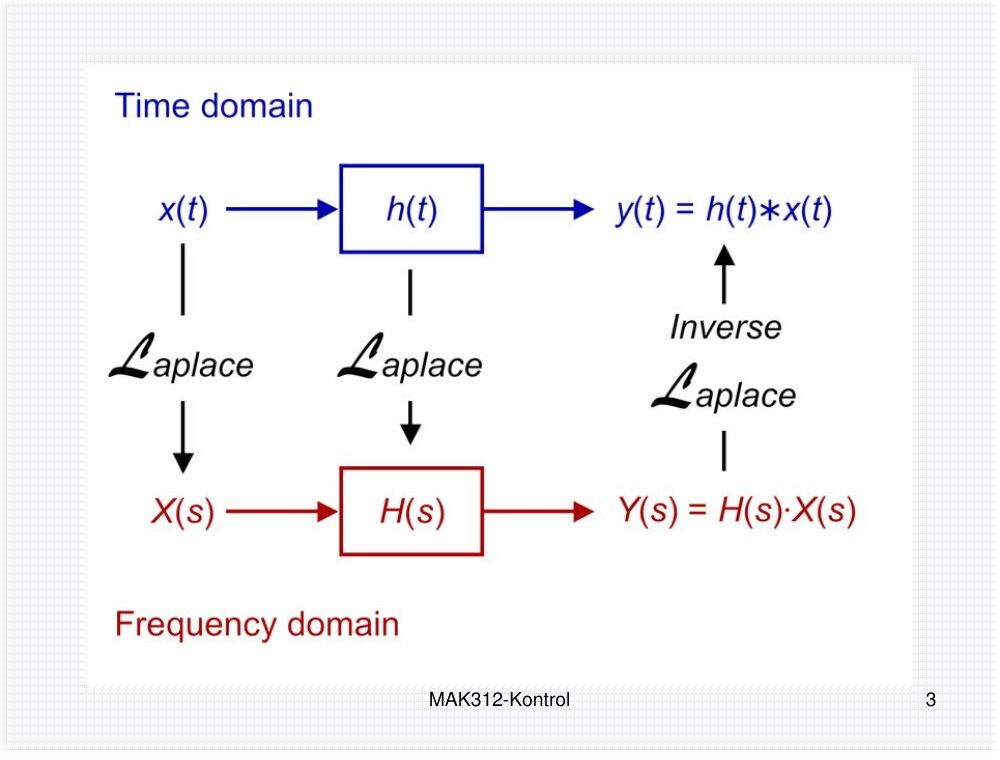
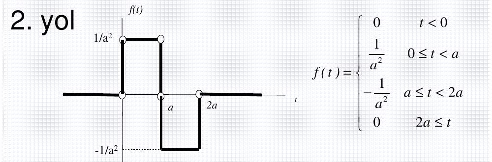

Bu yazı, EEM322 Denetim Sistemleri klasöründe "eem322_kontrol_alper_siteden" alt klasöründe saklanan **üçüncü taraf** bir sunumdur: **MAK312 Sistem Dinamiği ve Kontrol** dersinin **2007–2008 Güz dönemi** "Laplace Dönüşümü (Laplace Transform)" slaytları. Klasör adına göre bir web sitesinden indirilmiş; sunumda hoca ya da üniversite adı yazmıyor. PDF, sayfa başına iki slayt olacak şekilde 31 sayfa (62 slayt) ve **5 Mart 2008** tarihli. Slayt metinleri ve formüller aşağıya yazı olarak aktarıldı; orijinal PDF yazının sonunda indirilebilir.

*Bu içerik üçüncü taraf bir kaynağa aittir; arşiv ve nostalji amacıyla kaynak belirtilerek paylaşılmıştır. Hak sahibinin talebi hâlinde kaldırılır.*

## Laplace dönüşümü

Doğrusal sistemlerin modellenmesi ve analizi için kullanılan en önemli araçlardan biri Laplace dönüşümüdür. Gücü, **doğrusal diferansiyel denklemleri cebirsel denklemlere dönüştürmesinde** yatar; sistem dinamiği dersinde çok kullanıldığı için en başta çalışılması gereken konudur.



Bir f(t) fonksiyonunun Laplace dönüşümü, f(t)'yi e^(−st) ile çarpıp t = 0'dan ∞'a integral alarak bulunur. Sonuç, karmaşık Laplace değişkeni s'nin bir fonksiyonudur:

> F(s) = L[f(t)] = ∫₀^∞ f(t)·e^(−st) dt

**Doğrusallık:** L[a·f(t) + b·g(t)] = a·F(s) + b·G(s).

## Temel fonksiyonların dönüşümleri

| Fonksiyon | f(t) (t ≥ 0) | F(s) |
| --- | --- | --- |
| Üstel | A·e^(−αt) | A/(s + α)  (s > −α) |
| Birim basamak | h(t) = 1(t) | 1/s |
| Ötelenmiş birim basamak | 1(t − t₀) | e^(−st₀)/s |
| Rampa | a·t | a/s² |
| Sinüs | A·sin(ωt) | Aω/(s² + ω²) |
| Kosinüs | A·cos(ωt) | As/(s² + ω²) |
| Vurum (puls), yükseklik A/t₀, süre t₀ | (A/t₀)[1(t) − 1(t − t₀)] | (A/(s·t₀))(1 − e^(−st₀)) |
| Anivurum (impuls) | A·δ(t) | A |

- **Rampa:** integral kısmi integrasyonla (∫u dv = uv − ∫v du, u = t, dv = e^(−st)dt, v = −e^(−st)/s) çözülür: L[a·t] = a·∫₀^∞ e^(−st)dt/s = a/s².
- **Sinüs:** sin(ωt) = (e^(iωt) − e^(−iωt))/(2i) yazılarak L = (A/2i)[1/(s − iω) − 1/(s + iω)] = Aω/(s² + ω²); kosinüs benzer şekilde bulunur.
- **İmpuls:** vurum fonksiyonunda t₀ → 0 limiti alınır; 0/0 belirsizliği L'Hôpital ile çözülür: lim A(1 − e^(−st₀))/(st₀) = As/s = A. Altındaki alan 1 ise birim impuls (Dirac delta) adını alır. t = t₀ anındaki birim impuls δ(t − t₀): t ≠ t₀ için 0, t = t₀'da ∞ ve ∫δ(t − t₀)dt = 1. Birim impuls, birim basamağın türevidir; birim basamak da birim impulsun integralidir.

Bu örneklerdeki gibi integral almak her zaman pratik değildir; bunun yerine hazırlanmış Laplace dönüşüm tabloları kullanılır.

## Dönüşüm kuralları

- **Zaman ekseninde öteleme:** a > 0 için L[f(t − a)] = e^(−as)·F(s). (İspat: τ = t − a değişken değiştirmesi; zamana bağlı fonksiyonlar t < 0'da sıfır kabul edilir.)
- **e^(−αt) ile çarpım:** L[e^(−αt)·f(t)] = F(s + α). Örnek: L[sin ωt] = ω/(s² + ω²) ⇒ L[e^(−αt) sin ωt] = ω/((s + α)² + ω²).
- **Türevler:** L[df/dt] = sF(s) − f(0); L[d²f/dt²] = s²F(s) − s·f(0) − ḟ(0); genel olarak L[f⁽ⁿ⁾(t)] = sⁿF(s) − s^(n−1)f(0) − s^(n−2)ḟ(0) − … − f⁽ⁿ⁻¹⁾(0).
- **Örnek:** g(t) = sin ωt için L[ġ(t)]: I. yol, ġ = ω cos ωt ⇒ sω/(s² + ω²); II. yol, s·ω/(s² + ω²) − g(0) = sω/(s² + ω²).
- **İntegral:** L[∫f(t)dt] = F(s)/s + f⁻¹(0)/s, f⁻¹(0) = (∫f(t)dt) t = 0'da; belirli integral için L[∫₀ᵗ f(t)dt] = F(s)/s.
- **Karmaşık türevleme teoremi:** L[t·f(t)] = −dF(s)/ds, L[t²f(t)] = d²F(s)/ds², L[tⁿf(t)] = (−1)ⁿ dⁿF(s)/dsⁿ.
- **Konvolüsyon:** f₁(t)∗f₂(t) = ∫₀ᵗ f₁(t − τ)f₂(τ)dτ = f₂(t)∗f₁(t) ve L[f₁∗f₂] = F₁(s)·F₂(s).
- **İki fonksiyonun çarpımı:** L[f(t)·g(t)] = (1/2πj)∫_(c−j∞)^(c+j∞) F(ρ)G(s − ρ)dρ.

*Not: Slaytta karmaşık türevleme teoreminde türevler d/dt ile yazılmış; F(s) s'nin fonksiyonu olduğundan türev s'ye göredir (d/ds).*

## Son değer ve ilk değer teoremleri

Son değer teoremi bir fonksiyonun durağan durum (steady-state) davranışını verir ve yalnızca lim(t→∞) f(t) varsa geçerlidir. sF(s)'nin bütün kutupları s düzleminin sol yarısındaysa f(t) sınırlı bir değere yerleşir. Kutuplar sanal eksendeyse ya da sağ yarı düzlemdeyse f(t) salınır veya üstel olarak büyür ve limit yoktur; örneğin f(t) = sin ωt için F(s) = ω/(s² + ω²), kutuplar s = ∓jω'dır, son değer teoremi uygulanamaz.

> **Teorem:** f(t) ve df/dt'nin Laplace dönüşümleri ve lim(t→∞) f(t) varsa, lim(t→∞) f(t) = lim(s→0) sF(s).

İspat: türev kuralında s → 0 limiti alınırsa lim ∫₀^∞ (df/dt)e^(−st)dt = lim[sF(s) − f(0)]; e^(−st) → 1 olduğundan sol taraf ∫₀^∞ (df/dt)dt = lim f(t) − f(0) olur ve iki eşitlikten sonuç çıkar.

**Örnek:** F(s) = 1/(s(s + 1)). sF(s) = 1/(s + 1); kutup s = −1 sol yarı düzlemde, limit vardır: lim f(t) = lim(s→0) 1/(s + 1) = 1.

**İlk değer teoremi:** f(0+) = lim(s→∞) sF(s) (ispatı ödev olarak bırakılmış).

## Örnek: çift darbe ve a → 0 limiti



f(t), basamakların toplamı olarak yazılır: f(t) = (1/a²)1(t) − (2/a²)1(t − a) + (1/a²)1(t − 2a). Böylece

> F(s) = (1/(a²s))·(1 − 2e^(−as) + e^(−2as))

Aynı sonuç integralle de (2. yol) bulunur. a → 0 limiti 0/0 belirsizliğidir; L'Hôpital iki kez uygulanırsa lim F(s) = −s + 2s = s elde edilir (birim impulsun türevinin, yani birim çift darbenin dönüşümü).

## Periyodik fonksiyonlar

T periyotlu bir f(t) için

> L[f(t)] = (1/(1 − e^(−Ts)))·∫₀ᵀ f(t)e^(−st)dt

İspat: integral periyotlara bölünür, τ = t − nT ile Σ e^(−nTs)·∫₀ᵀ f(τ)e^(−sτ)dτ elde edilir ve Σ e^(−nTs) = 1/(1 − e^(−Ts)) geometrik serisi kullanılır.

**Örnek:** 0–T/2 aralığında +1, T/2–T aralığında −1 olan kare dalga için

> L[f(t)] = (1/(1 − e^(−Ts)))·(1/s)·(1 − e^(−sT/2))² = (1/s)·(1 − e^(−sT/2))/(1 + e^(−sT/2))

## Ters Laplace dönüşümü ve kısmi kesirler

> L⁻¹[F(s)] = f(t) = (1/2πj)∫_(c−j∞)^(c+j∞) F(s)e^(st) ds

Buradaki c sabiti F(s)'nin bütün kutuplarından büyük seçilir. Bu integral çok nadiren kullanılır; F(s), dönüşümleri bilinen fonksiyonların bileşenlerine ayrılır ve her biri ayrı ayrı ters dönüştürülür: F(s) = F₁(s) + … + Fₙ(s) ⇒ f(t) = f₁(t) + … + fₙ(t).

*Not: Slayttaki ters dönüşüm integralinde üstel terim e^(−sτ) diye yazılmış; doğrusu e^(st)'dir.*

**Kısmi kesirlere ayırma:** F(s) = B(s)/A(s) basit kesir olmalıdır, yani deg A(s) > deg B(s). Değilse önce bölme yapılır: (s + 1)/s = 1 + 1/s.

### (i) Farklı kutuplar

> F(s) = K(s + z₁)…(s + z_m)/[(s + p₁)…(s + p_n)] = a₁/(s + p₁) + a₂/(s + p₂) + … + aₙ/(s + pₙ), m < n

a_k sabitlerine kalıntı (residue) denir. Eşitliğin iki tarafı (s + p_k) ile çarpılıp s = −p_k konursa a_k = [(s + p_k)F(s)] (s = −p_k) bulunur. L⁻¹[a_k/(s + p_k)] = a_k·e^(−p_k t) kullanılarak f(t) = a₁e^(−p₁t) + a₂e^(−p₂t) + … + aₙe^(−pₙt) elde edilir.

Alıştırmalar: F(s) = 4(s + 1)(s + 2)/[s(s + 1)(s + 2)]; F(s) = (s⁴ + 3s² + 5s + 1)/[s(s + 1)(s + 2)]; F(s) = (s + 4)/(s² + s + 1).

### (ii) Tekrarlanan kutuplar

F(s) = (s² + 2s + 3)/(s + 1)³ = b₁/(s + 1) + b₂/(s + 1)² + b₃/(s + 1)³. İki taraf (s + 1)³ ile çarpılırsa (s + 1)³F(s) = (s + 1)²b₁ + (s + 1)b₂ + b₃:

- s = −1'de: b₃ = (s² + 2s + 3) = 2
- birinci türevde s = −1: b₂ = (2s + 2) = 0
- ikinci türevde s = −1: 2b₁ = 2 ⇒ b₁ = 1

> F(s) = 1/(s + 1) + 2/(s + 1)³,  L⁻¹[1/(s + a)ⁿ] = tⁿ⁻¹e^(−at)/(n − 1)!
> f(t) = e^(−t) + 2·t²e^(−t)/2! = e^(−t)(1 + t²)

### MATLAB ile kısmi kesirler

F(s) = B(s)/A(s) = (b(1)s^m + … + b(m))/(a(1)s^n + … + a(n)) için `num` ve `den` katsayı vektörleriyle `[r,p,k] = residue(num,den)` kalıntıları (r), kutupları (p) ve tam kısmı (k) verir. Örnek:

```matlab
pay = [1 -8 17 -6 -2];
payda = [1 -10 31 -30];
[r,p,k] = residue(pay,payda)
% r = 3, 1, 2   p = 5, 3, 2   k = 1 2
[pay,payda] = residue([3 1 2],[5 3 2],[1 2])   % ters yönde: kesirlerden polinomlara
```

> F(s) = (s⁴ − 8s³ + 17s² − 6s − 2)/(s³ − 10s² + 31s − 30) = s + 2 + 3/(s − 5) + 1/(s − 3) + 2/(s − 2)

*Not: Slaytta sonuç "3/(s + 5) + 1/(s + 3) + 2/(s + 2)" diye yazılmış; MATLAB ekran görüntüsündeki kutuplar p = 5, 3, 2'dir ve payda (s − 2)(s − 3)(s − 5)'e ayrılır, yani paydalar s − 5, s − 3, s − 2 olmalıdır.*

## Doğrusal, zamanla değişmeyen diferansiyel denklemlerin çözümü

İki adım izlenir: (1) diferansiyel denklemin her teriminin Laplace dönüşümü alınır, s'ye bağlı cebirsel bir denklem elde edilir ve bağımlı değişken X(s) yalnız bırakılır; (2) X(s)'e ters Laplace dönüşümü uygulanarak zaman fonksiyonu bulunur. Türevlerin dönüşümleri:

> L[x(t)] = X(s), L[ẋ(t)] = sX(s) − x(0), L[ẍ(t)] = s²X(s) − s·x(0) − ẋ(0)
> L[x⁽ⁿ⁾(t)] = sⁿX(s) − Σ(k=1…n) s^(n−k)·x⁽ᵏ⁻¹⁾(0)

Alıştırmalar:

- Örnek 4: y⃛ + 6ÿ + 11ẏ + 6y = 2t, y(0) = ẏ(0) = ÿ(0) = 0
- Örnek 5: ẍ + 2ẋ + 5x = 1, x(0) = 0, ẋ(0) = 2
