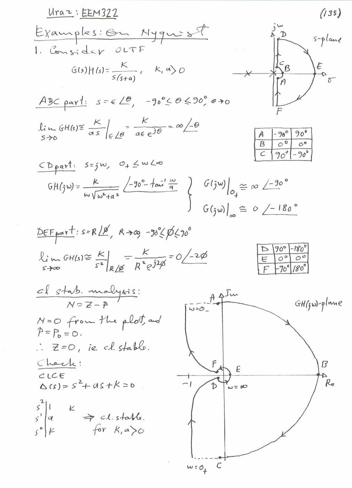
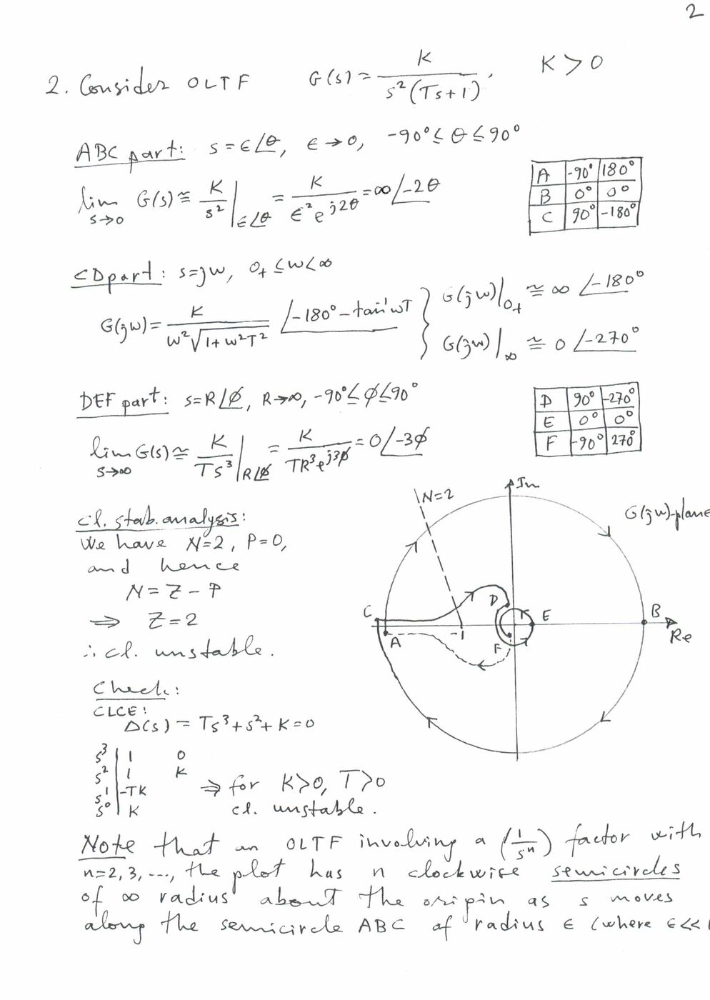
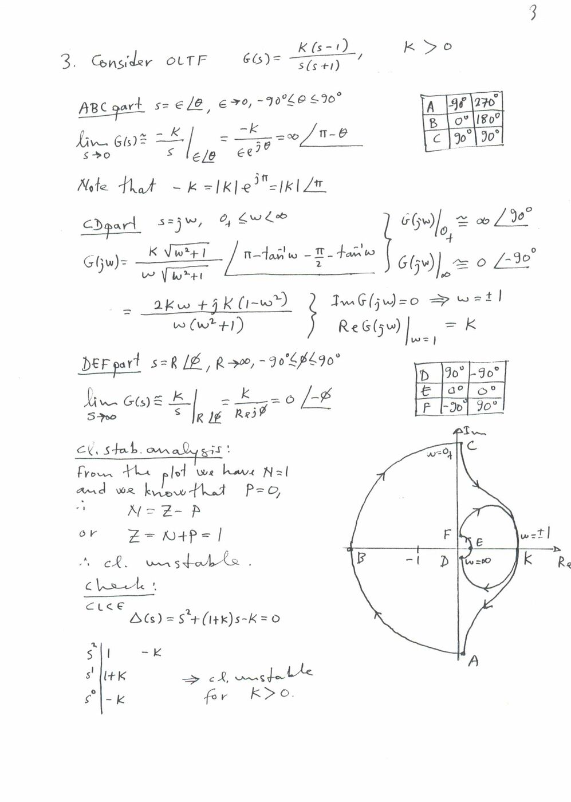
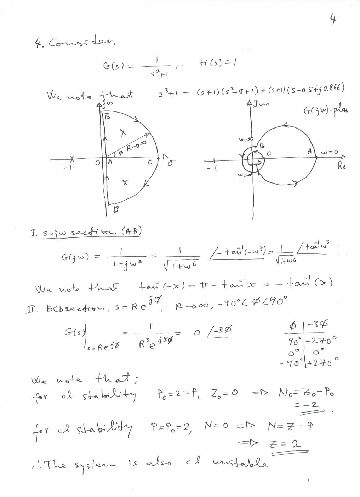
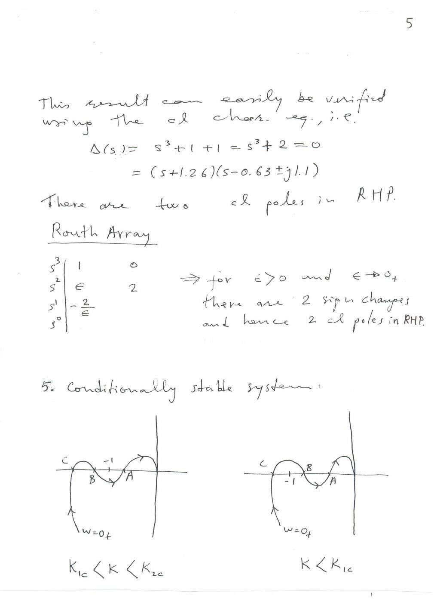
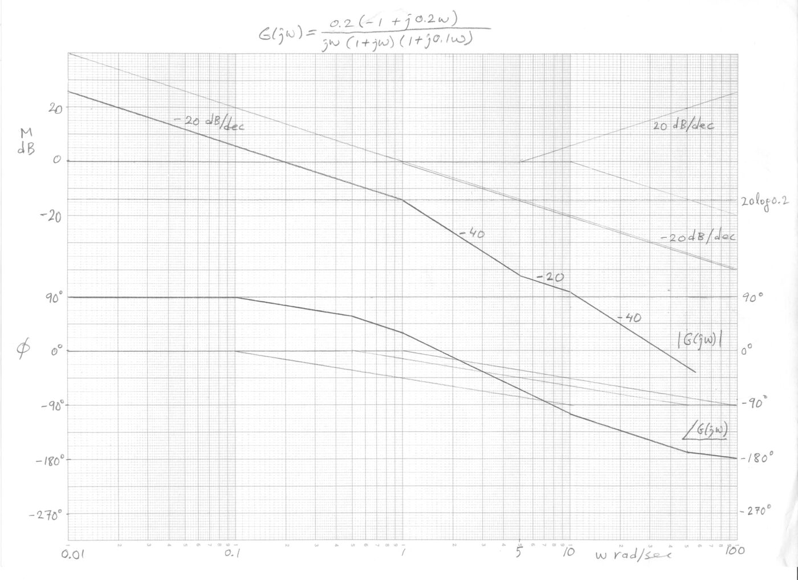

This post contains the **worked Nyquist and Bode examples** that **Prof. Dr. Alper Uraz**, instructor of the Başkent University course **EEM322 Control Systems**, prepared by hand. The pages are scanned; the file names are EEM322Ex6-1b … EEM322Ex6-7b. The title of the first page reads "Uraz: EEM322, Examples: On Nyquist", with "(135)" in the corner. There is no date; the files are part of the course's example set from around 2005. The text of the examples is transcribed below, and the Nyquist and Bode plots are included as images. All the scanned pages can be downloaded as a ZIP at the end of the post.

The Chapter 2 and 4 examples from the same set (modeling, block diagrams, time response) are in [a separate post](/arsiv/eem322-odev-uraz-ornekleri-bolum-2-4/). For a lecture-style treatment of the Bode diagram, see the [Lecture 9](/arsiv/eem322-ders-09-frekans-yaniti-bode/) note.

## The Nyquist contour and method

All the Nyquist examples use the same closed contour in the s-plane. The pole at the origin is bypassed along a small semicircle of radius ε (segment ABC), then the contour proceeds along the positive imaginary axis (segment CD, s = jω, 0₊ ≤ ω < ∞). Next it goes around the right half-plane along a large semicircle of radius R → ∞ (segment DEF) and returns along the negative imaginary axis. On each segment the limit of G(s)H(s) is taken, and the angles are tabulated for points A, B, C, D, E, F. Stability:

- N = Z − P (N: number of clockwise encirclements of the −1 point, P: number of open-loop right half-plane poles, Z: number of closed-loop right half-plane poles)

## Example 1: G(s)H(s) = K/[s(s + a)], K, a > 0

- Segment ABC (s = ε∠θ, −90° ≤ θ ≤ 90°, ε → 0): GH ≅ K/(as) = ∞∠−θ. A: −90° → +90°, B: 0° → 0°, C: 90° → −90°.
- Segment CD (s = jω): GH(jω) = K/[ω√(ω² + a²)] ∠(−90° − tan⁻¹(ω/a)); at ω = 0₊ it is ∞∠−90°, and as ω → ∞ it is 0∠−180°.
- Segment DEF (s = R∠φ, R → ∞): GH ≅ K/s² = 0∠−2φ. D: 90° → −180°, E: 0° → 0°, F: −90° → 180°.
- Stability: from the plot N = 0, P = P₀ = 0 ⇒ Z = 0, so the closed loop is stable.
- Check: Δ(s) = s² + as + K = 0; according to the Routh table, the closed loop is stable for K, a > 0.

## Example 2: G(s) = K/[s²(Ts + 1)], K > 0

- Segment ABC: G ≅ K/s² = ∞∠−2θ. A: −90° → 180°, C: 90° → −180°.
- Segment CD: G(jω) = K/[ω²√(1 + ω²T²)] ∠(−180° − tan⁻¹ωT); at ω = 0₊ it is ∞∠−180°, and as ω → ∞ it is 0∠−270°.
- Segment DEF: G ≅ K/(Ts³) = 0∠−3φ. D: 90° → −270°, F: −90° → 270°.
- Stability: N = 2, P = 0 ⇒ Z = 2, so the closed loop is unstable.
- Check: Δ(s) = Ts³ + s² + K = 0. Routh: s³: 1, 0; s²: 1, K; s¹: −TK; s⁰: K. Unstable for K > 0, T > 0.

Note (from the source): For systems whose open loop has a factor (1/sⁿ), n = 2, 3, …, as s travels along the ε-radius semicircle ABC, the curve traces n clockwise semicircles of infinite radius around the origin.

## Example 3: G(s) = K(s − 1)/[s(s + 1)], K > 0

- Segment ABC: G ≅ −K/s = ∞∠(π − θ), since −K = |K|e^(jπ). A: −90° → 270°, B: 0° → 180°, C: 90° → 90°.
- Segment CD: G(jω) = K√(ω² + 1)/[ω√(ω² + 1)] ∠(π − tan⁻¹ω − π/2 − tan⁻¹ω) = [2Kω + jK(1 − ω²)]/[ω(ω² + 1)]
- Im G(jω) = 0 ⇒ ω = ±1; Re G(jω) (ω = 1) = K. At ω = 0₊ it is ∞∠90°, and as ω → ∞ it is 0∠−90°.
- Segment DEF: G ≅ K/s = 0∠−φ.
- Stability: from the plot N = 1, P = 0 ⇒ Z = N + P = 1, so the closed loop is unstable.
- Check: Δ(s) = s² + (1 + K)s − K = 0. Routh: 1, 1 + K, −K ⇒ unstable for K > 0.

## Example 4: G(s) = 1/(s³ + 1), H(s) = 1

- s³ + 1 = (s + 1)(s² − s + 1) = (s + 1)(s − 0.5 ∓ j0.866): the open loop has two poles in the right half-plane.
- The s = jω segment (AB): G(jω) = 1/(1 − jω³) = (1/√(1 + ω⁶)) ∠tan⁻¹ω³
- Segment BCD (s = Re^(jφ), R → ∞): G = 1/(R³e^(j3φ)) = 0∠−3φ; at φ = 90° it is −270°, at 0° it is 0°, and at −90° it is +270°.
- For the open loop, P₀ = 2 = P, Z₀ = 0 ⇒ N₀ = Z₀ − P₀ = −2.
- For the closed loop, P = 2, N = 0 ⇒ Z = 2: the system is also unstable in closed loop.
- Check: Δ(s) = s³ + 1 + 1 = s³ + 2 = (s + 1.26)(s − 0.63 ∓ j1.1); the closed loop has two poles in the right half-plane. In the Routh table the first element of the s² row is zero, so ε is substituted: s³: 1, 0; s²: ε, 2; s¹: −2/ε. For ε → 0₊ there are two sign changes, i.e. two poles in the right half-plane.

## Example 5: Conditionally stable system

For a Nyquist plot that crosses the real axis several times, the position of the −1 point depends on K. The sketch compares two cases: for K₁c < K < K₂c the −1 point is not encircled (stable), whereas for K < K₁c the crossing points shift and the −1 point becomes encircled. That is, the system is stable only within a certain range of gain ("conditionally stable").

## Example 6.6b (Bode): Non-minimum-phase system

- G(s) = 0.4(s − 5)/[s(s + 1)(s + 10)] = 0.2(−1 + 0.2s)/[s(1 + s)(1 + 0.1s)]
- Corner frequencies: 1, 5, 10
- G(jω) = 0.2(−1 + j0.2ω)/[jω(1 + jω)(1 + j0.1ω)] = M(ω)∠φ(ω)
- 20 log M = 20 log 0.2 + 20 log|−1 + j0.2ω| − 20 log|jω| − 20 log|1 + jω| − 20 log|1 + j0.1ω|
- φ(ω) = 180° − tan⁻¹(0.2ω) − 90° − tan⁻¹ω − tan⁻¹(0.1ω) = 90° − tan⁻¹(0.2ω) − tan⁻¹ω − tan⁻¹(0.1ω)
- Reminder: ∠(−1 + jω) = π − tan⁻¹ω, ∠(1 − jω) = tan⁻¹(−ω) = −tan⁻¹ω

The given G(s) is not minimum phase (non-minimum phase, NMP); G₁(s) = 0.4(s + 5)/[s(s + 1)(s + 10)] is minimum phase. Their magnitude curves are the same, but their phase curves differ. In the asymptotic plot the magnitude starts at −20 dB/decade, changes to −40 at 1, −20 at 5, and back to −40 dB/decade at 10; the phase falls from +90° to −180°.

## Example 6.7b (Bode): Gain and phase margins

- G(s) = 9000s/[(s + 2)(s + 30)(s² + 5s + 25)] = 6s/[(1 + s/2)(1 + s/30)(1 + s/5 + s²/25)]
- Corner frequencies: 2, 5, 30
- 20 log M = 20 log 6 + 20 log ω − 20 log|1 + jω/2| − 20 log|1 + jω/30| − 20 log|1 − ω²/25 + jω/5|
- φ(ω) = 90° − tan⁻¹(ω/2) − tan⁻¹(ω/30) − tan⁻¹[(ω/5)/(1 − ω²/25)]
- From the plot: (a) the phase crossover frequency is ωp = 20 rad/s and gm = 3 dB; (b) the gain crossover frequency is ωg = 18 rad/s and pm = 14°.
- Result (from the source): since gm and pm are positive, the closed loop is stable.

![Example 6.7b: asymptotic Bode plot for 6jω/(1+jω/2)(1+jω/30)[1+jω/5+(jω/5)²]; gm = 3 dB, pm = 14°](bode-6-7b.jpg "Example 6.7b: margins read from the asymptotic Bode plot")

*Note: The asymptotic plot ignores the resonance effect of the second-order factor (ζ = 0.5, ωn = 5) and the difference between the actual curve and the asymptotes. With the exact calculation, the phase crosses −180° at ω ≈ 15.5 rad/s, where |G| ≈ 1.16, i.e. gm ≈ −1.3 dB. The gain crossover is at ω ≈ 16.5 rad/s, with pm ≈ −3.5°. In the Routh table of the closed-loop characteristic equation s⁴ + 37s³ + 245s² + 10100s + 1500 = 0, the first element of the s² row comes out as (37·245 − 10100)/37 ≈ −28: the closed loop has two poles in the right half-plane and the system is **unstable**. The "stable" conclusion given by the asymptotic reading is misleading in this example.*
