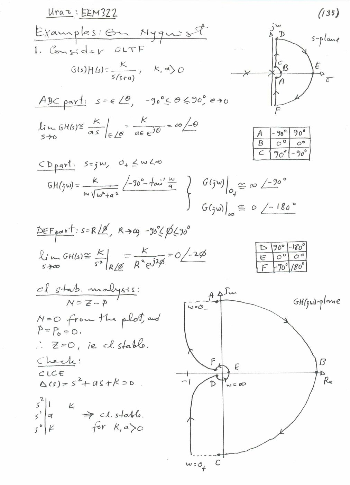
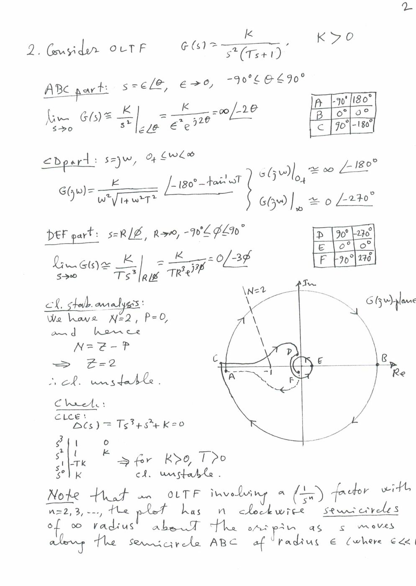
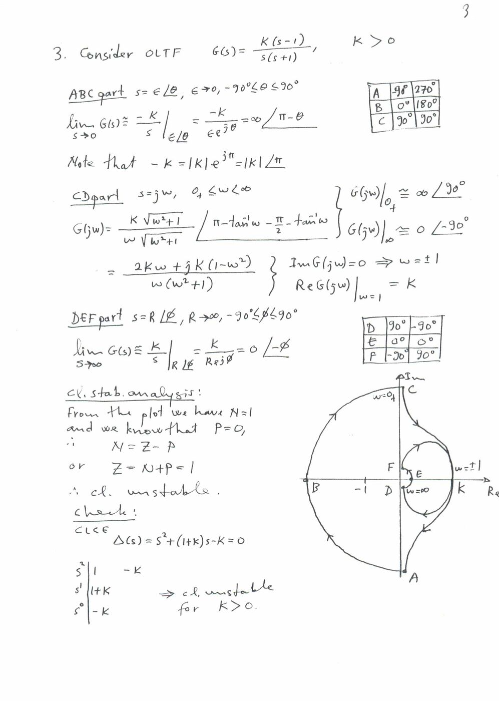
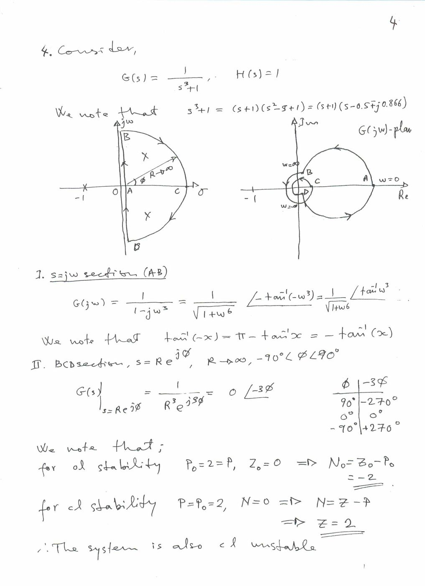
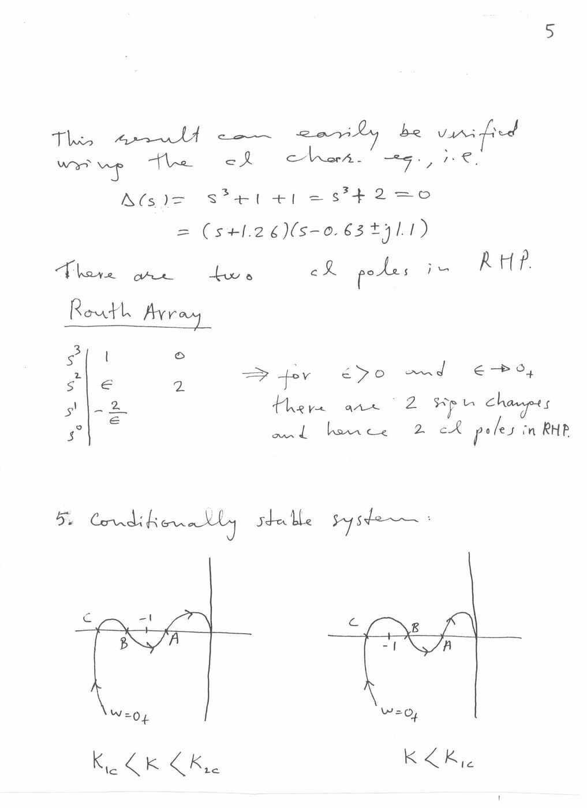
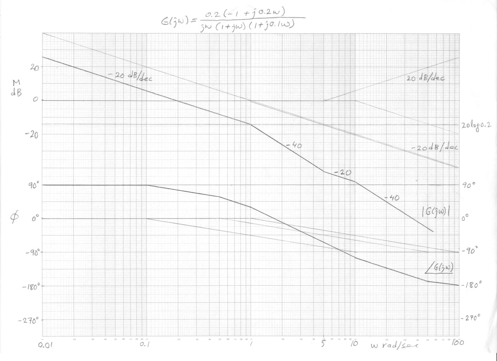

Bu yazı, Başkent Üniversitesi **EEM322 Denetim Sistemleri** dersinin öğretim üyesi **Prof. Dr. Alper Uraz**'ın el yazısıyla hazırladığı **Nyquist ve Bode çözümlü örneklerini** içeriyor. Sayfalar taranmış; dosya adları EEM322Ex6-1b … EEM322Ex6-7b. İlk sayfanın başlığı "Uraz: EEM322, Examples: On Nyquist", köşesinde de "(135)" yazıyor. Tarih yok; dosyalar dersin 2005 civarındaki örnek setinin parçası. Örneklerin metni aşağıya aktarıldı, Nyquist ve Bode çizimleri görsel olarak eklendi. Bütün taranmış sayfalar yazının sonunda ZIP olarak indirilebilir.

Aynı setin 2. ve 4. bölüm örnekleri (modelleme, blok diyagramı, zaman yanıtı) [ayrı bir yazıda](/arsiv/eem322-odev-uraz-ornekleri-bolum-2-4/). Bode diyagramının konu anlatımı için [Ders 9](/arsiv/eem322-ders-09-frekans-yaniti-bode/) notuna bakılabilir.

## Nyquist yolu ve yöntem

Bütün Nyquist örneklerinde s düzleminde aynı kapalı yol kullanılıyor. Orijindeki kutbun etrafından ε yarıçaplı küçük bir yarım çemberle geçiliyor (ABC kısmı), ardından pozitif sanal eksen boyunca ilerleniyor (CD kısmı, s = jω, 0₊ ≤ ω < ∞). Sonra sağ yarı düzlemi R → ∞ yarıçaplı büyük yarım çemberle dolaşıp (DEF kısmı) negatif sanal eksenden dönülüyor. Her kısımda G(s)H(s)'nin limiti alınıp açılar A, B, C, D, E, F noktaları için tablolanıyor. Kararlılık:

- N = Z − P (N: −1 noktasının saat yönünde çevrilme sayısı, P: açık çevrimin sağ yarı düzlem kutupları, Z: kapalı çevrimin sağ yarı düzlem kutupları)

## Örnek 1: G(s)H(s) = K/[s(s + a)], K, a > 0

- ABC kısmı (s = ε∠θ, −90° ≤ θ ≤ 90°, ε → 0): GH ≅ K/(as) = ∞∠−θ. A: −90° → +90°, B: 0° → 0°, C: 90° → −90°.
- CD kısmı (s = jω): GH(jω) = K/[ω√(ω² + a²)] ∠(−90° − tan⁻¹(ω/a)); ω = 0₊'da ∞∠−90°, ω → ∞'da 0∠−180°.
- DEF kısmı (s = R∠φ, R → ∞): GH ≅ K/s² = 0∠−2φ. D: 90° → −180°, E: 0° → 0°, F: −90° → 180°.
- Kararlılık: çizimden N = 0, P = P₀ = 0 ⇒ Z = 0, kapalı çevrim kararlı.
- Sağlama: Δ(s) = s² + as + K = 0; Routh tablosuna göre K, a > 0 için kapalı çevrim kararlı.

## Örnek 2: G(s) = K/[s²(Ts + 1)], K > 0

- ABC kısmı: G ≅ K/s² = ∞∠−2θ. A: −90° → 180°, C: 90° → −180°.
- CD kısmı: G(jω) = K/[ω²√(1 + ω²T²)] ∠(−180° − tan⁻¹ωT); ω = 0₊'da ∞∠−180°, ω → ∞'da 0∠−270°.
- DEF kısmı: G ≅ K/(Ts³) = 0∠−3φ. D: 90° → −270°, F: −90° → 270°.
- Kararlılık: N = 2, P = 0 ⇒ Z = 2, kapalı çevrim kararsız.
- Sağlama: Δ(s) = Ts³ + s² + K = 0. Routh: s³: 1, 0; s²: 1, K; s¹: −TK; s⁰: K. K > 0, T > 0 için kararsız.

Not (kaynaktan): Açık çevrimde (1/sⁿ) çarpanı olan, n = 2, 3, … sistemlerde s, ε yarıçaplı ABC yarım çemberinde ilerlerken eğri orijin çevresinde sonsuz yarıçaplı n tane saat yönünde yarım çember çizer.

## Örnek 3: G(s) = K(s − 1)/[s(s + 1)], K > 0

- ABC kısmı: G ≅ −K/s = ∞∠(π − θ), çünkü −K = |K|e^(jπ). A: −90° → 270°, B: 0° → 180°, C: 90° → 90°.
- CD kısmı: G(jω) = K√(ω² + 1)/[ω√(ω² + 1)] ∠(π − tan⁻¹ω − π/2 − tan⁻¹ω) = [2Kω + jK(1 − ω²)]/[ω(ω² + 1)]
- Im G(jω) = 0 ⇒ ω = ±1; Re G(jω) (ω = 1) = K. ω = 0₊'da ∞∠90°, ω → ∞'da 0∠−90°.
- DEF kısmı: G ≅ K/s = 0∠−φ.
- Kararlılık: çizimden N = 1, P = 0 ⇒ Z = N + P = 1, kapalı çevrim kararsız.
- Sağlama: Δ(s) = s² + (1 + K)s − K = 0. Routh: 1, 1 + K, −K ⇒ K > 0 için kararsız.

## Örnek 4: G(s) = 1/(s³ + 1), H(s) = 1

- s³ + 1 = (s + 1)(s² − s + 1) = (s + 1)(s − 0.5 ∓ j0.866): açık çevrimin sağ yarı düzlemde iki kutbu var.
- s = jω kısmı (AB): G(jω) = 1/(1 − jω³) = (1/√(1 + ω⁶)) ∠tan⁻¹ω³
- BCD kısmı (s = Re^(jφ), R → ∞): G = 1/(R³e^(j3φ)) = 0∠−3φ; φ = 90°'de −270°, 0°'da 0°, −90°'de +270°.
- Açık çevrim için P₀ = 2 = P, Z₀ = 0 ⇒ N₀ = Z₀ − P₀ = −2.
- Kapalı çevrim için P = 2, N = 0 ⇒ Z = 2: sistem kapalı çevrimde de kararsız.
- Sağlama: Δ(s) = s³ + 1 + 1 = s³ + 2 = (s + 1.26)(s − 0.63 ∓ j1.1); kapalı çevrimin sağ yarı düzlemde iki kutbu var. Routh tablosunda s² satırının ilk elemanı sıfır olduğundan ε konuyor: s³: 1, 0; s²: ε, 2; s¹: −2/ε. ε → 0₊ için iki işaret değişimi, yani sağ yarı düzlemde iki kutup.

## Örnek 5: Koşullu kararlı sistem

Gerçek ekseni birkaç kez kesen bir Nyquist eğrisinde −1 noktasının konumu K'ya bağlı. Çizimde iki durum karşılaştırılıyor: K₁c < K < K₂c aralığında −1 noktası çevrelenmiyor (kararlı), K < K₁c olduğunda ise kesişim noktaları kayıyor ve −1 çevrelenmiş oluyor. Yani sistem yalnız belli bir kazanç aralığında kararlı ("conditionally stable").

## Örnek 6.6b (Bode): Minimum fazlı olmayan sistem

- G(s) = 0.4(s − 5)/[s(s + 1)(s + 10)] = 0.2(−1 + 0.2s)/[s(1 + s)(1 + 0.1s)]
- Kırılma frekansları: 1, 5, 10
- G(jω) = 0.2(−1 + j0.2ω)/[jω(1 + jω)(1 + j0.1ω)] = M(ω)∠φ(ω)
- 20 log M = 20 log 0.2 + 20 log|−1 + j0.2ω| − 20 log|jω| − 20 log|1 + jω| − 20 log|1 + j0.1ω|
- φ(ω) = 180° − tan⁻¹(0.2ω) − 90° − tan⁻¹ω − tan⁻¹(0.1ω) = 90° − tan⁻¹(0.2ω) − tan⁻¹ω − tan⁻¹(0.1ω)
- Hatırlatma: ∠(−1 + jω) = π − tan⁻¹ω, ∠(1 − jω) = tan⁻¹(−ω) = −tan⁻¹ω

Verilen G(s) minimum fazlı değil (non-minimum phase, NMP); G₁(s) = 0.4(s + 5)/[s(s + 1)(s + 10)] ise minimum fazlı. İkisinin genlik eğrisi aynı, faz eğrileri farklı. Asimptotik çizimde genlik −20 dB/dekad ile başlıyor, 1'de −40, 5'te −20, 10'da yeniden −40 dB/dekada geçiyor; faz +90°'den −180°'ye iniyor.

## Örnek 6.7b (Bode): Kazanç ve faz payı

- G(s) = 9000s/[(s + 2)(s + 30)(s² + 5s + 25)] = 6s/[(1 + s/2)(1 + s/30)(1 + s/5 + s²/25)]
- Kırılma frekansları: 2, 5, 30
- 20 log M = 20 log 6 + 20 log ω − 20 log|1 + jω/2| − 20 log|1 + jω/30| − 20 log|1 − ω²/25 + jω/5|
- φ(ω) = 90° − tan⁻¹(ω/2) − tan⁻¹(ω/30) − tan⁻¹[(ω/5)/(1 − ω²/25)]
- Çizimden: (a) faz kesim frekansı ωp = 20 rad/s ve gm = 3 dB; (b) kazanç kesim frekansı ωg = 18 rad/s ve pm = 14°.
- Sonuç (kaynaktan): gm ve pm pozitif olduğundan kapalı çevrim kararlı.

![Örnek 6.7b: 6jω/(1+jω/2)(1+jω/30)[1+jω/5+(jω/5)²] için asimptotik Bode çizimi; gm = 3 dB, pm = 14°](bode-6-7b.jpg "Örnek 6.7b: asimptotik Bode çiziminden okunan paylar")

*Not: Asimptotik çizim ikinci dereceden çarpanın (ζ = 0.5, ωn = 5) rezonans etkisini ve gerçek eğriyle asimptot arasındaki farkı yok sayıyor. Tam hesapla faz −180°'yi ω ≈ 15.5 rad/s'de kesiyor ve orada |G| ≈ 1.16, yani gm ≈ −1.3 dB. Kazanç kesimi ω ≈ 16.5 rad/s'de, pm ≈ −3.5°. Kapalı çevrim karakteristik denklemi s⁴ + 37s³ + 245s² + 10100s + 1500 = 0'ın Routh tablosunda s² satırının ilk elemanı (37·245 − 10100)/37 ≈ −28 çıkıyor: kapalı çevrimin sağ yarı düzlemde iki kutbu var ve sistem **kararsız**. Asimptotik okumanın verdiği "kararlı" sonucu bu örnekte yanıltıcı.*
