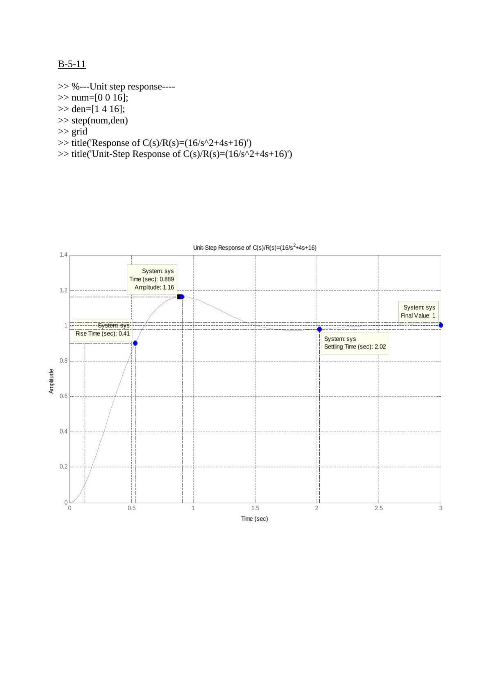
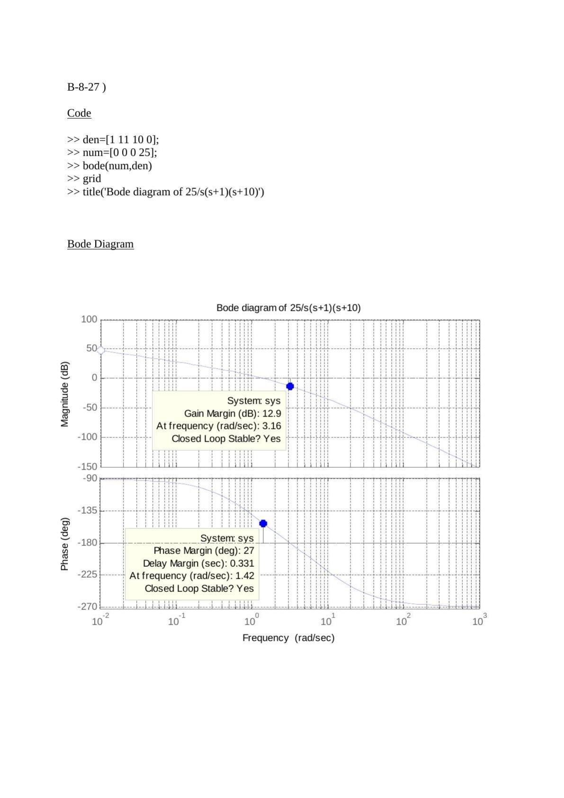

This post brings together five Word documents from the "denetim" subfolder of the EEM322 Control Systems folder: MATLAB solutions a friend prepared for **"EEM322 Homework No: 2"**. As in the course's homework table, the problems are from the end-of-chapter B-problems of Chapters 5, 6 and 8 of Ogata's *Modern Control Engineering*. Each document contains the MATLAB commands and a screenshot of the plot, along with the values read off the plot using MATLAB's data cursors. Personal information has been removed; the documents were merged into a single PDF and appended to the end of this post.

## B-5-11: Step response of a second-order system

```matlab
%---Unit step response---
num=[0 0 16];
den=[1 4 16];
step(num,den)
grid
title('Unit-Step Response of C(s)/R(s)=(16/s^2+4s+16)')
```

C(s)/R(s) = 16/(s² + 4s + 16), that is, ωn = 4 rad/s and ζ = 0.5. Values read from the plot:

| Quantity | Value |
|---|---|
| Peak value | 1.16 (at t = 0.889 s) |
| Rise time | 0.41 s |
| Settling time | 2.02 s |
| Final value | 1 |

Check: for ζ = 0.5 the overshoot is e^(−πζ/√(1 − ζ²)) = 16.3%, and the peak time is π/(ωn√(1 − ζ²)) = 0.907 s; the cursor values on the plot agree with these.



## B-6-9: Root locus

```matlab
num=[0 0 8.8 9]
den=[1 4 11 0]
rlocus(num,den)
grid
```

The open-loop transfer function is (8.8s + 9)/[s(s² + 4s + 11)]. Points marked on the root locus:

- On the complex branches, at K = 0.015 the pole is at −1.99 + j2.67 (ζ = 0.599, overshoot 9.54%, ωn = 3.33 rad/s); at K = 0.00112 the pole is at −2 − j2.65 (ζ = 0.603, overshoot 9.32%).
- On the real axis, the pole is at −0.00384 for K = 0.0047, and at −1.02 for K = 260.

## B-6-13: Root locus of a non-minimum-phase system

```matlab
num=[0 0 0 30.926 -20.618]
den=[1 3.3401 7.0325 0 0]
rlocus(num,den)
grid
```

The open-loop transfer function is (30.926s − 20.618)/[s²(s² + 3.3401s + 7.0325)]; its zero lies in the right half-plane, at s = 0.667. Marked points:

- Complex open-loop poles: −1.67 ± j2.06 (ζ ≈ 0.63, ωn = 2.65 rad/s).
- As K → ∞, one branch goes to the zero at 0.667 in the right half-plane.

## B-8-10: Nyquist diagram

The Nyquist diagram (with Nichols circles) is plotted for G(s) = K(1 − s)/(s + 1). The diagram runs along the unit circle between −1 and 1. MATLAB cursors:

- Phase margin 0°, delay margin 0 s (at ω = 0), "Closed Loop Stable? No".
- Peak gain 0 dB.

")

## B-8-26: Bode diagram

This page contains only the Bode diagram: the magnitude curve has a slope of −40 dB/dec at low frequencies and −20 dB/dec at high frequencies; the phase rises from −180° to −90°. Values read by MATLAB: **phase margin 45°**, delay margin 0.66 s, gain crossover frequency 1.19 rad/s, closed loop stable.

## B-8-27: Bode diagram, gain and phase margins

```matlab
den=[1 11 10 0];
num=[0 0 0 25];
bode(num,den)
grid
title('Bode diagram of 25/s(s+1)(s+10)')
```

For G(s) = 25/[s(s + 1)(s + 10)]:

| Quantity | Value |
|---|---|
| Gain margin | 12.9 dB (at ω = 3.16 rad/s) |
| Phase margin | 27° (at ω = 1.42 rad/s) |
| Delay margin | 0.331 s |
| Closed loop | Stable |

Check: the phase is −180° at ω = √10 = 3.16 rad/s, and the critical gain at this frequency is 110; 20 log(110/25) = 12.9 dB, the same as the MATLAB result.


