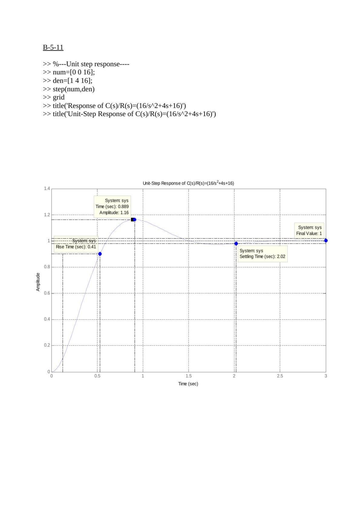
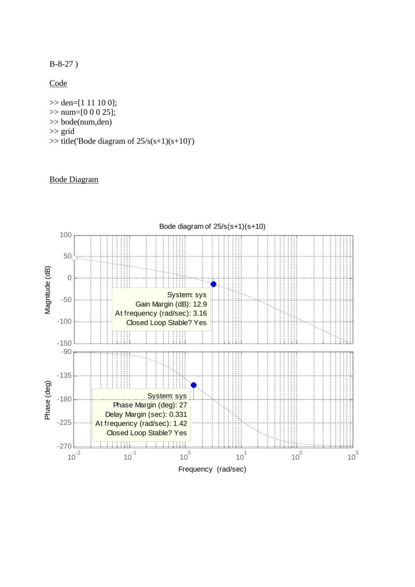

Bu yazı, EEM322 Denetim Sistemleri klasörünün "denetim" alt klasöründe duran beş Word belgesini bir araya getiriyor: bir arkadaşın **"EEM322 Ödev No: 2"** için hazırladığı MATLAB çözümleri. Problemler, dersin ödev tablosundaki gibi Ogata'nın *Modern Control Engineering* kitabının 5., 6. ve 8. bölüm sonu B-problemlerinden. Her belgede MATLAB komutları ve çizimin ekran görüntüsü, çizim üzerinde MATLAB'ın veri imleçleriyle okunan değerler var. Kişisel bilgiler çıkarıldı; belgeler tek bir PDF'te birleştirilip yazının sonuna eklendi.

## B-5-11: İkinci dereceden sistemin basamak yanıtı

```matlab
%---Unit step response---
num=[0 0 16];
den=[1 4 16];
step(num,den)
grid
title('Unit-Step Response of C(s)/R(s)=(16/s^2+4s+16)')
```

C(s)/R(s) = 16/(s² + 4s + 16), yani ωn = 4 rad/s ve ζ = 0.5. Grafikten okunan değerler:

| Büyüklük | Değer |
|---|---|
| Tepe değeri | 1.16 (t = 0.889 s'de) |
| Yükselme süresi | 0.41 s |
| Yerleşme süresi | 2.02 s |
| Son değer | 1 |

Kontrol: ζ = 0.5 için aşım e^(−πζ/√(1 − ζ²)) = %16.3, tepe zamanı π/(ωn√(1 − ζ²)) = 0.907 s; grafikteki imleç değerleri bunlarla uyumlu.



## B-6-9: Kök yer eğrisi

```matlab
num=[0 0 8.8 9]
den=[1 4 11 0]
rlocus(num,den)
grid
```

Açık döngü transfer fonksiyonu (8.8s + 9)/[s(s² + 4s + 11)]. Kök yer eğrisinde işaretlenen noktalar:

- Karmaşık kollar üzerinde K = 0.015'te kutup −1.99 + j2.67 (ζ = 0.599, aşım %9.54, ωn = 3.33 rad/s); K = 0.00112'de −2 − j2.65 (ζ = 0.603, aşım %9.32).
- Gerçek eksende K = 0.0047'de kutup −0.00384; K = 260'ta −1.02.

## B-6-13: Minimum fazlı olmayan sistemin kök yer eğrisi

```matlab
num=[0 0 0 30.926 -20.618]
den=[1 3.3401 7.0325 0 0]
rlocus(num,den)
grid
```

Açık döngü transfer fonksiyonu (30.926s − 20.618)/[s²(s² + 3.3401s + 7.0325)]; sıfırı sağ yarı düzlemde, s = 0.667'de. İşaretlenen noktalar:

- Karmaşık açık döngü kutupları: −1.67 ± j2.06 (ζ ≈ 0.63, ωn = 2.65 rad/s).
- K → ∞ için bir kol sağ yarı düzlemdeki 0.667 sıfırına gidiyor.

## B-8-10: Nyquist diyagramı

G(s) = K(1 − s)/(s + 1) için Nyquist diyagramı (Nichols çemberleriyle) çizilmiş. Diyagram −1 ile 1 arasında birim çember üzerinde ilerliyor. MATLAB imleçleri:

- Faz payı 0°, gecikme payı 0 s (ω = 0'da), "Closed Loop Stable? No".
- Tepe kazancı 0 dB.

")

## B-8-26: Bode diyagramı

Bu sayfada yalnız Bode diyagramı var: genlik eğrisi düşük frekansta −40 dB/dek, yüksek frekansta −20 dB/dek eğimli; faz −180°'den −90°'ye çıkıyor. MATLAB'ın okuduğu değerler: **faz payı 45°**, gecikme payı 0.66 s, kazanç kesim frekansı 1.19 rad/s, kapalı döngü kararlı.

## B-8-27: Bode diyagramı, kazanç ve faz payı

```matlab
den=[1 11 10 0];
num=[0 0 0 25];
bode(num,den)
grid
title('Bode diagram of 25/s(s+1)(s+10)')
```

G(s) = 25/[s(s + 1)(s + 10)] için:

| Büyüklük | Değer |
|---|---|
| Kazanç payı | 12.9 dB (ω = 3.16 rad/s'de) |
| Faz payı | 27° (ω = 1.42 rad/s'de) |
| Gecikme payı | 0.331 s |
| Kapalı döngü | Kararlı |

Kontrol: faz −180° olduğunda ω = √10 = 3.16 rad/s ve bu frekansta kritik kazanç 110'dur; 20 log(110/25) = 12.9 dB, MATLAB sonucuyla aynı.


