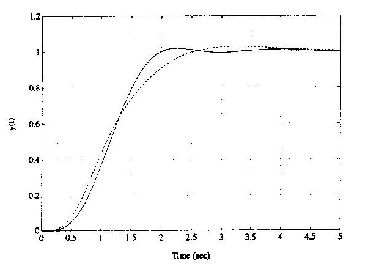

This post brings together two groups of handwritten solutions found in the "Control" subfolder of the EEM322 Control Systems folder. Both are scanned pages written by the course instructor **Prof. Dr. Alper Uraz**:

- The **Chapter 8 problems** (Ex. 8.7, 8.8, 8.9(c)) in the folder named "EEM419-Ch8-Prob": robust control. According to the file name, these belong to the course coded EEM419.
- Two pages named "EEM417NLDF": the **describing function** of a nonlinear element. According to the file name, these belong to the course EEM417.

They are included here because the documents were stored in the EEM322 folder; the documents do not state their dates. The original scanned pages can be downloaded as a ZIP at the end of the post. (A phase portrait page in the same folder was not published, because it was scanned from a printed textbook.)

## Ex. 8.7: PID design with the ITAE criterion for a system with uncertain parameters

System structure: prefilter P(s) → summing junction → controller C(s) → plant G(s), unity feedback.

> G(s) = K / [s(s + b)(s + 4)], K ∈ [1, 3], b ∈ [1, 3]; nominal values K = 2, b = 2.

Required: ITAE (integral of time-weighted absolute error) performance with peak time Tp < 2.5 s.

1. The worst-case performance is obtained with K = 1 and b = 1: G₁(s) = 1 / [s(s + 1)(s + 4)].
1. By simulation, ω0 = 2.38 is chosen to satisfy Tp = 2.5 s. From the zero position error ITAE table (Table 7.3), the fourth-order closed-loop transfer function is:

> T(s) = ω0⁴ / (s⁴ + 2.1ω0 s³ + 3.4ω0² s² + 2.7ω0³ s + ω0⁴) = 32.08 / (s⁴ + 5s³ + 19.26s² + 36.4s + 32.08)

1. PID controller: C(s) = Kp + Ki/s + Kd·s = (Kd·s² + Kp·s + Ki)/s ⇒ T₁(s) = C(s)G₁(s)/[1 + C(s)G₁(s)] = (Kd·s² + Kp·s + Ki) / [s⁴ + 5s³ + (4 + Kd)s² + Kp·s + Ki]. The overall transfer function is T(s) = P(s)T₁(s).
1. Equating the characteristic equations: s⁴ + 5s³ + 19.26s² + 36.4s + 32.08 = s⁴ + 5s³ + (4 + Kd)s² + Kp·s + Ki ⇒ **Kp = 36.4, Ki = 32.08, Kd = 15.26**.
1. The prefilter, such that T(s) = P(s)T₁(s): **P(s) = Ki/(Kd·s² + Kp·s + Ki) = 32.08/(15.26s² + 36.4s + 32.08)**.

## Ex. 8.8: Robust stability of the design (Kharitonov test)

With the PID from Ex. 8.7, without the prefilter, the closed-loop transfer function is:

> C(s)G(s)/[1 + C(s)G(s)] = K(Kd·s² + Kp·s + Ki) / [s²(s + b)(s + 4) + K(Kd·s² + Kp·s + Ki)]

For Kp = 36.4, Ki = 32.08, Kd = 15.26 and K ∈ [1, 3], b ∈ [1, 3], the characteristic equation is:

> Δ(s) = s⁴ + (b + 4)s³ + (4b + 15.26K)s² + 36.4K·s + 32.08K

Writing p(s) = q₀ + q₁s + q₂s² + q₃s³ + s⁴, the coefficient ranges are:

| Coefficient | Expression | Range |
|---|---|---|
| q₀ | 32.08K | [32.08, 96.24] |
| q₁ | 36.4K | [36.4, 109.2] |
| q₂ | 4b + 15.26K | [19.26, 57.78] |
| q₃ | b + 4 | [5, 7] |

Since n = 4, it suffices to test only two Kharitonov polynomials:

- P₁⁺⁻(s) = q₀⁺ + q₁⁻s + q₂⁻s² + q₃⁺s³ + s⁴ = 96.24 + 36.4s + 19.26s² + 7s³ + s⁴
- P₂⁺⁺(s) = q₀⁺ + q₁⁺s + q₂⁻s² + q₃⁻s³ + s⁴ = 96.24 + 109.2s + 19.26s² + 5s³ + s⁴

Routh table for P₁⁺⁻(s):

| Row | 1st column | 2nd column | 3rd column |
|---|---|---|---|
| s⁴ | 1 | 19.26 | 96.24 |
| s³ | 7 | 36.4 | |
| s² | 14.06 | 96.24 | |
| s¹ | −11.51 | | |
| s⁰ | 96.24 | | |

There are two sign changes in the first column; **the overall design is not robustly Hurwitz stable**. Since P₁⁺⁻(s) is not Hurwitz, there is no need to check P₂⁺⁺(s); had P₁⁺⁻(s) been Hurwitz, P₂⁺⁺(s) would also have had to be checked to show robust stability.

## Ex. 8.9(c): Polynomial with interval coefficients

> p(s) = (3 + q₁) + (4 − q₂)s + 21s² + (6 + 2q₃)s³ + s⁴, q₁ ∈ [−1, 1], q₂ ∈ [0, 2], q₃ ∈ [1, 2]

1. The uncertainties are lumped into the coefficients: p̃(s) = q̃₀ + q̃₁s + 21s² + q̃₃s³ + s⁴; q̃₀ = 3 + q₁ ∈ [2, 4], q̃₁ = 4 − q₂ ∈ [2, 4], q̃₃ = 6 + 2q₃ ∈ [8, 10].
1. That is, p̃(s) = [2, 4] + [2, 4]s + 21s² + [8, 10]s³ + s⁴. For n = 4, two polynomials are tested: P̃₁⁺⁻(s) = 4 + 2s + 21s² + 10s³ + s⁴ and P̃₂⁺⁺(s) = 4 + 4s + 21s² + 8s³ + s⁴.
1. Routh tables: for P̃₁⁺⁻ the first column is 1, 10, 20.8, 0.08, 4; for P̃₂⁺⁺ it is 1, 8, 20.5, 2.44, 4.
1. Since both polynomials are Hurwitz, **p(s) is robustly Hurwitz stable**.

## Ex. 1(f): Describing function

The nonlinear element: an odd-symmetric characteristic (saturation with a jump, no dead zone) that jumps by ±M at x = 0, has slope k for |x| < S, and saturates at M + kS for |x| ≥ S.

: the nonlinearity and output waveform")

For the input x = X sin ωt (X > S), the first half period of the output is:

| Interval | y(t) |
|---|---|
| 0 < ωt < α | M + kX sin ωt |
| α < ωt < π − α | M + kS |
| π − α < ωt < π | M + kX sin ωt |

where sin α = S/X, i.e. α = sin⁻¹(S/X).

1. Since the output is an odd function, the fundamental component is y₁(t) = Y₁ sin ωt; Y₁ = (1/π)∫₀^2π y(t) sin ωt d(ωt) = (4/π)∫₀^π/2 y(t) sin ωt d(ωt).
1. Y₁ = (4/π)[∫₀^α (M + kX sin ωt) sin ωt d(ωt) + ∫α^π/2 (M + kS) sin ωt d(ωt)]
1. = (4/π)[M∫₀^α sin ωt d(ωt) + (kX/2)∫₀^α (1 − cos 2ωt) d(ωt) + (M + kS)∫α^π/2 sin ωt d(ωt)]
1. = (4/π)[−M cos α + M + kX(α/2 − ½ sin α cos α) + (M + kS) cos α]
1. = (4/π)[M + (kX/2) sin⁻¹(S/X) + (kS/2)√(1 − S²/X²)]

The describing function of the given nonlinearity:

> N = (Y₁/X)∠0° = 4M/(πX) + (2k/π)[sin⁻¹(S/X) + (S/X)√(1 − S²/X²)]

N is a real quantity (there is no phase shift in the output).
