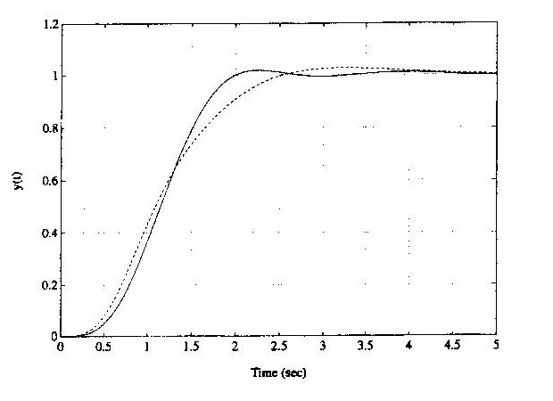

Bu yazı, EEM322 Denetim Sistemleri klasörünün "Control" alt klasöründe bulunan iki grup el yazısı çözümü bir araya getiriyor. İkisi de dersin öğretim üyesi **Prof. Dr. Alper Uraz**'ın elinden çıkma, taranmış sayfalar:

- "EEM419-Ch8-Prob" adlı klasördeki **8. bölüm problemleri** (Ex. 8.7, 8.8, 8.9(c)): dayanıklı (robust) denetim. Dosya adına göre bunlar EEM419 kodlu derse ait.
- "EEM417NLDF" adlı iki sayfa: doğrusal olmayan bir elemanın **tanımlayıcı fonksiyonu** (describing function). Dosya adına göre EEM417 dersine ait.

Belgeler EEM322 klasöründe saklandığı için burada yer alıyor; tarihleri belgede yazmıyor. Taranmış orijinal sayfalar yazının sonunda ZIP olarak indirilebilir. (Aynı klasördeki faz portresi sayfası basılı bir ders kitabından taranmış olduğu için yayınlanmadı.)

## Ex. 8.7: Belirsiz parametreli sistem için ITAE ölçütüyle PID tasarımı

Sistem yapısı: ön filtre P(s) → toplama noktası → denetleç C(s) → sistem G(s), birim geri besleme.

> G(s) = K / [s(s + b)(s + 4)], K ∈ [1, 3], b ∈ [1, 3]; nominal değerler K = 2, b = 2.

İstenen: tepe zamanı Tp < 2.5 s olan ITAE (zaman ağırlıklı mutlak hata integrali) performansı.

1. En kötü durum performansı K = 1 ve b = 1 ile elde edilir: G₁(s) = 1 / [s(s + 1)(s + 4)].
1. Simülasyonla Tp = 2.5 s koşulunu sağlayan ω0 = 2.38 seçilir. Sıfır konum hatalı ITAE tablosundan (Tablo 7.3) dördüncü dereceden kapalı döngü transfer fonksiyonu:

> T(s) = ω0⁴ / (s⁴ + 2.1ω0 s³ + 3.4ω0² s² + 2.7ω0³ s + ω0⁴) = 32.08 / (s⁴ + 5s³ + 19.26s² + 36.4s + 32.08)

1. PID denetleç: C(s) = Kp + Ki/s + Kd·s = (Kd·s² + Kp·s + Ki)/s ⇒ T₁(s) = C(s)G₁(s)/[1 + C(s)G₁(s)] = (Kd·s² + Kp·s + Ki) / [s⁴ + 5s³ + (4 + Kd)s² + Kp·s + Ki]. Toplam transfer fonksiyonu T(s) = P(s)T₁(s).
1. Karakteristik denklemler eşitlenir: s⁴ + 5s³ + 19.26s² + 36.4s + 32.08 = s⁴ + 5s³ + (4 + Kd)s² + Kp·s + Ki ⇒ **Kp = 36.4, Ki = 32.08, Kd = 15.26**.
1. Ön filtre, T(s) = P(s)T₁(s) olacak şekilde: **P(s) = Ki/(Kd·s² + Kp·s + Ki) = 32.08/(15.26s² + 36.4s + 32.08)**.

## Ex. 8.8: Tasarımın dayanıklı kararlılığı (Kharitonov testi)

Ex. 8.7'deki PID ile, ön filtre olmadan kapalı döngü transfer fonksiyonu:

> C(s)G(s)/[1 + C(s)G(s)] = K(Kd·s² + Kp·s + Ki) / [s²(s + b)(s + 4) + K(Kd·s² + Kp·s + Ki)]

Kp = 36.4, Ki = 32.08, Kd = 15.26 ve K ∈ [1, 3], b ∈ [1, 3] için karakteristik denklem:

> Δ(s) = s⁴ + (b + 4)s³ + (4b + 15.26K)s² + 36.4K·s + 32.08K

p(s) = q₀ + q₁s + q₂s² + q₃s³ + s⁴ yazılırsa katsayı aralıkları:

| Katsayı | İfade | Aralık |
|---|---|---|
| q₀ | 32.08K | [32.08, 96.24] |
| q₁ | 36.4K | [36.4, 109.2] |
| q₂ | 4b + 15.26K | [19.26, 57.78] |
| q₃ | b + 4 | [5, 7] |

n = 4 olduğundan yalnız iki Kharitonov polinomunu test etmek yeter:

- P₁⁺⁻(s) = q₀⁺ + q₁⁻s + q₂⁻s² + q₃⁺s³ + s⁴ = 96.24 + 36.4s + 19.26s² + 7s³ + s⁴
- P₂⁺⁺(s) = q₀⁺ + q₁⁺s + q₂⁻s² + q₃⁻s³ + s⁴ = 96.24 + 109.2s + 19.26s² + 5s³ + s⁴

P₁⁺⁻(s) için Routh tablosu:

| Satır | 1. sütun | 2. sütun | 3. sütun |
|---|---|---|---|
| s⁴ | 1 | 19.26 | 96.24 |
| s³ | 7 | 36.4 | |
| s² | 14.06 | 96.24 | |
| s¹ | −11.51 | | |
| s⁰ | 96.24 | | |

İlk sütunda iki işaret değişimi var; **genel tasarım dayanıklı Hurwitz kararlı değildir**. P₁⁺⁻(s) Hurwitz olmadığı için P₂⁺⁺(s)'yi denetlemeye gerek yoktur; P₁⁺⁻(s) Hurwitz olsaydı dayanıklı kararlılığı göstermek için P₂⁺⁺(s) de denetlenmeliydi.

## Ex. 8.9(c): Aralık katsayılı polinom

> p(s) = (3 + q₁) + (4 − q₂)s + 21s² + (6 + 2q₃)s³ + s⁴, q₁ ∈ [−1, 1], q₂ ∈ [0, 2], q₃ ∈ [1, 2]

1. Belirsizlikler katsayılarda toplanır (lumping): p̃(s) = q̃₀ + q̃₁s + 21s² + q̃₃s³ + s⁴; q̃₀ = 3 + q₁ ∈ [2, 4], q̃₁ = 4 − q₂ ∈ [2, 4], q̃₃ = 6 + 2q₃ ∈ [8, 10].
1. Yani p̃(s) = [2, 4] + [2, 4]s + 21s² + [8, 10]s³ + s⁴. n = 4 için iki polinom test edilir: P̃₁⁺⁻(s) = 4 + 2s + 21s² + 10s³ + s⁴ ve P̃₂⁺⁺(s) = 4 + 4s + 21s² + 8s³ + s⁴.
1. Routh tabloları: P̃₁⁺⁻ için ilk sütun 1, 10, 20.8, 0.08, 4; P̃₂⁺⁺ için 1, 8, 20.5, 2.44, 4.
1. İki polinom da Hurwitz olduğundan **p(s) dayanıklı Hurwitz kararlıdır**.

## Ex. 1(f): Tanımlayıcı fonksiyon

Doğrusal olmayan eleman: x = 0'da ±M sıçraması yapan, |x| < S aralığında eğimi k olan ve |x| ≥ S için M + kS'de doyan tek fonksiyonlu bir karakteristik (ölü bölgesiz, sıçramalı doyma).

: doğrusalsızlık ve çıkış dalga biçimi")

Giriş x = X sin ωt (X > S) için çıkışın ilk yarım periyodu:

| Aralık | y(t) |
|---|---|
| 0 < ωt < α | M + kX sin ωt |
| α < ωt < π − α | M + kS |
| π − α < ωt < π | M + kX sin ωt |

burada sin α = S/X, yani α = sin⁻¹(S/X).

1. Çıkış tek fonksiyon olduğundan temel bileşen y₁(t) = Y₁ sin ωt; Y₁ = (1/π)∫₀^2π y(t) sin ωt d(ωt) = (4/π)∫₀^π/2 y(t) sin ωt d(ωt).
1. Y₁ = (4/π)[∫₀^α (M + kX sin ωt) sin ωt d(ωt) + ∫α^π/2 (M + kS) sin ωt d(ωt)]
1. = (4/π)[M∫₀^α sin ωt d(ωt) + (kX/2)∫₀^α (1 − cos 2ωt) d(ωt) + (M + kS)∫α^π/2 sin ωt d(ωt)]
1. = (4/π)[−M cos α + M + kX(α/2 − ½ sin α cos α) + (M + kS) cos α]
1. = (4/π)[M + (kX/2) sin⁻¹(S/X) + (kS/2)√(1 − S²/X²)]

Verilen doğrusalsızlığın tanımlayıcı fonksiyonu:

> N = (Y₁/X)∠0° = 4M/(πX) + (2k/π)[sin⁻¹(S/X) + (S/X)√(1 − S²/X²)]

N gerçel bir büyüklüktür (çıkışta faz kayması yok).
