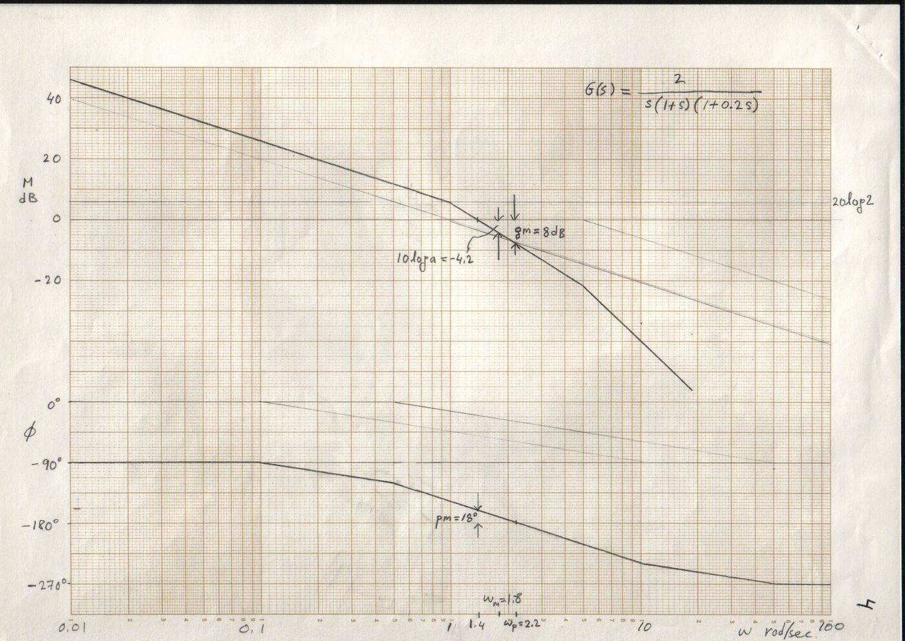
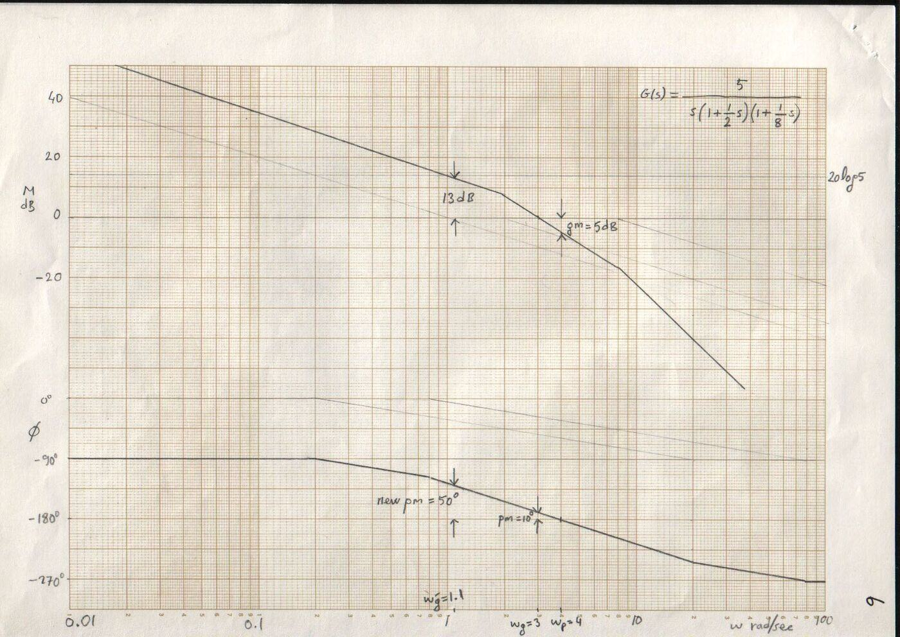

This post brings together the **worked examples of compensator and PD/PI controller design**, handwritten by the course instructor **Prof. Dr. Alper Uraz**, found in the "Control" subfolder of the EEM322 Control Systems folder. The folder containing Examples 7–10 is named "EEM471Ex7-8-9-10"; that is, according to the file name these pages belong to a course coded EEM471, but because they were stored in the EEM322 folder they appear here. The PD and PI design pages carry a note "(p. 174)" in the corner. The documents do not state their dates. The scanned original pages can be downloaded as a ZIP at the end of the post.

In all examples, a unity-feedback system with open-loop transfer function (OLTF) G(s) is considered. The general formulas used:

- Desired closed-loop poles: s = −ζωn ± jωn√(1 − ζ²); settling time (2%) Ts = 4/(ζωn); overshoot PO = 100·e^(−ζπ/√(1 − ζ²)).
- Lead compensator: Gc(s) = (s + 1/T)/(s + 1/(aT)) or in Bode form Gc(s) = a(1 + Ts)/(1 + aTs), sin φm = (1 − a)/(1 + a), 1/T = √a·ωm.
- Lag compensator: Gc(s) = (1/b)(s + 1/T)/(s + 1/(bT)).

## Example 7: Lead design via root locus (RL-LEAD)

OLTF: G(s) = 5 / [s(s + 2)(s + 10)]. Design specifications: Ts ≤ 2 s and PO ≤ 16.3%.

1. Ts = 4/(ζωn) = 2 ⇒ ζωn = 2; PO = 100·e^(−ζπ/√(1 − ζ²)) = 16.3 ⇒ ζ = 0.5 ⇒ ωn = 4.
1. Desired closed-loop poles: −2 ± j2√3 = −2 ± j3.46.
1. Angle condition: ∠5/[s(s + 2)(s + 10)] (at s = −2 + j3.46) = −120° − 90° − 23.4° = −233.4°.
1. Angle deficiency φ = 233.4° − 180° = 53.4° ≈ 54°; therefore a lead compensator is required.
1. Bisector method: the zero and pole are found by departing 27° to the right and to the left of the bisector of the angle between the ζ = 0.5 line (cos 60° = ζ) and the horizontal. tan 3° = y/(2√3) ⇒ y = 0.18; tan 57° = x/(2√3) ⇒ x = 5.33. Thus the zero is at −2.18 and the pole at −7.33: **Gc(s) = (s + 2.18)/(s + 7.33)**.
1. The amplifier gain from the magnitude condition: |Kc·Gc(s)·G(s)| = 1 (at s = −2 + j3.46) ⇒ |Kc × 3.46 × 5 / (6.35 × 4 × 3.46 × 8.71)| = 1 ⇒ **Kc = 44.25**.

## Example 8: Lag design via root locus (RL-LAG)

OLTF: G(s) = 1.06 / [s(s + 1)(s + 2)]. Design specifications: ζ = 0.491, ωn = 0.673 (desired pole sd = −0.331 + j0.586) and ess ≤ 0.5.

1. Angle condition: −119.5° − 41.2° − 19.3° = −180°; the desired poles lie on the branches of the root locus.
1. Magnitude condition: K₁ = |s(s + 1)(s + 2)/1.06| = 0.673 × 0.889 × 1.769 / 1.06 = 1.
1. With the assumption Gc(0) = 1, ess = 0.5 = 1/Kv ⇒ Kv = 2; Kv = lim(s→0) sK·Gc(s)·G(s) = K/2 = 2 ⇒ K₂ = 4. Hence b = K₂/K₁ = 4.
1. T = 10 is chosen (1/T = 0.1), 1/(bT) = 0.025.
1. **Gc(s) = (1/b)(s + 1/T)/(s + 1/(bT)) = (1/4)(s + 0.1)/(s + 0.025) = (1 + 10s)/(1 + 40s)**; Kc = 1/b = 0.25 and K = K₂ = 4.

## Example 9: Lead design via Bode (BODE-LEAD)

OLTF: G(s) = K / [s(s + 1)(s + 5)]. Design specifications: ess ≤ 0.5 and pm ≥ 40°.

1. ess = 0.5 = 1/Kv ⇒ Kv = 2; Kv = lim(s→0) sG(s) = K/5 = 2 ⇒ K₁ = 10.
1. From the plots, gm = 8 dB, pm = 18°.
1. Required additional phase 40° − 18° = 22°; with a 5° safety margin, φm = 27°.
1. sin 27° = (1 − a)/(1 + a) = 0.45 ⇒ a = 0.38; 10 log a = −4.2 dB ⇒ ωm = 1.8 rad/s (the frequency at which the magnitude is −4.2 dB).
1. 1/T = √a·ωm = 1.1 and 1/(aT) = 2.9.
1. **Gc(s) = a(1 + Ts)/(1 + aTs) = 0.38(1 + 0.9s)/(1 + 0.34s) = (s + 1.1)/(s + 2.9)**.
1. New phase margin at ωm = 1.8: pm′ = 180° − 90° − tan⁻¹ωm − tan⁻¹(ωm/2.9) + tan⁻¹(ωm/1.1) − tan⁻¹(ωm/5) = 36.1°.
1. Amplifier gain Kc = 1/a = 1/0.38 = 2.63.

*Note: The computed pm′ = 36.1° does not fully satisfy the required pm ≥ 40°; the design needs to be repeated once more (with a larger safety margin). The solution contains no comment on this.*

## Example 10: Lag design via Bode (BODE-LAG)

OLTF: G(s) = K / [s(s + 2)(s + 8)]. Design specifications: ess ≤ 0.2 and pm ≥ 45°.

1. ess = 0.2 = 1/Kv ⇒ Kv = 5; Kv = K/16 = 5 ⇒ K₁ = 80.
1. From the plots, a phase margin of 45° + 5° = 50° corresponds to a new gain crossover frequency ωg′ = 1.1 rad/s. An attenuation of 13 dB is needed at ωg′ = 1.1.
1. b = 10^(13/20) = 10^0.65 = 4.47.
1. One corner frequency is chosen one decade below ωg′: 1/T = 1.1/10 = 0.11 ⇒ 1/(bT) = 0.0246.
1. **Gc(s) = (1/4.47)(s + 0.11)/(s + 0.0246) = (1 + 9.1s)/(1 + 40.6s)**.
1. New phase margin: pm′ = 180° + tan⁻¹(ωg′/0.11) − tan⁻¹(ωg′/0.0246) − 90° − tan⁻¹(ωg′/2) − tan⁻¹(ωg′/8) = 49°.

## PD controller design (root locus)

PD controller: Gc(s) = Kp + Kd·s = Kd(s + Kp/Kd); its zero is at −Kp/Kd.

OLTF: K·G(s)·H(s) = K / [s(s + 2)]; desired closed-loop poles −2 ± j2.

1. Angle condition: ∠K/[s(s + 2)] (at s = −2 + j2) = −∠(−2 + j2) − ∠(−2 + j2 + 2) = −135° − 90° = −225°.
1. For the total angle to be 180°, the lead contribution must be 45°; the zero of the PD controller is placed at s = −4, i.e., Kp/Kd = 4.
1. Magnitude condition: Kd(s + 4)/[s(s + 2)] = −1 (at s = −2 + j2) ⇒ Kd = 2.
1. Thus Kp = 8 and **Gc(s) = 8 + 2s**. The compensated root locus breaks away between −2 and 0 and returns to the real axis, tracing an arc around the zero at −4.

## PI controller design (root locus, using the lag compensator approach)

OLTF: G(s) = 1 / [s(s + 5)(s + 10)]; desired closed-loop poles −1.85 ± j1.88 and ess = 0 for a ramp input.

1. PI controller: Gc(s) = Kp + Ki/s = Kp(s + Ki/Kp)/s. The zero is chosen close to the origin: Ki/Kp = 0.1.
1. Angle condition: ∠Kp(s + 0.1)/[s²(s + 5)(s + 10)] (at s = −1.85 ± j1.88) = 132.9° − 2 × 134.5° − 30.8° − 12.9° = −180°.
1. Magnitude condition: |Kp(s + 0.1)/[s²(s + 5)(s + 10)]| = 1 ⇒ Kp = 83.3 ⇒ Ki = 8.33.
1. **Gc(s) = 83.3 + 8.33/s**. With the PI controller the system becomes type 2, and ess = 0 for a ramp input.

*Note: In the scan, the result of the angle sum reads as something like "−120°"; when the terms are added, 132.9° − 269° − 30.8° − 12.9° ≈ −180°, i.e., the desired poles lie on the compensated root locus.*

## PI controller design (Bode, using the lag compensator approach)

OLTF: G(s) = 4 / [s(s + 1)(s + 2)]; desired phase margin φpm = 50°.

1. Step 1: The open-loop gain is set according to the ess condition; here K₁ = 1.
1. Step 2: 50° + 5° = 55° ⇒ new gain crossover frequency ωg′ = 0.4 rad/s.
1. Step 3: Kp is found from the condition |G(jωg′)| = −20 log Kp = 13.16 dB: Kp = 10^(−13.16/20) = 0.22.
1. Step 4: The corner frequency Ki/Kp is placed one decade below ωg′: Ki/Kp = ωg′/10 ⇒ Ki = 0.04 × 0.22 = 0.0088.
1. Step 5: **Gc(s) = K₁(Kp + Ki/s) = 0.22 + 0.0088/s**.

Comparison with the lag compensator: the lag compensator is Gc(s) = (1/b)(s + 1/T)/(s + 1/(bT)) and since b = 10^(|Gp(jωg′)|/20), Kp = 1/b; the PI design is a lag design with its pole moved to the origin.

## PD controller via Bode

The practical PD controller limits the derivative action with a filter:

> Gc(s) = Kp + Kd·s/(1 + (Kd/N)s) = Kp·[1 + ((Kp + N)Kd/(N·Kp))s] / [1 + (Kd/N)s]

This expression is a lead transfer function, Gc(s) = a(1 + Ts)/(1 + aTs); the design steps are the same as those of the lead compensator.

## Appendix: A student's RL-LAG solution

On one page in the folder (transcribed to text from a photographed page), a student applied the same method to the system Gp(s) = K/[s(s + 2)]: ζ = 0.707 and ess ≤ 0.2.

1. Desired closed-loop poles s = −1 + j. Angle condition: ∠1/[s(s + 2)] = −135° − 45° = −180°; the poles are on the root locus.
1. Magnitude condition: K₁ = 1.4142 × 1.4142 ≈ 2.
1. With the assumption Gc(0) = 1, ess = 0.2 = 1/Kv ⇒ Kv = 5; Kv = lim(s→0) sK·Gc(s)·Gp(s) = K/2 ⇒ K₂ = 10; b = K₂/K₁ = 5.
1. 1/T = 0.1, 1/(bT) = 0.02 ⇒ Gc(s) = (1/5)(s + 0.1)/(s + 0.02); the gain is set to K = K₂ = 10.
