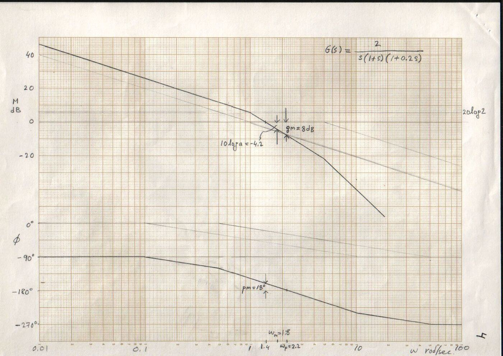
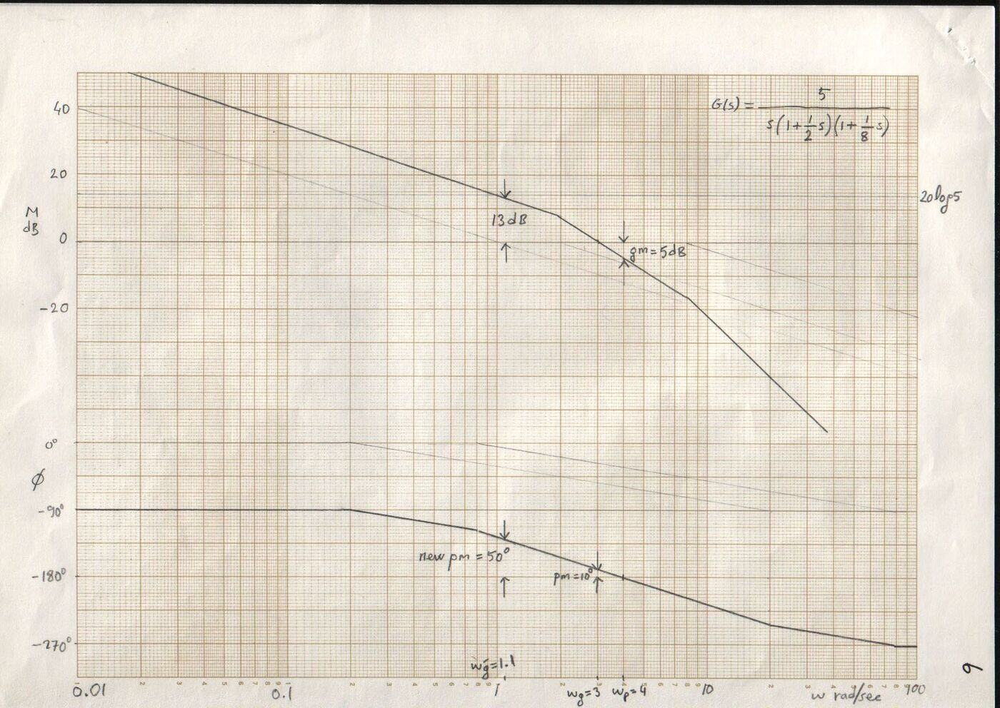

Bu yazı, EEM322 Denetim Sistemleri klasörünün "Control" alt klasöründe bulunan, dersin öğretim üyesi **Prof. Dr. Alper Uraz**'ın el yazısıyla hazırladığı **dengeleyici (kompanzatör) ve PD/PI denetleç tasarımı çözümlü örneklerini** bir araya getiriyor. Örnek 7–10'un bulunduğu klasörün adı "EEM471Ex7-8-9-10"; yani bu sayfalar dosya adına göre EEM471 kodlu bir derse ait, ama EEM322 klasöründe saklandıkları için burada yer alıyorlar. PD ve PI tasarımı sayfalarında köşede "(p. 174)" notu var. Tarihleri belgede yazmıyor. Taranmış orijinal sayfalar yazının sonunda ZIP olarak indirilebilir.

Bütün örneklerde birim geri beslemeli bir sistem ve açık döngü transfer fonksiyonu (OLTF) G(s) ele alınıyor. Kullanılan genel formüller:

- İstenen kapalı döngü kutupları: s = −ζωn ± jωn√(1 − ζ²); yerleşme süresi (%2) Ts = 4/(ζωn); aşım PO = 100·e^(−ζπ/√(1 − ζ²)).
- Faz ilerleten dengeleyici: Gc(s) = (s + 1/T)/(s + 1/(aT)) ya da Bode biçiminde Gc(s) = a(1 + Ts)/(1 + aTs), sin φm = (1 − a)/(1 + a), 1/T = √a·ωm.
- Faz geciktiren dengeleyici: Gc(s) = (1/b)(s + 1/T)/(s + 1/(bT)).

## Örnek 7: Kök yer eğrisiyle faz ilerleten tasarım (RL-LEAD)

OLTF: G(s) = 5 / [s(s + 2)(s + 10)]. Tasarım özellikleri: Ts ≤ 2 s ve PO ≤ %16.3.

1. Ts = 4/(ζωn) = 2 ⇒ ζωn = 2; PO = 100·e^(−ζπ/√(1 − ζ²)) = 16.3 ⇒ ζ = 0.5 ⇒ ωn = 4.
1. İstenen kapalı döngü kutupları: −2 ± j2√3 = −2 ± j3.46.
1. Açı koşulu: ∠5/[s(s + 2)(s + 10)] (s = −2 + j3.46'da) = −120° − 90° − 23.4° = −233.4°.
1. Açı eksiği φ = 233.4° − 180° = 53.4° ≈ 54°; dolayısıyla faz ilerleten dengeleyici gerekir.
1. Açıortay yöntemi: ζ = 0.5 doğrusu (cos 60° = ζ) ile yatay arasındaki açının açıortayından 27°'şer sağa ve sola ayrılarak sıfır ve kutup bulunur. tan 3° = y/(2√3) ⇒ y = 0.18; tan 57° = x/(2√3) ⇒ x = 5.33. Böylece sıfır −2.18'de, kutup −7.33'te: **Gc(s) = (s + 2.18)/(s + 7.33)**.
1. Kuvvetlendirici kazancı genlik koşulundan: |Kc·Gc(s)·G(s)| = 1 (s = −2 + j3.46'da) ⇒ |Kc × 3.46 × 5 / (6.35 × 4 × 3.46 × 8.71)| = 1 ⇒ **Kc = 44.25**.

## Örnek 8: Kök yer eğrisiyle faz geciktiren tasarım (RL-LAG)

OLTF: G(s) = 1.06 / [s(s + 1)(s + 2)]. Tasarım özellikleri: ζ = 0.491, ωn = 0.673 (istenen kutup sd = −0.331 + j0.586) ve ess ≤ 0.5.

1. Açı koşulu: −119.5° − 41.2° − 19.3° = −180°; istenen kutuplar kök yer eğrisinin kolları üzerindedir.
1. Genlik koşulu: K₁ = |s(s + 1)(s + 2)/1.06| = 0.673 × 0.889 × 1.769 / 1.06 = 1.
1. Gc(0) = 1 varsayımıyla ess = 0.5 = 1/Kv ⇒ Kv = 2; Kv = lim(s→0) sK·Gc(s)·G(s) = K/2 = 2 ⇒ K₂ = 4. Dolayısıyla b = K₂/K₁ = 4.
1. T = 10 seçilir (1/T = 0.1), 1/(bT) = 0.025.
1. **Gc(s) = (1/b)(s + 1/T)/(s + 1/(bT)) = (1/4)(s + 0.1)/(s + 0.025) = (1 + 10s)/(1 + 40s)**; Kc = 1/b = 0.25 ve K = K₂ = 4.

## Örnek 9: Bode ile faz ilerleten tasarım (BODE-LEAD)

OLTF: G(s) = K / [s(s + 1)(s + 5)]. Tasarım özellikleri: ess ≤ 0.5 ve pm ≥ 40°.

1. ess = 0.5 = 1/Kv ⇒ Kv = 2; Kv = lim(s→0) sG(s) = K/5 = 2 ⇒ K₁ = 10.
1. Çizimlerden gm = 8 dB, pm = 18°.
1. Gereken ek faz 40° − 18° = 22°; 5° güvenlik payıyla φm = 27°.
1. sin 27° = (1 − a)/(1 + a) = 0.45 ⇒ a = 0.38; 10 log a = −4.2 dB ⇒ ωm = 1.8 rad/s (genliğin −4.2 dB olduğu frekans).
1. 1/T = √a·ωm = 1.1 ve 1/(aT) = 2.9.
1. **Gc(s) = a(1 + Ts)/(1 + aTs) = 0.38(1 + 0.9s)/(1 + 0.34s) = (s + 1.1)/(s + 2.9)**.
1. Yeni faz payı ωm = 1.8'de: pm′ = 180° − 90° − tan⁻¹ωm − tan⁻¹(ωm/2.9) + tan⁻¹(ωm/1.1) − tan⁻¹(ωm/5) = 36.1°.
1. Kuvvetlendirici kazancı Kc = 1/a = 1/0.38 = 2.63.

*Not: Hesaplanan pm′ = 36.1° istenen pm ≥ 40° koşulunu tam karşılamıyor; tasarımın bir kez daha (daha büyük güvenlik payıyla) tekrarlanması gerekir. Çözümde bu konuda yorum yok.*

## Örnek 10: Bode ile faz geciktiren tasarım (BODE-LAG)

OLTF: G(s) = K / [s(s + 2)(s + 8)]. Tasarım özellikleri: ess ≤ 0.2 ve pm ≥ 45°.

1. ess = 0.2 = 1/Kv ⇒ Kv = 5; Kv = K/16 = 5 ⇒ K₁ = 80.
1. Çizimlerden 45° + 5° = 50° faz payı, yeni kazanç kesim frekansı ωg′ = 1.1 rad/s'ye karşılık gelir. ωg′ = 1.1'de 13 dB zayıflatma gerekir.
1. b = 10^(13/20) = 10^0.65 = 4.47.
1. Bir köşe frekansı ωg′'nün bir dekad altına seçilir: 1/T = 1.1/10 = 0.11 ⇒ 1/(bT) = 0.0246.
1. **Gc(s) = (1/4.47)(s + 0.11)/(s + 0.0246) = (1 + 9.1s)/(1 + 40.6s)**.
1. Yeni faz payı: pm′ = 180° + tan⁻¹(ωg′/0.11) − tan⁻¹(ωg′/0.0246) − 90° − tan⁻¹(ωg′/2) − tan⁻¹(ωg′/8) = 49°.

## PD denetleç tasarımı (kök yer eğrisi)

PD denetleç: Gc(s) = Kp + Kd·s = Kd(s + Kp/Kd); sıfırı −Kp/Kd'dedir.

OLTF: K·G(s)·H(s) = K / [s(s + 2)]; istenen kapalı döngü kutupları −2 ± j2.

1. Açı koşulu: ∠K/[s(s + 2)] (s = −2 + j2'de) = −∠(−2 + j2) − ∠(−2 + j2 + 2) = −135° − 90° = −225°.
1. Toplam açının 180° olması için ilerletme katkısı 45° olmalı; PD denetlecin sıfırı s = −4'e konur, yani Kp/Kd = 4.
1. Genlik koşulu: Kd(s + 4)/[s(s + 2)] = −1 (s = −2 + j2'de) ⇒ Kd = 2.
1. Böylece Kp = 8 ve **Gc(s) = 8 + 2s**. Dengelenmiş kök yer eğrisi −2 ile 0 arasından ayrılıp −4'teki sıfır çevresinde bir yay çizerek gerçek eksene döner.

## PI denetleç tasarımı (kök yer eğrisi, faz geciktiren mantığıyla)

OLTF: G(s) = 1 / [s(s + 5)(s + 10)]; istenen kapalı döngü kutupları −1.85 ± j1.88 ve rampa girişi için ess = 0.

1. PI denetleç: Gc(s) = Kp + Ki/s = Kp(s + Ki/Kp)/s. Sıfır orijine yakın seçilir: Ki/Kp = 0.1.
1. Açı koşulu: ∠Kp(s + 0.1)/[s²(s + 5)(s + 10)] (s = −1.85 ± j1.88'de) = 132.9° − 2 × 134.5° − 30.8° − 12.9° = −180°.
1. Genlik koşulu: |Kp(s + 0.1)/[s²(s + 5)(s + 10)]| = 1 ⇒ Kp = 83.3 ⇒ Ki = 8.33.
1. **Gc(s) = 83.3 + 8.33/s**. PI denetleçle sistem tip 2 olur, rampa girişi için ess = 0.

*Not: Taramada açı toplamının sonucu "−120°" gibi okunuyor; terimler toplandığında 132.9° − 269° − 30.8° − 12.9° ≈ −180° çıkar, yani istenen kutuplar dengelenmiş kök yer eğrisi üzerindedir.*

## PI denetleç tasarımı (Bode, faz geciktiren mantığıyla)

OLTF: G(s) = 4 / [s(s + 1)(s + 2)]; istenen faz payı φpm = 50°.

1. Adım 1: Açık döngü kazancı ess koşuluna göre ayarlanır; burada K₁ = 1.
1. Adım 2: 50° + 5° = 55° ⇒ yeni kazanç kesim frekansı ωg′ = 0.4 rad/s.
1. Adım 3: Kp, |G(jωg′)| = −20 log Kp = 13.16 dB koşulundan bulunur: Kp = 10^(−13.16/20) = 0.22.
1. Adım 4: Ki/Kp köşe frekansı ωg′'nün bir dekad altına konur: Ki/Kp = ωg′/10 ⇒ Ki = 0.04 × 0.22 = 0.0088.
1. Adım 5: **Gc(s) = K₁(Kp + Ki/s) = 0.22 + 0.0088/s**.

Faz geciktiren dengeleyiciyle karşılaştırma: geciktiren dengeleyici Gc(s) = (1/b)(s + 1/T)/(s + 1/(bT)) ve b = 10^(|Gp(jωg′)|/20) olduğundan Kp = 1/b'dir; PI tasarımı, kutbu orijine taşınmış bir faz geciktiren tasarımdır.

## Bode ile PD denetleç

Pratik PD denetleç türev etkisini bir filtreyle sınırlar:

> Gc(s) = Kp + Kd·s/(1 + (Kd/N)s) = Kp·[1 + ((Kp + N)Kd/(N·Kp))s] / [1 + (Kd/N)s]

Bu ifade bir faz ilerleten transfer fonksiyonudur, Gc(s) = a(1 + Ts)/(1 + aTs); tasarım adımları faz ilerleten dengeleyicininkilerle aynıdır.

## Ek: Bir öğrencinin RL-LAG çözümü

Klasördeki bir sayfada (fotoğraflanmış sayfadan metne aktarıldı) bir öğrenci aynı yöntemi Gp(s) = K/[s(s + 2)] sistemine uygulamış: ζ = 0.707 ve ess ≤ 0.2.

1. İstenen kapalı döngü kutupları s = −1 + j. Açı koşulu: ∠1/[s(s + 2)] = −135° − 45° = −180°; kutuplar kök yer eğrisi üzerinde.
1. Genlik koşulu: K₁ = 1.4142 × 1.4142 ≈ 2.
1. Gc(0) = 1 varsayımıyla ess = 0.2 = 1/Kv ⇒ Kv = 5; Kv = lim(s→0) sK·Gc(s)·Gp(s) = K/2 ⇒ K₂ = 10; b = K₂/K₁ = 5.
1. 1/T = 0.1, 1/(bT) = 0.02 ⇒ Gc(s) = (1/5)(s + 0.1)/(s + 0.02); kazanç K = K₂ = 10'a ayarlanır.
