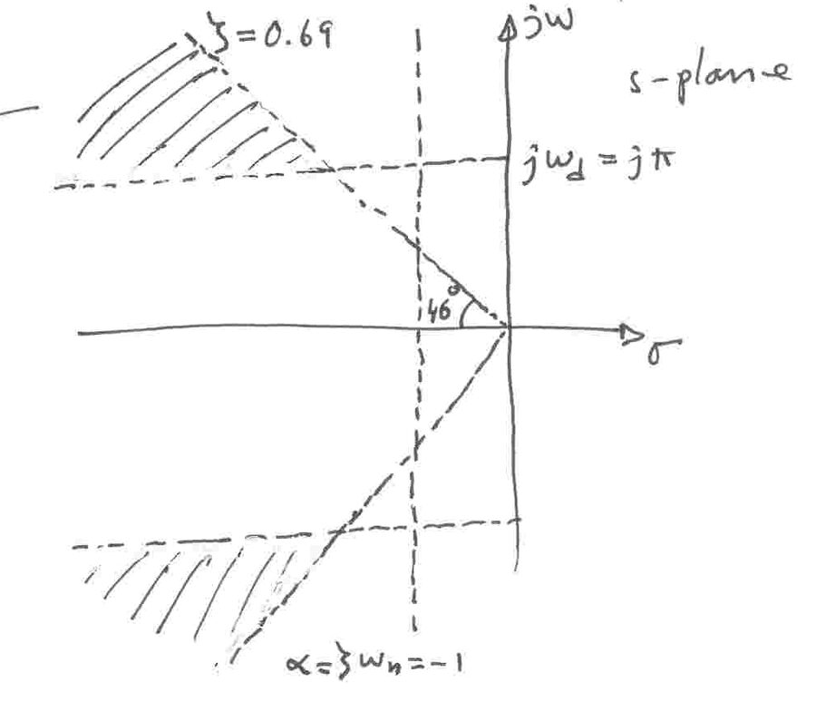

This post transcribes the solved examples **"Examples on Chapter 2 (EEM322)"** and **"CH-4"**, handwritten by the course instructor **Prof. Dr. Alper Uraz**, found in the "Kontrol" subfolder of the EEM322 Control Systems folder. The Chapter 2 examples deal with mathematical modeling and block diagrams, while the Chapter 4 examples deal with time response and steady-state errors. The "b" suffix on the page numbers (1b, 2b, …) indicates that these are the second set of examples. The documents are undated. The 12 scanned pages can be downloaded as a ZIP at the end of the post.

## Chapter 2: Mathematical Modeling

### Example 1(b): Pendulum

A torque T is applied to a pendulum consisting of a mass M, concentrated at the end of a massless rod of length b.

1. Moment of inertia about the pivot: J = Mb².
1. Newton's second law for rotational motion (N = Jθ̈; N: sum of external moments, J: mass moment of inertia, θ̈: angular acceleration): T − Mgb sin θ = Jθ̈, i.e. θ̈ + (g/b) sin θ = T/(Mb²); g ≅ 9.81 m/s².
1. The equation is nonlinear because of sin θ. Since the Taylor series is sin θ = θ − θ³/3! + θ⁵/5! − …, for small angles (in radians) we take sin θ ≅ θ: θ̈ + (g/b)θ = T/(Mb²).
1. If no torque is applied, this equation describes a harmonic oscillator with natural frequency ωn = √(g/b).
1. Transfer function: **θ(s)/T(s) = (1/(Mb²)) / (s² + g/b)**.

### Example 2(b): Gear Train

A gear train transmitting torque from a motor to a load shaft: on the first shaft J₁, B₁, and gear N₁; on the second shaft J₂, B₂, gear N₂, and load torque TL; n = N₁/N₂ and T₁/T₂ = θ₂/θ₁ = n.

1. First shaft: J₁ d²θ₁/dt² + B₁ dθ₁/dt + T₁ = Tm (T₁: load torque on gear 1 from the rest of the gear train, Tm: input torque from the motor).
1. Second shaft: J₂ d²θ₂/dt² + B₂ dθ₂/dt + TL = T₂ (T₂: torque transmitted to gear 2).
1. T₁ = nT₂ = n(J₂ θ̈₂ + B₂ θ̇₂ + TL) = n²J₂ θ̈₁ + n²B₂ θ̇₁ + nTL.
1. Substituting into the first-shaft equation: **J₁eq d²θ₁/dt² + B₁eq dθ₁/dt + nTL = Tm**; here J₁eq = J₁ + n²J₂ and B₁eq = B₁ + n²B₂ are the equivalent inertia and friction referred to the first shaft.

### Example 3(b): Interacting Two-Tank Level Control System

The system of Ex. 2.8 in the textbook. Equations in the Laplace domain:

- [Q(s) − Q₁(s)]/(C₁s) = P₁(s)
- [P₁(s) − P₂(s)]/R₁ = Q₁(s)
- P₂(s)/R₂ = Q₂(s)
- [Q₁(s) − Q₂(s)]/(C₂s) = P₂(s)

Each equation is represented by a block and the blocks are combined; the diagram is simplified step by step by moving the feedback points: first the two inner loops are reduced to the blocks 1/(R₁C₁s + 1) and 1/(R₂C₂s + 1), and the interaction between them remains as the feedback block R₂C₁s. Result:

> **Q₂(s)/Q(s) = 1 / [R₁C₁R₂C₂s² + (R₁C₁ + R₂C₂ + R₂C₁)s + 1]**

: block diagram reduction for interacting tanks")

### Example 4(b): Non-Interacting Tanks

The first tank (cross-sectional area A₁, level H₁, outlet resistance R₁) feeds the second tank (A₂, H₂, R₂). Pᵢ = ρHᵢ, Cᵢ = Aᵢ/ρ, ρ = 1 (density of water).

1. Dynamic equations: Q − Q₁ = C₁ dP₁/dt, P₁/R₁ = Q₁, Q₁ − Q₂ = C₂ dP₂/dt, P₂/R₂ = Q₂.
1. Transfer function: **Q₂(s)/Q(s) = 1 / [(1 + R₁C₁s)(1 + R₂C₂s)]**.
1. Electrical analogy: each tank corresponds to a parallel C and R circuit fed by a current source (i → C₁ ∥ R₁, i₁ → C₂ ∥ R₂).
1. Block diagram: Q → [1/(1 + R₁C₁s)] → Q₁ → [1/(1 + R₂C₂s)] → Q₂ (since the tanks do not load each other, the blocks simply multiply).

### Example 5(b): Armature-Controlled DC Motor Position Servo

(Similar to Ex. 2.4 in the textbook.) The angular position c of the output shaft is compared with the input angle r by means of two rotary potentiometers. The error voltage passes through an amplifier of gain Kp and drives the armature circuit (Ra, La); the field current is constant; the motor drives the load JL, BL through a gear train of ratio n = N₁/N₂.

The amplifier must have a very high input impedance, because the potentiometers are high-impedance circuits and cannot tolerate current being drawn from them; at the same time, since it drives the motor's armature circuit, its output impedance must be low.

| Time domain | s domain (zero initial conditions) |
|---|---|
| e = K₁(r − c) | E(s) = K₁[R(s) − C(s)] |
| ea = Kp·e | Ea(s) = Kp·E(s) |
| La·dia/dt + Ra·ia + eb = ea | (La·s + Ra)Ia(s) + Eb(s) = Ea(s) |
| eb = Kb·dθ/dt = Kb·ω | Eb(s) = Kb·s·θ(s) = Kb·Ω(s) |
| T = K₂·ia | T(s) = K₂·Ia(s) |
| Jeq·d²θ/dt² + Beq·dθ/dt = T | (Jeq·s² + Beq·s)θ(s) = T(s) |
| c = nθ | C(s) = n·θ(s) |

Jeq = n²JL and Beq = n²BL are the equivalent values referred to the motor shaft.

1. Transfer function of the armature-controlled DC motor: θ(s)/Ea(s) = K₂ / [s(La·s + Ra)(Jeq·s + Beq) + K₂Kb·s] ≅ K₂ / [Ra·s(Jeq·s + Beq) + K₂Kb·s] (for small La).
1. Overall transfer function: C(s)/R(s) = K₁KpK₂n / [s(La·s + Ra)(Jeq·s + Beq) + K₂Kb·s + K₁KpK₂n] ≅ K₁KpK₂n / [RaJeq·s² + (RaBeq + K₂Kb)s + K₁KpK₂n].
1. Dividing numerator and denominator by n²Ra: **C(s)/R(s) = K / (Js² + Bs + K)**; where K = K₁K₂Kp/(nRa), J = Jeq/n², B = Beq/n² + K₂Kb/(n²Ra) (values referred to the output shaft).
1. Simplified block diagram: K/[s(Js + B)] with unity feedback.
1. **Velocity feedback:** the derivative of the output signal can be used to improve system performance; the velocity signal is obtained with a tachometer. In the diagram, the output of the K/(Js + B) block is fed back through a gain Kt in the inner loop (velocity feedback), and the position feedback is taken after 1/s in the outer loop.

### Example 6(b): Signal Flow Graph and Mason's Gain Formula

Draw the signal flow graph of the given block diagram; find the output with respect to the inputs R and D (disturbance) using Mason's gain formula.

: block diagram and signal flow graph")

**For D(s) = 0:**

- Forward paths: P₁ = G₁G₂, P₂ = G₃.
- Loop gains: L₁ = −G₁H₁, L₂ = −G₂H₂, L₃ = −G₁G₂H₃, L₄ = −G₃H₃, L₅ = G₃H₂H₁.
- There are no non-touching loops. Determinant Δ = 1 − (L₁ + L₂ + L₃ + L₄ + L₅); cofactors Δ₁ = 1, Δ₂ = 1.
- **PR = (P₁Δ₁ + P₂Δ₂)/Δ = (G₁G₂ + G₃) / (1 + G₁H₁ + G₂H₂ + G₁G₂H₃ + G₃H₃ − G₃H₂H₁)**

**For R(s) = 0:** the determinant remains the same. Forward path P₁ = G₂, cofactor Δ₁ = 1 − L₁ = 1 + G₁H₁.

- **PD = P₁Δ₁/Δ = G₂(1 + G₁H₁)/Δ**

Total output: C(s) = PR·R(s) + PD·D(s). As homework: find the total transfer function for D(s) = 0 using block diagram algebra.

### Example 7(b): Block Diagram Algebra

A diagram consisting of forward blocks G₁, G₂, G₃, G₄ and feedback blocks H₁, H₂ is reduced step by step:

1. The branch point of G₄ is moved to after G₂; the parallel branch becomes G₄/G₂ + G₃.
1. Combined with G₂, the forward block becomes G₂G₃ + G₄; since the point from which the H₁ feedback is taken is also moved, the H₁ block becomes H₁G₂/(G₂G₃ + G₄).
1. The H₂ positive feedback loop is reduced: (G₂G₃ + G₄)/(1 − G₂G₃H₂ − G₄H₂).
1. Finally, the outer loop is closed:

> **Y/R = (G₁G₂G₃ + G₁G₄) / (1 − G₂G₃H₂ − G₄H₂ + G₁G₂H₁)**

## Chapter 4: Time Response

### Example 1b: Unit Step Response from a State-Space Model

> ẋ = [−1 0.5; −1 0]x + [0; 1]u, y = [1 0]x

1. In the Laplace domain, Y(s) = [C(sI − A)⁻¹B]U(s) = G(s)U(s); U(s) = 1/s, initial conditions zero.
1. sI − A = [s + 1 −0.5; 1 s], (sI − A)⁻¹ = (1/(s² + s + 0.5))·[s 0.5; −1 s + 1].
1. G(s) = [1 0]·(1/(s² + s + 0.5))·[0.5; s + 1] = **0.5/(s² + s + 0.5)**.
1. ωn = √0.5, 2ζωn = 1 ⇒ ζ = 1/(2√0.5) = 0.707.
1. Y(s) = 0.5/[(s² + s + 0.5)s]; inverse Laplace transform: **y(t) = 1 − (e^(−0.5t)/0.707)·sin(0.5t + π/4)**, t ≥ 0.
1. General form: y(t) = 1 − [e^(−ζωn t)/√(1 − ζ²)]·sin[ωn√(1 − ζ²)·t + tan⁻¹(√(1 − ζ²)/ζ)].

### Example 2b: Gain from a Settling Time Requirement

Unity-feedback system: G(s) = K/[s(s + √(2K))], desired Ts ≤ 1 s.

1. T(s) = G/(1 + G) = K/(s² + √(2K)s + K) ⇒ ωn = √K, ζ = √2/2 = 0.707.
1. Overshoot: PO = 100·e^(−πζ/√(1 − ζ²)) = 100·e^(−π) = 4.3%.
1. Settling time (2%): Ts = 4/(ζωn) = 8/√(2K). For Ts ≤ 1 s, 8/√(2K) = 1 ⇒ **K = 32**.
1. For K = 32: peak value Mp = 1 + e^(−πζ/√(1 − ζ²)) = 1.043; peak time Tp = π/ωd = π/(ωn√(1 − ζ²)) = π/4 = 0.785 s; rise time Tr = (π − θ)/ωd = (π − π/4)/4 = 3π/16 = 0.589 s, where θ = cos⁻¹ζ = cos⁻¹0.707 = π/4.

### Example 3b: Desired Pole Region

For the second-order closed loop T(s) = ωn²/(s² + 2ζωn s + ωn²), the specifications are: PO ≤ 5%, Ts ≤ 4 s, Tp ≤ 1 s.

1. PO = 100·e^(−πζ/√(1 − ζ²)) = 5 ⇒ e^(πζ/√(1 − ζ²)) = 20 ⇒ πζ/√(1 − ζ²) = ln 20 = 3 ⇒ π²ζ² = 9 − 9ζ² ⇒ ζ² = 9/(π² + 9) = 0.477 ⇒ **ζ = 0.69** (a boundary line at approximately 46°).
1. Ts = 4/(ζωn) ≤ 4 ⇒ ζωn ≥ 1 (poles to the left of the line σ = −1).
1. Tp = π/(ωn√(1 − ζ²)) ≤ 1 ⇒ ωd ≥ π.
1. The desired region for the poles is the (shaded, in the s-plane) region where these three boundaries intersect.

### Example 4b: Non-Unity Feedback and Steady-State Errors

System G(s) = 20/[s²(s + 2)], feedback H(s) = h.

1. The non-unity feedback is converted to an equivalent unity feedback: G/(1 + GH) = GE/(1 + GE) ⇒ GE = G/[1 + G(H − 1)].
1. Thus GE(s) = 20/[s²(s + 2) + 20(h − 1)]: for h = 1 the system is type 2, for h ≠ 1 it is type 0.
1. Error constants: Kp = GE(0) = ∞ (h = 1) or 1/(h − 1) (h ≠ 1); Kv = ∞ or 0; Ka = lim s²GE(s) = 10 (h = 1) or 0.
1. Step input (R = 1/s): ess = 1/(1 + Kp) = 0 (h = 1), (h − 1)/h (h ≠ 1).
1. Ramp input (R = 1/s²): ess = 1/Kv = 0 (h = 1), ∞ (h ≠ 1).
1. Parabolic input r(t) = t² (R = 2/s³): ess = 2/Ka = 2/10 (h = 1), ∞ (h ≠ 1).

*Note: These results are valid only if the closed loop is stable. The closed-loop characteristic equation s³ + 2s² + 20h = 0 has no s term; the Routh condition is not satisfied for any value of h, so this system is unstable for every h. The example is given to illustrate the method of computing the error constants.*
