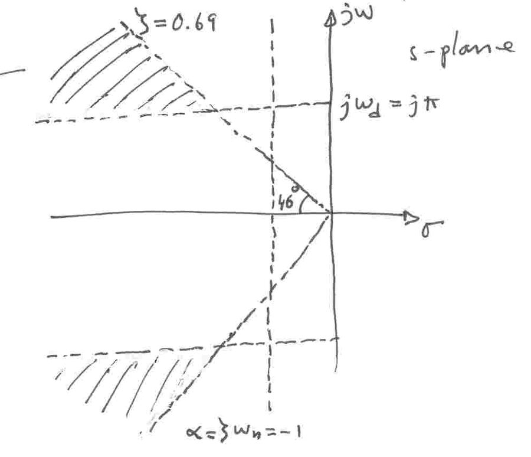

Bu yazı, EEM322 Denetim Sistemleri klasörünün "Kontrol" alt klasöründe bulunan, dersin öğretim üyesi **Prof. Dr. Alper Uraz**'ın el yazısıyla hazırladığı **"Examples on Chapter 2 (EEM322)"** ve **"CH-4"** çözümlü örneklerini metne aktarıyor. Bölüm 2 örnekleri matematiksel modelleme ve blok diyagramlarıyla, Bölüm 4 örnekleri zaman yanıtı ve sürekli hal hatalarıyla ilgili. Sayfa numaralarındaki "b" eki (1b, 2b, …) örneklerin ikinci takımı olduğunu gösteriyor. Belgelerde tarih yok. Taranmış 12 sayfa yazının sonunda ZIP olarak indirilebilir.

## Bölüm 2: Matematiksel modelleme

### Örnek 1(b): Sarkaç

Kütlesiz bir çubuğun ucunda toplanmış M kütleli, b uzunluklu bir sarkaca T torku uygulanıyor.

1. Dönme noktasına göre eylemsizlik momenti J = Mb².
1. Dönme hareketi için Newton'un ikinci yasası (N = Jθ̈; N: dış momentlerin toplamı, J: kütle eylemsizlik momenti, θ̈: açısal ivme): T − Mgb sin θ = Jθ̈, yani θ̈ + (g/b) sin θ = T/(Mb²); g ≅ 9.81 m/s².
1. Denklem sin θ yüzünden doğrusal değildir. Taylor serisi sin θ = θ − θ³/3! + θ⁵/5! − … olduğundan küçük açılar (radyan) için sin θ ≅ θ alınır: θ̈ + (g/b)θ = T/(Mb²).
1. Tork uygulanmazsa bu denklem ωn = √(g/b) doğal frekanslı bir harmonik osilatörü tanımlar.
1. Transfer fonksiyonu: **θ(s)/T(s) = (1/(Mb²)) / (s² + g/b)**.

### Örnek 2(b): Dişli takımı

Motordan yük miline tork ileten bir dişli takımı: birinci milde J₁, B₁, N₁ dişli; ikinci milde J₂, B₂, N₂ dişli ve TL yük torku; n = N₁/N₂ ve T₁/T₂ = θ₂/θ₁ = n.

1. Birinci mil: J₁ d²θ₁/dt² + B₁ dθ₁/dt + T₁ = Tm (T₁: dişli takımının geri kalanının 1. dişliye yük torku, Tm: motordan gelen giriş torku).
1. İkinci mil: J₂ d²θ₂/dt² + B₂ dθ₂/dt + TL = T₂ (T₂: 2. dişliye iletilen tork).
1. T₁ = nT₂ = n(J₂ θ̈₂ + B₂ θ̇₂ + TL) = n²J₂ θ̈₁ + n²B₂ θ̇₁ + nTL.
1. Birinci mil denklemine konunca: **J₁eq d²θ₁/dt² + B₁eq dθ₁/dt + nTL = Tm**; burada J₁eq = J₁ + n²J₂, B₁eq = B₁ + n²B₂ birinci mile indirgenmiş eşdeğer eylemsizlik ve sürtünmedir.

### Örnek 3(b): Etkileşimli iki tanklı seviye denetim sistemi

Ders kitabındaki Ex. 2.8'in sistemi. Laplace dönüşümlü denklemler:

- [Q(s) − Q₁(s)]/(C₁s) = P₁(s)
- [P₁(s) − P₂(s)]/R₁ = Q₁(s)
- P₂(s)/R₂ = Q₂(s)
- [Q₁(s) − Q₂(s)]/(C₂s) = P₂(s)

Her denklem bir blokla gösterilip birleştirilir; geri besleme noktaları kaydırılarak diyagram adım adım sadeleştirilir: önce iki iç döngü 1/(R₁C₁s + 1) ve 1/(R₂C₂s + 1) bloklarına indirgenir, aradaki etkileşim R₂C₁s geri besleme bloğu olarak kalır. Sonuç:

> **Q₂(s)/Q(s) = 1 / [R₁C₁R₂C₂s² + (R₁C₁ + R₂C₂ + R₂C₁)s + 1]**

: etkileşimli tanklar için blok diyagramı indirgeme")

### Örnek 4(b): Etkileşimsiz tanklar

Birinci tank (kesit alanı A₁, seviye H₁, çıkış direnci R₁) ikinci tankı (A₂, H₂, R₂) besliyor. Pᵢ = ρHᵢ, Cᵢ = Aᵢ/ρ, ρ = 1 (su yoğunluğu).

1. Dinamik denklemler: Q − Q₁ = C₁ dP₁/dt, P₁/R₁ = Q₁, Q₁ − Q₂ = C₂ dP₂/dt, P₂/R₂ = Q₂.
1. Transfer fonksiyonu: **Q₂(s)/Q(s) = 1 / [(1 + R₁C₁s)(1 + R₂C₂s)]**.
1. Elektriksel benzeşim: her tank, bir akım kaynağıyla beslenen paralel C ve R devresine karşılık gelir (i → C₁ ∥ R₁, i₁ → C₂ ∥ R₂).
1. Blok diyagramı: Q → [1/(1 + R₁C₁s)] → Q₁ → [1/(1 + R₂C₂s)] → Q₂ (tanklar birbirini yüklemediği için bloklar doğrudan çarpılır).

### Örnek 5(b): Endüvi kontrollü DC motorlu konum servosu

(Ders kitabındaki Ex. 2.4'e benzer.) Çıkış milinin açısal konumu c, giriş açısı r ile iki döner potansiyometre yardımıyla karşılaştırılıyor. Hata gerilimi Kp kazançlı bir kuvvetlendiriciden geçip endüvi devresini (Ra, La) sürüyor; alan akımı sabit; motor n = N₁/N₂ oranlı dişli takımıyla JL, BL yükünü döndürüyor.

Kuvvetlendiricinin giriş empedansı çok yüksek olmalıdır, çünkü potansiyometreler yüksek empedanslı devrelerdir ve akım çekilmesine dayanamaz; aynı zamanda motorun endüvi devresini beslediği için çıkış empedansı düşük olmalıdır.

| Zaman bölgesi | s bölgesi (sıfır başlangıç koşulları) |
|---|---|
| e = K₁(r − c) | E(s) = K₁[R(s) − C(s)] |
| ea = Kp·e | Ea(s) = Kp·E(s) |
| La·dia/dt + Ra·ia + eb = ea | (La·s + Ra)Ia(s) + Eb(s) = Ea(s) |
| eb = Kb·dθ/dt = Kb·ω | Eb(s) = Kb·s·θ(s) = Kb·Ω(s) |
| T = K₂·ia | T(s) = K₂·Ia(s) |
| Jeq·d²θ/dt² + Beq·dθ/dt = T | (Jeq·s² + Beq·s)θ(s) = T(s) |
| c = nθ | C(s) = n·θ(s) |

Jeq = n²JL ve Beq = n²BL, motor miline indirgenmiş eşdeğer değerlerdir.

1. Endüvi kontrollü DC motorun transfer fonksiyonu: θ(s)/Ea(s) = K₂ / [s(La·s + Ra)(Jeq·s + Beq) + K₂Kb·s] ≅ K₂ / [Ra·s(Jeq·s + Beq) + K₂Kb·s] (küçük La ile).
1. Toplam transfer fonksiyonu: C(s)/R(s) = K₁KpK₂n / [s(La·s + Ra)(Jeq·s + Beq) + K₂Kb·s + K₁KpK₂n] ≅ K₁KpK₂n / [RaJeq·s² + (RaBeq + K₂Kb)s + K₁KpK₂n].
1. Pay ve payda n²Ra'ya bölünürse: **C(s)/R(s) = K / (Js² + Bs + K)**; burada K = K₁K₂Kp/(nRa), J = Jeq/n², B = Beq/n² + K₂Kb/(n²Ra) (çıkış miline indirgenmiş değerler).
1. Sadeleştirilmiş blok diyagramı: birim geri beslemeli K/[s(Js + B)].
1. **Hız geri beslemesi:** çıkış işaretinin türevi sistem başarımını iyileştirmek için kullanılabilir; hız işareti bir takometreyle elde edilir. Diyagramda iç döngüde K/(Js + B) bloğunun çıkışı Kt kazancıyla geri beslenir (hız geri beslemesi), dışta 1/s'den sonra konum geri beslemesi vardır.

### Örnek 6(b): İşaret akış grafiği ve Mason kazanç formülü

Verilen blok diyagramının işaret akış grafiğini çizin; Mason kazanç formülüyle çıkışı R ve D (bozucu) girişlerine göre bulun.

: blok diyagramı ve işaret akış grafiği")

**D(s) = 0 için:**

- İleri yollar: P₁ = G₁G₂, P₂ = G₃.
- Döngü kazançları: L₁ = −G₁H₁, L₂ = −G₂H₂, L₃ = −G₁G₂H₃, L₄ = −G₃H₃, L₅ = G₃H₂H₁.
- Birbirine değmeyen döngü yok. Determinant Δ = 1 − (L₁ + L₂ + L₃ + L₄ + L₅); kofaktörler Δ₁ = 1, Δ₂ = 1.
- **PR = (P₁Δ₁ + P₂Δ₂)/Δ = (G₁G₂ + G₃) / (1 + G₁H₁ + G₂H₂ + G₁G₂H₃ + G₃H₃ − G₃H₂H₁)**

**R(s) = 0 için:** determinant aynı kalır. İleri yol P₁ = G₂, kofaktör Δ₁ = 1 − L₁ = 1 + G₁H₁.

- **PD = P₁Δ₁/Δ = G₂(1 + G₁H₁)/Δ**

Toplam çıkış: C(s) = PR·R(s) + PD·D(s). Ödev olarak: D(s) = 0 için toplam transfer fonksiyonunu blok diyagramı cebriyle bulun.

### Örnek 7(b): Blok diyagramı cebri

G₁, G₂, G₃, G₄ ileri blokları ve H₁, H₂ geri besleme bloklarından oluşan diyagram adım adım indirgeniyor:

1. G₄'ün dallanma noktası G₂'nin sonrasına taşınır; paralel kol G₄/G₂ + G₃ olur.
1. G₂ ile birleştirilince ileri blok G₂G₃ + G₄ olur; H₁ geri beslemesinin alındığı nokta da kaydırıldığı için H₁ bloğu H₁G₂/(G₂G₃ + G₄) olur.
1. H₂ pozitif geri besleme döngüsü indirgenir: (G₂G₃ + G₄)/(1 − G₂G₃H₂ − G₄H₂).
1. Son olarak dış döngü kapatılır:

> **Y/R = (G₁G₂G₃ + G₁G₄) / (1 − G₂G₃H₂ − G₄H₂ + G₁G₂H₁)**

## Bölüm 4: Zaman yanıtı

### Örnek 1b: Durum uzayı modelinden birim basamak yanıtı

> ẋ = [−1 0.5; −1 0]x + [0; 1]u, y = [1 0]x

1. Laplace bölgesinde Y(s) = [C(sI − A)⁻¹B]U(s) = G(s)U(s); U(s) = 1/s, başlangıç koşulları sıfır.
1. sI − A = [s + 1 −0.5; 1 s], (sI − A)⁻¹ = (1/(s² + s + 0.5))·[s 0.5; −1 s + 1].
1. G(s) = [1 0]·(1/(s² + s + 0.5))·[0.5; s + 1] = **0.5/(s² + s + 0.5)**.
1. ωn = √0.5, 2ζωn = 1 ⇒ ζ = 1/(2√0.5) = 0.707.
1. Y(s) = 0.5/[(s² + s + 0.5)s]; ters Laplace dönüşümü: **y(t) = 1 − (e^(−0.5t)/0.707)·sin(0.5t + π/4)**, t ≥ 0.
1. Genel biçim: y(t) = 1 − [e^(−ζωn t)/√(1 − ζ²)]·sin[ωn√(1 − ζ²)·t + tan⁻¹(√(1 − ζ²)/ζ)].

### Örnek 2b: Yerleşme süresi koşulundan kazanç

Birim geri beslemeli sistem: G(s) = K/[s(s + √(2K))], istenen Ts ≤ 1 s.

1. T(s) = G/(1 + G) = K/(s² + √(2K)s + K) ⇒ ωn = √K, ζ = √2/2 = 0.707.
1. Aşım: PO = 100·e^(−πζ/√(1 − ζ²)) = 100·e^(−π) = %4.3.
1. Yerleşme süresi (%2): Ts = 4/(ζωn) = 8/√(2K). Ts ≤ 1 s için 8/√(2K) = 1 ⇒ **K = 32**.
1. K = 32 için: tepe değeri Mp = 1 + e^(−πζ/√(1 − ζ²)) = 1.043; tepe zamanı Tp = π/ωd = π/(ωn√(1 − ζ²)) = π/4 = 0.785 s; yükselme süresi Tr = (π − θ)/ωd = (π − π/4)/4 = 3π/16 = 0.589 s, burada θ = cos⁻¹ζ = cos⁻¹0.707 = π/4.

### Örnek 3b: İstenen kutup bölgesi

İkinci dereceden kapalı döngü T(s) = ωn²/(s² + 2ζωn s + ωn²) için özellikler: PO ≤ %5, Ts ≤ 4 s, Tp ≤ 1 s.

1. PO = 100·e^(−πζ/√(1 − ζ²)) = 5 ⇒ e^(πζ/√(1 − ζ²)) = 20 ⇒ πζ/√(1 − ζ²) = ln 20 = 3 ⇒ π²ζ² = 9 − 9ζ² ⇒ ζ² = 9/(π² + 9) = 0.477 ⇒ **ζ = 0.69** (yaklaşık 46°'lik sınır doğrusu).
1. Ts = 4/(ζωn) ≤ 4 ⇒ ζωn ≥ 1 (kutuplar σ = −1 doğrusunun solunda).
1. Tp = π/(ωn√(1 − ζ²)) ≤ 1 ⇒ ωd ≥ π.
1. Kutuplar için istenen bölge, bu üç sınırın kesiştiği (s-düzleminde taranmış) bölgedir.

### Örnek 4b: Birim olmayan geri besleme ve sürekli hal hataları

Sistem G(s) = 20/[s²(s + 2)], geri besleme H(s) = h.

1. Birim olmayan geri besleme eşdeğer birim geri beslemeye dönüştürülür: G/(1 + GH) = GE/(1 + GE) ⇒ GE = G/[1 + G(H − 1)].
1. Böylece GE(s) = 20/[s²(s + 2) + 20(h − 1)]: h = 1 için sistem tip 2, h ≠ 1 için tip 0.
1. Hata sabitleri: Kp = GE(0) = ∞ (h = 1) ya da 1/(h − 1) (h ≠ 1); Kv = ∞ ya da 0; Ka = lim s²GE(s) = 10 (h = 1) ya da 0.
1. Basamak girişi (R = 1/s): ess = 1/(1 + Kp) = 0 (h = 1), (h − 1)/h (h ≠ 1).
1. Rampa girişi (R = 1/s²): ess = 1/Kv = 0 (h = 1), ∞ (h ≠ 1).
1. Parabol girişi r(t) = t² (R = 2/s³): ess = 2/Ka = 2/10 (h = 1), ∞ (h ≠ 1).

*Not: Bu sonuçlar ancak kapalı döngü kararlıysa geçerlidir. Kapalı döngü karakteristik denklemi s³ + 2s² + 20h = 0'da s'li terim yoktur; h'nin hiçbir değeri için Routh koşulu sağlanmaz, yani bu sistem her h için kararsızdır. Örnek, hata sabitlerinin hesap yöntemini göstermek için verilmiş.*
