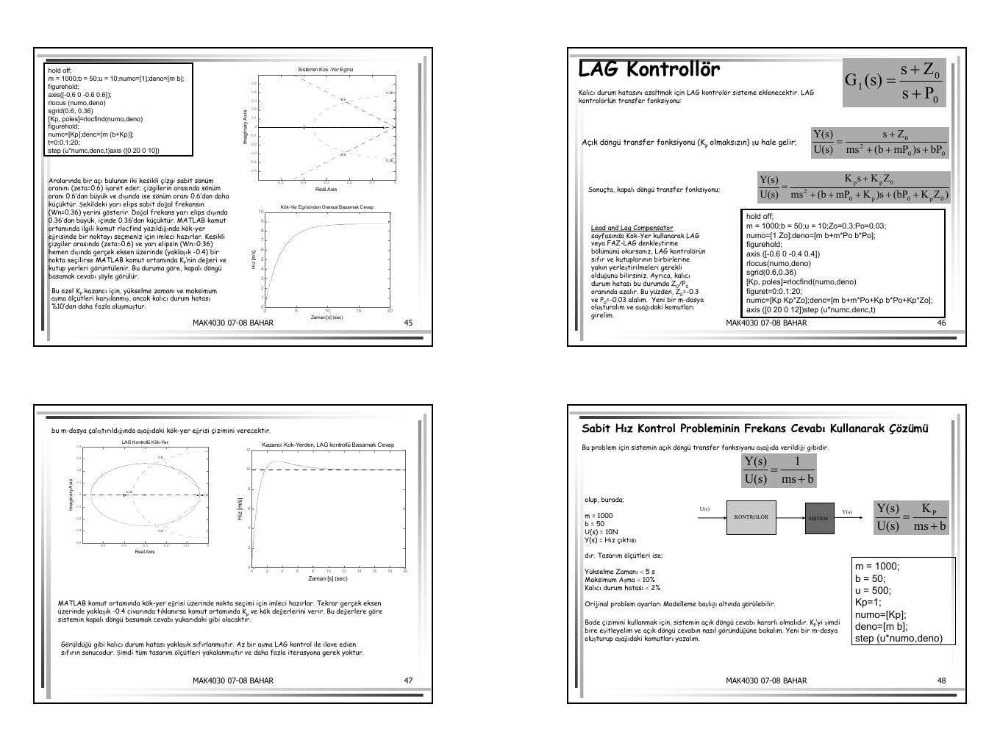

**Lecturer Dr. Gürsel Şefkat** prepared the "Summary on Automatic Control Systems" presentation for the course **MAK4030 Industrial Control Systems and Measurement**, which is among the third-party materials in the EEM322 archive. The presentation belongs to the 2007–2008 spring semester; the PDF is dated 28 February 2008. Four slides are placed on each of the thirteen PDF pages. The document cites İbrahim Yüksel's *Otomatik Kontrol* (Automatic Control) book (5th edition, 2006) as its source. The PDF can be downloaded at the end of the post.

*This content belongs to a third-party source; it is shared for archival and nostalgic purposes with the source credited. It will be removed upon request by the rights holder.*

## Transfer function and system types

With zero initial conditions, the transfer function is the ratio of the output to the input: **G(s) = Y(s)/U(s)**. It is obtained from the Laplace transform of the differential equation. The roots of the numerator are zeros, and the roots of the denominator are poles. Different physical structures can yield the same transfer function.

The presentation compares gain, first-order lag, and second-order oscillatory types. For the first-order system, the time constant is discussed; for the second-order system, the natural frequency, damping ratio, and step response. The transient response criteria are rise time, peak time, settling time, and overshoot.

## Steady-state error, stability, and control actions

The system type is related to the steady-state error for step, ramp, and parabolic inputs. Under the stability heading, pole locations, the Routh–Hurwitz criterion, and relative stability are listed.

Control actions are divided into on-off (two-position) control and continuous control. In continuous control:

- P: proportional action, Gc(s) = Kp.
- PI: Gc(s) = Kp + Ki/s.
- PD: Gc(s) = Kp + Kd s.
- PID: Gc(s) = Kp + Ki/s + Kd s.

Controller tuning can be done experimentally or analytically. The experimental topics are the oscillation method and the system response method. In the frequency response section, Bode and polar plots are introduced.

## Cruise control model

The vehicle is modeled as a mass–damper with wheel inertia neglected. With engine force u, speed v, mass m, and friction coefficient b:

**m v̇ + bv = u, y = v**

Take m = 1000 kg, b = 50 N·s/m, and u = 500 N. The open-loop transfer function is:

**G(s) = 1/(1000s + 50)**

State-space representation: A = [−b/m], B = [1/m], C = [1], D = 0. For a constant force of 500 N, the final speed is 10 m/s. The design requirements are: rise time < 5 s, overshoot < 10%, and steady-state error < 2%.

```matlab
m=1000;
b=50;
u=500;
num=[1];
den=[m b];
step(u*num,den)
```

The source's open-loop plot shows that the final value is approached very slowly; the speed takes more than 100 seconds to settle completely.

## P control

With unity feedback, the closed-loop transfer function is:

**T(s) = Kp/[ms + b + Kp]**

With Kp = 100, although the response becomes faster, the final value error is large: for a 10 m/s reference, the final speed is 10×100/150 ≈ 6.67 m/s. When Kp = 10000 is chosen, the error becomes very small and the response becomes very fast; the presentation notes that this may not be realistic given the force/acceleration constraints of a real vehicle.

```matlab
kp=100; m=1000;
b=50; u=10;
num=[kp];
den=[m b+kp];
t=0:0.1:20;
step(u*num,den,t)
axis([0 20 0 10])
```

## PI and PID control

For PI control:

**T(s) = (Kp s + Ki)/[ms² + (b + Kp)s + Ki]**

The presentation first examines the values Kp = 600, Ki = 1, and then the choice **Kp = 800, Ki = 40**. The response plotted for the second choice satisfies the design criteria.

```matlab
kp=800; ki=40;
m=1000; b=50; u=10;
num=[kp ki];
den=[m b+kp ki];
t=0:0.1:20;
step(u*num,den,t)
axis([0 20 0 10])
```

*Note: With this choice the denominator is (s + 0.8)(1000s + 50) and the numerator is of the form 800(s + 0.05); after cancellation, T(s) = 0.8/(s + 0.8). Thus the steady-state error and overshoot are zero, and the 10%–90% rise time is ln(9)/0.8 ≈ 2.75 s. This confirms the numerical result of the presentation.*

If PID is added, T(s) = (Kd s² + Kp s + Ki)/[(m + Kd)s² + (b + Kp)s + Ki]. The presentation states that the derivative action is not needed in this particular example; detailed tuning of the PID coefficients is not given.

## Root locus and phase-lag compensator

The root locus shows the movement of the closed-loop poles as Kp varies. The presentation marks the target region with `sgrid(0.6,0.36)` and has the user make a selection with `rlocfind`. Even though a pole at approximately −0.4 is selected with P control alone, the steady-state error is not reduced sufficiently.

A phase-lag compensator **G₁(s) = (s + Z₀)/(s + P₀)** is added. In the code, Z₀ = 0.3 and P₀ = 0.03 are used. This means that the zero is at −0.3 and the pole is at −0.03. The open loop is:

G₁(s)G(s) = (s + Z₀)/[ms² + (b + mP₀)s + bP₀]

The closed loop is:

T(s) = Kp(s + Z₀)/[ms² + (b + mP₀ + Kp)s + bP₀ + KpZ₀]



*Note: In the text, negative values are written for Z₀ and P₀, whereas positive coefficients are used in the code. In the definition G₁(s) = (s + Z₀)/(s + P₀), the pole and zero locations are the negatives of the coefficients.*

## Design with Bode

When the proportional gain is increased, the Bode magnitude curve shifts upward; the phase does not change. The source establishes approximate relationships between low-frequency gain and steady-state error, and between bandwidth and rise time.

In this example, the relative error for a unit step is **1/(1 + Kp/b)**. For Kp = 1, approximately 98.04% is obtained; for Kp = 100, 33.33% is obtained.

*Note: The last slide states the result "20 dB, 9% error" together with the code Kp = 100. For b = 50, Kp = 100 gives 6.02 dB and 33.33% error; Kp = 500 is required for 20 dB and approximately 9.09%. Moreover, since the open-loop magnitude never reaches 0 dB at any frequency for Kp = 1, the presentation's 155° phase margin interpretation is not consistent with this model.*
