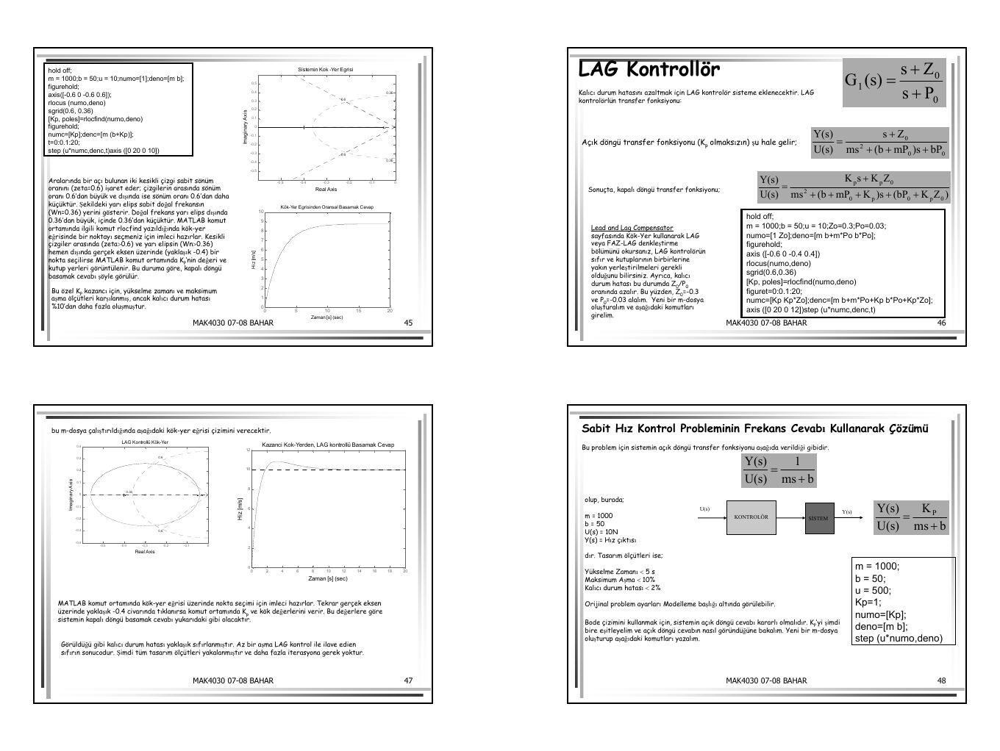

**Öğr. Gör. Dr. Gürsel Şefkat** tarafından hazırlanan, **MAK4030 Endüstriyel Kontrol Sistemleri ve Ölçme** dersinin “Otomatik Kontrol Sistemleri Hakkında Özet” sunumu, EEM322 arşivindeki üçüncü taraf materyaller arasındadır. Sunum 2007–2008 bahar dönemine ait; PDF tarihi 28 Şubat 2008. On üç PDF sayfasına dörder slayt yerleştirilmiş. Belge, İbrahim Yüksel’in *Otomatik Kontrol* kitabını (5. baskı, 2006) kaynak gösteriyor. PDF yazının sonunda indirilebilir.

*Bu içerik üçüncü taraf bir kaynağa aittir; arşiv ve nostalji amacıyla kaynak belirtilerek paylaşılmıştır. Hak sahibinin talebi hâlinde kaldırılır.*

## Transfer fonksiyonu ve sistem türleri

Sıfır başlangıç koşullarında transfer fonksiyonu çıkışın girişe oranıdır: **G(s) = Y(s)/U(s)**. Diferansiyel denklemin Laplace dönüşümünden elde edilir. Payın kökleri sıfırlar, paydanın kökleri kutuplardır. Farklı fiziksel yapılar aynı transfer fonksiyonunu verebilir.

Sunum kazanç, birinci dereceden gecikme ve ikinci dereceden titreşim tiplerini karşılaştırır. Birinci dereceden sistemin zaman sabiti; ikinci dereceden sistemin doğal frekansı, sönüm oranı ve basamak yanıtı üzerinde durulur. Geçici yanıt ölçütleri yükselme, tepe, yerleşme süresi ve aşmadır.

## Kalıcı durum hatası, kararlılık ve denetim etkileri

Sistem tipi ile basamak, rampa ve parabolik girişlerdeki kalıcı durum hatası ilişkilendirilir. Kararlılık başlığı altında kutupların konumu, Routh–Hurwitz ölçütü ve bağıl kararlılık sıralanır.

Denetim etkileri iki konumlu denetim ve sürekli denetim olarak ayrılır. Sürekli denetimde:

- P: orantı etkisi, Gc(s) = Kp.
- PI: Gc(s) = Kp + Ki/s.
- PD: Gc(s) = Kp + Kd s.
- PID: Gc(s) = Kp + Ki/s + Kd s.

Denetleyici ayarı deneysel veya analitik yapılabilir. Deneysel başlıklar salınım yöntemi ve sistem cevap yöntemidir. Frekans cevabı kısmında Bode ve kutupsal eğriler tanıtılır.

## Sabit hız kontrolünün modeli

Araç, tekerlek ataleti ihmal edilmiş bir kütle–sönümleyici olarak modellenir. Motor kuvveti u, hız v, kütle m ve sürtünme katsayısı b ile:

**m v̇ + bv = u, y = v**

m = 1000 kg, b = 50 N·s/m ve u = 500 N alınır. Açık döngü transfer fonksiyonu:

**G(s) = 1/(1000s + 50)**

Durum uzayı gösterimi: A = [−b/m], B = [1/m], C = [1], D = 0. Sabit 500 N kuvvet için son hız 10 m/s olur. Tasarım istekleri: yükselme zamanı < 5 s, aşma < %10 ve kalıcı durum hatası < %2.

```matlab
m=1000;
b=50;
u=500;
num=[1];
den=[m b];
step(u*num,den)
```

Kaynağın açık döngü grafiği son değere çok yavaş yaklaşıldığını gösterir; hızın tam yerleşmesi 100 saniyeyi aşar.

## P denetimi

Birim geri beslemede kapalı döngü transfer fonksiyonu:

**T(s) = Kp/[ms + b + Kp]**

Kp = 100 ile yanıt hızlansa da son değer hatası büyüktür: 10 m/s referans için son hız 10×100/150 ≈ 6.67 m/s. Kp = 10000 seçildiğinde hata çok küçülür ve yanıt çok hızlı olur; sunum bunun gerçek aracın kuvvet/ivmelenme kısıtları açısından gerçekçi olmayabileceğini belirtir.

```matlab
kp=100; m=1000;
b=50; u=10;
num=[kp];
den=[m b+kp];
t=0:0.1:20;
step(u*num,den,t)
axis([0 20 0 10])
```

## PI ve PID denetimi

PI denetim için:

**T(s) = (Kp s + Ki)/[ms² + (b + Kp)s + Ki]**

Sunum önce Kp = 600, Ki = 1 değerlerini, sonra **Kp = 800, Ki = 40** seçimini inceler. İkinci seçim için çizilen yanıt tasarım ölçütlerini sağlar.

```matlab
kp=800; ki=40;
m=1000; b=50; u=10;
num=[kp ki];
den=[m b+kp ki];
t=0:0.1:20;
step(u*num,den,t)
axis([0 20 0 10])
```

*Not: Bu seçimde payda (s + 0.8)(1000s + 50), pay 800(s + 0.05) biçimindedir; sadeleşme sonrası T(s) = 0.8/(s + 0.8). Böylece son değer hatası ve aşma sıfır, %10–%90 yükselme süresi ln(9)/0.8 ≈ 2.75 s olur. Bu, sunumun sayısal sonucunu doğrular.*

PID eklenirse T(s) = (Kd s² + Kp s + Ki)/[(m + Kd)s² + (b + Kp)s + Ki]. Sunum, bu özel örnekte türev etkisine gerek olmadığını belirtir; PID katsayılarının ayrıntılı ayarı verilmez.

## Kök yer ve faz geciktiren dengeleyici

Kök yer eğrisi Kp’nin değişmesiyle kapalı döngü kutuplarının hareketini gösterir. Sunum `sgrid(0.6,0.36)` ile hedef bölgeyi işaretler ve `rlocfind` ile seçim yaptırır. Yalnız P denetiminde yaklaşık −0.4 kutbu seçilse de kalıcı hata yeterince küçülmez.

Faz geciktiren dengeleyici **G₁(s) = (s + Z₀)/(s + P₀)** ile eklenir. Kodda Z₀ = 0.3, P₀ = 0.03 kullanılır. Bu, sıfırın −0.3’te, kutbun −0.03’te olduğu anlamına gelir. Açık döngü:

G₁(s)G(s) = (s + Z₀)/[ms² + (b + mP₀)s + bP₀]

Kapalı döngü:

T(s) = Kp(s + Z₀)/[ms² + (b + mP₀ + Kp)s + bP₀ + KpZ₀]



*Not: Metinde Z₀ ve P₀ için negatif değerler yazılırken kodda pozitif katsayılar kullanılmıştır. G₁(s) = (s + Z₀)/(s + P₀) tanımında kutup ve sıfır yerleri katsayıların negatifidir.*

## Bode ile tasarım

Oransal kazanç artırıldığında Bode genlik eğrisi yukarı kayar; faz değişmez. Kaynak düşük frekans kazancı ile kalıcı hata, bant genişliği ile yükselme süresi arasında yaklaşık ilişkiler kurar.

Bu örnekte birim basamak bağıl hatası **1/(1 + Kp/b)**’dir. Kp = 1 için yaklaşık %98.04; Kp = 100 için %33.33 elde edilir.

*Not: Son slaytta Kp = 100 koduyla “20 dB, %9 hata” sonucu birlikte yazılmıştır. b = 50 için Kp = 100, 6.02 dB ve %33.33 hata verir; 20 dB ve yaklaşık %9.09 için Kp = 500 gerekir. Ayrıca Kp = 1 durumunda açık döngü genliği hiçbir frekansta 0 dB’ye ulaşmadığından sunumdaki 155° faz payı yorumu bu modelle tutarlı değildir.*
