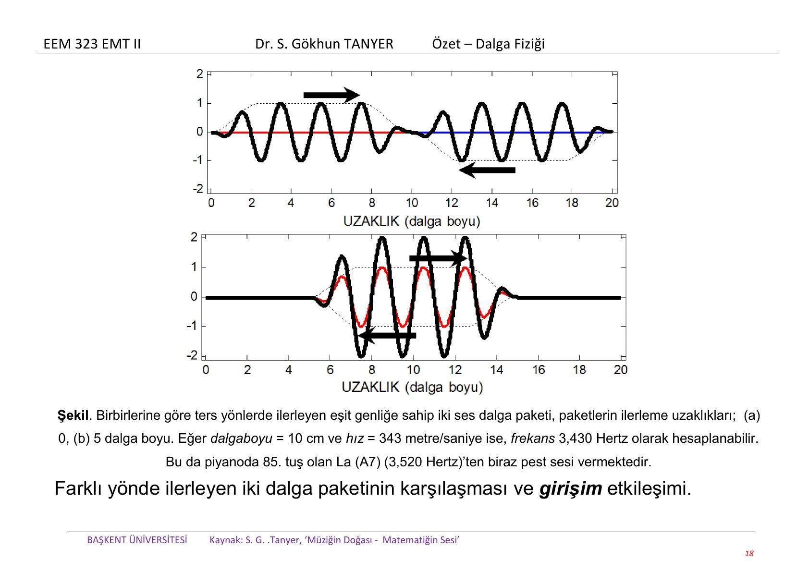
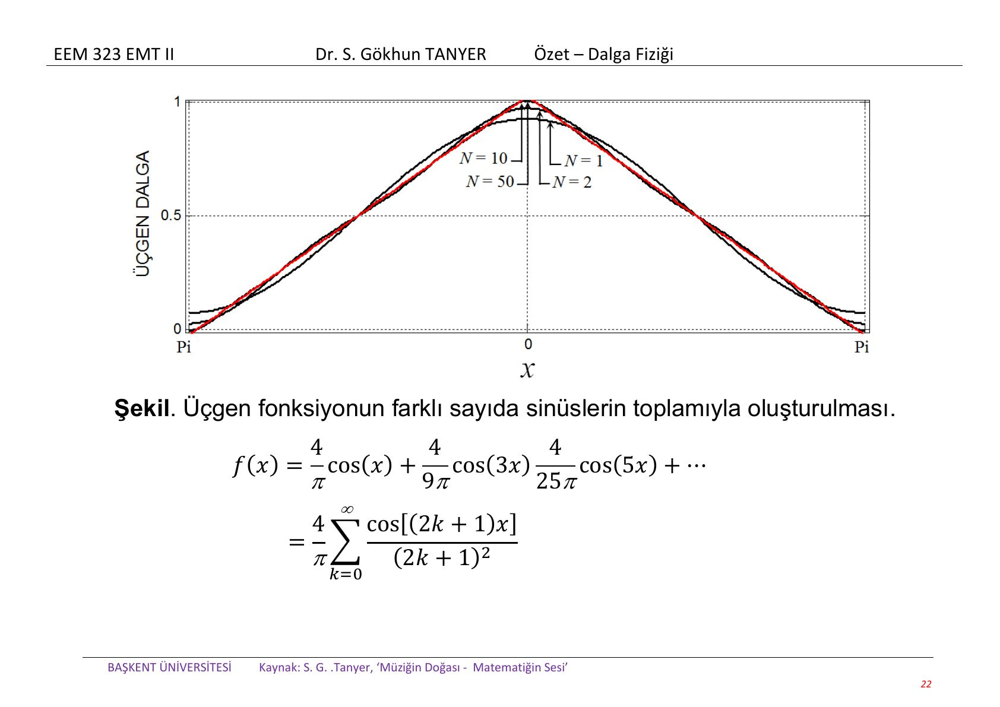
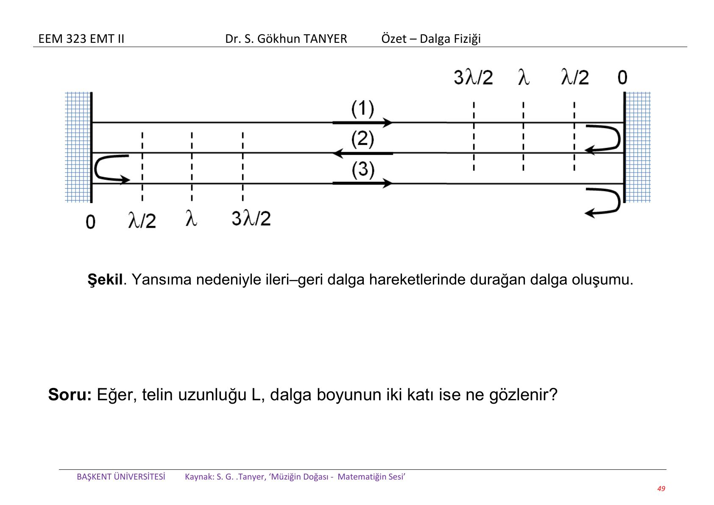

This is a summary of the 55-slide "Wave Physics" deck that Prof. Dr. S. Gökhun Tanyer prepared for the Başkent University **EEM323 Electromagnetics II** course (2013–2014 fall semester, 19 September 2013). The slides cite the professor's own work *The Nature of Music – The Sound of Mathematics* as their source. The important parts have been written out as text; the original PDF can be downloaded at the end of the post.

## Water, sound and electromagnetic waves

Waves obey the laws of conservation of energy and increasing entropy: a wave that starts propagates, may weaken or change direction, and its amplitude decreases as it spreads.

- A **sound wave** needs a medium (air, water, solids) in which to propagate; it cannot propagate in a vacuum. An electromagnetic wave (light, radio), on the other hand, travels through a vacuum. Humanity struggled to accept this difference and, until recently, believed in the existence of a medium in space called the "aether".
- In a sound wave, the compression and expansion lie along the direction of motion; an electromagnetic wave, like a water wave, oscillates **perpendicular** to its direction of motion. This direction of oscillation is the wave's **polarization**.
- **Huygens' principle** (Huygens and Fresnel): an advancing wave behaves as if it were formed again and again from point sources on the wavefront.
- The speed of a wave depends not on the magnitude of the energy that started it but only on the **properties of the medium**.
- The relation among speed, frequency and wavelength: v = λ · f, λ = v / f, f = v / λ.

## History of the wave equation

In wave propagation, nature "takes derivatives": if a change in energy is created in a small point-like volume, a change also occurs in the surroundings. The historical sequence: Ørsted (1821, a magnetic needle moves when the current changes), Ampère (1827, a changing electric field creates a magnetic field), Faraday (a changing magnetic field creates an electric field), Maxwell (unifies these in a single electromagnetic wave equation). For string vibration d'Alembert (1752) is cited, and for sound waves the work of Feynman.

Observations: the wave equation takes derivatives continuously; oscillations can propagate forever. The family of functions that is resistant to differentiation is the sine: sin, cos, −sin, −cos.

## Reflection, refraction, scattering, interference

A wave that returns is an **echo**. Changing direction when entering a different medium is **refraction**, and reaching behind corners and edges is **scattering**. When two wave packets traveling in opposite directions meet, interference occurs. In the example in the slides, a wavelength of 10 cm and a speed of 343 m/s give a frequency of 3430 Hz; this is slightly lower than the note A (A7, 3520 Hz), the 85th key on the piano.

## Fourier

The discussion proceeds through the question of Euler, d'Alembert, Daniel Bernoulli and Fourier: "How does the initial triangular shape of a plucked and released string turn into sines?" A triangular wave is a sum of sines:

f(x) = (4/π) cos x + (4/9π) cos 3x + (4/25π) cos 5x + … = (4/π) Σ cos[(2n+1)x] / (2n+1)²

**Fourier (1807):** all physical pressure distributions that can be produced by sound waves can be produced using only sines. A signal s(t) with period T decomposes into a sum of sines with frequencies n·f₀, where f₀ = 1/T; the same holds for the position variables x, y, z. As examples, the Fourier transform is shown for a single 50 Hz sine and for a sound recording with 50 Hz and 120 Hz components; this is followed by a preview of the 2-D Fourier transform, JPEG image compression and "Fourier optics" (Fresnel and Fraunhofer diffraction, rectangular and circular apertures, the 4-F imaging system, spatial filtering, image formation; figures taken from internet sources).

## Standing waves and overtones (harmonics)

If the reflected wave is also reflected, the sum of the forward and backward waves becomes a **standing wave**. On a string fixed at both ends, the amplitude at the ends is zero (boundary condition). If the string length is L, then for the first overtone λ = 2L and f = v/λ; for overtones 1–6:

- f₁ = f, f₂ = 2f, f₃ = 3f, f₄ = 4f, f₅ = 5f, f₆ = 6f
- λ₁ = λ, λ₂ = λ/2, λ₃ = λ/3, λ₄ = λ/4, λ₅ = λ/5, λ₆ = λ/6

Questions on the slide: What is observed if L is twice the wavelength? What happens if the wavelength is reduced (the frequency increased)? In instruments open at both ends, such as the flute and the ney, the amplitude at the ends is highest; is a standing wave still possible?

**Homework (internet research):** write the operating principle of the laser in your own words; explain, citing sources, the relation of the laser to resonance and standing-wave mechanisms; attach the outputs of your sources.

## Standing waves in sound production: guitar strings

In instruments such as the guitar, violin, saz and oud, the string thickness, tension and length according to the fretted position vary. Standard guitar tuning:

| String | Note | Pitch | Frequency |
|---|---|---|---|
| 1 (thinnest) | E | E4 | 329.63 Hz |
| 2 | B | B3 | 246.94 Hz |
| 3 | G | G3 | 196.00 Hz |
| 4 | D | D3 | 146.83 Hz |
| 5 | A | A2 | 110.00 Hz |
| 6 (thickest) | E | E2 | 82.41 Hz |
