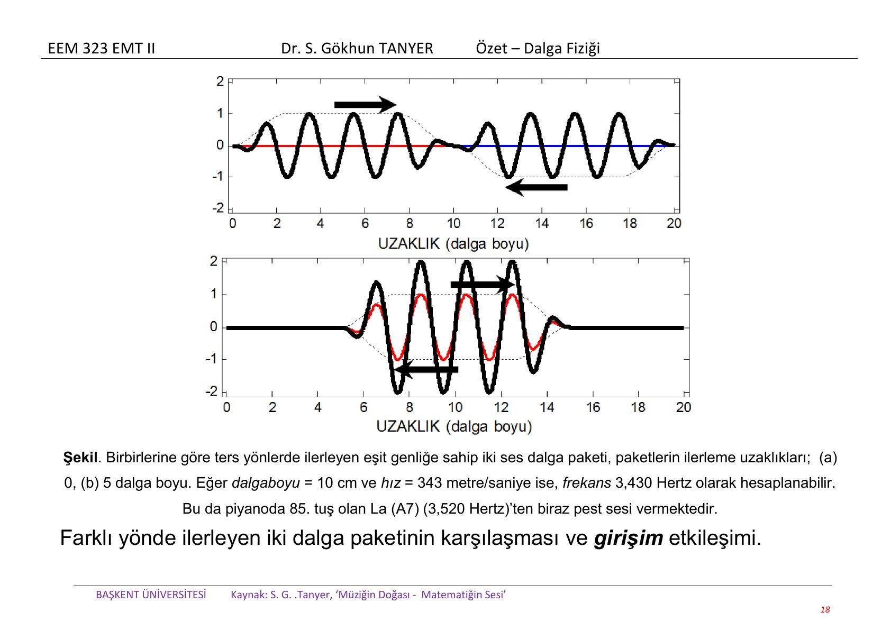
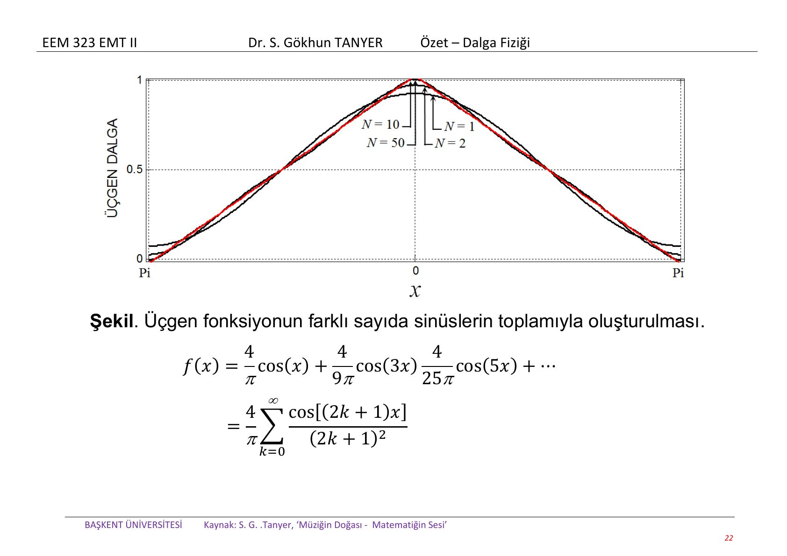
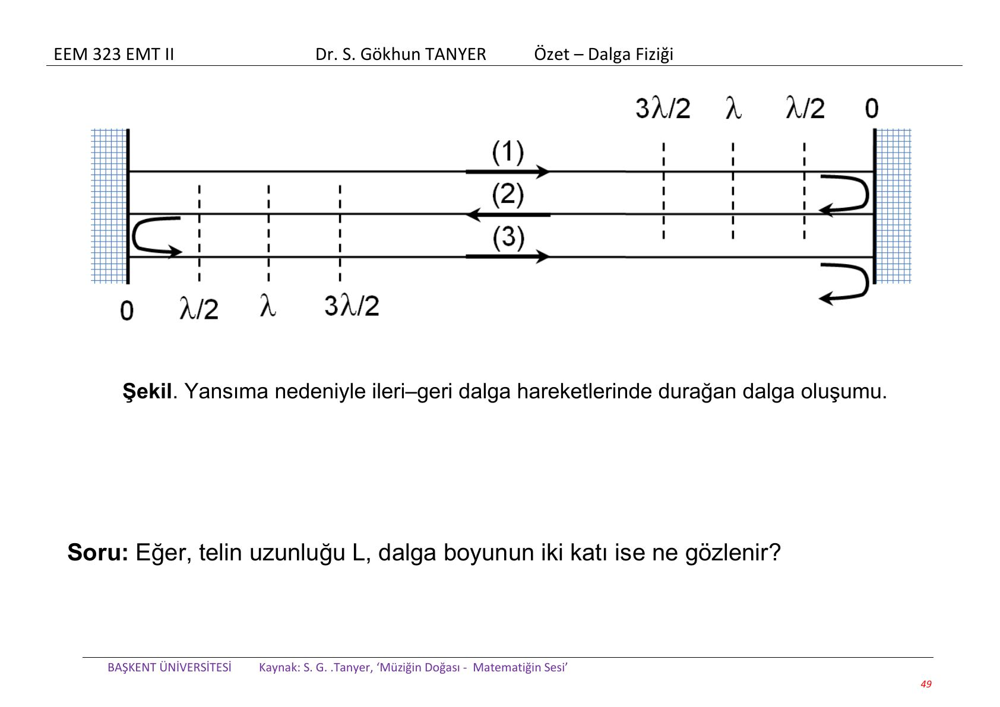

Prof. Dr. S. Gökhun Tanyer'in Başkent Üniversitesi **EEM323 Elektromanyetik II** dersi için hazırladığı 55 slaytlık "Dalga Fiziği" özeti (2013–2014 güz, 19 Eylül 2013). Slaytların kaynağı olarak hocanın *Müziğin Doğası – Matematiğin Sesi* çalışması gösteriliyor. Önemli kısımlar metne dökülmüştür; orijinal PDF yazının sonunda indirilebilir.

## Su, ses ve elektromanyetik dalgalar

Dalgalar enerjinin korunumu ve entropinin artması yasalarına uyar: başlayan bir dalga ilerler, zayıflayabilir ya da yön değiştirebilir ve yayıldıkça genliği azalır.

- **Ses dalgası** yayılmak için ortama (hava, su, katı maddeler) ihtiyaç duyar; boşlukta yayılamaz. Elektromanyetik dalga (ışık, radyo) ise boşlukta ilerler. İnsanlık bu farkı kabullenmekte zorlanmış ve yakın zamana kadar uzayda "esir" denen bir ortamın varlığına inanmıştır.
- Ses dalgasında sıkışıp genişleme hareketin yönündedir; elektromanyetik dalga ise su dalgası gibi hareket yönüne **dik** salınır. Bu salınım yönü dalganın **polarizasyonudur**.
- **Huygens ilkesi** (Huygens ve Fresnel): ilerleyen dalga, dalga yüzeyindeki noktasal kaynakçıklardan tekrar tekrar oluşuyormuş gibi davranır.
- Dalganın hızı, onu başlatan enerjinin büyüklüğüne değil yalnızca **ortamın özelliğine** bağlıdır.
- Hız, frekans ve dalga boyu arasındaki ilişki: v = λ · f, λ = v / f, f = v / λ.

## Dalga denkleminin tarihçesi

Doğa dalga yayılımında "türev" alır: küçük bir noktasal hacimde enerji değişikliği yaratılırsa çevrede de bir değişiklik oluşur. Tarihsel sıra: Ørsted (1821, akım değişince mıknatıs iğnesi oynar), Ampère (1827, değişen elektrik alanı manyetik alan yaratır), Faraday (değişen manyetik alan elektrik alan yaratır), Maxwell (bunları tek bir elektromanyetik dalga denkleminde birleştirir). Tel titreşimi için d'Alembert (1752), ses dalgaları için Feynman'ın çalışmaları anılır.

Gözlemler: dalga denklemi sürekli türev alır; salınımlar sonsuza dek ilerleyebilir. Türeve dayanıklı fonksiyon ailesi sinüstür: sin, cos, −sin, −cos.

## Yansıma, kırılma, saçınma, girişim

Geri dönen dalga **yankı**dır. Farklı ortama girerken yön değiştirme **kırılma**, köşe ve kenar arkalarına ulaşma **saçınma**dır. Ters yönlerde ilerleyen iki dalga paketi karşılaştığında girişim olur. Slaytlardaki örnekte dalga boyu 10 cm ve hız 343 m/s ise frekans 3430 Hz bulunur; bu, piyanodaki 85. tuş La (A7, 3520 Hz) notasının biraz pesidir.

## Fourier

Euler, d'Alembert, Daniel Bernoulli ve Fourier'in "çekilip bırakılan telin başlangıçtaki üçgen şekli nasıl sinüslere dönüşür?" sorusu üzerinden ilerlenir. Üçgen dalga, sinüslerin toplamıdır:

f(x) = (4/π) cos x + (4/9π) cos 3x + (4/25π) cos 5x + … = (4/π) Σ cos[(2n+1)x] / (2n+1)²

**Fourier (1807):** ses dalgalarıyla oluşturulabilecek tüm fiziksel basınç dağılımları yalnızca sinüslerle oluşturulabilir. T periyotlu bir s(t) işareti, f₀ = 1/T olmak üzere n·f₀ frekanslı sinüslerin toplamına ayrışır; aynısı konum değişkenleri x, y, z için de geçerlidir. Örnek olarak 50 Hz'lik tek sinüs ile 50 Hz ve 120 Hz bileşenli bir ses kaydının Fourier dönüşümü gösterilir; ardından 2 boyutlu Fourier dönüşümü, JPEG görüntü sıkıştırma ve "Fourier optiği" önizlemesi yapılır (Fresnel ve Fraunhofer kırınımı, dikdörtgen ve dairesel açıklık, 4-F görüntüleme sistemi, uzaysal filtreleme, görüntü oluşumu; şekiller internet kaynaklarından).

## Duran dalgalar ve selenler (harmonikler)

Yansıyan dalga da yansıtılırsa ileri ve geri dalgaların toplamı **duran dalga** olur. İki ucu sabit tel üzerinde uçlardaki genlik sıfırdır (sınır koşulu). Telin boyu L ise birinci selende λ = 2L ve f = v/λ; 1–6. selenler için:

- f₁ = f, f₂ = 2f, f₃ = 3f, f₄ = 4f, f₅ = 5f, f₆ = 6f
- λ₁ = λ, λ₂ = λ/2, λ₃ = λ/3, λ₄ = λ/4, λ₅ = λ/5, λ₆ = λ/6

Slayttaki sorular: L dalga boyunun iki katı olursa ne gözlenir? Dalga boyu azaltılırsa (frekans artırılırsa) ne olur? İki ucu açık flüt ve ney gibi çalgılarda uç genliği en yüksektir; duran dalga yine mümkün müdür?

**Ödev (internet araştırması):** lazerin çalışma prensibini kendi cümlelerinle yaz; lazerin rezonans ve duran dalga mekanizmalarıyla ilişkisini kaynak göstererek açıkla; kaynak çıktılarını ekle.

## Ses üretiminde duran dalga: gitar telleri

Gitar, keman, saz ve ud gibi çalgılarda tel kalınlığı, gerginliği ve basılan perdeye göre uzunluğu değişir. Standart gitar akordu:

| Tel | Nota | Perde | Frekans |
|---|---|---|---|
| 1 (en ince) | Mi | E4 | 329,63 Hz |
| 2 | Si | B3 | 246,94 Hz |
| 3 | Sol | G3 | 196,00 Hz |
| 4 | Re | D3 | 146,83 Hz |
| 5 | La | A2 | 110,00 Hz |
| 6 (en kalın) | Mi | E2 | 82,41 Hz |
