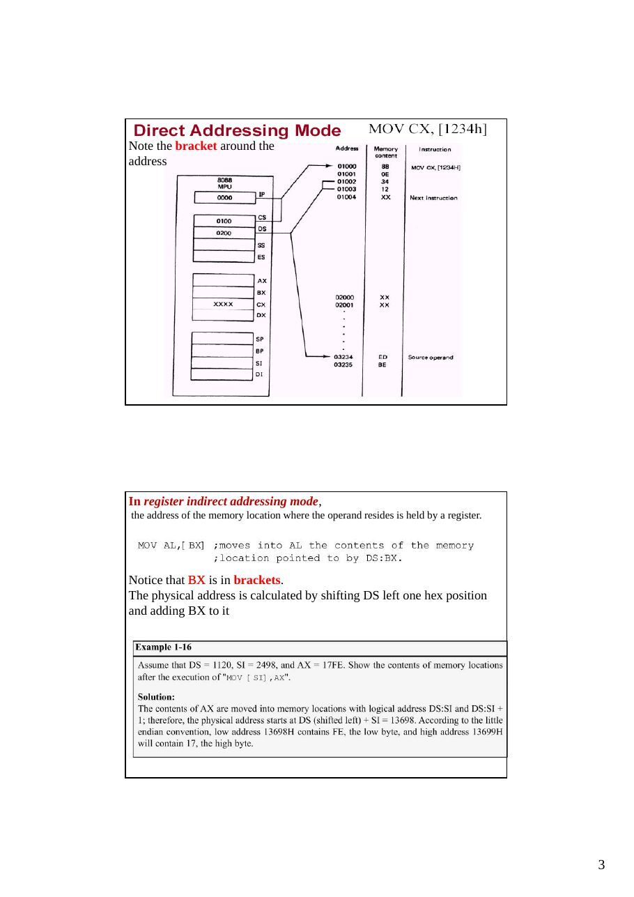
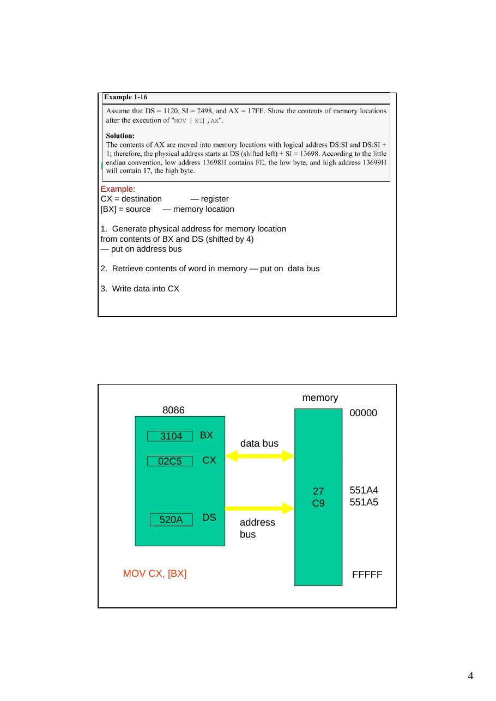

Bu yazı, Başkent Üniversitesi **EEM332 Mikroişlemciler** ders arşivindeki ilgili notları ve uygulamaları bir araya getiriyor (2005–2015). Doğrudan, dolaylı, taban ve indisli adresleme; segment ve ofsetten fiziksel adresin bulunması. Belgelerin PDF arşiv kopyaları ve varsa kaynak kodları yazının sonunda ZIP olarak indirilebilir.

## CPU03_2013

### EEM332 Lecture3

Adressing modes in 8086

```asm
Addressing Modes:
```

The CPU can access operands (data) in various ways, called addressing modes. In 80x86 there are 7 addressing modes. The number of addressing modes is determined when the microprocessor is designed & cannot be changed The x86 provides seven distinct addressing

- 1 - Register                         – 5 - Based relative

- 2 - Immediate                        – 6 - Indexed relative

- 3 - Direct                           – 7 - Based indexed relative

- 4 - Register indirect

Register addressing mode involves use of registers to hold the data to be manipulated. Memory is not accessed, so it is relatively fast.

Memory is not accessed, so it is relatively fast.

```asm
In immediate addressing mode, as the name implies, when the instruction
```

is assembled, the operand comes immediately after the opcode. The source operand is a constant.

Note the bracket around the

```asm
address
```

```asm
In register indirect addressing mode,
```

the address of the memory location where the operand resides is held by a register.

Notice that BX is in brackets. The physical address is calculated by shifting DS left one hex position

```asm
and adding BX to it
```

```asm
MOV CX, [BX]
```

### Example

CX = destination   — register [BX] = source — memory location

### 1. Generate physical address for memory location

from contents of BX and DS (shifted by 4) — put on address bus

### 2. Retrieve contents of word in memory — put on data bus

### 3. Write data into CX

memory 8086                                        00000

### 3104      BX

data bus

### 02C5       CX

### 27    551A4

### C9    551A5

520A       DS        address bus

```asm
MOV CX, [BX]                                           FFFFF
```

memory 8086                                 00000

### 3104     BX

data bus

### 02C5     CX

### 27      551A4

### 551A4                551A5

### C9

### 520A     DS

```asm
address
bus
```

520A0 = DS shifted by 4

### +3104 = BX

551A4 = physical address                   FFFFF

memory 8086                                 00000

### 3104     BX

data bus

### C927     CX

### C927

### 27      551A4

### 551A4                551A5

### C9

520A     DS      address bus

### FFFFF

### 4. Register indirect addressing mode: Examples

- The address of the memory location where the operand resides is held by a register.

- SI, DI and BX registers are used as the pointers to hold the offset addresses.

- They must be combined with DS to generate the 20-bit physical address

```asm
; moves into AL the contents of the memory
```

location pointed to by DS:BX

```asm
; move contents of DS:SI into CL
; move the contents of AH into DS:DI
```

BX contains 0400h           Offset 0400h contains ABCDh SI contains 0500h           Offset 0500h contains 1000h DI contains 0600h           Offset 0600h contains 0045h

### INSTRUCTIONS:                        RESULTS

### 1. MOV AX,BX                         AX: 0400h

### 2. MOV AX,[BX]                       AX: ABCDh

### 3. MOV AX,SI                         AX: 0500h

### 4. MOV AX,[SI]                       AX: 1000h

### Direct versus indirect addressing mode

```asm
address of the data in memory comes immediately after the instruction operand is a
```

constant The address is the offset address. The offset address is put in a rectangular bracket Ex: MOV AX,[SI] or SUB DX, [BX] indirect addressing

### Direct addressing mode

### EX

```asm
move contents of DS:2400H into DL
```

### 5. Based relative addressing mode:

BX and BP are known as the base registers. In this mode base registers as well as a displacement value are used to calculate the effective address. The default segments used for the calculation of Physical address (PA) are DS for BX,

```asm
and SS for BP.
```

opcode           mod r/m             displacement

### BX

+

### BP

effective address

```asm
Example: MOV [BX]+1234H, AL                        Displacement
```

Element n-1

Data Structure +

Element 1 Base Register Element 0

### 6. Indexed relative addressing mode:

Indexed relative addressing mode works the same as the based relative

```asm
addressing mode. Except the registers DI and SI holds the offset address.
```

```asm
Example: MOV             AL, [SI]+2000H
01000
01001
```

### IP      01002

01003

### CS      01004

Index Register   Element n-1

### DS

### SS

ES                                      Array of data

### FS                           +

### GS

Element 1 AX                     Displacement BX                                       Element 0

### CX

### DX

### SP

### BP

### SI

### DI

Adresing modes

### 7. Based Indexed addressing mode:

The combination of the based and indexed addressing modes. One base register and one index register are used.

opcode      mod r/m           displacement

### DI

+

### SI

effective address

Examples: Based and Index Addressing Modes

### INSTRUCTION          MEANING

```asm
SUB CX,[DI+4]        Subtract from CX the word located in the data segment at an
```

offset designated by the contents of DI + 4

```asm
MOV AH,[4+DI]        Move to AH the byte located in the data segment at an offset
```

designated by the contents of 4 + DI

```asm
CMP AX,[BP]+4        Compare the contents of AX with the word on the STACK
```

that is located at SS + the contents of BP + 4

```asm
CMP AX,4+[BP]        Compare the contents of AX with the word on the STACK
```

that is located at SS + 4 + the contents of BP

```asm
ADD CX,NUMBERS[SI]   Add to CX the word in memory located in the array named
```

NUMBERS that is offset from the beginning of the array by the value in SI

Accessing the STACK

- When BP is used in register indirect mode, it is understood that

```asm
the segment address is in SS
```

- Thus BP can be used to access the STACK without changing the

STACK or the Stack Pointer (SP)

- Example:

```asm
MOV     BP,SP             ; Set BP to the value in the stack pointer
MOV     AX,[BP]           ; move the top word on the stack to AX
MOV     BX,[BP+2]         ; move the second word from the top to BX
MOV     CX,[BP+4]         ; move the third word from the top to CX
```

```asm
Moves the 1st (top three) values in the stack to AX, BX, and CX
```

respectively without changing SP






## cpu03_08

```asm
Addressing Modes:
```

The CPU can access operands (data) in various ways, called addressing modes. In 80x86 there are 7

```asm
addressing modes
```

### 1. register

### 2. immediate

### 3. direct

### 4. register indirect

### 5. based relative

### 6. indexed relative

### 7. based indexed relative

The default segment register is DS


### Direct addressing mode

```asm
address of the data in memory comes immediately after the instruction operand is a
```

constant The address is the offset address. The offset address is put in a rectangular bracket Ex: MOV AX,[SI] or SUB DX, [BX]

### EX

```asm
move contents of DS:2400H into DL
```

- Direct Addressing Mode

- PA = Segment Base : Direct Address

- MOV CX, [1234H]

Instruction (program code)

### 01000   8B

### 01001   0E

### 0000    IP      01002   34

01003   12

### 0100    CS              XX

01004

### 0200    DS

### SS

### ES

### FS

### GS

AX                            Data

### BX

### XXXX    CX      03234   ED

### DX      03235   BE

### SP

### BP

### SI    BEED

### DI

### 4. Register indirect addressing mode:

- The address of the memory location where the operand resides is held by a register.

- SI, DI and BX registers are used as the pointers to hold the offset addresses.

- They must be combined with DS to generate the 20-bit physical address

```asm
; moves into AL the contents of the memory
```

location pointed to by DS:BX

```asm
; move contents of DS:SI into CL
; move the contents of AH into DS:DI
```

BX contains 0400h          Offset 0400h contains ABCDh SI contains 0500h          Offset 0500h contains 1000h DI contains 0600h          Offset 0600h contains 0045h

### INSTRUCTIONS:                       RESULTS

### 1. MOV AX,BX                        AX: 0400h

### 2. MOV AX,[BX]                      AX: ABCDh

### 3. MOV AX,SI                        AX: 0500h

### 4. MOV AX,[SI]                             AX: 1000h

```asm
MOV CX, [BX]
```

CX = destination           — register [BX] = source              — memory location

### 1. Generate physical address for memory location

from contents of BX and DS (shifted by 4) — put on address bus

### 2. Retrieve contents of word in memory — put on

data bus

### 3. Write data into CX

memory 8086                                00000

### 3104    BX

data bus

### 02C5     CX

### 27      551A4

### C9      551A5

520A     DS      address bus

```asm
MOV CX, [BX]                               FFFFF
```

memory 8086                                00000

### 3104    BX

data bus

### 02C5     CX

### 27      551A4

### 551A4               551A5

### C9

520A     DS      address bus 520A0 = DS shifted by 4

### +3104 = BX

551A4 = physical address                  FFFFF

memory 8086                                                     00000

### 3104         BX

data bus

### C927          CX            C927

### 27         551A4

### 551A4                             551A5

### C9

520A         DS         address bus

### FFFFF

### 5. Based relative addressing mode:

BX and BP are known as the base registers. In this mode base registers as well as a displacement value are used to calculate the effective address. The default segments used for the calculation of Physical address (PA) are DS for BX,

```asm
and SS for BP.
```

opcode           mod r/m             displacement

### BX

+

### BP

effective address

```asm
Example: MOV [BX]+1234H, AL
```

01000   88 01001   07                        Element n-1 0000         IP       01002   34   Displacement 01003   12

### 0100        CS               XX

01004 0200        DS                                        Data Structure

### SS                          +

### ES

FS                                          Element 1 GS                    Base Register Element 0

### ED    AX

### 1000         BX

### CX       04234

### DX       04235

### SP

### BP

### 1234        SI

### DI

### 6. Indexed relative addressing mode:

Indexed relative addressing mode works the same as the based relative

```asm
addressing mode. Except the registers DI and SI holds the offset address.
```

```asm
Example: MOV                    AL, [SI]+2000H
01000
01001
```

### IP       01002

01003

### CS

01004                          Element n-1 DS                     Index Register

### SS

ES                                      Array of data

### FS                           +

### GS

Element 1 AX                     Displacement BX                                       Element 0

### CX

### DX

### SP

### BP

### SI

### DI

Adresing modes

### 7. Based Indexed addressing mode:

The combination of the based and indexed addressing modes. One base register and one index register are used.

opcode      mod r/m       displacement

### DI

+

### SI

effective address

Examples: Based and Index Addressing Modes

### INSTRUCTION             MEANING

```asm
SUB CX,[DI+4]           Subtract from CX the word located in the data segment at an
```

offset designated by the contents of DI + 4

```asm
MOV AH,[4+DI]           Move to AH the byte located in the data segment at an offset
```

designated by the contents of 4 + DI

```asm
CMP AX,[BP]+4           Compare the contents of AX with the word on the STACK
```

that is located at SS + the contents of BP + 4

```asm
CMP AX,4+[BP]           Compare the contents of AX with the word on the STACK
```

that is located at SS + 4 + the contents of BP

```asm
ADD CX,NUMBERS[SI]      Add to CX the word in memory located in the array named
```

NUMBERS that is offset from the beginning of the array by the value in SI

Accessing the STACK

- When BP is used in register indirect mode, it is understood that

```asm
the segment address is in SS
```

- Thus BP can be used to access the STACK without changing the

STACK or the Stack Pointer (SP)

- Example:

```asm
MOV      BP,SP             ; Set BP to the value in the stack pointer
MOV      AX,[BP]           ; move the top word on the stack to AX
MOV      BX,[BP+2]         ; move the second word from the top to BX
MOV      CX,[BP+4]         ; move the third word from the top to CX
```

```asm
Moves the 1st (top three) values in the stack to AX, BX, and CX
```

respectively without changing SP


## Cp04_06

```asm
Addressing Modes:
```

Immediate operand addressing mode Register operand addressing mode Memory operand addressing mode Direct addressing mode Register indirect addressing mode Based addressing mode Indexed addressing mode Based-indexed addressing mode

The default segment register is DS

- Direct Addressing Mode

- PA = Segment Base : Direct Address

- MOV CX, [1234H]

Instruction (program code)

### 01000   8B

### 01001   0E

### 0000   IP      01002   34

01003   12

### 0100   CS              XX

01004

### 0200   DS

### SS

### ES

### FS

### GS

AX                       Data

### BX

### XXXX   CX      03234   ED

### DX      03235   BE

### SP

### BP

### SI    BEED

### DI

- Effective address is found in either the BX, BP, SI, DI register

- SUB DX, [BX]

Examples

### ASSUMPTION: ASSUME all specified offsets are in the DATA Segment

BX contains 0400h           Offset 0400h contains ABCDh SI contains 0500h           Offset 0500h contains 1000h DI contains 0600h           Offset 0600h contains 0045h

### INSTRUCTIONS:                        RESULTS

### 1. MOV AX,BX                         AX: 0400h

### 2. MOV AX,[BX]                       AX: ABCDh

### 3. MOV AX,SI                         AX: 0500h

### 4. MOV AX,[SI]                       AX: 1000h

```asm
mov      al,      [bp]     ;al gets 8 bits at SS:BP
```

```asm
mov      ah,      [bx]     ;ah gets 8 bits at DS:BX
```

```asm
mov      ax,      [di]     ;ax gets 16 bits at DS:SI
```

```asm
mov      eax,     [si]     ;eax gets 32 bits at DS:SI
```

```asm
MOV CX, [BX]
```

CX = destination        — register [BX] = source           — memory location

### 1. Generate physical address for memory location

from contents of BX and DS (shifted by 4) — put on address bus

### 2. Retrieve contents of word in memory — put on

data bus

### 3. Write data into CX

memory 8086                                       00000

### 3104    BX

data bus

### 02C5         CX

### 27    551A4

### C9    551A5

520A         DS       address bus

```asm
MOV CX, [BX]                                       FFFFF
```

memory 8086                                 00000

### 3104    BX

data bus

### 02C5     CX

### 27      551A4

### 551A4                551A5

### C9

520A     DS      address bus 520A0 = DS shifted by 4

### +3104 = BX

551A4 = physical address                   FFFFF

memory 8086                                 00000

### 3104    BX

data bus

### C927     CX           C927

### 27      551A4

### 551A4                551A5

### C9

520A     DS      address bus

### FFFFF

- Based Addressing Mode

- PA = Segment Base : {BX or BP} + {8-bit or 16-bit

displacement}

- Base register : the beginning of a data structure

- See Fig 3.16 (b) in page 74

- Example: MOV [BX]+1234H, AL

01000   88 01001   07

### 0000        IP        01002   34

01003   12

### 0100       CS                XX

01004

### 0200       DS

### SS

ES                               Displacement     Element n-1

### FS

### GS

ED   AX                                               Data Structure

### 1000        BX                                    +

### CX        04234

DX                                                 Element 1 04235 Base Register SP                                                 Element 0

### BP

### 1234       SI

### DI

Based Addressing

```asm
mov    al,      [bp+2]                      ;al gets 8 bits at SS:BP+2
```

```asm
mov    ah,      [bx-4]                      ;ah gets 8 bits at DS:BX-4
```

opcode               mod r/m                displacement

### BX

+

### BP

effective address

- Indexed Addressing Mode

- PA = Segment Base : {SI, DI}+{8-bit or 16-bit

displacement}

- Displacement : the starting address of an array;

Index: selects the specific element in the array

- Example: MOV         AL, [SI]+2000H

01000 01001

### IP     01002

01003

### CS

01004

### DS

### SS

### ES

### FS

### GS

AX                       Index Register   Element n-1

### BX

### CX

DX                                        Array of data +

### SP

BP                                         Element 1 SI                       Displacement Element 0

### DI

Indexed Indirect Addressing

```asm
mov    ax,       [si+1000h]       ;ax gets 16 bits at DS:SI+1000h
```

```asm
mov    eax,      [si+300h]        ;eax gets 32 bits at DS:SI+300h
```

```asm
Mov    [di+100h],      al         ;DS:DI+100h gets 8 bits in al
```

opcode     mod r/m          displacement

### DI

+

### SI

effective address

- Based-Indexed Addressing Mode

- PA= Seg Base: {BX, BP}+{SI,DI}+{8-bit or

16-bit displacement}

- to access complex data structures

- See fig 3.20 in page 80

- Example: MOV            AH, [BX][SI]+1234H

opcode : 8A 44 34 12

Based Indexed Indirect Addressing

```asm
mov       ax,     [bp+di]             ;ax gets 16 bits at SS:BP+DI
```

```asm
mov       ax,     [di+bp]             ;ax gets 16 bits at DS:BP+DI
```

```asm
mov       eax,    [bx+si+10h]         ;eax gets 32 bits at DS:BX+SI+10h
```

```asm
mov       cx,     [bp+si-7]           ;cx gets 16 bits at SS:BP+SI-7
```

opcode         mod r/m           displacement

### DI

+

### SI

### BX

+

### BP

effective address

```asm
Addressing Mode Examples
mov al,     bl           ;8-bit register addressing
mov di,     bp           ;16-bit register addressing                           Register
mov eax,    eax          ;32-bit register addressing
mov al,     12           ;8-bit immediate, al<-0ch
mov cx,     faceh        ;16-bit immediate, cx<-64,206                         Immediate
mov ebx,    2h           ;32-bit immediate, ebx<-00000002h
mov al,     LIST         ;al<-8 bits stored at label LIST
mov ch,     DATA         ;ch<-8 bits stored at label DATA                      Direct
mov ds,     DATA2        ;ds<-16 bits stored at label DATA2
mov al,     [bp]         ;al<-8 bits stored at SS:BP
mov ah,     [bx]         ;ah<-8 bits stored at DS:BX
mov ax,     [bp]         ;ax<-16 bits stored at SS:BP
mov eax,    [bx]         ;eax<-32 bits stored at DS:BX
mov al,     [bp+2]       ;al<-8 bits stored at SS:(BP+2)
mov ax,     [bx-4]       ;ax<-16 bits stored at DS:(BX-4)
Based
mov al,     LIST[bp]     ;al<-8 bits stored at SS:(BP+LIST)
mov bx,     LIST[bx]     ;bx<-16 bits stored at DS:(BX+LIST)
mov al,     LIST[bp+2] ;al<-8 bits stored at SS:(BP+2+LIST)
mov ax,     LIST[bx-12h] ;ax<-16 bits stored at DS:(BX-
```

### 12+LIST)

More Addressing Mode Examples

```asm
mov al,     [si]         ;al<-8 bits stored at DS:SI
mov ah,     [di]         ;ah<-8 bits stored at DS:DI
mov ax,     [si]         ;ax<-16 bits stored at DS:SI
mov eax,    [di]         ;eax<-32 bits stored at DS:DI
mov ax,     es:[di]      ;ax<-16 bits stored at ES:DI         Indexed
mov al,     [si+2]       ;al<-8 bits stored at DS:(SI+2)
mov ax,     [di-4]       ;ax<-16 bits stored at DS:(DI-4)
mov al,     LIST[si]     ;al<-8 bits stored at DS:(SI+LIST)
mov bx,     LIST[di]     ;bx<-16 bits stored at DS:(DI+LIST)
mov al,     LIST[si+2] ;al<-8 bits stored at DS:(SI+2+LIST)
mov ax,     LIST[di-12h] ;ax<-16 bits stored at DS:(DI-18+LIST)
mov al,     [bp+di]      ;al<-8 bits from SS:(BP+DI)
mov ah,     ds:[bp+si] ;ah<-8 bits from DS:(BP+SI)
mov ax,     [bx+si]      ;ax<-16 bits from DS:(BX+SI)
Based
mov eax,    es:[bx+di] ;eax<-32 bits from ES:(BX+DI)            Indexed
mov al,     LIST[bp+di] ;al<-8 bits from SS:(BP+DI+LIST)
mov ax,     LIST[bx+si] ;ax<-16 bits from DS:(BX+SI+LIST)
mov al,     LIST[bp+di-10h]     ;al<-8 bits from SS:(BP+DI-16+LIST)
mov ax,     LIST[bx+si+1AFH]    ;ax<-16 bits from DS:(BX+SI+431+LIST)
```

Examples: Based and Index Addressing Modes

### INSTRUCTION              MEANING

```asm
SUB CX,[DI+4]            Subtract from CX the word located in the data segment at an
```

offset designated by the contents of DI + 4

```asm
MOV AH,[4+DI]            Move to AH the byte located in the data segment at an offset
```

designated by the contents of 4 + DI

```asm
CMP AX,[BP]+4            Compare the contents of AX with the word on the STACK
```

that is located at SS + the contents of BP + 4

```asm
CMP AX,4+[BP]            Compare the contents of AX with the word on the STACK
```

that is located at SS + 4 + the contents of BP

```asm
ADD CX,NUMBERS[SI]       Add to CX the word in memory located in the array named
```

NUMBERS that is offset from the beginning of the array by the value in SI

Accessing the STACK

- When BP is used in register indirect mode, it is understood that

```asm
the segment address is in SS
```

- Thus BP can be used to access the STACK without changing the

STACK or the Stack Pointer (SP)

- Example:

```asm
MOV     BP,SP            ; Set BP to the value in the stack pointer
MOV     AX,[BP]          ; move the top word on the stack to AX
MOV     BX,[BP+2]        ; move the second word from the top to BX
MOV     CX,[BP+4]        ; move the third word from the top to CX
```

```asm
Moves the 1st (top three) values in the stack to AX, BX, and CX
```

respectively without changing SP

## Cp04

- Direct Addressing Mode

- PA = Segment Base : Direct Address

- MOV CX, [1234H]

Instruction (program code)

### 01000   8B

### 01001   0E

### 0000   IP      01002   34

01003   12

### 0100   CS              XX

01004

### 0200   DS

### SS

### ES

### FS

### GS

AX                       Data

### BX

### XXXX   CX      03234   ED

### DX      03235   BE

### SP

### BP

### SI    BEED

### DI

- Effective address is found in either the BX, BP, SI, DI register

- SUB DX, [BX]

Examples

### ASSUMPTION: ASSUME all specified offsets are in the DATA Segment

BX contains 0400h      Offset 0400h contains ABCDh SI contains 0500h      Offset 0500h contains 1000h DI contains 0600h      Offset 0600h contains 0045h

### INSTRUCTIONS:                  RESULTS

### 1. MOV AX,BX                   AX: 0400h

### 2. MOV AX,[BX]                 AX: ABCDh

### 3. MOV AX,SI                   AX: 0500h

### 4. MOV AX,[SI]                 AX: 1000h

Register Indirect

```asm
Addressing
mov   al,   [bp]   ;al gets 8 bits at SS:BP
```

```asm
mov   ah,   [bx]   ;ah gets 8 bits at DS:BX
```

```asm
mov   ax,   [di]   ;ax gets 16 bits at DS:SI
```

```asm
mov   eax, [si]    ;eax gets 32 bits at DS:SI
```

- Register Indirect Addressing Mode

- PA = Segment Base : Indirect Address {BX,BP,SI,DI}

- example : MOV AX, [SI]

### 01000   8B

01001   04

### 0000    IP     01002   XX

### 01003   XX

### 0100   CS             XX

01004

### 0200   DS

### SS

### ES

### FS

### GS

### XXXX    AX

### BX

### CX     03234   ED

### DX     03235   BE

### SP

### BP

### 1234   SI   BEED

### DI

```asm
MOV CX, [BX]
```

CX = destination   — register [BX] = source      — memory location

### 1. Generate physical address for memory location

from contents of BX and DS (shifted by 4) — put on address bus

### 2. Retrieve contents of word in memory — put on

data bus

### 3. Write data into CX

memory 8086                             00000

### 3104     BX

data bus

### 02C5     CX

### 27      551A4

### C9      551A5

520A     DS   address bus

```asm
MOV CX, [BX]                            FFFFF
```

memory 8086                                00000

### 3104    BX

data bus

### 02C5     CX

### 27      551A4

### 551A4               551A5

### C9

520A     DS      address bus 520A0 = DS shifted by 4

### +3104 = BX

551A4 = physical address                  FFFFF

memory 8086                            00000

### 3104   BX

data bus

### C927   CX    C927

### 27      551A4

### 551A4               551A5

### C9

520A   DS   address bus

### FFFFF

- Offsets of data is found by adding some value to the base

register

```asm
MOV AX, [BX-2]
```

- Based Addressing Mode

- PA = Segment Base : {BX or BP} + {8-bit or 16-bit displacement}

- Base register : the beginning of a data structure

- See Fig 3.16 (b) in page 74

- Example: MOV [BX]+1234H, AL

01000   88 01001   07

### 0000        IP   01002   34

01003   12

### 0100       CS           XX

01004

### 0200       DS

### SS

### ES

### FS

Displacement     Element n-1

### GS

### ED   AX

1000        BX                                    Data Structure +

### CX   04234

DX   04235                              Element 1 SP                    Base Register Element 0

### BP

### 1234       SI

### DI

- Indexed Addressing Mode

- PA = Segment Base : {SI, DI}+{8-bit or 16-bit displacement}

- Displacement : the starting address of an array; Index: selects the

specific element in the array

- Example: MOV AL, [SI]+2000H

01000 01001

### IP       01002

01003

### CS

01004

### DS

### SS

### ES

### FS

### GS

AX                               Index Register        Element n-1

### BX

### CX

DX                                                     Array of data +

### SP

BP                                                     Element 1 SI                               Displacement Element 0

### DI

- Based-Indexed Addressing Mode

- PA= Seg Base: {BX, BP}+{SI,DI}+{8-bit or 16-bit

displacement}

- to access complex data structures

- See fig 3.20 in page 80

- Example: MOV           AH, [BX][SI]+1234H

opcode : 8A 44 34 12

Based Indirect Addressing

```asm
mov   al,       [bp+2]             ;al gets 8 bits at SS:BP+2
```

```asm
mov   ah,       [bx-4]             ;ah gets 8 bits at DS:BX-4
```

opcode            mod r/m        displacement

### BX

+

### BP

effective address

Indexed Indirect Addressing

```asm
mov   ax,       [si+1000h]       ;ax gets 16 bits at DS:SI+1000h
```

```asm
mov   eax,      [si+300h]        ;eax gets 32 bits at DS:SI+300h
```

```asm
Mov   [di+100h],      al         ;DS:DI+100h gets 8 bits in al
```

opcode     mod r/m          displacement

### DI

+

### SI

effective address

Based Indexed Indirect Addressing

```asm
mov    ax,    [bp+di]             ;ax gets 16 bits at SS:BP+DI
```

```asm
mov    ax,    [di+bp]             ;ax gets 16 bits at DS:BP+DI
```

```asm
mov    eax,   [bx+si+10h]         ;eax gets 32 bits at DS:BX+SI+10h
```

```asm
mov    cx,    [bp+si-7]           ;cx gets 16 bits at SS:BP+SI-7
```

opcode         mod r/m           displacement

### DI

+

### SI

### BX

+

### BP

effective address

```asm
Addressing Mode Examples
mov al,    bl           ;8-bit register addressing
mov di,    bp           ;16-bit register addressing             Register
mov eax,   eax          ;32-bit register addressing
mov al,    12           ;8-bit immediate, al<-0ch
mov cx,    faceh        ;16-bit immediate, cx<-64,206           Immediate
mov ebx,   2h           ;32-bit immediate, ebx<-00000002h
mov al,    LIST         ;al<-8 bits stored at label LIST
mov ch,    DATA         ;ch<-8 bits stored at label DATA        Direct
mov ds,    DATA2        ;ds<-16 bits stored at label DATA2
mov al,    [bp]         ;al<-8 bits stored at SS:BP
mov ah,    [bx]         ;ah<-8 bits stored at DS:BX
mov ax,    [bp]         ;ax<-16 bits stored at SS:BP
mov eax,   [bx]         ;eax<-32 bits stored at DS:BX
mov al,    [bp+2]       ;al<-8 bits stored at SS:(BP+2)
mov ax,    [bx-4]       ;ax<-16 bits stored at DS:(BX-4)
Based
mov al,    LIST[bp]     ;al<-8 bits stored at SS:(BP+LIST)
mov bx,    LIST[bx]     ;bx<-16 bits stored at DS:(BX+LIST)
mov al,    LIST[bp+2] ;al<-8 bits stored at SS:(BP+2+LIST)
mov ax,    LIST[bx-12h] ;ax<-16 bits stored at DS:(BX-
```

### 12+LIST)

More Addressing Mode Examples

```asm
mov al,     [si]         ;al<-8 bits stored at DS:SI
mov ah,     [di]         ;ah<-8 bits stored at DS:DI
mov ax,     [si]         ;ax<-16 bits stored at DS:SI
mov eax,    [di]         ;eax<-32 bits stored at DS:DI
mov ax,     es:[di]      ;ax<-16 bits stored at ES:DI         Indexed
mov al,     [si+2]       ;al<-8 bits stored at DS:(SI+2)
mov ax,     [di-4]       ;ax<-16 bits stored at DS:(DI-4)
mov al,     LIST[si]     ;al<-8 bits stored at DS:(SI+LIST)
mov bx,     LIST[di]     ;bx<-16 bits stored at DS:(DI+LIST)
mov al,     LIST[si+2] ;al<-8 bits stored at DS:(SI+2+LIST)
mov ax,     LIST[di-12h] ;ax<-16 bits stored at DS:(DI-18+LIST)
mov al,     [bp+di]      ;al<-8 bits from SS:(BP+DI)
mov ah,     ds:[bp+si] ;ah<-8 bits from DS:(BP+SI)
mov ax,     [bx+si]      ;ax<-16 bits from DS:(BX+SI)          Based
mov eax,    es:[bx+di] ;eax<-32 bits from ES:(BX+DI)           Indexed
mov al,     LIST[bp+di] ;al<-8 bits from SS:(BP+DI+LIST)
mov ax,     LIST[bx+si] ;ax<-16 bits from DS:(BX+SI+LIST)
mov al,     LIST[bp+di-10h]     ;al<-8 bits from SS:(BP+DI-16+LIST)
mov ax,     LIST[bx+si+1AFH]    ;ax<-16 bits from DS:(BX+SI+431+LIST)
```

Examples: Based and Index Addressing Modes

### INSTRUCTION          MEANING

```asm
SUB CX,[DI+4]        Subtract from CX the word located in the data segment at an
```

offset designated by the contents of DI + 4

```asm
MOV AH,[4+DI]        Move to AH the byte located in the data segment at an offset
```

designated by the contents of 4 + DI

```asm
CMP AX,[BP]+4        Compare the contents of AX with the word on the STACK
```

that is located at SS + the contents of BP + 4

```asm
CMP AX,4+[BP]        Compare the contents of AX with the word on the STACK
```

that is located at SS + 4 + the contents of BP

```asm
ADD CX,NUMBERS[SI]   Add to CX the word in memory located in the array named
```

NUMBERS that is offset from the beginning of the array by the value in SI

Accessing the STACK

- When BP is used in register indirect mode, it is understood that

```asm
the segment address is in SS
```

- Thus BP can be used to access the STACK without changing the

STACK or the Stack Pointer (SP)

- Example:

```asm
MOV     BP,SP            ; Set BP to the value in the stack pointer
MOV     AX,[BP]          ; move the top word on the stack to AX
MOV     BX,[BP+2]        ; move the second word from the top to BX
MOV     CX,[BP+4]        ; move the third word from the top to CX
```

```asm
Moves the 1st (top three) values in the stack to AX, BX, and CX
```

respectively without changing SP
