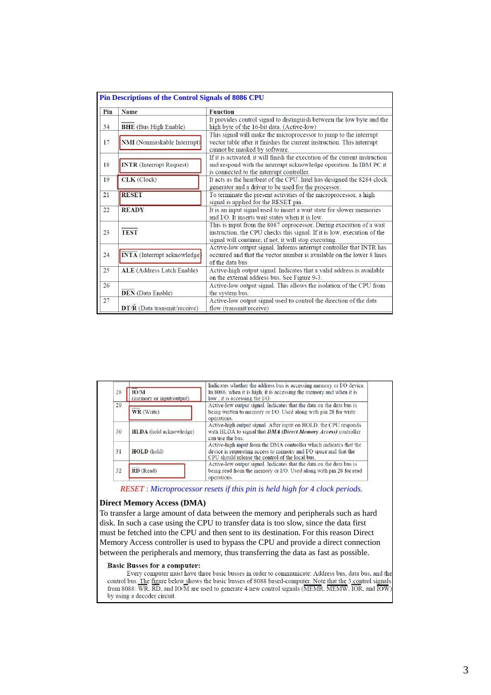
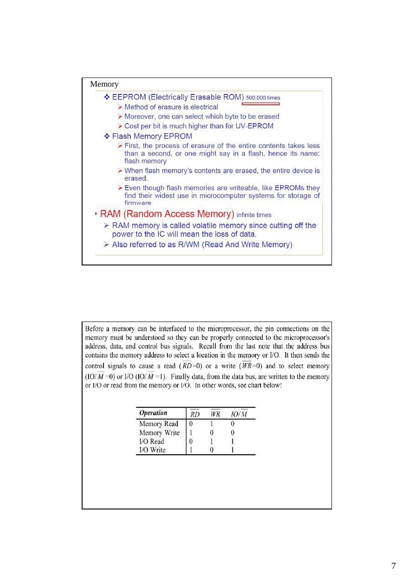
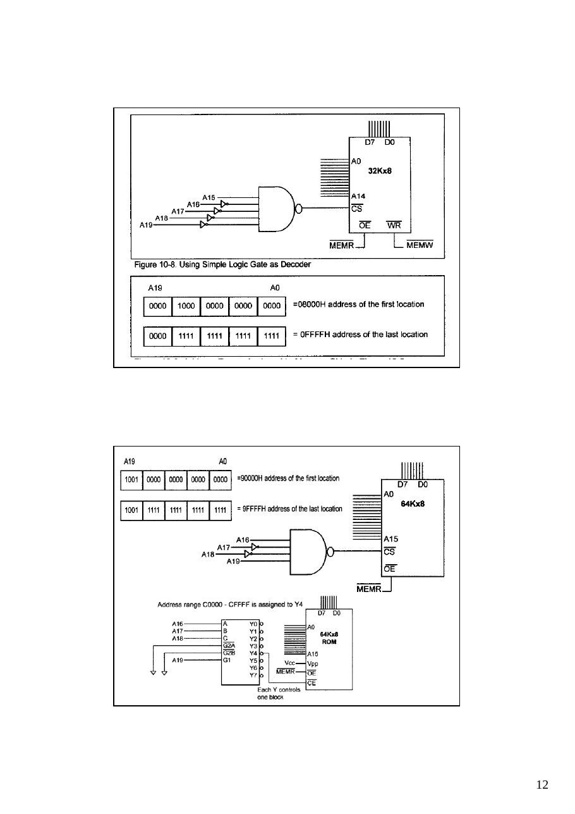

Bu yazı, Başkent Üniversitesi **EEM332 Mikroişlemciler** ders arşivindeki ilgili notları ve uygulamaları bir araya getiriyor (2003–2015). Minimum ve maksimum çalışma kipleri, veri yolu zamanlaması, bellek arabirimi ve adres çözümleme. Belgelerin PDF arşiv kopyaları ve varsa kaynak kodları yazının sonunda ZIP olarak indirilebilir.

## cpu07_2013

### EEM332 Lecture7

Hardware of 8086 based system Adress bus, Data Bus, Control Bus Memory design, Adress decoding

8086 Hardware design

### The 8086 and 8088 microprocessors can be configured to work in either of two modes

The minimum mode - The maximum mode - The mode selection feature lets the 8088 or 8086 better meet the needs of a wide variety of system requirement. Minimum mode 8088/8086 systems are typically smaller and contain a single processor..

Note: that for 8088 the address bus is 20 bit and data bus is 8-bit.

System Clock The time base for synchronization of the internal and external operations of the microprocessor in a microcomputer system is provided by the clock (CLK) input signal. The standard 8088 operates at 5 MHz and the 8088- 2 operates at 8 MHz. The 8086 is manufactured in three speeds: 5-MHz 8086, 8-MHz 8086-2, and the 10-MHz 8086-1. The CLK is externally generated by the 8284 clock generator and driver IC. System Clock Connecting the 8284 to the 8088

System Clock

Pin Descriptions of the Control Signals of 8086 CPU

RESET : Microprocessor resets if this pin is held high for 4 clock periods. Direct Memory Access (DMA) To transfer a large amount of data between the memory and peripherals such as hard disk. In such a case using the CPU to transfer data is too slow, since the data first must be fetched into the CPU and then sent to its destination. For this reason Direct Memory Access controller is used to bypass the CPU and provide a direct connection between the peripherals and memory, thus transferring the data as fast as possible.

Pin descriptions of 8086 Microprocessor Data Bus: - In 8086 microprocessor Pins AD0 – AD15 are used for the data bus. - However the same pins are also used for Address bus as well. - The ALE (Address Latch Enable –pin 25) signals whether the information on pins AD0 – AD15 is used address or data. - When the data is sent out or in, the case when ALE is low indicates that AD0-AD15 will be used as data bus. - When the address data is sent out, the ALE is high indicating that AD0-AD15 will be used as address bus, - This process of separating address and data from pins AD0- AD15 is called demultiplexing.

```asm
Address Bus: - The 8086 CPU is has 20-bit address bus, where the AD0-AD15
and A16-A20 are used as the address bus. To demultiplex the address signals from
```

the address/data pins (AD0-AD15) a latch must be used to grab the addresses. - In 8086 microprocessor the address bus is 20-bit wide, however only 16-bit is shared with data bus (AD0-AD15) through demultiplexing. The most widely used latch for demultiplexing is 74LS373 IC -Control Bus : is used to indicate - When a valid address is on the address bus - In which direction data are to be transferred over the data bus (in/out) - When external devices can read/write data on the data bus. - When valid read/write data are on the data bus. - Etc.

Adress, Data and control Buses

### Adress latching

Using the 74LS373 Address Latch

Memory Interface Circuit (Latch circuit- Common bus)

Memory

Memory

Memory


### Bus Cycle

```asm
Address decoding
Address decoding is the process of generating chip select (CS*) signals from the
address bus for each device in the system The address bus lines are split into two
```

sections. The N most significant bits are used to generate the CS* signals for the different devices The M least significant signals are passed to the devices as addresses to the different memory cells or internal registers Memory Address Decoding

```asm
In order to splice a memory device into the address space of the processor, decoding is
necessary.
```


For 32 K byte chip

For 2 K byte chip


74LS 3x8 decoder chip

- Note that all three Enables (G2A, G2B, and G1) must be active, e.g. low, low

```asm
and high, respectively. Each output of the decoder can be attached to an 2764
```

### EPROM ( 8K X 8 ).

### Example

Figure: 10-3








## cpu08_07

8086 Hardware design

### The 8086 and 8088 microprocessors can be configured to work in either of two modes

The minimum mode - The maximum mode - The mode selection feature lets the 8088 or 8086 better meet the needs of a wide variety of system requirement. Minimum mode 8088/8086 systems are typically smaller and contain a single processor..

Note: that for 8088 the address bus is 20 bit and data bus is 8-bit. So only 8-bit is latched).

8.6 System Clock The time base for synchronization of the internal and external operations of the microprocessor in a microcomputer system is provided by the clock (CLK) input signal. The standard 8088 operates at 5 MHz and the 8088- 2 operates at 8 MHz. The 8086 is manufactured in three speeds: 5-MHz 8086, 8-MHz 8086-2, and the 10-MHz 8086-1. The CLK is externally generated by the 8284 clock generator and driver IC. System Clock Connecting the 8284 to the 8088

System Clock

Pin Descriptions of the Control Signals of 8086 CPU

RESET : Microprocessor resets if this pin is held high for 4 clock periods.

Direct Memory Access (DMA)

```asm
In computers there is often need to transfer a large amount of data between the memory and
```

peripherals such as hard disk. In such a case using the CPU to transfer data is too slow, since the data first must be fetched into the CPU and then sent to its destination. For this reason Direct Memory Access controller is used to bypass the CPU and provide a direct connection between the peripherals and memory, thus transferring the data as fast as possible.

Pin descriptions of 8086 Microprocessor Data Bus: - In 8086 microprocessor Pins AD0 – AD15 are used for the data bus. - However the same pins are also used for Address bus as well. - The ALE (Address Latch Enable –pin 25) signals whether the information on pins AD0 – AD15 is used address or data. - When the data is sent out or in, the case when ALE is low indicates that AD0-AD15 will be used as data bus. - When the address data is sent out, the ALE is high indicating that AD0-AD15 will be used as address bus - This process of separating address and data from pins AD0-AD15 is called demultiplexing.

```asm
Address Bus: - The 8086 CPU is has 20-bit address bus, where the AD0-AD15 and A16-
```

A20 are used as the

```asm
address bus. To demultiplex the address signals from the address/data pins (AD0-AD15) a
```

latch must be used to grab the addresses. - In 8086 microprocessor the address bus is 20-bit wide, however only 16-bit is shared with data bus (AD0-AD15) through demultiplexing. -The most widely used latch for demultiplexing is 74LS373 IC -Control Bus : is used to indicate - When a valid address is on the address bus - In which direction data are to be transferred over the data bus (in/out) - When external devices can read/write data on the data bus. - When valid read/write data are on the data bus. - Etc.

Adress, Data and control Buses

### Adress latching

Using the 74LS373 Address Latch

Memory Interface Circuit (Latch circuit- Common bus)

Memory

Memory

Memory


### Bus Cycle

```asm
Address decoding
Address decoding is the process of generating chip select (CS*) signals from the
address bus for each device in the system The address bus lines are split into two
```

sections. The N most significant bits are used to generate the CS* signals for the different devices The M least significant signals are passed to the devices as addresses to the different memory cells or internal registers Memory Address Decoding

```asm
In order to splice a memory device into the address space of the processor, decoding is
necessary.
```


For 32 K byte chip

For 2 K byte chip


74LS 3x8 decoder chip

- Note that all three Enables (G2A, G2B, and G1) must be active, e.g. low, low

```asm
and high, respectively. Each output of the decoder can be attached to an 2764
```

### EPROM ( 8K X 8 ).

### Example

Figure: 10-3


## cpu08_06

8086 Hardware design

### The 8086 and 8088 microprocessors can be configured to work in either of two modes

The minimum mode - The maximum mode - The mode selection feature lets the 8088 or 8086 better meet the needs of a wide variety of system requirement. Minimum mode 8088/8086 systems are typically smaller and contain a single processor. Depending on the mode of operation selected, the assignment for a number of the pins on the microprocessor package are changed.

Minimum-Mode Interface

```asm
Address/Data bus
```

The address bus is used to carry address information to the memory and I/O ports. The address bus is 20-bit long and consists of signal lines A0 through A19. A 20-bit address gives the 8088 a 1 Mbyte memory address space. Only address line A0 through A15 are used when

```asm
addressing I/O. This give an I/O address space 64 Kbytes. The 8088 has 8 multiplexed
address/data bus lines (A0~A7) while 8086 has 16 multiplexed address/data bus lines (A0~A15).
```

### Control signals

The control signals are provided to support the memory and I/O interfaces of the 8088 and 8086.

RESET : Microprocessor resets if this pin is held high for 4 clock periods.

8.6 System Clock The time base for synchronization of the internal and external operations of the microprocessor in a microcomputer system is provided by the

```asm
clock (CLK) input signal.
```

The standard 8088 operates at 5 MHz and the 8088- 2 operates at 8 MHz. The 8086 is manufactured in three speeds: 5-MHz 8086, 8-MHz 8086-2, and the 10-MHz 8086-1. The CLK is externally generated by the 8284 clock generator and driver IC.

System Clock

System Clock Connecting the 8284 to the 8088

8.7 Bus Cycle and Time States A bus cycle defines the basic operation that a microprocessor performs to communicate with external devices. Examples of bus cycles are the memory read, memory write, input/output read, and input/output write. The bus cycle of the 8088 and 8086 microprocessors consists of at least four clock periods. If no bus cycles are required, the microprocessor performs what are known as idle states. When READY is held at the 0 level, wait states are inserted between states T3 and T4 of the bus cycle.

### Bus Cycle

Memory Interface Circuit (Latch circuit)

### Adress latching

Using the 74LS373 Address Latch

For 32 K byte chip

For 2 K byte chip

74LS 3x8 decoder chip

- Note that all three Enables (G2A, G2B, and

G1) must be active, e.g. low, low and high, respectively.

- Each output of the decoder can be attached

to an 2764 EPROM ( 8K X 8 ).

### A14   A14

Rom1 FFFFFH-FE000H Rom1 FDFFFH-FC000H Ram2 03FFFH-02000H Ram1 01FFFH-00000H

4 ROM memory and 4 RAM memory chip are used for total memory . Each memory chip is 2 kbyte Ao and A10 are used as adress bus IC1......IC4 Ram

### IC5,.....IC8 ROM

*Not: Bazı eski sunum sayfalarında kaynak dosyanın kendi “Resim görüntülenemiyor” uyarısı vardır. Eksik şekiller yeniden oluşturulmadı; diğer yıl sürümleriyle birlikte arşivlendi.*
