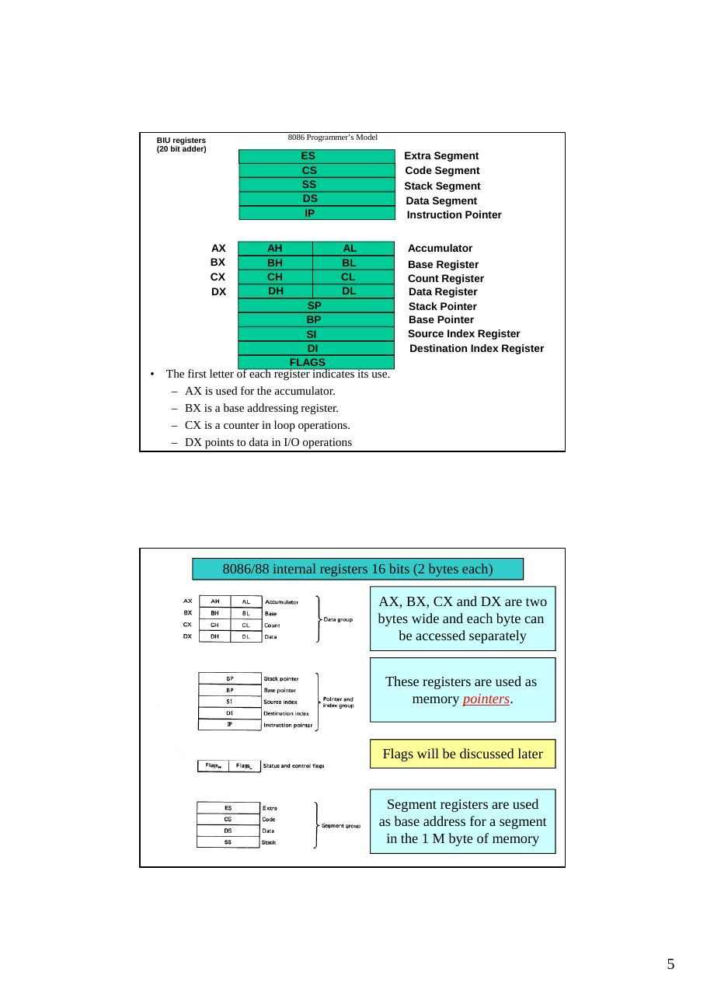
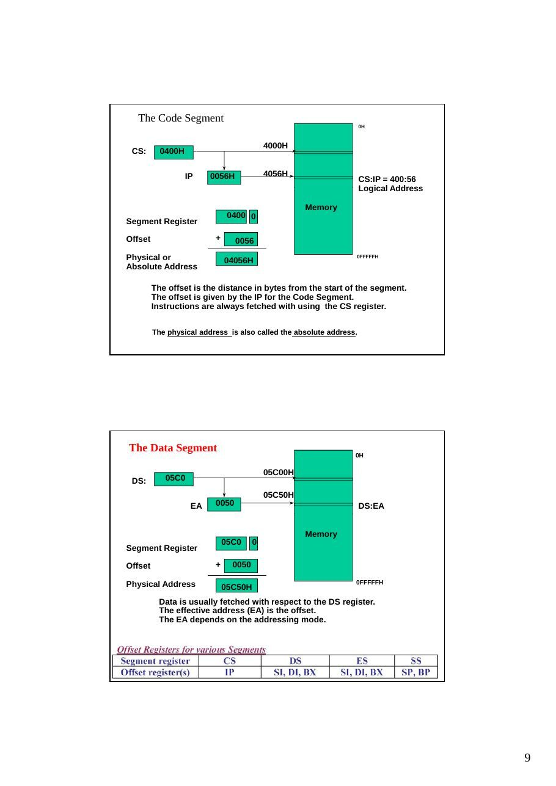

Bu yazı, Başkent Üniversitesi **EEM332 Mikroişlemciler** ders arşivindeki ilgili notları ve uygulamaları bir araya getiriyor (2003–2015). 8086/8088 tarihi, yazmaçlar, segmentler, bayraklar ve ikili-onaltılı sayı gösterimi. Belgelerin PDF arşiv kopyaları ve varsa kaynak kodları yazının sonunda ZIP olarak indirilebilir.

## CPU02_2013

EEM332 Lecture2. History of Microprocessor Introduction to Intel 8086/8088 Registers of 8086 Simple instructions

8086 Microprocessor History

1959: first IC's 1971: µP 4004 4Bit     Intel (~2000 Tr.) 1972: µP 8008 8Bit     Intel (~5000 Tr.) 1974: µP 8080 8Bit     Intel (~6000 Tr.) 1974: µP 6800 8Bit     Motorola 1975: µP Z80 8Bit      Zilog 1976: µP 9900 16Bit    Texas Instruments 1978: µP 8086 16Bit    Intel (50.000 Tr) 1982: µP 8286 16Bit    Intel (100.000 Tr.) 1985: µP 80386 16Bit   Intel (300.000 Tr.) 1989: µP 80486 16Bit   Intel (10 Tr.) 1993: µP 80586 16Bit   Intel (5·106 Tr.) ...

BRIEF HISTORY OF THE x86 FAMILY evolution from 8080/8085 to 8086

```asm
In 1978, Intel Corporation introduced the 16-bit 8086 microprocessor, a major
```

improvement over the previous generation 8080/8085 series. The 8086 capacity of 1 megabyte of memory exceeded the 8080/8085 maximum of 64K bytes of memory. 8080/8085 was an 8-bit system, which could work on only 8 bits of data at a time. Data larger than 8 bits had to be broken into 8-bit pieces to be processed by the

### CPU.

8086 was a pipelined processor, as opposed to the nonpipelined 8080/8085

BRIEF HISTORY OF THE x86 FAMILY evolution from 8080/8085 to 8086

The microprocessor is typically a single VLSI (Very Large-Scale Integration) chip

### MAXIMUM       MINIMUM

### MAXIMUM    MINIMUM

### MODE          MODE

### MODE       MODE

GND    1           40   Vcc GND      1           40   Vcc

### AD14                    AD15

### A14                      A15

### AD13                    A16,S3

### A13                      A16,S3

### AD12                    A17,S4

AD11                    A18,S5      Dta Bus A11  A12                      A17,S4

### A18,S5

### AD10                    A19,S6

### AD9                     /BHE,S7

16 bit 8 bit A10                       A19,S6 A9                      high       /SS0

### AD8                     MN,/MX

### A8                      MN,/MX

### AD7                     /RD

### AD7                      /RD

### AD6                     /RQ,/GT0      HOLD

### 8086                                 AD6                      /RQ,/GT0   HOLD

### AD5                     /RQ,/GT1      HLDA

### AD5

### 8088        /RQ,/GT1   HLDA

### AD4                     /LOCK         /WR

### AD4                      /LOCK      /WR

### AD3                     /S2           IO/M

### AD3                      /S2        IO/M

### AD2                     /S1           DT/R

### AD2                      /S1        DT/R

### AD1                     /S0           /DEN

### AD1                      /S0        /DEN

### AD0                     QS0           ALE

### AD0                      QS0        ALE

### NMI                    QS1           /INTA

### NMI                      QS1        /INTA

### INTR                    /TEST

### INTR                      /TEST

```asm
CLK                     READY
CLK                      READY
```

### GND    20          21   RESET

### GND      20          21   RESET

Internal structure is same

Bus Interface Unit

Execution Unit (EU).

The BIU accesses memory and peripherals, while the EU executes instructions previously fetched.

The 8086 has two parts, the Bus Interface Unit (BIU) and the Execution Unit (EU).

The BIU fetches instructions, reads and writes data, and computes the 20-bit address.

The EU decodes and executes the instructions using the 16-bit

### ALU.

- The BIU contains the following registers:

IP - the Instruction Pointer CS – the Code Segment Register DS - the Data Segment Register SS - the Stack Segment Register ES - the Extra Segment Register

Software Model of the 8088/8086 Microprocessor

The status register, SR, with nine of its bits implement for status and control flags. The memory address space is 1 Mbytes and the I/O

```asm
address space is 64 Kbytes in length.
```

BIU registers                  8086 Programmer’s Model (20 bit adder) ES                         Extra Segment CS                         Code Segment SS                         Stack Segment DS                         Data Segment IP                         Instruction Pointer

AX       AH                AL                Accumulator BX       BH                BL                Base Register CX       CH                CL                Count Register DX       DH                DL                Data Register SP                          Stack Pointer BP                          Base Pointer SI                          Source Index Register DI                          Destination Index Register

### FLAGS

- The first letter of each register indicates its use.

- AX is used for the accumulator.

- BX is a base addressing register.

- CX is a counter in loop operations.

- DX points to data in I/O operations

8086/88 internal registers 16 bits (2 bytes each)

AX, BX, CX and DX are two bytes wide and each byte can be accessed separately

These registers are used as memory pointers.

Flags will be discussed later

Segment registers are used as base address for a segment

```asm
in the 1 M byte of memory
```

Data Registers

The 8086/8088 Microprocessors: Registers

- Registers

- Registers are in the CPU and are referred to by specific names

- Data registers

- Hold data for an operation to be performed

- There are 4 data registers (AX, BX, CX, DX)

- Low and High bytes of the data registers (AX, BX, CX, DX) can be accessed

separately

- AH, BH, CH, DH are the high bytes

- AL, BL, CL, and DL are the low bytes

- Address registers

- Hold the address of an instruction or data element

- Segment registers (CS, DS, ES, SS)

- Pointer registers (SP, BP, IP)

- Index registers (SI, DI)

- Status register

- Keeps the current status of the processor

- On an IBM PC the status register is called the FLAGS register

- In total there are fourteen 16-bit registers in an 8086/8088

Pointer and Index Registers

- Contain the offset addresses of memory locations

- Can also be used in arithmetic and other operations

- SP: Stack pointer

- Used with SS to access the stack segment

- BP: Base Pointer

- Primarily used to access data on the stack

- Can be used to access data in other segments

- SI: Source Index register

- is required for some string operations

- When string operations are performed, the SI register points to

memory locations in the data segment which is addressed by the DS register. Thus, SI is associated with the DS in string operations.

Segment Registers - CS, DS, SS and ES

- Are Address registers

- Store the memory addresses of instructions and data

- Memory Organization

- Each byte in memory has a 20 bit address starting with 0 to 220-1 or 1

meg of addressable memory

- Addresses are expressed as 5 hex digits from 00000 - FFFFF

- Problem: But 20 bit addresses are TOO BIG to fit in 16 bit registers!

- Solution: Memory Segment

- Block of 64K (65,536) consecutive memory bytes

- A segment number is a 16 bit number

- Segment numbers range from 0000 to FFFF

- Within a segment, a particular memory location is specified with an offset

- An offset also ranges from 0000 to FFFF

Generating a Memory Address

- The BIU has a dedicated

```asm
adder for determining
```

physical memory addresses

Segments

```asm
Address
```

Segment Starting address is segment                           0H register value shifted 4 places to the left.

### CODE

64K Data

```asm
STACK                                Segment
```

### DATA

### EXTRA                                               CS:0

64K Code Segment Segment Registers

Segments are < or = 64K, can overlap, start at an address that ends in 0H.                                            0FFFFFH

### MEMORY

The Code Segment

### 0H

### 4000H

### CS:       0400H

### IP    0056H             4056H

### CS:IP = 400:56

Logical Address

Memory 0400 0 Segment Register

Offset                    +      0056 Physical or                   04056H

### 0FFFFFH

Absolute Address

The offset is the distance in bytes from the start of the segment. The offset is given by the IP for the Code Segment. Instructions are always fetched with using the CS register.

The physical address is also called the absolute address.

The Data Segment

### 0H

### 05C00H

### DS:        05C0

### 05C50H

### EA    0050                                       DS:EA

Memory

### 05C0     0

Segment Register

Offset                    +     0050

Physical Address                                                 0FFFFFH

### 05C50H

Data is usually fetched with respect to the DS register. The effective address (EA) is the offset. The EA depends on the addressing mode.

The Stack Segment

### 0H

### 0A00                              0A000H

### SS

### 0A100H

### SP        0100                                             SS:SP

Memory

### 0A00 0

Segment Register

Offset                        +    0100

### 0FFFFFH

Physical Address                  0A100H The offset is given by the SP register. The stack is always referenced with respect to the stack segment register. The stack grows toward decreasing memory locations. The SP points to the last or top item on the stack.

- Logical Address is specified as segment:offset

- Physical address is obtained by shifting the segment address 4 bits to the left and adding the

offset address

- Thus the physical address of the logical address A4FB:4872 is      A4FB0+ 4872 = A9822

### INTRODUCTION TO PROGRAM SEGMENTS

A typical Assembly language program consists of

### at least three segments

A code segment - which contains the Assembly language instructions that perform the tasks that the program was designed to accomplish. A data segment - used to store information (data) to be processed by the instructions in the code segment. A stack segment - used by the CPU to store information temporarily. The stack is a section of RAM,

```asm
A segment is an area of memory that includes up to 64K bytes, and begins on an
address evenly divisible by 16 (such an address ends in 0H)
```

8085 addressed a maximum of 64K of physical memory, since it had only 16 pins for address lines. (216 = 64K) Limitation was carried into 8088/86 design for compatibility.

```asm
In 8085 there was 64K bytes of memory for all code, data, and stack information.
In 8088/86 there can be up to 64K bytes in each category.
```

The code segment, data segment, and stack segment.

The Stack

- The stack is implemented for temporary storage of information such as

data or addresses.

- The stack is 64KBytes long and is organized from a software point of

view as 32K words.

- The contents of the SP and BP registers are used as offsets into the stack

segment memory while the

- segment base value is in the SS register. Push instructions (PUSH) and

```asm
pop instructions (POP)
```

- Top of the stack (TOS) and bottom of the stack (BOS)

- The 8088 can push word-wide data and address information onto the

stack from registers or memory.

- Many stacks can exist but only one is active at a time.

- As data is pushed onto the stack it is decremented.

- As data is popped off the stack into the CPU, it is incremented.


Examples of ass. Language fo 8086

### INTRODUCTION TO ASSEMBLY PROGRAMMING

### Example for MOV instruction

This program first loads CL with value 55H, then moves this value around to various registers inside the CPU.

### The use of 16-bit registers is shown here

Values cannot be loaded directly into any segment register (CS, DS, ES, or SS). To load a value into a segment register, load it to a non-segment register, then move it to the segment register


Flag register Many Assembly language instructions alter flag register bits & some instructions function differently based on the information in the flag register. The flag register is a 16-bit register sometimes referred to as the status register. Although 16 bits wide, only some of the bits are used. The rest are either undefined or reserved by Intel.

Carry flag Overflow Direction                                       Parity flag

Interrupt enable                             Auxiliary flag 6 are status flags 3 are control flag            Trap                    Zero

Sign Status flags (called conditional flags ): They are set according to some results of arithmetic operation. You do not need to alter the value yourself. Control flags: Used to control some operations of the MPU. These flags are to be set by you in order to achieve some specific purposes.

CF, the Carry Flag: This flag is set whenever there is a carry out, either from d7 after an 8-bit operation, or from d15 after a 16-bit data operation. PF, the Parity Flag: After certain operations, the parity of the result’s low-order byte is checked. If the byte has an even number of 1s, the parity flag is set to 1; otherwise, it is

```asm
cleared.
```

AF, the Auxiliary Carry Flag: If there is a carry from d3 to d4 of an operation this bit is set to 1, otherwise cleared (set to 0). ZF, the Zero Flag: The ZF is set to 1 if the result of the arithmetic or logical operation is zero, otherwise, it is cleared (set to 0). SF, the Sign Flag: MSB is used as the sign bit of the binary representation of the signed numbers.After arithmetic or logical operations the MSB is copied into SF to indicate the sign of the result. TF, the Trap Flag: When this flag is set it allows the program to single step, meaning to execute one instruction at a time. Used for debugging purposes. IF, Interrupt Enable Flag: This bit is set or cleared to enable or disable only the external interrupt requests. DF, the Direction Flag: This bit is used to control the direction of the string operations. OF, the Overflow Flag: This flag is set whenever the result of a signed number operation is too large, causing the high-order bit to overflow into the sign bit.

```asm
Not: the zero is used flag to implement program loops.
```

The status register, also called the flags register, indicate conditions that are produced as the result of executing an instruction. Only nine bits of the register are implemented. Six of these bits represent status flags and the other three bits represent control flags The 8088 provides instructions within its instruction set that are able to use these flags to alter the sequence in which the program is executed.


- As an example, to add 5 bytes of data, a counter can be used to keep track of

how many times the loop needs to be repeated.

Each time the addition is performed the counter is decremented and the zero flag is checked. When the counter becomes zero, the zero flag is set (ZF = 1) and the loop is stopped.





## cpu02_08

8086 Microprocessor History

1959: first IC's 1971: µP 4004 4Bit      Intel (~2000 Tr.) 1972: µP 8008 8Bit      Intel (~5000 Tr.) 1974: µP 8080 8Bit      Intel (~6000 Tr.) 1974: µP 6800 8Bit      Motorola 1975: µP Z80 8Bit       Zilog 1976: µP 9900 16Bit     Texas Instruments 1978: µP 8086 16Bit     Intel (50.000 Tr) 1982: µP 8286 16Bit     Intel (100.000 Tr.) 1985: µP 80386 16Bit    Intel (300.000 Tr.) 1989: µP 80486 16Bit    Intel (10 Tr.) 1993: µP 80586 16Bit    Intel (5·10 Tr.) ...

History of Intel’s Microprocessors

- Intel 4004

- 1971, 4-bit

- Intel 8008

- 1972, 8-bit

- Originally designed for Datapoint Corp. as a CRT display controller

- Intel 8080

- 1974, April - Altair 8800, 1975, MITS( 256 bytes of Mem, $395)

- Apple II -- Steve Jobs and Steve Wozniak 1976, Apple 사 설립

- Bill Gates and a fellow student : BASIC, 1975 --> Microsoft

- Intel 8086/8088

- 1978, 16 bit: 8088, 1979, 8-bit external bus

- IBM PC ; 1981

- 29,000 Trs

- Intel 80286

- 1982, 16-bit architecture

- 24-bit addressing, memory protection and virtual memory

- 16 MB of physical MEM and 1 GB of virtual mem

- 130,000 Trs onto a single chip

- IBM PC/AT in 1984, IBM PS/2 Model 50 and 60

- Intel 80386

- 1985, 32 bits

- 3~5 MIPS (7 MIPS on the 25 MHz chip)

- memory paging and enhanced I/O permission features

- 4GB programming model

- Intel 80486

- 1989 Spring COMDEX show -> 1990 June : actual release

- 1,200,000 Trs

- 386+387+8K data and instruction cache, paging and MMU

- Pentium

- 1993

- 110 MIPS on 66 Mhz Chip

- 16 KB on-chip cache and 64 bit data bus

- superscalar technology (two instructions/clock)

- 3.1 million transistors

- Pentium Pro

- 1995, Superscalar(three-way issue)

- 5.5 million Trs in the CPU core + 15.5 million Trs in the secondary cache

8K data, 8K instr cache

- 256 KB SRAM secondary cache

- 200 SPECint92 at 133 MHz

- 2.9 V, 0.6 micron BICMOS

- Pentium II

- Pentium Pro + MMX, 1997

- 233, 266, upto 450 MHz

- 7.5 million Trs in CPU

- 512KB in secondary cache

- Pentium III

- 1999

- Pentium Pro + MMX + Internet Streaming SIMD Instructions

- 0.25 micron, 9.5 million Trs

- 600 MHz, 550 MHz,...

- 32 K(16K/16K) non-blocking level 1 cache

### MAXIMUM    MINIMUM

### MAXIMUM    MINIMUM

### MODE       MODE

### MODE       MODE

GND    1           40   Vcc GND    1           40   Vcc

### A14                     A15

### AD14                    AD15

### A13                     A16,S3

### AD13                    A16,S3

### A12                     A17,S4

### AD12                    A17,S4

### A11                     A18,S5

### AD11                    A18,S5

### A10                     A19,S6

### AD10                    A19,S6

A9                     high       /SS0

### AD9                     /BHE,S7

### A8                     MN,/MX

### AD8                     MN,/MX

### AD7                     /RD

### AD7                     /RD

### AD6                     /RQ,/GT0   HOLD

### AD6

8086

### /RQ,/GT0   HOLD

### AD5

### 8088        /RQ,/GT1   HLDA

### AD5                     /RQ,/GT1   HLDA

### AD4                     /LOCK      /WR

### AD4                     /LOCK      /WR

### AD3                     /S2        IO/M

### AD3                     /S2        IO/M

### AD2                     /S1        DT/R

### AD2                     /S1        DT/R

### AD1                     /S0        /DEN

### AD1                     /S0        /DEN

### AD0                     QS0        ALE

### AD0                     QS0        ALE

### NMI                     QS1        /INTA

### NMI                    QS1        /INTA

### INTR                    /TEST

### INTR                    /TEST

```asm
CLK                     READY
CLK                     READY
```

### GND    20          21   RESET

### GND    20          21   RESET

Software Model of the 8088/8086 Microprocessor

The status register, SR, with nine of its bits implement for status and control flags. The memory address space is 1 Mbytes and the I/O

```asm
address space is 64 Kbytes in length.
```

- The 8086 has two parts, the Bus Interface Unit (BIU) and the

Execution Unit (EU).

- The BIU fetches instructions, reads and writes data, and computes the

20-bit address.

- The EU decodes and executes the instructions using the 16-bit ALU.

- The BIU contains the following registers:

IP - the Instruction Pointer CS – the Code Segment Register DS - the Data Segment Register SS - the Stack Segment Register ES - the Extra Segment Register

Bus Interface Unit

Execution Unit (EU).

8086 Programmer’s Model

ES                      Extra Segment BIU registers (20 bit adder)                    CS                      Code Segment SS                      Stack Segment DS                      Data Segment IP                      Instruction Pointer

AX        AH                AL            Accumulator BX        BH                BL            Base Register CX        CH                CL            Count Register DX        DH                DL            Data Register SP                      Stack Pointer BP                       Base Pointer SI                       Source Index Register DI                      Destination Index Register

### FLAGS

8086/88 internal registers 16 bits (2 bytes each)

AX, BX, CX and DX are two bytes wide and each byte can be accessed separately

These registers are used as memory pointers.

Flags will be discussed later

Segment registers are used as base address for a segment

```asm
in the 1 M byte of memory
```

Data Registers

The 8086/8088 Microprocessors: Registers

- Registers

- Registers are in the CPU and are referred to by specific names

- Data registers

- Hold data for an operation to be performed

- There are 4 data registers (AX, BX, CX, DX)

- Address registers

- Hold the address of an instruction or data element

- Segment registers (CS, DS, ES, SS)

- Pointer registers (SP, BP, IP)

- Index registers (SI, DI)

- Status register

- Keeps the current status of the processor

- On an IBM PC the status register is called the FLAGS register

- In total there are fourteen 16-bit registers in an 8086/8088

Data Registers: AX, BX, CX, DX

- Instructions execute faster if the data is in a register

- AX, BX, CX, DX are the data registers

- Low and High bytes of the data registers can be accessed

separately

- AH, BH, CH, DH are the high bytes

- AL, BL, CL, and DL are the low bytes

- Data Registers are general purpose registers but they also

perform special functions

- AX

- Accumulator Register

- Preferred register to use in arithmetic, logic and data transfer instructions

because it generates the shortest Machine Language Code

- Must be used in multiplication and division operations

- Must also be used in I/O operations

- BX .Base Register

- Also serves as an address register

- Used in array operations

- Used in Table Lookup operations (XLAT)

- CX : Count register

- Used as a loop counter

- Used in shift and rotate operations

- DX : Data register

- Used in multiplication and division

- Also used in I/O operations

DI: Destination Index register is also required for some string operations. When string operations are performed, the DI register points to memory locations in the

```asm
data segment which is addressed by the ES register. Thus, DI is
```

associated with the ES in string operations. The SI and the DI registers may also be used to access data stored in arrays

Pointer and Index Registers

- Contain the offset addresses of memory locations

- Can also be used in arithmetic and other operations

- SP: Stack pointer

- Used with SS to access the stack segment

- BP: Base Pointer

- Primarily used to access data on the stack

- Can be used to access data in other segments

- SI: Source Index register

- is required for some string operations

- When string operations are performed, the SI register points to

memory locations in the data segment which is addressed by the DS register. Thus, SI is associated with the DS in string operations.

Segment Registers - CS, DS, SS and ES

- Are Address registers

- Store the memory addresses of instructions and data

- Memory Organization

- Each byte in memory has a 20 bit address starting with 0 to 220-1 or 1

meg of addressable memory

- Addresses are expressed as 5 hex digits from 00000 - FFFFF

- Problem: But 20 bit addresses are TOO BIG to fit in 16 bit registers!

- Solution: Memory Segment

- Block of 64K (65,536) consecutive memory bytes

- A segment number is a 16 bit number

- Segment numbers range from 0000 to FFFF

- Within a segment, a particular memory location is specified with an offset

- An offset also ranges from 0000 to FFFF

Generating a Memory

```asm
Address
```

- The BIU has a dedicated

```asm
adder for determining
```

physical memory addresses

Segments

```asm
Address
```

Segment Starting address is segment                           0H register value shifted 4 places to the left.

### CODE

64K Data

```asm
STACK                                Segment
```

### DATA

### EXTRA                                               CS:0

64K Code Segment Segment Registers

Segments are < or = 64K, can overlap, start at an address that ends in 0H.                                            0FFFFFH

### MEMORY

The Code Segment

### 0H

### 4000H

### CS:       0400H

### IP    0056H             4056H

### CS:IP = 400:56

Logical Address

Memory 0400 0 Segment Register

Offset                    +      0056

Physical or                   04056H

### 0FFFFFH

Absolute Address

The offset is the distance in bytes from the start of the segment. The offset is given by the IP for the Code Segment. Instructions are always fetched with using the CS register.

The physical address is also called the absolute address.

The Data Segment

### 0H

### 05C00H

### DS:        05C0

### 05C50H

### EA    0050                                       DS:EA

Memory

### 05C0     0

Segment Register

Offset                    +     0050

Physical Address                                                 0FFFFFH

### 05C50H

Data is usually fetched with respect to the DS register. The effective address (EA) is the offset. The EA depends on the addressing mode.

The Stack Segment

### 0H

### 0A00                             0A000H

### SS

### 0A100H

### SP       0100                                             SS:SP

Memory

### 0A00 0

Segment Register

Offset                       +     0100

### 0FFFFFH

Physical Address                 0A100H The offset is given by the SP register. The stack is always referenced with respect to the stack segment register. The stack grows toward decreasing memory locations. The SP points to the last or top item on the stack.

- Logical Address is specified as segment:offset

- Physical address is obtained by shifting the segment address 4 bits to the left and adding the

offset address

- Thus the physical address of the logical address A4FB:4872 is       A4FB0+ 4872 = A9822

The Stack

- The stack is implemented for temporary storage of information such as

data or addresses.

- The stack is 64KBytes long and is organized from a software point of

view as 32K words.

- The contents of the SP and BP registers are used as offsets into the stack

segment memory while the

- segment base value is in the SS register. Push instructions (PUSH) and

```asm
pop instructions (POP)
```

- Top of the stack (TOS) and bottom of the stack (BOS)

- The 8088 can push word-wide data and address information onto the

stack from registers or memory.

- Many stacks can exist but only one is active at a time.

Assembly


Flags in flag register

Carry flag Overflow Direction                                          Parity flag

Interrupt enable                                 Auxiliary flag 6 are status flags 3 are control flag            Trap                       Zero

Sign

### Status flags

They are set according to some results of arithmetic operation. You do not need to alter the value yourself.

### Control flags

Used to control some operations of the MPU. These flags are to be set by you in order to achieve some specific purposes.

CF, the Carry Flag: This flag is set whenever there is a carry out, either from d7 after an 8-bit operation, or from d15 after a 16-bit data operation. PF, the Parity Flag: After certain operations, the parity of the result’s low-order byte is checked. If the byte has an even number of 1s, the parity flag is set to 1; otherwise, it is

```asm
cleared.
```

AF, the Auxiliary Carry Flag: If there is a carry from d3 to d4 of an operation this bit is set to 1, otherwise cleared (set to 0). ZF, the Zero Flag: The ZF is set to 1 if the result of the arithmetic or logical operation is zero, otherwise, it is cleared (set to 0). SF, the Sign Flag: MSB is used as the sign bit of the binary representation of the signed numbers.After arithmetic or logical operations the MSB is copied into SF to indicate the sign of the result. TF, the Trap Flag: When this flag is set it allows the program to single step, meaning to execute one instruction at a time. Used for debugging purposes. IF, Interrupt Enable Flag: This bit is set or cleared to enable or disable only the external interrupt requests. DF, the Direction Flag: This bit is used to control the direction of the string operations. OF, the Overflow Flag: This flag is set whenever the result of a signed number operation is too large, causing the high-order bit to overflow into the sign bit.

The status register, also called the flags register, indicate conditions that are produced as the result of executing an instruction. Only nine bits of the register are implemented. Six of these bits represent status flags and the other three bits represent control flags The 8088 provides instructions within its instruction set that are able to use these flags to alter the sequence in which the program is executed.

Data Types

The most significant bit of a signed integer is a sign bit. A zero in this bit position identifies a positive number.

The 8088 can also process data that is coded as binary-coded decimal (BCD) numbers.

## cpu03-06

8086 Microprocessor History

1959:   first IC's 1971:   µP 4004 4Bit     Intel (~2000 Tr.) 1972:   µP 8008 8Bit     Intel (~5000 Tr.) 1974:   µP 8080 8Bit     Intel (~6000 Tr.) 1974:   µP 6800 8Bit     Motorola 1975:   µP Z80 8Bit      Zilog 1976:   µP 9900 16Bit    Texas Instruments 1978:   µP 8086 16Bit    Intel (50.000 Tr) 1982:   µP 8286 16Bit    Intel (100.000 Tr.) 1985:   µP 80386 16Bit   Intel (300.000 Tr.) 1989:   µP 80486 16Bit   Intel (106 Tr.) 1993:   µP 80586 16Bit   Intel (5·106 Tr.) ...

History of Intel’s Microprocessors

- Intel 4004

- 1971, 4-bit

- Intel 8008

- 1972, 8-bit

- Originally designed for Datapoint Corp. as a CRT display controller

- Intel 8080

- 1974, April - Altair 8800, 1975, MITS( 256 bytes of Mem, $395)

- Apple II -- Steve Jobs and Steve Wozniak 1976, Apple 사 설립

- Bill Gates and a fellow student : BASIC, 1975 --> Microsoft

- Intel 8086/8088

- 1978, 16 bit: 8088, 1979, 8-bit external bus

- IBM PC ; 1981

- 29,000 Trs

- Intel 80286

- 1982, 16-bit architecture

- 24-bit addressing, memory protection and virtual memory

- 16 MB of physical MEM and 1 GB of virtual mem

- 130,000 Trs onto a single chip

- IBM PC/AT in 1984, IBM PS/2 Model 50 and 60

- Intel 80386

- 1985, 32 bits

- 3~5 MIPS (7 MIPS on the 25 MHz chip)

- memory paging and enhanced I/O permission features

- 4GB programming model

- Intel 80486

- 1989 Spring COMDEX show -> 1990 June : actual release

- 1,200,000 Trs

- 386+387+8K data and instruction cache, paging and MMU

- Pentium

- 1993

- 110 MIPS on 66 Mhz Chip

- 16 KB on-chip cache and 64 bit data bus

- superscalar technology (two instructions/clock)

- 3.1 million transistors

- Pentium Pro

- 1995, Superscalar(three-way issue)

- 5.5 million Trs in the CPU core + 15.5 million Trs in the secondary cache

8K data, 8K instr cache

- 256 KB SRAM secondary cache

- 200 SPECint92 at 133 MHz

- 2.9 V, 0.6 micron BICMOS

- Pentium II

- Pentium Pro + MMX, 1997

- 233, 266, upto 450 MHz

- 7.5 million Trs in CPU

- 512KB in secondary cache

- Pentium III

- 1999

- Pentium Pro + MMX + Internet Streaming SIMD Instructions

- 0.25 micron, 9.5 million Trs

- 600 MHz, 550 MHz,...

- 32 K(16K/16K) non-blocking level 1 cache

8086 Microprocessor

16-bit Arithmetic Logic Unit

- 16-bit data bus

(8088 has 8-bit data bus)

- 20-bit address bus -

220 = 1,048,576 = 1 meg

8086 Architecture

- The 8086 has two parts, the Bus Interface Unit (BIU) and the

Execution Unit (EU).

- The BIU fetches instructions, reads and writes data, and computes the

20-bit address.

- The EU decodes and executes the instructions using the 16-bit ALU.

- The BIU contains the following registers:

IP - the Instruction Pointer CS - the Code Segment Register DS - the Data Segment Register SS - the Stack Segment Register ES - the Extra Segment Register

The BIU fetches instructions using the CS and IP, written CS:IP, to contruct the 20-bit address. Data is fetched using a segment register (usually the DS)

```asm
and an effective address (EA) computed by the EU depending on the
addressing mode.
```

80386/80486/Pentium Registers

The ax, bx, cx, dx, si, di, bp, sp, flags, and ip 32 bits registers of the 8068 were all extended to 32 bits. The 80386 calls these new 32 bit versions EAX,

### EBX, ECX, EDX, ESI, EDI, EBP, ESP,

EFLAGS, and EIP Memory segments can be as large as 4GB

8086 Programmer’s Model

ES                      Extra Segment BIU registers                CS                      Code Segment (20 bit adder)               SS                      Stack Segment DS                      Data Segment IP                     Instruction Pointer

AX   AH                AL           Accumulator BX   BH                BL           Base Register CX   CH                CL           Count Register DX   DH                DL           Data Register SP                     Stack Pointer BP                     Base Pointer SI                     Source Index Register DI                     Destination Index Register

### FLAGS

8086/88 8086/88internal internalregisters registers16 16bits bits(2 (2bytes byteseach) each)

AX, BX, CX and DX are two bytes wide and each byte can be accessed separately

These registers are used as memory pointers.

Flags will be discussed later

Segment registers are used as base address for a segment

```asm
in the 1 M byte of memory
```

The 8086/8088 Microprocessors: Registers

- Registers

- Registers are in the CPU and are referred to by specific names

- Data registers

- Hold data for an operation to be performed

- There are 4 data registers (AX, BX, CX, DX)

- Address registers

- Hold the address of an instruction or data element

- Segment registers (CS, DS, ES, SS)

- Pointer registers (SP, BP, IP)

- Index registers (SI, DI)

- Status register

- Keeps the current status of the processor

- On an IBM PC the status register is called the FLAGS register

- In total there are fourteen 16-bit registers in an 8086/8088

Data Registers: AX, BX, CX, DX

- Instructions execute faster if the data is in a register

- AX, BX, CX, DX are the data registers

- Low and High bytes of the data registers can be accessed

separately

- AH, BH, CH, DH are the high bytes

- AL, BL, CL, and DL are the low bytes

- Data Registers are general purpose registers but they also

perform special functions

- AX

- Accumulator Register

- Preferred register to use in arithmetic, logic and data transfer instructions

because it generates the shortest Machine Language Code

- Must be used in multiplication and division operations

- Must also be used in I/O operations

- BX

- Base Register

- Also serves as an address register

- Used in array operations

- Used in Table Lookup operations (XLAT)

- CX

- Count register

- Used as a loop counter

- Used in shift and rotate operations

- DX

- Data register

- Used in multiplication and division

- Also used in I/O operations

Pointer and Index Registers

- Contain the offset addresses of memory locations

- Can also be used in arithmetic and other operations

- SP: Stack pointer

- Used with SS to access the stack segment

- BP: Base Pointer

- Primarily used to access data on the stack

- Can be used to access data in other segments

- SI: Source Index register

- is required for some string operations

- When string operations are performed, the SI register points to

memory locations in the data segment which is addressed by the DS register. Thus, SI is associated with the DS in string operations.

- DI: Destination Index register

- is also required for some string operations.

- When string operations are performed, the DI register points to

memory locations in the data segment which is addressed by the ES register. Thus, DI is associated with the ES in string operations.

- The SI and the DI registers may also be used to access data

stored in arrays

Segment Registers - CS, DS, SS and ES

- Are Address registers

- Store the memory addresses of instructions and data

- Memory Organization

- Each byte in memory has a 20 bit address starting with 0 to 2 20-1 or 1

meg of addressable memory

- Addresses are expressed as 5 hex digits from 00000 - FFFFF

- Problem: But 20 bit addresses are TOO BIG to fit in 16 bit registers!

- Solution: Memory Segment

- Block of 64K (65,536) consecutive memory bytes

- A segment number is a 16 bit number

- Segment numbers range from 0000 to FFFF

- Within a segment, a particular memory location is specified with an offset

- An offset also ranges from 0000 to FFFF

Intel                Memory Address Generation

- The BIU has a dedicated adder for determining physical

memory addresses

- If the data segment starts at location 1000h and a data reference

- contains the address 29h where is the actual data?

Offset Value (16 bits)

Segment Register (16 bits)     0000

2          9

```asm
Adder
```

Offset:          0000000000101001

Segment 0 0 0 1 0 0 0 0 0 0 0 0 0 0 0 00 0 0 0 :                                                             Physical Address (20 Bits)

```asm
Address: 0 0 0 1 0 0 0 0 0 0 0 0 0 0 1 01 0 0 1
```

Segments

```asm
Address
0H
```

Segment Starting address is segment

register value shifted 4 places to the left.

### CODE

64K Data

```asm
STACK                                  Segment
```

### DATA

### EXTRA                                                CS:0

64K Code Segment Segment Registers

Segments are < or = 64K, can overlap, start at an address that ends in 0H.                                            0FFFFFH

### MEMORY

The Code Segment

### 0H

### 4000H

### CS:       0400H

### IP       0056H          4056H

### CS:IP = 400:56

Logical Address

Memory 0400 0 Segment Register

Offset                       +      0056 Physical or                      04056H                                 0FFFFFH Absolute Address

The offset is the distance in bytes from the start of the segment. The offset is given by the IP for the Code Segment. Instructions are always fetched with using the CS register.

The physical address is also called the absolute address.

The Data Segment

### 0H

### 05C00H

### DS:        05C0

### 05C50H

### EA      0050                               DS:EA

Memory

### 05C0     0

Segment Register

Offset                      +     0050

Physical Address                05C50H                         0FFFFFH

Data is usually fetched with respect to the DS register. The effective address (EA) is the offset. The EA depends on the addressing mode.

The Stack Segment

### 0A00                              0A000H                          0H

### SS

### 0A100H

### SP        0100                                                 SS:SP

Memory

### 0A00 0

Segment Register

Offset                        +     0100

Physical Address                  0A100H                                       0FFFFFH

The offset is given by the SP register. The stack is always referenced with respect to the stack segment register. The stack grows toward decreasing memory locations. The SP points to the last or top item on the stack.

- Logical Address is specified as segment:offset

- Physical address is obtained by shifting the segment address 4 bits to the left and adding the

offset address

- Thus the physical address of the logical address A4FB:4872 is       A4FB0+ 4872 = A9822

### LOGICAL ADDRESS       PHYSICAL ADDRESS

Segment   Beginning Last        Beginning Last Number    Address   Address     Address   Address

### 0000      0000:0000 0000:FFFF   00000     0FFFF

### 0001      0001:0000 0001:FFFF   00010     1000F

### 0002      0002:0000 0002:FFFF   00020     1001F

### 0003      0003:0000 0003:FFFF   00030     1002F

.         .         .           .         . .         .         .           .         . .         .         .           .         .

### FFFF      FFFF:0000 FFFF:FFFF   FFFF0     0FFEF

Flags Flags in

```asm
in flag
```

flag register register

Carry flag Overflow Direction                              Parity flag Interrupt enable                    Auxiliary flag Trap          Zero

6 are status flags                 Sign 3 are control flag

Flag Register

- Conditional flags:

- They are set according to some results of arithmetic operation. You do

```asm
not need to alter the value yourself.
```

- Control flags:

- Used to control some operations of the MPU. These flags are to be set

by you in order to achieve some specific purposes. Flag                         O    D   I   T   S   Z       A       P       C

Bit no.   15   14   13   12   11       9   8   7   6   5   4   3   2   1   0

- CF (carry) Contains carry from leftmost bit following

arithmetic, also contains last bit from a shift or rotate operation.

Flag Register

- OF (overflow) Indicates overflow of the

leftmost bit during arithmetic.

- DF (direction) Indicates left or right for

```asm
moving or comparing string data.
```

- IF (interrupt) Indicates whether external

interrupts are being processed or ignored.

- TF (trap) Permits operation of the processor

```asm
in single step mode.
```

- SF (sign) Contains the resulting sign of an

arithmetic operation (1=negative)

- ZF (zero) Indicates when the result of

arithmetic or a comparison is zero. (1=yes)

- AF (auxiliary carry) Contains carry out of

bit 3 into bit 4 for specialized arithmetic.

- PF (parity) Indicates the number of 1 bits

that result from an operation.

## cpu02

```asm
Representation of Numbers and
Characters
```

Number Systems

- A. Decimal

- B. Binary

- C. Hexadecimal

- Is a short-hand notation for binary

- Consists of 16 digits: 0, 1, 2, 3, 4, 5, 6, 7, 8, 9, A, B, C,

### D, E, F

- Note: Yu's book use:

- 101d to represent decimal

- 101b to represent binary

- 101h to represent hexadecimal

Conversion between number systems

- A. Binary to Decimal

- B. Decimal to Binary

- C. Hexadecimal to Decimal

- D. Decimal to Hexadecimal

- E. Binary to Hex

- F. Hex to Binary

- Note: we will learn addition and subtraction in

hexadecimal only

Terminology

- MSB - most significant bit is bit 15 in a word or bit 7 in a

byte

- LSB - least significant bit is bit 0 in both a word and a byte

(If the LSB of an integer is 0, the integer is even. If its LSB is a 1, the integer is odd)

```asm
Representing Integers
```

- Unsigned Integers

- Integers that are never negative

- Memory addresses, counters, and ASCII character codes are stored

as unsigned numbers

- No bit is needed to represent the sign bit

- Largest unsigned integer in a byte is 11111111b or 255 or 28 -1;

```asm
in a word it is 1111111111111111b or 65,535 or 216 - 1
```

- Signed Integers

- In a signed number the MSB is the sign. The number is positive if

the MSB is a 0 and the number is negative if the MSB is a One's complement in binary

- flip all the bits from 0 to 1 or from 1 to 0

- Two's complement in binary -

- get one's complement and then add 1 (that is, flip all the

bits and then add 1)

```asm
Representing Positive and Negative Numbers in Hex
```

- Positive numbers - straight conversion to hex

- Negative numbers are stored in two's complement form

- To get the two's complement form of a number in hex:

- First:        Represent the number as if it were positive

- Second:       Subtract it from FF(byte) or FFFF(word)

- Third:        Add 1

- Examples:

-97 as a word is FFFF -0061

### FF9E

+ 1

### FF9F = -97

-97 as a byte is FF -61

### 9E

+1

### 9F = - 97

Advantage of Storing Numbers in 2’s Complement Form

- Advantage of storing numbers in 2's complement form is

that subtraction can be accomplished by bit complementation and addition

- Circuits for complementation and addition are easy to

design

- Also the same addition circuit can be used for subtraction

as well. Hence, no separate circuit is needed for subtration

Interpreting Signed and Unsigned Bytes and Words in Memory as Decimal Numbers

- Unsigned

- Straight translation from binary or hex to decimal

- Signed numbers

- First determine the sign of the number by looking at its MSB. If

its 0, its positive and you can do a straight translation from binary

```asm
or hex to decimal
```

- If its MSB is a 1, its negative and you must Re-complement it!

- Since everything you see in memory will be expressed in

hexadecimal, you won't "see" the MSB. Instead, you will see a hex digit. Therefore, if the first hex digit of a signed word or a byte is 0 to 7, the number is positive. If the first hex digit of a signed word or a byte is 8 to F, the number is negative. Why?

Identifying Positive Integers in Hex First Hex Digit          Expressed in Binary 0            0000 1            0001 2            0010 3            0011 4            0100 5            0101 6            0110 7            0111

- In all of the above cases, the MSB is 0!

- Therefore, if the first hex digit of a signed word or a byte is

0 to 7, the number is positive.

Identifying Negative Integers in Hex First Hex Digit Expressed in Binary 8            1000 9            1001

### A            1010

### B            1011

### C            1100

### D            1101

### E            1110

### F            1111

- In all of the above cases, the MSB is 1 !

- Therefore, if the first hex digit of a signed word or a byte is

8 to F, the number is positive

How to Interpret a Negative Integer Given in Hex

- Re-complement the number in hex. To do that,

- First:     Subtract the byte or word from FF or FFFF respectively

- Second:    Add 1

- Interpret your hex answer as a decimal answer and place a

minus sign in front of your answer!

- Example: What signed number does the byte AAh

```asm
represent?
FF
```

-AA Subtract from all F's + 1 Add 1 56h Interpret your HEX answer as a decimal number So the answer is: -86

How to Interpret a Negative Integer Given in Binary

- Re-complement the number in binary. To do that,

- First:    Flip all the bits

- Second:   Add 1

- Interpret your binary answer as a decimal answer and place a

minus sign in front of your answer!

- Example: What signed number does the byte 11111000b

```asm
represent?
```

Flip all bits      00000111b

```asm
Add 1          00001000b
```

So the answer is: -8

Range of Integers

- The range of signed values that can be stored in a byte is

from -128 to 127

- The range of signed values that can be stored in a word is

from -32,768 to 32,767

Character Representation

- Code chosen for IBM PC is the ASCII code

- 7 bit code

- 27 or 128 possible values

- stored in a byte

- 95 ASCII codes are printable (32 to 126)

- 0 to 31 and 127 are used for control purposes

- IBM PC uses an extended character set using an 8 bit code

thus in can represent 28 or 256 possible values

- ASCII keyboard

- Each key pressed is stored in ASCII code

- Today on IBM PC, each key is assigned a unique number called a

scan code to handle the many control and function keys in addition to the ASCII character keys

ASCII Codes for Capital Letters

- Capital Letters of the Alphabet (41 - 5A)

### A - 41         J - 4A        Q - 51    Z - 5A

### B - 42         K - 4B        R - 52

### C - 43         L - 4C        S - 53

### D - 44         M - 4D        T - 54

### E - 45         N - 4E        U - 55

### F - 46         0 - 4F        V - 56

### G - 47         P - 50        W - 57

### H - 48                       X - 58

### I - 49                       Y - 59

ASCII Codes for Lower Case Letters

- Lower case letters of the alphabet (61-7A)

a - 61        j - 6A         q - 71     z - 7A b - 62        k - 6B         r - 72 c - 63        l - 6C         s - 73 d - 64        m - 6D         t - 74 e - 65        n - 6E         u - 75 f - 66        o - 6F         v - 76 g - 67        p - 70         w - 77 h - 68                       x - 78 i - 69                       y - 79

ASCII Codes for Digits and Special Characters

- Digits (30-39)

0 - 30   3 - 33   6 - 36    9 - 39 1 - 31   4 - 34   7 - 37 2 - 32   5 - 35    8 - 38

- Special Characters

space - 20 ! - 21

### + - 2B

### - - 2D

- See pages 442-443 in Yu's book for the complete ASCII

CODE chart

Practice Problems on ASCII Code

- Interpret this: 31 32 33 20 4F 41 4B 20 53 54 52 45 45 54

- Interpret this: 49 53 4E 27 54 20 54 48 49 53 20 46 55 4E 21

Homework - Number System Review

### Conversion

### 1. Convert from decimal to binary

a. 43                         b. 167

### 2. Convert from binary to decimal

a. 1101100b                   b. 1100011b

### 3. Convert from decimal to hexadecimal

a. 6242                       b. 12321

### 4. Convert from hexadecimal to decimal

a. 4BFh                       b. A2F7h

### 5. Convert from binary to hexadecimal

a. 110010011110b              b. 100001011b

### 6. Convert from hexadecimal to binary

a. FADh                       b. 265Ch        c. BE98h

Homework: Data Representations Set 1 Problems Note: Express all answers to problems 1-9 in HEXADECIMAL

### 1. How do you represent 231 as an unsigned byte? ___________

### 2. How do you represent 110 as a signed byte? ___________

### 3. How do you represent -103 as a signed byte? ___________

### 4. How do you represent 64785 as an unsigned word? _______

### 5. How do you represent 1600 as a signed word? ___________

### 6. How do you represent -160 as a signed word? _________

### 7. How do you represent +7623 as a character string?_________

### 8. How do you represent -632 as a character string? _______

### 9. How do you represent WOW! as a character string? _______

Homework: Hex to Decimal or Character - Set 1 You are looking at a dump. Therefore, the values in problems 10-16 are expressed in HEXADECIMAL. Express your answers to problems 10-16 in

```asm
decimal or character form:
```

### 10. You know 8E is an unsigned byte. What number does it represent? ______

### 11. You know 8E is a signed byte. What number does it represent? _________

### 12. You know 7E is a signed byte. What number does it represent? _________

### 13. You know 34A2 is an unsigned word (PV). What number does

it represent? _________

### 14. You know 34A2 is a signed word (PV). What number does it

```asm
represent? _________
```

### 15. You know 3452 is a signed word (PV). What number does it

```asm
represent? _________
```

### 16. You know 5745 is a character string. What value does it

```asm
represent? _________
```

Homework: Hex to Decimal or Character - Set 1 (cont’d) You are looking at a dump. Therefore, the values in problems 10-16 are expressed in HEXADECIMAL. Express your anwers to problems 10-16 in

```asm
decimal or character form:
Answers
```

### 10. You know 8E is an unsigned byte. What number does it represent? 142

### 11. You know 8E is a signed byte. What number does it represent? -114

### 12. You know 7E is a signed byte. What number does it represent?       126

### 13. You know 34A2 is an unsigned word (PV). What number does

it represent? 41524

### 14. You know 34A2 is a signed word (PV). What number does it

```asm
represent?       -24012
```

### 15. You know 3452 is a signed word (PV). What number does it

```asm
represent?       21044
```

### 16. You know 5745 is a character string. What value does it

```asm
represent?       WE
```

HOMEWORK: Data Representations - Set 2 LV: Logical View                PV: Physical View Express all answers to problems 1-9 in HEXADECIMAL

### 1. How do you represent 195 as an unsigned byte? ___________

### 2. How do you represent 101 as a signed byte? ___________

### 3. How do you represent -119 as a signed byte? ___________

### 4. How do you represent 42623 as an unsigned word? (LV)______

### 5. How do you represent 32001 as a signed word? (LV)__________

### 6. How do you represent -1675 as a signed word? (LV) _________

### 7. How do you represent +25 as a character string?_______

### 8. How do you represent -413 as a character string? _______

### 9. How do you represent (TEST) as a character string? ______

Hex to Decimal or Character: Set 2 You are looking at a dump. Therefore, the values in problems 10-16 are expressed in HEXADECIMAL. Express your answers to problems 10-16 in

```asm
decimal or character form:
```

### 10. You know 95 is an unsigned byte. What number does it represent? ____

### 11. You know 95 is a signed byte. What number does it represent? _____

### 12. You know 7F is a signed byte. What number does it represent? _____

### 13. You know 1DB1 is an unsigned word (PV). What number does

it represent? ______

### 14. You know 1DB1 is a signed word (PV). What number does it

```asm
represent? ______
```

### 15. You know 6C73 is a signed word (PV). What number does it

```asm
represent? ______
```

### 16. You know 4D41 is a character string. What value does it

```asm
represent? ______
```

## cpu02-06

```asm
Representation of Numbers and
Characters
```

Number Systems

- A. Decimal

- B. Binary

- C. Hexadecimal

- 0, 1, 2, 3, 4, 5, 6, 7, 8, 9, A, B, C, D, E, F

- Note:                                        • MSB - most significant bit

- 101d to represent decimal                                 is bit 15 in a word or bit 7

- 101b to represent binary                                  in a byte

- 101h to represent hexadecimal

- Conversion between number systems

- LSB - least significant bit

- A.     Binary to Decimal                                     is bit 0 in both a word and

- B.     Decimal to Binary

a byte (If the LSB of an

- C.     Hexadecimal to Decimal

- D.     Decimal to Hexadecimal

integer is 0, the integer is

- E.     Binary to Hex                                         even. If its LSB is a 1, the

- F.     Hex to Binary                                         integer is odd)

- Note: we will learn addition and subtraction in hexadecimal only

```asm
Representing Integers
```

- Unsigned Integers

- Integers that are never negative

- Memory addresses, counters, and ASCII character codes are stored

as unsigned numbers

- No bit is needed to represent the sign bit

- Largest unsigned integer in a byte is 11111111b or 255 or 28 -1;

```asm
in a word it is 1111111111111111b or 65,535 or 216 - 1
```

- Signed Integers

- In a signed number the MSB is the sign. The number is positive if

the MSB is a 0 and the number is negative if the MSB is a One's complement in binary

- flip all the bits from 0 to 1 or from 1 to 0

- Two's complement in binary -

- get one's complement and then add 1 (that is, flip all the

bits and then add 1)

```asm
Representing Positive and Negative Numbers in Hex
```

- Positive numbers - straight conversion to hex

- Negative numbers are stored in two's complement form

- To get the two's complement form of a number in hex:

- First:        Represent the number as if it were positive

- Second:       Subtract it from FF(byte) or FFFF(word)

- Third:        Add 1

- Examples:

-97 as a word is FFFF -0061

### FF9E

+ 1

### FF9F = -97

-97 as a byte is FF -61

### 9E

+1

### 9F = - 97

Advantage of Storing Numbers in 2’s Complement Form

- Advantage of storing numbers in 2's complement form is

that subtraction can be accomplished by bit complementation and addition

- Circuits for complementation and addition are easy to

design

- Also the same addition circuit can be used for subtraction

as well. Hence, no separate circuit is needed for subtration

Interpreting Signed and Unsigned Bytes and Words in Memory as Decimal Numbers

- Unsigned

- Straight translation from binary or hex to decimal

- Signed numbers

- First determine the sign of the number by looking at its MSB. If

its 0, its positive and you can do a straight translation from binary

```asm
or hex to decimal
```

- If its MSB is a 1, its negative and you must Re-complement it!

- Since everything you see in memory will be expressed in

hexadecimal, you won't "see" the MSB. Instead, you will see a hex digit. Therefore, if the first hex digit of a signed word or a byte is 0 to 7, the number is positive. If the first hex digit of a signed word or a byte is 8 to F, the number is negative. Why?

Identifying Positive Integers in Hex First Hex Digit          Expressed in Binary 0            0000 1            0001 2            0010 3            0011 4            0100 5            0101 6            0110 7            0111

- In all of the above cases, the MSB is 0!

- Therefore, if the first hex digit of a signed word or a byte is

0 to 7, the number is positive.

Identifying Negative Integers in Hex First Hex Digit Expressed in Binary 8            1000 9            1001

### A            1010

### B            1011

### C            1100

### D            1101

### E            1110

### F            1111

- In all of the above cases, the MSB is 1 !

- Therefore, if the first hex digit of a signed word or a byte is

8 to F, the number is positive

How to Interpret a Negative Integer Given in Hex

- Re-complement the number in hex. To do that,

- First:         Subtract the byte or word from FF or FFFF respectively

- Second:        Add 1

- Interpret your hex answer as a decimal answer and place a

minus sign in front of your answer!

- Example: What signed number does the byte AAh

```asm
represent?
FF
```

-AA Subtract from all F's + 1 Add 1 56h Interpret your HEX answer as a decimal number So the answer is: -86

How to Interpret a Negative Integer Given in Binary

- Re-complement the number in binary. To do that,

- First:      Flip all the bits

- Second:     Add 1

- Interpret your binary answer as a decimal answer and place a

minus sign in front of your answer!

- Example: What signed number does the byte 11111000b

```asm
represent?
```

Flip all bits      00000111b

```asm
Add 1          00001000b
```

So the answer is: -8

- Range of Integers

- The range of signed values that can be stored in a byte is

from -128 to 127

- The range of signed values that can be stored in a word is

from -32,768 to 32,767

Character Representation

- Code chosen for IBM PC is the ASCII code

- 7 bit code

- 27 or 128 possible values

- stored in a byte

- 95 ASCII codes are printable (32 to 126)

- 0 to 31 and 127 are used for control purposes

- IBM PC uses an extended character set using an 8 bit code

thus in can represent 28 or 256 possible values

- ASCII keyboard

- Each key pressed is stored in ASCII code

- Today on IBM PC, each key is assigned a unique number called a

scan code to handle the many control and function keys in addition to the ASCII character keys

ASCII Codes for Capital Letters

- Capital Letters of the Alphabet (41 - 5A)

### A - 41           J - 4A            Q - 51            Z - 5A

### B - 42           K - 4B            R - 52

### C - 43           L - 4C            S - 53

### D - 44           M - 4D            T - 54

### E - 45           N - 4E            U - 55

### F - 46           0 - 4F            V - 56

### G - 47           P - 50            W - 57

### H - 48                             X - 58

### I - 49                             Y - 59

ASCII Codes for Lower Case Letters

- Lower case letters of the alphabet (61-7A)

a - 61            j - 6A             q - 71   z - 7A b - 62            k - 6B             r - 72 c - 63            l - 6C             s - 73 d - 64            m - 6D             t - 74 e - 65            n - 6E             u - 75 f - 66            o - 6F             v - 76 g - 67            p - 70             w - 77 h - 68                               x - 78 i - 69                               y - 79

ASCII Codes for Digits and Special Characters

- Digits (30-39)

0 - 30   3 - 33   6 - 36    9 - 39 1 - 31   4 - 34   7 - 37 2 - 32   5 - 35    8 - 38

- Special Characters

space - 20 ! - 21

### + - 2B

### - - 2D

- See pages 442-443 in Yu's book for the complete ASCII

CODE chart

Homework - Number System Review

### Conversion

### 1. Convert from decimal to binary

a. 43                         b. 167

### 2. Convert from binary to decimal

a. 1101100b                   b. 1100011b

### 3. Convert from decimal to hexadecimal

a. 6242                       b. 12321

### 4. Convert from hexadecimal to decimal

a. 4BFh                       b. A2F7h

### 5. Convert from binary to hexadecimal

a. 110010011110b              b. 100001011b

### 6. Convert from hexadecimal to binary

a. FADh                       b. 265Ch                c. BE98h

Homework: Data Representations Set 1 Problems Note: Express all answers to problems 1-9 in HEXADECIMAL

### 1. How do you represent 231 as an unsigned byte? ___________

### 2. How do you represent 110 as a signed byte? ___________

### 3. How do you represent -103 as a signed byte? ___________

### 4. How do you represent 64785 as an unsigned word? _______

### 5. How do you represent 1600 as a signed word? ___________

### 6. How do you represent -160 as a signed word? _________

### 7. How do you represent +7623 as a character string?_________

### 8. How do you represent -632 as a character string? _______

### 9. How do you represent WOW! as a character string? _______

Practice Problems on ASCII Code

- Interpret this: 31 32 33 20 4F 41 4B 20 53 54 52 45 45 54

- Interpret this: 49 53 4E 27 54 20 54 48 49 53 20 46 55 4E 21

Homework: Hex to Decimal or Character - Set 1 You are looking at a dump. Therefore, the values in problems 10-16 are expressed in HEXADECIMAL. Express your answers to problems 10-16 in

```asm
decimal or character form:
```

### 10. You know 8E is an unsigned byte. What number does it represent? ______

### 11. You know 8E is a signed byte. What number does it represent? _________

### 12. You know 7E is a signed byte. What number does it represent? _________

### 13. You know 34A2 is an unsigned word (PV). What number does

it represent? _________

### 14. You know 34A2 is a signed word (PV). What number does it

```asm
represent? _________
```

### 15. You know 3452 is a signed word (PV). What number does it

```asm
represent? _________
```

### 16. You know 5745 is a character string. What value does it

```asm
represent? _________
```

Homework: Hex to Decimal or Character - Set 1 (cont’d) You are looking at a dump. Therefore, the values in problems 10-16 are expressed in HEXADECIMAL. Express your anwers to problems 10-16 in

```asm
decimal or character form:
Answers
```

### 10. You know 8E is an unsigned byte. What number does it represent? 142

### 11. You know 8E is a signed byte. What number does it represent? -114

### 12. You know 7E is a signed byte. What number does it represent?       126

### 13. You know 34A2 is an unsigned word (PV). What number does

it represent? 41524

### 14. You know 34A2 is a signed word (PV). What number does it

```asm
represent?       -24012
```

### 15. You know 3452 is a signed word (PV). What number does it

```asm
represent?       21044
```

### 16. You know 5745 is a character string. What value does it

```asm
represent?       WE
```

HOMEWORK: Data Representations - Set 2 LV: Logical View                 PV: Physical View Express all answers to problems 1-9 in HEXADECIMAL

### 1. How do you represent 195 as an unsigned byte? ___________

### 2. How do you represent 101 as a signed byte? ___________

### 3. How do you represent -119 as a signed byte? ___________

### 4. How do you represent 42623 as an unsigned word? (LV)______

### 5. How do you represent 32001 as a signed word? (LV)__________

### 6. How do you represent -1675 as a signed word? (LV) _________

### 7. How do you represent +25 as a character string?_______

### 8. How do you represent -413 as a character string? _______

### 9. How do you represent (TEST) as a character string? ______

Hex to Decimal or Character: Set 2 You are looking at a dump. Therefore, the values in problems 10-16 are expressed in HEXADECIMAL. Express your answers to problems 10-16 in

```asm
decimal or character form:
```

### 10. You know 95 is an unsigned byte. What number does it represent? ____

### 11. You know 95 is a signed byte. What number does it represent? _____

### 12. You know 7F is a signed byte. What number does it represent? _____

### 13. You know 1DB1 is an unsigned word (PV). What number does

it represent? ______

### 14. You know 1DB1 is a signed word (PV). What number does it

```asm
represent? ______
```

### 15. You know 6C73 is a signed word (PV). What number does it

```asm
represent? ______
```

### 16. You know 4D41 is a character string. What value does it

```asm
represent? ______
```
