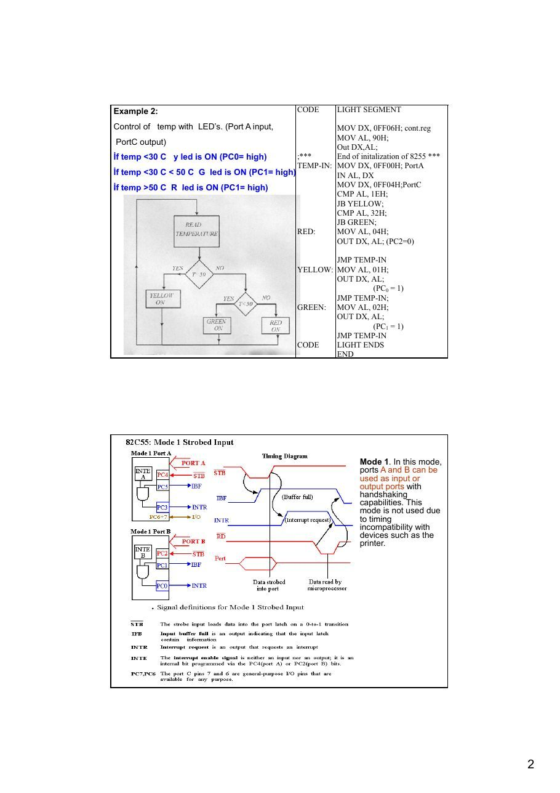
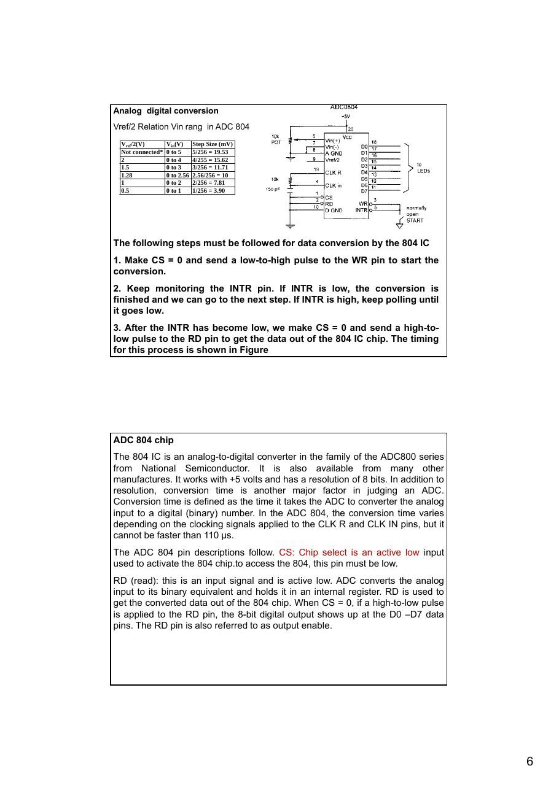

Bu yazı, Başkent Üniversitesi **EEM332 Mikroişlemciler** ders arşivindeki ilgili notları ve uygulamaları bir araya getiriyor (2014–2015). Analog-dijital ve dijital-analog dönüşüm, 8255 üzerinden sıcaklık okuma ve ısıtıcı denetimi. Belgelerin PDF arşiv kopyaları ve varsa kaynak kodları yazının sonunda ZIP olarak indirilebilir.

## cpu09_2013

### EEM332 Lecture9

Input/Output instructions of 8086 ADC-DAC interface

Example design The heater is controlled by using an cpu and 8255 PPI chip. The output of sensor is sent to 8255 after A/D convertion . The on/off control of

### heater is down by port C (PC0)

If PC0 is 0 heater is OFF and for PC04 =1 heater is ON. Control condition: IF temp is lower then 100 the heater will be ON.

### CODE         HEAT SEGMENT

```asm
MOV AL, 90H;
MOV DX, 0FF06 H;
OUT DX, AL
;***      End of initalization of 8255 ***
```

TEMP-IN: MOV DX, 0FF00H; (port A)

```asm
IN AL, DX;
CMP AL, 100;
JAE HEAT-OFF
MOV AL, 01H;
MOV DX, 0FF04H; PortC
OUT DX, AL;
JMP TEMP-IN;
```

### HEAT OFF: MOV AL, 00H;

```asm
MOV DX, FF04H;
OUT DX. AL; (PC 0 = 0)
JMP TEMP-IN;
```

### CODE      HEAT ENDS

```asm
END
```

Example 2:                                      CODE      LIGHT SEGMENT

Control of temp with LED’s. (Port A input,            MOV DX, 0FF06H; cont.reg

```asm
MOV AL, 90H;
```

PortC output)

```asm
Out DX,AL;
```

İf temp <30 C y led is ON (PC0= high)        ;***     End of initalization of 8255 *** TEMP-IN: MOV DX, 0FF00H; PortA İf temp <30 C < 50 C G led is ON (PC1= high)          IN AL, DX İf temp >50 C R led is ON (PC1= high)                 MOV DX, 0FF04H;PortC

```asm
CMP AL, 1EH;
JB YELLOW;
CMP AL, 32H;
JB GREEN;
RED:     MOV AL, 04H;
OUT DX, AL; (PC2=0)
```

```asm
JMP TEMP-IN
YELLOW: MOV AL, 01H;
OUT DX, AL;
```

### (PC0 = 1)

```asm
JMP TEMP-IN;
GREEN: MOV AL, 02H;
OUT DX, AL;
```

### (PC1 = 1)

```asm
JMP TEMP-IN
```

### CODE    LIGHT ENDS

```asm
END
```

Mode 1. In this mode, ports A and B can be used as input or output ports with handshaking capabilities. This mode is not used due to timing

```asm
incompatibility with
```

devices such as the printer.

Mode 1. In this mode, ports A and B can be used as input or output ports with handshaking capabilities. This mode is not used due to timing incompatibility with devices such as the printer.

Mode 2. In this mode, port A can be used as a bidirectional I/O port with handshaking capabilities. This mode is rarely used.

OBFa (output buffer full for port A) This is an activ-low signal going out of PC7 to indicate the fact that the CPU has written a byte of data into port A. OBF a must be connected to STROBE of the receiving equipment (such as a printer) to inform it that now it can read a byte of data from the port A latch. INTRa (interrupt request for port A): This is an active-high signal coming out PC3. the ACK signal is a signal of limited duration. When it goes active (low) it makes OBFa inactive, stays low for a small amount of time and then goes back to high (inactive). It is the rising edge of ACK that activates INTRa by making it high. This high signal on INTRa can be used to get the attention of The CPU. The CPU is informed through INTRa that the printer has received the last byte and is ready to receive another one. INTRa interrupts the CPU from whatever it is doing

```asm
and forces it to write the next byte to port A to be printed.
```

STB (storbe) : This is an active-low input signal. When an external peripheral device provides a byte of the data to an input port (A or B), it informs the 8255 through the STB pin that it can load (latch in) the data into its internal register. IBF (input buffer full) This is an active-high output signal. In response to STB, the 8255 latches into its internal register the data present PA0 – PA7 or Pb0 – PB7, and through IBF indicates that it has latched the data, but it has not been read by the CPU yet. INTR (interrupt request) : This is an active-high output signal. If INTE = 1 when IBF goes active, INTR is activated (set to high) to inform the CPU that is a byte of data in the 8255. either an interrupt or pulling the status word can be used to read the data from port A or B.

Analog Signal Conditioning Signal conditioning refers to operations performed on signals to convert them to a form suitable for interface with other elements in the digital circuits. The primary purpose for the analog signal conditioning circuitry is to modify the sensor output into a form that can be optimally converted to a digital signal. signal conditioning

### are as follows

Signal-level Changes The simplest type of signal conditioning is to change the level of a signal. To amplify or attenuate a voltage level.

- amplification: raise milivolt signals to volts

Linearization · Often the dependence that exists between input and output of sensor or system is nonlinear.· Analog signal conditioning is to maximize the linearity of a transducer’s response. Filtering and Impedance Matching It is necessary to use high-pass, low-pass, or notch filters to eliminate unwanted signals from the loop. (a) passive filters (b) active filters using op amps.– filtering remove frequencies above Nyquist Frequency Impedance matching is an important element of signal conditioning when transducer internal impedance or line impedance can cause errors in measurement of a dynamic variable.

- electrical isolation: protect microprocessor based system from high voltages

### WHAT IS AN ADC?

An analog to digital converter is a peripheral which converts analog signals in a defined range to the digital outputs. In the real world, signals are mostly available in analog form. To use a microcontroller in this type of system, an ADC is required, so that the signals can be converted to the digital values. The application software can then process the digital outputs and take decisions depending on the application or system requirements. The limitation imposed by the finite number of digital outputs decides how close the output is to the analog input. The more bits there are in the output, the closer the digital result will be to the analog signal. In other words, the resolution of the ADC is defined by the number of bits in the digital result (8 bits, 10 bits etc) Step Size =Vout = VR2-n The difference between an analogue and a digital parameter is thus exactly the same as between the mathematical "real number", which can have any value,

```asm
and the "integer", which can only have whole-number values.
```

Resolution :The number of bits that the ADC uses to represent the analog signal is its resolution. The higher the resolution, the higher the number of divisions the range is broken into, and therefore, the smaller the detectable voltage change. ( n=number of bits) Vin n

### N  INT (        2 )

Vref

Three bit ADC

### Example

The input to a 10-bit ADC with a 2.500-V reference is 1.45V.What is the hex output?

### N = INT (1.45/2.5)210

Analog digital conversion Vref/2 Relation Vin rang in ADC 804 Vref/2(V)      Vin(V) Step Size (mV)

```asm
Not connected* 0 to 5    5/256 = 19.53
```

2              0 to 4    4/255 = 15.62 1.5            0 to 3    3/256 = 11.71 1.28           0 to 2.56 2.56/256 = 10 1              0 to 2    2/256 = 7.81 0.5            0 to 1    1/256 = 3.90

The following steps must be followed for data conversion by the 804 IC

### 1. Make CS = 0 and send a low-to-high pulse to the WR pin to start the

conversion.

### 2. Keep monitoring the INTR pin. If INTR is low, the conversion is

finished and we can go to the next step. If INTR is high, keep polling until it goes low.

### 3. After the INTR has become low, we make CS = 0 and send a high-to-

low pulse to the RD pin to get the data out of the 804 IC chip. The timing for this process is shown in Figure

ADC 804 chip The 804 IC is an analog-to-digital converter in the family of the ADC800 series from National Semiconductor. It is also available from many other manufactures. It works with +5 volts and has a resolution of 8 bits. In addition to resolution, conversion time is another major factor in judging an ADC. Conversion time is defined as the time it takes the ADC to converter the analog input to a digital (binary) number. In the ADC 804, the conversion time varies depending on the clocking signals applied to the CLK R and CLK IN pins, but it cannot be faster than 110 μs. The ADC 804 pin descriptions follow. CS: Chip select is an active low input used to activate the 804 chip.to access the 804, this pin must be low. RD (read): this is an input signal and is active low. ADC converts the analog input to its binary equivalent and holds it in an internal register. RD is used to get the converted data out of the 804 chip. When CS = 0, if a high-to-low pulse is applied to the RD pin, the 8-bit digital output shows up at the D0 –D7 data pins. The RD pin is also referred to as output enable.

WR (write; a better name might be ‘’start conversion’’): This is an active low input used to inform the 804 ADC to start the conversion process. If CS = 0 when WR makes a low-to-high transition, the ADC 804 starts converting the analog input value of Vin to an 8-bit digital number. The amount of time it takes to convert varies depending on the CLK IN and CLK R values explained below. When the data conversion is complete, the INTR pin is forced low by the 804.

```asm
CLK IN and CLK r: CLK IN is an input pin connected to an external clock source
```

when an external clock is used for timing. However, the 804 has an internal

```asm
clock generator. To use the internal clock generator (also called self-clocking) of
```

the 804, the CLK IN and CLK R pins are connected to a capacitor and a resistor, as shown in Figure . In that case the clock frequency is determined by the equation: f=1/1RC. Typical values are R = 10K ohms and C = 150 pF. Substituting in the above equation, we get f = 606 KHz. In that case, the conversion time is 110 μs. INTR (interrupt; a bettr name might be ‘’end of conversion’’): It is a normally high pin and when the conversion is finished, it goes low to signal the CPU that the converted data is ready to be picked up. After INTR goes low, we make CS = 0 and send a high-to-low pulse to the RD pin to get the data out of the 804 chip. Vin(+) and Vin(-) are the differential analog inputs where Vin = Vin (+) – Vin (- ). Often the Vin (-) pin is connected to ground and the Vin (+) pin is used as the analog input to be converted to digital.

of the ADC800 series from Nwith +5 votaking a sa ADC804 Chip ADC804 IC is an analog-to-digital converter in the fa ational Semiconductor. It is also available from many other manufacturers. It works lts and has a resolution of 8 bits. Figure shows a typical timing diagram for mple of data via an

### ADC804.

- CS(chip select):

- WR(write): (Start convertion)

- INTR(interrupt): (ADC isfinished)

- RD(read): ( The digital value is read by CPU)

Interfacing ADC chip tp 8255) The 8255 in Figure is configured for mode 0, port A in, port B out, PC0 through PC3

```asm
in, and PC4 through PC7 out. The 8255 has a base address of 40H. an 8-bit analog-
```

to-digital converter (ADC0804) is connected to ports A and C. port c is used to control the RD and WR inputs on the 00804, and to read the end-of-conversion status. The 741 op-amp converts a +/- input voltage swing into a 0-5 V signal that can be digitized by the 0804. to start a conversion, the 0804’s WR line must be pulled low. This will force the INT output high until the conversion is complete. When INT goes low, the 0804 can be read by pulling the RD input low and reading port A. The following subroutine is called to perform a signal conversion and return the results

```asm
in AH:
```

Port A =40 H Port B =41 H Port C =42 H Control register =43 H ...........

### PC0=INT

### PC4 =WR

PC7=read

Port A =40 H (input) Port B =41 H (Output) Port C =42 H (control pins) Control register =43 H ...........

### PC0=INT

### PC4 =WR

PC7=read

```asm
VCON       PROC         FAR
MOV          AL, 80H    start a conversion by pulling ;WR low..PC7=high,
OUT          42H, AL    pc4=0
MOV          AL, 90H    ;; now pull WR high(pc7 and pc4 =high)
OUT          42H, AL
EOC:       IN           AL, 42H
AND          AL, 1      ;read port C (read interrupt)
JNZ          EOC        ;test bit-0 (read port C for int detection)
MOV          AL, 10H    ;wait for end of conversion (test of PC0 for INT)
OUT          42H, AL    ;enable RD
IN           AL, 40H    ;
OUT          41H, AL    ;read port A (the 0804)
MOV          AH, AL     ;echo data to port B
MOV          AL,90H
;return result in AH
OUT          42H, AL
RET                     ;get RD back to normal
```

### VCON       ENDP

```asm
MOV    AL, 91H   ;mode 0, Ain, Bout,
```

The 8255 is configured and            OUT    43H, AL   CLin, Chout initialized in this way:              MOV    AL, 90H   ;send to control port

```asm
OUT    42H, AL   ;RD and WR both high
;send to port C
```

The data read from the 0804 is sent out to the LEDs on port B. this gives a visual indication that everything is working properly. Being able to split up port C makes the interface with the 0804 easy to accomplish.

Example: ADC in microcontroller (PIC 16f877)

- Start Conversion by GO bit =high in ADCON0 register (write)

- Wait for ADC for 20 micro second (interrupt)

- The result of conversion is in ADRESH register (Read)

- Firstly send result into W (acu..), Then send result to PORT C

```asm
bsf     ADCON0,GO         ;Start A/D conversion
Wait
btfsc ADCON0,GO             ;Wait for conversion to complete
goto      Wait
movf        ADRESH,W         ;Write A/D result to PORTC
movwf PORTC                  ;LEDs     return
```

Digital-to-analog (DAC) converter The digital-to-analog converter (DAC) is a device widely used to convert digital pulses to analog signals. In this section we discuss the basics of interfacing a DAC to PC.

### Example

What is the output voltage of a 10-bit DAC with a 10.0-V reference if the input is (a) 0010110101 = 0B5H, (b) 20FH? The answers are; a) Vout = 1.767578 V b) Vout = 5.14648 V

Generating sine wave To generate a sine wave, we first need a table whose values represent the magnituda of the sine of angles between 0 and 360 degrees. The values for the sine fuction vary from –1.0 to +1.0 for 0 to 360 degree angles. Therefore, the table values are integer numbers representing the voltage magnitude for the sine of theta. This method ensures that only integer numbers are output to the DAC by the x86 processor. Table shows the angles, the sine values, the voltage magnitude, and the integer values representing the voltage magnitude for each angle with 30-degree increments. To generate Table , we assumed the full-scale voltage of 10V for DAC output (as designed in Figure ). Full-scal output of the DAC is achieved when all the data inputs of the DAC are high. Therefore. To achieve the full-scale 10V output, we use the following equation. Vout of DAC (for various sine degrees) = 5V + (5 × sin θ)                 To fined the value sent to DAC for various angles, we simply multiply the Vout voltage by 25.60 because there are 256 steps and full-scale Vout is 10 volts. Therefore, 256 steps / 10 V = 25.6 steps per volt. To further clarify this., look at Example . The following program sends the value to DAC continuously (in an infinite loop) to produce a crude sine wave. See Figure .

Thee bir DAC

Angle v. Voltage Magnitude for Sine Wave (Sine wave generation in CPU- 8bit) Angle θ          Vout (Voltage Magnitude) Values Sent to DAC (decimel) (degress) Sin θ 5V + (5V × sin θ)         (Voltage Mag x 25.6) 0         0       5                       128 30        0.5       7.5                   192 60        0.866 9.33                      238 90        1.000 10                        255 120       0.866 9.33                      238 150       0.5    7.5                      192 180       0      5                        128 210       -0.5   2.5                      64 240       -0.866 0.669                    17 270       -1.0   0                        0 300       -0.866 0.669                    17 330       -0.5   2.5                      64 360       0      5                        128

```asm
TABLE DB 128,192,238,255,192,128,64,17,0,17,64,128
;in code segment
MOV AL,80H          ;make all ports as output
MOV DX,CONPORT
OUT DX,AL
A1:                MOV CX,12           ;count
MOV BX,OFFSET TABLE
MOV DX,PORTA        ;port A address
NEXT:              MOV AL,[BX]
OUT DX,AL
INC BX
CALL DELAY          ;let DAC recover
LOOP NEXT
JMP A1              ;do it again
```

DAC circuit

### (DAC 808)

```asm
In high-speed CPU’s (30 MHz and higher), the use of two I/O instructions (IN, OUT)
```

### right after each other might not work

```asm
MOV       AL, 55H
OUT       PORT_A,AL
OUT       PORT_B,AL
```

You need to place a delay (or other code) between

```asm
subsequent OUT or IN instructions:
```

```asm
MOV AL,55H
OUT PORT_A,AL
MOV CX,5
HERE:            LOOP HERE
OUT PORT_B,AL
```





## cpu10_07

Example design The heater is controlled by using an cpu and 8255 PPI chip. The output of sensor is sent to

### 8255 after A/D convertion . The on/off control of heater is down by port C (PC0)

If PC0 is 0 heater is OFF and for PC04 =1 heater is ON.

### Control condition

IF temp is lower then 100 the heater will be ON.

### CODE         HEAT SEGMENT

```asm
MOV AL, 90H;
MOV DX, 0FF06 H;
OUT DX, AL
;***      End of initalization of 8255 ***
```

TEMP-IN: MOV DX, 0FF00H; (port A)

```asm
IN AL, DX;
CMP AL, 100;
JAE HEAT-OFF
MOV AL, 01H;
MOV DX, 0FF04H; PortC
OUT DX, AL;
JMP TEMP-IN;
```

### HEAT OFF: MOV AL, 00H;

```asm
MOV DX, FF04H;
OUT DX. AL; (PC0 = 0)
JMP TEMP-IN;
```

### CODE      HEAT ENDS

```asm
END
```

### Example 2

Control of temp with LED’s. (Port A input, PortC output)

### CODE       LIGHT SEGMENT

İf temp <30 C y led is ON (PC0= high)

```asm
MOV DX, 0FF06H; cont.reg
```

İf temp <30 C < 50 C G led is ON (PC1= high)                    MOV AL, 90H;

```asm
Out DX,AL;
```

İf temp >50 C R led is ON (PC1= high)                  ;***     End of initalization of 8255 *** TEMP-IN: MOV DX, 0FF00H; PortA

```asm
IN AL, DX
MOV DX, 0FF04H;PortC
CMP AL, 1EH;
JB YELLOW;
CMP AL, 32H;
JB GREEN;
RED:     MOV AL, 04H;
OUT DX, AL; (PC2=0)
```

```asm
JMP TEMP-IN
YELLOW: MOV AL, 01H;
OUT DX, AL;
```

### (PC0 = 1)

```asm
JMP TEMP-IN;
GREEN: MOV AL, 02H;
OUT DX, AL;
```

### (PC1 = 1)

```asm
JMP TEMP-IN
```

### CODE    LIGHT ENDS

```asm
END
```

Mode 1. In this mode, ports A and B can be used as input or output ports with handshaking capabilities. This mode is not used due to timing

```asm
incompatibility with
```

devices such as the printer.

Mode 1. In this mode, ports A and B can be used as input or output ports with handshaking capabilities. This mode is

```asm
not used due to timing
incompatibility with
```

devices such as the printer.

Mode 2. In this mode, port A can be used as a bidirectional I/O port with handshaking capabilities. This mode is rarely used.

OBFa (output buffer full for port A) This is an activ-low signal going out of PC7 to indicate the fact that the CPU has written a byte of data into port A. OBF a must be connected to STROBE of the receiving equipment (such as a printer) to inform it that now it can read a byte of data from the port A latch. INTRa (interrupt request for port A) This is an active-high signal coming out PC3. the ACK signal is a signal of limited duration. When it goes active (low) it makes OBFa inactive, stays low for a small amount of time and then goes back to high (inactive). It is the rising edge of ACK that activates INTRa by making it high. This high signal on INTRa can be used to get the attention of The CPU. The CPU is informed through INTRa that the printer has received the last byte and is ready to receive another one. INTRa interrupts the CPU from whatever it is doing and forces it to write the next byte to port A to be printed. STB (storbe) This is an active-low input signal. When an external peripheral device provides a byte of the data to an input port (A or B), it informs the 8255 through the STB pin that it can load (latch in) the data into its internal register. IBF (input buffer full) This is an active-high output signal. In response to STB, the 8255 latches into its internal register the data present PA0 – PA7 or Pb0 – PB7, and through IBF indicates that it has latched the data, but it has not been read by the CPU yet. INTR (interrupt request) This is an active-high output signal. If INTE = 1 when IBF goes active, INTR is activated (set to high) to inform the CPU that is a byte of data in the 8255. either an interrupt or pulling the status word can be used to read the data from port A or B.

Analog Signal Conditioning Signal conditioning refers to operations performed on signals to convert them to a form suitable for interface with other elements in the digital circuits. The primary purpose for the analog signal conditioning circuitry is to modify the sensor output into a form that can be optimally converted to a discrete time digital data stream by the data acquisition system. It is possible to categorize signal conditioning into several general types. Signal-level Changes The simplest type of signal conditioning is to change the level of a signal. The most common example is the necessity to either amplify or attenuate a voltage level.

- amplification: raise milivolt signals to volts

Linearization · Process control engineer has little choice of the characteristics of a transducer's dynamic response --- Physics, Chemistry. · Often the dependence that exists between input and output is nonlinear. · Analog signal conditioning is to maximize the linearity of a transducer’s response. Filtering and Impedance Matching

```asm
In many cases, it is necessary to use high-pass, low-pass, or notch filters to eliminate
```

unwanted signals from the loop. Such filtering can be accomplished by (a) passive filters (b) active filters using op amps.

- filtering : remove frequencies above Nyquist Frequency

Impedance matching is an important element of signal conditioning when transducer internal impedance or line impedance can cause errors in measurement of a dynamic variable.

- electrical isolation: protect microprocessor based system from high voltages

### WHAT IS AN ADC?

An analog to digital converter is a peripheral which converts analog signals in a defined range to the digital outputs. In the real world, signals are mostly available in analog form. To use a microcontroller in this type of system, an ADC is required, so that the signals can be converted to the digital values. The application software can then process the digital outputs and take decisions depending on the application or system requirements. The limitation imposed by the finite number of digital outputs decides how close the output is to the analog input. The more bits there are in the output, the closer the digital result will be to the analog signal. In other words, the resolution of the ADC is defined by the number of bits in the digital result (8 bits, 10 bits etc) and the input voltage range. The difference between an analogue and a digital parameter is thus exactly the same as between the mathematical "real number", which can have any value, and the "integer", which can only have whole-number values. Resolution                                                  Step Size = Vout = VR2-n The number of bits that the ADC uses to represent the analog signal is its resolution. The higher the resolution, the higher the number of divisions the range is broken into, and therefore, the smaller the detectable voltage change. ( n=number of bits)                        Vin n

### N  INT (           2 )

Vref

### Example

The input to a 10-bit ADC with a 2.500-V reference is 1.45V.What is the hex output?

### N = INT (1.45/2.5)210


Analog digital conversion Vref/2 Relation Vin rang in ADC 804 Vref/2(V)      Vin(V)    Step Size (mV)

```asm
Not connected* 0 to 5    5/256 = 19.53
```

2              0 to 4    4/255 = 15.62 1.5            0 to 3    3/256 = 11.71 1.28           0 to 2.56 2.56/256 = 10 1              0 to 2    2/256 = 7.81 0.5            0 to 1    1/256 = 3.90

From this discussion we conclude that the following steps must be followed for data conversion by the 804 chip.

### 1. Make CS = 0 and send a low-to-high pulse to the WR pin to start the conversion.

### 2. Keep monitoring the INTR pin. If INTR is low, the conversion is finished and we can go to the next step.

If INTR is high, keep polling until it goes low.

### 3. After the INTR has become low, we make CS = 0 and send a high-to-low pulse to the RD pin to get the

data out of the 804 IC chip. The timing for this process is shown in Figure

ADC 804 chip

The 804 IC is an analog-to-digital converter in the family of the ADC800 series from National Semiconductor. It is also available from many other manufactures. It works with +5 volts and has a resolution of 8 bits. In addition to resolution, conversion time is another major factor in judging an ADC. Conversion time is defined as the time it takes the ADC to converter the analog input to a digital (binary) number. In the ADC 804, the conversion time varies depending on the clocking signals applied to the CLK R and CLK IN pins, but it cannot be faster than 110 μs. The ADC 804 pin descriptions follow. CS: Chip select is an active low input used to activate the 804 chip.to access the 804, this pin must be low. RD (read): this is an input signal and is active low. ADC converts the analog input to its binary equivalent and holds it in an internal register. RD is used to get the converted data out of the 804 chip. When CS = 0, if a high-to- low pulse is applied to the RD pin, the 8-bit digital output shows up at the D0 –D7 data pins. The RD pin is also referred to as output enable. WR (write; a better name might be ‘’start conversion’’): This is an active low input used to inform the 804 ADC to start the conversion process. If CS = 0 when WR makes a low-to-high transition, the ADC 804 starts converting the analog input value of Vin to an 8-bit digital number. The amount of time it takes to convert varies depending on the CLK IN and CLK R values explained below. When the data conversion is complete, the INTR pin is forced low by the 804. CLK IN and CLK r: CLK IN is an input pin connected to an external clock source when an external

```asm
clock is used for timing. However, the 804 has an internal clock generator. To use the internal clock generator
```

(also called self-clocking) of the 804, the CLK IN and CLK R pins are connected to a capacitor and a resistor, as shown in Figure . In that case the clock frequency is determined by the equation: f=1/1RC. Typical values are R = 10K ohms and C = 150 pF. Substituting in the above equation, we get f = 606 KHz. In that case, the conversion time is 110 μs. INTR (interrupt; a bettr name might be ‘’end of conversion’’): It is a normally high pin and when the conversion is finished, it goes low to signal the CPU that the converted data is ready to be picked up. After INTR goes low, we make CS = 0 and send a high-to-low pulse to the RD pin to get the data out of the 804 chip. Vin(+) and Vin(-) are the differential analog inputs where Vin = Vin (+) – Vin (-). Often the Vin (-) pin is connected to ground and the Vin (+) pin is used as the analog input to be converted to digital.

of the ADC800 series from Nwith +5 votaking a sa ADC804 Chip ADC804 IC is an analog-to-digital converter in the fa ational Semiconductor. It is also available from many other manufacturers. It works lts and has a resolution of 8 bits. Figure shows a typical timing diagram for mple of data via an ADC804.

### CS(chip select)

WR(write): (Start convertion) INTR(interrupt): (ADC isfinished) RD(read): ( The digital value is read by CPU)

Interfacing ADC chip tp 8255) The 8255 in Figure is configured for mode 0, port A in, port B out, PC0 through PC3

```asm
in, and PC4 through PC7 out. The 8255 has a base address of 40H. an 8-bit analog-
```

to-digital converter (ADC0804) is connected to ports A and C. port c is used to control the RD and WR inputs on the 00804, and to read the end-of-conversion status. The 741 op-amp converts a +/- input voltage swing into a 0-5 V signal that can be digitized by the 0804. to start a conversion, the 0804’s WR line must be pulled low. This will force the INT output high until the conversion is complete. When INT goes low, the 0804 can be read by pulling the RD input low and reading port A. The following subroutine is called to perform a signal conversion and return the results

```asm
in AH:
```

Port A =40 H Port B =41 H Port C =42 H Control register =43 H ...........

### PC0=INT

### PC4 =WR

PC7=read

Port A =40 H (input) Port B =41 H (Output) Port C =42 H (control pins) Control register =43 H ...........

### PC0=INT

### PC4 =WR

PC7=read

```asm
VCON     PROC     FAR
MOV      AL, 80H    start a conversion by pulling ;WR low..PC7=high,
OUT      42H, AL    pc4=0
MOV      AL, 90H    ;; now pull WR high(pc7 and pc4 =high)
OUT      42H, AL
EOC:     IN       AL, 42H
AND      AL, 1      ;read port C (read interrupt)
JNZ      EOC        ;test bit-0 (read port C for int detection)
MOV      AL, 10H    ;wait for end of conversion (test of PC0 for INT)
OUT      42H, AL    ;enable RD
IN       AL, 40H    ;
OUT      41H, AL    ;read port A (the 0804)
MOV      AH, AL     ;echo data to port B
MOV      AL,90H
;return result in AH
OUT      42H, AL
RET                 ;get RD back to normal
```

### VCON     ENDP

```asm
MOV    AL, 91H   ;mode 0, Ain, Bout,
```

The 8255 is configured and           OUT    43H, AL   CLin, Chout initialized in this way:             MOV    AL, 90H   ;send to control port

```asm
OUT    42H, AL   ;RD and WR both high
;send to port C
```

The data read from the 0804 is sent out to the LEDs on port B. this gives a visual indication that everything is working properly. Being able to split up port C makes the interface with the 0804 easy to accomplish.

ADC in microcontroller (PIC 16f877)

- Start Conversion by GO bit =high in ADCON0 register (write)

- Wait for ADC for 20 micro second (interrupt)

- The result of conversion is in ADRESH register (Read)

- Firstly send result into W (acu..), Then send result to PORT C

```asm
bsf   ADCON0,GO     ;Start A/D conversion
Wait
btfsc ADCON0,GO        ;Wait for conversion to complete
goto      Wait
movf       ADRESH,W     ;Write A/D result to PORTC
movwf PORTC            ;LEDs     return
```

Digital-to-analog (DAC) converter The digital-to-analog converter (DAC) is a device widely used to convert digital pulses to analog signals. In this section we discuss the basics of interfacing a DAC to PC.

### Example

What is the output voltage of a 10-bit DAC with a 10.0-V reference if the input is (a) 0010110101 = 0B5H, (b) 20FH? The answers are; a) Vout = 1.767578 V b) Vout = 5.14648 V

Generating sine wave To generate a sine wave, we first need a table whose values represent the magnituda of the sine of angles between 0 and 360 degrees. The values for the sine fuction vary from –1.0 to +1.0 for 0 to 360 degree angles. Therefore, the table values are integer numbers representing the voltage magnitude for the sine of theta. This method ensures that only integer numbers are output to the DAC by the x86 processor. Table shows the angles, the sine values, the voltage magnitude, and the integer values representing the voltage magnitude for each angle with 30-degree increments. To generate Table , we assumed the full-scale voltage of 10V for DAC output (as designed in Figure ). Full-scal output of the DAC is achieved when all the data inputs of the DAC are high. Therefore. To achieve the full-scale 10V output, we use the following equation. Vout of DAC (for various sine degrees) = 5V + (5 × sin θ) To fined the value sent to DAC for various angles, we simply multiply the Vout voltage by 25.60 because there are 256 steps and full- scale Vout is 10 volts. Therefore, 256 steps / 10 V = 25.6 steps per volt. To further clarify this., look at Example . The following program sends the value to DAC continuously (in an infinite loop) to produce a crude sine wave. See Figure .


Angle v. Voltage Magnitude for Sine Wave (Sine wave generation in CPU) Angle θ          Vout (Voltage Magnitude) Values Sent to DAC (decimel) (degress) Sin θ 5V + (5V × sin θ)         (Voltage Mag x 25.6) 0         0       5                       128 30        0.5       7.5                   192 60        0.866 9.33                      238 90        1.000 10                        255 120       0.866 9.33                      238 150       0.5    7.5                      192 180       0      5                        128 210       -0.5   2.5                      64 240       -0.866 0.669                    17 270       -1.0   0                        0 300       -0.866 0.669                    17 330       -0.5   2.5                      64 360       0      5                        128

```asm
TABLE DB 128,192,238,255,192,128,64,17,0,17,64,128
;in code segment
MOV AL,80H          ;make all ports as output
MOV DX,CONPORT
OUT DX,AL
A1:              MOV CX,12           ;count
MOV BX,OFFSET TABLE
MOV DX,PORTA        ;port A address
NEXT:            MOV AL,[BX]
OUT DX,AL
INC BX
CALL DELAY          ;let DAC recover
LOOP NEXT
JMP A1              ;do it again
```

DAC circuit

```asm
In high-speed CPU’s (30 MHz and higher), the use of two I/O instructions (IN, OUT)
```

### right after each other might not work

```asm
MOV       AL, 55H
OUT       PORT_A,AL
OUT       PORT_B,AL
```

You need to place a delay (or other code) between

```asm
subsequent OUT or IN instructions:
```

```asm
MOV AL,55H
OUT PORT_A,AL
MOV CX,5
HERE:         LOOP HERE
OUT PORT_B,AL
```

## cpu10_06

Example design The heater is controlled by using an cpu and 8255 PPI chip. The output of sensor is sent to

### 8255 after A/D convertion . The on/off control of heater is down by port C (PC04)

If PC04 is 0 heater is OFF and for PC04 =1 heater is ON. Control condition:                                 CODE        HEAT SEGMENT

IF temp is lower then 100 the heater will be ON.             MOV AL, 90H;

```asm
MOV DX, 0FF06 H;
OUT DX, AL
;***      End of initalization of 8255 ***
```

### TEMP-IN: MOV DX, 0FF00H;

```asm
IN AL, DX;
CMP AL, 100;
JAE HEAT-OFF
MOV AL, 01H;
MOV DX, 0FF04H;
OUT DX, AL;
JMP TEMP-IN;
```

### HEAT OFF: MOV AL, 00H;

```asm
MOV DX, FF04H;
OUT DX. AL; (PC0 = 0)
JMP TEMP-IN;
```

### CODE      HEAT ENDS

```asm
END
```

### Example 2

Control of temp with LED’s.

### CODE        LIGHT SEGMENT

İf temp <30 C y led is ON (PC0= high)

```asm
MOV DX, 0FF06H;
MOV AL, 90H;
```

İf temp <30 C < 50 C G led is ON (PC1= high)                    Out DX,AL;

```asm
;***     End of initalization of 8255 ***
```

İf temp >50 C R led is ON (PC1= high)                  TEMP-IN: MOV DX, 0FF00H;

```asm
IN AL, DX
MOV DX, 0FF04H;
CMP AL, 1EH;
JB YELLOW;
CMP AL, 32H;
JB GREEN;
RED:     MOV AL, 04H;
OUT DX, AL;
```

```asm
JMP TEMP-IN
YELLOW: MOV AL, 01H;
OUT DX, AL;
```

### (PC0 = 1)

```asm
JMP TEMP-IN;
GREEN: MOV AL, 02H;
OUT DX, AL;
```

### (PC1 = 1)

```asm
JMP TEMP-IN
```

### CODE    LIGHT ENDS

```asm
END
```

Mode 1. In this mode, ports A and B can be used as input or output ports with handshaking capabilities. This mode is not used due to timing

```asm
incompatibility with
```

devices such as the printer.

Mode 1. In this mode, ports A and B can be used as input or output ports with handshaking capabilities. This mode is

```asm
not used due to timing
incompatibility with
```

devices such as the printer.

Mode 2. In this mode, port A can be used as a bidirectional I/O port with handshaking capabilities. This mode is rarely used.

OBFa (output buffer full for port A) This is an activ-low signal going out of PC7 to indicate the fact that the CPU has written a byte of data into port A. OBF a must be connected to STROBE of the receiving equipment (such as a printer) to inform it that now it can read a byte of data from the port A latch. INTRa (interrupt request for port A) This is an active-high signal coming out PC3. the ACK signal is a signal of limited duration. When it goes active (low) it makes OBFa inactive, stays low for a small amount of time and then goes back to high (inactive). It is the rising edge of ACK that activates INTRa by making it high. This high signal on INTRa can be used to get the attention of yhe CPU. The CPU is informed through INTRa that the printer has received the last byte and is ready to receive another one. INTRa interrupts the CPU from whatever it is doing and forces it to write the next byte to port A to be printed. STB (storbe) This is an active-low input signal. When an external peripheral device provides a byte of the data to an input port (A or B), it informs the 8255 through the STB pin that it can load (latch in) the data into its internal register. IBF (input buffer full) This is an active-high output signal. In response to STB, the 8255 latches into its internal register the data present PA0 – PA7 or Pb0 – PB7, and through IBF indicates that it has latched the data, but it has not been read by the CPU yet. INTR (interrupt request) Tis is an active-high output signal. If INTE = 1 when IBF goes active, INTR is activated (set to high) to inform the CPU that is a byte of data in the 8255. either an interrupt or pulling the status word can be used to read the data from port A or B.

Analog Signal Conditioning Signal conditioning refers to operations performed on signals to convert them to a form suitable for interface with other elements in the digital circuits. The primary purpose for the analog signal conditioning circuitry is to modify the sensor output into a form that can be optimally converted to a discrete time digital data stream by the data acquisition system. It is possible to categorize signal conditioning into several general types. Signal-level Changes The simplest type of signal conditioning is to change the level of a signal. The most common example is the necessity to either amplify or attenuate a voltage level.

- amplification: raise milivolt signals to volts

Linearization · Process control engineer has little choice of the characteristics of a transducer's dynamic response --- Physics, Chemistry. · Often the dependence that exists between input and output is nonlinear. · Analog signal conditioning is to maximize the linearity of a transducer’s response. Filtering and Impedance Matching

```asm
In many cases, it is necessary to use high-pass, low-pass, or notch filters to eliminate
```

unwanted signals from the loop. Such filtering can be accomplished by (a) passive filters (b) active filters using op amps.

- filtering : remove frequencies above Nyquist Frequency

Impedance matching is an important element of signal conditioning when transducer internal impedance or line impedance can cause errors in measurement of a dynamic variable.

- electrical isolation: protect computer from high voltages

### WHAT IS AN ADC?

An analog to digital converter is a peripheral which converts analog signals in a defined range to the digital outputs. In the real world, signals are mostly available in analog form. To use a microcontroller in this type of system, an ADC is required, so that the signals can be converted to the digital values. The application software can then process the digital outputs and take decisions depending on the application or system requirements. The limitation imposed by the finite number of digital outputs decides how close the output is to the analog input. The more bits there are in the output, the closer the digital result will be to the analog signal. In other words, the resolution of the ADC is defined by the number of bits in the digital result (8 bits, 10 bits etc) and the input voltage range. The difference between an analogue and a digital parameter is thus exactly the same as between the mathematical "real number", which can have any value, and the "integer", which can only have whole-number values. Resolution                                                 ∆ Step Size = Vout = VR2-n The number of bits that the ADC uses to represent the analog signal is its resolution. The higher the resolution, the higher the number of divisions the range is broken into, and therefore, the smaller the detectable voltage change. ( n=number of bits)                        Vin n

### N = INT (           2 )

### Example

Vref The input to a 10-bit ADC with a 2.500-V reference is 1.45V.What is the hex output?

### N = INT (1.45/2.5)210

Analog digital conversion Vref/2 Relation Vin rang in ADC 804 Vref/2(V)      Vin(V)    Step Size (mV)

```asm
Not connected* 0 to 5    5/256 = 19.53
```

2              0 to 4    4/255 = 15.62 1.5            0 to 3    3/256 = 11.71 1.28           0 to 2.56 2.56/256 = 10 1              0 to 2    2/256 = 7.81 0.5            0 to 1    1/256 = 3.90

From this discussion we conclude that the following steps must be followed for data conversion by the 804 chip.

### 1. Make CS = 0 and send a low-to-high pulse to the WR pin to start the conversion.

### 2. Keep monitoring the INTR pin. If INTR is low, the conversion is finished and we can go to the next step. If INTR is high,

keep polling until it goes low.

### 3. After the INTR has become low, we make CS = 0 and send a high-to-low pulse to the RD pin to get the data out of the

804 IC chip. The timing for this process is shown in Figure

ADC 804 chip The 804 IC is an analog-to-digital converter in the family of the ADC800 series from National Semiconductor. It is also available from many other manufactures. It works with +5 volts and has a resolution of 8 bits. In addition to resolution, conversion time is another major factor in judging an ADC. Conversion time is defined as the time it takes the ADC to converter the analog input to a digital (binary) number. In the ADC 804, the conversion time varies depending on the

```asm
clocking signals applied to the CLK R and CLK IN pins, but it cannot be faster than 110 µs.
```

The ADC 804 pin descriptions follow. CS: Chip select is an active low input used to activate the 804 chip.to access the 804, this pin must be low. RD (read): this is an input signal and is active low. ADC converts the analog input to its binary equivalent and holds it in an internal register. RD is used to get the converted data out of the 804 chip. When CS = 0, if a high-to-low pulse is applied to the RD pin, the 8-bit digital output shows up at the D0 –D7 data pins. The RD pin is also referred to as output enable. WR (write; a better name might be ‘’start conversion’’): This is an active low input used to inform the 804 ADC to start the conversion process. If CS = 0 when WR makes a low-to-high transition, the ADC 804 starts converting the analog input value of Vin to an 8-bit digital number. The amount of time it takes to convert varies depending on the CLK IN and CLK R values explained below. When the data conversion is complete, the INTR pin is forced low by the 804.

```asm
CLK IN and CLK r: CLK IN is an input pin connected to an external clock source when an external clock is used for timing.
```

However, the 804 has an internal clock generator. To use the internal clock generator (also called self-clocking) of the 804, the CLK IN and CLK R pins are connected to a capacitor and a resistor, as shown in Figure . In that case the clock frequency is determined by the equation: f=1/1RC. Typical values are R = 10K ohms and C = 150 pF. Substituting in the above equation, we get f = 606 KHz. In that case, the conversion time is 110 µs. INTR (interrupt; a bettr name might be ‘’end of conversion’’): It is a normally high pin and when the conversion is finished, it goes low to signal the CPU that the converted data is ready to be picked up. After INTR goes low, we make CS = 0 and send a high-to-low pulse to the RD pin to get the data out of the 804 chip. Vin(+) and Vin(-) are the differential analog inputs where Vin = Vin (+) – Vin (-). Often the Vin (-) pin is connected to ground

```asm
and the Vin (+) pin is used as the analog input to be converted to digital.
```

of the ADC800 series from Nwith +5 votaking a sa ADC804 Chip ADC804 IC is an analog-to-digital converter in the fa ational Semiconductor. It is also available from many other manufacturers. It works lts and has a resolution of 8 bits. Figure shows a typical timing diagram for mple of data via an ADC804.

### CS(chip select)

WR(write): (Start convertion) INTR(interrupt): (ADC isfinished) RD(read): ( The digital value is read by CPU)

Interfacing ADC chip tp 8255) The 8255 in Figure is configured for mode 0, port A in, port B out, PC0 through PC3

```asm
in, and PC4 through PC7 out. The 8255 has a base address of 40H. an 8-bit analog-
```

to-digital converter (ADC0804) is connected to ports A and C. port c is used to control the RD and WR inputs on the 00804, and to read the end-of-conversion status. The 741 op-amp converts a +/- input voltage swing into a 0-5 V signal that can be digitized by the 0804. to start a conversion, the 0804’s WR line must be pulled low. This will force the INT output high until the conversion is complete. When INT goes low, the 0804 can be read by pulling the RD input low and reading port A. The following subroutine is called to perform a signal conversion and return the results

```asm
in AH:
```

Port A =40 H Port B =41 H Port C =42 H Control register =43 H ...........

### PC0=INT

### PC4 =WR

PC7=read

```asm
VCON        PROC    FAR
MOV     AL, 80H    start a conversion by pulling
OUT     42H, AL    ;WR low..PC7=high and pc4=0
MOV     AL, 90H    ;now pull WR high(pc7 and pc4 =high)
OUT     42H, AL    ;
EOC:        IN      AL, 42H    ;read port C
AND     AL, 1      ;test bit-0 (read port C for int detection)
JNZ     EOC        ;wait for end of conversion (test of PC0 for INT)
MOV     AL, 10H    ;enable RD
OUT     42H, AL    ;
IN      AL, 40H    ;read port A (the 0804)
OUT     41H, AL    ;echo data to port B
MOV     AH, AL     ;return result in AH
MOV     AL,90H     ;get RD back to normal
OUT     42H, AL
RET
```

### VCON        ENDP

```asm
MOV     AL, 91H     ;mode 0, Ain, Bout,
```

The 8255 is configured and               OUT     43H, AL     CLin, Chout initialized in this way:                 MOV     AL, 90H     ;send to control port

```asm
OUT     42H, AL     ;RD and WR both high
;send to port C
```

The data dear from the 0804 is sent out to the LEDs on port B. this gives a visual indication that everything is working properly. Being able to split up port C makes the interface with the 0804 easy to accomplish.

ADC in microcontroller (PIC 16f877) Start Conversion by GO bit =high in ADCON0 register (write) Wait for ADC for 20 micro second (interrupt) The result of conversion is in ADRESH register (Read) Firstly send result into W (acu..), Then send result to PORT C

```asm
bsf       ADCON0,GO                  ;Start A/D conversion
Wait
btfsc ADCON0,GO                       ;Wait for conversion to complete
goto       Wait
movf       ADRESH,W                   ;Write A/D result to PORTC
movwf PORTC                         ;LEDs              return
```

Digital-to-analog (DAC) converter The digital-to-analog converter (DAC) is a device widely used to convert digital pulses to analog signals. In this section we discuss the basics of interfacing a DAC to PC.

### Example

What is the output voltage of a 10-bit DAC with a 10.0-V reference if the input is (a) 00101101012 = 0B5H, (b) 20FH? The answers are; a) Vout = 1.767578 V b) Vout = 5.14648 V

Generating sine wave To generate a sine wave, we first need a table whose values represent the magnituda of the sine of angles between 0 and 360 degrees. The values for the sine fuction vary from –1.0 to +1.0 for 0 to 360 degree angles. Therefore, the table values are integer numbers representing the voltage magnitude for the sine of theta. This method ensures that only integer numbers are output to the DAC by the x86 processor. Table shows the angles, the sine values, the voltage magnitude, and the integer values representing the voltage magnitude for each angle with 30-degree increments. To generate Table , we assumed the full-scale voltage of 10V for DAC output (as designed in Figure ). Full-scal output of the DAC is achieved when all the data inputs of the DAC are high. Therefore. To achieve the full-scale 10V output, we use the following equation. Vout of DAC (for various sine degrees) = 5V + (5 × sin θ) To fined the value sent to DAC for various angles, we simply multiply the Vout voltage by 25.60 because there are 256 steps and full- scale Vout is 10 volts. Therefore, 256 steps / 10 V = 25.6 steps per volt. To further clarify this., look at Example . The following program sends the value to DAC continuously (in an infinite loop) to produce a crude sine wave. See Figure .

Angle v. Voltage Magnitude for Sine Wave Angle θ          Vout (Voltage Magnitude) Values Sent to DAC (decimel) (degress) Sin θ 5V + (5V × sin θ)         (Voltage Mag x 25.6) 0         0       5                       128 30        0.5       7.5                   192 60        0.866 9.33                      238 90        1.000 10                        255 120       0.866 9.33                      238 150       0.5    7.5                      192 180       0      5                        128 210       -0.5   2.5                      64 240       -0.866 0.669                    17 270       -1.0   0                        0 300       -0.866 0.669                    17 330       -0.5   2.5                      64 360       0      5                        128

```asm
TABLE DB 128,192,238,255,192,128,64,17,0,17,64,128
;in code segment
MOV AL,80H          ;make all ports as output
MOV DX,CONPORT
OUT DX,AL
A1:                MOV CX,12           ;count
MOV BX,OFFSET TABLE
MOV DX,PORTA        ;port A address
NEXT:              MOV AL,[BX]
OUT DX,AL
INC BX
CALL DELAY          ;let DAC recover
LOOP NEXT
JMP A1              ;do it again
```

DAC circuit

```asm
In high-speed CPU’s (30 MHz and higher), the use of two I/O instructions (IN, OUT)
```

### right after each other might not work

```asm
MOV       AL, 55H
```

```asm
OUT       PORT_A,AL
```

```asm
OUT       PORT_B,AL
```

### You need to place a delay (or other code) between subsequent OUT or IN instructions

```asm
MOV AL,55H
```

```asm
OUT PORT_A,AL
```

```asm
MOV CX,5
```

```asm
HERE:            LOOP HERE
OUT PORT_B,AL
```
