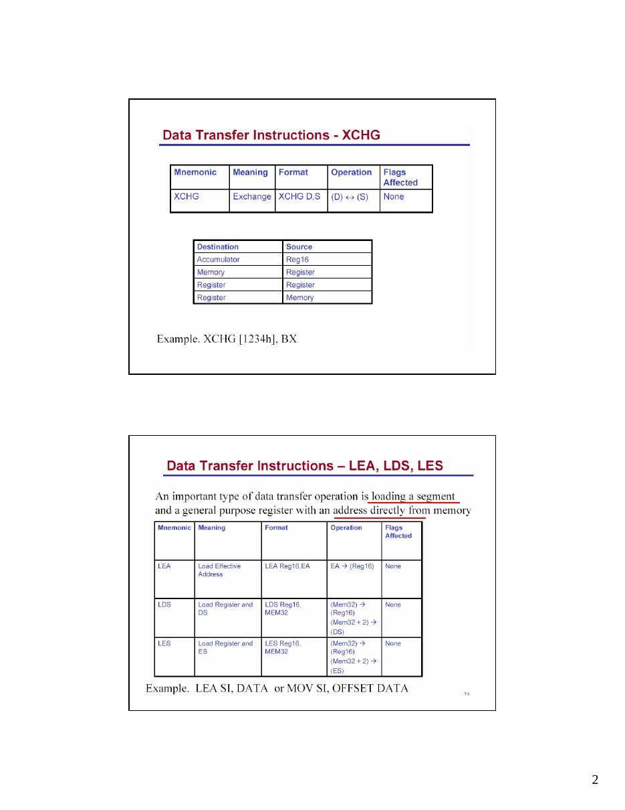
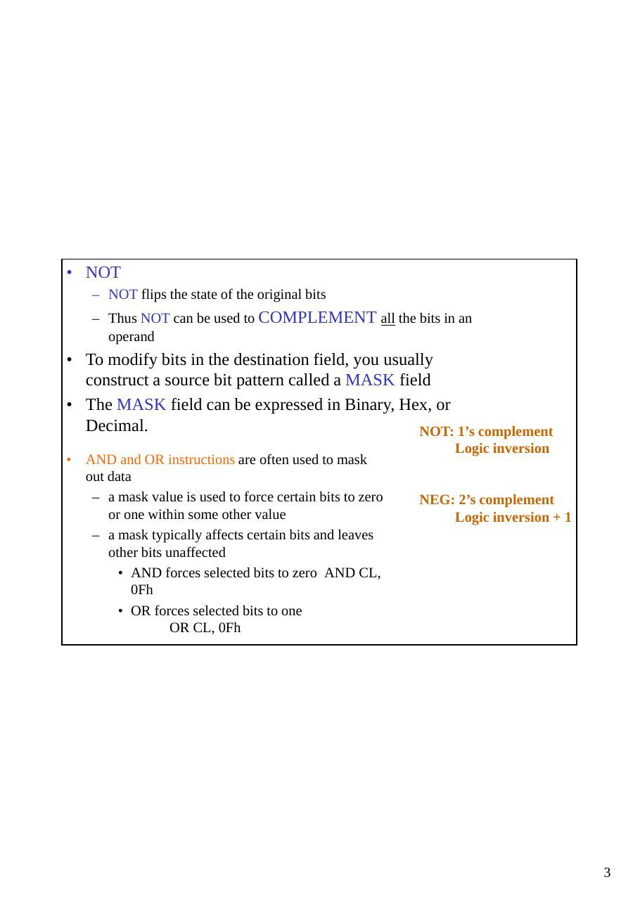

Bu yazı, Başkent Üniversitesi **EEM332 Mikroişlemciler** ders arşivindeki ilgili notları ve uygulamaları bir araya getiriyor (2005–2015). MOV, LDS, XLAT, ADD, SUB, çarpma, bölme, mantık işlemleri, kaydırma ve döndürme komutları. Belgelerin PDF arşiv kopyaları ve varsa kaynak kodları yazının sonunda ZIP olarak indirilebilir.

## CPU04_08


LDS : Load Data Segment....

After..

XLAT :Traslate instruction

Arithmetic : Addition ;                         Decimal arithmetic

```asm
Subtraction; Multiplication; Division
AAA (adjust after addition)
```

ASCII, unpacked decimal AAS (adjust after subtraction) ASCII, unpacked decimal

```asm
AAM (adjust after multip..)
```

unpacked decimal

```asm
AAD (adjust before division)
```

unpacked decimal

```asm
DAA ( adjust after addition)
```

packed decimal

```asm
DAS ( adjust after subtraction)
```

packed decimal

```asm
Decimal arithmetic : Storing decimal numbers 12345
```

ASCII format:         31 32 33 34 35

unpacked BCD:         01 02 03 04 05 packed decimal:          01 23 45

Flag Register and ADD instruction


- Example

```asm
mov ah, 0                 ; AX = 00 ??
mov al, "9"     ;        AX = 00 39
add al, "3"     ;        AX = 00 6C
aaa             ;        AX = 01 02
or    ax, 3030h ;        AX = 31 32
```

- We have the answer in ASCII decimal

- Slower than normal binary adds

- May be faster than converting ASCII decimal to binary, adding,

```asm
and converting back to ASCII decimal
```

0010 0101 1100 > 9

```asm
Subtraction:
```

### 1. Take the 2’s complement of the subtrahend (source operand)

### 2. Add it to the minuend (destination operand)

### 3. Invert the carry

If the CF=0, the result is positive and the destination has the result. If the CF=1, the result is negative and the destination has the 2’s complement of the result. NOT

```asm
and INC increment instructions can be used to change it.
```

Flags Affected: OF, SF, ZF, AF, PF, CF

’15’

```asm
MOV AX,0105H ;      AX=0105 unpacked BCD for 15
MOV CL,06          ; CL=06H
SUB AL,CL          ; 5-6=-1 (FFH)
```

AAS              ;FFH in AL is adjusted to 09 and

```asm
;AH is decremented leaving AX=0009
```

ASCII to Unpacked BCD Conversion

ASCII to packed BCD Conversion


```asm
mov BL,0FEh
mov AL,0E5h
mul BL
```

- BL contains 254, AL contains 229

- After MUL

- AX contains 0E336h (58166d)

- CF=OF=1 (result requires a word)

- SF, AF, PF, and ZF are undefined

```asm
mov BL,0FEh
mov AL,0E5h
```

imul BL

- BL contains -2, AL contains -27

- After IMUL

- AX contains 0036h (54d)

- CF=OF=0 (result still fits in byte)

- SF, AF, PF, and ZF are undefined

AL=20 H……..32

### CL= 80 H…….128

```asm
MUL CL ………AX= 1000
```

------------------------------------------ IMUL CL ………….AX=F000

AL=95

```
AX=2711 H………10001 d
```

BL=10 BL=32 H…………..50 d

```asm
DIV BL
Div BL….. …….. AX=01C8
```

AL=09 ; AH=05

Examples of MUL and IMUL

- AX = 1h and BX = FFFFh, then:

- Instruction      Result DX     AX               CF/OF

 mul        bx    65535 0000    FFFF              0  imul       bx    -1       FFFF FFFF              0

### AX = FFFFh and BX = FFFFh, then

- Instruction      Result DX      AX              CF/OF

 mul        bx    4294836225 FFFE 0001            1  imul       bx       1            0000 0001      0

- AL = 30h and BL = 4h, then:

- Instruction       Result     AH       AL        CF/OF

 mul        bl     192                 00        C0        0  imul       bl     192                 00        C0        1

- AL = 80h and BL = FFh, then

- Instruction       Result     AH       AL        CF/OF

 mul        bl     32640      7F       80         1  imul       bl     128                 00        80        1

Examples of DIV and IDIV

- DX = 0000h, AX = 0005h, BX = FFFEh:

- Instruction          Quot. Rem. AX DX

div bx                0     5    0000 0005 idiv bx               -2        1     FFFE 0001

- DX = FFFFh, AX = FFFBh, BX = 0002h:

- Instruction          Quot. Rem. AX DX

div bx                Divide Overflow idiv bx               -2    -1    FFFE FFFF

- Example 1

### Before the instruction executes

### DX:???? AX: 0002                   BX: 0010 (16)     CF/OF:?

IMUL     BX        multiplies the contents of AX by BX placing the 32 bit answer in DX:AX

### After the instruction executes

DX:0000 AX: 0020 (32) BX: 0010 CF/OF:0 (Result fits in AX)

- Example 2

### Before the instruction executes

### DX:????      AX: 0003           BX: 7000 (28672)   CF/OF:?

IMUL         BX          multiplies the contents of AX by BX placing the 32 bit answer in DX:AX

### After the instruction executes

### DX:0001 AX: 5000 BX: 7000 CF/OF:1

(Result [86016] does not fit in AX)

CBW Instruction

- This instruction converts the signed 8-bit number in AL

into a signed 16-bit number in AX

- NOTE: Use this instruction only with signed arithmetic!!

- Syntax: CBW

If bit 7 of AL is a 1, the instruction will place FF in AH. If bit 7 of AL is a 0, the instruction will place 00 in AH. No flags are affected by this instruction.

- Examples:

Before:       AX:??40 (64) CBW converts the signed 8-bit number in AL to a 16-bit signed number in AX After:        AX:0040 (64)

```asm
Example: ADD
```

Overflow problem in signed number operations When using signed numbers Overflow problem can arise after an operation. This problem arises if the result in a register after an operation is too large. In such a case CPU sets the OF (Overflow Flag). The programmer must consider the overflow case.

When the OF is set in 8-bit operations

```asm
In 8-bit signed number operations, OF is set to 1 is either of the following two conditions occurs:
```

### 1. There is a carry out from D6 to D7, but no carry out from D7 (CF=0).

### 2. There is a carry out from D7 (CF=1), but no carry out from D6 to D7.

CBW ; Convert signed Byte to signed Word CBW will copy D7 (the sign flag) of AL to all bits of AH. Notice that the operand is assumed to be AL and the contents of AH is destroyed.

```asm
MOV AL,+96 ;AL = 0110 0000
```

CBW ;now AH= 0000 0000 and AL=0110 0000

```asm
MOV AL,–2 ;AL = 1111 1110
```

CBW ;now AH= 1111 1111 and AL=1111 1110



## Cpu05_08

Logic Instructions Truth tables for AND, OR, XOR, NOT

### 0 AND 0 = 0   0 OR 0 = 0      0 XOR 0 = 0

### 0 AND 1 = 0   0 OR 1 = 1      0 XOR 1 = 1

### 1 AND 0 = 0   1 OR 0 = 1      1 XOR 0 = 1

```asm
NOT 0 = 1     ; NOT 1 = 0
```

### 1 AND 1 = 1   1 OR 1 = 1      1 XOR 1 = 0

- OR

- If you OR in a 1 bit, you force the result to be a 1 bit

- If you OR in a 0 bit, you do not change the original bit

- Thus OR can be used to turn bits on (SET a bit)

- AND

- If you AND in a 1 bit, you do not change the original bit

- If you AND in a 0 bit, you force the result to be a 0 bit

- Thus AND can be used to turn bits off (CLEAR bits)

- XOR

- If you XOR a bit with itself, you force the result to be a 0 bit

- If you XOR a 0 bit, you do not change the original bit

- If you XOR a 1 bit, you flip the state of the original bit

- Thus XOR can be used to COMPLEMENT individual bits or to CLEAR a

group of bits

- NOT

- NOT flips the state of the original bits

- Thus NOT can be used to COMPLEMENT all the bits in an

operand

- To modify bits in the destination field, you usually

construct a source bit pattern called a MASK field

- The MASK field can be expressed in Binary, Hex, or

```asm
Decimal.                                          NOT: 1’s complement
```

Logic inversion

- AND and OR instructions are often used to mask

```asm
out data
```

- a mask value is used to force certain bits to zero   NEG: 2’s complement

```asm
or one within some other value                          Logic inversion + 1
```

- a mask typically affects certain bits and leaves

other bits unaffected

- AND forces selected bits to zero AND CL,

0Fh

- OR forces selected bits to one

```asm
OR CL, 0Fh
```

Logic examples

### AL     1100 1010    AL       0011 0101

```asm
NOT AL           BL       0110 1101
```

### AL     0011 0101       OR AL, BL

### AL       0111 1101

### AL      0011 0101

### BL      0110 1101   AL       0011 0101

```asm
AND AL, BL        BL       0000 1111
```

### AL      0010 0101      OR AL, BL

### AL       0011 1111

### AL      0011 0101

### BL      0000 1111   AL      0011 0101

```asm
AND AL, BL        BL      0110 1101
```

### AL      0000 0101     XOR AL, BL

### AL      0101 1000

### 1. Before the instruction executes: AX: 8935

```asm
AND AX,0000h A MASK of 0000000000000000b is ANDed
```

with               the AX register After the instruction executes: AX: 0000

### 2. Before the instruction executes: AL: 01

```asm
OR AL,40h             A MASK of 01000000b is ORed with
```

the AL register After the instruction executes: AL: 41

### 3. Before the instruction executes: AX: 7849

```asm
XOR AX,AX              The AX register is XORed with itself
```

After the instruction executes: AX: 0000

### 4. Convert the ASCII digit in AL to a pure number (remember the ASCII codes

for 0-9 are 30h-39h)

```asm
SUB     AL,30h or
AND AL,00001111b or
AND AL,Of h
```

### 5. Convert the digit in AL to its ASCII code

```asm
OR AL,00110000b or
OR AL,30h or
ADD AL,30h
```

### 6. Convert the upper case letter at CHAR to its corresponding lower case letter

```asm
OR CHAR,00100000b or
OR CHAR,20h or
ADD CHAR,20h
```


Shift left

- Syntax:         SHL reg, count      (immediate count)

```asm
SHL reg, CL         (count stored in CL)
```

- moves each bit of the operand one bit position to the left the number of

times specified by the count operand

- zeros fill vacated positions at the L.O. bit

- H.O. bit shifts into the carry flag

- a quick way to multiply by two

- useful in packing data, e.g., consider two nibbles in AL and AH that we want to

combine

```asm
shl ah, 4
or al,ah
```

- the 8086 and 8088 allow an immediate shift of 1 only

C             Register

```asm
SHL                                            0
```

Shift right

- Syntax:        SHR reg, count (immediate count)

```asm
SHR reg, CL       (count stored in CL)
```

- moves each bit of the operand one bit position to the right the number

of times specified by the count operand

- zeros fill vacated positions at the H.O. bit

- L.O. bit shifts into the carry flag

- a quick way to divide by two

- useful in unpacking data, e.g., suppose you want to extract the two nibbles

```asm
in the AL register, leaving the H.O. nibble in AH and the L.O. nibble in
AL
mov ah, al
shr ah, 4
and al, 0Fh                                  Register            C
SHL      0
```

- the 8086 and 8088 allow an immediate shift of 1 only

Shift arithmetic right

- Syntax:             SAR reg, count            (immediate count)

```asm
SAR reg, CL               (count stored in CL)
```

- moves each bit of the operand one bit position to the left the number of times specified by the count

operand

- H.O. bit replicates

- L.O. bit shifts into the carry flag

- main purpose is to perform a signed division by some power of two

```asm
mov ax, -15
sar ax, 1             ; result is -8
```

- In 80286 and later you can use SAR to sign extend one register into another

```asm
mov ah, al
sar ah, 7
```

if AL contains 1111 0001 then AX will be 1111 1111 1111 0001 after execution

Register                  C

```asm
SAR
```

### Examples

### 1. Shift the contents of register AX to the left by 3 bits

Before: AX: 0001 CL:??

```asm
MOV CL,3   ;Puts a 3 into register CL
SHL AX,CL ;Shifts register AX 3 bits to the left
```

After: AX: 0008 CL:03

### 2. Multiply the contents of BX by 2

Before: BX: 0001

```asm
SAL BX,1     ;Shifts register BX 1 bit to the left
```

After: BX: 0002

AX =091A


Rotate through carry L/R

- Syntax:        RCL reg, count               (immediate count)

```asm
RCL reg, CL                  (count stored in CL)
```

- rotates bits to the left, through the carry flag

- bit in the carry flag is written back into bit zero on the right

- Syntax:        RCR reg, count               (immediate count)

```asm
RCR reg                      (count stored in CL)
```

- rotates bits to the right, through the carry flag

- bit in the carry flag is written back into the H.O. bit on the left

```asm
RCR
```

```asm
RCL
```

Rotate left/right

- Syntax:          ROL reg, count             (immediate count)

```asm
ROL reg, CL                (count stored in CL)
```

- rotates bits to the left

- H.O. bit goes to carry flag and L.O. bit

- Syntax:          ROR reg, count             (immediate count)

```asm
ROR reg                    (count stored in CL)
```

- rotates bits to the right

- L.O. bit goes to carry flag and H.O. bit

```asm
ROL                                                                  ROR
```

- mov ah,40h     ;ah = 0100 0000b

- rol ah,1      ;ah = 1000 0000b, CF = 0

- rol ah,1      ;ah = 0000 0001b, CF = 1

- rol ah,1    ;ah = ____________b,

### CF = ___

- mov ax,1234h ;ax = 0001 0010 0011

0100b = 1234h

- ror ax,4     ;ax = 4123h

- ror ax,4     ;ax = 3412h

- ror ax,4     ;ax = 2341h


```asm
OR
```




## CPU05_06

XLAT :Traslate instruction

LDS : Load Data Segment....

After..

Arithmetic

- Addition ;Subtraction; Multiplication; Division

```asm
Decimal arithmetic
```

- Many computers can do decimal arithmetic.

- Storing decimal numbers 12345

- ASCII format:         31 32 33 34 35

- unpacked BCD:         01 02 03 04 05

- packed decimal: 01 23 45

```asm
Decimal arithmetic
```

- AAA (adjust after addition)

ASCII, unpacked decimal

- AAS (adjust after subtraction)

ASCII, unpacked decimal

- AAM (adjust after multiplication)

unpacked decimal

- AAD (adjust before division)

unpacked decimal

- DAA (decimal adjust after addition)

packed decimal

- DAS (decimal adjust after subtraction)

packed decimal

- Example

```asm
mov ah, 0                 ; AX = 00 ??
mov al, "9"     ;        AX = 00 39
add al, "3"     ;        AX = 00 6C
aaa             ;        AX = 01 02
or    ax, 3030h ;        AX = 31 32
```

- We have the answer in ASCII decimal

- Slower than normal binary adds

- May be faster than converting ASCII decimal to binary, adding,

```asm
and converting back to ASCII decimal
```

neg Two's complement negate Syntax: neg op register or memory Action: op = 0 - op Flags Affected: OF, SF, ZF, AF, PF, CF


```asm
mov BL,0FEh
mov AL,0E5h
mul BL
```

- BL contains 254, AL contains 229

- After MUL

- AX contains 0E336h (58166d)

- CF=OF=1 (result requires a word)

- SF, AF, PF, and ZF are undefined

```asm
mov BL,0FEh
mov AL,0E5h
```

imul BL

- BL contains -2, AL contains -27

- After IMUL

- AX contains 0036h (54d)

- CF=OF=0 (result still fits in byte)

- SF, AF, PF, and ZF are undefined

AL=20 H……..32

### CL= 80 H…….128

```asm
MUL CL ………AX= 1000
```

------------------------------------------ IMUL CL ………….AX=F000

AL=95

```
AX=2711 H………10001 d
```

BL=10 BL=32 H…………..50 d

```asm
DIV BL
Div BL….. …….. AX=01C8
```

AL=09 ; AH=05

Examples of MUL and IMUL

- Say that AX = 1h and BX = FFFFh, then:

- Instruction   Result    DX AX        CF/OF

```asm
mul bx        655350000 FFFF 0
```

imul bx       -1         FFFF FFFF    0

- Say that AX = FFFFh and BX = FFFFh,

### then

- Instruction   Result     DX AX CF/OF

```asm
mul bx        4294836225 FFFE 0001 1
```

imul bx       1          0000 0001    0

Examples of MUL and IMUL (cont.)

- AL = 30h and BL = 4h, then:

- Instruction   ResultAH   AL   CF/OF

```asm
mul bl        192        00   C0    0
```

imul bl       192        00   C0      1

- AL = 80h and BL = FFh, then

- Instruction   ResultAH   AL   CF/OF

```asm
mul bl        326407F    80    1
```

imul bl       128        00   80      1

Examples of DIV and IDIV

- DX = 0000h, AX = 0005h, BX = FFFEh:

- Instruction          Quot. Rem. AX DX

```asm
div bx             0     5    0000 0005
```

idiv bx            -2        1     FFFE 0001

- DX = FFFFh, AX = FFFBh, BX = 0002h:

- Instruction          Quot. Rem. AX DX

```asm
div bx              Divide Overflow
```

idiv bx             -2    -1    FFFE FFFF

- Example 1

### Before the instruction executes

### DX:???? AX: 0002                   BX: 0010 (16)     CF/OF:?

IMUL     BX        multiplies the contents of AX by BX placing the 32 bit answer in DX:AX

### After the instruction executes

DX:0000 AX: 0020 (32) BX: 0010 CF/OF:0 (Result fits in AX)

- Example 2

### Before the instruction executes

### DX:????      AX: 0003           BX: 7000 (28672)   CF/OF:?

IMUL         BX          multiplies the contents of AX by BX placing the 32 bit answer in DX:AX

### After the instruction executes

### DX:0001 AX: 5000 BX: 7000 CF/OF:1

(Result [86016] does not fit in AX)

CBW Instruction

- This instruction converts the signed 8-bit number in AL

into a signed 16-bit number in AX

- NOTE: Use this instruction only with signed arithmetic!!

- Syntax: CBW

If bit 7 of AL is a 1, the instruction will place FF in AH. If bit 7 of AL is a 0, the instruction will place 00 in AH. No flags are affected by this instruction.

- Examples:

Before:       AX:??40 (64) CBW converts the signed 8-bit number in AL to a 16-bit signed number in AX After:        AX:0040 (64)


## cpu07_06

Compare operands       CF   ZF Destination > source   0    0 Destination = source   0    1 Destination < source   1    0


String and String-Handling Instructions Autoindexing for string instruction – CLD and STD instructions

## Cpu06

Logic Instructions Truth tables for AND, OR, XOR, NOT

### 0 AND 0 = 0       0 OR 0 = 0              0 XOR 0 = 0

0 AND 1 = 0       0 OR 1 = 1              0 XOR 1 = 1              NOT 0 = 1   ; NOT 1 = 0

### 1 AND 0 = 0       1 OR 0 = 1              1 XOR 0 = 1

### 1 AND 1 = 1       1 OR 1 = 1              1 XOR 1 = 0

- OR

- If you OR in a 1 bit, you force the result to be a 1 bit

- If you OR in a 0 bit, you do not change the original bit

- Thus OR can be used to turn bits on (SET a bit)

- AND

- If you AND in a 1 bit, you do not change the original bit

- If you AND in a 0 bit, you force the result to be a 0 bit

- Thus AND can be used to turn bits off (CLEAR bits)

- XOR

- If you XOR a bit with itself, you force the result to be a 0 bit

- If you XOR a 0 bit, you do not change the original bit

- If you XOR a 1 bit, you flip the state of the original bit

- Thus XOR can be used to COMPLEMENT individual bits or to CLEAR a group of bits

- NOT

- NOT flips the state of the original bits

- Thus NOT can be used to COMPLEMENT all the bits in an

operand

- To modify bits in the destination field, you usually

construct a source bit pattern called a MASK field

- The MASK field can be expressed in Binary, Hex, or

```asm
Decimal. For example, the following three mask fields are
```

### all equivalent

01000000b in Binary is the same as 40h in Hex is the same as 64 in Decimal                            NOT: 1’s complement Logic inversion

```asm
AND and OR instructions are often used to mask out data
```

- a mask value is used to force certain bits to zero or one within some other value

- a mask typically affects certain bits and leaves other bits unaffected     NEG: 2’s complement

- AND forces selected bits to zero AND CL, 0Fh                                 Logic inversion + 1

- OR forces selected bits to one                     OR CL, 0Fh

Shift right

- Syntax:             SHR reg, count            (immediate count)

```asm
SHR reg, CL               (count stored in CL)
```

- moves each bit of the operand one bit position to the right the number of times specified by the count

operand

- zeros fill vacated positions at the H.O. bit

- L.O. bit shifts into the carry flag

- a quick way to divide by two

- useful in unpacking data, e.g., suppose you want to extract the two nibbles in the AL register,

leaving the H.O. nibble in AH and the L.O. nibble in AL

```asm
mov ah, al
shr ah, 4
and al, 0Fh
```

- the 8086 and 8088 allow an immediate shift of 1 only

Register                  C

```asm
SHL       0
```

### 1. Shift the contents of register AX to the left by 3 bits

Before: AX: 0001 CL:??

```asm
MOV CL,3   ;Puts a 3 into register CL
SHL AX,CL ;Shifts register AX 3 bits to the left
```

After: AX: 0008 CL:03

### 2. Multiply the contents of BX by 2

Before: BX: 0001

```asm
SAL BX,1    ;Shifts register BX 1 bit to the left
```

After: BX: 0002

Rotate through carry L/R

- Syntax:           RCL reg, count               (immediate count)

```asm
RCL reg, CL                  (count stored in CL)
```

- rotates bits to the left, through the carry flag

- bit in the carry flag is written back into bit zero on the right

- Syntax:           RCR reg, count               (immediate count)

```asm
RCR reg                      (count stored in CL)
```

- rotates bits to the right, through the carry flag

- bit in the carry flag is written back into the H.O. bit on the l eft

```asm
RCL                                                                            RCR
```

## Cpu06_06

Logic Instructions Truth tables for AND, OR, XOR, NOT

### 0 AND 0 = 0      0 OR 0 = 0          0 XOR 0 = 0

### 0 AND 1 = 0      0 OR 1 = 1          0 XOR 1 = 1        NOT 0 = 1        ; NOT 1 = 0

### 1 AND 0 = 0      1 OR 0 = 1          1 XOR 0 = 1

### 1 AND 1 = 1      1 OR 1 = 1          1 XOR 1 = 0

- OR

- If you OR in a 1 bit, you force the result to be a 1 bit

- If you OR in a 0 bit, you do not change the original bit

- Thus OR can be used to turn bits on (SET a bit)

- AND

- If you AND in a 1 bit, you do not change the original bit

- If you AND in a 0 bit, you force the result to be a 0 bit

- Thus AND can be used to turn bits off (CLEAR bits)

- XOR

- If you XOR a bit with itself, you force the result to be a 0 bit

- If you XOR a 0 bit, you do not change the original bit

- If you XOR a 1 bit, you flip the state of the original bit

- Thus XOR can be used to COMPLEMENT individual bits or to CLEAR a group of bits

- NOT

- NOT flips the state of the original bits

- Thus NOT can be used to COMPLEMENT all the bits in an

operand

- To modify bits in the destination field, you usually

construct a source bit pattern called a MASK field

- The MASK field can be expressed in Binary, Hex, or

```asm
Decimal. For example, the following three mask fields are
```

### all equivalent

01000000b in Binary is the same as 40h in Hex is the same as 64 in Decimal                           NOT: 1’s complement Logic inversion

```asm
AND and OR instructions are often used to mask out data
```

- a mask value is used to force certain bits to zero or one within some other value

- a mask typically affects certain bits and leaves other bits unaffected      NEG: 2’s complement

- AND forces selected bits to zero AND CL, 0Fh                                 Logic inversion + 1

- OR forces selected bits to one                     OR CL, 0Fh

Logic examples

### AL     1100 1010                        AL       0011 0101

```asm
NOT AL                               BL       0110 1101
```

### AL     0011 0101                           OR AL, BL

### AL       0111 1101

### AL      0011 0101

### BL      0110 1101                       AL       0011 0101

```asm
AND AL, BL                            BL       0000 1111
```

### AL      0010 0101                          OR AL, BL

### AL       0011 1111

### AL      0011 0101

### BL      0000 1111                       AL      0011 0101

```asm
AND AL, BL                            BL      0110 1101
```

### AL      0000 0101                         XOR AL, BL

### AL      0101 1000

### 1. Before the instruction executes: AX: 8935

```asm
AND AX,0000h A MASK of 0000000000000000b is ANDed
```

with               the AX register After the instruction executes: AX: 0000

### 2. Before the instruction executes: AL: 01

```asm
OR AL,40h             A MASK of 01000000b is ORed with
```

the AL register After the instruction executes: AL: 41

### 3. Before the instruction executes: AX: 7849

```asm
XOR AX,AX             The AX register is XORed with itself
```

After the instruction executes: AX: 0000

### 4. Convert the ASCII digit in AL to a pure number (remember the ASCII codes

for 0-9 are 30h-39h)

```asm
SUB     AL,30h or
AND AL,00001111b or
AND AL,Ofh
```

### 5. Convert the digit in AL to its ASCII code

```asm
OR AL,00110000b or
OR AL,30h or
ADD AL,30h
```

### 6. Convert the upper case letter at CHAR to its corresponding lower case letter

```asm
OR CHAR,00100000b or
OR CHAR,20h or
ADD CHAR,20h
```

Shift left

- Syntax:             SHL reg, count            (immediate count)

```asm
SHL reg, CL               (count stored in CL)
```

- moves each bit of the operand one bit position to the left the number of times specified by the count

operand

- zeros fill vacated positions at the L.O. bit

- H.O. bit shifts into the carry flag

- a quick way to multiply by two

- useful in packing data, e.g., consider two nibbles in AL and AH that we want to combine

```asm
shl ah, 4
or al,ah
```

- the 8086 and 8088 allow an immediate shift of 1 only

C               Register

```asm
SHL                                                      0
```

Shift right

- Syntax:             SHR reg, count            (immediate count)

```asm
SHR reg, CL               (count stored in CL)
```

- moves each bit of the operand one bit position to the right the number of times specified by the count

operand

- zeros fill vacated positions at the H.O. bit

- L.O. bit shifts into the carry flag

- a quick way to divide by two

- useful in unpacking data, e.g., suppose you want to extract the two nibbles in the AL register,

leaving the H.O. nibble in AH and the L.O. nibble in AL

```asm
mov ah, al
shr ah, 4
and al, 0Fh
```

- the 8086 and 8088 allow an immediate shift of 1 only

Register                  C

```asm
SHL       0
```

Shift arithmetic right

- Syntax:              SAR reg, count            (immediate count)

```asm
SAR reg, CL               (count stored in CL)
```

- moves each bit of the operand one bit position to the left the number of times specified by the count

operand

- H.O. bit replicates

- L.O. bit shifts into the carry flag

- main purpose is to perform a signed division by some power of two

```asm
mov ax, -15
sar ax, 1             ; result is -8
```

- In 80286 and later you can use SAR to sign extend one register into another

```asm
mov ah, al
sar ah, 7
```

if AL contains 1111 0001 then AX will be 1111 1111 1111 0001 after execution

Register                  C

```asm
SAR
```

### 1. Shift the contents of register AX to the left by 3 bits

Before: AX: 0001  CL:??

```asm
MOV CL,3    ;Puts a 3 into register CL
SHL AX,CL     ;Shifts register AX 3 bits to the left
```

After: AX: 0008  CL:03

### 2. Multiply the contents of BX by 2

Before: BX: 0001

```asm
SAL BX,1           ;Shifts register BX 1 bit to the left
```

After: BX: 0002

Rotate through carry L/R

- Syntax:           RCL reg, count               (immediate count)

```asm
RCL reg, CL                  (count stored in CL)
```

- rotates bits to the left, through the carry flag

- bit in the carry flag is written back into bit zero on the right

- Syntax:           RCR reg, count               (immediate count)

```asm
RCR reg                      (count stored in CL)
```

- rotates bits to the right, through the carry flag

- bit in the carry flag is written back into the H.O. bit on the left

```asm
RCL                                                                           RCR
```

Rotate left/right

- Syntax:          ROL reg, count             (immediate count)

```asm
ROL reg, CL                (count stored in CL)
```

- rotates bits to the left

- H.O. bit goes to carry flag and L.O. bit

- Syntax:          ROR reg, count             (immediate count)

```asm
ROR reg                    (count stored in CL)
```

- rotates bits to the right

- L.O. bit goes to carry flag and H.O. bit

```asm
ROL                                                                  ROR
```

- mov ah,40h                        ;ah = 0100 0000b

- rol ah,1                         ;ah = 1000 0000b, CF = 0

- rol ah,1                         ;ah = 0000 0001b, CF = 1

- rol ah,1    ;ah = ____________b,

### CF = ___

- mov ax,1234h ;ax = 0001 0010 0011

0100b = 1234h

- ror ax,4     ;ax = 4123h

- ror ax,4     ;ax = 3412h

- ror ax,4     ;ax = 2341h
