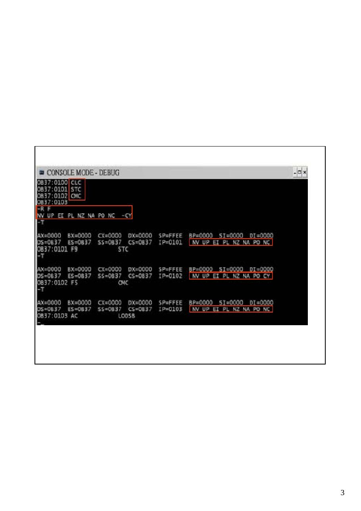
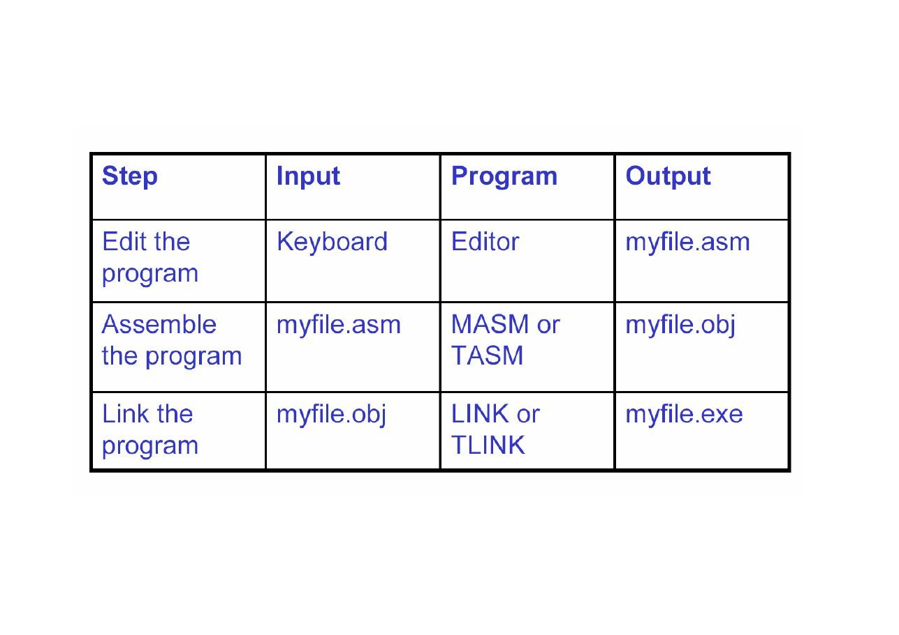

Bu yazı, Başkent Üniversitesi **EEM332 Mikroişlemciler** ders arşivindeki ilgili notları ve uygulamaları bir araya getiriyor (2005–2015). Assembly programının yapısı, çevirme ve bağlama adımları, yığın, yordamlar ve dizge işlemleri. Belgelerin PDF arşiv kopyaları ve varsa kaynak kodları yazının sonunda ZIP olarak indirilebilir.

## cpu07_08


Stack operation The stack is a section of read/write memory (RAM) used by the CPU to store information temporarily. CPU needs this storage area since there are only limited number of registers.

### STACK: PUSHING AND POPPING OPERATIONS

What is a stack, and why is it needed? How stacks are accessed

- SS (stack segment) and SP (stack pointer) must be loaded to access stack in

the memory. Every register in the CPU (except segment registers and SP) can be stored in the stack and loaded from the stack.

- Pushing onto the stack:

Storing the CPU register

```asm
in the stack is called a push.
```

Ex: SP=1236, AX=24B6, DI=85C2, and DX=5F93, show the contents of the stack as each instruction is executed.

Popping the stack Loading the contents of the stack into the CPU register is called a pop. Ex: assume that the stack is shown below, and SP=18FA,


Compare operands       CF   ZF Destination > source   0    0 Destination = source   0    1 Destination < source   1    0


Unconditional Jump -Conditional Jump- ( If-Then While –Do)

```asm
In NEAR the control is transferred within the current code segment
```

(intrasegment). IP is changed.

- In FAR the control is transferred outside the current code segment

(intersegment). Both CS

```asm
and IP are changed.
```


Conditional Jumps

```asm
In the conditional jump, control is transferred to a new location if a certain condition
```

is met. JC (jump if carry) [CF is checked], JNZ (jump if not zero) [ZF is checked].

Note: “above” and “below” refer to the relationship of two unsigned values; “greater” and “less” refer to the relationship of two signed values.


### String and Strin operations


After the transfer of every byte by the MOVSB instruction, both SI and DI registers are incremented automatically once only (notice CLD). The REP (repeat) prefix causes the CX counter to be decremented and MOVSB is

```asm
repeated until CX becomes zero.
```

Ex: Assuming that there is a spelling of “Europe” in an electronic dictionary and a user types in “Euorope”, write a program that compares these two and displays the

### following message, depending on a result

### 1. If they are equal, display “The spelling is correct”

### 2. If they are not equal, display “Wrong Spelling”




## assembly

Running a Program

- Running a program involves several steps:

Executable Code (Machine Language)

### C++

Assembler

Loader Compiler          Object Code (Machine Language)

Assembly Program                                     Library Linker Memory

Assembler

- Reads and Uses Directives

- Directives give instructions to the assembler but

do not produce machine language instructions

- .data, . . .

- Produce Machine Language

- Creates Object File

Language Components of MASM

- Reserved words

- Identifiers

- Predefined symbols

- Constants

- Expressions

- Operators

- Data types

- Registers

- Statements

Reserved Words

- instructions

- operations the processor can execute

- directives

- give commands to the assembler

- operators

- used in expressions such as product+2

- predefined symbols

- return info to your program such as @data

reserved words are not case sensitive, except for the predefined symbols

Identifiers

- a name that you invent and attach to a definition

- can represent variables, constants, procedure

names, segment names, and user-defined data types such as structures

- cannot exceed 247 characters

- the first character can be alphabetic (A-Z), or

@, _ $ ?

- the other characters can by any of the above

characters or a decimal digit (0 - 9)

it’s best to avoid starting an identifier with @, because many predefined symbols begin with @

Some Predefined Symbols

- @code

- returns the name of the code segment

- @data

- returns the name of the data segment

- @Model

- returns the selected memory model

Integer Constants

- an integer constant is a series of one or more

numerals followed by an optional radix specifier

```asm
mov ax, 25
mov ax, 0b3h
```

- 25 and 0b3h are integer constants..h is

a radix specifier

- the default radix is decimal

- b is for binary

- d is for decimal

- h is hex

- q for octal

- hex constants must start with a decimal

digit…if necessary, add a leading zero

Symbolic Constant Expressions

- You can create symbolic integer

constants using the EQU directive

```asm
column EQU 80 ; Constant - 80
row    EQU 25 ; Constant - 25
screen EQU column * row
; Constant - 2000
```

- you cannot change these!

Other Directives

- ASSUME

- tells the assembler which logical segment to use

for each physical segment

- remember that just because I named my

```asm
data segment DATA_HERE, doesn’t tell
```

the assembler that that’s my data segment!

### ASSUME DS:DATA_HERE,

### CS:CODE_HERE

- segment registers other than the code segment

must still be initialized

```asm
mov ax, DATA_HERE
mov ds, ax
```

MASM Directives

- .TITLE

- give the title of the program

- .DOSSEG

- use the MSDOS segment order

- .MODEL small

- use a small memory model

- .8086

- 8086/88 instructions only

- .STACK 0100h

- start stack segment and specify size

- .DATA

- start data segment

- .CODE

- start code segment

- END

- tells the assembler to STOP reading…any instructions after

this will be ignored

- an optional label/address tells the assembler what to use as

the program entry point


