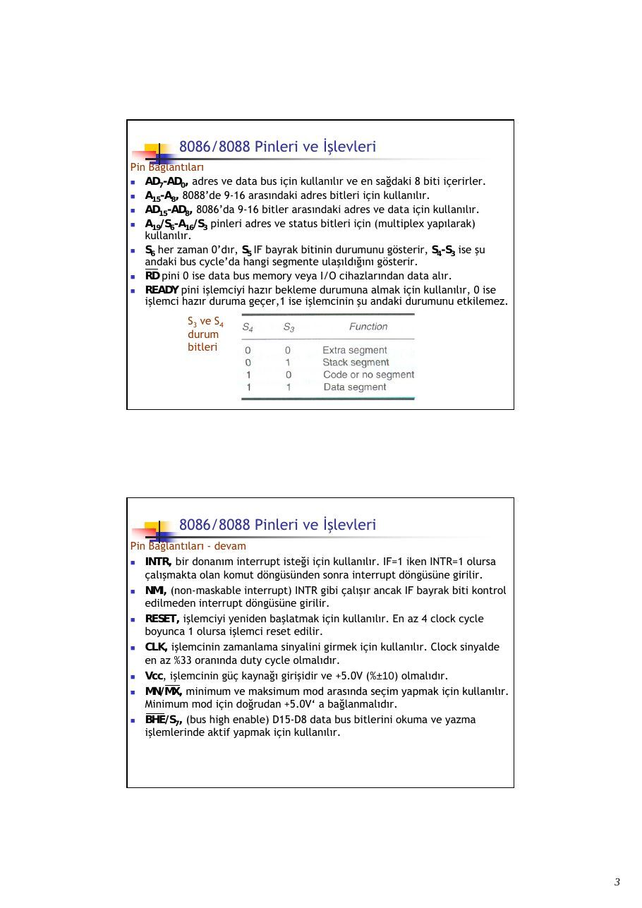
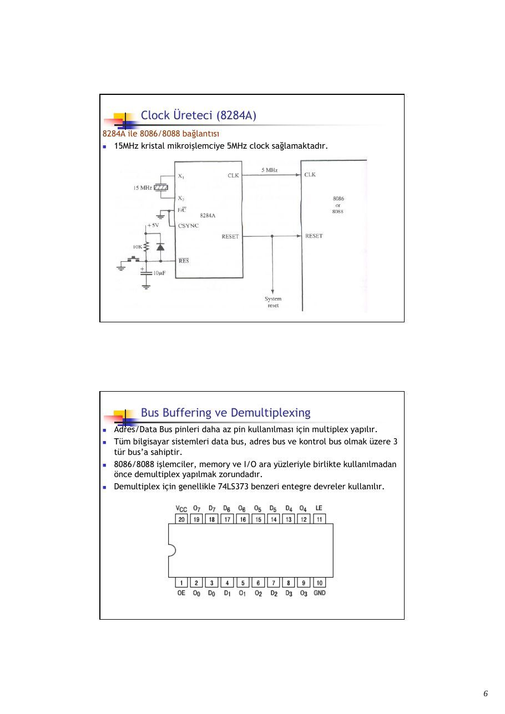
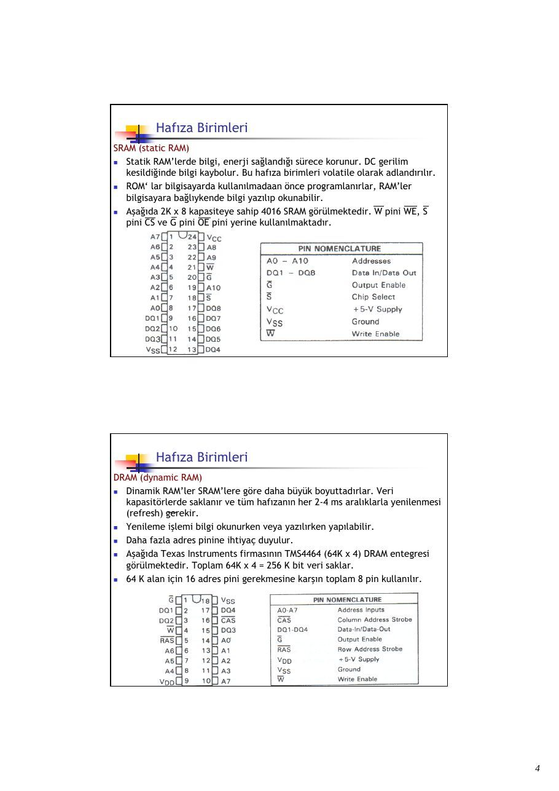
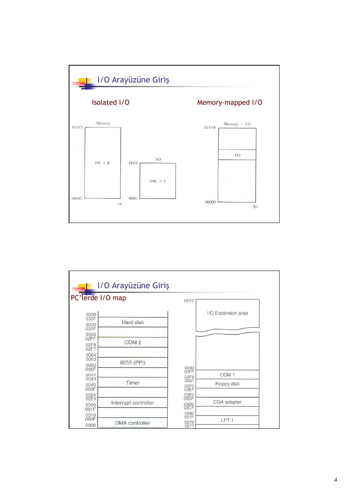

This post brings together the relevant notes and exercises from the Başkent University **EEM332 Microprocessors** course archive (2008–2008). It covers 8086/8088 hardware, address decoding, memory devices, and basic input-output interfacing. Source: Gazi University, M. Ali Akcayol; BİL362 lecture notes. PDF archive copies of the documents and, where available, the source code can be downloaded as a ZIP at the end of the post.

*Note: This content belongs to a third-party source; it is shared for archival and nostalgic purposes with attribution to the source. It will be removed at the request of the rights holder.*

## CPUL9Hardware

BIL 362 Microprocessors

M. Ali Akcayol, Gazi University, Department of Computer Engineering

Topics: 8086/8088 Hardware Features

- 8086/8088 Pins and Their Functions

- Clock Generator (8284A)

- Bus Buffering and Demultiplexing

- Bus Timing

- Minimum and Maximum Mode

- Bus Controller (8288)

- 8088 Connections and Buses

8086/8088 Pins and Their Functions

- The 8086 and 8088 come in a 40-pin dual-in-line (DIP) package.

8086/8088 Pins and Their Functions

- The 8086 is a 16-bit microprocessor with a 16-bit data bus; the 8088 is also a 16-bit

microprocessor but has an 8-bit data bus.

- In the 8086, AD0-AD15 are used for the data bus; in the 8088, AD0-AD7 are used for the data bus. The 8086 performs data transfers more efficiently.

- The 8086 and 8088 processors operate at +5.0V. The 8086 draws a maximum supply current of 360mA and the 8088 draws 340mA.

- In connections to microprocessors, attention must be paid to the current required for an input pin and the output current required for an output pin.

- The voltage and current values for the input and output pins are given below.

Input

Output

8086/8088 Pins and Their Functions: Pin Connections

- AD7-AD0 are used for the address and data bus and contain the rightmost 8 bits.

- A15-A8 are used for address bits 9-16 in the 8088.

- AD15-AD8 are used for address and data for bits 9-16 in the 8086.

- The A19/S6-A16/S3 pins are used (multiplexed) for address and status bits.

- S6 is always 0, S5 shows the state of the IF flag bit, and S4-S3 show which segment is being accessed in the current bus cycle.

- When the RD pin is 0, the data bus receives data from memory or I/O devices.

- The READY pin is used to put the processor into a wait state. When it is 0, the processor enters the wait state; when it is 1, it does not affect the processor's current state. S3 and S4 status bits

8086/8088 Pins and Their Functions: Pin Connections - continued

- INTR is used for a hardware interrupt request. If INTR=1 while IF=1, the interrupt cycle is entered after the instruction cycle in progress.

- NMI (non-maskable interrupt) works like INTR, but the interrupt cycle is entered without checking the IF flag bit.

- RESET is used to restart the processor. If it is held at 1 for at least 4 clock cycles, the processor is reset.

- CLK is used to input the processor's timing signal. The clock signal must have a duty cycle of at least 33%.

- Vcc is the processor's power supply input and must be +5.0V (±10%).

- MN/MX is used to select between minimum and maximum mode. For minimum mode, it must be connected directly to +5.0V.

- BHE/S7 (bus high enable) is used to enable the D15-D8 data bus bits during read and write operations.

8086/8088 Pins and Their Functions: Pin Connections – continued – minimum mode pins

- IO/M or M/IO selects memory or I/O in 8088 and 8086 processors, respectively.

- WR indicates that the 8086/8088 processor is sending data to memory or an I/O device. When it is 0, the data bus holds valid data for memory or I/O.

- INTA indicates that the interrupt arriving at the INTR input pin has been acknowledged.

- ALE (address latch enable) selects between address and data on the address/data bus in 8086/8088 processors. When it is 1, it indicates that address information is on the address/data bus.

- DT/R (data transmit/receive) indicates whether data is being transmitted (1) or received (0) on the data bus.

- SS0, together with IO/M and DT/R, is used to decode the function of the current bus cycle (8088).

8086/8088 Pins and Their Functions: Pin Connections – continued – maximum mode pins

- S2, S1, S0 indicate the function of the current bus cycle. They are decoded by a bus controller (8288).

- RQ/GT1 and RQ/GT0 are used for DMA (direct memory access) requests when operating in maximum mode. They are bidirectional (request and grant are performed).

- QS1 and QS0 (queue status) indicate the status of the instruction queue.

```asm
Clock Üreteci (8284A)
```

- The 8284A clock generator is a support component for 8086/8088 microprocessors.

- It basically performs the functions of clock generation, RESET synchronization, READY synchronization, and generating a peripheral clock signal at TTL (Transistor–Transistor Logic) level.

- It has a total of 18 pins and is designed specifically for use with 8086/8088 processors.

```asm
Clock Üreteci (8284A)
```

Pin functions

- AEN1 and AEN2 (address enable) are used to qualify the bus ready signals (RDY1 and RDY2).

- RDY1 and RDY2 (bus ready), together with AEN1 and AEN2, are used to put the 8086/8088 processor into a wait state.

- READY is an output pin and is connected to the READY input of the 8086/8088.

- X1 and X2 are used for the crystal oscillator connection.

- EFI (External Frequency Input): when selected, the clock signal is generated by an external input.

- F/C (Frequency/Clock): when 0, the clock signal is generated by the 8284A; when 1, the clock signal is generated by EFI.

- CLK is the clock signal output and is connected to the clock input of the 8086/8088.

- RES (reset input) starts the reset operation when it is 0.

- RESET (reset output) is connected to the RESET input of the 8086/8088.

```asm
Clock Üreteci (8284A)
```

8284A to 8086/8088 connection

- A 15MHz crystal provides a 5MHz clock to the microprocessor.

Bus Buffering and Demultiplexing

- The address/data bus pins are multiplexed in order to use fewer pins.

- All computer systems have 3 types of buses: the data bus, the address bus, and the control bus.

- 8086/8088 processors must be demultiplexed before being used with memory and I/O interfaces.

- ICs such as the 74LS373 are generally used for demultiplexing.

Bus Buffering and Demultiplexing

- When LE (latch enable) is 1, it enables the D flip-flops; when OE (output enable) is 1, it puts the output into high impedance.

- The truth table is as follows.

8088 demultiplexing

8086 demultiplexing

8088 buffer

uni-directional

bi-directional

uni-directional

bi-directional

8086 buffer

Bus Timing

- The data, address, and control buses are used in data write and read operations.

- If data is to be written to memory, the data to be written is sent on the data bus, the location to be written is sent on the address bus, and the control signals are sent on the control bus.

- WR (0) and IO/M (0) (for the 8088) or M/IO (1) (for the 8086) must be used as control signals.

Data Write

Bus Timing

- If a read is to be performed, the location to be read is sent on the address bus.

- With the RD control signal, the data to be read is received on the data bus.

Data Read

Minimum and Maximum Mode

- The 8086/8088 can operate in two modes: minimum and maximum.

- If the MN/MX select pin is connected to +5.0V, minimum mode is selected; if it is connected to ground, maximum mode is selected.

- Maximum mode is designed for systems that use coprocessors.

- Processors from the 80286 onward have no maximum mode.

- In minimum mode, all control signals are generated by the microprocessor, and it is inexpensive in terms of cost.

- In maximum mode, some control signals are generated externally, and the cost is higher.

- In maximum mode, an external bus controller is used and generates the bus control signals.

8088 minimum mode

8088 maximum mode

Bus Controller (8288)

- In maximum mode operation, the control signals are generated by the 8288 instead of the 8086/8088.

- It takes the S0, S1, and S2 outputs as status inputs and generates all the control signals.

Bus Controller (8288)

- The 8288 controller inputs and the control signals it generates are as follows.

- If the S0, S1, and S2 inputs are all 1, the controller goes to the passive state and no command is generated.

Bus Controller (8288) Pin functions

- S0, S1, and S2 are the status inputs. They are connected to the 8086/8088 status outputs.

- CLK is the clock input. It is connected to the CLK output pin of the 8284A clock generator.

- ALE (address latch enable) is used for demultiplexing the address/data bus.

- DEN (data bus enable) controls the bi-directional data bus buffer.

- DT/R (data transmit/receive) is used to select write/read on the data bus.

- With the AEN (address enable) input, the 8288 enables the memory control signals.

- With the CEN (control enable) input, the 8288 control output pins are enabled.

Bus Controller (8288) Pin functions

- IOWC (I/O write command) generates a write command for the I/O device.

- IORC (I/O read command) generates a read command for the I/O device.

- MWTC (memory write command) generates a write command for memory.

- MRDC (memory read command) generates a read command for memory.

- INTA (interrupt acknowledge) is the response to an interrupt arriving at the INTR pin.

- IOB (I/O bus mode) selects between I/O bus mode and system bus mode.

8088 Connections and Buses

- The 8259 is an interrupt controller.





## CPUL10Memory

BIL 362 Microprocessors

M. Ali Akcayol, Gazi University, Department of Computer Engineering

Topics: Memory Interfacing

- Memory Devices

- Address Decoding

- 8088 and 80188 Memory Interface (8-bit)

- 8086, 80186, 80286, and 80386SX Memory Interface (16-bit)

- 80386DX and 80486 Memory Interface (32-bit)

- Pentium–Pentium 4 Memory Interface (64-bit)

Memory Devices

- Memory devices are classified as ROM (read-only memory), flash memory (EEPROM), SRAM (Static Random Access Memory), and DRAM (Dynamic Random Access Memory).

- A memory device has address connections, data connections, selection connections, and control connections.

- The number of address pins determines the number of memory rows, and the number of data pins determines the number of bits written to a location. Selection connections (CS, CE, S, etc.) enable the chip for writing/reading. There can be one control pin (R/W) or two or more (WE, OE).

Memory Devices: ROM (read-only memory)

- It stores programs permanently; its contents are not lost when power is removed (nonvolatile memory).

- PROM (programmable read-only memory) can be programmed once and cannot be erased.

- EPROM (erasable programmable read-only memory) is a type of ROM that can be erased by applying ultraviolet light for about 20 minutes.

- The newer type of RMM (read mostly memory) is called flash memory. Today, the name flash memory is often used for EEPROM (electrically erasable programmable ROM).

- Flash memory is used in many computer systems to store BIOS memory and video card setup information.

Memory Devices: ROM (read-only memory) - continued

- The 2716 EPROM is shown below. It has 11 inputs and 8 outputs.

- The 2716 is a 2Kx8 read-only memory device.

Memory Devices: ROM (read-only memory) - continued

- The timing diagram for the 2716 EPROM is as follows.

- First, the address information is sent to the address pins.

- Then the chip is enabled with the CS input (logic 0).

- After a certain delay (at most 120 ns), the data at the corresponding address is read from the output pins.

- The most important criterion is the time elapsed between entering the address information and reading the data. For the 2716, the maximum delay is 450 ns.

Memory Devices: SRAM (static RAM)

- In static RAMs, information is retained as long as power is supplied. When the DC voltage is removed, the information is lost. These memory devices are called volatile.

- ROMs are programmed before being used in a computer, whereas RAMs can be written to and read from while connected to the computer.

- The 4016 SRAM, with a capacity of 2K x 8, is shown below. The W pin is used in place of WE, the S pin in place of CS, and the G pin in place of OE.

Memory Devices: DRAM (dynamic RAM)

- Dynamic RAMs are larger than SRAMs. Data is stored in capacitors, and the entire memory must be refreshed at intervals of 2-4 ms.

- The refresh operation can be performed while information is being read or written.

- More address pins are needed.

- The TMS4464 (64K x 4) DRAM IC from Texas Instruments is shown below. It stores a total of 64K x 4 = 256 Kbit of data.

- Although 16 address pins would be required for 64K locations, a total of only 8 pins are used.

Memory Devices: DRAM (dynamic RAM) - continued

- Addressing in DRAMs is done in two stages, row and column.

- RAS (row address strobe) is used for row address selection and CAS (column address strobe) for column address selection.

- The 74157 shown alongside performs the two-stage address selection.

- RAS both indicates the row address and determines which part of the address inputs is selected. For RAS=1 the B inputs are selected, and for RAS=0 the A inputs are selected.

Memory Devices: DRAM (dynamic RAM) - continued

- The 41256 DRAM (256K x 1) is shown below. It stores a total of 256K bits and requires 70ns for data access.

- DRAMs are manufactured in larger sizes (1M x 1, 4M x 1, 16M x 1, and 64M x 1).

- DRAM memory devices are placed on small circuit boards and are called SIMMs (Single in-line Memory Modules).

- 30-pin SIMM modules are organized as 1M x 8, 1M x 9, 4M x 8, and 4M x 9. 72-pin SIMM modules are organized as 1M x 32, 1M x 36, 2M x 32, 4M x 32, 8M x 32, and 16M x 32.

Memory Devices: DRAM (dynamic RAM) - continued

- A 30-pin SIMM module (4M x 9) is shown below.

Memory Devices: DRAM (dynamic RAM) - continued

- A 72-pin SIMM module (4M x 36) is shown below.

Memory Devices: DRAM (dynamic RAM) - continued

- 64-bit wide DIMMs (Dual in-line Memory Modules) are used in Pentium processors.

- They are generally organized as 16MByte (2M x 64), 32 MByte (4M x 64), 64MByte (8M x 64), and 128 MByte (16M x 64).

- A 168-pin DIMM module is shown below.

Address Decoding

- Address decoding allows a desired location in memory to be selected using the address generated by the processor.

- The 8088 microprocessor generates a 20-bit address. If a 2716 EPROM is used, 11-bit addressing is needed. Decoding is also used to resolve incompatibilities between the processor and the memory device.

- If a 2K x 8 EPROM is used, the A10-A0 address pins of the 8088 processor are connected to the A10-A0 pins of the EPROM. The remaining address pins (A19-A11) are connected to a NAND gate.

Address Decoding

- If all of the A19-A11 inputs are 1 and the IO/M input is 0 (M active), the CE input becomes 0 (enabled).

- The processor's RD connection is connected to the OE input and the read operation can begin.

- The address range is (since the pattern is 1111 1111 1XXX XXXX XXXX) 1111 1111 1000 0000 0000-1111 1111 1111 1111 1111 (FF800H-FFFFFH).

Address Decoding: 3-to-8 decoder

- ICs such as the 74LS138 convert 3 inputs to 8 outputs.

- The G2A (0), G2B (0), and G1 (1) inputs must be active.

- The truth table is shown alongside.

Address Decoding: Example decoder

- A decoder connected to eight 2764 (8K x 8) EPROMs is shown below.

- When A19-A16 are active (1), it addresses the range F0000H-FFFFFH (64KB).

8088 and 80188 Memory Interface (8-bit)

- 8088/80188 processors have an 8-bit data bus and 8-bit memory is used.

- The processor's RD, WR, and IO/M signals must also be used.

- The connection of a 27256 EPROM (32K x 8) to an 8088 is shown below.

- The address range is E8000H-FFFFFH and the total memory is 96KByte.

8086, 80186, 80286, and 80386SX Memory Interface (16-bit)

- The address is 20 bits wide in 8086/80186 processors and 24 bits wide in 80286/80386SX processors.

- 80286 and 80386SX processors have the MWRC and MRDC control signals instead of RD and WR.

- A memory organization with 2 banks is shown below.

16-bit data bus and 24-bit address

Ao

Using an 80386SX processor

### Address range

### 000000H – 0FFFFFH

512K x 16 1024K x

Ao

80386DX and 80186 Memory Interface (32-bit)

- 80386DX and 80486 processors have a 32-bit data bus. Memory is built using 4 banks.

- 80386DX and 80486 processors have a 32-bit address width.

- A memory organization with 4 banks is shown below.

64K x 8

32-bit data bus 32-bit address 512KByte SRAM

Pentium–Pentium 4 Memory Interface (64-bit)

- Pentium processors have a 64-bit data bus. 8 banks are used.

64K x 8

64-bit data bus 32-bit address 512KByte EPROM



## CPUL11I_O

BIL 362 Microprocessors

M. Ali Akcayol, Gazi University, Department of Computer Engineering

Topics: Basic I/O Interfacing

- Introduction to I/O Interfacing

- I/O Port Address Decoding

- Programmable Peripheral Interface

- Analog-to-Digital and Digital-to-Analog Converters

Introduction to I/O Interfacing

- Microprocessors have an instruction for transferring data to an I/O device (OUT) and an instruction for receiving data from an I/O device (IN).

- In 80186 and higher processors, the OUTS and INS instructions perform string data transfers between memory and I/O devices.

- The IN and OUT instructions transfer data between the I/O device and the microprocessor accumulator (AL, AX, EAX).

- The I/O address is stored as 16 bits in the DX register, or given as an 8-bit immediate immediately after the opcode.

Introduction to I/O Interfacing

- When data is transferred with the IN and OUT instructions, the I/O address (port number) is sent on the address bus.

- The I/O interface decodes the port number (just as the memory interface decodes the memory address).

- The first 256 port addresses (00H-FFH) are accessed with either an immediate operand or DX, and the port addresses between 0100H-FFFFH are accessed with the DX register.

- For the ISA (industry standard architecture) bus, I/O addresses between 0000H-03FFH are used.

### DX

### DX

### DX

Introduction to I/O Interfacing: Isolated and memory-mapped I/O

- In the isolated I/O approach, the IN, INS, OUT, and OUTS instructions transfer data between the microprocessor accumulator or memory and the I/O device.

- In the memory-mapped I/O approach, the IN, INS, OUT, and OUTS instructions are not used; instead, any instruction that transfers data between memory and the microprocessor can be used.

- The addresses (ports) of isolated I/O devices lie outside memory, and data transfer between the I/O and the microprocessor is performed with the IN, INS, OUT, and OUTS instructions.

- The IN, INS, OUT, and OUTS instructions are not used to access memory-mapped I/O devices. Instructions that transfer data between memory and the microprocessor are used.

- An area within memory is set aside for I/O devices.

Introduction to I/O Interfacing

Isolated I/O           Memory-mapped I/O

Introduction to I/O Interfacing: I/O map in PCs

Introduction to I/O Interfacing: Basic Input/Output Interfaces

- A three-state buffer is used for input.

Introduction to I/O Interfacing: Basic Input/Output Interfaces

- The connection interface for output is as follows.

Introduction to I/O Interfacing: Input Devices

Output Devices

I/O Port Address Decoding

- I/O port address decoding is the same as memory address decoding, especially for memory-mapped I/O.

- The number of address pins used in decoding differs for isolated I/O.

- For memory, 32, 24, or 20 address bits are decoded. For isolated I/O, a 16-bit address is decoded.

I/O Port Address Decoding: 8-bit I/O address decoding

- I/O instructions that address with an immediate operand perform 8-bit addressing (addresses between 0000H-00FFH).

- If the system will not use more than 256 devices, only the A7-A0 address connections are used.

- The figure below shows a decoder that addresses the range F0H-F7H.

I/O Port Address Decoding: 16-bit I/O address decoding

- In 16-bit address decoding, all of the bits A15-A0 are used.

I/O Port Address Decoding: 32-bit

### I/O

Programmable Peripheral Interface

- The 82C55 programmable peripheral interface is the most commonly used component.

- It has a total of 24 I/O pins and can be programmed in groups.

- The 82C55 is used in keyboard and parallel port interfaces.

- It has 3 ports: A, B, and C.

- The A1 and A0 pins are used for port selection.

Programmable Peripheral Interface

- The connection of an 82C55 to an 80386SX for 8-bit I/O port addressing is shown alongside.

- C0H (port A)

- C2H (port B)

- C4H (port C)

- C6H (command register)

Analog-to-Digital and Digital-to-Analog Converters

- ADC and DAC devices are used so that the microprocessor can process analog values.

- The DAC0830 digital-to-analog converter is shown below.

- The DAC0830 is an 8-bit converter. It expresses the reference voltage at the VREF input in 255 steps across 256 different levels.

- 10-bit DAC devices produce output at 1024 different levels.

- For an input of 1001 0010, it produces an output of +2.862V.

Analog-to-Digital and Digital-to-Analog Converters

- The ADC0804 8-bit converter is shown below.

- The INTR output is used to indicate that the conversion has finished.

- The analog input is applied at the VI+ and VI- pins.


