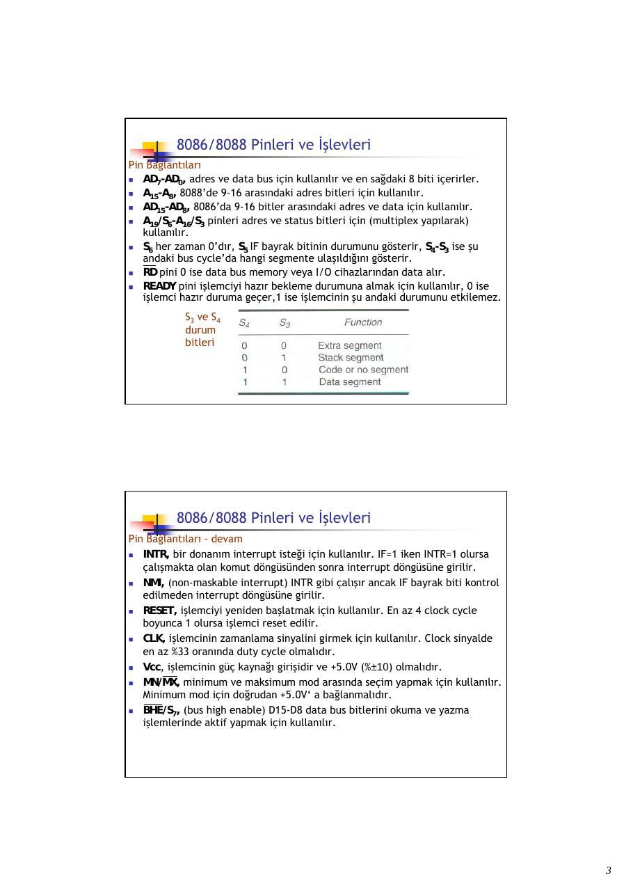
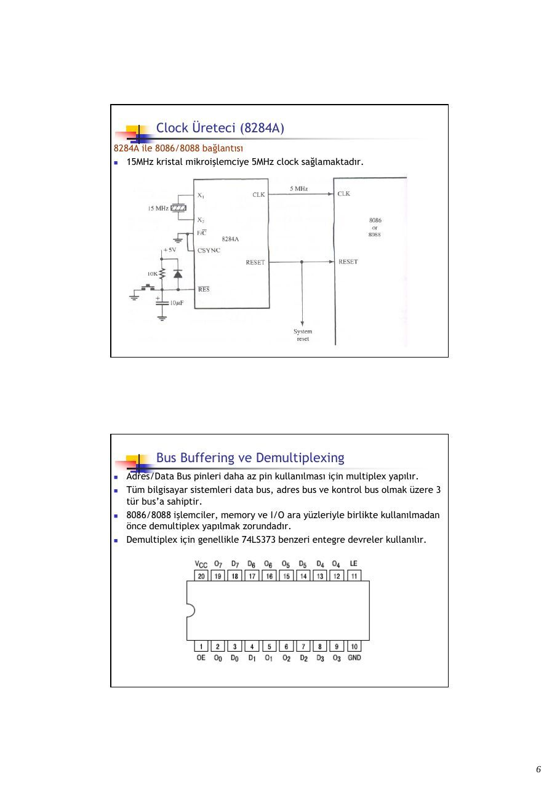
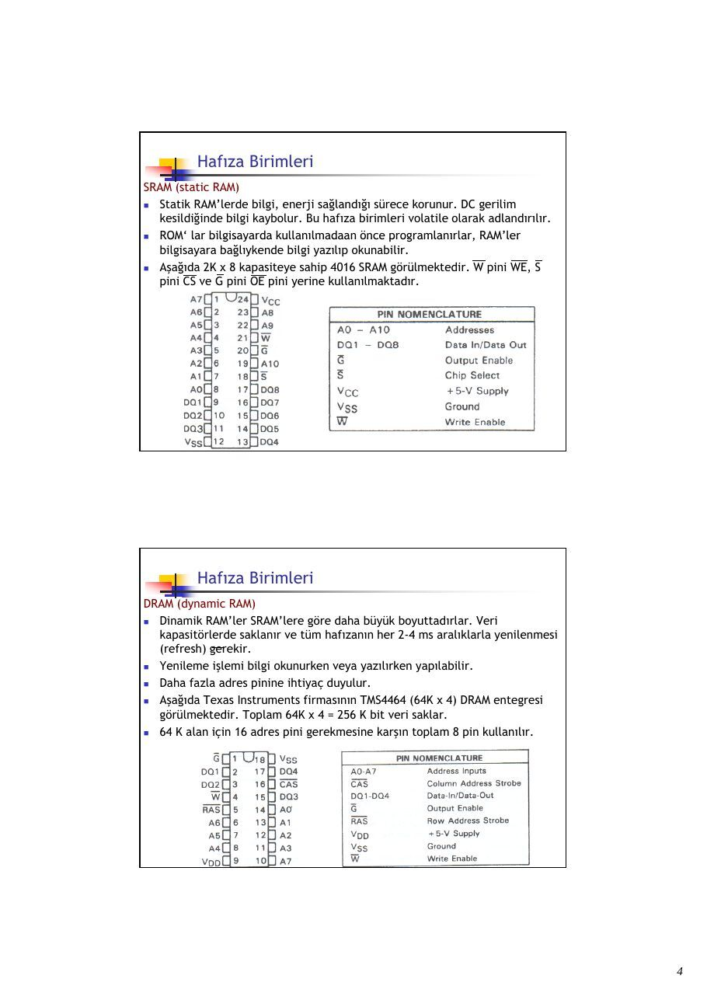
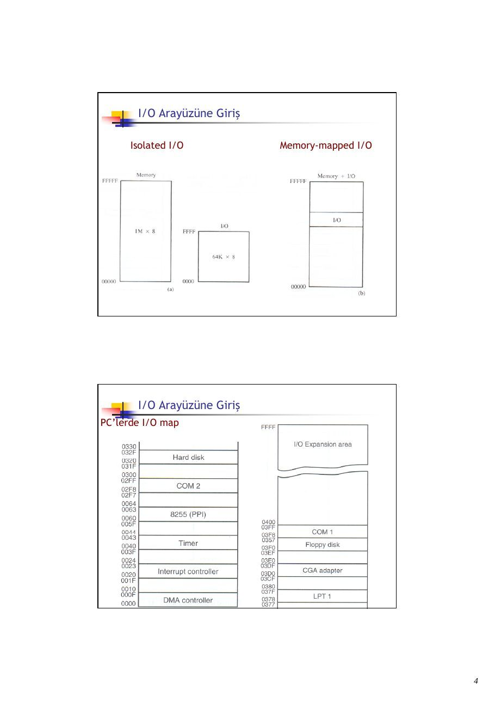

Bu yazı, Başkent Üniversitesi **EEM332 Mikroişlemciler** ders arşivindeki ilgili notları ve uygulamaları bir araya getiriyor (2008–2008). 8086/8088 donanımı, adres çözümleme, hafıza birimleri ve temel giriş-çıkış arayüzü. Kaynak: Gazi Üniversitesi, M. Ali Akcayol; BİL362 ders notları. Belgelerin PDF arşiv kopyaları ve varsa kaynak kodları yazının sonunda ZIP olarak indirilebilir.

*Bu içerik üçüncü taraf bir kaynağa aittir; arşiv ve nostalji amacıyla kaynak belirtilerek paylaşılmıştır. Hak sahibinin talebi hâlinde kaldırılır.*

## CPUL9Hardware

BIL 362 Mikroişlemciler

M.Ali Akcayol Gazi Üniversitesi Bilgisayar Mühendisliği Bölümü

Konular 8086/8088 Donanım Özellikleri

- 8086/8088 Pinleri ve İşlevleri

- Clock Üreteci (8284A)

- Bus Buffering ve Demultiplexing

- Bus Timing

- Minimum ve Maksimum Mod

- Bus Denetleyici (8288)

- 8088 Bağlantıları ve Bus’lar

8086/8088 Pinleri ve İşlevleri

- 8086 ve 8088 40 pin ve dual-in-line (DIP) paketi şeklindedir.

8086/8088 Pinleri ve İşlevleri

- 8086 16-bit mikroişlemcidir ve 16-bit data bus’a sahiptir, 8088’de 16-bit

mikroişlemcidir ancak 8-bit data bus’a sahiptir.

- 8086’da AD0-AD15 data bus için kullanılır, 8088’de AD0-AD7 data bus için

kullanılır. 8086 daha etkin data transferi yapar.

- 8086 ve 8088 işlemciler +5.0V ile çalışır. 8086 360mA ve 8088 340mA

maksimum kaynak akımı kullanır.

- Mikroişlemcilere yapılan bağlantılarda giriş pini için gereken akıma ve çıkış

pini için gereken çıkış akımına dikkat edilmelidir.

- Aşağıda giriş ve çıkış pinleri için gerilim ve akım değerleri verilmiştir.

Giriş

Çıkış

8086/8088 Pinleri ve İşlevleri Pin Bağlantıları

- AD7-AD0, adres ve data bus için kullanılır ve en sağdaki 8 biti içerirler.

- A15-A8, 8088’de 9-16 arasındaki adres bitleri için kullanılır.

- AD15-AD8, 8086’da 9-16 bitler arasındaki adres ve data için kullanılır.

- A19/S6-A16/S3 pinleri adres ve status bitleri için (multiplex yapılarak)

kullanılır.

- S6 her zaman 0’dır, S5 IF bayrak bitinin durumunu gösterir, S4-S3 ise şu

```asm
andaki bus cycle’da hangi segmente ulaşıldığını gösterir.
```

- RD pini 0 ise data bus memory veya I/O cihazlarından data alır.

- READY pini işlemciyi hazır bekleme durumuna almak için kullanılır, 0 ise

işlemci hazır duruma geçer,1 ise işlemcinin şu andaki durumunu etkilemez. S3 ve S4 durum bitleri

8086/8088 Pinleri ve İşlevleri Pin Bağlantıları - devam

- INTR, bir donanım interrupt isteği için kullanılır. IF=1 iken INTR=1 olursa

çalışmakta olan komut döngüsünden sonra interrupt döngüsüne girilir.

- NMI, (non-maskable interrupt) INTR gibi çalışır ancak IF bayrak biti kontrol

edilmeden interrupt döngüsüne girilir.

- RESET, işlemciyi yeniden başlatmak için kullanılır. En az 4 clock cycle

boyunca 1 olursa işlemci reset edilir.

- CLK, işlemcinin zamanlama sinyalini girmek için kullanılır. Clock sinyalde

en az %33 oranında duty cycle olmalıdır.

- Vcc, işlemcinin güç kaynağı girişidir ve +5.0V (%±10) olmalıdır.

- MN/MX, minimum ve maksimum mod arasında seçim yapmak için kullanılır.

Minimum mod için doğrudan +5.0V‘ a bağlanmalıdır.

- BHE/S7, (bus high enable) D15-D8 data bus bitlerini okuma ve yazma

işlemlerinde aktif yapmak için kullanılır.

8086/8088 Pinleri ve İşlevleri Pin Bağlantıları – devam – minimum mod pinleri

- IO/M veya M/IO, 8088 ve 8086 işlemcilerde memory veya I/O seçimi yapar.

- WR, 8086/8088 işlemcinin memory veya I/O cihazına data gönderdiğini

gösterir. 0 ise data bus, memory veya I/O için geçerli dataya sahiptir.

- INTA, INTR giriş pininden gelen interrupt’ın algılandığını gösterir.

- ALE, (adres latch enable) 8086/8088 işlemcilerde adres/data bus seçimini

yapar. 1 ise adres/data bus üzerinde adres bilgisi olduğunu gösterir.

- DT/R, (data transmit/receive) data bus’ta veri gönderildiğini(1) veya

alındığını(0) gösterir.

- SS0, IO/M ve DT/R ile birlikte

şimdiki bus cycle’nın fonksiyonunu çözümlemek için kullanılır (8088).

8086/8088 Pinleri ve İşlevleri Pin Bağlantıları – devam – maksimum mod pinleri

- S2,S1,S0, şimdiki bus cycle’ın fonksiyonunu gösterir. Bir bus denetleyici

(8288) tarafından çözülür.

- RQ/GT1 ve RQ/GT0, maksimum modda çalışırken DMA (direct memory

access) isteği için kullanılırlar. İki yönlüdürler(request ve grant yapılır.)

- QS1 ve QS0, (queue status) komut kuyruğunun durumunu gösterir.

```asm
Clock Üreteci (8284A)
```

- 8284A clock üreteci 8086/8088 mikroişlemciler için yardımcı elemandır.

- Temel olarak clock üretme, RESET senkronizasyonu, READY

senkronizasyonu ve TTL (Transistor–Transistor Logic ) seviyesinde çevre birim clock sinyali üretme fonksiyonlarını gerçekleştirir.

- Toplam 18 pine sahiptir ve özellikle 8086/8088 işlemcilerle birlikte

kullanılmak için tasarlanmıştır.

```asm
Clock Üreteci (8284A)
```

Pin fonksiyonları

- AEN1 ve AEN2, (address enable) bus hazır sinyallerini (RDY1 ve RDY2)

sağlamak için kullanılırlar.

- RDY1 ve RDY2, (bus ready) AEN1 ve AEN2 ile birlikte 8086/8088 işlemciyi

bekleme durumuna almak için kullanılırlar.

- READY, çıkış pinidir ve 8086/8088 READY girişine bağlıdır.

- X1 ve X2, kristal osilatör bağlantısı için kullanılır.

- EFI, (External Frequency Input) 1 ise clock sinyalin external bir giriş

tarafından üretileceğini belirler.

- F/C, (Frequency/Clock) 0 ise clock sinyalin 8284A tarafından üretileceği, 1

ise clock sinyalin EFI tarafından üretileceği seçilmiş olur.

- CLK, clock sinyal çıkışıdır ve 8086/8088 clock girişine bağlanır.

- RES, (reset input) 0 olduğunda reset işlemi başlatır.

- RESET, (reset output) 8086/8088 RESET girişine bağlıdır.

```asm
Clock Üreteci (8284A)
```

8284A ile 8086/8088 bağlantısı

- 15MHz kristal mikroişlemciye 5MHz clock sağlamaktadır.

Bus Buffering ve Demultiplexing

- Adres/Data Bus pinleri daha az pin kullanılması için multiplex yapılır.

- Tüm bilgisayar sistemleri data bus, adres bus ve kontrol bus olmak üzere 3

tür bus’a sahiptir.

- 8086/8088 işlemciler, memory ve I/O ara yüzleriyle birlikte kullanılmadan

önce demultiplex yapılmak zorundadır.

- Demultiplex için genellikle 74LS373 benzeri entegre devreler kullanılır.

Bus Buffering ve Demultiplexing

- LE, (latch enable) 1 ise D flip-flop’unu aktif yapar, OE (output enable) 1

ise çıkışı yüksek direnç yapar.

- Doğruluk tablosu aşağıdaki gibidir.

8088 demultiplexing

8086 demultiplexing

8088 buffer

uni-directional

bi-directional

uni-directional

bi-directional

8086 buffer

Bus Timing

- Veri yazma ve okuma işlemlerinde data, adres ve kontrol bus’lar kullanılır.

- Eğer hafızaya veri yazılacaksa, yazılacak veri data bus’la, yazılacak yer

adres bus’la ve kontrol işaretleride kontrol bus’la gönderilmelidir.

- Kontrol işareti olarak WR (0) ile IO/M (0) (8088 için) veya M/IO (1) (8086

için) kullanılmalıdır.

Data Write

Bus Timing

- Eğer okuma yapılacaksa okunacak yer adres bus’la gönderilir.

- RD kontrol işaretiyle okunacak veri data bus’la alınır.

Data Read

Minimum ve Maksimum Mod

- 8086/8088 minimum ve maksimum olarak iki modda

çalışabilmektedir.

- MN/MX seçme pini +5.0V ‘a bağlanırsa minimum mod seçilmiş olur,

toprağa bağlandığında ise maksimum mod seçilmiş olur.

- Maksimum mod, yardımcı işlemci kullanılan sistemler için

tasarlanmıştır.

- 80286 ve üstü işlemcilerde maksimum mod yoktur.

- Minimum modda tüm kontrol işaretleri mikroişlemci tarafından

üretilir ve maliyet açısından ucuzdur.

- Maksimum modda bazı kontrol işaretleri external olarak üretilir ve

maliyeti daha fazladır.

- Maksimum modda external bus denetleyici kullanılır ve bus kontrol

işaretlerini üretir.

8088 minimum mod

8088 maksimum mod

Bus Denetleyici (8288)

- Maksimum mod çalışmada kontrol işaretleri 8086/8088 yerine 8288

tarafından üretilir.

- Durum girişleri olarak S0,S1 ve S2 çıkışlarını alır ve tüm kontrol

işaretlerini üretir.

Bus Denetleyici (8288)

- 8288 denetleyici girişleri ve üretilen kontrol işaretleri aşağıdaki

gibidir.

- S0, S1 ve S2 girişlerinin tümüde 1 olursa pasif duruma geçilmekte ve

komut üretilmemektedir.

Bus Denetleyici (8288) Pin fonksiyonları

- S0,S1 ve S2, durum girişleri. 8086/8088 durum çıkışlarına bağlıdır.

- CLK, clock girişi. 8284A clock üretecinin CLK çıkış pinine bağlıdır.

- ALE, (address latch enable) adres/data bus arasında demultiplex

için kullanılır.

- DEN, (data bus enable) bi-directional data bus buffer’ı kontrol eder.

- DT/R, (data transmit/receive) data bus üzerinden yazma/okuma

seçimi için kullanılır.

- AEN, (address enable) girişiyle 8288 memory kontrol sinyallerini

etkin yapar.

- CEN, (control enable) girişiyle 8288 kontrol çıkış pinleri aktif yapılır.

Bus Denetleyici (8288) Pin fonksiyonları

- IOWC, (I/O write command) I/O cihazı için write komutu üretir.

- IORC, (I/O read command) I/O cihazı için read komutu üretir.

- MWTC, (memory write command) memory için write komutu üretir.

- MRDC, (memory read command) memory için read komutu üretir.

- INTA, (interrupt acknowledge) INTR pininden gelen interrupt’a

cevap bilgisidir.

- IOB, (I/O bus mode) I/O bus mod ile system bus mod arasında seçim

yapar.

8088 Bağlantıları ve Bus’lar

- 8259 interrupt denetleyicisidir.





## CPUL10Memory

BIL 362 Mikroişlemciler

M.Ali Akcayol Gazi Üniversitesi Bilgisayar Mühendisliği Bölümü

Konular Hafıza Arayüzü

- Hafıza Birimleri

- Adres Çözümleme

- 8088 ve 80188 Hafıza Arayüzü (8-bit)

- 8086, 80186, 80286 ve 80386SX Hafıza Arayüzü (16-bit)

- 80386DX ve 80486 Hafıza Arayüzü (32-bit)

- Pentium–Pentium 4 Hafıza Arayüzü (64-bit)

Hafıza Birimleri

- Hafıza elemanları ROM (read-only memory), flash memory (EEPROM), SRAM

(Static Random Access Memory) ve DRAM (Dynamic Random Access Memory) olarak sınıflandırılır.

- Bir hafıza elemanın adres bağlantıları, data bağlantıları, seçme bağlantıları

ve kontrol bağlantıları bulunur.

- Adres pin sayısı hafıza satır sayısını, data pin sayısı bir alana yazılacak bit

sayısını belirler. Seçme bağlantıları (CS, CE, S, vb) chip‘i yazma/okuma için aktif yapar. Kontrol pinleri bir tane (R/W), iki veya daha fazla (WE, OE) olabilir.

Hafıza Birimleri ROM (read-only memory)

- Programları sürekli olarak saklar, enerji kesildiğinde kaybolmaz

(nonvolatile memory).

- PROM (programmable read-only memory) bir kez programlanabilir

ve silinemez.

- EPROM (erasable programmable read-only memory) bir tür ROM

hafızadır ve yaklaşık 20 dakika ultraviyole ışını uygulanarak silinebilmektedir.

- Yeni tip RMM (read mostly memory) flash memory olarak

adlandırılır. Günümüzde flash memory adı sıklıkla EEPROM (electrically erasable programmable ROM) için kullanılır.

- Flash memory birçok bilgisayar sisteminde BIOS memory ve video

kartı setup bilgilerini saklamak için kullanılır.

Hafıza Birimleri ROM (read-only memory) - devam

- Aşağıda 2716 EPROM görülmektedir. 11 giriş ve 8 çıkış vardır.

- 2716, 2Kx8 read-only hafıza elemanıdır.

Hafıza Birimleri ROM (read-only memory) - devam

- 2716 EPROM için zamanlama (timing diagram) aşağıdaki gibidir.

- Öncelikle adres bilgisi adres pinlerine gönderilir.

- Ardından CS girişiyle (Lojik 0) chip etkin hale getirilir.

- Belirli bir gecikmeden sonra (en fazla 120 ns) çıkış pinlerinden ilgili

adresteki veri okunur.

- En önemli ölçüt adres bilgisinin girilmesinden sonra verinin okunması için

geçen süredir. 2716 için en fazla 450 ns gecikme vardır.

Hafıza Birimleri SRAM (static RAM)

- Statik RAM’lerde bilgi, enerji sağlandığı sürece korunur. DC gerilim

kesildiğinde bilgi kaybolur. Bu hafıza birimleri volatile olarak adlandırılır.

- ROM‘ lar bilgisayarda kullanılmadaan önce programlanırlar, RAM’ler

bilgisayara bağlıykende bilgi yazılıp okunabilir.

- Aşağıda 2K x 8 kapasiteye sahip 4016 SRAM görülmektedir. W pini WE, S

pini CS ve G pini OE pini yerine kullanılmaktadır.

Hafıza Birimleri DRAM (dynamic RAM)

- Dinamik RAM’ler SRAM’lere göre daha büyük boyuttadırlar. Veri

kapasitörlerde saklanır ve tüm hafızanın her 2-4 ms aralıklarla yenilenmesi (refresh) gerekir.

- Yenileme işlemi bilgi okunurken veya yazılırken yapılabilir.

- Daha fazla adres pinine ihtiyaç duyulur.

- Aşağıda Texas Instruments firmasının TMS4464 (64K x 4) DRAM entegresi

görülmektedir. Toplam 64K x 4 = 256 K bit veri saklar.

- 64 K alan için 16 adres pini gerekmesine karşın toplam 8 pin kullanılır.

Hafıza Birimleri DRAM (dynamic RAM) - devam

- DRAM’lerde adresleme satır ve sütun

olarak iki aşamalı yapılır.

- RAS (row address strobe) satır adresi

seçimi ve CAS (column address strobe) sütun adresi seçimi için kullanılır.

- Yandaki 74157 ile iki aşamalı

adres seçimi yapılır.

- RAS hem satır adresini göstermekte

hem de adres girişlerinin hangi kısmının seçileceğini belirlemektedir. RAS=1 için B’ler, RAS=0 için A’lar seçilir.

Hafıza Birimleri DRAM (dynamic RAM) - devam

- Aşağıda 41256 DRAM (256K x 1) görülmektedir. Toplam 256K bit

saklamaktadır ve veriye erişim için 70ns gerektirir.

- Daha yüksek boyutlarda (1M x 1, 4M x 1, 16M x 1 ve 64M x 1) DRAM’ler

üretilmektedir.

- DRAM hafıza elemanları küçük devreler üzerine yerleştirilirler ve

SIMMs(Single in-line Memory Modules) olarak adlandırılırlar.

- 30-pin SIMM modüller 1M x 8, 1M x 9, 4M x 8, 4M x 9 olarak organize

edilirler. 72-pin SIMM modüller 1M x 32, 1M x 36, 2M x 32, 4M x 32, 8M x 32, 16M x 32 olarak organize edilirler.

Hafıza Birimleri DRAM (dynamic RAM) - devam

- Aşağıda 30-pin SIMM modül (4M x 9) görülmektedir.

Hafıza Birimleri DRAM (dynamic RAM) - devam

- Aşağıda 72-pin SIMM modül (4M x 36) görülmektedir.

Hafıza Birimleri DRAM (dynamic RAM) - devam

- Pentium işlemcilerde 64-bit genişliğinde DIMMs (Dual in-line Memory

Modules) kullanılmaktadır.

- Genel olarak 16MByte (2M x 64), 32 MByte (4M x 64), 64MByte (8M x 64) ve

128 MByte (16M x 64) olarak organize edilirler.

- Aşağıda 168-pin DIMM modül görülmektedir.

Adres Çözümleme

- Adres çözümleme (decoding) işlemcinin ürettiği adres ile hafızada istenen

bir alanın seçilmesini sağlar.

- 8088 mikroişlemci 20-bit adres üretir. Eğer 2716 EPROM kullanılırsa 11-bit

adresleme yapmak gerekir. Decoding işlemi işlemciyle hafıza birimi arasındaki uyumsuzlukları da gidermek amacıyla kullanılır.

- 2K x 8 EPROM kullanılırsa, 8088 işlemcisinin A10-A0 adres pinleri EPROM’un

A10-A0 pinlerine bağlanır. Kalan adres pinleri (A19-A11) bir NAND kapısına bağlanır.

Adres Çözümleme

- A19-A11 girişlerinin tümünün 1 olması ve IO/M girişinin 0 olması (M aktif)

halinde CE girişi 0 olur (etkin).

- İşlemcinin RD bağlantısı OE girişine bağlanır ve okuma işlemi başlatılabilir.

- Adres aralığı ise, (1111 1111 1XXX XXXX XXXX olacağından)

1111 1111 1000 0000 0000-1111 1111 1111 1111 1111 olur(FF800H-FFFFFH).

Adres Çözümleme 3-to-8 adres çözücü

- 74LS138 ve benzeri entegreler 3 girişi 8 çıkışa dönüştürür.

- G2A (0), G2B (0) ve G1 (1) girişlerinin aktif olması gereklidir.

- Doğruluk tablosu yanda görülmektedir.

Adres Çözümleme Örnek adres çözücü

- Aşağıda 8 adet 2764 (8K x 8) EPROM’a bağlı bir çözücü görülmektedir.

- A19-A16 aktif ise (1) F0000H-FFFFFH (64KB) arasında adresleme yapar.

8088 ve 80188 Hafıza Arayüzü (8-bit)

- 8088/80188 işlemciler 8-bit data bus’a sahiptir ve 8-bit hafıza kullanılır.

- Mikroişlemcinin RD, WR ve IO/M işaretlerinin de kullanılması gerekir.

- 27256 EPROM (32K x 8) ile 8088 bağlantısı aşağıda görülmektedir.

- Adres aralığı E8000H-FFFFFH ve toplam hafıza 96KByte’tır.

8086, 80186, 80286 ve 80386SX Hafıza Arayüzü (16-bit)

- 8086/80186 işlemcilerde adres 20-bit, 80286/80386SX işlemcilerde 24-bit

genişliğindedir.

- 80286 ve 80386SX işlemcilerde RD ve WR yerine MWRC ve MRDC kontrol

işaretleri vardır.

- Aşağıda 2 bank halinde hafıza organizasyonu görülmektedir.

16-bit data bus ve 24-bit adres

Ao

80386SX işlemci Kullanılıyor

### Adres aralığı

### 000000H – 0FFFFFH

512K x 16 1024K x

Ao

80386DX ve 80186 Hafıza Arayüzü (32-bit)

- 80386DX ve 80486 işlemciler 32-bit data bus’a sahiptir. Hafıza 4 bank

kullanılarak oluşturulur.

- 80386DX ve 80486 işlemciler 32-bit adres genişliğine sahiptir.

- Aşağıda 4 bank halinde hafıza organizasyonu görülmektedir.

64K x 8

32-bit data bus 32-bit adres 512KByte SRAM

Pentium–Pentium 4 Hafıza Arayüzü (64-bit)

- Pentium işlemciler 64-bit data bus’a sahiptir. 8 bank kullanılır.

64K x 8

64-bit data bus 32-bit adres 512KByte EPROM



## CPUL11I_O

BIL 362 Mikroişlemciler

M.Ali Akcayol Gazi Üniversitesi Bilgisayar Mühendisliği Bölümü

Konular Temel I/O Arayüzü

- I/O Arayüzüne Giriş

- I/O Port Adres Çözümleme

- Programlanabilir Çevrebirim Arayüzü

- Analog-Dijital ve Dijital-Analog Çeviriciler

I/O Arayüzüne Giriş

- Mikroişlemciler I/O cihazına veri aktarmak için (OUT) ve I/O

cihazından veri almak için komutlara (IN) sahiptir.

- 80186 ve üstü işlemcilerde OUTS ve INS komutlarıyla memory

ve I/O cihazı arasında string veri transferi yapılmaktadır.

- IN ve OUT komutları I/O cihazıyla mikroişlemci akümülatör’ü

(AL, AX, EAX) arasında veri transferi yapar.

- I/O adresi DX register’ında 16-bit olarak saklanır. Veya 8-bit

immediate olarak opcode’dan hemen sonra verilir.

I/O Arayüzüne Giriş

- IN ve OUT komutlarıyla veri transferi yapılacağı zaman I/O

adresi (port numarası) adres bus’a gönderilir.

- I/O arayüzü port numarasını çözümler (hafıza arayüzünün

hafıza adresini çözümlediği gibi).

- İlk 256 port adresine (00H-FFH) immediate ve DX ile ve 0100H-

FFFFH arasındaki port adreslerine DX register’ıyla erişilir.

- ISA (industry standart architecture) bus için 0000H-03FFH

arasındaki I/O adresleri kullanılır.

### DX

### DX

### DX

I/O Arayüzüne Giriş Isolated and memory-mapped I/O

- Isolated I/O yaklaşımında IN, INS, OUT ve OUTS komutları

mikroişlemci akümülatörü ve hafıza ile I/O cihazı arasında veri transferi yapar.

- Memory-mapped I/O yaklaşımında IN, INS, OUT ve OUTS

komutları kullanılmaz bunların yerine hafıza ile mikroişlemci arasında veri transferi yapan herhangi bir komut kullanılabilir.

- Isolated I/O cihazlarının adresleri (port) hafızanın dışındadır

ve I/O ile mikroişlemci arasında veri aktarımı IN, INS, OUT ve OUTS komutlarıyla yapılır.

- Memory-mapped I/O cihazlarına erişim için IN, INS, OUT ve

OUTS komutları kullanılmaz. Hafıza ile mikroişlemci arasında veri aktarımı yapan komutlar kullanılır.

- Memory içerisinde bir alan I/O cihazlarına ayrılır.

I/O Arayüzüne Giriş

Isolated I/O           Memory-mapped I/O

I/O Arayüzüne Giriş PC’lerde I/O map

I/O Arayüzüne Giriş Temel Giriş/Çıkış Arayüzleri

- Giriş için three-state buffer kullanılır.

I/O Arayüzüne Giriş Temel Giriş/Çıkış Arayüzleri

- Çıkış için bağlantı arayüzü aşağıdaki gibidir.

I/O Arayüzüne Giriş Giriş Cihazları

Çıkış Cihazları

I/O Port Adres Çözümleme

- I/O port adres çözümleme özellikle memory-mapped I/O için

memory adres çözümlemeyle aynıdır.

- Isolated I/O adresi çözümlemede kullanılan adres pin sayısı

farklıdır.

- Memory için 32, 24 veya 20 adres biti çözümlenir. Isolated I/O

için 16-bit adres çözümlenir.

I/O Port Adres Çözümleme 8-bit I/O adres çözümleme

- Immediate operandla adresleme yapan I/O komutları 8-bit

adresleme yapar (0000H-00FFH arasındaki adresler).

- Eğer sistem 256’dan fazla cihaz kullanmayacaksa sadece A7-

A0 adres bağlantıları kullanılır.

- Aşağıdaki şekilde F0H-F7H arasında adresleme yapan decoder

görülmektedir.

I/O Port Adres Çözümleme 16-bit I/O adres çözümleme

- 16-bit adres çözümlemede A15-A0 arasındaki bitlerin tümü

kullanılır.

I/O Port Adres Çözümleme 32-bit

### I/O

Programlanabilir Çevrebirim Arayüzü

- 82C55 programlanabilir çevrebirim

arayüzü en yaygın kullanılan elemandır.

- Toplam 24 tane I/O pinine sahiptir ve

gruplar halinde programlanabilir.

- 82C55 klavye ve paralel port arayüzünde

kulanılmaktadır.

- A,B ve C olarak 3 porta sahiptir.

- A1 ve A0 pinleri port seçimi için

kullanılır.

Programlanabilir Çevrebirim Arayüzü

- 8-bit I/O port adresleme için 82C55 ile 80386SX bağlantısı

yandadır.

- C0H(port A)

- C2H(port B)

- C4H(port C)

- C6H

(komut reg)

Analog-Dijital ve Dijital-Analog Çeviriciler

- ADC ve DAC elemanları mikroişlemcinin analog değerleri

değerlendirebilmesi amacıyla kullanılır.

- Aşağıda DAC0830 dijital-analog çevirici görülmektedir.

- DAC0830 8-bit çeviricidir. VREF girişindeki referans gerilimi

256 farklı seviyede 255 aralıkla ifade eder.

- 10-bit DAC elemanlar 1024 farklı seviyede çıkış üretirler.

- 1001 0010 girişi için

+2.862V çıkış üretir.

Analog-Dijital ve Dijital-Analog Çeviriciler

- Aşağıda ADC0804 8-bit çevirici görülmektedir.

- INTR çıkışı çevirme işleminin bittiğini göstermek için kullanılır.

- Analog giriş VI+ ve VI- pinlerinden yapılır.


