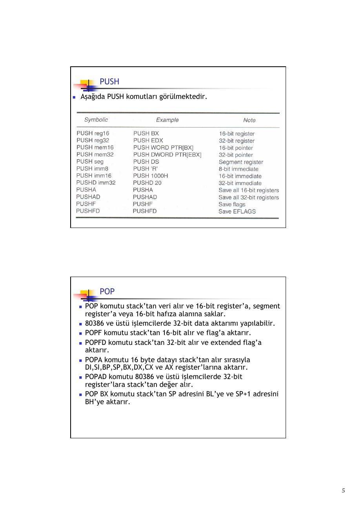
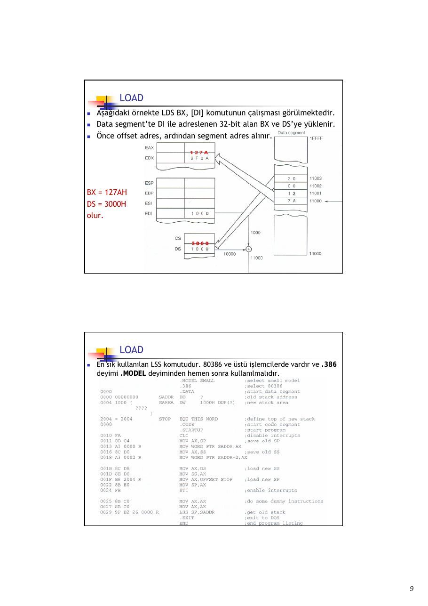
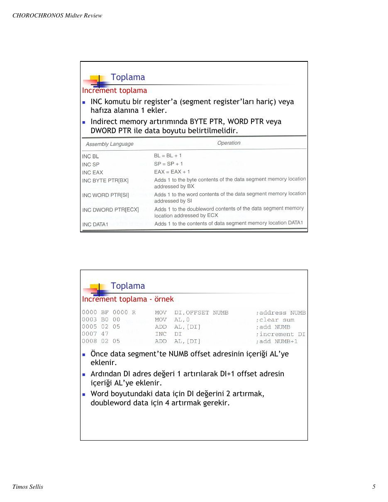
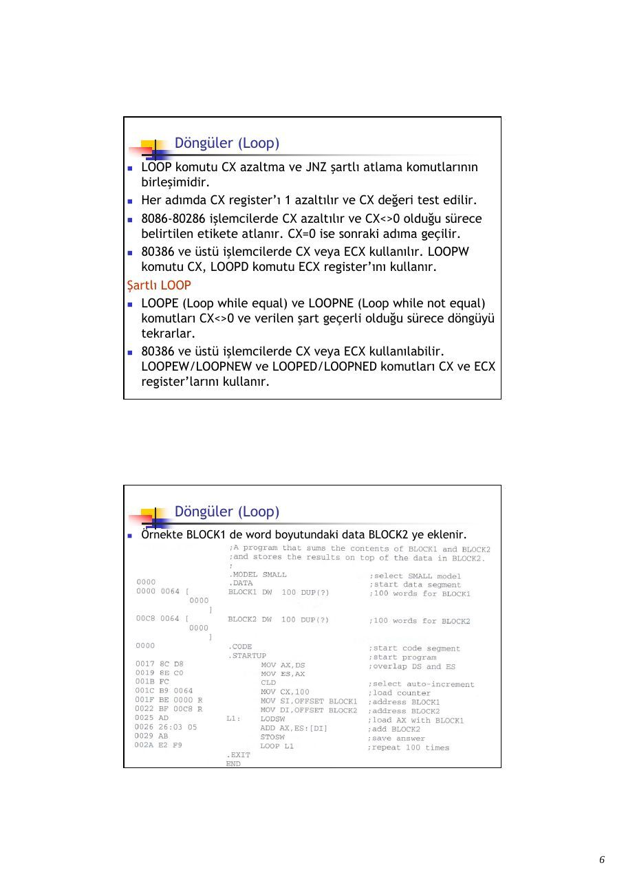
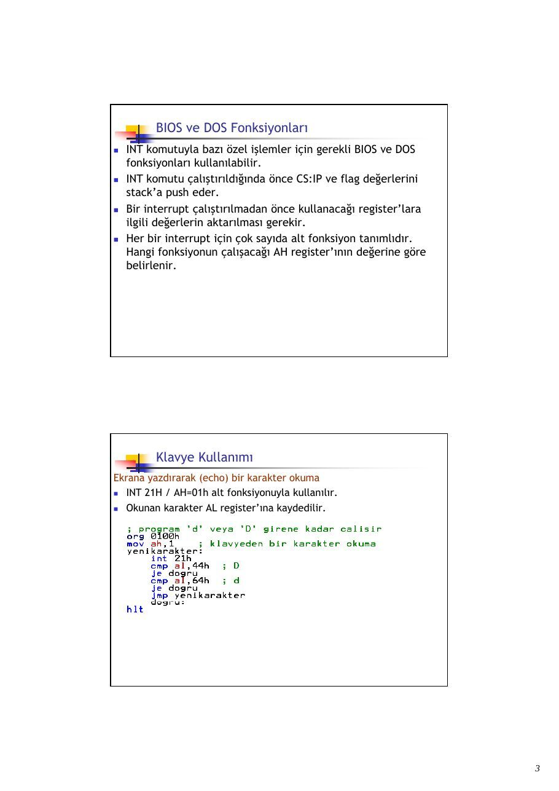

This post collects the relevant notes and applications from the Başkent University **EEM332 Microprocessors** course archive (2008–2015). It covers data transfer, arithmetic and logic, branching, macros, BIOS and DOS routines. Source: Gazi University, M. Ali Akcayol; BİL362 lecture notes. PDF archive copies of the documents and, where available, their source code can be downloaded as a ZIP at the end of the post.

*This content belongs to a third-party source; it is shared for archival and nostalgic purposes with attribution. It will be removed at the request of the rights holder.*

## CPUL5DataMovement

BIL 362 Microprocessors

M. Ali Akcayol, Gazi University, Department of Computer Engineering

Topics: Data Movement Instructions

- MOV Instruction

- PUSH / POP Instructions

- LOAD Instructions

- String Data Transfer Instructions

- Other Data Transfer Instructions

- Segment Override Prefix

- Assembler Directives

- Memory Organization

```asm
MOV
```

- The MOV instruction transfers data between register and register or between register and memory.

For 8086-80286 processors it transfers a byte or word; for 80386 and later processors it transfers a byte, word or doubleword.

- The MOV CX,DX instruction transfers the word (16-bit) contents of DX

to the CX register.

- On 80386 and later processors, doubleword (32-bit) data can be transferred.

- The MOV ECX,EDX instruction transfers the doubleword contents of EDX to the ECX

register.

- The MOV AL,22H instruction transfers the byte value 22H to the AL

register.

```asm
MOV
```

- On 80386 and later processors, doubleword (32-bit) data

can be transferred.

- The MOV EBX,12345678H instruction copies the doubleword value 12345678H

to the EBX register.

- The MOV CX,LIST instruction transfers the word contents at memory address LIST

to the CX register.

- The MOV AX,[BX] instruction transfers a data word at offset address BX

in the data segment to the AX register.

```asm
PUSH / POP
```

- The PUSH and POP instructions are used to store data to or retrieve data from

the LIFO stack memory.

- The microprocessor has 6 different PUSH and POP forms: register,

memory, immediate, segment register, flags and all registers.

- Register addressing allows the contents of any register to be saved to or retrieved from

the stack.

- Memory addressing allows a memory location to be saved to or retrieved from

the stack.

- Immediate addressing allows a constant value to be saved to the stack.

- Segment register addressing allows a segment register to be saved to or retrieved from

the stack. CS can be PUSHed but cannot be POPped.

- With flags addressing, the flags can be saved to or retrieved from

the stack.

- With all registers addressing, the contents of all registers can be

PUSHed or POPped.

```asm
PUSH
```

- On 8086-80286 microprocessors, the PUSH instruction saves 16-bit data to

or retrieves it from the stack. On 80386 and later processors, 2 or 4 bytes of data are stored on the stack.

- The PUSHA instruction saves all registers except the segment registers

to the stack.

- The PUSHA (push all) instruction saves the registers to the stack in the order AX,CX,DX,BX,SP,BP,SI

and DI.

- The PUSHF (push flags) instruction saves the contents of the flag register to

the stack.

- The PUSHAD and POPAD instructions push to or pop from the stack all

32-bit registers.

- When a 16-bit push is performed, the left 8 bits are written to address SP-1 and the right

8 bits to address SP-2.

```asm
PUSH
```

- The state after the PUSH AX instruction executes is shown below.

- AH is stored at address SP-1 and AL at address SP-2.

```asm
PUSH
```

- The PUSHA instruction saves all 16-bit registers to the stack.

- The order is AX,CX,DX,BX,SP,BP,SI and DI.

- The PUSHAD instruction saves all 32-bit registers to the stack.

- The PUSH 'A' instruction saves the value 0041H

to the stack.

### 0041H = ASCII(A)

```asm
PUSH
```

- The PUSH instructions are shown below.

```asm
POP
```

- The POP instruction takes data from the stack and stores it in a 16-bit register,

a segment register or a 16-bit memory location.

- On 80386 and later processors, 32-bit data transfer is possible.

- The POPF instruction takes 16 bits from the stack and transfers them to the flags.

- The POPFD instruction takes 32 bits from the stack and transfers them to the extended

flags.

- The POPA instruction takes 16 bytes of data from the stack and transfers them in order to the

DI,SI,BP,SP,BX,DX,CX and AX registers.

- The POPAD instruction, on 80386 and later processors, takes values from the stack into the 32-bit

registers.

- The POP BX instruction transfers the data at stack address SP to BL

and the data at address SP+1 to BH.

```asm
POP
```

- The figure below shows the state after the POP BX instruction executes.

```asm
POP
```

- The POP instructions are shown below.

### LOAD

- Used to load any memory location or the offset address of an operand into a

register.

- The LEA instruction loads the offset address of an operand into a 16-bit register.

- LDS and LES load a memory location into the 16-bit DS and ES registers.

- On 80386 and later processors, the LFS, LGS and LSS instructions load the FS, GS and SS registers

from a 32-bit offset address.

- The LOAD instructions are shown below.

### LOAD

```asm
LEA
```

- The LEA instruction loads the offset address of the data specified by the operand into 16- or 32-bit

registers.

- The LEA AX, NUMB instruction loads the address of the NUMB operand into AX.

- The LEA BX,[DI] instruction loads the offset address of the [DI] operand into BX

(the contents of DI). The MOV BX,[DI] instruction loads into BX the data at the address pointed to by the [DI] operand.

### LOAD

- In the example below, the offset address of the DATA1 operand is first loaded into the SI

register.

- Then the offset address of the DATA2 operand is loaded into the DI register.

- After the program runs, the contents of the DATA1 and DATA2 memory locations

are swapped.

### LOAD

### LDS, LES, LFS, LGS, LSS

- The LDS, LES, LFS, LGS and LSS instructions load the offset address into one of the

16- or 32-bit registers and the segment address into one of the DS, ES, FS, GS and SS segment registers.

- These instructions access a 32-bit (16-bit

segment + 16-bit offset) or 48-bit (32-bit offset + 16-bit segment) memory location containing the segment and offset addresses.

- The LFS, LGS and LSS instructions are available on 80386 and later processors.

### LOAD

- The example below shows how the LDS BX, [DI] instruction works.

- The 32-bit location in the data segment addressed by DI is loaded into BX and DS.

- The offset address is loaded first, followed by the segment address.

### BX = 127AH

### DS = 3000H

result.

### LOAD

- The most frequently used one is the LSS instruction. It is available on 80386 and later processors, and the .386

directive must be used immediately after the .MODEL directive.

String Data Transfer

- The LODS, STOS, MOVS, INS and OUTS instructions are used. String

instructions transfer byte, word or doubleword data. Direction Flag

- The D bit in the flag register is used for string operations to make the DI and SI registers

automatically increment (D=0) or automatically decrement (D=1).

- The direction bit is used only in string operations.

- The CLD instruction clears D (D=0), and the STD instruction sets D (D=1).

- If a string instruction transfers one byte, SI/DI changes by 1; for a word,

SI/DI changes by 2; for a doubleword, SI/DI changes by 4.

- Each instruction uses one of the DI/SI pair. The STOSB instruction increments or decrements the DI

register (SI is unchanged), and LODSB increments or decrements the SI register (DI is unchanged).

- All string instructions access the extra segment with the DI offset address and

the data segment with the SI offset address.

String Data Transfer

```asm
LODS
```

- The LODS instruction loads into the AL, AX or EAX (80386 and later) register

the contents of the offset address specified by the SI register in the data segment.

- When AL, AX or EAX is loaded, SI is incremented for D=0 and decremented for D=1.

- It is incremented or decremented by 1 for byte transfers, 2 for word transfers and 4 for doubleword transfers.

- The LODSB (loads a byte) instruction loads a byte into the AL register, LODSW (loads a

word) loads a word into the AX register and LODSD (loads a doubleword) loads a doubleword into the EAX register.

String Data Transfer

- The figure below shows how the LODSW instruction works

for D=0, SI=1000H and DS=1000H.

- 11000H and 11001H are loaded into AX.

- Since D=0 and a 16-bit transfer is performed, SI is incremented by 2.

- SI will be 1002.

String Data Transfer

```asm
STOS
```

- The STOS instruction copies the AL, AX or EAX (80386 and later) register to the offset

address specified by the DI register in the extra segment.

- When AL, AX or EAX is transferred, DI is incremented for D=0 and decremented for D=1.

- It is incremented or decremented by 1 for byte transfers, 2 for word transfers and 4 for doubleword transfers.

- The STOSB (stores a byte) instruction copies the AL register, STOSW (stores a word) copies the AX

register and STOSD (stores a doubleword) copies the EAX register to the offset address specified by DI in the extra segment.

String Data Transfer

```asm
STOS and REP
```

- The REP (repeat prefix) is added to string data transfer instructions

other than LODS.

- Each time the string instruction executes, the REP prefix decrements the CX counter by 1. When CX = 0 the loop ends and the next instruction executes.

- With CX=100, the REP STOSB instruction transfers the contents of the AL register to a 100-address memory block,

since the DI register is decremented or incremented by 1 in each iteration.

- The STOSB (stores a byte) instruction transfers the AL register, STOSW (stores a

word) transfers the AX register and STOSD (stores a doubleword) transfers the EAX register to the extra segment location specified by DI.

- The STOSW instruction changes DI by 2, and STOSD changes it by 4.

String Data Transfer

```asm
STOS and REP
```

- The example below clears the memory block named Buffer for Count elements.

- The program is written with inline assembler in a C++ environment and is run by calling the

ClearBuffer function.

- The REP STOSW instruction clears the memory block named Buffer by writing AX=0.

In each repetition ECX is decremented by 1 and EDI is incremented by 2 (D=0).

String Data Transfer: Operand Operators

- Any operand can be used together with operators.

String Data Transfer

```asm
MOVS
```

- The MOVS instruction transfers string data between two memory locations.

- It is the only instruction on 8086-Pentium 4 microprocessors that allows memory-to-memory

operations.

- The MOVS instruction copies the byte, word or doubleword data addressed by SI in the data segment

to the extra segment location addressed by DI.

- The increment/decrement of SI and DI is determined by the direction flag.

String Data Transfer: Block Transfer

- The REP MOVSD instruction copies BlockA to BlockB.

String Data Transfer

### INS

- The INS instruction transfers byte, word or doubleword data from an I/O device to the location

addressed by DI in the extra segment. (Not available on the 8086/8088.)

- The I/O address is taken from the DX register.

- It is effective for block data transfers from an external I/O device to memory.

- INSB transfers byte, INSW word and INSD doubleword data.

String Data Transfer: INS - example

- In the example below, 50 bytes of data are transferred from the I/O device with address 03ACH

```asm
to the LISTS array in the extra segment.
```

String Data Transfer

### OUTS

- The OUTS instruction transfers byte, word or doubleword data from the location addressed by SI in the data segment

to an I/O device. (Not available on the 8086/8088.)

- The I/O address is in the DX register.

- It is effective for transferring a block of data to an external I/O device.

- OUTSB transfers byte, OUTSW word and OUTSD doubleword data.

String Data Transfer: OUTS - example

- In the example below, 100 bytes of data at address ARRAY in the data segment are transferred to the I/O device with address

03ACH.

Other Data Transfer Instructions

```asm
XCHG
```

- The XCHG instruction exchanges data between two registers or between a register and a memory location.

- The XCHG instruction cannot exchange segment registers or perform memory-to-

memory exchanges.

- XCHG AL,[DI] and XCHG [DI],AL perform the same operation.

Other Data Transfer Instructions

```asm
IN and OUT
```

- The IN instruction transfers data from an external I/O device to the AL, AX and EAX registers.

- The OUT instruction transfers data from AL, AX and EAX to an external I/O device.

- The 16-bit I/O port address is carried to the relevant device over the address bus.

- In fixed port addressing, the port address immediately follows the opcode.

In variable port addressing, the DX register holds the port address.

Other Data Transfer Instructions

```asm
IN and OUT - example
```

- The example below shows how the OUT 19H,AX instruction works.

- The contents of AX are transferred to I/O port address 19H. The address bus has the value 0019H (16-bit),

the data bus has the contents of AX, and the control bus has the IOCW (I/O write control) signal (logic 0 enables the relevant I/O device).

Segment Override Prefix

- Allows access to data in a different segment by changing the default register

for instructions.

- The MOV AX,[DI] instruction accesses the data segment by default. The MOV

AX,ES:[DI] instruction accesses the extra segment.

- Some instructions are shown below.

Assembler Directives

- Assembler directives determine how the assembler processes an operand or a part of

the program.

Assembler Directives

Assembler Directives

- DB (define byte), DW (define word) and DD (define

doubleword) are used to define memory and transfer data.

- With the SEGMENT directive, as many segments with new symbolic names as desired can be

defined.

- Areas defined with the DB, DW and DD directives can be reserved with ? for later use.

- The DUP (duplicates) directive creates an array. The 10 DUP (?) directive

reserves 10 memory locations without assigning any value.

- The DATA1 DB 10 DUP (2) directive reserves 10 bytes of memory and assigns

02H to each of them.

Assembler Directives: Example

Assembler Directives: ASSUME, EQU and ORG

- The ASSUME directive is used to specify the names selected for the code, data, extra and stack segments.

The EQU (equate) directive equates a number, ASCII character or label to another label.

- The ORG (origin) directive is used to change the offset address within the data segment.

The THIS directive is used as THIS BYTE, THIS WORD or THIS DWORD, and the specified data type can be assigned to the relevant label.

Assembler Directives: PROC and ENDP

- The PROC and ENDP directives mark the beginning and end of a procedure.

- The PROC and ENDP directives require a label for their beginning and end.

- The PROC directive uses one of two attributes, NEAR or FAR.

- NEAR (local) places the procedure in the same code segment; FAR (global) allows it to be placed

anywhere in memory.

- In the example below, BX, CX and DX are added and the result is transferred to the AX register.

Memory Organization

- The assembler uses two different memory organizations. One is the use of models; the other is the definition of all

segments (full-segment definitions).

- Using models is easy and should be used for simple programs.

- Full-segment definitions provide better control in assembly language and should be used for complex

programs. Model

- The MASM assembler uses the tiny, small, medium, compact, large, huge and flat models.

- The tiny model fits the entire program into a single 64 KB segment.

- The small model uses one data segment and one code segment, for a total

size of 128 KB.

- The medium model allows multiple code segments and one data segment.

- The compact model allows one code segment and multiple data segments.

- The large model allows multiple code segments and multiple data segments.

Arrays larger than 64K cannot be used.

- The huge model allows multiple code segments and multiple data segments.

Arrays larger than 64K can be used.

- The flat model allows a single segment of up to 4 GB. All data and code can reside in a 32-bit

segment.

Memory Organization: Model

- The example below copies a 100-byte memory block named LISTA to the LISTB

area.

Memory Organization: Full-Segment Definition

- It is more structured than the model approach. An example is on the next page.

- The area reserved for STACK_SEG lies between SEGMENT and ENDS.

- The DW 100H DUP(?) instruction creates 100H words of space for the stack segment.

- The STACK keyword automatically loads the SS and SP registers.

- For DATA_SEG, LISTA and LISTB are defined as two 100-element arrays, each element being a byte.

- The area between CODE_SEG and ENDS is the code segment.

- The words 'DATA' and 'CODE' are used for debugging with MS CodeView.

- The ASSUME directive indicates that the names STACK_SEG are used for SS, DATA_SEG for DS and CODE_SEG

for CS.

Memory Organization

Homework

- Write a program that copies the elements of a 10-element array named DIZI1, each element a byte, into

a 100-element array named DIZI2, each element a byte, 10 times in a row. Write comments wherever you consider necessary. The program is to be written in Courier New font at size 12. In the program, it is sufficient to write only the labels, instructions and comments.





## CPUL6ArithmeticLogic

BIL 362 Microprocessors

M. Ali Akcayol, Gazi University, Department of Computer Engineering

## Topics

- Arithmetic and Logic Instructions
- Addition, Subtraction, and Comparison Instructions
- Multiplication and Division Instructions
- Basic Logic Instructions
- Shift and Rotate Instructions
- String Comparison Instructions

## Addition

- ADD (Addition) can be used in many ways in the microprocessor.
- Register, immediate, memory-to-register, array, increment, and addition-with-carry operations can be performed.
- Memory-to-memory and segment register additions cannot be performed.
- Segment registers can only be handled with MOV, PUSH, or POP.

Addition

Register addition

```asm
Assembly Language Operation

ADD AL,BL AL = AL + BL
ADD CX,DI CX = CX + DI
ADD EBP,EAX EBP = EBP + EAX
ADD CL,44H CL = CL + 44H
ADD BX,245FH BX = BX + 245FH
ADD EDX,12345H EDX = EDX + 12345H
ADD [BX],AL AL adds to the byte contents of the data segment memory location
addressed by BX with the sum stored in the same memory location
ADD CL,[BP] The byte contents of the stack segment memory location addressed
```

by BP add to CL with the sum stored in CL

```asm
ADD AL,[EBX] The byte contents of the data segment memory location addressed
```

by EBX add to AL with the sum stored in AL

```asm
ADD BX,[SI+2] The word contents of the data segment memory location addressed
```

by SI + 2 add to BX with the sum stored in BX

```asm
ADD CL,TEMP The byte contents of data segment memory location TEMP add to
```

CL with the sum stored in CL

ADD BX,TEMP[DI] The word contents of the data segment memory location addressed by TEMP + DI add to BX with the sum stored in BX

```asm
ADD [BX+DI],DL DL adds to the byte contents of the data segment memory location
addressed by BX + DI with the sum stored in the same memory
location
```

```asm
ADD BYTE PTR[DI],3 3 adds to the byte contents of the data segment memory location
addressed by DI with the sum stored in the same location
```

```asm
ADD BX,[EAX+2*ECX] The word contents of the data segment memory location addressed
```

by EAX plus 2 times ECX add to BX with the sum stored in BX

Addition

Example

In the example, the AX, BX, CX, and DX registers are added, and the result is stored in the 16-bit AX register.

When an addition is performed, the FLAG register value changes.

The ADD instruction changes the sign, zero, carry, auxiliary carry, parity, and overflow bits.

Addition

Immediate addition

A constant value is added.

### 0000 B2

00 80

First, 12H is loaded into DL. Then 33H is added to the contents of DL. The result of the addition, 45H, is stored in the DL register.

The FLAG changes resulting from this operation are as follows.

Z = 0 (result not zero) C = 0 (no carry)

A = 0 (no half-carry) S = 0 (result positive) P = 0 (odd parity)

O = 0 (no overflow)

Addition

Memory-to-register addition: the desired memory location is added to a register.

### 0000 BF 0000 R MOV DI,OFFSET NUMB

### 0003 BO 00 MOV AL,0

0005 02 05 0007 02 45 01

;clear sum

```asm
ADD AL,[DI] ;add NUMB
ADD AL,[DI+1] ;add NUMB+1
```

- First, the offset address NUMB is loaded into DI.
- Then the value 0 is loaded into AL.
- The contents of the data segment at offset address DI are added to the AL register.
- Finally, the contents of the data segment at offset address DI+1 are added to the AL register.

Addition

Array addition: the array values located in a memory area are added.

```asm
;clear sum
```

### ERE

Le oD

- First, 0 is loaded into AL.
- Then the value 3 is loaded into the SI register.
- Since SI = 3, the operand ARRAY[SI] points to the 3rd element of the array.
- The 3rd, 5th, and 7th elements of the array are added, and the result is stored in the AL register.

Addition

Increment addition

- The INC instruction adds 1 to a register (except segment registers) or to a memory location.
- In indirect memory increments, the data size must be specified with BYTE PTR, WORD PTR, or DWORD PTR.

```asm
Assembly Language Operation

INC BL BL = BL + 1
```

```asm
INC SP SP = SP + 1
```

```asm
INC EAX EAX = EAX + 1
```

```asm
INC BYTE PTR[BX] Adds 1 to the byte contents of the data segment memory location
addressed by BX
```

```asm
INC WORD PTR[SI] Adds 1 to the word contents of the data segment memory location
addressed by SI
```

```asm
INC DWORD PTR[ECX] Adds 1 to the doubleword contents of the data segment memory
```

location addressed by ECX

```asm
INC DATA1 Adds 1 to the contents of data segment memory location DATA1
```

Addition

Increment addition - example

0000 BF 0000 R MOV DI,OFFSET NUMB ;address NUMB

0003 BO 00 MOV AL,0 ;clear sum

0005 02 05 ADD AL,[DI] ;add NUMB

0007 47 INC DI ;increment DI

0008 02 05 ADD AL,[DI] ;add NUMB+1

- First, the contents of the data segment at offset address NUMB are added to AL.
- Then the DI address value is incremented by 1, and the contents of offset address DI+1 are added to AL.
- For word-sized data, DI must be incremented by 2; for doubleword data, by 4.

Addition

Addition with carry

- The ADC (addition-with-carry) instruction adds the value of the carry bit to the operand.

Assembly Language Operation

ADC AL,AH AL = AL + AH + carry

ADC CX,BX CX = CX + BX + carry

ADC EBX,EDX EBX = EBX + EDX + carry

ADC DH,[BX] The byte contents of the data segment memory location addressed by BX add to DH with the sum stored in DH

ADC BX,[BP+2] The word contents of the stack segment memory location addressed by BP plus 2 add to BX with the sum stored in BX

ADC ECX,[EBX] The doubleword contents of the data segment memory location

```asm
addressed by EBX add to ECX with the sum stored in ECX
```

Addition: addition with carry - example

- Add the 32-bit data in AX and BX to the 32-bit data in CX and DX.

(ADD) (ADC)

### [ BX | | L AX |

+ L DX | | [ cx |

### [ BX | J AX |

000 03 Cl ADD

### 2 13 DA ADC

Subtraction

- The SUB (subtraction) instruction is used to subtract one operand from another.
- Its special form is the DEC (decrement) instruction, which subtracts 1.

Assembly Language Operation

```asm
SUB CL,BL CL = CL - BL
```

```asm
SUB AX,SP AX = AX - SP
```

```asm
SUB ECX,EBP ECX = ECX - EBP
```

```asm
SUB DH,6FH DH = DH - 6FH
```

```asm
SUB AX,0CCCCH AX = AX - 0CCCCH
```

```asm
SUB ESI,2000300H ESI = ESI - 2000300H
```

```asm
SUB [DI],CH Subtracts CH from the byte contents of the data segment memory
location addressed by DI and stores the difference in the same memory
location
```

```asm
SUB CH,[BP] Subtracts the byte contents of the stack segment memory location
addressed by BP from CH and stores the difference in CH
```

```asm
SUB AH,TEMP Subtracts the byte contents of memory location TEMP from AH and
```

stores the difference in AH

```asm
SUB DI,TEMP[ESI] Subtracts the word contents of the data segment memory location
addressed by TEMP plus ESI from DI and stores the difference in DI
```

```asm
SUB ECX,DATA1 Subtracts the doubleword contents of memory location DATA1 from
```

ECX and stores the difference in ECX

Subtraction

Register subtraction: the value of one register is subtracted from another.

### 0000 2B D9 SUB BX,CX

### 0002 2B DA SUB BX,DX

- In the example, the 16-bit CX and DX registers are subtracted from BX, and the result is stored in BX.
- The FLAG bits are modified after each subtraction.

Subtraction

Immediate subtraction: a constant value is subtracted from a register. The constant is given together with the instruction.

)000 BS z MOV H

- In the example, the 8-bit value 22H is loaded into the CH register.
- Then 44H is subtracted from 22H. The result (0DEH) is stored in the CH register. The FLAG states are below.

Z = 0 (result not zero)

C = 1 (borrow) A = 1 (half-borrow)

S = 1 (result negative)

P = 1 (even parity)

O = 0 (no overflow)

Subtraction

Decrement subtraction

- 1 is subtracted from a memory location or a register.
- When the DEC instruction addresses memory, BYTE PTR, WORD PTR, or DWORD PTR must be used.
- Instead of DEC [SI], DEC BYTE PTR [SI], DEC WORD PTR [SI], or DEC DWORD PTR [SI] must be used.

```asm
Assembly Language Operation

DEC BH BH = BH - 1
DEC CX CX = CX - 1
DEC EDX EDX = EDX - 1
```

```asm
DEC BYTE PTR[DI] Subtracts 1 from the byte contents of the data segment memory
```

location addressed by DI

```asm
DEC WORD PTR[BP] Subtracts 1 from the word contents of the stack segment
```

memory location addressed by BP

```asm
DEC DWORD PTR[EBX] Subtracts 1 from the doubleword contents of the data segment
```

memory location addressed by EBX

```asm
DEC NUMB Subtracts 1 from the contents of data segment memory
```

location NUMB

Subtraction

Subtraction with borrow

- With SBB (subtraction-with-borrow), the other operand and the carry bit are subtracted from the destination operand.
- When the SBB instruction addresses memory, BYTE PTR, WORD PTR, or DWORD PTR must be used. Instead of SBB [SI], SBB BYTE PTR [SI], SBB WORD PTR [SI], or SBB DWORD PTR [SI] must be used.

Assembly Language Operation

SBB AH,AL AH = AH - AL - carry

SBB AX,BX AX = AX - BX - carry

SBB EAX,ECX EAX = EAX - ECX - carry

SBB CL,2 CL = CL - 2 - carry

SBB BYTE PTR[DI],3 Both 3 and carry subtract from the data segment memory location

```asm
addressed by DI
```

SBB [DI],AL Both AL and carry subtract from the data segment memory location

```asm
addressed by DI
```

SBB DI,[BP+2] Both carry and the word contents of the stack segment memory location addressed by BP plus 2 subtract from DI

SBB AL,[EBX+ECX] Both carry and the byte contents of the data segment memory

location addressed by EBX plus ECX subtract from AL

Subtraction

Subtraction with borrow - example

- The 32-bit number in the BX and AX registers is subtracted from the 32-bit number in SI and DI.

(SBB) (SUB)

### BX AX

— SI DI BX AX

### 0000 2B

Comparison

- The CMP (compare) instruction performs a subtraction; the destination operand is not changed.
- It is usually followed by a JUMP instruction and checks the FLAGs.
- Memory-to-memory and segment register comparisons cannot be performed.

Assembly Language Operation

```asm
CMP CL,BL CL - BL
```

```asm
CMP AX,SP AX - SP
```

```asm
CMP EBP,ESI EBP - ESI
```

```asm
CMP AX,2000H AX - 2000H
```

```asm
CMP [DI],CH CH subtracts from the byte contents of the data segment memory
```

location addressed by DI

```asm
CMP CL,[BP] The byte contents of the stack segment memory location addressed
```

by BP subtracts from CL

```asm
CMP AH,TEMP The byte contents of data segment memory location TEMP subtracts
```

from AH

```asm
CMP DI,TEMP[BX] The word contents of the data segment memory location addressed
```

by TEMP plus BX subtracts from DI

```asm
CMP AL,[EDI+ESI] The byte contents of the data segment memory location addressed
```

by EDI plus ESI subtracts from AL

Comparison

- In the example below, the AL register is compared with 10H.
- The conditional jump instructions JA (jump above) and JB (jump below) perform the jump according to the result of the comparison.
- The JA instruction jumps if the AL register is greater than 10H, and the JB instruction jumps if it is less.

compare against 10H

```asm
jump if AL is above or equal
```

0000 3c 10 CMP AL,10H ;compare 0002 73 1c JAE SUBER ;if AL

- In the example, the JAE (jump above or equal) instruction jumps the program to the line with the SUBER label if the AL register is 10H or greater than 10H.
- The JBE (jump below or equal) instruction jumps to the relevant line if the AL register is 10H or less than 10H.

Multiplication and Division

Multiplication

- Multiplication can be performed with byte, word, or doubleword data.
- Signed integer (IMUL) or unsigned integer (MUL) instructions can be used.
- The product is always twice the width. The product of two 8-bit numbers is 16 bits, the product of two 16-bit numbers is 32 bits, and the product of two 32-bit numbers is 64 bits.
- The O and C flag bits are affected. If the left 8 bits of the result of two 8-bit numbers are 0, then O = 0 and C = 0. C = 1 indicates that the result is 16 bits.
- If the product of two 16-bit numbers gives C = 0 and O = 0, the left 16 bits are 0.

Multiplication and Division

8-bit multiplication

- In 8-bit multiplication, the multiplicand is always AL (signed/unsigned).
- The multiplier is an 8-bit register or a memory location.
- The multiplication instruction has 1 operand, and the default multiplicand is the AL register.
- The MUL BL instruction multiplies AL by BL as unsigned numbers. The product is stored in the 16-bit AX register.

Assembly Language Operation

```asm
MUL CL AL is multiplied by CL; the unsigned product is in AX
```

IMUL DH AL is multiplied by DH; the signed product is in AX

IMUL BYTE PTR[BX] AL is multiplied by the byte contents of the data segment memory location addressed by BX; the signed product is in AX

```asm
MUL TEMP AL is multiplied by the byte contents of data segment memory
```

location TEMP; the unsigned product is in AX

Multiplication and Division

8-bit multiplication - example

- The 8-bit unsigned numbers in the BL and CL registers are multiplied.
- The 16-bit result is stored in the DX register.
- Since this operation is performed using the AL register, one of the registers must be moved into AL.
- The IMUL instruction is used for signed numbers.
- Two's complement is used for negative numbers, and binary form for positive numbers.

(6)

AL,CL ;position data

### 0008 8B DO MOV DX,AX

```asm
;position product
```

Multiplication and Division

16-bit multiplication

- In 16-bit multiplication, the multiplicand is always AX.
- The multiplier is a 16-bit register or a memory location.
- The product is stored in DX-AX. DX stores the most-significant 16 bits and AX the least-significant 16 bits.

Assembly Language Operation

```asm
MUL CX AX is multiplied by CX; the unsigned product is in DX-AX
```

IMUL DI AX is multiplied by DI; the signed product is in DX-AX

```asm
MUL WORD PTR[SI] AX is multiplied by the word contents of the data segment memory
```

location addressed by SI; the unsigned product is in DX-AX

Multiplication and Division

32-bit multiplication

32-bit multiplication can be performed on 80386 and higher processors. 32-bit multiplication can be signed (IMUL) or unsigned (MUL). The EAX register is multiplied by the operand specified by the instruction.

The result is stored in EDX-EAX. EDX stores the most-significant 32 bits and EAX the least-significant 32 bits.

Assembly Language Operation

```asm
MUL ECX EAX is multiplied by ECX; the unsigned product is in EDX-EAX
```

IMUL EDI EAX is multiplied by EDI; the signed product is in EDX-EAX

```asm
MUL DWORD PTR[ESI] EAX is multiplied by the doubleword contents of the data
```

segment memory location address by ESI; the unsigned product is in EDX-EAX

Multiplication and Division

Division

In the 8086-80286 processors, division is performed on 8-bit or 16-bit numbers; in the 80386-Pentium 4 processors, it is performed on 32-bit numbers.

IDIV performs division on signed numbers, and DIV on unsigned numbers. The dividend is always twice the width.

```
If AX=3000 and it is divided by 2, the result is 1500 and does not fit
in the AL register. (1500 = 10111011100)
```

In this case an overflow occurs and a divide-error interrupt is generated.

Multiplication and Division

8-bit division

- In 8-bit division, the dividend is in the AX register and is divided by an 8-bit register or a value in memory.
- The quotient is stored in the AL register and the remainder in the AH register.
- For signed numbers, the quotient can be negative or positive; the remainder takes the sign of the dividend and is an integer.
- If AX=0010H (+16), BL=FDH (-3), and the IDIV BL instruction is executed,

```
AX=01FBH. AL=-5 is the quotient and AH=1 is the remainder.
```

Assembly Language Operation

```asm
DIV CL AX is divided by CL; the unsigned quotient is in AL and the unsigned
```

remainder is in AH

IDIV BL AX is divided by BL; the signed quotient is in AL and the signed remainder is in AH

```asm
DIV BYTE PTR[BP] AX is divided by the byte contents of the stack segment memory
```

location addressed by BP; the unsigned quotient is in AL and the unsigned remainder is in AH

Multiplication and Division

8-bit division - continued

- In 8-bit division, the numbers are usually 8 bits. The dividend must be converted to word size for the AX register.
- For unsigned numbers, the left 8 bits (AH) are set to 0 (zero-extended). For signed numbers, the sign bit of AL is copied into the AH register (sign-extended).
- The CBW (convert byte to word) instruction converts the contents of the signed AL register to AX size.

Multiplication and Division

8-bit division - example

- The unsigned byte number NUMB is divided by the unsigned number NUMB1.
- The quotient and remainder are stored in the memory locations ANSQ and ANSR.

### 0000 AO 0000 R

```asm
MOV AL,NUMB
```

;get NUMB

0003 EF MOV AH,O ;zero-extend 0005 DIV B ;divide by NU 0009 A2 MOV ;save quotient

000C 88 2 MOV ANSR,AH ;save remainder

- Below, signed division is performed and CBW is used for sign extension.

```asm
MOV AL, NUMB
cBW
```

### IDIV NUMB1

```asm
MOV ANSQ, AL
MOV ANSR, AH
```

Multiplication and Division

16-bit division

- In 16-bit division, the 32-bit dividend is in the DX-AX registers and is divided by a 16-bit register or a value in memory.
- The quotient is stored in the AX register and the remainder in the DX register.
- For a 16-bit unsigned dividend, DX=0 is set (zero-extended); for a signed number, DX=sign(AX) is set (sign-extended).
- CWD (convert word to doubleword) performs a 16-bit sign extension.

Assembly Language Operation

```asm
DIV CX DX-AX is divided by CX; the unsigned quotient is in AX and the
```

unsigned remainder is in DX

IDIV SI DX-AX is divided by SI; the signed quotient is in AX and the signed remainder is in DX

```asm
DIV NUMB DX-AX is divided by the word contents of data segment memory
```

NUMB; the unsigned quotient is in AX and the unsigned remainder is

```asm
in DX
```

Multiplication and Division

16-bit division - example

- Below, the division of two 16-bit signed numbers is shown.
- AX = -100, CX = +9, and the CWD instruction converts AX = -100 (16-bit) to DX-AX = -100 (32-bit).
- After the division, AX = -11 (quotient) and DX = -1 (remainder).

0000 0003 0006 0007

Multiplication and Division

32-bit division

- On 80386-Pentium 4 processors, 32-bit division is performed on signed or unsigned numbers.
- The 64-bit dividend EDX-EAX is divided by the value specified by the operand. EAX holds the 32-bit quotient and EDX holds the remainder.
- CDQ (convert doubleword to quadword) converts the 32-bit EAX to the 64-bit EDX-EAX.

Assembly Language Operation

```asm
DIV ECX EDX-EAX is divided by ECX; the unsigned quotient is in EAX and
```

the unsigned remainder is in EDX

IDIV DATA4 EDX-EAX is divided by the doubleword contents in data segment

memory location DATA4; the signed quotient is in EAX and the signed remainder is in EDX

```asm
DIV DWORD PTR[EDI] EDX-EAX is divided by the doubleword contents of the data
```

segment memory location addressed by EDI; the unsigned quotient is in EAX and the unsigned remainder is in EDX

Multiplication and Division

32-bit division - example

- In the example, the AX value is divided by BL and the result is rounded.
- With ADD AH,AH, the remainder is multiplied by two, and if it is greater than BL, AL (the quotient) is incremented by 1.
- Values greater than 0.5 are thus rounded up to the next integer.

Basic Logic Instructions

- AND, OR, XOR, and NOT are the basic logic instructions.
- The TEST and NEG instructions are special forms of the AND and NOT instructions.
- Logic instructions set, clear, and complement bits.
- Logic instructions set the carry and overflow bits to 0. The other FLAG bits take values according to the result of the operation.
- Logic instructions perform bit-level control in software.

Basic Logic Instructions

AND

- The AND operation performs logical multiplication. Memory-to-memory and segment register addressing cannot be used. It has the truth table below.

### A B T

0 0 0 / 0 1 0 / 1 0 0 / 1 1 1

- The AND operation is used to clear a bit value in a binary number to 0 (masking).

XXXX XXXX Unknown number

* 0000 1111 Mask

0000 XXXX Result

### 0000 BB 3135 MOV BX,3135H

### 0003 81 E3 000F AND BX,0FH

```asm
;load ASCII
;mask BX
```

Basic Logic Instructions

AND - continued

- AND operations are shown in the table below. Memory-to-register, register-to-register, or immediate addressing can be used.

Assembly Language Operation

```asm
AND AL,BL AL = AL and BL
```

```asm
AND CX,DX CX = CX and DX
```

```asm
AND ECX,EDI ECX = ECX and EDI
```

```asm
AND CL,33H CL = CL and 33H
```

```asm
AND DI,4FFFH DI = DI and 4FFFH
```

```asm
AND ESI,34H ESI = ESI and 34H
```

```asm
AND AX,[DI] The word contents of the data segment memory location addressed
```

by DI are ANDed with AX

```asm
AND ARRAY[SI],AL The byte contents of the data segment memory location addressed
```

by ARRAY plus SI are ANDed with AL

```asm
AND [EAX],CL CL is ANDed with the byte contents of the data segment memory
```

location addressed by ECX

Basic Logic Instructions

OR

- The OR operation performs logical addition. Memory-to-memory and segment register addressing cannot be used. It has the truth table below.

### A B T

0 0 0 / 0 1 1 / 1 0 1 / 1 1 1

- The OR operation is used to set a bit value in a binary number to 1 (masking).

XXXX XXXX Unknown number

* 0000 1111 Mask

XXXX 1111 Result

```asm
OR AX,3030H ;convert to ASCII
```

Basic Logic Instructions

OR - continued

- OR operations are shown in the table below. Memory-to-register, register-to-register, or immediate addressing can be used.

Assembly Language Operation

```asm
OR AL,BL AL = AL or BL
```

```asm
OR SI,DX SI = SI or DX
```

```asm
OR EAX,EBX EAX = EAX or EBX
```

```asm
OR DH,0A3H DH = DH or 0A3H
```

```asm
OR SP,990DH SP = SP or 990DH
```

```asm
OR EBP,10 EBP = EBP or 10
```

```asm
OR DX,[BX] DX is ORed with the word contents of data segment memory location
addressed by BX
```

```asm
OR DATES[DI+2],AL The byte contents of the data segment memory location addressed
```

by DI plus 2 are ORed with AL

Basic Logic Instructions

Exclusive-OR (XOR)

0000 81 0004 83 0007 81

Unlike the OR operation, in the Exclusive-OR operation the result for inputs 1,1 is 0, not 1. Memory-to-memory and segment register addressing cannot be used. It has the truth table below.

### A B T

0 0 0 / 0 1 1 / 1 0 1 / 1 1 0

The XOR operation is used to invert a bit value in a binary number (masking).

XXXX XXXX Unknown number

0000 1111 Mask

### 9 0600 OR CX

### 1 FC AND CX

### 1 1000 XOR CX

Basic Logic Instructions

XOR - continued

XOR operations are shown in the table below. Memory-to-register, register-to-register, or immediate addressing can be used.

Assembly Language Operation

```asm
XOR CH,DL CH = CH xor DL
```

```asm
XOR SI,BX SI = SI xor BX
```

```asm
XOR EBX,EDI EBX = EBX xor EDI
```

```asm
XOR AH,0EEH AH = AH xor 0EEH
```

```asm
XOR DI,00DDH DI = DI xor 00DDH
```

```asm
XOR ESI,100 ESI = ESI xor 100
```

```asm
XOR DX,[SI] DX is Exclusive-ORed with the word contents of the data segment
```

memory location addressed by SI

```asm
XOR DEAL[BP+2],AH AH is Exclusive-ORed with the byte contents of the stack segment
```

memory location addressed by BP plus 2

Basic Logic Instructions

TEST and Bit Test Instructions

- The TEST instruction performs an AND operation. TEST does not change the destination operand, whereas AND does.
- The TEST operation changes the FLAG bits and works similarly to the CMP instruction. CMP operates on a byte or word, whereas TEST operates on a bit.
- If the bit being tested is 0, Z = 1; if it is 1, Z = 0. (Z -> Zero Flag)

Assembly Language Operation

```asm
TEST DL,DH DL is ANDed with DH
TEST CX,BX CX is ANDed with BX
TEST EDX,ECX EDX is ANDed with ECX
TEST AH,4 AH is ANDed with 4
TEST EAX,256 EAX is ANDed with 256
```

Basic Logic Instructions

TEST and Bit Test Instructions - continued

- The JZ (Jump Zero) or JNZ (Jump Not Zero) instructions are usually used immediately after the TEST instruction.
- The destination operand can be tested with an immediate value.
- If the immediate value is 1, the rightmost bit is tested; if it is 2, the second bit from the right is tested.
- In the example below, first the rightmost bit of AL and then the leftmost bit are tested. Depending on the result, a jump is made to the section with the RIGHT or LEFT label.

Basic Logic Instructions

TEST and Bit Test Instructions - continued

80386 and higher processors have instructions used for testing a single bit.

The result of the test operation is transferred to the Carry Flag bit. The BT AX,4 instruction tests bit 4 of the AX register. If it is 1, C=1; if it is 0, C=0.

The other three instructions change the value immediately after the test operation.

Assembly Language Operation

BT Tests a bit in the destination operand specified by the source operand

BTC Tests and complements a bit in the destination operand specified by the source operand

BTR Tests and resets a bit in the destination operand specified by the source operand

BTS Tests and sets a bit in the destination operand specified by the source operand

Basic Logic Instructions

TEST and Bit Test Instructions - continued

80386 and higher processors have instructions used for testing a single bit.

The result of the test operation is transferred to the Carry Flag bit. The BT AX,4 instruction tests bit 4 of the AX register. If it is 1, C=1; if it is 0, C=0.

The other three instructions change the value immediately after the test operation.

Basic Logic Instructions

NOT and NEG instructions

NOT performs logical inversion or one's complement, and NEG performs arithmetic sign inversion or two's complement.

NOT inverts all bits, NEG inverts the sign.

Assembly Language Operation

```asm
NOT CH CH is one's complemented
```

NEG CH CH is two's complemented NEG AX AX is two's complemented

```asm
NOT EBX EBX is one's complemented
```

NEG ECX ECX is two's complemented

```asm
NOT TEMP The contents of data segment memory location TEMP are one's
complemented
NOT BYTE PTR[BX] The byte contents of the data segment memory location addressed
```

by BX are one's complemented

### S

SHIFT and ROTATE Instructions

The SHIFT instruction shifts the contents of a register or memory location right or left. It performs multiplication (shift left) or division (shift right) by powers of 2.

In a logical shift, the bit shifted out is discarded. It is used with unsigned numbers.

In an arithmetic shift, the sign bit of the value is kept constant. It is used with signed numbers.

Assembly Language Operation

```asm
SHL AX,1 AX is logically shifted left 1 place
SHR BX,12 BX is logically shifted right 12 places
SHR ECX,10 ECX is logically shifted right 10 places
SAL DATA1,CL The contents of data segment memory location DATA1 are
```

arithmetically shifted left the number of spaces specified by CL

```asm
SAR SI,2 SI is arithmetically shifted right 2 places
SAR EDX,14 EDX is arithmetically shifted right 14 places
```

- SHL and SHR perform logical shifts.
- SAL and SAR perform arithmetic shifts.

SHIFT and ROTATE Instructions

SHIFT example

- In early processors, multiplication performed with shifts runs faster than the MUL instruction.

SHIFT and ROTATE Instructions

- ROTATE instructions are used to shift a register or a memory location using the carry flag.
- They are used for shifting large numbers.

Assembly Language Operation

```asm
ROL SI,14 SI rotates left 14 places
```

RCL BL,6 BL rotates left through carry 6 places

```asm
ROL ECX,18 ECX rotates left 18 places
RCR AH,CL AH rotates right through carry the number of places specified by CL
ROR WORD PTR[BP],2 The word contents of the stack segment memory location addressed
```

by BP rotate right 2 places

- In the example below, the 48-bit number DX,BX,AX is shifted left.

### 0000 D1 E0 SAL AX,1

### 0002 D1 D3 RCL BX,1

### 0004 D1 D2 RCL DX,1

SHIFT and ROTATE Instructions

Target register or memory

```asm
ROL
```

### 

```asm
RCR
```

### C

String Comparison Instructions

- String data operations are performed with the MOVS, LODS, STOS, INS, and OUTS instructions.
- The SCAS (Scan String) and CMPS (Compare String) instructions are used to compare a block in memory with a constant value or with another memory block.

SCAS

- The SCAS instruction compares the AL register with a byte block in memory, the AX register with a word block, or the EAX register with a doubleword block.
- The SCAS instruction subtracts the block in memory from the AL, AX, or EAX registers.
- SCASB is used for byte comparison, SCASW for word, and SCASD for doubleword.
- The block compared at offset address DI in memory is in the extra segment.

String Comparison Instructions

SCAS - continued

- Suppose there is a 100-byte memory block named BLOCK. The example below tests whether 00H is present in this block.
- The REPNE (Repeat While Not Equal) and REPE (Repeat While Equal) prefixes repeat the loop until CX=0 or until the comparison result becomes equal (REPNE) / not equal (REPE).

```asm
CLD ;auto-increment mode
```

String Comparison Instructions

CMPS

The CMPS instruction compares two blocks in memory as bytes (CMPSB), words (CMPSW), or doublewords (CMPSD).

The area specified by SI in the data segment is compared with the area specified by DI in the extra segment.

CMPS automatically increments or decrements the DI and SI registers.

It is used with the REPE, REPNE, REPZ (Repeat While Zero), and REPNZ (Repeat While Not Zero) prefixes.

In the example below, a 10-byte block is compared. The loop continues as long as CX>0 and the blocks are equal.

MOV SI,OFFSET LINK

Assignment

Write a program that, for each element of a 100-element array, computes the sum of that element and all the preceding numbers and stores it in place of the element.

The largest of the numbers will be stored in the BX register and the smallest in the DX register.

The program will compute the arithmetic mean of the numbers and store it in the AX register.



## CPUL7Control

BIL 362 Microprocessors

M. Ali Akcayol, Gazi University, Department of Computer Engineering

Topics: Program Control Instructions

- Unconditional Jump

- Conditional Jump

- Loops

- Assembly Program Flow Control

- While Loops

- Repeat-Until Loops

- Procedures

- Introduction to Interrupts

- Other Instructions

Unconditional Jump

- Control instructions allow jumping to another part of the program.

- Control instructions perform conditional jumps based on the state of the flag bits.

- Three types of unconditional jump instructions can be used: short jump, near jump, and far jump.

Unconditional Jump

- The short jump instruction is 2 bytes long and jumps within the address range of +127 and -128 relative to the current location.

- The near jump is 3 bytes long and jumps within a ±32K range inside the current segment.

- The far jump is 5 bytes long and jumps to any location in memory.

- Short and near jumps are intrasegment jumps; the far jump is an intersegment jump.

Unconditional Jump: Short jump

- Performs a relative jump within the current segment.

- Instead of the address to jump to, the opcode contains the distance from the current location.

- It is used as JMP SHORT NEXT, where NEXT is the jump target.

### 0009H + 0017H = 0020H

Unconditional Jump: Near jump

- Like the short jump, the near jump jumps within the same segment, but it covers a longer range than the short jump.

- It jumps within a ±32K range inside the current segment. On 80386 and higher processors in protected mode, it jumps within a ±2G range.

Unconditional Jump: Far jump

- The far jump takes a new segment and offset address and jumps directly to the desired address.

- The far jump is specified with the FAR PTR instruction or with a far label.

Conditional Jump

- On 8086-80286 processors, conditional jump instructions perform short jumps.

Conditional Jump

- They jump within the range of +127 to -128. The MASM v.6X assembler adjusts the distance automatically.

- Conditional jump instructions test the S, Z, C, P, and O flag bits.

- If the tested condition is true (1), the jump to the labeled location is taken; if false (0), the next instruction is executed.

- The comparison produces different results for signed and unsigned numbers.

- For unsigned numbers, FFH (255) is greater than 00H (0).

- For signed numbers, FFH (-1) is less than 00H (0).

Conditional Jump

- For comparisons of signed numbers, the JG, JL, JGE, JLE, JE, and JNE instructions are used.

- For comparisons of unsigned numbers, the JA, JB, JAE, JBE, JE, and JNE instructions are used.

- The other conditional jump instructions test the flag bits.

- The JCXZ and JECXZ instructions test the CX and ECX registers and jump to the desired location if the register is 0.

- The following example searches for the value 0AH within a 100-byte area.

Loops

- The LOOP instruction is a combination of decrementing CX and the JNZ conditional jump instruction.

- At each step, the CX register is decremented by 1 and the CX value is tested.

- On 8086-80286 processors, CX is decremented and a jump to the specified label is taken as long as CX<>0. If CX=0, execution continues with the next instruction.

- On 80386 and higher processors, either CX or ECX can be used. The LOOPW instruction uses the CX register and the LOOPD instruction uses the ECX register.

Conditional LOOP

- The LOOPE (Loop while equal) and LOOPNE (Loop while not equal) instructions repeat the loop as long as CX<>0 and the given condition holds.

- On 80386 and higher processors, either CX or ECX can be used.

```asm
LOOPEW/LOOPNEW and LOOPED/LOOPNED instructions use the CX and ECX
```

registers.

Loops

- In the example, the word-sized data in BLOCK1 is added to BLOCK2.

Assembly Program Flow Control

- The MASM 6.X assembler provides directives such as .IF,

### .ELSE, .ELSEIF, .ENDIF,

### .REPEAT, .UNTIL, .WHILE

and .ENDW.

- The example alongside shows how the operation performed with .IF and .ENDIF is carried out with assembly instructions.

Assembly Program Flow Control

- The relational operators that can be used with the .IF directive are shown below.

Example

Assembler generates

While Loops

- As in high-level languages, MASM 6.X includes a WHILE loop structure.

- The .WHILE statement marks the condition part, and .ENDW marks the end of the loop.

- The loop is repeated as long as the condition in the .WHILE statement is true. The condition is checked again on every iteration.

- When the condition is no longer true, execution continues with the instruction after the .ENDW statement.

- In the example on the next page, all inputs are stored in an array named BUF in the extra segment until 0DH (Enter) is entered from the keyboard.

- The .BREAK and .CONTINUE statements are used in while loops.

- The .BREAK .IF AL == 0DH instruction exits the loop if AL==0DH.

- The .CONTINUE .IF AL==15 instruction skips the rest of the loop body if AL==15 and continues with the next iteration.

```asm
Repeat-Until Loops
```

- As in high-level languages, MASM 6.X includes a REPEAT-UNTIL loop structure.

- The .UNTIL statement marks the condition part, and .REPEAT marks the start of the loop.

- The statements inside the loop are repeated until the condition is true. The condition is checked again on every iteration.

- When the condition is satisfied, execution continues with the instruction after the .UNTIL statement.

- In the example on the next page, all inputs are stored in an array named BUF in the extra segment until 0DH (Enter) is entered from the keyboard.

- The .UNTILCXZ statement is used in repeat loops, and it checks by decrementing the CX register by one on every iteration.

### DS

```asm
Repeat-Until Loops
```

- In the following example, the CX register is checked by decrementing it on every iteration.

- The loop is repeated as long as CX <> 0.

Procedures

- Procedures are the reusable parts of programs, and they generally perform only a single function.

- The CALL instruction is used to enter a procedure, and the RET instruction is used to return.

- When a procedure is called, the stack stores the return address.

```asm
The CALL instruction pushes the next address (return) onto the stack.
```

- The RET instruction takes an address from the stack as the return address.

- A procedure begins with the PROC directive and ends with ENDP. The name of the procedure is specified before both.

- After the PROC directive, the type is specified as NEAR (intrasegment) or FAR (intersegment).

- After the NEAR and FAR directives, the USES directive can be used to specify which registers will be used. The specified registers are automatically pushed and popped on the stack.

Procedures: Example

Procedures

- The near return instruction takes a 16-bit value from the stack and assigns it to IP as the return address.

- The far return instruction takes a 32-bit value from the stack and assigns it to IP and CS as the return address.

```asm
CALL
```

- The CALL instruction calls the named procedure and stores the return address on the stack.

- The near CALL instruction is 3 bytes long. The first byte is the opcode, and the second and third bytes are the displacement to the target (±32K).

- On 80386 and higher processors in protected mode, the displacement is 4 bytes (±2G).

- The far CALL instruction is 5 bytes long. The first byte is the opcode, bytes 2-3 are the new value of IP, and bytes 4-5 are the new value of CS.

- The CALL instruction pushes the IP and CS values onto the stack.

Procedures

```asm
CALL - example
```

Procedures

```asm
CALL – calling with a register
```

- CALL instructions can use a register operand (CALL BX).

- IP is pushed onto the stack and execution transfers to the offset address in BX within the same segment.

- In the following example, the DISP procedure is called with CALL BX.

- The same operation can be performed as CALL DISP.

Procedures

```asm
CALL – calling with an indirect memory address
```

- CALL instructions can use indirect addressing (CALL [BX]).

- This is generally useful for using different procedures selected from a lookup table.

- In the following example, execution transfers to the ZERO, ONE, or TWO procedure depending on the value of EBX.

- The CALL FAR PTR [4*EBX] instruction performs a far call, or, if the table is defined as doubleword (DD), the CALL TABLE[4*EBX] instruction performs a far call.

Procedures

```asm
RET
```

- For a near return, the RET instruction takes a 16-bit number from the stack and assigns it to IP. For a far

```asm
return, it takes a 32-bit number from the stack and assigns it to IP and CS.
```

- In the following example, SS=A000 and CS=1000. Before the CALL operation, SP=FFFF and IP=0003.

- After the CALL, SP=FFFD and IP=0FFF.

- After the RET operation, SP=FFFF, IP=0003, and the effective address is 11003.

Procedures

```asm
RET
```

- After removing the return address from the stack, the RET instruction can add a specified value to SP. In this way, the parameters that were pushed onto the stack when the procedure was called are discarded by adding an amount equal to their size.

- In the example, AX and BX (4 bytes) are pushed onto the stack before the procedure is called. RET 4 adds 4 to SP after the return address, discarding AX and BX.

Assignment

- Write a program that takes 100 word-sized numbers located in an area of memory and transfers them, sorted from smallest to largest, to a second array in memory.

- Any sorting algorithm may be used.

- The program will be written with emu8086.

- Both the printout of the assignment and its source code will be submitted; the source code will be sent by e-mail to akcayol@gazi.edu.tr.



## CPUL8Programming

BIL 362 Microprocessors

M. Ali Akcayol, Gazi University, Department of Computer Engineering

Topics: Microprocessor Programming

- Macros

- BIOS and DOS Functions

- Keyboard Usage

- Reading a character from the keyboard

- Reading a string from the keyboard

- Screen Functions

- Writing a character to the screen

- Writing a string to the screen

- Screen settings

- Mouse Usage

Macros

- Macros are used to perform a task like procedures.

- Procedures are called with call; macros are called simply by writing their name.

- Procedures are located at the end of the program; macros are located before the place where they are used.

- A macro consists of the instructions between the MACRO directive and the ENDM directive.

- As with procedures, a name must be entered before the MACRO directive.

- After the MACRO directive, parameters can be defined to pass input from outside.

Macros - Example

BIOS and DOS Functions

- With the INT instruction, the BIOS and DOS functions required for certain special operations can be used.

- When the INT instruction is executed, it first pushes the CS:IP and flag values onto the stack.

- Before an interrupt is executed, the relevant values must be loaded into the registers it will use.

- Many subfunctions are defined for each interrupt. Which function will run is determined by the value of the AH register.

Keyboard Usage: Reading a character with echo to the screen

- It is used with the INT 21H / AH=01h subfunction.

- The character read is stored in the AL register.

Keyboard Usage: Reading a character without echo to the screen

- It is used with the INT 21H / AH=06h subfunction. For the read operation, the value 0FFh is loaded into the DL register.

- The character read is stored in the AL register, but it is not displayed on the screen. Unlike AH=1, it does not wait; the processor can do other work while waiting.

Keyboard Usage: Reading a character without echo to the screen - continued

Keyboard Usage: Reading a string from the keyboard

- It is used with the INT 21H / AH=0Ah subfunction. The string read can be at most 255 characters long.

- It stores the string received until Enter is pressed or 255 characters are reached at the address DS:DX. The first byte stores the buffer size and the second byte stores the number of characters entered.

Keyboard Usage: Checking whether a key has been pressed

- With the INT 16H / AH=01h subfunction, when a key is pressed it is placed into the buffer.

- With the INT 16H / AH=00h subfunction, the character in the buffer is loaded into AL.

Screen Functions: Writing a character to the screen

- It is used with the INT 21H / AH=02h subfunction. The character to be written is in the DL register.

Screen Functions: Writing a string to the screen

- It is used with the INT 21H / AH=09h subfunction.

- The offset address of the string to be written is in the DX register.

- The string must end with $.

Screen Functions: Screen settings – changing the screen size

- It is used with the INT 10H / AH=00h subfunction.

- The desired screen size is in the AL register.

For AL = 00h: size=40x25, color=16 colors, pages=8. For AL = 03h: size=80x25, color=16 colors, pages=8. For AL = 13h: size=40x25, color=256 colors, 320x200 pixels, 1 page.

Screen Functions: Screen settings – cursor position

- The cursor position is set with the INT 10H / AH=02h subfunction.

- The cursor position is read with the INT 10H / AH=03h subfunction.

- In both, DH=row, DL=column, and BH=page number.

Screen Functions: Screen settings – cursor color attribute

- The cursor attribute is set with the INT 10H / AH=09h subfunction.

- AL=character, BL=color, CX=number of times to write, and BH=page number.

Mouse Usage: Initializing the mouse

- The mouse is initialized with the INT 33H / AX=0000h subfunction.

- If successful, AX=0FFFFH and BX indicates the number of buttons.

- If unsuccessful, AX=0.

Mouse Usage: Showing the mouse pointer

- The mouse pointer is displayed with the INT 33H / AX=0001h subfunction.

Hiding the mouse pointer

- The mouse pointer is hidden with the INT 33H / AX=0002h subfunction.

Mouse Usage: Detecting mouse buttons and position

- Mouse button and position information is obtained with the INT 33H / AX=0003h subfunction.

- If the left button is pressed, BX=1; if the right button is pressed, BX=2; if both are pressed, BX=3.

- The CX register indicates the x position and the DX register indicates the y position.

- For the scroll button, BX=4.

- When the scroll button is pressed together with the left and right buttons, BX=5 and BX=6 respectively.

Assignment

- Write a program that searches for a string entered from outside (its size may vary – until Enter is pressed) within a 5000-byte (character) block located in memory.

- If the string is found, the program will print the index number of its first character to the screen; if not found, it will give the user a message.

- The SCAS instruction will not be used for the search. The search will be performed with character-by-character checks.

- The Boyer-Moore search algorithm will be used.

- The program will be written with emu8086.

- The printout of the assignment will be submitted, and the source code will be sent by e-mail to akcayol@gazi.edu.tr.



*Note: Because the text layer of the arithmetic and logic presentation is corrupted, this section was transcribed from the images using OCR. The header text "CHOROCHRONOS Midter Review / Timos Sellis" is a leftover from the template; the cover reads M. Ali Akcayol and Gazi University.*
