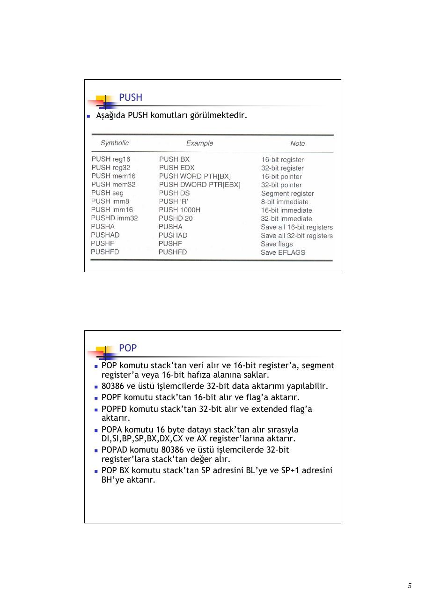
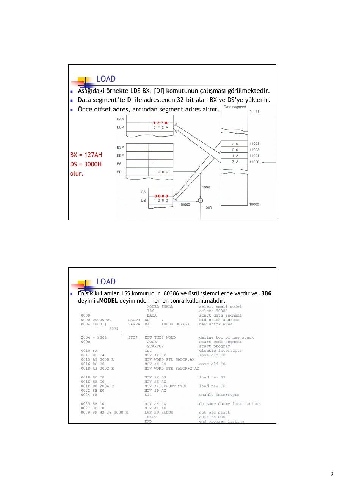
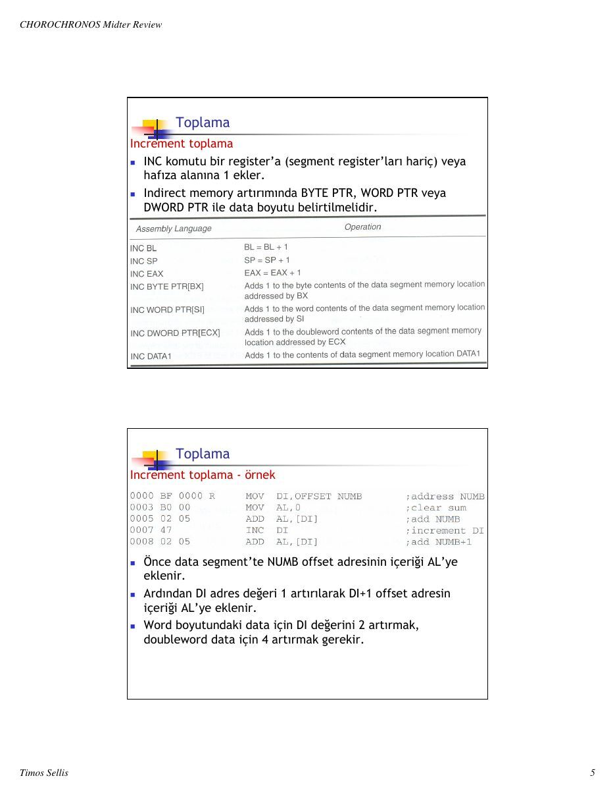
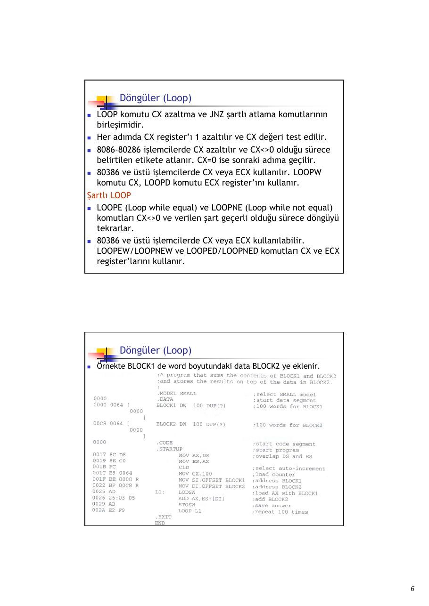
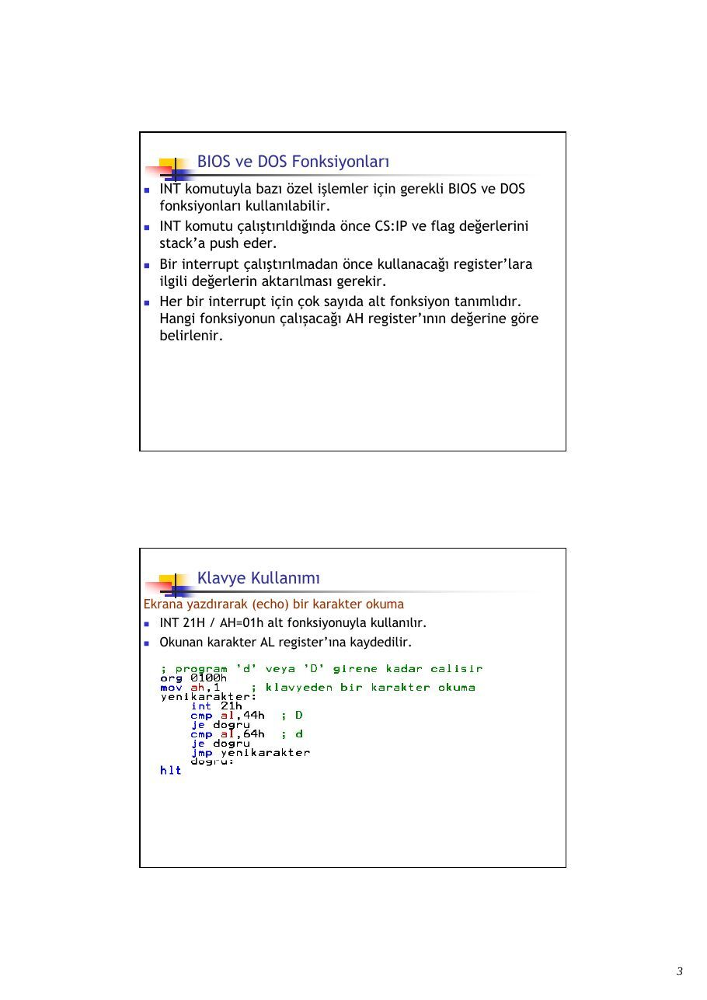

Bu yazı, Başkent Üniversitesi **EEM332 Mikroişlemciler** ders arşivindeki ilgili notları ve uygulamaları bir araya getiriyor (2008–2015). Veri aktarımı, aritmetik ve mantık, dallanma, makrolar, BIOS ve DOS yordamları. Kaynak: Gazi Üniversitesi, M. Ali Akcayol; BİL362 ders notları. Belgelerin PDF arşiv kopyaları ve varsa kaynak kodları yazının sonunda ZIP olarak indirilebilir.

*Bu içerik üçüncü taraf bir kaynağa aittir; arşiv ve nostalji amacıyla kaynak belirtilerek paylaşılmıştır. Hak sahibinin talebi hâlinde kaldırılır.*

## CPUL5DataMovement

BIL 362 Mikroişlemciler

M.Ali Akcayol Gazi Üniversitesi Bilgisayar Mühendisliği Bölümü

Konular Veri Aktarım (Data Movement) Komutları

- MOV Komutu

- PUSH / POP Komutları

- LOAD Komutları

- String Data Transfer Komutları

- Diğer Data Transfer Komutları

- Segment Override Prefix

- Assembler Komutları

- Hafıza Organizasyonu

```asm
MOV
```

- MOV komutu register-register veya register-memory arasında

8086-80286 işlemciler için byte veya word 80386 ve üstü işlemciler için byte, word veya doubleword data transfer eder.

- MOV CX,DX komutu word (16-bit) boyutundaki DX içeriğini

CX register’ına aktarır.

- 80386 ve üstü işlemcilerde doubleword (32-bit) boyutundaki

veri aktarılabilir.

- MOV ECX,EDX komutu doubleword EDX içeriğini ECX

register’ına aktarır.

- MOV AL,22H       komutu byte boyutundaki 22H değerini AL

register’ına aktarır.

```asm
MOV
```

- 80386 ve üstü işlemcilerde doubleword (32-bit) boyutundaki

data aktarılabilir.

- MOV EBX,12345678H komutu doubleword 12345678H

değerini EBX register’ına kopyalar.

- MOV CX,LIST     komutu hafızada LIST adresindeki word

boyutundaki içeriği CX register’ına aktarır.

- MOV AX,[BX]     komutu data segment içerisinde BX offset

adresindeki bir word datayı AX register’ına aktarır.

```asm
PUSH / POP
```

- PUSH ve POP komutları LIFO yapısındaki stack memory’den bilgi

almak veya bilgi depolamak için kullanılırlar.

- Mikroişlemci 6 farklı PUSH ve POP yapısına sahiptir: register,

memory, immediate, segment register, flags ve all registers.

- Register adresleme herhangi bir register içeriğinin stack’a

saklanması veya stack’tan alınmasını sağlar.

- Memory adresleme bir memory alanının stack’a saklanması veya

stack’tan alınmasını sağlar.

- Immediate adresleme sabit bir verinin stack’a saklanmasını sağlar.

- Segment register adresleme bir segment register’ın stack’a

saklanması veya stack’tan alınmasını sağlar. CS PUSH edilebilir ancak CS’ye POP edilemez.

- Flags adreslemede flag’lar stack’a saklanabilir veya stack’tan

alınabilir.

- All register adreslemede tüm register içerikleri PUSH veya POP

edilebilir.

```asm
PUSH
```

- 8086-80286 mikroişlemcilerde PUSH komutu 16-bit data’yı

stack’a saklar veya stack’tan alır. 80386 ve üstü işlemcilerde 2 veya 4 byte data stack’a saklanır.

- PUSHA komutu segment register’ları hariç diğer tüm

register’ları stack’a saklar.

- PUSHA (push all) komutu register’ları AX,CX,DX,BX,SP,BP,SI

ve DI sırasında stack’a saklar.

- PUSHF (push flags) komutu flag register’ların içeriğini

stack’a saklar.

- PUSHAD ve POPAD komutları 32-bit register’ların tümünü

stack’a push veya stack’tan pop eder.

- 16-bit push işlemi yapıldığında soldaki 8-bit SP-1 ve sağdaki

8-bit SP-2 adresine yazılır.

```asm
PUSH
```

- PUSH AX komutunun çalışmasından sonraki durum aşağıda

görülmektedir.

- AH SP-1 ve AL SP-2 adresine saklanır.

```asm
PUSH
```

- PUSHA komutu 16-bit tüm register’ları stack’a saklar.

- Sıralama AX,CX,DX,BX,SP,BP,SI ve DI şeklindedir.

- PUSHAD komutu 32-bit tüm register’ları stack’a saklar.

- PUSH ‘A’ komutu 0041H

değerini stack’a saklar.

### 0041H = ASCII(A)

```asm
PUSH
```

- Aşağıda PUSH komutları görülmektedir.

```asm
POP
```

- POP komutu stack’tan veri alır ve 16-bit register’a, segment

register’a veya 16-bit hafıza alanına saklar.

- 80386 ve üstü işlemcilerde 32-bit data aktarımı yapılabilir.

- POPF komutu stack’tan 16-bit alır ve flag’a aktarır.

- POPFD komutu stack’tan 32-bit alır ve extended flag’a

aktarır.

- POPA komutu 16 byte datayı stack’tan alır sırasıyla

DI,SI,BP,SP,BX,DX,CX ve AX register’larına aktarır.

- POPAD komutu 80386 ve üstü işlemcilerde 32-bit

register’lara stack’tan değer alır.

- POP BX komutu stack’tan SP adresini BL’ye ve SP+1 adresini

BH’ye aktarır.

```asm
POP
```

- Aşağıdaki şekilde POP BX komutu çalıştıktan sonraki durum

görülmektedir.

```asm
POP
```

- Aşağıda POP komutları görülmektedir.

### LOAD

- Herhangi bir hafıza alanını veya bir operand’ın offset adresini bir

register’a yüklemek için kullanılır.

- LEA komutu 16-bit register’a operand’ın offset adresini yükler.

- LDS, LES 16-bit DS ve ES register’larına bir hafıza alanını yükler.

- 80386 ve üstü işlemcilerde LFS, LGS ve LSS komutları 32-bit offset

adresinden FS, GS ve SS register’larına yükler.

- Aşağıda LOAD komutları görülmektedir.

### LOAD

```asm
LEA
```

- LEA komutu 16 veya 32-bit register’lara operand’la belirtilen

datanın offset adresini yükler.

- LEA AX, NUMB komutu NUMB operand’ının adresini AX’e

yükler.

- LEA BX,[DI] komutu [DI] operand’ının offset adresini BX’e

yükler (DI içeriği). MOV BX,[DI] komutu [DI] operand’ının gösterdiği adresteki datayı BX’e yükler.

### LOAD

- Aşağıdaki örnekte önce SI register’ına DATA1 operand’ının offset

adresi yüklenir.

- Ardından DI register’ına DATA2 operand’ının offset adresi yüklenir.

- Program çalıştıktan sonra DATA1 ve DATA2 hafıza alanlarının içeriği

yer değiştirilir.

### LOAD

### LDS, LES, LFS, LGS, LSS

- LDS, LES, LFS, LGS, LSS komutları 16 veya 32-bit register’lardan

birisine offset adresini yükler, DS, ES, FS, GS, SS segment register’larından birisine segment adresini yükler.

- Bu komutlar segment ve offset adresini içeren 32-bit (16-bit

segment+16-bit offset) veya 48-bit (32-bit offset+16-bit segment) hafıza alanına erişim yapar.

- LFS, LGS ve LSS komutları 80386 ve üstü işlemcilerde vardır.

### LOAD

- Aşağıdaki örnekte LDS BX, [DI] komutunun çalışması görülmektedir.

- Data segment’te DI ile adreslenen 32-bit alan BX ve DS’ye yüklenir.

- Önce offset adres, ardından segment adres alınır.

### BX = 127AH

### DS = 3000H

olur.

### LOAD

- En sık kullanılan LSS komutudur. 80386 ve üstü işlemcilerde vardır ve .386

deyimi .MODEL deyiminden hemen sonra kullanılmalıdır.

String Data Transfer

- LODS, STOS, MOVS, INS ve OUTS komutları kullanılır. String

komutları byte,word veya doubleword data transfer eder. Direction Flag

- Flag register’daki D biti string işlemleri için DI ve SI register’larının

otomatik artırılması (D=0) veya otomatik azaltılması (D=1) için kullanılır.

- Direction biti sadece string işlemlerinde kullanılır.

- CLD komutu D=0 (clear) yapar, STD komutu D=1 (set) yapar.

- String komutu bir byte transfer ederse SI/DI 1 değişir, bir word için

SI/DI 2 değişir, doubleword için SI/DI 4 değişir.

- Her komut DI/SI çiftinden birisini kullanır. STOSB komutu DI

register’ını artırır veya azaltır (SI değişmez), LODSB SI register’ını artırır veya azaltır (DI değişmez).

- Tüm string komutları DI offset adresiyle extra segment’e, SI offset

adresiyle data segment’e erişir.

String Data Transfer

```asm
LODS
```

- LODS komutu AL, AX veya EAX (80386 ve üstü) register’larına data

segment’te SI register’ıyla belirlenen offset adresinin içeriğini yükler.

- AL, AX veya EAX yüklendiğinde D=0 için SI artırılır D=1 için SI azaltılır.

- Byte boyutunda transfer için 1, word için 2 ve doubleword için 4 artırılır

veya azaltılır.

- LODSB (loads a byte) komutu AL register’ına bir byte, LODSW (loads a

word) AX register’ına bir word ve LODSD (loads a doubleword) EAX register’ına bir doubleword yükler.

String Data Transfer

- Aşağıdaki şekilde LODSW komutunun

D=0, SI=1000H ve DS=1000H için çalışması görülmektedir.

- 11000H ve 11001H AX’e yüklenir.

- D=0 olduğundan ve 16-bit transfer

edildiğinden SI 2 artırılır.

- SI=1002 olacaktır.

String Data Transfer

```asm
STOS
```

- STOS komutu AL, AX veya EAX (80386 ve üstü) register’larını extra

segment’te DI register’ıyla belirlenen offset adresine kopyalar.

- AL, AX veya EAX aktarıldığında D=0 için DI artırılır D=1 için DI azaltılır.

- Byte boyutunda transfer için 1, word için 2 ve doubleword için 4 artırılır

veya azaltılır.

- STOSB (stores a byte) komutu AL register’ını, STOSW (stores a word) AX

register’ını ve STOSD (stores a doubleword) EAX register’ını extra segment’te DI ile belirtilen offset adresine kopyalar.

String Data Transfer

```asm
STOS ve REP
```

- REP (repeat prefix) deyimi LODS hariç diğer string data

transfer komutlarına eklenir.

- REP deyimi her string komutu çalıştığında CX sayacını 1

azaltır. CX = 0 olduğunda döngü biter ve sonraki komut çalışır.

- CX=100 iken REP STOSB komutu, DI register’ı her döngüde 1

azalacağı veya artacağı için AL register’ının içeriğini 100 adreslik bir hafıza bloğuna aktarır.

- STOSB (stores a byte) komutu AL register’ını, STOSW (stores a

word) AX register’ını ve STOSD (stores a doubleword) EAX register’ını DI ile belirtilen extra segment alanına aktarır.

- STOSW komutu DI register’ını 2 değiştirir, STOSD komutu 4

değiştirir.

String Data Transfer

```asm
STOS ve REP
```

- Aşağıdaki örnek Buffer adlı hafıza bloğunu Count değeri kadar temizler.

- Program C++ ortamında inline assembler ile yazılmış ve ClearBuffer

fonksiyonu çağırılarak çalıştırılmaktadır.

- REP STOSW komutu Buffer adlı hafıza bloğunu AX=0 yazarak temizler.

her tekrarda ECX 1 azalır, EDI 2 (D=0)artar.

String Data Transfer Operand operatörleri

- Herhangi bir operand operatörlerle birlikte kullanılabilir.

String Data Transfer

```asm
MOVS
```

- MOVS komutu iki hafıza alanı arasında string data aktarır.

- 8086-Pentium 4 mikroişlemcilerde memory-to-memory işlemine izin veren

tek komuttur.

- MOVS komutu data segment’te SI ile adreslenen byte, word veya

doubleword data’yı DI ile adreslenen extra segment’e kopyalar.

- SI ve DI için artma/azalma direction bayrağıyla belirlenir.

String Data Transfer Blok Transfer

- REP MOVSD komutu BlockA’yı BlockB’ye kopyalar.

String Data Transfer

### INS

- INS komutu bir I/O cihazından byte, word veya doubleword data’yı extra

segment içerisinde DI ile adreslenen alana aktarır. (8086/8088’de yoktur.)

- I/O adresi DX register’ından alınır.

- Bir harici I/O cihazından hafızaya blok data aktarımında etkindir.

- INSB byte, INSW word ve INSD doubleword data transfer eder.

String Data Transfer INS - örnek

- Aşağıdaki örnekte 03ACH adresine sahip I/O cihazından 50 byte data’yı

```asm
extra segment’te LISTS dizisine aktarılır.
```

String Data Transfer

### OUTS

- OUTS komutu data segment içerisinden SI ile adreslenen alandan byte,

word veya doubleword data’yı bir I/O cihazına aktarır. (8086/8088’de yoktur.)

- I/O adres DX register’ındadır.

- Bir blok datanın harici I/O cihazına aktarımında etkindir.

- OUTSB byte, OUTW word ve OUTSD doubleword data transfer eder.

String Data Transfer OUTS - örnek

- Aşağıdaki örnekte data segment’te ARRAY adresindeki 100 byte data 03ACH

adresine sahip I/O cihazına aktarılır.

Diğer Data Transfer Komutları

```asm
XCHG
```

- XCHG komutu iki register veya bir register ile bir hafıza alanı arasında

data’yı karşılıklı değiştirir.

- XCHG komutu segment register’larını değiştiremez veya memory-to-

memory değiştiremez.

- XCHG AL,[DI] ile XCHG [DI],AL aynı işlemi yapar.

Diğer Data Transfer Komutları

```asm
IN ve OUT
```

- IN komutu harici I/O cihazından AL,AX ve EAX register’larına data aktarır.

- OUT komutu AL,AX ve EAX’ten harici I/O cihazına data aktarır.

- 16-bit I/O port adres Address Bus ile ilgili cihaza iletilir.

- Fixed port adreslemede port adresi opcode’dan hemen sonra gelir.

Variable port adreslemede DX register’ı port adresini saklar.

Diğer Data Transfer Komutları

```asm
IN ve OUT - örnek
```

- Aşağıdaki örnekte OUT 19H,AX komutunun çalışması görülmektedir.

- AX içeriği I/O port 19H adresine aktarılır. Adres bus 0019H (16-bit)

değerine, data bus AX içeriğine ve control bus IOCW (I/O write control) kontrol işaretine (lojik 0 ilgili I/O cihazını etkin yapar (enable)) sahiptir.

Segment Override Prefix

- Komutlar için default (varsayılan) register değiştirilerek farklı

segment’teki data’ya erişmeyi sağlar.

- MOV AX,[DI] komutu default olarak data segment’e erişir. MOV

AX,ES:[DI] komutu extra segment’e erişmeyi sağlar.

- Aşağıda bazı komutlar görülmektedir.

Assembler Komutları

- Assembler komutları (directives), operand veya programın bir kısmında

assembler tarafından nasıl işlem yapılacağını belirler.

Assembler Komutları

Assembler Komutları

- DB (define byte), DW (define word) ve DD (define

doubleword) hafıza tanımlama ve data aktarmak için kullanılır.

- SEGMENT deyimiyle istenildiği kadar yeni sembolik isme sahip

segment tanımlanabilir.

- DB, DW ve DD komutlarıyla tanımlanan alanlar ? ile sonraki

kullanımlar için reserve edilebilir.

- DUP (duplicates) komutu bir dizi oluşturur. 10 DUP (?) komutu

herhangi bir değer atamadan 10 hafıza alanı ayırır.

- DATA1 DB 10 DUP (2) komutu 10 byte hafıza alanını ayırır ve

her birisinin içerisine 02H atar.

Assembler Komutları Örnek

Assembler Komutları ASSUME, EQU ve ORG

- ASSUME deyimi code, data, extra ve stack segment için seçilen isimleri

belirtmek için kullanılır. EQU (equate) deyimi bir sayıyı, ASCII karakteri veya etiketi başka bir etikete eşitler.

- ORG (origin) deyimi data segment içindeki offset adresini değiştirmek için

kullanılır. THIS deyimi THIS BYTE, THIS WORD veya THIS DWORD şeklinde kullanılır ve ilgili etikete belirtilen data aktarılabilir.

Assembler Komutları PROC ve ENDP

- PROC ve ENDP deyimleri bir prosedürün başlangıcını ve bitişini gösterir.

- PROC ve ENDP deyimleri başlangıç ve bitişi için etikete gerek duyarlar.

- PROC deyimi NEAR veya FAR şeklinde iki ifade kullanır.

- NEAR (lokal) procedürün aynı code segment’e yerleştirilmesi, FAR (global)

hafızada herhangi bir yere yerleştirilmesini sağlar.

- Aşağıdaki örnekte BX, CX, DX toplanarak sonuç AX register’ına

aktarılmaktadır.

Hafıza Organizasyonu

- Assembler iki farklı hafıza organizasyonu kullanır. Birisi model kullanımı diğeri tüm

segment tanımlarının (full-segment definitions) yapılmasıdır.

- Model kullanımı kolaydır ve basit programlarda kullanılmalıdır.

- Full-segment definitions assembly dilinnde daha iyi kontrol sağlar ve kompleks

programlarda kullanılmalıdır. Model

- MASM assembler tiny, small, medium, compact, large, huge, flat modelleri

kullanır.

- Tiny model tüm programın 64 KB tek segment’e sığdırılmasını sağlar.

- Small model bir data segment ve bir code segment kullanılmasını sağlar ve toplam

boyut 128KB olur.

- Medium model birden çok code segment ve bir data segment kullanılmasını sağlar.

- Compact model, bir code segment ve birden çok data segment kullanılmasını

sağlar.

- Large model, birden çok code segment ve birden çok data segment kullanılmasını

sağlar. 64K dan büyük dizi kullanılamaz.

- Huge model, birden çok code segment ve birden çok data segment kullanılmasını

sağlar. 64K dan büyük dizi kullanılabilir.

- Flat model, 4GB’a kadar bir segment kullanılmasını sağlar. Tüm data ve code 32-bit

bir segmentte bulunabilir.

Hafıza Organizasyonu Model

- Aşağıdaki örnekte 100-byte LISTA isimli hafıza bloğunu LISTB alanına

kopyalar.

Hafıza Organizasyonu Full-Segment Tanımı

- Model yaklaşımına göre daha yapısaldır. Örnek sonraki sayfadadır.

- STACK_SEG için ayrılan alan SEGMENT ve ENDS arasıdır.

- DW 100H DUP(?) komutu stack segment için 100H adet word alan oluşturur.

- STACK kelimesi SS ve SP register’larını otomatik olarak yükler.

- DATA_SEG için LISTA ve LISTB her elemanı byte olan 100 elemanlı iki dizi

tanımlanmıştır.

- CODE_SEG ile ENDS arası code segment’i göstermektedir.

- ‘DATA’ ve ‘CODE’ kelimeleri MS CodeView ile debug işlemi için kullanılır.

- ASSUME deyimi SS için STACK_SEG, DS için DATA_SEG ve CS için CODE_SEG

isminin kullanıldığını gösterir.

Hafıza Organizasyonu

Ödev

- Her birisi byte olan 10 elemanlı DIZI1 adlı dizinin elemanlarını

hepsi byte olan 100 elemanlı DIZI2 adlı diziye 10 kez ardarda kopyalayan bir program yazınız. Programda gerekli gördüğünüz yerlere açıklama yazınız. Program courier new font ile ve 12 boyutunda yazılacaktır. Programda sadece etiket, komut ve açıklama kısımlarının yazılması yeterlidir.





## CPUL6ArithmeticLogic

BIL 362 Mikroişlemciler

M.Ali Akcayol Gazi Üniversitesi Bilgisayar Mühendisliği Bölümü

Sh Konular

Aritmetik ve Mantık (Arithmetic and Logic) Komutları = Toplama, Çıkarma ve Karşılaştırma Komutları » Çarpma ve Bölme Komutları = Temel Mantık Komutları = Kaydırma ve Döndürme (Shift and Rotate) Komutları = String Karşılaştırma Komutları

Toplama

= ADD (Addition) mikroişlemcide birçok şekilde kullanılabilir.

= Register, immediate, memory-to-register, array, increment,

```asm
addition-with-carry toplama işlemleri yapılabilir.
```

= Memory-to-memory ve segment register toplama işlemleri yapılamaz.

= Segment register'ları sadece MOV, PUSH veya POP yapılabilir.

=. Toplama

Register ‘Assembly Language Operation

```asm
ADD ALL AL=AL+BL
```

toplama Awcxo Ox= 0X +01

```asm
ADD EBP,EAX EBP = EBP + EAX
ADD CLAAH CL=CL+44H
ADD BX,245FH BX = BX + 245FH
ADD EDX,12345H EDX = EDX + 12345H
ADD [BX] AL AL adds to the byte contents of the data segment memory location
addressed by BX with the sum stored in the same memory location
ADD CLP] The byte contents ofthe stack segment memory location addressed
```

by BP add to CL with the

```asm
ADD AL, [EBX] The byte contents of the
```

by EBX add to AL with the sun

um stored in CL

```asm
ta segment memory location addressed
```

tored in AL

```asm
ADD BX,[SI+2] The word contents of the data segment memory location addressed
```

by Sİ + 2 add to BX with the sum stored in BX

```asm
ADD CL, TEMP. The byte contents of data segment memory location TEMP add to
```

CL with the sum stored in Ci

‘ADD BX,TEMPJDİ) ‘The word contents of the data segment memory location addressed by TEMP + DI add to BX with the sum stored in BX

```asm
ADD [BX+DI],DL DL adds to the byte contents of the data segment memory location
addressed by BX + Dİ with the sum stored in the same memory
location
```

```asm
ADD BYTE PTR[DI],3 O A3 adds to the byte contents of the data segment memory location
addressed by DI with the sum stored in the same location
```

```asm
ADD BX,[EAX+2*ECX] © The word contents of the data segment memory location addressed
```

by EAX plus 2 times ECX add to BX with the sum stored in BX

Sh Toplama

Örnek

Örnekte AX, BX, CX ve DX register'ları toplanır ve 16-bti AX register'ına sonuç saklanır.

Bir toplama işlemi yapıldığında FLAG register değeri değişir.

```asm
ADD komutu sign, zero, carry, auxiliary carry, parity ve
```

overflow bitleri değişir.

Toplama

Immediate toplama

Sabit bir değer toplanır.

### 0000 B2

00 80

Once DL’ye 12H yüklenir. Daha sonra 33H ile DL içeriği toplanır. Toplama işlemi sonucu 45H DL register'ına saklanır.

Bu işlem sonucunda FLAG değişimleri yandaki gibidir.

Z = 0 (result not zero) C= 0 (no carry)

A= 0 (no half-carry) S = 0 (result positive) P = 0 (odd parity)

O= 0 (no overflow)

Toplama

Memory-to-register toplama « İstenen hafıza alanı bir register'la toplanır.

### 0000 BF 0000 R MOV DI,OFFSET NUMB

### 0003 BO 00 MOV AL,0

0005 02 05 0007 02 45 01

iclear sum

```asm
ADD AL, [DI] ;add NUMB
ADD AL, [DI+1] jadd NUMB+1
```

= Önce DI’ya NUMB offset adresi aktarılır.

= Daha sonra AL’ye 0 değeri aktarılır.

= Data segment'te DI offset adresinin içeriği AL register’ina eklenir.

= Son olarak AL register'ına data segmentte DI*1 offset adresinin içeriği eklenir.

Toplama

Array toplama = Hafızada bir alanda bulunan dizi değerleri toplanır.

```asm
;clear sum
```

### ERE

Le oD

= Önce AL’ye aktarılır.

= Daha sonra SI register'ına 3 değeri aktarılır.

= ARRAYISIJ operand’1 SI=3 olduğu için dizideki 3.elemanı gösterir.

= Dizinin 3.elemanı, 5.elemani ve 7.elemanı toplanarak sonuç AL register'ına aktarılır.

Toplama

```asm
Increment toplama
```

= INC komutu bir register'a (segment register'ları hariç) veya hafıza alanına 1 ekler.

= Indirect memory artırımında BYTE PTR, WORD PTR veya DWORD PTR ile data boyutu belirtilmelidir.

Assembly Language Operation

```asm
INC BL BL=BL+1
```

```asm
INC SP SP=SP+1
```

```asm
INC EAX EAX = EAX+1
```

```asm
INC BYTE PTR[BX] Adds 1 to the byte contents of the data segment memory location
addressed by BX
```

```asm
INC WORD PTRISIJ ‘Adds 1 to the word contents of the data segment memory location
addressed by SI
```

```asm
INC DWORD PTRIECX] Adds 1 to the doubleword contents of the data segment memory
```

location addressed by ECX

```asm
INC DATA1 Adds 1 to the contents of data segment memory location DATA1
```

Toplama

```asm
Increment toplama - örnek
```

0000 BF 0000 R MOV DI,OFFSET NUMB jaddress NUMB

0003 BO 00 / AL,O ;clear sum

0005 02 05 ADD AL, [DI] ;add NUMB

0007 47 INC DI ;increment DI

0008 02 05 ADD AL, [DI] ;add NUMB+1

« Once data segment’te NUMB offset adresinin içeriği AL’ye eklenir.

= Ardından DI adres değeri 1 artırılarak DI*1 offset adresin içeriği AL’ye eklenir.

= Word boyutundaki data için DI değerini 2 artırmak, doubleword data için 4 artırmak gerekir.

=. Toplama

Carry ile toplama

= ADC (addition-with-carry) komutu operand’a carry bitinin degerini ekler.

|Assembly Language Operation

ADC AL,AH AL = AL + AH + carry

ADC CX,BX CX = CX + BX + carry

ADC EBX,EDX EBX = EBX + EDX + carry

ADC DH BX] The byte contents of the data segment memory location addressed by BX add to DH with the sum stored in DH

ADC BX,[BP+2] The word contents of the stack segment memory location addressed by BP plus 2 add to BX with the sum stored in BX

ADC ECX,[EBX] The doubleword contents of the data segment memory location

```asm
addressed by EBX add to ECX with the sum stored in ECX
```

=. Toplama Carry ile toplama nek

= AX ve BX te bulunan 32-bit data CX ve DX te bulunan 32-bit

datayla toplansin. Sr (ADO) (çi (ADD)

### [ BX | | L AX |

+ L DX | | [ cx |

### [ BX | J AX |

000 03 Cl ADD

### 2 13 DA ADC

a Cikarma . (subtraction) komutu bir operand’! diğerinden çıkarmak

için kullanılır. « Özel formu DEC (decrement) komutudur ve 1 cıkarır.

Assembly Language Operation

```asm
SUB CLEL CL=CL-BL
```

```asm
SUB AX,SP AX = AX - SP
```

```asm
SUB ECX,EBP ECX = ECX - EBP
```

```asm
SUB DH,6FH DH = DH ~ 6FH
```

```asm
SUB AX,0CCCCH AX = AX — 0CCCCH
```

```asm
SUB ESI,2000300H ESI = ES! — 2000300H
```

```asm
SUB [DI],CH Subtracts CH from the byte contents of the data se
addressed by DI and stores the difference in the
location
```

```asm
SUB CH,[BP] Subtracts the byte contents of the stack segment memory location
addressed by BP from CH and stores the difference in CH
```

```asm
SUB AH,TEMP Subtracts the byte contents of memory location TEMP from AH and
```

stores the difference in AH

```asm
SUB Dİ,TEMPJESİ) Subtracts the word contents of the data segment memory location
addressed by TEMP plus ESI from DI and stores the difference in Dİ
```

```asm
SUB ECX,DATAT Subtracts the doubleword contents of memory location DATA1 from
```

ECX and stores the difference in ECX

ent memory e memory

Cikarma

Register çıkarma = Bir register’in değeri diğerinden çıkarılır.

### 0000 2B D9 SUB BX,CX

### 0002 2B DA SUB BX,DX

« Örnekte 16-bit CX ve DX register'ları BX’ten çıkarılır ve sonuç BX'te saklanır.

= Her çıkarmadan sonra FLAG bitleri değiştirilir.

= Cikarma Immediate çıkarma = Bir sabit değer bir register'dan çıkarılır. Sabit değer

instruction'la birlikte verilir.

)000 BS z MOV H

= Örnekte 8-bit 22H değeri CH register’ina aktarılır.

= Ardından 22H değerinden 44H değeri çıkartılır. Sonuç (ODEH) CH register'ında saklanmaktadır. FLAG durumları aşağıdadır. Z = O (result not zero)

C = 1 (borrow) 1 (half-borrow)

= | (result negative)

i

1 (even parity)

### OUND

if

= 0 (no overflow)

Cikarma

```asm
Decrement cikarma
```

= Bir hafıza alanından veya register’dan 1 çıkarılır.

a DEC komutu hafıza adreslediğinde BYTE PTR, WORD PTR veya DWORD PTR kullanilmalidir.

= DEC [SI] yerine DEC BYTE PTR [SI], DEC WORD PTR [SI] veya

```asm
DEC DWORD PTR [S!] kullanılmalıdır.
```

```asm
DEC BYTE PTRIDI|
```

```asm
DEC WORD PTRIBP]
```

```asm
DEC DWORD PTRIEBX!
```

```asm
DEC NUMB
```

Assemb Operation

```asm
DEC BH BH =BH~1
DEC CX CX=CX-1
DEC EDX EDX = EDX -1
```

```asm
Subtracts 1 from the byte contents of the data segment memory
```

location addr by DI

```asm
Sub n the word contents of the stack segment
```

memory | addressed by BP

Su

the doubleword contents of the data segment tion addressed by EBX

```asm
Subtracts 1 from the contents of data segment memory
```

location NUMB

memory |

Cikarma

Ödünç alma ile (subtraction-with-borrow) çıkarma

= SBB (subtraction-with-borrow) hedef operand’dan diğer operand ile carry biti çıkarılır.

= SBB komutu hafıza adreslediğinde BYTE PTR, WORD PTR veya DWORD PTR kullanılmalıdır.SBB [SI] yerine SBB BYTE PTR [SI], SBB WORD PTR [SI] veya SBB DWORD PTR [SI] kullanılmalıdır.

Assembly Language Operation

SBB AH,AL AH = AH— AL ~carry

SBB AX,BX AX = AX - BX - carry

SBB EAX,ECX EAX = EAX — ECX — carry

SBB CL,2 CL-CL-2- carry

SBB BYTE PTRIDI|3 Both 3 and carry subtract from the data segment memory location

```asm
addressed by Dİ
```

SBB (DI) AL Both AL and carry subtract from the data segment memory location

```asm
addressed by Dİ
```

SBB DI,[BP+2] Both carry and the word contents of the stack segment memory location addressed by BP plus 2 subtract from DI

SBB AL,[EBX+ECX] Both carry and the byte contents of the data segment memory

location addressed by EBX plus ECX subtract from AL

karma

Ödünç alma ile çıkarma - örnek = BX ve AX register'larında bulunan 32-bit sayı SI ve DI’da bulunan 32-bit

sayidan cikarilmaktadir. CF (SBB) i (SUB)

### BX AX

— sı DI BX i AX

### 0000 2B

Zi Karşılaştırma (Comparison) . (compare) komutu çıkarma işlemi yapar, hedef operand değişmez.

= Genellikle bir JUMP komutu izler ve FLAG ları kontrol eder. = Memory-to-memory ve segment register karşılaştırılamaz.

Assembly Language Operation

```asm
CMP CL,BL cL-BL
```

```asm
CMP AX,SP AX-SP
```

```asm
CMP EBPESİ EBP —ESİ
```

```asm
CMP AX,2000H AX—2000H
```

```asm
CMP [DI],CH CH subtracts from the byte contents of the data segment memory
```

location addressed by DI

```asm
CMP CLIP] The byte contents of the stack segment memory location addressed
```

by BP subtracts from CL

```asm
CMP AH,TEMP The byte contents of data segment memory location TEMP subtracts
```

from AH

```asm
CMP DI,TEMP[BX] The word contents of the data segment memory location addressed
```

by TEMP plus BX subtracts from DI

```asm
CMP AL{EDIESI] The byte contents of the data segment memory location addressed
```

by EDİ plus ES! subtracts from AL

Karsilastirma (Comparison)

= Aşağıdaki örnekte AL register’! 10H ile karşılaştırılır.

= Şartlı dallanma (conditional jump) komutları JA (jump above) ve JB (jump below) karşılaştırmanın sonucuna göre atlamayı gerçekleştirir.

= JA komutu eğer AL register'ı 10H’dan büyüksek atlamayı gerçekleştirir, JB komutu küçükse atlamayı gerçekleştirir.

ainst 10H

```asm
or above
```

0000 3c 10 CMP AL,10H compare 0002 73 1c JAE SUBER jif AL

= Örnekte JAE (jump above or equal) komutu AL register'ı 10H

ise veya 10H’dan büyükse programı SUBER etiketinin olduğu satıra atlatır.

= JBE (jump below or equal) komutu AL register’1 10H ise veya

10H’dan küçükse ilgili satıra atlatır.

Çarpma ve Bölme Çarpma (Multiplication) = Çarpma işlemi byte,word veya doubleword datayla yapılabilir. « İşaretli (signed) integer (IMUL) veya isaretsiz (unsigned) integer (MUL) komutları kullanılabilir.

= Çarpım sonucu her zaman iki kat genişliğindedir. 8-bit iki sayının çarpım sonucu 16-bit, 16-bit iki sayının çarpımı 32-bit ve 32-bit iki sayının çarpımı 64-bit olur.

= Ove C fag bitleri etkilenir. Eğer 8-bit iki sayının sonucunda soldaki 8-bit 0 ise 0-0 ve C-0 olur. C=1 olması sonucun 16-bit olduğunu gösterir.

« İki 16-bit sayının çarpım sonucunda C-0 ve 0-0 olursa soldaki 16-bit 0 değerindedir.

Sİ Çarpma ve Bölme

8-bit çarpma

= 8-bit çarpmada çarpılan her zaman AL (işaretli/işaretsiz) olur.

= Çarpan 8-bit bir register veya bir hafıza alanı olur.

= Çarpma komutunda 1 operand vardır ve default çarpılan AL register’idir.

= MUL BL komutu AL ile BL’yi isaretsiz çarpar. Çarpma sonucu 16-bit AX register'ına kaydedilir.

Assembly Language Operation

```asm
MUL CL AL is multiplied by CL; the unsigned product is in AX
```

IMUL DH AL is multiplied by DH; the signed product is in AX

IMUL BYTE PTRIBXJ AL is multiplied by the byte contents of the data segment memory location addressed by BX; the signed product is in AX

```asm
MUL TEMP AL is multiplied by the byte contents of data segment memory
```

location TEMP; the unsigned product is in AX

il

Çarpma ve Bölme

8-bit çarpma - örnek

= BI ve CL register'larındaki 8-bit unsigned sayılar çarpılmaktadır.

= 16-bit sonuç DX register’ina kaydedilmektedir.

= Bu işlem AL register’: kullanılarak yapılacağından bir register’! AL’ye aktarmak gerekir.

= Signed sayılar için IMUL komutu kullanılır.

= Negatif sayılar için ikinin tümleyeni, pozitif sayılar için binary form kullanılır.

(6)

AL, CL ;position data

### 0008 8B DO MOV DX,AX

```asm
;position product
```

= Carpma ve Bolme 16-bit carpma

= 16-bit çarpmada çarpılan her zaman AX olur. = Carpan 8-bit bir register veya bir hafiza alam olur.

= Carpim sonucu DX-AX icerisine saklanir. DX most-significant 16-bit, AX least-significant 16-bit sayıyı saklar.

Assembly Language Operation

```asm
MUL Cx AX is multiplied by CX; the unsigned product is in DX-AX
```

IMUL DI AX is multiplied by DI; the signed product is in DX-AX

```asm
MUL WORD PTRISIJ AX is multiplied by the word contents of the data segment memory
```

location addressed by SI; the unsigned product is in DX-AX

= Carpma ve Bolme 32-bit carpma

80386 ve üstü işlemcilerde 32-bit çarpma yapılabilir. 32-bit çarpma işaretli (IMUL) veya isaretsiz (MUL) olabilir. EAX register’1 komut tarafından belirlenen operand'la çarpılır.

Sonuç EDX-EAX içerisine saklanır. EDX most-significant 32-bit ve EAX least significant 32-bit kısmı saklar.

Assembly Language Operation

```asm
MUL ECX EAX is multiplied by ECX; the unsigned product is in EDX-EA\
```

IMUL EDI EAX is multiplied by EDİ; the signed product is in EDX-EAX

```asm
MUL DWORD PTRIES!] EAX is multiplied by the doubleword contents of the data
```

segment memory location address by ESI; the unsigned product is in EDX-EAX

Carpma ve Bolme

Bölme (Division)

8086-80286 islemcilerde bolme 8-bit veya 16-bit sayilarda, 80386-Pentium 4 işlemcilerde 32-bit sayılarda yapılır.

IDIV işaretli sayılarda, DIV işaretsiz sayılarda bölme yapar. Bölünen her zaman iki kat genişliğindedir.

```
AX=3000 ise ve 2 ile bölünürse sonuç 1500 olur ve AL
```

registerina sığmaz. (1500 - 10111011100)

Bu durumda overflow oluşur ve divide-error-interrupt gerçekleşir.

=k Carpma ve Bolme 8-bit bolme

= 8-bit bölmede bölünen AX register'ında bulunur ve 8-bit register veya hafızadaki bir değere bölünür.

= AL register’ina bölüm sonucu, AH register’ina kalan saklanır.

« İşaretli sayılar için bölüm negatif veya pozitif olabilir, kalan bölünenin işaretini saklar ve integer sayıdır.

= AX=0010H(+16), BL=FDH(-3) ve IDIV BL komutu çalışırsa

```
AX=01FBH olur. AL=-5 bölüm sonucu ve AH=1 kalan değerdir.
```

Assembly Language Operation

```asm
DIV CL AX is divided by CL; the unsigned quotient is in AL and the unsigned
```

remainder is in AH

IDIV BL AX is divided by BL; the signed quotient is in AL and the signed remainder is in AH

```asm
DIV BYTE PTRIBP| AX is divided by the byte contents of the stack segment memory
```

location addressed by BP; the unsigned quotient is in AL and the unsigned remainder is in AH

Sh Carpma ve Bolme 8-bit bolme - devam

= 8-bit bölmede sayılar genellikle 8-bit olur. Bölünen sayının AX register'i için word boyutuna dönüştürülmesi gerekir.

« İşaretsiz sayılarda soldaki 8-bit (AH) O yapılır (zero-extended). İşaretli sayılarda AH register’ina AL'nin işaret biti aktarılır (sign-extended).

= CBW (convert byte to word) komutu işaretli sayı olan AL register’inin içeriğini AX boyutuna dönüştürür.

=k Carpma ve Bolme 8-bit bolme nek

= Unsigned byte sayı NUMB, unsigned sayı NUMB1’e bölünür. = Bölüm sonucu ANSQ ve kalan ANSR hafıza alanlarına aktarılır.

### 0000 AO 0000 R

```asm
MOV AL,NUMB
```

iget NUMB

0003 EF MOV AH,O ;zero-extend 0005 DIV B ;divide by NU 0009 A2 MOV ;save guotie

000C 88 2 MOV ANSR,AH ave remainder

= Aşağıda signed bölme yapılıyor ve sign extent için CBW kullanilmaktadir.

```asm
MOV AL, NUMB
cBW
```

### IDIV NUMB1

```asm
MOV ANSQ, AL
MOV ANSR, AH
```

=. Carpma ve Bolme 16-bit bolme

= 16-bit bölmede bölünen 32-bit sayı DX-AX register'ında bulunur ve 16-bit register veya hafizadaki bir değere bölünür.

= AX register’ina bölüm sonucu, DX register’ina kalan saklanır.

= 16-bit unsigned bölünen sayı için DX=0 yapılır (zero-extended) ve signed sayı için DX=sign(AX) yapılır (sign-extended).

= CWD(convert word to doubleword) 16-bit sign extend yapar.

Assembly Language Operation

```asm
DIV cx DX-AX is divided by CX; the unsigned quotient is in AX and the
```

unsigned remainder is in DX

ID SI DX-AX is divided by SI; the signed quotient is in AX and the signed remainder is in DX

```asm
DIV NUMB DX-AX is divided by the word contents of data segment memory
```

NUMB; the unsigned quotient is in AX and the unsigned remainder is

```asm
in DX
```

Çarpma ve Bölme 16-bit bölme - örnek

= Aşağıda iki 16-bit signed sayının bölümü görülmektedir.

= AX =-100, CX = +9 ve CWD komutu AX--100(16-bit) değerini DX-AX = -100(32-bit) yapar.

= Bölme sonucunda AX=-11(bdliim) ve DX=-1(kalan) değerine sahiptir.

0000 0003 0006 0007

= Carpma ve Bolme 32-bit bolme

= 80386-Pentium 4 islemcilerde isaretli veya isaretsiz sayilarda 32-bit bölme yapılır.

= 64-bit bölünen EDX-EAX değeri operand’la belirlenen değere bölünür. EAX 32-bit bölüm sonucunu ve EDX kalanı tutar.

= CDQ (convert doubleword to quadword) 32-bit EAX’i 64-bit EDX-EAX’e dönüştürür.

Assembly Language Operation

```asm
Div ECx EDX-EAX is divided by ECX; the unsigned quotient is in EAX and
```

the unsigned remainder is in EDX

IDIV DATA4 EDX-EAX is divided by the doubleword contents in data segment

memory location DATA4; the signed quotient is in EAX and the signed remainder is in EDX

```asm
DIV DWORD PTRIEDI) EDX-EAX is divided by the doubleword contents of the data
```

segment memory location addressed by EDİ; the unsigned quotient is in EAX and the unsigned remainder is in EDX

= Carpma ve Bolme 32-bit bolme - ornek

= Örnekte AX değeri BL’ye bölünür ve sonuç yuvarlanır (round).

= ADDAH,AH ile kalan ikiyle çarpılır ve BL’den büyükse AL (bölüm sonucu) 1 artırılır.

= 0.5 ten büyük değerler bir üst tamsayıya yuvarlanmış olur.

oh Temel Mantık Komutları

. , OR, XOR ve NOT temel mantık komutlarıdır.

= TEST ve NEG komutları AND ile NOT komutlarının özel şeklidir.

= Mantık komutlar bitlere set,clear ve complement işlemi yapar.

= Mantık komutlar carry ve overflow bitlerini 0 yapar. Diğer FLAG bitleri işlem sonucuna göre değer alır.

= Mantık komutları yazılımlarda bit seviyesinde kontrol gerçekleştirir.

Temel Mantık Komutları br,

= AND islemi mantıksal çarpma yapar. Memory-to-memory ve segment register adresleme yapilamaz. Asagidaki dogruluk tablosuna sahiptir.

### A BT

ololo altel : ji — i ole 8

= AND islemi binary sayıda bir bit degerini U yapmak için kullanılır. (masking) XXXXx XXxXx Unknown number

* 00001111 Mask

Result

### 0000 BB 3135 MOV BX,31

### 0003 81 E3 ND BX, 0F'

```asm
;load ASCII
;mask BX
```

### OF

=. Temel Mantık Komutları

```asm
AND - devam
```

= AND işlemleri aşağıdaki tabloda görülmektedir. Memory-to- register veya register-to-register veya immediate adresleme

Assembly Language Operation

```asm
AND AL,BL AL = AL and BL
```

```asm
AND CX,DX CX = CX and DX
```

```asm
AND ECX,EDI ECX = ECX and EDİ
```

```asm
AND CL,33H CL - CL and 33H
```

```asm
AND DI,4FFFH DI = DI and 4FFFH
```

```asm
AND ESİ,34H ESI = ESI and 34H
```

```asm
AND AX,[DI] The word contents of the data segment memory location addressed
```

by Dİ are ANDed with AX

```asm
AND ARRAY[SI],AL The byte contents of the data segment memory location addressed
```

by ARRAY plus SI are ANDed with AL

```asm
AND [EAX],CL CL is ANDed with the byte contents of the data segment memory
```

location addressed by ECX

Si Temel Mantık Komutları

```asm
OR
```

= OR islemi mantıksal toplama yapar. Memory-to-memory ve segment

register adresleme yapilamaz. Asagidaki dogruluk tablosuna sahiptir.

### A BT

### T T

ololo

ola

= OR islemi binary sayıda bir bit değerini 0 yapmak için kullanılır. (masking) XXXX XXXX Unknown number

*00001111 Mask

XXX Result

```asm
OR oOAX,3030H to ASCIT
```

= Temel Mantık Komutları

```asm
OR - devam
```

= OR islemleri aşağıdaki tabloda görülmektedir. Memory-to-register veya register-to-register veya immediate adresleme yapılabilir.

Assembly Language Operation

```asm
OR AL.BL AL = AL or BL
```

```asm
OR SI,DX SI = Sl or DX
```

```asm
OR EAX,EBX EAX = EAX or EBX
```

```asm
OR DH,OA3H DH = DH or OA3H
```

```asm
OR SP,990DH SP = SP or 990DH
```

```asm
OR EBP10 EBP = EBP or 10
```

```asm
OR DX,[BX] DX is ORed with the word contents of data segment memory location
addressed by BX
```

```asm
OR DATES[D1+2],AL The byte contents of the data segment memory location addressed
```

by DI plus 2 are ORed with AL

= Temel Mantık Komutları Exclusive-OR (XOR)

0000 81 0004 83 0007 81

Exclusive-OR işleminde OR işleminden farklı olarak 1,1 girişleri için sonuç 1 değil 0 olur. Memory-to-memory ve segment register adresleme yapılamaz. Aşağıdaki doğruluk tablosuna sahiptir.

### A BT

olala

e |

lale

```asm
OR işlemi binary sayıda bir bit değerini O yapmak için kullanılır. (masking)
```

XXXX XXXxX Unknown number

800001111 Mask

### 9 0600 OR CK

### 1 FC AND CX

### 1 1000 XOR CX

= Temel Mantık Komutları XO levam

```asm
XOR işlemleri aşağıdaki tabloda görülmektedir. Memory-to-register veya
```

register-to-register veya immediate adresleme yapılabilir.

Assembly Language Operation

```asm
XOR CH,DL CH = CH xor DL
```

```asm
XOR SI,BX SI = SI xor BX
```

```asm
XOR EBX,ED! EBX = EBX xor EDİ
```

```asm
XOR AH,OEEH AH = AH xor OEEH
```

```asm
XOR DI,OODDH DI = DI xor OODDH
```

```asm
XOR ESI, 100 ESI = ESI xor 100
```

```asm
XOR DX,(SI] DX is Exclusive-ORed with the word contents of the data segment
```

memory location addressed by SI

```asm
XOR DEAL(BP+2],AH ‘AH is Exclusive-ORed with the byte contents of the stack segment
```

memory location addressed by BP plus 2

Temel Mantık Komutları

```asm
Test ve Bit Test Komutları
```

= Test komutu AND işlemi yapar. TEST komutu hedef operandi değiştirmez, AND değiştirir.

= TEST işlemi FLAG bitlerini değiştirir ve CMP komutuna benzer şekilde çalışır. CMP bir byte veya word üzerinde işlem yapar TEXT bit üzerinde işlem yapar.

= Eger test edilen bit 0 ise Z = 1 ve 1 ise Z = 0 olur. (Z -> Zero

Flag) Assembly Language Operation

```asm
TEST DL,DH DL is ANDed with DH
TEST CX,BX CX is ANDed with BX
TEST EDX,ECX EDX is ANDed with ECX
TEST AH,4 AH is ANDed with 4
TEST EAX,256 EAX is ANDed with 256
```

Temel Mantık Komutları

```asm
Test ve Bit Test Komutları - devam
```

= Test komutundan hemen sonra genellikle JZ (Jump Zero) veya JNZ (Jump Not Zero) komutları kullanılır.

= Hedef operand bir immediate değerle test edilebilir.

Immediate değer 1 ise en sağdaki bit, 2 ise sağdan ikinci bit

```asm
test edilir.
```

= Aşağıdaki örnekte önce AL nin en sağdaki biti ardından en soldaki biti test edilir. Sonuca göre RIGHT veya LEFT etiketlerinin olduğu kısma atlama yapılır.

Temel Mantık Komutları

```asm
Test ve Bit Test Komutları - devam
```

80386 ve üstü işlemciler bir bit testi için kullanılan komutlara sahiptir.

```asm
Test işleminin sunucu Carry Flag bitine aktarılır. BT AX,4
```

komutu AX register’inin 4.bitini test eder. 1 ise C=1, O ise C=0 yapılır.

Diğer üç komut test işleminden hemen sonra değer değiştirir.

Assembly Language Operation

BT Tests a bit in the destination operand specified by the source operand

BTC Tests and complements a bit in the destination operand specified by the source operand

BTR Tests and resets a bit in the destination operand specified by the source operand

BTS Tests and sets a bit in the destination operand specified by the source operand

Temel Mantık Komutları

```asm
Test ve Bit Test Komutları - devam
```

80386 ve üstü işlemciler bir bit testi için kullanılan komutlara sahiptir.

```asm
Test işleminin sunucu Carry Flag bitine aktarılır. BT AX,4
```

komutu AX register’inin 4.bitini test eder. 1 ise C=1, 0 ise C-0 yapılır.

Diğer üç komut test işleminden hemen sonra değer değiştirir.

= Temel Mantık Komutları

```asm
NOT ve NEG komutları
```

```asm
NOT mantıksal tersleme veya 1 tümleyen (one's
```

complement), NEG aritmetik işaret tersleme veya 2 tümleyen (two’s complement) işlemi yapar.

= NOT tümbitleri tersler, NEG işareti tersler. Assembly Language Operation

```asm
NOT CH CH is one’s complemented
```

NEG CH CH is two's complemented NEG AX AX is two's complemented

```asm
NOT EBX EBX is one’s complemented
```

NEG ECX ECX is two's complemented

```asm
NOT TEMP: The contents of data segment memory location TEMP are one’s
complemented
NOT BYTE PTRJBXJ The byte contents of the data segment memory location addressed
```

by BX are one’s complemented

### S

SHIFT ve ROTATE Komutları a

SHIFT komutu bir register veya hafıza içeriğini sağa veya sola kaydırma işlemi yapar. 2 nin katları şeklinde çarpma (sola kaydırma) veya bölme (sağa kaydırma) yapar.

Mantıksal kaydırmada taşan biti atılır. İşaretsiz sayılarda kullanılır.

Aritmetik kaydırmada değerin işaret biti sabit tutulur. İşaretli sayılarda kullanılır.

Assembly Language Operation

```asm
SHL AX,1 AX is logically shifted left 1 place
SHR BX,12 BX is logically shifted right 12 places
SHR ECX,10 ECX is logically shifted right 10 places
SAL DATA1,CL The contents of data segment memory location DATA are
```

arithmetically shifted left the number of spaces specified by CL

```asm
SAR S2 SI is arithmeticaliy shifted right 2 places
SAR EDX,14 EDX is arithmetically shifted right 14 places
```

« SHLve SHR mantıksal | swf

kaydırma yapar. = SAL ve SAL aritmetik 8,

kaydırma yapar. sa []}—{_-=———_

= SHIFT ve ROTATE Komutları SHI örnek

«İlk işlemcilerde kaydırma ile yapılan çarpma MUL komutundan daha hızlı çalışır.

SHIFT ve ROTATE Komutları ğe

= ROTATE komutları register veya hafizadaki bir alanın carry flag kullanılarak kaydırılması için kullanılır.

= Büyük boyuttaki sayıların kaydırılması için kullanılır.

Assembly Language Operation

```asm
ROL SI,14 SI rotates left 14 places
```

RCLBL,6 BL rotates left through carry 6 places

```asm
ROL ECX,18 ECX rotates left 18 places
RCR AH,CL ‘AH rotates right through carry the number of places specified by CL
ROR WORD PTRIBP],2 O The word contents of the stack segment memory location addressed
```

by BP rotate right 2 places

= Aşağıdaki örnekte 48-bit DX,BX,AX sayısı sola kaydırılmıştır.

### 0000 DI EO SAL AX,1

### 0002 DI D3 RCL

### 0004 DI D2 RCL

=. SHIFT ve ROTATE Komutları RO Target register or memory

```asm
ROL Ak Pra
```

### 

= Of

```asm
RCR
```

### C

+ String Karşılaştırma Komutları

. ok data işlemleri MOVS, LODS, STOS, INS ve OUTS komutlarıyla yapılmaktadır.

= Hafizadaki bir bloğun sabit bir değerle veya başka bir hafıza bloğuyla karşılaştırılması için SCAS (Scan String) ve CMPS (Compare String) komutları kullanılır.

```asm
SCAS
```

= SCAS komutu AL register’ini hafizadaki bir byte blokla, AX register'ını bir word blokla veya EAX registerini bir doubleword blokla karşılaştırır.

= SCAS komutu hafızadaki bloğu AL, AX veya EAX register’ larindan çıkartır.

= Byte karşılaştırması için SCASB, word için SCASW ve doubleword için SCASD komutu kullanılır.

= Hafizada karşılaştırılan DI offset adresine sahip blok extra segment içerisindedir.

a String Karşılaştırma Komutları

```asm
SCAS - devam
```

= BLOCK isimli 100 byte’lk bir hafıza bloğu olsun. Bu blok içerisinde 00H olup olmadığı aşağıdaki örnekte test edilmektedir.

= REPNE (Repeat While Not Equal) ve REPE (Repeat While Equal) deyimleri CX=0 oluncaya kadar veya karsilastirma sonucu esit oluncaya (REPNE)/esit olmayincaya (REPE) kadar döngüyü tekrarlar.

```asm
CLD pauto
```

to-inerement lo. cou ace

Sh String Karşılaştırma Komutları

### CMPS

CMPS komutu hafizaki iki bloğu byte (CMPSB), word (CMPSW) veya doubleword (CMPSD) olarak karşılaştırır.

```asm
Data segment içerisinde SI ile belirtilen alan extra segment
```

içerisinde DI ile belirtilen alanla karşılaştırılır.

CMPS, DI ve SI register’larim otomatik artırır veya azaltır.

```asm
REPE, REPNE, REPZ (Repeat While Zero), REPNZ (Repeat
```

While Not Zero) ön belirteçlerle(prefix) kullanılır.

Aşağıdaki örnekte 10 byte’lik bir blok karşılatırılır. CX>0 olduğu sürece veya eşitlik olduğu sürece döngü devam eder.

MO SI,OFFSE dr

= Ödev

100 elemanlı bir dizinin her bir elemanının yerine kendisi ve kendisinden önceki sayıların toplamını hesaplayıp kaydeden bir program yazınız.

Sayıların içinde en büyük sayı BX register'ına ve en küçük sayı DX register'ına kaydedilecektir.

Program sayıların aritmetik ortalamasını hesaplayıp AX register'ına saklayacaktır.



## CPUL7Control

BIL 362 Mikroişlemciler

M.Ali Akcayol Gazi Üniversitesi Bilgisayar Mühendisliği Bölümü

Konular Program Kontrol Komutları

- Şartsız Atlama

- Şartlı Atlama

- Döngüler (Loop)

- Assembly Programı Akış Denetimi

- While Döngüleri

- Repeat-Until Döngüleri

- Prosedürler

- Kesmelere (Interrupts) Giriş

- Diğer Komutlar

Şartsız Atlama

- Kontrol komutları programın bir kısmına atlamayı sağlar.

- Kontrol komutları bayrak bitlerinin durumuna göre şartlı

atlamayı gerçekleştir.

- Short jump, near jump ve far jump olmak üzere 3 tür şartsız

atlama komutu kullanılabilir.

Şartsız Atlama

- Short jump komutu 2 byte uzunluğundadır ve bulunulan yere göre

+127 ve -128 adres aralığına atlama yapar.

- Near jump 3 byte uzunluğundadır ve bulunulan segment içerisinde

±32K aralığına atlama yapar.

- Far jump 5 byte uzunluğundadır ve hafızada herhangi bir alana

atlamayı gerçekleştirir.

- Short ve near jump intrasegment, far jump intersegment atlama

yapar.

Şartsız Atlama Short jump

- Bulunulan segment içerisinde göreceli atlama yapar.

- Opcode içinde atlanacak adres yerine bulunulan yere uzaklık verilir.

- JMP SHORT NEXT şeklinde kullanılır. NEXT atlanacak yerdir.

### 0009H + 0017H = 0020H

Şartsız Atlama Near jump

- Near jump, short jump gibi aynı segment içerisinde atlama yapar

ancak short jump’a göre daha uzun aralığa atlar.

- Bulunulan segment içerisinde ±32K aralığına atlama yapar. 80386 ve

üstü işlemcilerde protected mode’da ±2G aralığına atlama yapar.

Şartsız Atlama Far jump

- Far jump yeni bir segment ve offset adres alır ve doğrudan istenen

adrese atlar.

- Far jump FAR PTR komutuyla veya far label etiketiyle belirtilir.

Şartlı Atlama

- Şartlı atlama komutları 8086-80286 işlemcilerde short jump yapar.

Şartlı Atlama

- +127 ile -128 arasında atlama yapar. MASM v.6X assembler uzaklığı

otomatik ayarlar.

- Şartlı atlama komutları S, Z, C, P ve O bayrak bitlerini kontrol eder.

- Test edilen şart doğru (true, 1) ise etiketle belirtilen yere atlanır,

yanlış (false, 0) ise sonraki adım çalıştırılır.

- Karşılaştırma işlemi signed (işaretli) ve unsigned (işaretsiz) sayılarda

farklı sonuçlar oluşturur.

- İşaretsiz sayılarda FFH (255)

sayısı 00H (0) sayısından büyüktür.

- İşaretli sayılarda FFH (-1)

sayısı 00H (0) sayısından küçüktür.

Şartlı Atlama

- İşaretli sayılarda karşılaştırma için JG, JL, JGE, JLE, JE ve JNE

komutları kullanılır.

- İşaretsiz sayılarda karşılaştırma için JA, JB, JAE, JBE, JE ve JNE

komutları kullanılır.

- Diğer şartlı atlama komutları bayrak bitlerini test eder.

- JCXZ ve JECXZ komutları CX ve ECX register’larını test eder ve 0 ise

istenen yere atlama yapar.

- Aşağıdaki örnekte 100 byte alan içinde 0AH değerini arar.

Döngüler (Loop)

- LOOP komutu CX azaltma ve JNZ şartlı atlama komutlarının

birleşimidir.

- Her adımda CX register’ı 1 azaltılır ve CX değeri test edilir.

- 8086-80286 işlemcilerde CX azaltılır ve CX<>0 olduğu sürece

belirtilen etikete atlanır. CX=0 ise sonraki adıma geçilir.

- 80386 ve üstü işlemcilerde CX veya ECX kullanılır. LOOPW

komutu CX, LOOPD komutu ECX register’ını kullanır. Şartlı LOOP

- LOOPE (Loop while equal) ve LOOPNE (Loop while not equal)

komutları CX<>0 ve verilen şart geçerli olduğu sürece döngüyü tekrarlar.

- 80386 ve üstü işlemcilerde CX veya ECX kullanılabilir.

```asm
LOOPEW/LOOPNEW ve LOOPED/LOOPNED komutları CX ve ECX
```

register’larını kullanır.

Döngüler (Loop)

- Örnekte BLOCK1 de word boyutundaki data BLOCK2 ye eklenir.

Assembly Programı Akış Denetimi

- MASM 6.X assembler .IF,

### .ELSE, .ELSEIF, .ENDIF,

### .REPEAT, .UNTIL, .WHILE

ve .ENDW gibi komutları sağlar.

- Yandaki örnekte .IF ve

.ENDIF ile yapılan işlemin assembly komutlarıyla gerçekleştirilmesi görülmektedir.

Assembly Programı Akış Denetimi

- Aşağıda .IF komutuyla kullanılabilecek ilişkisel operatörler

görülmektedir.

Örnek

Assembler üretir

While Döngüleri

- Yüksek seviyeli dillerde olduğu gibi MASM 6.X WHILE döngü

yapısı içermektedir.

- .WHILE deyimi şart kısmını, .ENDW ise döngü bitişini gösterir.

- .WHILE deyimindeki şart kısmı doğru olduğu sürece döngü

tekrarlanır. Her döngüde şart tekrar kontrol edilir.

- Şart doğru olmadığında .ENDW deyiminden sonraki adıma

geçilir.

- Sonraki sayfadaki örnekte klavyeden 0DH (Enter) girilene

kadar tüm girişler ekstra segment içerisinde BUF adlı diziye kaydedilir.

- While döngülerinde .BREAK ve .CONTINUE deyimleri kullanılır.

- .BREAK .IF AL == 0DH komutu AL==0 ise döngüden çıkış yapar.

- .CONTINUE .IF AL==15 komutu AL==15 ise döngü sonuna

kadarki kısmı atlar ve sonraki döngüye devam eder.

```asm
Repeat-Until Döngüleri
```

- Yüksek seviyeli dillerde olduğu gibi MASM 6.X REPEAT-UNTIL

döngü yapısı içermektedir.

- .UNTIL deyimi şart kısmını, .REPEAT ise döngü başlangıcını

gösterir.

- Döngü içindeki deyimler şart kısmı doğru olduğu sürece

tekrarlanır. Her döngüde şart tekrar kontrol edilir.

- Şart doğru olmadığında .UNTIL deyiminden sonraki adıma

geçilir.

- Sonraki sayfadaki örnekte klavyeden 0DH (Enter) girilene

kadar tüm girişler ekstra segment içerisinde BUF adlı diziye kaydedilir.

- Repeat döngülerinde .UNTILCXZ deyimi kullanılır ve her

döngüde CX register’ını bir azaltarak kontrol eder.

### DS

```asm
Repeat-Until Döngüleri
```

- Aşağıdaki örnekte CX register’ı her döngüde bir azaltılarak

kontrol edilir.

- CX <> 0 olduğu sürece döngü tekrarlanır.

Prosedürler

- Prosedürler programların yeniden kullanılabilir olan ve

genellikle sadece bir fonksiyonu gerçekleştiren kısımlarıdır.

- CALL komutu bir prosedüre geçiş için, RET komutu ise geri

dönüş için kullanılır.

- Bir prosedür çağrıldığında stack geri dönüş adresini saklar.

```asm
CALL komutu stack’a bir sonraki adresi (return) push eder.
```

- RET komutu stack’tan bir adresi geri dönüş adresi olarak alır.

- Bir prosedür PROC deyimiyle başlar ve ENDP ile biter. Her

ikisinden önce prosedürün adı belirtilir.

- PROC deyiminden sonra NEAR (intrasegment) ve FAR

(intersegment) olarak tür belirtilir.

- NEAR ve FAR deyimlerinden sonra USE deyimiyle hangi

register’ların kullanılacağı belirtilebilir. Belirtilen register’lar stack’a otomatik olarak push ve pop edilir.

Prosedürler Örnek

Prosedürler

- Near return komutu stack’tan 16-bit değer alır ve IP’ye dönüş

adresi olarak atar.

- Far return komutu stack’tan 32-bit değer alır ve IP ile CS’ye

dönüş adresi olarak atar.

```asm
CALL
```

- CALL komutu adı verilen prosedürü çağırır ve dönüş adresini

stack’a saklar.

- Near CALL komutu 3 byte boyutundadır. İlk byte opcode,

ikinci ve üçüncü byte dönüş adresidir (±32K).

- 80386 ve üstü işlemcilerde protected mode’da dönüş adresi 4

byte (±2G) olur.

- Far CALL komutu 5 byte boyutundadır. İlk byte opcode, 2-3 IP

ve 4-5 CS’ nin yeni değeridir.

- CALL komutu IP ve CS değerlerini stack’a push eder.

Prosedürler

```asm
CALL - örnek
```

Prosedürler

```asm
CALL – register ile çağırma
```

- CALL komutları register operand kullanabilir (CALL BX).

- IP stack’a push edilir ve aynı segmentte BX offset adresine geçilir.

- Aşağıdaki örnekte CALL BX ile DISP prosedürü çağırılmaktadır.

- Aynı işlem CALL DISP şeklinde yapılabilir.

Prosedürler

```asm
CALL – dolaylı hafıza adresiyle çağırma
```

- CALL komutları indirect adres kullanabilir (CALL [BX]).

- Genellikle bir lookup tablodan seçilen farklı prosedürlerin kullanımında

faydalıdır.

- Aşağıdaki örnekte EBX değerine göre ZERO, ONE veya TWO prosedürlerine

geçiş yapılır.

- CALL FAR PTR [4*EBX] komutu far çağırma yapar veya eğer tablo

doubleword tanımlı ise (DD) CALL TABLE[4*EBX] komutu far çağırma yapar.

Prosedürler

```asm
RET
```

- RET komutu near return için 16-bit sayıyı stack’tan alır ve IP’ye atar. Far

```asm
return için 32-bit sayıyı stack’tan alır ve IP ve CS’ye atar.
```

- Aşağıdaki örnekte SS=A000 ve CS=1000 değerine sahiptir. CALL işleminden

önce SP=FFFF ve IP=0003 değerindedir.

- CALL’dan sonra SP=FFFD, IP=0FFF.

- RET işleminden sonra SP=FFFF,

IP=0003 ve Efektif adres=11003 olur.

Prosedürler

```asm
RET
```

- RET komutu dönüş adresini stack’tan sildikten sonra SP değerine belirli bir

değer ekleyebilir. Böylece, prosedür çağrıldığında stack’a push edilen parametreler kadar değer eklenerek bu parametrelerin atılması sağlanır.

- Örnekte AX ve BX (4 byte) prosedür çağrılmadan önce stack’a push

ediliyor. RET 4 ile dönüş adresinden sonra SP’e 4 ekleyerek AX,BX’i atar.

Ödev

- Hafızada bir alanda bulunan ve herbirisi word boyutunda olan 100 adet

sayıyı küçükten büyüğe doğru sıralanmış olarak hafızadaki ikinci bir diziye aktaran program yazınız.

- İstenen sıralama algoritması kullanılabilir.

- Program emu8086 ile yazılacaktır.

- Ödevin hem çıktısı teslim edilecek hemde kaynak kodu

akcayol@gazi.edu.tr adresine e-posta ile gönderilecektir.



## CPUL8Programming

BIL 362 Mikroişlemciler

M.Ali Akcayol Gazi Üniversitesi Bilgisayar Mühendisliği Bölümü

Konular Mikroişlemci Programlama

- Makrolar

- BIOS ve DOS Fonksiyonları

- Klavye Kullanımı

- Klavyeden bir karakter alma

- Klavyeden bir string alma

- Ekran Fonksiyonları

- Ekrana bir karakter yazma

- Ekrana bir string yazma

- Ekran ayarları

- Mouse Kullanımı

Makrolar

- Makrolar prosedürler gibi bir işi yapmak için kullanılırlar.

- Prosedürler call ile çağrılır makrolar sadece ismi yazılarak

çağrılır.

- Prosedürler programın sonunda bulunur, makrolar kullanıldığı

yerden önce bulunur.

- Bir makro MACRO deyimiyle ENDM deyimi arasındaki

komutlardan oluşur.

- Prosedürlerde olduğu gibi MACRO deyiminden önce bir isim

girilmelidir.

- MACRO deyiminden sonra dışarıdan giriş yapmak için

parametreler tanımlanabilir.

Makrolar - Örnek

BIOS ve DOS Fonksiyonları

- INT komutuyla bazı özel işlemler için gerekli BIOS ve DOS

fonksiyonları kullanılabilir.

- INT komutu çalıştırıldığında önce CS:IP ve flag değerlerini

stack’a push eder.

- Bir interrupt çalıştırılmadan önce kullanacağı register’lara

ilgili değerlerin aktarılması gerekir.

- Her bir interrupt için çok sayıda alt fonksiyon tanımlıdır.

Hangi fonksiyonun çalışacağı AH register’ının değerine göre belirlenir.

Klavye Kullanımı Ekrana yazdırarak (echo) bir karakter okuma

- INT 21H / AH=01h alt fonksiyonuyla kullanılır.

- Okunan karakter AL register’ına kaydedilir.

Klavye Kullanımı Ekrana yazmadan bir karakter okuma

- INT 21H / AH=06h alt fonksiyonuyla kullanılır. Okuma işlemi için dl

register’ına 0FFh değeri aktarılır.

- Okunan karakter AL register’ına kaydedilir. Ancak ekranda

gösterilmez. AH=1 deki gibi beklenmez işlemci bekleme sırasında başka iş yapabilir.

Klavye Kullanımı Ekrana yazmadan bir karakter okuma - devam

Klavye Kullanımı Klavyeden string okuma

- INT 21H / AH=0Ah alt fonksiyonuyla kullanılır. Okunan string en çok

255 karakter olabilir.

- Enter yapılana kadar veya 255 karakter olana kadar alınan string’i

DS:DX adresine kaydeder. Ilk byte buffer boyutunu ikinci byte girilen karakter sayısını saklar.

Klavye Kullanımı Klavyede bir tuşa basıldığını kontrol etmek

- INT 16H / AH=01h alt fonksiyonuyla bir tuşa basıldığında buffer’a

alınır.

- INT 16H / AH=00h alt fonksiyonuyla buffer’daki karakter AL’ye

alınır.

Ekran Fonksiyonları Ekrana bir karakter yazdırma

- INT 21H / AH=02h alt fonksiyonuyla kullanılır. Yazılacak karakter DL

register’ındadır.

Ekran Fonksiyonları Ekrana string yazdırma

- INT 21H / AH=09h alt fonksiyonuyla kullanılır.

- Yazılacak string’in offset adresi dx register’ındadır.

- String sonunun $ ile bitirilmesi gerekir.

Ekran Fonksiyonları Ekran ayarları – ekran boyutu değiştirme

- INT 10H / AH=00h alt fonksiyonuyla kullanılır.

- İstenen ekran boyutu AL register’ındadır.

AL = 00h için, boyut=40x25, renk=16 renk, sayfa sayısı=8 sayfa. AL = 03h için, boyut=80x25, renk=16 renk, sayfa sayısı=8 sayfa. AL = 13h için, boyut=40x25, renk=256 renk, 320x200 piksel, 1 sayfa.

Ekran Fonksiyonları Ekran ayarları – imleç (cursor) yeri

- INT 10H / AH=02h alt fonksiyonuyla cursor pozisyonu girilir.

- INT 10H / AH=03h alt fonksiyonuyla cursor pozisyonu okunur.

- Her ikisinde de DH=satır, DL=sütun ve BH=sayfa sayısı.

Ekran Fonksiyonları Ekran ayarları – imleç renk özelliği

- INT 10H / AH=09h alt fonksiyonuyla cursor özelliği girilir.

- AL=karakter, BL=renk, CX=yazma adedi ve BH=sayfa sayısı.

Mouse Kullanımı Mouse başlatma

- INT 33H / AX=0000h alt fonksiyonuyla mouse başlatılır.

- Başarılı olursa AX=0FFFFH olur ve BX buton sayısını gösterir.

- Başarısız olursa AX=0 gösterir.

Mouse Kullanımı Mouse pointer gösterme

- INT 33H / AX=0001h alt fonksiyonuyla mouse pointer

görüntülenir.

Mouse pointer gizleme

- INT 33H / AX=0002h alt fonksiyonuyla mouse pointer gizlenir.

Mouse Kullanımı Mouse butonları ve pozisyonu algılama

- INT 33H / AX=0003h alt fonksiyonuyla mouse butonları ve

pozisyonu bilgilerine ulaşılır.

- Sol butona basıldıysa BX=1, sağ butona basıldıysa BX=2, ikisine

birden basıldıysa BX=3 olur.

- CX register’ı x pozisyonunu, DX register’ı y pozisyonunu

gösterir.

- Scrool butonu için BX=4 olur.

- Scrool butonuyla sol ve sağ butona basıldığında sırasıyla BX=5

ve BX=6 olur.

Ödev

- Hafızada bulunan 5000 byte (karakter) blok içerisinde dışarıdan girilen bir

string’i (boyutu değişebilir – enter’a basana kadar) arayan program yazınız.

- String bulunursa ilk karakterinin sıra numarasını ekrana yazacak,

bulunamazsa kullanıcıya mesaj verecektir.

- Arama işlemi için SCAS komutu kullanılmayacaktır. Karakter bazında

kontrollerle arama işlemi yapılacaktır.

- Boyer-Moore arama algoritması kullanılacaktır.

- Program emu8086 ile yazılacaktır.

- Ödevin çıktısı teslim edilecek ve kaynak kodu akcayol@gazi.edu.tr adresine

e-posta ile gönderilecektir.



*Not: Aritmetik ve mantık sunumunun metin katmanı bozuk olduğundan bu bölüm görsellerden OCR ile aktarılmıştır. Üstbilgideki “CHOROCHRONOS Midter Review / Timos Sellis” ibaresi şablondan kalmıştır; kapakta M. Ali Akcayol ve Gazi Üniversitesi yazmaktadır.*
