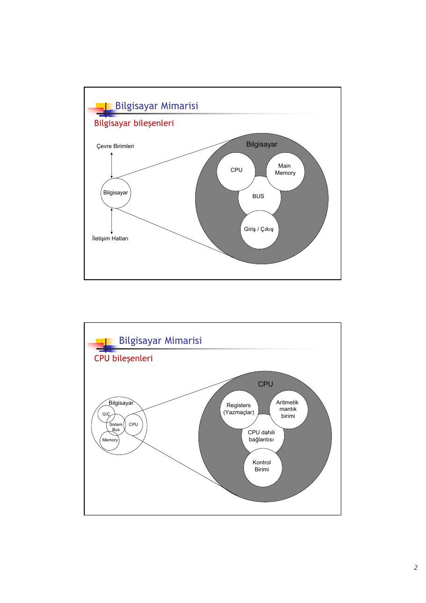
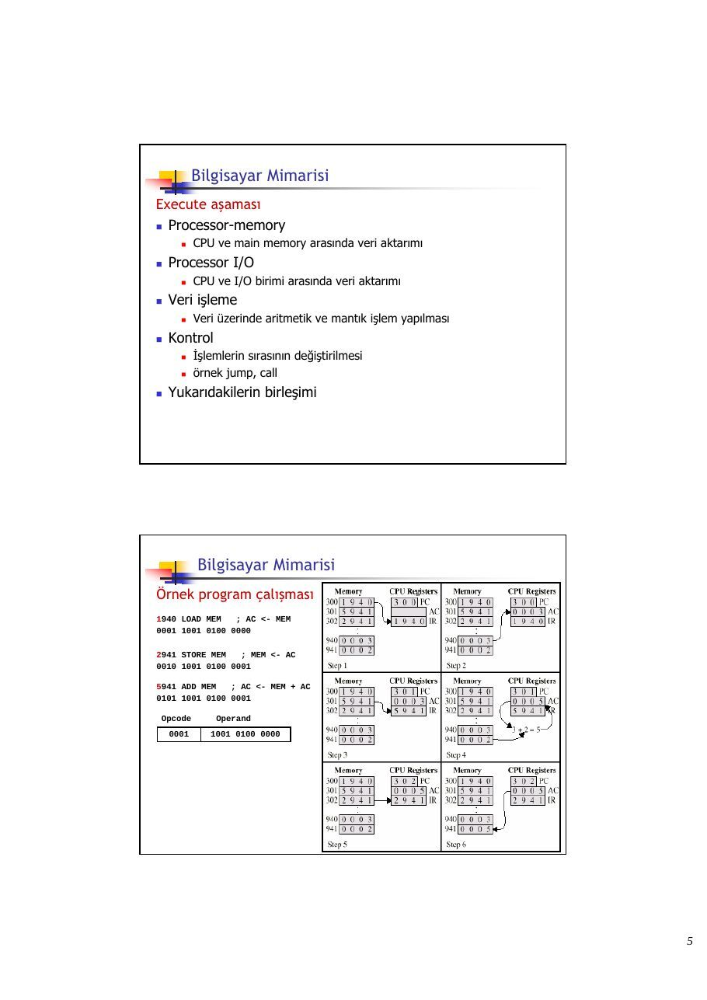
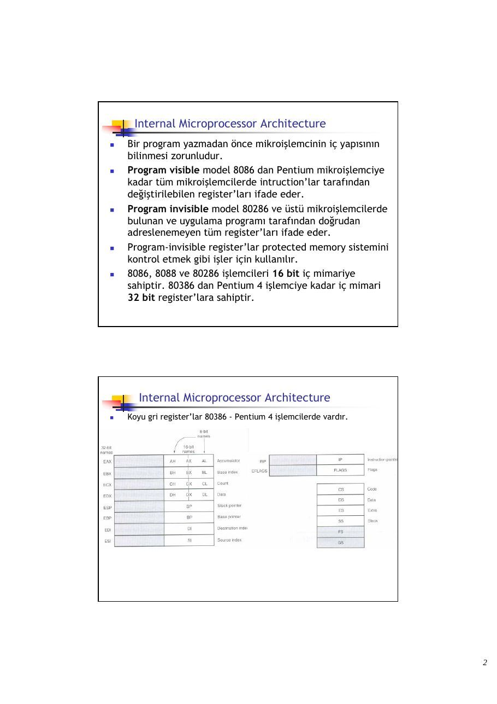
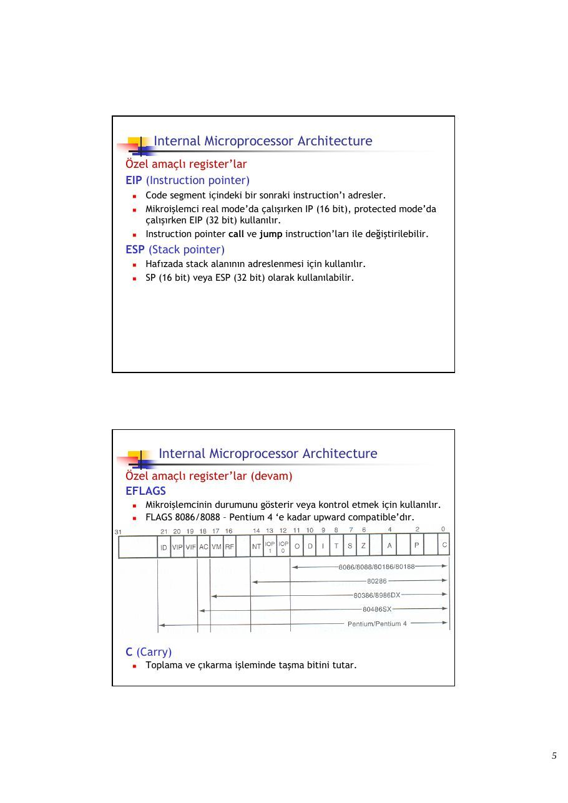
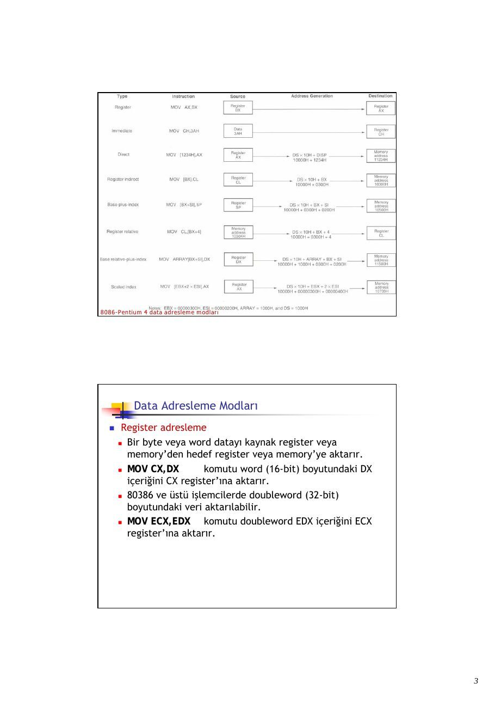
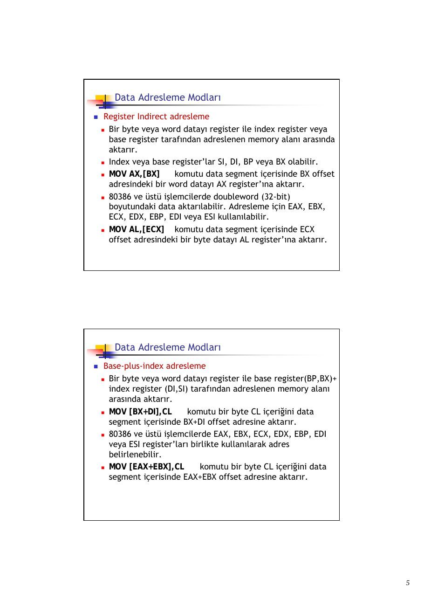

This post collects the relevant notes and exercises from the Başkent University **EEM332 Microprocessors** course archive (2008–2008). It covers computer architecture, the instruction cycle, cache memory, real and protected mode, and addressing modes. Source: Gazi University, M. Ali Akcayol; BİL362 lecture notes. PDF archive copies of the documents and, where available, source code can be downloaded as a ZIP at the end of the post.

*Note: This content belongs to a third-party source; it is shared for archival and nostalgic purposes with the source credited. It will be removed at the request of the rights holder.*

## CPUL1Introduction

BIL 362 Microprocessors

M. Ali Akcayol Gazi University Department of Computer Engineering

General Information Instructor: Assoc. Prof. Dr. M. Ali Akcayol Office: Başkent University, Department of Computer Engineering E-mail: akcayol@gazi.edu.tr Office hours: Mon 16:00-18:00

Teaching assistant: Res. Asst. Mehmet Dikmen Office: Başkent University, Department of Computer Engineering

### E-mail

Course web page: http://w3.gazi.edu.tr/~akcayol (\dersler\mikroişlemciler)

### Classroom

### Lab

General Information Grading Midterm: 25% Lab: 25% Weekly assignments: 10% Attendance: 5% Final: 35%

Main textbook Barry B. Brey, The Intel Microprocessors 8086/8088, 80186/80188, 80286, 80386, 80486, Pentium, Pentium Pro, Pentium II, Penium III, Pentium 4 Architecture, Programming and Interfacing (7th edition), Prentice Hall, 2006.

Supplementary textbook

### Walter A.Triebel, Avtar Singh, The 8088 and 8086 Microprocessors

Programming, Interfacing, Software, Hardware and Applications (4th edition), Prentice Hall, 2002.

General Information Course topics

(1)      Introduction to microprocessors and the development of Intel microprocessors (2)      8086 and 8088 microprocessor architectures: Registers, Stack, Physical and Logical addressing (3)      Program development in assembly language (4)      Addressing modes (5)      Data transfer, arithmetic and logic instructions (6)      Flow control, subroutine call and string instructions (7)      8086 programming (8)      8086 memory interfaces (9)      8086 basic input/output interfaces (10)     Interrupts and their types (11)     Introduction to the 80386, 80486 and Pentium processors

Historical Development Mechanical age

- The abacus, the first mechanical calculating device, was developed

by the Babylonians in 500 BC.

- In 1642 Blaise Pascal developed a calculating machine made up of

gears and wheels.

- Each gear has 10 teeth. When one completes a full turn, the next

advances by one tooth, performing the calculation.

- In 1947 Charles Babbage began developing a calculating machine

called the Analytical Engine. This machine, developed with the help of Augusta Ada Byron, used punch cards.

Historical Development Electrical age

- In the 1800s, as a result of advances in electric motors, the

calculating machine developed mechanically by Pascal came to be driven by motors.

- It was widely used in workplaces until the 1970s.

- In the 1970s the Bomar Brain handheld calculator was developed.

- Konrad Zuse developed a mechanical calculating machine in 1936

and an electromechanical one in 1941.

- In the 1940s Konrad Zuse developed the first modern computer,

called the Z3.

- The Z3 had a clock frequency of 5.33 Hz.

- In 1943 an electronic calculating machine called Colossus was

developed with vacuum tubes by Alan Turing.

- Colossus could not be reprogrammed and is called a special-purpose

computer.

Historical Development First generation: Vacuum tubes

- ENIAC (Electronic Numerical Integrator and Computer) was the first

general-purpose electronic computer.

- ENIAC was completed in 1946. It weighed 30 tons, occupied about

1500 m2 and consisted of 17000 vacuum tubes.

- ENIAC had a power of 140 kW and could perform 5000 additions per

second.

- In 1945 John von Neumann put forward the idea of storing both data

and program in memory and developed a computer called EDVAC (Electronic Discrete Variable Computer). (stored-program)

- In the following years, commercial computers such as UNIVAC

(Universal Automatic Computer) were developed.

Historical Development Second generation: Transistors (a computer made up of 10,000 transistors)

- The biggest change in electronic computers was the replacement of

vacuum tubes with transistors.

- The transistor was invented in 1947 at Bell Laboratories.

- In the late 1950s, computers built entirely from transistors were

produced. Third generation: Integrated circuits

- Integrated circuits consist of a large number of discrete elements

(transistors). They are called Small/Medium Scale Integration. Fourth generation

- Large Scale Integration (1,000 transistors in one chip)

Fifth generation

- Very Large Scale Integration (10,000 transistors in one chip)

Sixth generation

- Ultra Large Scale Integration (more than 1 million transistors in one chip)

Historical Development Computer generations

Historical Development Development of the number of transistors in a microprocessor

Historical Development Microprocessor age

- In 1971 Intel developed the 4004, the first microprocessor.

- It can address 4096 memory locations.

- Each memory location is 4 bits (a nibble) wide.

- The 4004 microprocessor instruction set has a total of 45 instructions.

- Its speed is 50 KIPs (kilo-instructions per second).

- The 30-ton ENIAC computer, developed in 1946, runs at 100 KIPs.

- The 4004 is slower but much lighter.

- In 1972 Intel developed the 8008 microprocessor.

- It is the 8-bit version of the 4004 microprocessor.

- The 8008 can address 16 KBytes.

- The 8008 instruction set has a total of 48 instructions.

Historical Development Microprocessor age (continued)

- In 1974 Intel developed the 8080.

- It can address 64 KBytes of memory.

- It is 10 times faster than the 8008 (500 KIPs).

- It was used in the MITS Altair 8800 computer.

- The BASIC language interpreter for the MITS Altair 8800 was

developed in 1975 by Bill Gates and Paul Allen.

- The assembler program for the MITS Altair 8800 was developed by

Digital Research Corporation.

- In 1977 Intel developed the 8085 microprocessor.

- It can address 64 KBytes of memory.

- It is Intel's last 8-bit microprocessor.

- Its speed is approximately 769 KIPs.

Historical Development Modern microprocessors

- In 1978 Intel developed the 8086, and a year later the 8088.

- They are 16-bit microprocessors.

- They can address 1 MByte of memory (16 times more than the 8085).

- Their speed is 2.5 MIPs (one instruction takes 400 ns).

- The 8086/8088 processors were the first to use a 4-6 byte cache, and

some instructions were prefetched.

- In 1983 Intel developed the 80286 microprocessor.

- It is a 16-bit microprocessor.

- It can address 16 MBytes.

- Its speed is 4 MIPs.

Historical Development Modern microprocessors (continued)

- In 1986 Intel developed the 80386 microprocessor.

- It is Intel's first 32-bit microprocessor.

- It has a 32-bit data bus and a 32-bit address bus.

- It can address 2^32 = 4 GBytes.

- In 1989 Intel developed the 80486 microprocessor.

- It is a 32-bit microprocessor.

- It contains an 8 KByte cache.

- Its speed is 50 MIPs.

- In 1993 Intel developed the Pentium microprocessor.

- It is a 32-bit microprocessor.

- It can address 4 GBytes.

- It has a 16 KByte split cache (8 KB instruction, 8 KB data).

- There are versions with speeds of 110 MIPs or 150 MIPs.

- The biggest innovation is that it has 2 integer processors.

Historical Development Modern microprocessors (continued)

- In 1995 Intel developed the Pentium Pro microprocessor.

- It is Intel's first 64-bit microprocessor.

- It has 3 integer units and 1 floating-point unit.

- It can address 2^36 = 64 GBytes. (address bus = 36 bits)

- It has a 16 KB (8K data + 8K instruction) on-chip L1 cache and a

256 KB L2 cache.

- In 1997 Intel developed the Pentium II microprocessor.

- It is a 64-bit microprocessor.

- In the Pentium processor, the L2 cache runs on a 60-66 MHz system bus.

- The Pentium II and the L2 cache are on a separate board, and the L2

cache runs at 133 MHz and is 512 KB in size.

- The Pentium II Xeon has a 32 KB L1 cache and 512 KB, 1 MB, 2 MB L2

cache.

Historical Development Modern microprocessors (continued)

- In 1999 Intel developed the Pentium III microprocessor.

- It is a 64-bit microprocessor.

- It runs at a clock frequency of 1 GHz.

- It can address 2^36 = 64 GBytes. (address bus = 36 bits)

- It has 512 KB or 256 KB of cache.

- The memory bus speed is 100 MHz.

- Celeron processors have a memory bus clock speed of 66 MHz.

- In 2000 Intel developed the Pentium 4 microprocessor.

- It is a 64-bit microprocessor.

- It runs at a clock frequency of 3.2 GHz.

- L1 cache is 8-32 KB, L2 cache is 256-512 KB.

Historical Development Development of Intel microprocessors

Historical Development Change in the complexity of Intel microprocessors

Historical Development Performance of Intel microprocessors

Historical Development Development of Intel microprocessors

Historical Development Development of Intel microprocessors (continued)

Historical Development General structures of Intel microprocessors

Historical Development Intel and Motorola microprocessors

Historical Development Intel and Motorola microprocessors (continued)

Historical Development Intel iCOMP index

Historical Development Intel iCOMP2 index

Historical Development Intel microprocessors with SYSmark 2002

Assignment

- Prepare a report on microprocessor performance tests and the

related test software.

## CPUL2Architecture

BIL 362 Microprocessors

M. Ali Akcayol Gazi University Department of Computer Engineering

Topics

- Computer Architecture

- Components of the Computer, CPU and Control Unit

- Instruction Cycle

- Interrupts

- Bus

- Storage Devices

- Cache Memory

Computer Architecture Computer components

Peripherals                            Computer

Main CPU                   Memory

Computer

### BUS

Input / Output Communication Lines

Computer Architecture CPU components

### CPU

Computer                                          Arithmetic Registers logic G/Ç                            (Registers) unit System      CPU Bus CPU internal Memory                                  connection

Control Unit

Computer Architecture Control Unit components

Control Unit

### CPU

Sequencing ALU                              logic Control Internal Unit Bus Control unit Registers                                     registers and                                        decoder

Control Memory

Computer Architecture General view of the computer

Computer Architecture

### Two-step instruction cycle

- Fetch: bringing the instruction (command) from memory

- Execute: the instruction carrying out its function

Computer Architecture Fetch stage

- The Program Counter (PC) holds the address of the next instruction

to be fetched

- The processor fetches the instruction from the memory location

indicated by the PC.

- The PC value is incremented

- Unless there are operations such as Jump, Call, etc.

- The instruction is stored in the Instruction Register (IR).

- The processor interprets the instruction and performs the required

operation.

Computer Architecture Execute stage

- Processor-memory

- Data transfer between the CPU and main memory

- Processor I/O

- Data transfer between the CPU and an I/O unit

- Data processing

- Performing arithmetic and logic operations on data

- Control

- Changing the order of operations

- e.g. jump, call

- A combination of the above

Computer Architecture Example program execution

### 1940 LOAD MEM   ; AC <- MEM

0001 1001 0100 0000

### 2941 STORE MEM   ; MEM <- AC

0010 1001 0100 0001

### 5941 ADD MEM   ; AC <- MEM + AC

0101 1001 0100 0001

Opcode        Operand 0001      1001 0100 0000

Computer Architecture Instruction cycle state diagram

Computer Architecture Interrupts

- An interrupt is the interruption of the normal sequence of a

program by other modules.

- Program interrupts

- overflow, division by zero, …

- Timer interrupts

- Generated by the processor's internal clock

- I/O interrupts

- Generated by the I/O controller.

- Hardware failure interrupts

- memory parity error, HDD read error

Computer Architecture Program flow control

Computer Architecture Program flow control

Computer Architecture Instruction cycle state diagram (with interrupt control)

Computer Architecture Nested multiple interrupts

Computer Architecture All units must be connected Memory

- receives and sends data

- receives address information

- receives control signals (write, read, timing)

I/O unit

- receives data from the CPU

- receives data from peripherals

- sends data to the CPU

- sends data to peripherals

- receives control signals from the CPU

- sends control signals to peripherals

(spin the disk, eject the CD, etc.)

- receives addresses from the CPU (peripheral port number)

- sends interrupt signals to the CPU

Computer Architecture All units must be connected CPU connection

- reads instructions and data from memory

- writes the data resulting from an operation to the relevant place

- sends control signals to other units

- receives incoming interrupts and performs the required operation

Computer Architecture What is a BUS?

- It is a communication path connecting two or more devices.

- It generally works in a broadcast manner.

- There are control, data and address buses.

Data bus

- Carries data (instructions or data)

- Data bus width (number of connections) greatly affects computer

performance (8, 16, 32, 64 bits) Address bus

- Carries the address of the destination or source data.

- Address bus width determines the maximum memory capacity of the

system. (8086 address bus 16 bits, maximum memory 64 KB) Control bus

- Memory write and read signals.

- Interrupt request

- Clock signals

Computer Architecture Bus connection diagram

Computer Architecture Data storage units by access method

- Sequential

- Starts from the beginning and reads in order

- Access time depends on where the data is located

- e.g. tape

- Direct

- Each block has its own address

- Access is made by direct jumping, and a sequential search is made

within the block

- Access time depends on the previous position and where the data is

located

- e.g. disk

Computer Architecture Data storage units by access method

- Random

- Access time does not depend on the previous position

- e.g. RAM

- Associative

- Data can be stored in a block area and is reached by comparison

- Access time does not depend on the previous position or access

- e.g. cache

Computer Architecture Memory hierarchy                                   Unit cost increases Access time decreases Size decreases Gets closer to the CPU Frequency of use increases

Computer Architecture Memory performance

- Access time

- The time between specifying the address and retrieving the data

- Memory cycle time

- The time between two accesses

- Transfer rate

- The rate of data transfer per unit time

Computer Architecture Cache Memory

- It is located between the CPU and main memory.

- It can be placed inside the CPU.

Computer Architecture Cache Memory

- The CPU requests the contents of a memory address

- First, it is checked whether this data is in the cache memory

- If it is, it is taken from the cache (fast)

- If not, the data is read from memory and transferred into the

cache memory

- It is then transferred from the cache memory to the CPU

Computer Architecture Cache Memory Organization

Computer Architecture Pentium 4 Architecture

Assignment

- Prepare a report on pipelining.





## CPUL3Architecture8086

BIL 362 Microprocessors

M. Ali Akcayol Gazi University Department of Computer Engineering

Topics

- Internal microprocessor architecture

- Real mode addressing

- Protected mode addressing

Internal Microprocessor Architecture

- Before writing a program, it is essential to know the internal

structure of the microprocessor.

- The program visible model refers to the registers that can be

modified by instructions in all microprocessors from the 8086 to the Pentium.

- The program invisible model refers to all the registers found in

80286 and later microprocessors that cannot be directly addressed by an application program.

- Program-invisible registers are used for tasks such as controlling

the protected memory system.

- The 8086, 8088 and 80286 processors have a 16-bit internal

architecture. From the 80386 to the Pentium 4, the internal architecture has 32-bit registers.

Internal Microprocessor Architecture

- The dark gray registers are present in the 80386 - Pentium 4 processors.

Internal Microprocessor Architecture

- A program can contain 8-, 16- and 32-bit registers.

- The 8-bit registers are AH, AL, BH, BL, CH, CL, DH and DL.

(The ADD AL, AH instruction adds the AH register to the AL register. Only AL changes value.)

- The 16-bit registers are AX, BX, CX, DX, SP, BP, DI, SI, IP,

FLAGS, CS, DS, ES, SS, FS and GS. (The ADD DX, CX instruction adds the CX register to the DX register. Only DX changes value.)

- The 32-bit registers are EAX, EBX, ECX, EDX, ESP, EBP, EDI, ESI,

EIP and EFLAGS.

- The 32-bit extended registers and the 16-bit FS and GS registers

are found only in the 80386 and later processors. (The ADD ECX, EBX instruction adds the EBX register to the ECX register. Only ECX changes value.)

Internal Microprocessor Architecture

- Some registers are general or multipurpose, while others are

special purpose. General-purpose registers EAX (Accumulator)

- It is written as EAX when used as 32 bits, AX when used as 16 bits

and AH or AL when used as 8 bits.

- When used as 8 or 16 bits, only the lower 8 or 16 bits change

value; the rest remains unchanged.

- It is used as the accumulator in operations such as multiplication

and division.

- In the 80386 and later processors, EAX can be used to hold an

offset address in memory. EBX (Base index)

- It can be used as EBX, BX, BH and BL.

- In all microprocessors it can also hold an offset address in memory.

Internal Microprocessor Architecture General-purpose registers (continued) ECX (Count)

- In the 80386 and later processors it holds an offset address in memory.

- Instructions such as string, loop, shift and rotate use the count value.

- Shift and rotate instructions use CL, string repeat instructions (REP,

```asm
REPE, REPNE) CX and loop instructions (LOOP) CX veya ECX kullanır.
```

EDX (Data)

- It holds part of the result of a multiplication or part of the

dividend in a division.

- In the 80386 and later processors it can be used to address data in memory.

EBP (Base pointer)

- In all processors it is used to address a location in memory.

- It can be used as BP or EBP.

Internal Microprocessor Architecture General-purpose registers (continued) EDI (Destination index)

- It is generally used in string instructions to address the

destination string.

- It can be used as DI (16 bits) or EDI (32 bits).

ESI (Source index)

- It is generally used in string instructions to address the source

string.

- It can be used as SI (16 bits) or ESI (32 bits).

Internal Microprocessor Architecture Special-purpose registers EIP (Instruction pointer)

- It addresses the next instruction within the code segment.

- When the microprocessor is running in real mode, IP (16 bits) is

used; when running in protected mode, EIP (32 bits) is used.

- The instruction pointer can be changed by call and jump instructions.

ESP (Stack pointer)

- It is used to address the stack area in memory.

- It can be used as SP (16 bits) or ESP (32 bits).

Internal Microprocessor Architecture Special-purpose registers (continued)

### EFLAGS

- It indicates the state of the microprocessor or is used to control it.

- FLAGS is upward compatible from the 8086/8088 to the Pentium 4.

C (Carry)

- It holds the carry bit in addition and subtraction.

Internal Microprocessor Architecture Special-purpose registers (continued) P (Parity)

- It takes the value 0 for odd parity and 1 for even parity.

- Parity is the number of 1s in a series of bits. It is used for error

checking in data communication.

- In the first Intel processors, error checking was done in the

microprocessor. Today, the parity check is done in network cards. A (Auxiliary carry)

- It is used in BCD addition and subtraction.

Z (Zero)

- It indicates that the result of an arithmetic or logic operation is

zero (for Z = 1). Otherwise (Z = 0) the result is nonzero. S (Sign)

- It holds the sign of the result of an arithmetic or logic operation.

(For S = 1 the result is negative, for S = 0 the sign is positive)

Internal Microprocessor Architecture Special-purpose registers (continued) T (Trap)

- It makes the microprocessor run in debug mode (for T = 1).

I (Interrupt)

- The interrupt bit controls the INTR input pin.

- It can be changed with the STI (Set I flag) and CLI (Clear I flag)

instructions.

D (Direction)

- It controls whether the DI and SI registers are in increment or

decrement mode.

- For D = 1 the registers automatically decrement, for D = 0 they increment.

- The STD (Set direction) and CLD (Clear direction) instructions change it.

O (Overflow)

- In signed numbers, overflow occurs if the result of an addition or

subtraction is larger than the capacity of the machine.

- 7FH (+127) + 01H (+1) = 80H (-128)        8-bit addition

- 01111111 + 00000001 = 10000000

Internal Microprocessor Architecture Segment registers CS (Code)

- The code segment is the part that holds the code used by the

microprocessor.

- CS holds the starting address of the code segment.

- The size of CS is 64 KBytes in real mode; in protected mode, the

starting address and size are determined by a descriptor.

- It is 64 KBytes for the 8088 and 80286, and for the 80386 and later

it can be 4 GBytes when the microprocessor is running in protected mode. DS (Data)

- The data segment holds the data used by the program.

- DS holds the starting address of the data segment.

- It is 64 KBytes for the 8088 and 80286, and for the 80386 and later

it can be 4 GBytes when the microprocessor is running in protected mode.

Internal Microprocessor Architecture Segment registers (continued) ES (Extra)

- The extra segment is used by some string instructions to reach the

destination data. SS (Stack)

- The stack segment holds the part of memory used as the stack.

- Addressing within the stack segment can be done with BP.

FS and GS

- They are used in the 80386 and later processors.

- They are used by Windows.

Real Mode Memory Addressing

- The 80286 and later processors can run in real mode or protected mode.

- The 8086/8088 processors run directly in real mode.

- In real mode operation, only 1 MB of memory can be addressed. (Even

if the processor is a Pentium)

- This 1 MB of memory is called real memory, conventional memory or

DOS memory.

- All computers run in real mode when first powered on.

Real Mode Memory Addressing Segment and Offset

- In real mode, the desired memory location is reached by combining

the segment address and the offset address.

- The segment address is in one of the segment registers and holds the

starting address of the 64 KB segment.

- The offset address specifies an address within the 64 KB segment.

- In real mode, the segment size is always 64 KB.

- In real mode, the 20-bit address for the segment starting address

is obtained by appending 0H to the right end of the segment register value.

- If the segment register = 1200H, the segment starting address is

12000H.

- Since 0H is always appended at the right end, segments can start at

16-byte intervals. (paragraph)

Real Mode Memory Addressing Segment and Offset (continued)

- The segment ending address is found by adding FFFFH to the starting address.

- If the segment register value = 3000H, the segment starting address is

30000H and the ending address is 30000H + FFFFH = 3FFFFH.

Real Mode Memory Addressing Segment and Offset (continued)

- The desired memory location is found by adding the offset address to

the segment starting address.

- If the segment starting address = 1000H and the offset address =

2000H, the microprocessor addresses memory location 12000H.

- The segment and offset address is written as 1000:2000.

(Segment start = 1000H and offset address = 2000H)

```asm
Default Segment and Offset Registers
```

- The microprocessor calculates a segment and offset address by

applying certain rules.

- CS is always used together with IP. CS holds the code segment

starting address and IP holds the address within the segment (the address of the next instruction to be executed).

- The combination is shown as CS:IP or CS:EIP.

- CS = 1400H, IP/EIP = 1200H, CS:IP = 14000H+1200H = 15200H

Real Mode Memory Addressing

```asm
Default Segment and Offset Registers (continued)
```

16-bit

- Data in the stack is indicated by the stack segment and the stack

pointer or base pointer registers.

- The combination is SS:SP (SS:ESP) or SS:BP (SS:EBP).

- SS = 2000H, BP = 3000H, SS:BP = 20000H+3000H = 23000H

Real Mode Memory Addressing

```asm
Default Segment and Offset Registers (continued)
```

32-bit

- The 80386 and later processors have more segment and offset address

selection options.

Real Mode Memory Addressing Example placement of segments

Real Mode Memory Addressing Placement of an application program in memory

- The code, data and stack segments do not use the full 64 KB.

- Segments can overlap.

Protected Mode Memory Addressing

- In the 80286 and later processors, it allows access to areas above

the 1 MB memory area. (Windows runs in protected mode)

- In protected mode as well, the offset address specifies the desired

address within the segment.

- The segment register stores a selector and selects a descriptor in

the descriptor table.

- The descriptor specifies the segment starting address, its size and

access rights.

- In the 80386 and later, the offset address is 32 bits and the

segment size can be 4 GB.

Protected Mode Memory Addressing

Protected Mode Memory Addressing Selectors and Descriptors

- Selectors are stored in segment registers and select one of the 8192

descriptors found in two tables.

- The global descriptor table holds information about the segments

that will be used by all programs.

- The local descriptor table holds information about the segments that

will be used by one application.

- A total of 16384 segments can be created in the two descriptor tables.

- The size of one segment can be 4 GB. Total addressable memory =

4 GB x 16384 = 64 TB.

- Each descriptor is 8 bytes. The space occupied by each descriptor

table = 8192 x 8 = 64 KB.

- The 80386-Pentium 4 descriptors have a different structure.

Protected Mode Memory Addressing Selectors and Descriptors (continued)

- The base address part holds the starting address of the segment.

- The limit part holds the last offset address of the segment.

Protected Mode Memory Addressing Selectors and Descriptors (continued)

- G (Granularity bit) enlarges the segment limit by multiplying it by 4K.

Base = Start = 10000000H

### G = 0

```asm
End = Base + Limit = 10000000H + 001FFH = 100001FFH
```

Base = Start = 10000000H

### G = 1

```asm
End = Base + Limit = 10000000H + 001FFFFFH = 101FFFFFH
```

- In the 80386 and later, AV (Available) specifies whether the segment

is available for use.

- AV = 1 available, AV = 0 not available

Protected Mode Memory Addressing Selectors and Descriptors (continued)

- For the 80386 and later, the D bit determines the operating mode.

(real / protected mode)

- D = 0, 16-bit instructions, 16-bit offset address, 16-bit register.

- D = 1, 32-bit instructions, 32-bit offset address, 32-bit register.

- The access rights byte controls access to the protected mode segment.

Protected Mode Memory Addressing Selectors and Descriptors (continued) Segment access rights

Protected Mode Memory Addressing Selectors and Descriptors (continued)

- The descriptor is selected with the segment register.

- 13 bits of the segment register select one of the 8192 descriptors.

- TI = 0 selects from the global descriptor table, TI = 1 from the local

descriptor table.

- RPL (Requested Privilege Level), 00 highest, 11 lowest.

- If the RPL has priority over the DPL in the descriptor, access is

granted. (RPL = 10, DPL = 11)

- Windows uses 00 for kernel operations and 11 for driver programs.

.

Protected Mode Memory Addressing Selectors Descriptors (continued)

access rights

base

limit

DS = 8 = 0000000000001000, TI = 0(global), RPL = 00(highest), Selector = 0000000000001 (Descriptor 1)

Protected Mode Memory Addressing Program-Invisible Registers

- The global and local descriptor tables are present in the 80286-Pentium 4

processors.

- Program-invisible registers are used to access and address these tables.

- Program-invisible registers are used only in protected mode.

- GDTR (Global Descriptor Table Register) and IDTR (Interrupt

Descriptor Table Register) hold the base addresses and limits of the tables.

- LDTR (Local Descriptor Table Register) is used to access the local

descriptor table.

- TR (Task Register) enables switching between tasks (a program or

procedure) in approximately 17µs.

- Multitasking is realized by sequential switching by the TR.

Protected Mode Memory Addressing Program-Invisible Registers (continued)

Assignment

- Prepare a report on memory swapping, partitioning and paging.





## CPUL4AdressingModes

BIL 362 Microprocessors

M. Ali Akcayol, Gazi University, Department of Computer Engineering

Topics: Addressing Modes

- Data addressing modes

- Register addressing

- Immediate addressing

- Direct addressing

- Register indirect addressing

- Base-plus-index addressing

- Register relative addressing

- Base relative-plus-index addressing

- Scaled-index addressing

- Program memory addressing modes

- Direct program memory addressing

- Relative program memory addressing

- Indirect program memory addressing

- Stack memory addressing modes

Addressing Modes

- To develop software effectively, the addressing modes available for each

instruction in the microprocessor must be known.

- Because of its flexibility, the MOV instruction is used as the example for all

addressing modes in this section.

- The MOV instruction transfers data between register-register or register-memory:

bytes or words for the 8086-80286 processors, and bytes, words, or doublewords for the 80386 and later processors.

- For program memory addressing, the examples use the CALL and JUMP

instructions to show how the program flow is changed.

- The PUSH and POP instructions are used for stack memory addressing.

Data Addressing Modes

- The general form of the MOV instruction is as follows.

- In all instructions, the rightmost item is the source, the one to its left is the

destination, and the leftmost is the opcode.

- Memory-to-memory transfer is not allowed (except for MOVS).

- The MOV instruction above transfers one word. It transfers the contents of the

BX register to the AX register.

- The contents of the BX register do not change; it is only copied.

- The contents of the destination register (AX) change. (In instructions such as

CMP and TEST, the destination does not change.)

8086-Pentium 4 data addressing modes

Data Addressing Modes

- Register addressing

- Transfers a byte or word of data from a source register or

memory to a destination register or memory.

- The MOV CX,DX instruction transfers the contents of DX, which is word

(16-bit) in size, to the CX register.

- On 80386 and later processors, doubleword (32-bit) data can be

transferred.

- The MOV ECX,EDX instruction transfers the doubleword contents of EDX to

the ECX register.

Data Addressing Modes

- Immediate addressing

- Transfers a byte or word of data to a destination register or

memory.

- The MOV AL,22H instruction transfers the byte-sized value 22H to the AL

register.

- On 80386 and later processors, doubleword (32-bit) data can be

transferred.

- The MOV EBX,12345678H instruction copies the doubleword value

12345678H to the EBX register.

Data Addressing Modes

- Direct addressing

- Transfers a byte or word of data between a register and

memory.

- The instruction set does not allow memory-to-memory transfers.

(Except for MOVS.)

- The MOV CX,LIST instruction transfers the word-sized contents at memory

address LIST to the CX register.

- On 80386 and later processors, doubleword (32-bit) data can be

transferred.

- The MOV ESI,LIST instruction transfers the doubleword-sized contents at

memory address LIST to the ESI register.

Data Addressing Modes

- Register Indirect addressing

- Transfers a byte or word of data between a register and the

memory location addressed by an index register or base register.

- The index or base register can be SI, DI, BP, or BX.

- The MOV AX,[BX] instruction transfers the word at offset address BX in

the data segment to the AX register.

- On 80386 and later processors, doubleword (32-bit) data can be

transferred. EAX, EBX, ECX, EDX, EBP, EDI, or ESI can be used for addressing.

- The MOV AL,[ECX] instruction transfers the byte at offset address ECX in

the data segment to the AL register.

Data Addressing Modes

- Base-plus-index addressing

- Transfers a byte or word of data between a register and the

memory location addressed by a base register (BP, BX) + an index register (DI, SI).

- The MOV [BX+DI],CL instruction transfers the byte in CL to offset address

BX+DI in the data segment.

- On 80386 and later processors, the address can be formed by using the

EAX, EBX, ECX, EDX, EBP, EDI, or ESI registers together.

- The MOV [EAX+EBX],CL instruction transfers the byte in CL to offset

address EAX+EBX in the data segment.

Data Addressing Modes

- Register relative addressing

- Transfers a byte or word of data between a register and the

memory location addressed by a base register (BP, BX) or index register (DI, SI) + a displacement.

- The MOV AX,[BX+4] instruction transfers the contents of offset address

BX+4 in the data segment to the AX register.

- The MOV AX,ARRAY[BX] instruction transfers the contents of offset

address ARRAY+BX in the data segment to the AX register.

- On 80386 and later processors, any register can be used for

addressing.

- It can be used as MOV AX,[ECX+4] or MOV AX,ARRAY[EBX].

Data Addressing Modes

- Base relative-plus-index addressing

- Transfers a byte or word of data between a register and the

memory location addressed by a base register (BP, BX) + an index register (DI, SI) + a displacement.

- The MOV AX,ARRAY[BX+DI] instruction transfers the contents of offset

address ARRAY+BX+DI in the data segment to the AX register.

- The MOV AX,[BX+DI+4] instruction transfers the contents of offset address

BX+DI+4 in the data segment to the AX register.

- On 80386 and later processors, any register can be used for

addressing.

- The MOV EAX,ARRAY[EBX+ECX] instruction transfers the contents of

```asm
offset address ARRAY+EBX+ECX in the data segment
```

to the EAX register.

Data Addressing Modes

- Scaled-index addressing

- Available on 80386 and later processors.

- The second register used for the offset address is modified by a scale

factor of 2x, 4x, or 8x.

- The MOV EDX,[EAX+4*EBX] instruction transfers the contents of offset

address EAX+4*EBX in the data segment to the EDX register.

- Scaling makes it possible to access word (2x), doubleword (4x), or

quadword (8x) contents.

- The MOV EAX,ARRAY[EBX+ECX] instruction transfers the contents of

```asm
offset address ARRAY+EBX+ECX in the data segment
```

to the EAX register.

Data Addressing Modes

- Register addressing - details

- It is the most commonly used form of data addressing. Knowing the

register names is sufficient.

- The AH, AL, BH, BL, CH, CL, DH, and DL registers are used for 8-bit

register addressing.

- The AX, BX, CX, DX, SP, BP, SI, and DI registers are used for 16-bit

register addressing.

- The EAX, EBX, ECX, EDX, ESP, EBP, ESI, and EDI registers are used for

32-bit register addressing.

- Some MOV instructions, as well as PUSH and POP, use the CS, ES, DS,

SS, FS, and GS registers.

- Registers of different sizes cannot be used together. (MOV

AX, AL or MOV EAX, AL). Some instructions, such as SHL, can use registers of different sizes.

- MOV does not affect the flag bits.

Data Addressing Modes

- Register addressing - details

- Example instructions for register addressing

Data Addressing Modes

- Register addressing - details

- The MOV instruction changes only the destination register. (CMP and

TEST do not change the destination register.)

- The MOV BX, CX instruction copies the value 1234H from the CX register

to the BX register.

- The leftmost 16 bits of the EBX register do not change.

Data Addressing Modes

- Register addressing - details

- The following instructions transfer 8-bit, 16-bit, or 32-bit data.

- The leftmost 16 bits of the EBX register do not change.

3 bytes                          2 bytes

Data Addressing Modes

- Immediate addressing - details

- The data immediately follows the opcode and is constant.

- Immediate addressing operates on 8- or 16-bit data.

- On 80386 – Pentium 4 processors, doubleword (32-bit) data can be

used.

- The following instruction copies the value 13456H (located in memory

immediately after the opcode) to the EAX register.

0 0 0 1   3 4    5 6

- Some assemblers perform immediate addressing as MOV AX, #13456H

(using the # sign).

- Intel ASM, Microsoft MASM, and Borland TASM do not use #.

Data Addressing Modes

- Immediate addressing - details

- Example instructions for immediate addressing

Data Addressing Modes

- Immediate addressing - details

- The .MODEL TINY directive makes the assembler place the program in a

single code segment.

- The .CODE directive marks the start of the code segment.

- The .STARTUP directive marks the starting instruction of the program.

- The .EXIT directive ends the program and returns to DOS.

- The END directive marks the end of the program file.

```asm
MOV AX, 0 komutunun
```

is the offset address.

Data Addressing Modes

- Immediate addressing - details

- Each statement consists of 4 parts.

- The label is at the far left. It assigns a symbolic name to the memory

location where it is placed.

- The second field is the opcode.

- The third field(s) are the operands to the right of the opcode.

- The last field is the comment field at the far right. A comment always

starts with ;.

Data Addressing Modes

- Direct addressing - details

- In direct addressing, the MOV instruction transfers data between a memory

location in the data segment and a register (AL, AX, EAX, …).

- The MOV AL,DATA instruction transfers 8 bits from the memory location

indicated by DATA (e.g., 1234H) in the data segment to AL.

- Some assemblers write this as MOV AL,DS:[1234H] or MOV AL,DS:[DATA].

- If DS = 1000H, the data at physical address 11234H in the data segment

is transferred to the AL register.

Data Addressing Modes

- Direct addressing

examples

Data Addressing Modes

- Direct addressing example program

offset    machine label address     code   (label)          operand opcode

```asm
.DATA indicates the start of the data segment and that a SMALL model, with one data segment and one code
```

segment, will be used.

Data Addressing Modes

- Register indirect addressing - details

- Register indirect addressing addresses the memory location at the offset

given by the value of a register (BP, BX, SI, DI) in the data segment.

- If the BX contents are 1000H, the MOV AX,[BX] instruction copies the data at

offset address 1000H in the data segment to the AX register.

Data Addressing Modes

- Register indirect addressing - details

* When addressing data with BP or EBP, the default segment is the stack segment. With the others, it is the data segment.

Data Addressing Modes

- Base-plus-Index addressing - details

- A base register (BP, BX) is used together with an index register (DI, SI).

- The base register usually holds the starting address of an array, and the

index register holds the position of an element in the array.

- How the MOV DX, [BX+DI] instruction works.

- DS = 0100H, BX = 1000H, DI = 0010H, MEM = 2010H

Data Addressing Modes

- Base-plus-Index addressing - details

- Example instructions.

Data Addressing Modes

- Base-plus-Index addressing - details

- BX holds the starting address of the array, and DI holds the index of the element.

Data Addressing Modes

- Base-plus-Index addressing - details

- In the following example, the array element at address 10H is copied to

address 20H.

- BX holds the starting address of the array, and DI holds the index of the element.

Data Addressing Modes

- Register relative addressing - details

- Memory is addressed by adding a displacement value to a base or index

register (BP, BX, SI, DI).

- Below is how the MOV AX,[BX+1000H] instruction works.

- BX = 0100H, DS = 0200H.

Data Addressing Modes

- Register relative addressing - details

- Below are examples of register relative addressing.

Data Addressing Modes

- Base relative plus index addressing - details

- Similar to base plus index, except that it adds a displacement.

- Below is how the MOV AX,[BX+SI+100H] instruction works.

- BX = 0020H, SI = 0010H, DS = 1000H.

Data Addressing Modes

- Base relative plus index addressing - details

- Below are examples of base relative plus index addressing.

Data Addressing Modes

- Scaled index addressing - details

- Found on the 80386 and Pentium 4 microprocessors.

- Addressing is performed with a 32-bit base register and an index register.

- The index register is multiplied by a scale factor (1X, 2X, 4X, or 8X).

- 2X is used to access an array whose elements are words, 4X for an array of

doublewords, and 8X for an array of quadwords.

- For MOV AX,[EDI+2*ECX] the factor is 2; MOV EAX,[4*EDI] uses only one

register, and the factor is set to 4.

- Example instructions are shown below.

Program Memory Addressing Modes

- There are three program memory addressing modes: direct, relative, and

indirect.

- They are used with the JMP and CALL instructions.

- An intersegment jump allows a jump to any location in memory.

- An intrasegment jump allows a jump to a location within the current code

segment.

Direct program memory addressing

- Direct program memory addressing is also used in high-level languages

### (GOTO, GOSUB)

- In direct addressing, the address of the next instruction is stored together

with the opcode.

- In the figure below, the program jumps to address 10000H for the next

instruction.

- The instruction is 5 bytes in total.

Program Memory Addressing Modes

- Relative program memory addressing

- Provides a jump relative to the IP value.

- If the JMP is to jump forward 2 addresses, 2 is added to the IP value.

- The JMP and CALL instructions use an 8-bit or 16-bit signed displacement

value. (This allows both forward and backward jumps.)

- The assembler calculates the displacement value according to the address

to be jumped to. If the jump is to a very distant address, direct addressing is chosen.

- With an 8-bit displacement, jumps of +127 to -128 are possible; with a

16-bit displacement, ±32K; and with a 32-bit displacement, ±2G (protected mode only).

Program Memory Addressing Modes

- Indirect program memory addressing

- The JMP and CALL instructions can use many different kinds of indirect

addressing.

- If BX = 1000H, the JMP BX instruction jumps to offset address 1000H in the

current code segment.

- The JMP [BX] instruction uses the value in the location at offset address BX

in the data segment as the jump target. (This is called double indirect or indirect-indirect.)

Stack Memory Addressing Modes

- The stack works in LIFO fashion and organizes the return addresses of

methods and the passing and receiving of parameters.

- Data is added to the stack with the PUSH instruction and removed from the

stack with the POP instruction.

- Stack memory is formed by the SP (ESP) and SS registers.

- Below is the situation after the PUSH BX operation.

- The left 8 bits are written to address SP-1 and the right 8 bits to address SP-2.

Stack Memory Addressing Modes

- Below is the situation after the POP CX operation.

- The right 8 bits of the 16-bit register are written to address SP, and the

left 8 bits to address SP+1.

Stack Memory Addressing Modes

- Below are the PUSH and POP instructions.

Stack Memory Addressing Modes

- Example program for the PUSH and POP instructions.

- The values of the AX, BX, and CX registers are swapped.

Assignment

- Research the Pentium 4 addressing modes and prepare a

report.





*Note: The history slide gives 1947 for Charles Babbage; this date is wrong. The Analytical Engine work dates from the 1830s. The source wording has been kept unchanged.*
