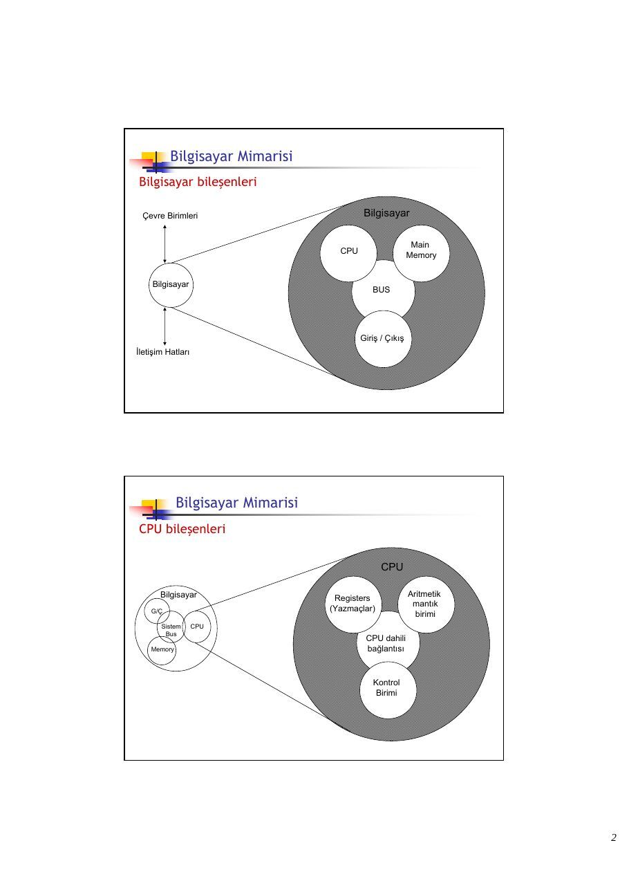
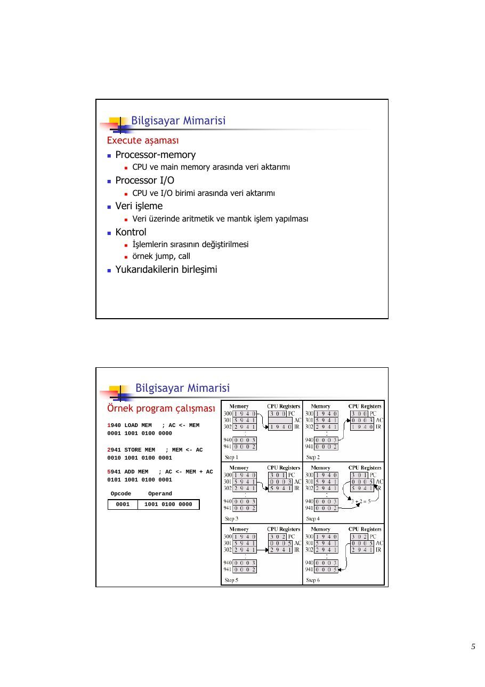
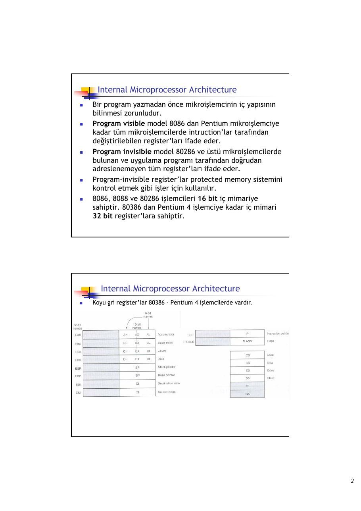
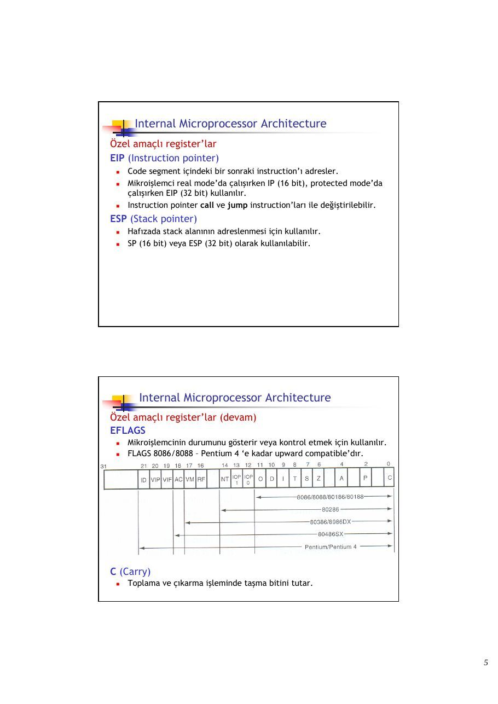
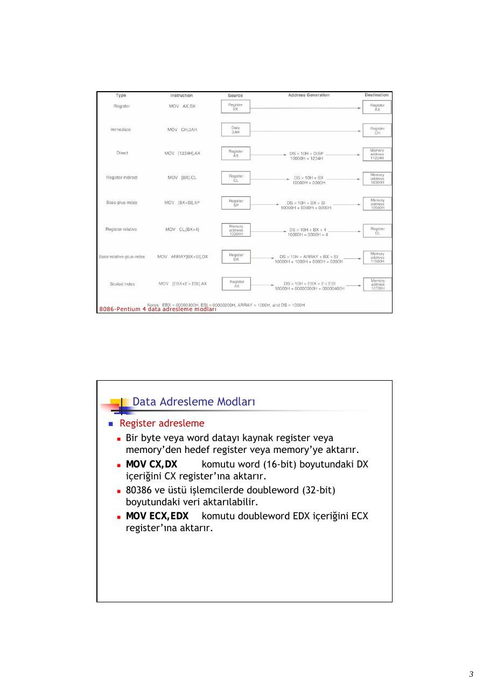
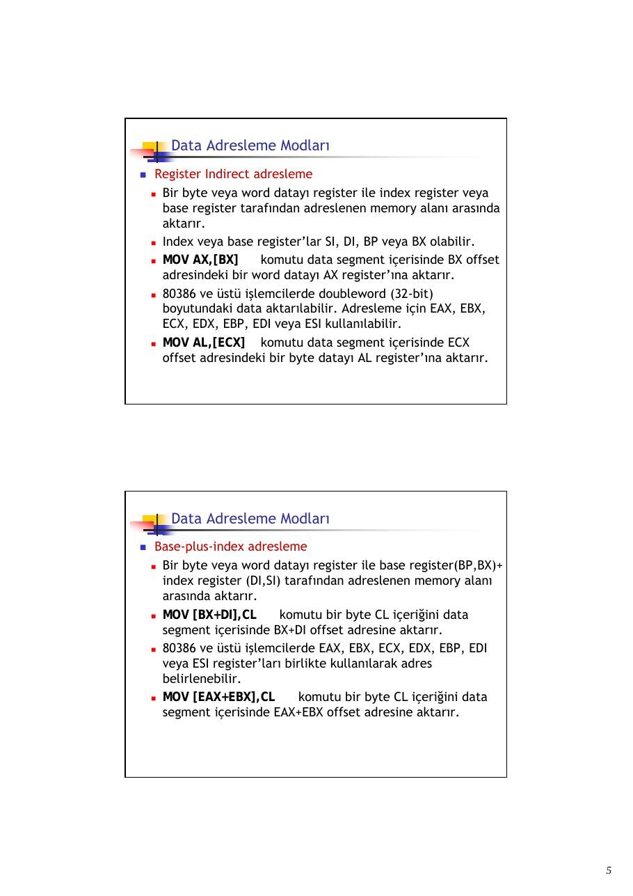

Bu yazı, Başkent Üniversitesi **EEM332 Mikroişlemciler** ders arşivindeki ilgili notları ve uygulamaları bir araya getiriyor (2008–2008). Bilgisayar mimarisi, komut çevrimi, önbellek, gerçek ve korumalı kip ile adresleme modları. Kaynak: Gazi Üniversitesi, M. Ali Akcayol; BİL362 ders notları. Belgelerin PDF arşiv kopyaları ve varsa kaynak kodları yazının sonunda ZIP olarak indirilebilir.

*Bu içerik üçüncü taraf bir kaynağa aittir; arşiv ve nostalji amacıyla kaynak belirtilerek paylaşılmıştır. Hak sahibinin talebi hâlinde kaldırılır.*

## CPUL1Introduction

BIL 362 Mikroişlemciler

M.Ali Akcayol Gazi Üniversitesi Bilgisayar Mühendisliği Bölümü

Genel Bilgiler Öğretim üyesi : Doç.Dr.M.Ali Akcayol Ofis : Başkent Ünv., Bilgisayar Mühendisliği Bölümü E-Posta : akcayol@gazi.edu.tr Ofis saatleri : Pzt 16:00-18:00

Ders asistanı : Arş.Gör.Mehmet Dikmen Ofis : Başkent Ünv., Bilgisayar Mühendisliği Bölümü

### E-Posta 

Dersin web sayfası : http://w3.gazi.edu.tr/~akcayol (\dersler\mikroişlemciler)

### Derslik 

### Lab 

Genel Bilgiler Değerlendirme Arasınav : 25% Lab : 25% Haftalık ödevler : 10% Derse katılım : 5% Final : 35%

Temel ders kitabı Barry B. Brey, The Intel Microprocessors 8086/8088, 80186/80188, 80286, 80386, 80486, Pentium, Pentium Pro, Pentium II, Penium III, Pentium 4 Architecture, Programming and Interfacing (7th edition), Prentice Hall, 2006.

Yardımcı ders kitabı

### Walter A.Triebel, Avtar Singh, The 8088 and 8086 Microprocessors 

Programming, Interfacing, Software, Hardware and Applications (4th edition), Prentice Hall, 2002.

Genel Bilgiler Ders konuları

(1)      Mikroişlemcilere giriş ve Intel mikroişlemcilerin gelişimi (2)      8086 ve 8088 mikroişlemci yapıları: Registers, Stack, Fiziksel ve Mantıksal adresleme (3)      Assembly diliyle program geliştirme (4)      Adresleme modları (5)      Data transfer, aritmetik ve mantık komutları (6)      Akış kontrol, altyordam çağırma ve string komutları (7)      8086 programlama (8)      8086 hafıza arayüzleri (9)      8086 temel giriş/çıkış arayüzleri (10)     Kesmeler ve türleri (11)     80386, 80486 ve Pentium işlemcilere giriş

Tarihsel Gelişim Mekanik çağ

- MÖ 500 yılında ilk mekanik hesap makinesi olan abacus

babilliler tarafından geliştirilmiştir.

- 1642 yılında Blaise Pascal dişliler ve tekerleklerden oluşan bir

hesap makinesi geliştirdi.

- Her dişlide 10 diş bulunmaktadır. Bir tur atıldığında diğeri bir

diş atlayarak hesap yapmaktadır.

- 1947 yılında Charles Babbage Analytical Engine isimli bir hesap

makinesi geliştirmeye başlamıştır. Augusta Ada Byren’ın yardımıyla geliştirdiği bu makine punch card kullanmaktaydı.

Tarihsel Gelişim Elektrik çağı

- 1800’lü yıllarda elektrik motorlarındaki gelişmelerin

sonucunda Pascal tarafından mekanik olarak geliştirilen hesap makinesi motorlar tarafından çalıştırılır hale gelmiştir.

- 1970’li yıllara kadar işyerlerinde yaygın olarak kullanılmıştır.

- 1970’li yıllarda el hesap makinesi Bomar Brain geliştirilmiştir.

- Konrad Zuse 1936 yılında mekanik ve 1941 yılında ise

elektromekanik hesap makinesini geliştirmiştir.

- 1940’lı yıllarda Konrad Zuse Z3 isimli ilk modern bilgisayarı

geliştirmiştir.

- Z3 5.33 Hz clock frekansına sahipti.

- 1943 yılında Alan Turing tarafından vakum tüplerle Colossus

isimli elektronik hesap makinesi geliştirilmiştir.

- Colossus yeniden programlanamamaktadır ve özel amaçlı

(special-purpose) bilgisayar olarak adlandırılmaktadır.

Tarihsel Gelişim İlk jenerasyon : Vakum tüpleri

- ENIAC (Electronic Numerical Integrator and Computer) ilk

genel amaçlı elektronik bilgisayardır.

- ENIAC 1946 yılında tamamlanmıştır. 30 ton ağırlığında

yaklaşık 1500 m2 ve 17000 adet vakum tüpten oluşmaktaydı.

- ENIAC 140 kW gücünde ve saniyede 5000 toplama işlemi

yapabiliyordu.

- John von Neumann 1945 yılında hem datanın hem de

programın hafızada saklanması fikrini ortaya atmış ve EDVAC (Electronic Discrete Variable Computer) isimli bilgisayarı geliştirmiştir.(stored-program)

- Daha sonraki yıllarda UNIVAC (Universal Automatic Computer)

gibi ticari bilgisayarlar geliştirilmiştir.

Tarihsel Gelişim İkinci jenerasyon : Transistörler (10.000 transistörden oluşan bilgisayar)

- Elektronik bilgisayarlardaki en büyük değişim vakum tüplerin yerine

transistörlerin kullanılmaya başlanmasıdır.

- Transistör 1947 yılında Bell laboratuarlarında bulunmuştur.

- 1950’li yılların sonlarında komple transistörlerden oluşan bilgisayarlar

üretilmiştir. Üçüncü jenerasyon : Entegre devreler

- Entegre devreler çok sayıda discrete eleman’dan (transistör)

oluşmaktadır. Small/Medium Scale Integration olarak adlandırılır. Dördüncü jenerasyon

- Large Scale Integration (bir chip içinde 1.000 transistör)

Beşinci jenerasyon

- Very Large Scale Integration (bir chip içinde 10.000 transistör)

Altıncı jenerasyon

- Ultra Large Scale Integration (bir chip içinde 1 milyondan çok transistör)

Tarihsel Gelişim Bilgisayar jenerasyonları

Tarihsel Gelişim Bir mikroişlemcideki transistör sayılarının gelişimi

Tarihsel Gelişim Mikroişlemci çağı

- Intel 1971 yılında ilk mikroişlemci olan 4004 ‘ü geliştirdi.

- 4096 hafıza alanı adresleme kapasitesine sahiptir.

- Her adres alanı 4 bit (nibble) genişliğindedir.

- 4004 mikroişlemci komut kümesinde toplam 45 komut vardır.

- Saniyede 50 KIPs (kilo-instructions per seconds) hızındadır.

- 1946 yılında geliştirilen 30 ton ağırlığındaki ENIAC bilgisayar 100 KIPs

hızındadır.

- 4004 daha yavaştır ancak çok daha hafiftir.

- Intel 1972 yılında 8008 mikroişlemciyi geliştirdi.

- 4004 mikroişlemcinin 8-bit versiyonudur.

- 8008 16 KByte adresleme kapasitesine sahiptir.

- 8008 komut seti toplam 48 komut vardır.

Tarihsel Gelişim Mikroişlemci çağı (devam)

- Intel 1974 yılında 8080 ‘i geliştirdi.

- 64 KByte hafıza alanı adresleme kapasitesine sahiptir.

- 8008’den 10 kat daha hızlıdır (500 KIPs)

- MITS Altair 8800 bilgisayarda kullanılmıştır.

- MITS Altair 8800 için BASIC dili yorumlayıcısı 1975 yılında Bill Gates

ve Paul Allen tarafından geliştirilmiştir.

- MITS Altair 8800 için assembler programı Digital research

Corporation tarafından geliştirilmiştir.

- Intel 1977 yılında 8085 mikroişlemciyi geliştirdi.

- 64 KByte hafıza alanı adresleme kapasitesine sahiptir.

- Intel’in son 8-bit mikroişlemcidir.

- Yaklaşık 769 KIPs hızındadır.

Tarihsel Gelişim Modern mikroişlemciler

- Intel 1978 yılında 8086 ve bir yıl sonra 8088‘i geliştirdi.

- 16 bit mikroişlemcilerdir.

- 1 MByte hafıza alanı adresleme kapasitesine sahiptirler (8085’ten 16

kat fazla).

- 2.5 MIPs hızındadır (bir instruction 400ns).

- 8086/8088 işlemcilerde ilk defa 4-6 byte cache kullanılmıştır ve bazı

instruction’lar prefetch yapılmıştır.

- Intel 1983 yılında 80286 mikroişlemciyi geliştirdi.

- 16-bit mikroişlemcidir.

- 16 MByte adresleme kapasitesine sahiptir.

- 4 MIPs hızındadır.

Tarihsel Gelişim Modern mikroişlemciler(devam)

- Intel 1986 yılında 80386 mikroişlemciyi geliştirdi.

- Intel’in ilk 32 bit mikroişlemcilerdir.

- 32 bit data bus ve 32 bit adres bus’a sahiptir.

- 232 = 4 GByte adresleme kapasitesine sahiptir.

- Intel 1989 yılında 80486 mikroişlemciyi geliştirdi.

- 32-bit mikroişlemcidir.

- 8 KByte cache’i içinde bulundurur.

- 50 MIPs hızındadır.

- Intel 1993 yılında Pentium mikroişlemciyi geliştirdi.

- 32-bit mikroişlemcidir.

- 4 GByte adresleme kapasitesine sahiptir.

- 16 KByte split cache vardır (8 KB instruction, 8 KB data).

- 110 MIPs veya 150 MIPs hızlarında versiyonları vardır.

- En büyük yenilik 2 adet integer işlemciye sahip olmasıdır.

Tarihsel Gelişim Modern mikroişlemciler(devam)

- Intel 1995 yılında Pentium Pro mikroişlemciyi geliştirdi.

- Intel’in ilk 64 bit mikroişlemcilerdir.

- 3 tane integer unit ve 1 adet floating-point unit vardır.

- 236 = 64 GByte adresleme kapasitesine sahiptir.(adres bus = 36 bit)

- 16 KB (8K data + 8K instruction) on-chip L1 cache ve 256 KB L2 cache

vardır.

- Intel 1997 yılında Pentium II mikroişlemciyi geliştirdi.

- 64-bit mikroişlemcidir.

- L2 cache Pentium işlemcide 60-66Mhz system bus ile çalışır.

- Pentium II ve L2 cache ayrı bir board üzerindedir ve L2 cache 133

MHz hızla çalışır ve 512 KB boyutundadır.

- Pentium II Xeon 32 KB L1 cache ve 512 KB, 1 MB, 2M L2 cache’e

sahiptir.

Tarihsel Gelişim Modern mikroişlemciler(devam)

- Intel 1999 yılında Pentium III mikroişlemciyi geliştirdi.

- 64 bit mikroişlemcidir.

- 1 GHz clock frekansla çalışır.

- 236 = 64 GByte adresleme kapasitesine sahiptir.(adres bus = 36 bit)

- 512 KB veya 256 KB cache vardır.

- Memory bus speed 100 MHz’ dir.

- Celeron işlemciler 66 MHz memory bus clock hızına sahiptir.

- Intel 2000 yılında Pentium 4 mikroişlemciyi geliştirdi.

- 64-bit mikroişlemcidir.

- 3.2 GHz clock frekansla çalışır.

- L1 cache 8-32 KB, L2 cache 256-512 KB.

Tarihsel Gelişim Intel mikroişlemcilerin gelişimi

Tarihsel Gelişim Intel mikroişlemcilerin karmaşıklık değişimi

Tarihsel Gelişim Intel mikroişlemcilerin performansı

Tarihsel Gelişim Intel mikroişlemcilerin gelişimi

Tarihsel Gelişim Intel mikroişlemcilerin gelişimi (devam)

Tarihsel Gelişim Intel mikroişlemcilerin genel yapıları

Tarihsel Gelişim Intel ve Motorola mikroişlemciler

Tarihsel Gelişim Intel ve Motorola mikroişlemciler (devam)

Tarihsel Gelişim Intel iCOMP indeks

Tarihsel Gelişim Intel iCOMP2 indeks

Tarihsel Gelişim SYSmark 2002 ile Intel mikroişlemciler

Ödev

- Mikroişlemcilerin performans testleri ve ilgili test

yazılımlarıyla ilgili bir rapor hazırlayınız.

## CPUL2Architecture

BIL 362 Mikroişlemciler

M.Ali Akcayol Gazi Üniversitesi Bilgisayar Mühendisliği Bölümü

Konular

- Bilgisayar Mimarisi

- Bilgisayar, CPU ve Kontrol Birimi Bileşenleri

- Komut Döngüsü

- Kesmeler

- Bus

- Depolama Aygıtları

- Cache Bellek

Bilgisayar Mimarisi Bilgisayar bileşenleri

Çevre Birimleri                            Bilgisayar

Main CPU                   Memory

Bilgisayar

### BUS

Giriş / Çıkış İletişim Hatları

Bilgisayar Mimarisi CPU bileşenleri

### CPU

Bilgisayar                                          Aritmetik Registers mantık G/Ç                            (Yazmaçlar) birimi Sistem      CPU Bus CPU dahili Memory                                  bağlantısı

Kontrol Birimi

Bilgisayar Mimarisi Kontrol Birimi bileşenleri

Kontrol Birimi

### CPU

Sıralama ALU                              mantığı Kontrol Dahili Birimi Bus Kontrol birimi Yazmaç-                                     yazmaçları ve lar                                        kod çözücü

Kontrol Memory

Bilgisayar Mimarisi Bilgisayarın genel görünümü

Bilgisayar Mimarisi

### İki adım komut döngüsü

- Fetch, komutun (instruction, buyruk) hafızadan getirilmesi

- Execute, komutun işlevini gerçekleştirmesi

Bilgisayar Mimarisi Fetch aşaması

- Program Counter (PC) fetch edilecek bir sonraki komutun

adresini tutar

- İşlemci PC ile gösterilen hafıza alanından komutu getirir.

- PC değeri artırılır

- Jump, Call, v.b. İşlemler olmadığı sürece

- Komut Instruction Register (IR) içerisine kaydedilir.

- İşlemci komutu yorumlar ve gereken işlemi gerçekleştirir.

Bilgisayar Mimarisi Execute aşaması

- Processor-memory

- CPU ve main memory arasında veri aktarımı

- Processor I/O

- CPU ve I/O birimi arasında veri aktarımı

- Veri işleme

- Veri üzerinde aritmetik ve mantık işlem yapılması

- Kontrol

- İşlemlerin sırasının değiştirilmesi

- örnek jump, call

- Yukarıdakilerin birleşimi

Bilgisayar Mimarisi Örnek program çalışması

### 1940 LOAD MEM   ; AC <- MEM

0001 1001 0100 0000

### 2941 STORE MEM   ; MEM <- AC

0010 1001 0100 0001

### 5941 ADD MEM   ; AC <- MEM + AC

0101 1001 0100 0001

Opcode        Operand 0001      1001 0100 0000

Bilgisayar Mimarisi Komut döngüsü durum diyagramı

Bilgisayar Mimarisi Kesmeler (Interrupts)

- Programın normal sırasının diğer modüller tarafından

kesilmesidir.

- Program kesmeleri

- overflow, division by zero, …

- Timer kesmeleri

- İşlemcinin dahili saati tarafından oluşturulur

- I/O kesmeleri

- G/Ç denetleyicisi oluşturur.

- Donanım hatası kesmeleri

- memory parity error, HDD okuma hatası

Bilgisayar Mimarisi Program akış denetimi

Bilgisayar Mimarisi Program akış denetimi

Bilgisayar Mimarisi Komut döngü durum diyagramı (interrupt denetimi ile)

Bilgisayar Mimarisi İçiçe çoklu interrupt

Bilgisayar Mimarisi Bütün birimler bağlantılı olmalıdır Memory

- veri alır ve gönderir

- adres bilgisi alır

- kontrol sinyalleri alır (write, read, timing)

I/O birimi

- CPU’dan veri alır

- çevre birimlerden veri alır

- CPU’ya veri gönderir

- çevre birimlerine veri gönderir

- CPU’dan kontrol işareti alır

- çevre birimlerine kontrol işareti

gönderir (diski döndür, CD çıkart, v.b.)

- CPU’dan adres alır (çevre birimi port no)

- CPU’ya kesme işareti gönderir

Bilgisayar Mimarisi Bütün birimler bağlantılı olmalıdır CPU bağlantısı

- hafızadan komut ve veri okur

- işlem sonucu oluşan veriyi ilgili yere yazar

- diğer birimlere kontrol sinyalleri gönderir

- gelen kesmeleri alır ve gereken işlemi

yapar

Bilgisayar Mimarisi BUS nedir ?

- İki veya daha fazla cihazı bağlayan iletişim yoludur.

- Genellikle broadcast şeklinde çalışır.

- Kontrol, Veri ve Adres bus vardır.

Veri bus

- Veri taşır (komut veya data)

- Veri bus genişliği (bağlantı sayısı) bilgisayar performansını çok etkiler

(8, 6, 32, 64 bit) Adres bus

- Hedef veya kaynak verinin adresini taşır.

- Adres bus genişliği sistemin maksimum hafıza kapasitesini belirler.

(8086 adres bus 16 bit, maksimum hafıza 64KB) Kontrol bus

- Hafıza yazma ve okuma sinyali.

- Kesme isteği

- Clock sinyalleri

Bilgisayar Mimarisi Bus bağlantı şeması

Bilgisayar Mimarisi Erişim yöntemlerine göre veri depolama birimleri

- Sequential (Sıralı)

- Baştan başlar ve sırayla okur

- Erişim süresi verinin bulunduğu yere bağlıdır

- örnek tape

- Direct (Doğrudan)

- Her blok kendi adresine sahiptir

- Erişim doğrudan atlamayla yapılır ve blok içinde sıralı arama yapılır

- Erişim süresi önceki bulunulan yere ve verinin bulunduğu yere bağlıdır

- örnek disk

Bilgisayar Mimarisi Erişim yöntemlerine göre veri depolama birimleri

- Rastgele (Random)

- Erişim süresi bir önce bulunan pozisyona bağlı değildir

- örnek RAM

- İlişkisel (Associative)

- Veri bir blok alanda saklanabilir ve karşılaştırılarak ulaşılır

- Erişim süresi bir önceki pozisyona veya erişime bağlı değildir

- örnek cache

Bilgisayar Mimarisi Memory hiyerarşisi                                   Birim maliyet artar Erişim süresi azalır Boyut azalır CPU’ya yaklaşır Kullanım sıklığı artar

Bilgisayar Mimarisi Memory performans

- Erişim süresi (Access time)

- Adresi belirleme ile veriyi getirme arasındaki süre

- Memory döngü süresi (Cycle time)

- İki erişim arasındaki süre

- Aktarım oranı (Transfer rate)

- Birim zamanda veri aktarım oranı

Bilgisayar Mimarisi Cache Bellek

- CPU ile main memory arasında bulunur.

- CPU içine yerleştirilebilir.

Bilgisayar Mimarisi Cache Bellek

- CPU bir hafıza adresinin içeriğini ister

- Önce bu verinin cache bellekte olup olmadığına bakılır

- Varsa cache’ten alınır (hızlıdır)

- Yoksa hafızadan veri okunur ve cache bellek içerisine

aktarılır

- Daha sonra cache bellekten CPU’ya aktarılır

Bilgisayar Mimarisi Cache Bellek Organizasyonu

Bilgisayar Mimarisi Pentium 4 Mimarisi

Ödev

- Pipelining hakkında rapor hazırlayınız.





## CPUL3Architecture8086

BIL 362 Mikroişlemciler

M.Ali Akcayol Gazi Üniversitesi Bilgisayar Mühendisliği Bölümü

Konular

- Internal microprocessor architecture

- Real mode adresleme

- Protected mode adresleme

Internal Microprocessor Architecture

- Bir program yazmadan önce mikroişlemcinin iç yapısının

bilinmesi zorunludur.

- Program visible model 8086 dan Pentium mikroişlemciye

kadar tüm mikroişlemcilerde intruction’lar tarafından değiştirilebilen register’ları ifade eder.

- Program invisible model 80286 ve üstü mikroişlemcilerde

bulunan ve uygulama programı tarafından doğrudan adreslenemeyen tüm register’ları ifade eder.

- Program-invisible register’lar protected memory sistemini

kontrol etmek gibi işler için kullanılır.

- 8086, 8088 ve 80286 işlemcileri 16 bit iç mimariye

sahiptir. 80386 dan Pentium 4 işlemciye kadar iç mimari 32 bit register’lara sahiptir.

Internal Microprocessor Architecture

- Koyu gri register’lar 80386 - Pentium 4 işlemcilerde vardır.

Internal Microprocessor Architecture

- Program 8, 16 ve 32 bit register’ları içerebilir.

- 8 bit register’lar AH, AL, BH, BL, CH, CL, DH ve DL dir.

(ADD AL, AH instruction’ı AL register’ına AH register’ını ekler. Sadece AL değer değiştir.)

- 16 bit register’lar AX, BX, CX, DX, SP, BP, DI, SI, IP,

FLAGS, CS, DS, ES, SS, FS ve GS dir. (ADD DX, CX instruction’ı DX register’ına CX register’ını ekler. Sadece DX değer değiştir.)

- 32 bit register’lar EAX, EBX, ECX, EDX, ESP, EBP, EDI, ESI,

EIP ve EFLAGS.

- 32 bit extended register’lar ve 16 bit FS ve GS register’ları

sadece 80386 ve üstü işlemcilerde bulunur. (ADD ECX, EBX instruction’ı ECX register’ına EBX register’ını ekler. Sadece ECX değer değiştir.)

Internal Microprocessor Architecture

- Bazı registerlar genel veya çok amaçlıdır (general or

multipurpose purpose) bazı register’lar ise özel amaçlıdır (special purpose). Genel amaçlı register’lar EAX (Accumulator)

- 32 bit olarak kullanılırsa EAX, 16 bit kullanılırsa AX ve 8 bit olarak

kullanılırsa AH veya AL olarak yazılır.

- 8 veya 16 bit olarak kullanıldığında sadece ilk 8 veya 16 bit değer

değiştirir diğer kısım değişmez.

- Çarpma ve bölme gibi işlemlerde accumulator olarak kullanılır.

- 80386 ve üstü işlemcilerde EAX hafızada offset adresini tutmak için

kullanılabilir. EBX (Base index)

- EBX, BX, BH ve BL olarak kullanılabilir.

- Tüm mikroişlemciler için hafızada offset adresini de tutabilir.

Internal Microprocessor Architecture Genel amaçlı register’lar (devam) ECX (Count)

- 80386 ve üstü işlemcilerde hafızada offset adresi tutar.

- String, döngü, shift ve rotate gibi instruction’lar count değeri kullanır.

- Shift ve rotate instruction’ları CL, string repeat instruction’ları (REP,

```asm
REPE, REPNE) CX ve loop instruction’ları (LOOP) CX veya ECX kullanır.
```

EDX (Data)

- Çarpma işleminin sonucunun bir kısmını veya bölme işleminde

bölünenin bir kısmını tutar.

- 80386 ve üstü işlemcilerde hafızada data adreslemek için kullanılabilir.

EBP (Base pointer)

- Tüm işlemcilerde hafızada bir alanı adreslemek için kullanılır.

- BP veya EBP olarak kullanılabilir.

Internal Microprocessor Architecture Genel amaçlı register’lar (devam) EDI (Destination index)

- Genellikle string instruction’larda hedef string adresleme amacıyla

kullanılır.

- DI (16 bit) veya EDI (32 bit) olarak kullanılabilir.

ESI (Source index)

- Genellikle string instruction’larda kaynak string adresleme amacıyla

kullanılır.

- SI (16 bit) veya ESI (32 bit) olarak kullanılabilir.

Internal Microprocessor Architecture Özel amaçlı register’lar EIP (Instruction pointer)

- Code segment içindeki bir sonraki instruction’ı adresler.

- Mikroişlemci real mode’da çalışırken IP (16 bit), protected mode’da

çalışırken EIP (32 bit) kullanılır.

- Instruction pointer call ve jump instruction’ları ile değiştirilebilir.

ESP (Stack pointer)

- Hafızada stack alanının adreslenmesi için kullanılır.

- SP (16 bit) veya ESP (32 bit) olarak kullanılabilir.

Internal Microprocessor Architecture Özel amaçlı register’lar (devam)

### EFLAGS

- Mikroişlemcinin durumunu gösterir veya kontrol etmek için kullanılır.

- FLAGS 8086/8088 – Pentium 4 ‘e kadar upward compatible’dır.

C (Carry)

- Toplama ve çıkarma işleminde taşma bitini tutar.

Internal Microprocessor Architecture Özel amaçlı register’lar (devam) P (Parity)

- Odd parity (tek eşlik) için 0, even parity (çift eşlik) için 1 değerini alır.

- Parity bir bit serisindeki 1 lerin sayısıdır. Veri iletişiminde hata

denetimi için kullanılır.

- İlk Intel işlemcilerinde hata denetimi mikroişlemcide yapılırdı.

Günümüzde parity check işlemi ağ kartlarında yapılır. A (Auxiliary carry)

- BCD toplama ve çıkarma işleminde kullanılır.

Z (Zero)

- Aritmetik ve mantık işlemin sonucunun sıfır olduğunu (Z = 1 için)

belirtir. Diğer durumda (Z = 0) işlem sonucu sıfırdan farklıdır. S (Sign)

- Aritmetik ve mantık işlemin sonucunun işaretini tutar. (S = 1 için sonuç

negatif, S = 0 için işaret pozitif)

Internal Microprocessor Architecture Özel amaçlı register’lar (devam) T (Trap)

- Mikroişlemcinin debug modunda çalışmasını (T = 1 için) sağlar.

I (Interrupt)

- Interrupt biti INTR giriş pinini kontrol eder.

- STI (Set I flag) ve CLI (Clear I flag) instruction’larıyla değiştirilebilir.

D (Direction)

- DI ve SI register’larının artma veya azalma modunda olmasını denetler.

- D = 1 için register’lar otomatik olarak azalır, D = 0 için artar.

- STD (Set direction) ve CLD (Clear direction) instruction’ları değiştirir.

O (Overflow)

- İşaretli sayılarda toplama ve çıkarma sonucunda makinenin

kapasitesinden büyük değer oluşursa overflow oluşur.

- 7FH (+127) + 01H (+1) = 80H (-128)        8 bit toplama işlemi

- 01111111 + 00000001 = 10000000

Internal Microprocessor Architecture Segment register’lar CS (Code)

- Code segment mikroişlemcinin kullandığı kodu tutan kısımdır.

- CS, register code segment kısmının başlangıç adresini tutar.

- CS boyutu real mode’da 64 KByte, protected mode’da bir tanımlayıcı

(descriptor) ile başlangıç adresi ve boyutu belirlenir.

- 8088 ve 80286 için 64 KByte 80386 ve üstü için mikroişlemci protected

mode’ da çalışırken 4GByte olabilir. DS (Data)

- Data segment program tarafından kullanılan dataları tutar.

- DS, Data segment başlangıç adresini tutar.

- 8088 ve 80286 için 64 KByte 80386 ve üstü için mikroişlemci protected

mode’ da çalışırken 4GByte olabilir.

Internal Microprocessor Architecture Segment register’lar (devam) ES (Extra)

- Extra segment bazı string instruction’lar tarafından hedef dataya

ulaşmak için kullanılır. SS (Stack)

- Stack segment hafızada stack olarak kullanılan kısmı tutar.

- BP ile stack segment içinde adresleme yapılabilir.

FS ve GS

- 80386 ve üstü işlemcilerde kullanılırlar.

- Windows tarafından kullanılırlar.

Real Mode Hafıza Adresleme

- 80286 ve üstü işlemciler real mode veya protected mode’da

çalışabilirler.

- 8086/8088 işlemciler doğrudan real mode’da çalışırlar.

- Real mode çalışmada hafızada sadece 1 MB alan

adreslenebilir. (İşlemci Pentium bile olsa)

- 1 MB hafıza real memory, conventional memory veya DOS

memory olarak adlandırılır.

- Tüm bilgisayarlar ilk açıldığında real mode’da çalışır.

Real Mode Hafıza Adresleme Segment ve Offset

- Real mode’da segment adres ve offset adres’in birleşimiyle

hafızada istenen alana erişilir.

- Segment adres segment register’ların birisindedir ve 64 KB

segment kısmının başlangıç adresini tutar.

- Offset adres 64 KB segment içerisindeki bir adresi belirtir.

- Real mode’da segment boyutu her zaman 64 KB dır.

- Real mode’da segment başlangıç adresi için segment register

değerinin en sağına 0H eklenerek 20-bit adres elde edilir.

- Segment register = 1200H ise segment başlangıç adresi

12000H olur.

- En sağa hep 0H eklendiği için segment başlangıçları 16 byte

aralıklarla başlayabilir. (paragraph)

Real Mode Hafıza Adresleme Segment ve Offset (devam)

- Segment bitiş adresi başlangıç adresine FFFFH eklenerek bulunur.

- Segment register değeri = 3000H ise segment başlangıç adresi 30000H ve

bitiş adresi 30000H + FFFFH = 3FFFFH olur.

Real Mode Hafıza Adresleme Segment ve Offset (devam)

- İstenen hafıza alanına segment başlangıç adresine offset

adresi eklenerek bulunur.

- Segment başlangıç adresi = 1000H ve offset adres = 2000H ise

mikroişlemci 12000H hafıza alanını adresler.

- Segment ve offset adresi 1000:2000 şeklinde yazılır.

(Segment başlangıcı = 1000H ve offset adresi = 2000H)

```asm
Default Segment ve Offset Register’ları
```

- Mikroişlemci bir segment ve offset adresini belirli kuralları

uygulayarak hesaplar.

- CS her zaman IP ile birlikte kullanılır. CS code segment

başlangıç adresini ve IP ise segment içindeki adresi (bir sonra çalıştırılacak instruction adresi) tutar.

- Birleşim CS:IP veya CS:EIP şeklinde gösterilir.

- CS = 1400H, IP/EIP = 1200H, CS:IP = 14000H+1200H = 15200H

Real Mode Hafıza Adresleme

```asm
Default Segment ve Offset Register’ları (devam)
```

16-bit

- Stack içindeki data stack segment ve stack pointer veya base pointer

register’ları ile gösterilir.

- Birleşim SS:SP(SS:ESP) veya SS:BP(SS:EBP) şeklindedir.

- SS = 2000H, BP = 3000H, SS:BP = 20000H+3000H = 23000H

Real Mode Hafıza Adresleme

```asm
Default Segment ve Offset Register’ları (devam)
```

32-bit

- 80386 ve üstü işlemciler daha çok segment ve offset adres seçim

opsiyonuna sahiptir.

Real Mode Hafıza Adresleme Segmentlerin örnek yerleşimi

Real Mode Hafıza Adresleme Bir uygulama programının hafızaya yerleşimi

- Code, data ve stack segment 64KB alanı kullanmıyor.

- Segmentlerde overlap (üstüste çakışma) olabilir.

Protected Mode Hafıza Adresleme

- 80286 ve üstü işlemcilerde 1 MB hafıza alanının üstündeki

alanlara ulaşmaya izin verir.(Windows protected mode’da çalışır)

- Offset adres protected mode’dada segment içerisinde

istenen adresi belirler.

- Segment register bir selector saklar ve descriptor

tablosunda bir descriptor seçer.

- Descriptor segment başlangıç adresini, boyutunu ve erişim

haklarını belirler.

- 80386 ve üstünde offset adres 32 bittir ve segment boyutu

4 GB olabilir.

Protected Mode Hafıza Adresleme

Protected Mode Hafıza Adresleme Selectors ve Descriptors

- Selector’lar segment register’larda saklanır ve iki tabloda

bulunan 8192 descriptor’dan birisini seçer.

- Global descriptor tablosu tüm programların kullanacağı

segmentlere ilişkin bilgiyi tutar.

- Local descriptor tablosu bir uygulamanın kullanacağı

segmentlere ilişkin bilgiyi tutar.

- İki descriptor tablosunda toplam 16384 segment

oluşturulabilir.

- Bir segment boyutu 4 GB olabilir. Toplam adreslenebilir

hafıza alanı = 4 GB x 16384 = 64 TB.

- Her descriptor 8 byte’tır. Her descriptor tablosunun

kapladığı alan = 8192 x 8 = 64 KB tır.

- 80386-Pentium 4 descriptor’ları farklı yapıdadır.

Protected Mode Hafıza Adresleme Selectors ve Descriptors (devam)

- Base address kısmı segmentin başlangıç adresini tutar.

- Limit kısmı segment’in son offset adresini tutar.

Protected Mode Hafıza Adresleme Selectors ve Descriptors (devam)

- G (Granularity bit) segment limitini 4K ile çarparak büyütür.

Base = Start = 10000000H

### G = 0

```asm
End = Base + Limit = 10000000H + 001FFH = 100001FFH
```

Base = Start = 10000000H

### G = 1

```asm
End = Base + Limit = 10000000H + 001FFFFFH = 101FFFFFH
```

- AV (Available) 80386 ve üstünde segmentin kullanılabilir

olma durumunu belirler.

- AV = 1 available, AV = 0 not available

Protected Mode Hafıza Adresleme Selectors ve Descriptors (devam)

- D bit 80386 ve üstü için çalışma modunu belirler. (real /

protected mode)

- D = 0, 16 bit instructions, 16 bit offset adres, 16 bit register.

- D = 1, 32 bit instructions, 32 bit offset adres, 32 bit register.

- Access rights byte protected mode segment’ine erişim

denetimi yapar.

Protected Mode Hafıza Adresleme Selectors ve Descriptors (devam) Segment erişim hakları

Protected Mode Hafıza Adresleme Selectors ve Descriptors (devam)

- Descriptor seçimi segment register ile yapılır.

- Segment register’ın 13 biti 8192 descriptor’dan birini seçer.

- TI = 0, global TI = 1 local descriptor tablosundan seçim yapar.

- RPL (Requested Privilage Level), 00 highest, 11 lowest.

- Eğer RPL descriptor içindeki DPL’den öncelikli ise erişim hakkı verilir.

### (RPL = 10, DPL = 11)

- Windows kernel işlemleri için 00, sürücü pogramları için 11 kullanır.

.

Protected Mode Hafıza Adresleme Selectors Descriptors (devam)

access rights

base

limit

DS = 8 = 0000000000001000, TI = 0(global), RPL = 00(highest), Selector = 0000000000001 (Descriptor 1)

Protected Mode Hafıza Adresleme Program-Invisible Registers

- Global ve local descriptor tabloları 80286-Pentium 4

işlemcilerde vardır.

- Bu tablolara erişim ve adresleme için program-invisible

register’lar kullanılır.

- Program-invisible register’lar sadece protected mode’da

kullanılırlar.

- GDTR (Global Descriptor Table Register) ve IDTR (Interrupt

Descriptor Table Register) tabloların base adreslerini ve limitlerini tutar.

- LDTR (Local Descriptor Table Register) local descriptor

tablosuna erişmek için kullanılır.

- TR (Task Register) görevler (bir program veya prosedür)

arasında yaklaşık 17µs de geçiş yapmayı sağlar.

- Multitasking TR tarafından sıralı geçişlerle gerçekleştirilir.

Protected Mode Hafıza Adresleme Program-Invisible Registers (devam)

Ödev

- Memory swapping, partitioning, paging hakkında rapor

hazırlayınız.





## CPUL4AdressingModes

BIL 362 Mikroişlemciler

M.Ali Akcayol Gazi Üniversitesi Bilgisayar Mühendisliği Bölümü

Konular Adresleme Modları

- Data adresleme modları

- Register adresleme

- Immediate adresleme

- Direct adresleme

- Register indirect adresleme

- Base-plus-index adresleme

- Register relative adresleme

- Base relative-plus-index adresleme

- Scaled-index adresleme

- Program memory adresleme modları

- Direct program memory adresleme

- Relative program memory adresleme

- Indirect program memory adresleme

- Stack memory adresleme modları

Adresleme Modları

- Etkin yazılım geliştirmek için mikroişlemcideki herbir

instruction’da kullanılabilecek adresleme modları bilinmelidir.

- Bu kısımdaki tüm adresleme modları için esnek olmasından

dolayı MOV komutu örnek olarak kullanılacaktır.

- MOV komutu register-register veya register-memory arasında

8086-80286 işlemciler için byte veya word 80386 ve üstü işlemciler için byte, word veya doubleword data transfer eder.

- Program memory adresleme için örneklerde CALL ve JUMP

komutları kullanılarak programın akışının nasıl değiştirildiği gösterilmiştir.

- Stack memory adresleme için PUSH ve POP komutları

kullanılmıştır.

Data Adresleme Modları

- MOV komutunun genel yapısı aşağıdaki gibidir.

- Tüm komutlarda en sağdaki kaynak, solundaki hedef ve en soldaki ise

opcode’dur.

- Memory-memory bilgi aktarımına izin verilmemektedir.(MOVS hariç)

- MOV komutu yukarıda bir word bilgi aktarımı yapar. BX register’inin

içeriğini AX registerine aktarır.

- BX registerinin içeriği değişmez sadece kopyalama yapılır.

- Hedef registerin (AX) içeriği değişir. (CMP ve TEST gibi komutlarda hedef

değişmez)

8086-Pentium 4 data adresleme modları

Data Adresleme Modları

- Register adresleme

- Bir byte veya word datayı kaynak register veya

memory’den hedef register veya memory’ye aktarır.

- MOV CX,DX         komutu word (16-bit) boyutundaki DX

içeriğini CX register’ına aktarır.

- 80386 ve üstü işlemcilerde doubleword (32-bit)

boyutundaki veri aktarılabilir.

- MOV ECX,EDX       komutu doubleword EDX içeriğini ECX

register’ına aktarır.

Data Adresleme Modları

- Immediate adresleme

- Bir byte veya word datayı hedef register veya memory’ye

aktarır.

- MOV AL,22H        komutu byte boyutundaki 22H değerini AL

register’ına aktarır.

- 80386 ve üstü işlemcilerde doubleword (32-bit)

boyutundaki data aktarılabilir.

- MOV EBX,12345678H          komutu doubleword 12345678H

değerini EBX register’ına kopyalar.

Data Adresleme Modları

- Direct adresleme

- Bir byte veya word datayı register ile memory arasında

aktarır.

- Komut kümesi memory-to-memory aktarımına izin

vermemektedir. (MOVS hariç)

- MOV CX,LIST      komutu hafızada LIST adresindeki word

boyutundaki içeriği CX register’ına aktarır.

- 80386 ve üstü işlemcilerde doubleword (32-bit)

boyutundaki data aktarılabilir.

- MOV ESI,LIST     komutu hafızada LIST adresindeki

doubleword boyutundaki içeriği ESI register’ına aktarır.

Data Adresleme Modları

- Register Indirect adresleme

- Bir byte veya word datayı register ile index register veya

base register tarafından adreslenen memory alanı arasında aktarır.

- Index veya base register’lar SI, DI, BP veya BX olabilir.

- MOV AX,[BX]       komutu data segment içerisinde BX offset

adresindeki bir word datayı AX register’ına aktarır.

- 80386 ve üstü işlemcilerde doubleword (32-bit)

boyutundaki data aktarılabilir. Adresleme için EAX, EBX, ECX, EDX, EBP, EDI veya ESI kullanılabilir.

- MOV AL,[ECX]      komutu data segment içerisinde ECX

offset adresindeki bir byte datayı AL register’ına aktarır.

Data Adresleme Modları

- Base-plus-index adresleme

- Bir byte veya word datayı register ile base register(BP,BX)+

index register (DI,SI) tarafından adreslenen memory alanı arasında aktarır.

- MOV [BX+DI],CL        komutu bir byte CL içeriğini data

segment içerisinde BX+DI offset adresine aktarır.

- 80386 ve üstü işlemcilerde EAX, EBX, ECX, EDX, EBP, EDI

veya ESI register’ları birlikte kullanılarak adres belirlenebilir.

- MOV [EAX+EBX],CL          komutu bir byte CL içeriğini data

segment içerisinde EAX+EBX offset adresine aktarır.

Data Adresleme Modları

- Register relative adresleme

- Bir byte veya word datayı register ile base register(BP,BX)

veya index register(DI,SI)+displacement(kayma) tarafından adreslenen memory alanı arasında aktarır.

- MOV AX,[BX+4]        komutu AX register’ına data segment

içerisinde BX+4 offset adresinin içeriğini aktarır.

- MOV AX,ARRAY[BX]        komutu AX register’ına data

segment içerisinde ARRAY+BX offset adresinin içeriğini aktarır.

- 80386 ve üstü işlemcilerde herhangi bir register adresleme

için kullanılabilir.

- MOV AX,[ECX+4] veya MOV AX,ARRAY[EBX]            şeklinde

kullanılabilir.

Data Adresleme Modları

- Base relative-plus-index adresleme

- Bir byte veya word datayı register ile base

register(BP,BX)+index register(DI,SI)+displacement(kayma) tarafından adreslenen memory alanı arasında aktarır.

- MOV AX,ARRAY[BX+DI]        komutu AX register’ına data

segment içerisinde ARRAY+BX+DI offset adresinin içeriğini aktarır.

- MOV AX,[BX+DI+4]        komutu AX register’ına data

segment içerisinde BX+DI+4 offset adresinin içeriğini aktarır.

- 80386 ve üstü işlemcilerde herhangi bir register adresleme

için kullanılabilir.

- MOV EAX,ARRAY[EBX+ECX]         komutu EAX register’ına

```asm
data segment içerisinde ARRAY+EBX+ECX offset adresinin
```

içeriğini aktarır.

Data Adresleme Modları

- Scaled-index adresleme

- 80386 ve üstü işlemcilerde vardır.

- Offset adres için kullanılan ikinci register bir ölçek

faktörüyle (scale factor) 2x, 4x, 8x değiştirilir.

- MOV EDX,[EAX+4*EBX]         komutu EDX register’ına data

segment içerisinde EAX+4*EBX offset adresinin içeriğini aktarır.

- Ölçeklendirme word (2x), doubleword (4x) veya quadword

(8x) içeriğe ulaşmayı sağlar.

- MOV EAX,ARRAY[EBX+ECX]          komutu EAX register’ına

```asm
data segment içerisinde ARRAY+EBX+ECX offset adresinin
```

içeriğini aktarır.

Data Adresleme Modları

- Register adresleme - detay

- En yaygın kullanılan data adresleme şeklidir. Register

adlarının bilinmesi yeterlidir.

- 8-bit register adresleme için AH, AL, BH, BL, CH, CL, DH ve

DL registerleri kullanılır.

- 16-bit register adresleme için AX, BX, CX, DX, SP, BP, SI ve

DI registerleri kullanılır.

- 32-bit register adresleme için EAX, EBX, ECX, EDX, ESP,

EBP, ESI ve EDI registerleri kullanılır.

- Bazı MOV komutlarıyla, PUSH ve POP komutları CS, ES, DS,

SS, FS ve GS register’larını kullanır.

- Farklı boyutlardaki register’lar birlikte kullanılamaz.(MOV

AX, AL veya MOV EAX, AL). SHL gibi bazı komutlarda farklı boyutlarda register kullanılabilir.

- MOV bayrak (FLAG) bitlerini etkilemez.

Data Adresleme Modları

- Register adresleme - detay

- Register adresleme için örnek komutlar

Data Adresleme Modları

- Register adresleme - detay

- MOV komutu sadece hedef register’ı değiştirir. (CMP ve

TEXT komutları hedef register’ı değiştirmez.)

- MOV BX, CX komutu 1234H değerini CX register’ından BX

register’ına kopyalar.

- EBX register’ının en soldaki 16-bit değişmez.

Data Adresleme Modları

- Register adresleme - detay

- Aşağıdaki komutlar 8-bit, 16-bit veya 32-bit veri aktarır.

- EBX register’ında en soldaki 16-bit değişmez.

3 byte                          2 byte

Data Adresleme Modları

- Immediate adresleme - detay

- Data, opcode’un hemen ardından gelir ve sabittir.

- Immediate adresleme 8- veya 16-bit data ile işlem yapar.

- 80386 – Pentium 4 işlemcilerde doubleword (32-bit) data

kullanılabilir.

- Aşağıdaki komut 13456H değerini (opcode’dan hemen

sonra hafızada yer alır) EAX register’ına kopyalar.

0 0 0 1   3 4    5 6

- Bazı assembler’lar MOV AX, #13456H şeklinde immediate

adresleme yapar. (# işareti kullanılır)

- Intel ASM, Microsoft MASM ve Borland TASM # kullanmaz.

Data Adresleme Modları

- Immediate adresleme - detay

- Immediate adresleme için örnek komutlar

Data Adresleme Modları

- Immediate adresleme - detay

- .MODEL TINY deyimi assembler’ın programı tek code

segment içerisine yerleştirmesini sağlar.

- .CODE deyimi code segment başlangıcını gösterir.

- .STARTUP deyimi programın başlangıç komutunu gösterir.

- .EXIT deyimi programın sonlanıp DOS’a çıkmasını sağlar.

- END deyimi program dosyasının sonunu gösterir.

```asm
MOV AX, 0 komutunun
```

offset adresidir.

Data Adresleme Modları

- Immediate adresleme - detay

- Her deyim 4 parçadan oluşur.

- En solda label bulunur. Bulunduğu hafıza alanına sembolik

isim atar.

- İkinci alan opcode’dur.

- Üçüncü alan/alanlar opcode’un sağındaki operand’lardır.

- Son alan en sağdaki comment (açıklama) alanıdır. Açıklama

her zaman ; ile başlar.

Data Adresleme Modları

- Direct adresleme - detay

- MOV komutu direct adreslemede data segment içindeki bir hafıza alanı

ile bir register (AL, AX, EAX, …) arasında veri transfer eder.

- MOV AL,DATA komutu data segment içinde DATA(örn.: 1234H) ile

gösterilen hafıza alanından 8-bit’i AL ye aktarır.

- Bazı assembler’larda MOV AL,DS:[1234H] veya MOV AL,DS:[DATA]

şeklinde gösterilir.

- DS = 1000H ise data segment içindeki 11234H fiziksel adresindeki data

AL register’ına aktarılır.

Data Adresleme Modları

- Direct adresleme

örnekleri

Data Adresleme Modları

- Direct adresleme örnek program

offset    makine etiket adres     kodu   (label)          operand opcode

```asm
.DATA data segment başlangıcını, SMALL bir data segment ve bir code
```

segment kullanılacağını gösterir.

Data Adresleme Modları

- Register indirect adresleme - detay

- Register indirect adresleme, data segment içinde bir register (BP, BX,

SI, DI) değeriyle belirtilen offset hafıza alanını adresler.

- BX içeriği 1000H ise MOV AX,[BX] komutu data segment içinde 1000H

offset adresindeki datayı AX register’ına kopyalar.

Data Adresleme Modları

- Register indirect adresleme - detay

* BP veya EBP ile data adreslemede default (varsayılan) segment stack segment’tir. Diğerlerinde data segment’tir.

Data Adresleme Modları

- Base-plus-Index adresleme - detay

- Base register (BP, BX) ile index register (DI, SI) birlikte kullanılır.

- Base register genellikle bir dizinin başlangıç adresini, index register ise

dizideki bir elemanın sırasını belirler.

- MOV DX, [BX+DI] komutunun çalışması.

- DS = 0100H, BX = 1000H ve DI = 0010H, MEM = 2010H

Data Adresleme Modları

- Base-plus-Index adresleme - detay

- Örnek komutlar.

Data Adresleme Modları

- Base-plus-Index adresleme - detay

- BX dizinin başlangıç adresini, DI elemanın sıra numarasını tutar.

Data Adresleme Modları

- Base-plus-Index adresleme - detay

- Aşağıdaki örnekte 10H adresindeki dizi elemanı 20H adresine

kopyalanır.

- BX dizinin başlangıç adresini, DI elemanın sıra numarasını tutar.

Data Adresleme Modları

- Register relative adresleme - detay

- Bir displacement değeri base veya index register’a (BP, BX, SI, DI)

eklenerek memory adreslenir.

- Aşağıda MOV AX,[BX+1000H] komutunun çalışması görülmektedir.

- BX = 0100H, DS = 0200H.

Data Adresleme Modları

- Register relative adresleme - detay

- Aşağıda register relative adresleme önekleri görülmektedir.

Data Adresleme Modları

- Base relative plus index adresleme - detay

- Base plus index ‘e benzer sadece farklı olarak bir displacement ekler.

- Aşağıda MOV AX,[BX+SI+100H] komutunun çalışması görülmektedir.

- BX = 0020H, SI = 0010H, DS = 1000H.

Data Adresleme Modları

- Base relative plus index adresleme - detay

- Aşağıda base relative plus index adresleme önekleri görülmektedir.

Data Adresleme Modları

- Scaled index adresleme - detay

- 80386 ve Pentium 4 mikroişlemcilerde bulunmaktadır.

- 32-bit bir base ve bir index register ile adresleme yapılır.

- Index register ölçeklendirme faktörüyle (1X, 2X, 4X veya 8X) çarpılır.

- 2X her elemanı bir word olan diziye, 4X doubleword olan diziye ve 8X

ise quadword olan diziye erişmek için kullanılır.

- MOV AX,[EDI+2*ECX] için faktör 2, MOV EAX,[4*EDI] sadece bir register

kullanır ve faktör 4 olarak belirlenmiştir.

- Aşağıda örnek komutlar görülmektedir.

Program Memory Adresleme Modları

- Program memory adresleme modları direct, relative ve indirect olarak üç

tanedir.

- JMP ve CALL komutlarıyla kullanılır.

- Intersegment jump hafızada herhangi bir alana atlamayı sağlar.

- Intrasegment jump aktif code segment içinde bir alana atlamayı sağlar.

Direct program memory adresleme

- Direct program memory adresleme yüksek seviyeli dillerdede kullanılır.

### (GOTO, GOSUB)

- Direct adreslemede bir sonraki komut adresi opcode ile birlikte saklanır.

- Aşağıdaki şekilde program bir sonraki komut için 10000H adresine jump

yapmaktadır.

- Komut boyutu toplam 5 byte’tır.

Program Memory Adresleme Modları

- Relative program memory adresleme

- IP değerine göre göreceli atlamayı sağlar.

- Eğer JMP 2 adres ileri atlayacaksa IP değerine 2 eklenir.

- JMP ve CALL komutları 8-bit veya 16-bit işaretli displacement değeri

kullanır. (Böylece ileri veya geri atlama gerçekleştirilir.)

- Assembler atlama yapılacak adrese göre displacement değerini

hesaplar. Eğer çok uzak adrese atlanacaksa direct adresleme seçilir.

- 8-bit displacement ile +127 ile -128, 16-bit displacement ile ±32K ve

32-bit displacement ile ±2G (sadece protected mode) atlanabilir.

Program Memory Adresleme Modları

- Indirect program memory adresleme

- JMP ve CALL komutları çok farklı sayıda indirect adresleme yapabilir.

- Eğer BX = 1000H ise JMP BX komutu aktif code segment içinde 1000H

offset adresine atlamayı gerçekleştirir.

- JMP [BX] komutu, data segment içinde BX offset adresine sahip alan

içindeki değeri atlama değeri olarak kullanır. (double indirect veya indirect-indirect olarak adlandırılır.)

Stack Memory Adresleme Modları

- Stack LIFO şeklinde çalışır ve metodların dönüş adresleriyle parametre

gönderme ve alma işlemlerini organize eder.

- Data PUSH komutuyla stack’a eklenir ve POP komutuyla stack’tan silinir.

- Stack hafızası SP(ESP) ve SS register’larıyla oluşturulur.

- Aşağıda PUSH BX işleminden sonraki durum görülmektedir.

- Soldaki 8-bit SP-1 adresine ve sağdaki 8-bit SP-2 adresine yazılır.

Stack Memory Adresleme Modları

- Aşağıda POP CX işleminden sonraki durum görülmektedir.

- SP adresi 16 bitlik register’ın sağdaki 8-bit ve SP+1 adresi soldaki 8-bit

kısma yazılır.

Stack Memory Adresleme Modları

- Aşağıda PUSH ve POP komutları görülmektedir.

Stack Memory Adresleme Modları

- PUSH ve POP komutları örnek program.

- AX, BX ve CX register’larının değerleri yer değiştirilmektedir.

Ödev

- Pentium 4 adresleme modlarını araştırınız ve bir rapor

hazırlayınız.





*Not: Tarihçe slaytında Charles Babbage için 1947 yazmaktadır; bu tarih yanlıştır. Analytical Engine çalışmaları 1830’lara aittir. Kaynak ifadesi değiştirilmeden korunmuştur.*
