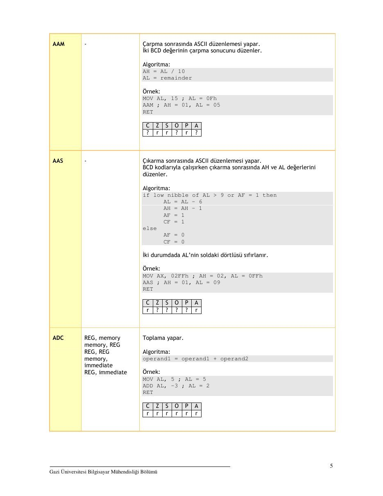
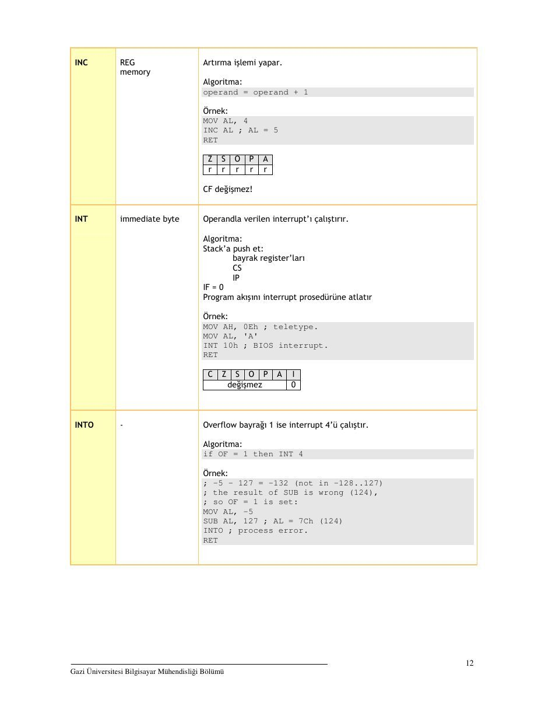

This post brings together the relevant notes and exercises from the Başkent University **EEM332 Microprocessors** course archive (2007–2007). 8086 instruction set, operands, and example assembly operations; lecture notes from 2007. Source: Gazi University, M. Ali Akcayol, 2007. PDF archive copies of the documents and, where available, the source code can be downloaded as a ZIP at the end of the post.

*Note: This content belongs to a third-party source; it is shared for archival and nostalgic purposes with the source credited. It will be removed at the request of the rights holder.*

## _8086KomutlarOrnekler

### 8086 INSTRUCTION SET AND EXAMPLES

Assoc. Prof. Dr. M. Ali Akcayol

Gazi University, Department of Computer Engineering

(2007)

```asm
NOT: Bu doküman başta emu8086 programının yardım dosyası olmak üzere aşağıdaki
```

### This document was prepared using the following sources

Barry B. Brey, The Intel Microprocessors 8086/8088, 80186/80188, 80286, 80386, 80486, Pentium, Pentium Pro Processor, Pentium II, Pentium Ill, Pentium 4 Architecture, Programming, and Interfacing (7th edition), Prentice Hall, ISBN: 0131974076, 2006.

Walter A. Triebel, Avtar Singh, Avtar Singh, The 8088 and 8086 Microprocessors: Programming, Interfacing, Software, Hardware, and Applications (4th edition), Prentice Hall, 0130930814, 2002.

Muhammad Ali Mazidi, Janice Gillispie-Mazidi, Muhammad A. Mazidi, Janice Catherine Gillispie-Mazidi, 80X86 IBM PC and Compatible Computers: Assembly Language, Design, and Interfacing (4th edition), Prentice Hall, 2002.

Gazi University, Department of Computer Engineering

### GENERAL INFORMATION

### GENERAL-PURPOSE REGISTERS

### AX, BX, CX, DX, SI, DI, BP, SP

### SPECIAL-PURPOSE REGISTERS

### IP, FLAG REGISTERS

### SEGMENT REGISTERS

### CS, DS, ES, SS

### OPERAND TYPES

### REG : AX, BX, CX, DX, AH, AL, BL, BH, CH, CL, DH, DL, DI, SI, BP, SP.

SREG : DS, ES, SS, CS (second operand only).

memory _ : [BX], [BX+SI+7], variable, etc.

immediate : 5, -24, 3Fh, 10001101b, etc.

### FLAG STATES

1 - the instruction sets this flag bit to 1.

0 - the instruction sets this flag bit to 0.

r - the flag value depends on the result of the instruction.

? - the flag value is undefined (may be 1 or 0).

### VARIABLES

```asm
name DB value
```

```asm
name DW value
```

name DD value

### Example

```asm
ORG 100h
```

```asm
MOV AL, varl
MOV BX, var2
```

```asm
RET ; program stops
VARI DB 7
```

```asm
var2 DW 1234h
```

### ARRAYS

```asm
a DB 48h, 65h, 6Ch, 6Ch, 6Fh, 00h
b DB 'Hello', 0
```

... a[6] al1) a[2] a[3] a[4] a[5] b(6J b[1] b[2]

Gazi University, Department of Computer Engineering

```asm
MOV AL, a[3]
```

```asm
MOV SI, 3
```

```asm
MOV AL, a[SI]
```

DUP operator

count DUP ( values )

```asm
c DB 5 DUP (9)
c DB 9, 9, 9, 9, 9
```

```asm
d DB 5 DUP(1, 2)
```

sh 2 0

### CONSTANTS

```asm
name EQU <expression>
```

```asm
k EQU 5
MOV AX, k
```

```asm
MOV AX, 5
```

### FLAG BITS

C - Carry Flag

Z - Zero Flag

S - Sign Flag

O - Overflow Flag P - Parity Flag

A - Auxiliary Flag | - Interrupt Flag D - Direction Flag

### DATA TRANSFER INSTRUCTIONS

```asm
PUSH, POP, LEA, LDS, LODS, LODSB, LODSW, STOS, STOSB, STOSW, MOVS, MOVSB, MOVSW, INS, INSB,
```

### INSW, OUTS, OUTSB, OUTSW, XCHG, LAHF, SAHF, XLAT, IN, OUT

### ARITHMETIC AND LOGIC INSTRUCTIONS

```asm
ADD, INC, ADC, SUB, DEC, SBB, CMP, MUL, IMULI DIV, IDIV, CBW, CWD, DAA, DAS, AAA, AAD, AAM, AAS,
AND, OR, XOR, TEST, NOT, NEG, SHL, SHR, SAL, SAR, ROL, RCL, RCR, ROR, SCAS, CMPS
```

### PROGRAM CONTROL INSTRUCTIONS

```asm
JMP, JA, JAE, JB, JBE, JC, JE, JZ, JG, JGE, JL, JLE, INC, JNE, JNZ, JNC, JNE, JNZ, JNO, JNS, JNP, JPO,
JO, JP, JPE, JS, JCXZ, LOOP, CALL, RET, INT, IRET, HLT, NOP
```

Gazi University, Department of Computer Engineering

### GENERAL INFORMATION

### INSTRUCTION OPERANDS DESCRIPTION AND EXAMPLE

5 Performs ASCII adjust after addition. When working with BCD codes, it adjusts the AH and AL values after addition.

düzenler.

### Algorithm

if low nibble of AL > 9 or AF = 1 then

### AL = AL + 6

### AH = AH +1

AF =1 CF=1 else

### AF = 0

### CF = 0

In both cases, the upper nibble of AL is cleared.

### Example

```asm
MOV AX, 15 ; AH = 00, AL = OFh
AAA ; AH = 01, AL = 05
RET
```

2 Performs ASCII adjust after division. Prepares two BCD values for division.

### Algorithm

### AL = (AH * 10) + AL

### AH = 0

```asm
Ornek:
```

```asm
MOV AX, 0105h ; AH = 01, AL = 05
```

```asm
AAD ; AH = 00, AL = OFh (15)
RET
```

c|zJsJojfJrPJA ?l)rjr|2)Jr)J2

Gazi University, Department of Computer Engineering

Performs ASCII adjust after multiplication. Adjusts the product of two BCD values.

### Algorithm

### AH = AL / 10

AL = remainder

```asm
Ornek:
```

```asm
MOV AL, 15 ; AL = OFh
```

```asm
AAM ; AH = 01, AL = 05
RET
```

lol

### N

oO} >

Performs ASCII adjust after subtraction. When working with BCD codes, it adjusts the AH and AL values after subtraction.

### Algorithm

if low nibble of AL > 9 or AF - 1 then

### AL = AL - 6

### AH = AH - 1

AF =1 CE s1 else a (8)

### CE = 0

In both cases, the upper nibble of AL is cleared.

### Example

```asm
MOV AX, O2FFh ; AH = 02, AL = OFFh
```

### AAS ; AH = 01, AL = 09

```asm
RET
```

SPAS ee rj(2J2(2)J2)r

REG, memory memory, REG

### REG, REG

memory, immediate REG, immediate

Performs addition.

### Algorithm

operandi = operandi + operand2

```asm
Ornek:
```

```asm
MOV AL, 5; AL = 5
ADD AL, -3 ; AL = 2
RET
```

### GEZE

rİrjrlrjrjr

Gazi University, Department of Computer Engineering

REG, memory memory, REG

### REG, REG

memory, immediate REG, immediate

Performs a logical AND on all corresponding bits of the two operands and stores the result in the left operand.

### Truth table

1 AND 1=1

1 AND 0 o

### 0 AND 1 = 0

### 0 AND 0 = 0

```asm
Ornek:
```

```asm
MOV AL, 'a' ; AL = 01100001b
AND AL, 11011111b ; AL = 01000001b ('A')
```

```asm
RET
```

ae O|P olr|/r/ojr

procedure name label 4-byte address

Calls a procedure and pushes the return address (IP) onto the stack. The call can be made using a 4-byte address. In the address 1234h:5678h, the first value specifies the segment and the second value specifies the offset. This is a far call, and CS is pushed onto the stack together with IP.

### Example

#make, COM$

```asm
ORG 100h Oo; for COM file.
```

```asm
CALL pl
```

```asm
ADD AX, 1
```

```asm
RET ; return to DOS.
```

```asm
pl PROC i procedure declaration.
MOV AX, 1234h
RET 7; return to caller.
```

pl ENDP

C[z{s[o[PlA unchanged

Converts a byte value to a word.

### Algorithm

if high bit of AL = 1 then AH = 255 (OFFh)

else

### AH = 0

```asm
Ornek:
MOV AX, 0 ; AH = 0, AL = 0
MOV AL, -5 ; AX = 000FBh (251)
```

CBW } AX = OFFFBh (-5)

```asm
RET
```

C[z{s[o[PlA unchanged

Gazi University, Department of Computer Engineering

. Clears the carry flag.

### Algorithm

### CE = 0

Cc

- Clears the direction flag. The SI and DI registers are incremented during successive operations performed with the CMPSB,

### CMPSW, LODSB, LODSW,

```asm
MOVSB, MOVSW, STOSB, STOSW instructions.
```

işlemlerde artırılır.

### Algorithm

### DF = 0

### D

s Clears the interrupt enable flag. This disables hardware interrupts.

### Algorithm

### IF -0

### I

i Complements the carry flag.

### Algorithm

if CF - 1 then CF - 0 if CF = 0 then CF - 1

Cc

### R

Gazi University, Department of Computer Engineering

REG, memory memory, REG

### REG, REG

memory, immediate REG, immediate

Performs a comparison. Subtracts the right operand from the left operand, but the operands are not changed; only the flag bits are affected.

### Algorithm

öperandi - operand2

The OF, SF, ZF, AF, PF, CF flags are updated according to the result.

### Example

```asm
MOV AL, 5
```

```asm
MOV BL, 5
```

```asm
CMP AL, BL ; AL=5, ZF=1 (equal)
RET
```

### GSE

rİrjrlrjrjr

Compares one byte between ES:[DI] and DS:[SI].

### Algorithm

### DS:1SIJ — ES: [DI]

The OF, SF, ZF, AF, PF, CF flags are updated according to the result. if DF = 0 then

SI =sI+1

DI =DI+1

SI=st-1 DI =DI-1

Z(s|o r[re[r[r[r[r

Compares one word between ES:[DI] and DS:[SI].

### Algorithm

### DS: [SI] - ES: [DI]

The OF, SF, ZF, AF, PF, CF flags are updated according to the result. if DF = 0 then

### SI = SI + 2

### DI = DI +2

### SI = SI - 2

### DI = DI - 2

Z{[s[o rİrjrirjrjr

Gazi University, Department of Computer Engineering

. Extends a signed word to a doubleword.

### Algorithm

if high bit of AX = 1 then DX = 65535 (OFFFFh)

else

### DX = 0

```asm
Ornek:
MOV DX, 0 ; DX = 0
MOV AX, 0 ; AX = 0
```

```asm
MOV AX, —5 ; DX AX = 00000h:0FFFBh
```

CWD ; DX AX = OFFFFh:0FFFBh

```asm
RET
```

### CIZISTOJPTA

unchanged

2 Performs decimal adjust after addition. Adjusts the sum of two BCD values.

### Algorithm

if low nibble of AL > 9 or AF - 1 then

### AL = AL + 6

AF =1

if AL > 9Fh or CF = 1 then AL = AL + 60h

CF =1

```asm
Ornek:
MOV AL, OFh } AL = OFh (15)
DAA AE Gia
RET
```

a O|P

3 Performs decimal adjust after subtraction. Adjusts the difference of two BCD values.

### Algorithm

if low nibble of AL > 9 or AF - 1 then

### AL = AL - 6

AF =1

if AL > 9Fh or CF = 1 then AL = AL — 60h

Cr Si

```asm
Ornek:
MOV AL, OFFh ; OFFh (<1)
DAS 7 99h, CF -1
RET
```

c|zJsJoJPJA rİrjrirjrjr

Gazi University, Department of Computer Engineering

REG Performs a decrement. memory

### Algorithm

operand = operand - 1

```asm
Ornek:
```

```asm
MOV AL, 255 ; AL = OFFh (255 or -1)
DEC AL ; AL = OFEh (254 or -2)
```

```asm
RET
```

c|zJsJofJPJA rİrjirirjrjr

CF unchanged! REG Performs unsigned division. memory

### Algorithm

### when operand is a byte

AL - AX / operand AH - remainder

### when operand is a word

AX = (DX AX) / operand DX = remainder

```asm
Ornek:
```

‘MOV AX, 203 ; AX = 00CBh

```asm
MOV BL, 4
```

```asm
DIV BL 7 AL = 50 (32h), AH = 3
RET
```

cj|zjsJofJPJA

### İNENENENENE

- Stops the program.

### Example

```asm
MOV AX, 5
HLT
```

c(zJsJoJPJA unchanged

Gazi University, Department of Computer Engineering

REG Performs signed division. memory

### Algorithm

### when operand is a byte

AL = AX / operand

AH = remainder

### when operand is a word

AX = (DX AX) / operand

DX = remainder

```asm
Ornek:
```

```asm
MOV AX, -203 ; AX = OFF35h
```

```asm
MOV BL, 4
```

IDIV BL ; AL = -50 (0CEh), AH = -3 (OFDh)

```asm
RET
```

c/zJsJojJrPJA

Tl?l?l?7 lel?

REG Performs signed multiplication. memory

### Algorithm

### when operand is a byte

AX = AL * operand

### when operand is a word

(DX AX) = AX * operand

```asm
Ornek:
MOV AL, -2
MOV BL, -4
```

### IMUL BL ; AX = 8

```asm
RET
```

cj(zJsJojJrPJA r|2(/2(r|J2)(2

CF=OF=0 if the result does not overflow the operand size.

AL, im.byte Reads input from a port into AL or AX. AL, DX The second operand is the port number. AX, im.byte AX, DX Second operand is a port number. If ports above 255 need to be accessed, the DX register is used.

```asm
Ornek:
IN AX, 4 ; get status of traffic lights.
IN AL, 7 ; get status of stepper-motor.
```

cj|zJsJoJPJA unchanged

Gazi University, Department of Computer Engineering

REG Performs an increment. memory

### Algorithm

operand = operand + 1

```asm
Ornek:
```

```asm
MOV AL, 4
INC AL ; AL
RET
```

" a

### SJOJPJA

r[r[r[r[r

CF unchanged!

immediate byte Invokes the interrupt specified by the operand.

### Algorithm

### Push onto the stack

flag registers cs

### IP

IF=0 Transfers program flow to the interrupt procedure

### Example

```asm
MOV AH, OBh ; teletype.
MOV AL, 'A'
```

```asm
INT 10h ; BIOS interrupt.
RET
```

Ci[z[s[o[P[A unchanged 0

2 Invokes interrupt 4 if the overflow flag is 1.

### Algorithm

if OF = 1 then INT 4

```asm
Ornek:
```

} -5 - 127 = -132 (not in -128..127)

```asm
; the result of SUB is wrong (124),
ji so OF = 1 is set:
```

```asm
MOV AL, -5
```

```asm
SUB AL, 127 ; AL = 7Ch (124)
```

INTO ; process error.

```asm
RET
```

Gazi University, Department of Computer Engineering

Returns from an interrupt.

### Algorithm

### Pop from the stack

### IP

cs flags register

c(zJsJoJPJA

```asm
popped
```

label

Performs a short jump if the first operand is greater than the second. Performs an unsigned comparison.

### Algorithm

if (CF = 0) and (ZF = 0) then jump

### Example

```asm
include ‘emu8086.inc'
```

#make_COM#

```asm
ORG 100h
```

```asm
MOV AL, 250
```

```asm
CMP AL, 5
JA etiketi
```

PRINT 'AL is not greater than 5'

```asm
JMP exit
etiketi:
```

PRINT 'AL is greater than 5'

### exit

```asm
RET
```

CIZ[S[oO[P[A unchanged

Gazi University, Department of Computer Engineering

label Performs a short jump if the first operand is greater than or equal to the second. Performs an unsigned comparison.

### Algorithm

if CF = 0 then jump

```asm
Ornek:
include 'emu8086.inc"
```

#make_COM# ‘ORG 100h

```asm
MOV AL, 5
CMP AL, 5
JAE etiketli
```

PRINT 'AL is not above or equal to 5'

```asm
JMP exit
```

etiketi; PRINT 'AL is above or egual to 5'

### exit

```asm
RET
```

c(zJsJoJPJA unchanged

label Performs a short jump if the first operand is less than the second. Performs an unsigned comparison.

### Algorithm

if CF = 1 then jump

```asm
Ornek:
include 'emu8086.inc"
```

#make_COM#

```asm
ORG 100h
MOV AL, 1
CMP AL, 5
JB etiketl
```

PRINT 'AL is not below 5!

```asm
JMP exit
etiketi:
```

PRINT 'AL is below 5'

### exit

```asm
RET
```

### CELLE

unchanged

Gazi University, Department of Computer Engineering

label

Performs a short jump if the first operand is less than or equal to the second. Performs an unsigned comparison.

### Algorithm

if CF = 1 or ZF = 1 then jump

```asm
Ornek:
include 'emu8086.inc"
```

#make_COM#

‘ORG 100h

```asm
MOV AL, 5
```

### ‘CMP AL, 5

```asm
JBE etiketli
```

PRINT 'AL is not below or equal to 5' IMP exit

### etiketi

PRINT 'AL is below or egual to 5'

### exit

```asm
RET
```

c(zJsJoJPJA unchanged

label

Performs a short jump if the carry flag bit is 1.

### Algorithm

if CF = 1 then jump

### Example

```asm
include 'emu8086.inc'
```

#make_COM#

‘ORG 100h

```asm
MOV AL, 255
ADD AL, 1
JC etiketi
```

PRINT 'no carry"

```asm
JMP exit
siiketli:
```

PRINT 'carry'

### exit

```asm
RET
```

cizJsJoJPJA unchanged

Gazi University, Department of Computer Engineering

label Performs a short jump if the CX register is 0.

### Algorithm

if CX = 0 then jump

### Example

```asm
include "emu8086.inc"
```

#make_COM#

```asm
ORG 100h
MOV CX, 0
JCXZ etiket1
```

PRINT 'CX is not zero.' IMP exit

### etiketl

PRINT 'CX is zero.'

### exit

```asm
RET
```

CIZ[s[O[P[A unchanged

label Performs a short jump if the first operand is equal to the second. Performs a signed or unsigned comparison.

### Algorithm

if 2F = 1 then jump

### Example

```asm
include 'emu8086.inc'
```

#make COM#

```asm
ORG 100h
MOV AL, 5
CMP AL, 5
JE etiketl
```

PRINT 'AL is not equal to 5.' UMP exit

### etiketli

PRINT 'AL is equal to 5.' exits

```asm
RET
```

### CI[Z[S[O][P[A

unchanged

Gazi University, Department of Computer Engineering

label

Performs a short jump if the first operand is greater than the second. Performs a signed comparison.

### Algorithm

if (ZF = 0) and (SF = OF) then jump

### Example

```asm
include 'emu8086.inc"
```

#make_COM# ‘ORG 100h

```asm
MOV AL, 5
CMP AL, -5
JG etiketli
```

PRINT 'AL is not greater than -5.'

```asm
JMP exit
```

etiketi; PRINT ' AL is greater than -5."

### exit

```asm
RET
```

c(zJsJoJPJA unchanged

label

Performs a short jump if the first operand is greater than or equal to the second. Performs a signed comparison.

### Algorithm

if SF - OF then jump

### Example

```asm
include 'emu8086.inc"
```

#make_COM#

```asm
ORG 100h
```

```asm
MOV AL, 2
```

```asm
CMP AL, -5
```

```asm
JGE etiketli
```

### PRINT 'AL < -5'

```asm
JMP exit
etiketi:
```

### PRINT 'AL >= -5'

### exit

```asm
RET
```

### CELLE

unchanged

Gazi University, Department of Computer Engineering

label

Performs a short jump if the first operand is less than the second. Performs a signed comparison.

### Algorithm

if SF <> OF then jump

### Example

```asm
include 'emu8086.inc"
```

#make_COM#

```asm
ORG 100h
```

```asm
MOV AL, -2
CMP AL, 5
JL etiketli
```

### PRINT 'AL >= 5."

UMP exit etiketi;

### PRINT 'AL < 5.'

### exit

```asm
RET
```

c(zJsJoJPJA unchanged

label

Performs a short jump if the first operand is less than or equal to the second. Performs a signed comparison.

### Algorithm

if SF <> OF or ZF - 1 then jump

### Example

```asm
include 'emu8086.inc"
```

#make_COM#

```asm
ORG 100h
```

```asm
MOV AL, -2
```

```asm
CMP AL, 5
```

```asm
JLE etiketli
```

### PRINT 'AL > 5.'

```asm
JMP exit
etiketi:
```

### PRINT 'AL <= 5.'

### exit

```asm
RET
```

### CELLE

unchanged

Gazi University, Department of Computer Engineering

label 4-byte address

Performs an unconditional jump. . The 4-byte address can be entered in the form 1234h:5678h. The first value is the segment and the second is the offset address.

### Algorithm

always jump

```asm
Ornek:
```

```asm
include 'emu8086.inc'
```

#make_COM#

```asm
ORG 100h
```

```asm
MOV AL, 5
```

UMP etiket1 ; jump over 2 lines! PRINT ‘Not Jumped!"

```asm
MOV AL, 0
```

### etiketi

PRINT 'Got Here!

```asm
RET
```

c(zJsJoJPJA unchanged

label

Performs a short jump if the first operand is not greater than the second. Performs an unsigned comparison.

### Algorithm

if CF = 1 or ZF = 1 then jump

```asm
Ornek:
```

```asm
include 'emu8086.inc"
```

#make_COM#

```asm
ORG 100h
```

```asm
MOV AL, 2
```

```asm
CMP AL, 5
```

```asm
JNA etiketli
```

PRINT 'AL is above 5."

```asm
JMP exit
```

etiket lc

PRINT 'AL is not above 5."

### exit

```asm
RET
```

### CIZISTOJPTA

unchanged

Gazi University, Department of Computer Engineering

label

Performs a short jump if the first operand is neither greater than nor equal to the second. Performs an unsigned comparison.

### Algorithm

if CF = 1 then jump

```asm
Ornek:
include 'emu8086.inc"
```

#make_COM#

```asm
ORG 100h
```

```asm
MOV AL, 2
CMP AL, 5
JNAE etiketi
```

### PRINT 'AL >= 5."

```asm
JMP exit
```

etiketi;

### PRINT 'AL < 5.'

### exit

```asm
RET
```

c(zJsJoJPJA unchanged

label

Performs a short jump if the first operand is not less than the second. Performs an unsigned comparison.

### Algorithm

if CF = 0 then jump

```asm
Ornek:
```

```asm
include 'emu8086.inc"
```

#make_COM#

```asm
ORG 100h
```

```asm
MOV AL, 7
```

```asm
CMP AL, 5
```

```asm
JNB etiket1
```

### PRINT 'AL < 5.'

```asm
JMP exit
etiketi:
```

### PRINT 'AL >= 5."

### exit

```asm
RET
```

### CELLE

unchanged

Gazi University, Department of Computer Engineering

label Performs a short jump if the first operand is neither less than nor equal to the second. Performs an unsigned comparison.

### Algorithm

if (CF = 0) and (ZF = 0) then jump

```asm
Ornek:
include 'emu8086.inc"
```

#make_COM# ‘ORG 100h

```asm
MOV AL, 7
CMP AL, 5
JNBE etiketi
```

### PRINT 'AL <= 5."

```asm
JMP exit
```

etiketi;

### PRINT 'AL > 5.'

### exit

```asm
RET
```

c(zJsJoJPJA unchanged

label Performs a short jump if the carry flag bit is 0.

### Algorithm

if CF = 0 then jump

```asm
Ornek:
include 'emu8086.inc'
```

#make_COM# ‘ORG 100h

```asm
MOV AL, 2
ADD AL, 3
JNC etiketli
```

PRINT ‘has carry.' UMP exit etiketi; PRINT 'no carry.'

### exit

```asm
RET
```

cizJsJoJPJA unchanged

Gazi University, Department of Computer Engineering

label Performs a short jump if the first operand is not equal to the second. Performs a signed or unsigned comparison.

### Algorithm

if ZF = 0 then jump

```asm
Ornek:
include 'emu8086.inc'
```

#make_COM#

```asm
ORG 100h
MOV AL, 2
CMP AL, 3
```

INE etiketi

### PRINT 'AL = 3."

IMP exit etiketlik PRINT 'Al <> 3.'

### exit

```asm
RET
```

### CIZ[S[O[P[A

unchanged

label Performs a short jump if the first operand is not greater than the second. Performs a signed comparison.

### Algorithm

if (ZF = 1) and (SF <> OF) then jump

### Example

```asm
include 'emu8086.inc"
```

#make_COM#

```asm
ORG 100h
```

```asm
MOV AL, 2
```

```asm
CMP AL, 3
```

ING etiket1

### PRINT 'AL > 3.'

```asm
JMP exit
etiketi:
```

PRINT 'Al <= 3."

### exit

```asm
RET
```

CIZJISToJPJA unchanged

Gazi University, Department of Computer Engineering

label Performs a short jump if the first operand is neither greater than nor equal to the second. Performs a signed comparison.

### Algorithm

if SF <> OF then jump

### Example

```asm
include 'emu8086.inc"
```

#make_COM# ‘ORG 100h

```asm
MOV AL, 2
CMP AL, 3
JNGE etiketli
```

### PRINT 'AL >= 3.'

```asm
JMP exit
```

etiketi; PRINT 'Al < 3.'

### exit

```asm
RET
```

c(zJsJoJPJA unchanged

label Performs a short jump if the first operand is not less than the second. Performs a signed comparison.

### Algorithm

if SF - OF then jump

### Example

```asm
include 'emu8086.inc"
```

#make_COM#

```asm
ORG 100h
```

```asm
MOV AL, 2
```

```asm
CMP AL, -3
```

```asm
JNL etiketli
```

### PRINT 'AL < -3.'

```asm
JMP exit
```

### etiketi

PRINT 'Al >= -3.'

### exit

```asm
RET
```

### CELLE

unchanged

Gazi University, Department of Computer Engineering

label Performs a short jump if the first operand is neither less than nor equal to the second. Performs a signed comparison.

### Algorithm

if (SF - OF) and (ZF - 0) then jump

### Example

```asm
include 'emu8086.inc"
```

#make_COM#

‘ORG 100h

```asm
MOV AL, 2
```

```asm
CMP AL, -3
```

İNLE etiketi

### PRINT 'AL <= -3.'

```asm
JMP exit
etiketi:
```

PRINT 'Al > -3.'

### exit

```asm
RET
```

c(zJsJoJPJA unchanged

label Performs a short jump if the overflow flag bit is 0.

### Algorithm

if OF = 0 then jump

```asm
Ornek:
```

-5 - 2 = -7 (inside -128..127) the result of SUB is correct,

### so OF = 0

```asm
include 'emu8086.inc'
```

#make_COM#

```asm
ORG 100h
MOV AL, -5
SUB AL, 2 ; AL = 0F9h (-7)
JNO etiketli
```

PRINT 'overflow!' IMP exit etiketlik PRINT 'no overflow."

### exit

```asm
RET
```

c(zJsJoJPJA unchanged

Gazi University, Department of Computer Engineering

label Performs a short jump if the parity flag bit is 0 (odd). Only the least significant 8 bits are checked. It is set by the CMP, SUB, ADD,

```asm
TEST, AND, OR, XOR instructions.
```

### Algorithm

if PF = 0 then jump

```asm
Ornek:
```

```asm
include 'emu8086.inc'
```

#make_COM#

```asm
ORG 100h
```

```asm
MOV AL, 00000111b ; AL = 7
OR AL, 0 ; just set flags.
```

INP etiket1

PRINT 'parity even.'

```asm
JMP exit
```

### etiketi

PRINT 'parity odd.'

### exit

```asm
RET
```

cj|zJsJoJPJAa unchanged

label Performs a short jump if the sign flag bit is not 1 (positive). It is set by the CMP, SUB, ADD, TEST, AND, OR, XOR instructions.

### Algorithm

if SF = 0 then jump

```asm
Ornek:
include 'emu8086.inc'
```

#make_COM#

```asm
ORG 100h
MOV AL, 00000111b ; AL = 7
OR AL, 0 ; just set flags.
```

ONS etiket1 PRINT 'signed.' UMP exit

### etiketl

PRINT 'not signed.’

### exit

```asm
RET
```

C[z{s[o[PlA unchanged

Gazi University, Department of Computer Engineering

label Performs a short jump if the zero flag (ZF) bit is 0 (positive).

```asm
It is set by the CMP, SUB, ADD, TEST, AND, OR, XOR instructions.
```

### Algorithm

if ZF = 0 then jump

```asm
Ornek:
```

```asm
include 'emu8086.inc"
```

#make_COM#

```asm
ORG 100h
```

```asm
MOV AL, 00000111b ; AL=7
OR AL, 0 ; just set flags.
JNZ etiket1
```

PRINT 'zero.'

UMP exit

etiketi;

PRINT 'not zero.'

### exit

```asm
RET
```

c(zJsJoJPJA unchanged

label Performs a short jump if the overflow flag (OF) bit is 1.

### Algorithm

if OF - 1 then jump

### Example

e iye 132 (ice in 128127)

```asm
; the result of SUB is wrong (124),
```

### i so OF = 1 is set

```asm
include 'emu8086.inc'
```

#make_COM#

```asm
org 100h
```

```asm
MOV AL, -5
```

```asm
SUB AL, 127 ; AL = 7Ch (124)
```

```asm
JO etiketi
```

PRINT 'no overflow.'

IMP exit

### etiketii

PRINT 'overflow!'

### exit

```asm
RET
```

### C[Z[S[O[P[A

unchanged

Gazi University, Department of Computer Engineering

label

Performs a short jump if the parity flag bit is 1 (even). Only the least significant 8 bits are checked. It is set by the CMP, SUB,

```asm
ADD, TEST, AND, OR, XOR instructions.
```

### Algorithm

if PF = 1 then jump

```asm
Ornek:
```

```asm
include 'emu8086.inc"
```

#make_COM#

```asm
ORG 100h
```

```asm
MOV AL, 00000101b ; AL = 5
OR AL, 0 ; just set flags.
JP etiketl
```

PRINT 'parity odd.'

UMP exit

### etiketi

PRINT 'parity even."

### exit

```asm
RET
```

cj|zJsJoJPJAa unchanged

label

Performs a short jump if parity is even. Only the least significant 8 bits are checked. It is set by the CMP, SUB, ADD, TEST, AND, OR, XOR instructions.

### Algorithm

if PF = 1 then jump

### Example

```asm
include 'emu8086.inc"
```

#make_COM#

```asm
ORG 100h
```

```asm
MOV AL, 00000101b ; AL = 5
OR AL, 0 ; just set flags.
JPE etiket1
```

PRINT 'parity odd.'

```asm
JMP exit
```

### etiketli

PRINT 'parity even.'

### exit

```asm
RET
```

c(zJsJoJPJA unchanged

Gazi University, Department of Computer Engineering

label Performs a short jump if parity is odd. Only the least significant 8 bits are checked. It is set by the CMP, SUB, ADD, TEST, AND, OR, XOR instructions.

### Algorithm

if PF = 0 then jump

```asm
Ornek:
```

```asm
include 'emu8086.inc"
```

#make_COM#

```asm
ORG 100h
```

```asm
MOV AL, 00000111b ; AL = 7
OR AL, 0 ; just set flags.
JPO etiketli
```

PRINT 'parity even.'

UMP exit

### etiketi

PRINT 'parity odd.'

### exit

```asm
RET
```

cj|zJsJoJPJAa unchanged

label Performs a short jump if the sign flag bit is 1 (negative). It is set by the CMP,

```asm
SUB, ADD, TEST, AND, OR, XOR instructions.
```

### Algorithm

if SF = 1 then jump

```asm
Ornek:
include 'emu8086.inc'
```

#make_COM#

```asm
ORG 100h
MOV AL, 10000000b ; AL = -128
OR AL, 0 ; just set flags.
JS etiketi
```

PRINT 'not signed.' UMP exit

### etiketl

PRINT 'signed.'

### exit

```asm
RET
```

C[z{s[o[PlA unchanged

Gazi University, Department of Computer Engineering

label Performs a short jump if zero (ZF=1). It is set by the CMP, SUB, ADD,

```asm
TEST, AND, OR, XOR instructions.
```

### Algorithm

if ZF = 1 then jump

### Example

```asm
include 'emu8086.inc"
```

#make_COM#

```asm
ORG 100h
```

```asm
MOV AL, 5
```

```asm
CMP AL, 5
```

```asm
JZ etiketi
```

PRINT 'AL is not equal to 5.' UMP exit

etiketi;

PRINT 'AL is equal to 5.'

### exit

```asm
RET
```

c(zJsJoJPJA unchanged

2 Loads the least significant 8 bits of the flags register into the AH register.

### Algorithm

AH = flags register AH: 7 6 5 4 3 2 1 te)

### (SF) [ZF] [0] [AF] [0] [PF] [1] [CF]

Bits 1, 3, 5 are reserved.

CIZ[S[oO[P[A unchanged

REG, memory Loads the doubleword data fetched from memory into the destination operand register and into DS.

### Algorithm

REG = first word DS = second word

```asm
Ornek:
```

#make_COM#

```asm
ORG 100h
```

LDS AX, m

```asm
RET
```

```asm
m DW 1234h
```

DW 5678h

```asm
END
```

AX is set to 1234h, DS is set to 5678h.

cJzJsJoJPJA unchanged

Gazi University, Department of Computer Engineering

REG, memory Loads the effective address.

### Algorithm

REG = address of memory (offset)

### Example

#make_COM#

```asm
ORG 100h
LEA AX, m
RET
```

```asm
m DW 1234h
END
```

AX is set to 0104h.

```asm
The LEA instruction is 3 bytes and the RET instruction is 1 byte. Since
```

the program starts at address 0100h, the address of m is 0104h.

### CIZJSJOJPJA

unchanged

REG, memory Loads the doubleword data fetched from memory into the destination operand register and into ES.

### Algorithm

REG = first word ES = second word

```asm
Ornek:
```

#make COM$#

```asm
ORG 100h
```

LES AX, m

```asm
RET
```

```asm
m DW 1234h
```

DW 5678h

```asm
END
```

The AX register becomes 1234h and the ES register becomes 5678h.

CIZJSJoJPJA unchanged

Gazi University, Department of Computer Engineering

. Loads one byte from address DS:[SI] into the AL register. The SI value is updated (incremented by 1 (D=0), decremented by 1 (D=1))

### Algorithm

### AL = DS:1SI)J

if DF = 0 then Sr = Si + 1 else

Seki sl

### Example

#make_COM#

```asm
ORG 100h
LEA SI, al
MOV CX, 5
MOV AH, OEh
m: LODSB
INT 10h
LOOP m
```

```asm
RET
```

```asm
al DB 'H', 'e', Cl, '1!, to!
```

CiZ[s[o[P[A unchanged

i Loads one word from address DS:[SI] into the AX register. The SI value is updated (incremented by 2 (D=0), decremented by 2 (D=1))

### Algorithm

### AX = DS:(SIJ

if DF = 0 then Su = si 2 else

Sh ei = 2

```asm
Ornek:
```

#make_COM#

```asm
ORG 100h
```

```asm
LEA SI, al
```

```asm
MOV CX, 5
```

```asm
REP LODSW ; finally there will be 555h in AX.
RET
```

```asm
al dw 1lih, 222h, 333h, 444h, 555h
```

CIZJSJoJPJA unchanged

Gazi University, Department of Computer Engineering

label Decrements CX by one and jumps to the label if CX is not zero.

### Algorithm

ex sGX-1

if CX <> 0 then

```asm
jump
```

else

no jump, continue

### Example

```asm
include 'emu8086.inc"
```

#make_COM#

```asm
ORG 100h
```

```asm
MOV CX, 5
```

etiker ik

PRININ 'loop!'

```asm
LOOP etiket1
```

```asm
RET
```

### CI[Z[S[O][P[A

unchanged

label Decrements CX by one and jumps to the label if CX is not zero and equality holds (between the two given operands) (ZF=1).

### Algorithm

xx =

if (CX <> 0) and (ZF = 1) then

```asm
jump
```

else

no jump, continue

```asm
Ornek:
```

```asm
; Loop until result fits into AL alone,
; or 5 times. The result will be over 255
; on third loop (100+100+100),
```

```asm
; so loop will exit.
```

```asm
include 'emu8086.inc’
```

#make_COM#

```asm
ORG 100h
```

```asm
MOV AX, O
```

```asm
MOV CX, 5
```

### etiketi

### PUTC '*'

```asm
ADD AX, 100
```

```asm
CMP AH, 0
```

```asm
LOOPE etiket1l
```

```asm
RET
```

C[Z[S[O[Pl/A unchanged

Gazi University, Department of Computer Engineering

label Decrements CX by one and jumps if CX is not zero and equality does not hold (between the two given operands) (ZF=0)

### Algorithm

EK =x

if (CX <> 0) and (ZF = 0) then

```asm
jump
```

else

no jump, continue

```asm
Ornek:
```

```asm
; Loop until '7' is found,
; or 5 times.
```

```asm
include 'emu8086.inc'
```

#make_COM#

```asm
ORG 100h
```

```asm
MOV SI, 0
```

```asm
MOV CX, 5
```

### etiketi

### PUTC '4!

```asm
MOV AL, v1[SI]
```

```asm
INC SI ; next byte (SI=SI+1).
CMP AL, 7
```

```asm
LOOPNE etiketl
```

```asm
RET
```

```asm
vl db 9, 8, 7, 6, 5
```

cizJsJoJPJA unchanged

label Decrements CX by one and jumps to the label if CX is not zero and ZF=0.

### Algorithm

### CX = CX -— 1

if (CX <> 0) and (ZF = 0) then

```asm
jump
```

else

no jump, continue

```asm
Ornek:
```

```asm
; Loop until '7' is found,
```

7 or 5 times.

```asm
include 'emu8086.inc!
```

#make_COM#

```asm
ORG 100h
```

```asm
MOV SI, 0
```

```asm
MOV CX, 5
```

### etiketl

rege) Tet

```asm
MOV AL, v1[SI]
```

```asm
INC SI ; next byte (SI=SI+1).
```

```asm
CMP AL, 7
LOOPNZ etiketli
RET
```

```asm
vl db 9, 8, 7, 6, 5
```

cj|zJsJoJPJAa unchanged

Gazi University, Department of Computer Engineering

label Decrements CX by one and jumps to the label if CX is not zero and ZF=1.

### Algorithm

cece

if (CX <> 0) and (ZF = 1) then

```asm
jump
```

else

no jump, continue

```asm
Ornek:
```

```asm
; Loop until result fits into AL alone,
; or 5 times. The result will be over 255
; on third loop (100+100+100),
```

```asm
; so loop will exit.
```

```asm
include 'emu8086.inc'
```

#make_COM#

```asm
ORG 100h
```

```asm
MOV AX, 0
```

```asm
MOV CX, 5
```

### etiketi

Eyre 1 #

```asm
ADD AX, 100
```

```asm
CMP AH, 0
```

```asm
LOOPZ etiketl
```

```asm
RET
```

### CIZ[S[O[P[A

unchanged

```asm
MOV REG, memory The second operand is copied to the first operand.
```

| memory, REG

### REG, REG With the MOV instruction

memory, * values cannot be assigned to the CS and IP registers. immediate * Values cannot be transferred between two segment registers (first REG, immediate they must be moved to a general-purpose register). SREG, memory

### memory, SREG Algorithm

REG, SREG operandl = operand2

### SREG, REG

```asm
Ornek:
```

#make_COM#

```asm
ORG 100h
```

```asm
MOV AX, OB800h ; set AX = B800h (VGA memory).
MOV DS, AX ; copy value of AX to DS.
```

```asm
MOV CL, 'A' ; CL = 41h (ASCII code).
```

```asm
MOV CH, 01011111b ; CL = color attribute.
MOV BX, 15Eh ; BX = position on screen.
```

```asm
MOV [BX], CX ; w.[0B800h:015Eh] = CX.
```

```asm
RET ; returns to operating system.
```

cj|zJsJoJPJAa unchanged

Gazi University, Department of Computer Engineering

. Copies one byte from address DS:[SI] to address ES:[DI]. The SI and DI registers are updated.

### Algorithm

### ES:(DIJ = DS:[SI]

if DF = 0 then SE = Si 4 1 DI =DI+1

SI=st-1

### DI = DI-1

```asm
Ornek:
```

#make_COM#

```asm
ORG 100h
```

```asm
LEA SI, al
```

```asm
LEA DI, a2
```

```asm
MOV CX, 5
```

```asm
REP MOVSB
```

```asm
RET
```

ai Bel, 2, 3,475

```asm
a2 DB 5 DUP (0)
```

c(zJsJoJPJA unchanged

. Copies one word from address DS:[SI] to address ES:[DI]. The SI and DI registers are updated.

### Algorithm

### ES:(DI] = DS:(SIJ

if DF = 0 then

### SI = SI + 2

### DI = DI + 2

### SI = SI -2

### DI = DI - 2

```asm
Ornek:
```

#make_COM#

```asm
ORG 100h
```

```asm
LEA SI, al
```

```asm
LEA DI, a2
```

```asm
MOV CX, 5
```

```asm
REP MOVSW
```

```asm
RET
```

```asm
al DW 1,2,3,4,5
a2 DW 5 DUP(0)
```

CIZ[s[O[P[A unchanged

Gazi University, Department of Computer Engineering

### REG

memory

Performs unsigned multiplication.

### Algorithm

### when operand is a byte

AX - AL * operand.

### when operand is a word

(DX AX) = AX * operand.

```asm
Ornek:
```

```asm
MOV AL, 200 ; AL = 0C8h
MOV BL, 4
```

```asm
MUL BL ; AX = 0320h (800)
RET
```

C{[Z{[s[O[PlA cl? [?[r[?[?

CF=OF=0 when high section of the result is zero.

### REG

memory

Negates a number (two's complement).

### Algorithm

Invert all bits of the operand

```asm
Add 1 to inverted operand
```

```asm
Ornek:
```

```asm
MOV AL, 5 ; AL = 05h
```

NEG AL ; AL = OFBh (-5) NEG AL ; AL = 05h (5)

```asm
RET
```

c|zJsJo rİrjrirjrjr

Performs no operation.

### Algorithm

Do nothing

### Example

```asm
; do nothing, 3 times:
NOP
```

```asm
NOP
```

```asm
NOP
```

```asm
RET
```

cizJsJoJPJA unchanged

Gazi University, Department of Computer Engineering

REG Inverts every bit of the operand (one's complement). memory

### Algorithm

if bit is 1 turn it to 0. if bit is 0 turn it to 1.

```asm
Ornek:
```

```asm
MOV AL, 00011011b
```

```asm
NOT AL ; AL = 11100100b
RET
```

CIZ[sS[O[P[A

unchanged REG, memory Performs a logical OR on each pair of corresponding bits of the two operands. memory, REG

### REG, REG Truth table

memory, 1OR1=1

immediate 1 oR 0 REG, immediate OORI

### Example

```asm
MOV AL, 'A' ; AL = 01000001b
```

```asm
OR AL, 00100000b ; AL = 01100001b ('a')
RET
```

c|zJsJojfJrPJA olr|r/ojJrfJ2

```asm
OUT im.byte, AL The AL or AX register is sent to the given port.
```

im.byte, AX The first operand is the port number. If ports above 255 need DX, AL to be accessed, the DX register is used.

### DX, AX

### Example

```asm
MOV AX, OFFEh ; Turn on all
```

```asm
OUT 4, AX ; traffic lights.
```

```asm
MOV AL, 100b ; Turn on the third
```

```asm
OUT 7, AL ; magnet of the stepper-motor.
```

cj|zJsJoJPJAa unchanged

Gazi University, Department of Computer Engineering

### REG

### SREG

memory

Takes a 16-bit value from the stack and transfers it to the operand.

### Algorithm

operand = SS:[SP] (top of the stack)

### SP - SP 42

### Example

```asm
MOV AX, 1234h
```

```asm
PUSH AX
```

```asm
POP DX ; DX = 1234h
```

```asm
RET
```

cj|zJsJoJPJAa unchanged

Pops all general-purpose registers (DI, SI, BP, SP, BX, DX, CX, AX) from the stack. The SP value is ignored.

```asm
Not: Bu komut sadece 80186 ve üstü lişlemcilerde kullanılır.
```

### Algorithm

```asm
POP DI
```

```asm
POP SI
```

```asm
POP BP
```

```asm
POP xx (SP is ignored)
POP BX
```

```asm
POP DX
```

```asm
POP CX
```

```asm
POP AX
```

cj|zJsJoJPJA unchanged

Pops a value from the stack into the flags register.

### Algorithm

flags = SS:(SPJ (top of the stack)

### SP = SP + 2

C[Z[s[oO[PlA

```asm
Popped
```

Gazi University, Department of Computer Engineering

### REG

### SREG

memory immediate

Stores a 16-bit value in the stack.

```asm
Not: PUSH immediate sadece 80186 ve üstü işlemcilerde kullanılır.
```

### Algorithm

e

SS:[SP] (top of the stack) = operand

```asm
Ornek:
```

```asm
MOV AX, 1234h
```

```asm
PUSH AX
```

```asm
POP DX ; DX = 1234h
```

```asm
RET
```

### CIZJSJOJPJA

unchanged

Pushes all general-purpose registers (AX, CX, DX, BX, SP, BP, SI, DI) onto the stack. The value of the SP register before the PUSHA instruction is used.

```asm
Not: Bu komut sadece 80186 ve üstü işlemcilerde kullanılır.
```

### Algorithm

```asm
PUSH AX
PUSH CX
PUSH DX
PUSH BX
PUSH SP
PUSH BP
PUSH SI
PUSH DI
```

c(zJsJoJPJA unchanged

Stores the flags register on the stack.

### Algorithm

### SP = SP - 2

SS:[SP] (top of the stack) = flags

cj|zJsJoJPJAa unchanged

Gazi University, Department of Computer Engineering

memory, immediate

REG, immediate memory, CL

### REG, CL

Rotates the first operand left through the carry flag. The number of bit rotations is specified by the second operand.

### Algorithm

shift all bits left, the bit that goes off is set to CF and

previous value of CF is inserted to the right-most position.

### Example

STC ; set carry (CF=1).

```asm
MOV AL, 1Ch ; AL = 00011100b
```

```asm
RCL AL, 1 ; AL = 00111001b, CF=0.
```

```asm
RET
clo
rjr
```

OF=0 if the first operand keeps its sign.

memory, immediate

REG, immediate memory, CL

### REG, CL

Rotates the first operand right through the carry flag. The number of bit rotations is specified by the second operand.

### Algorithm

shift all bits right, the bit that goes off is set to

### CE

```asm
and previous value of CF is inserted to the left-most
position.
```

### Example

STC ; set carry (CF=1).

```asm
MOV AL, 1Ch ; AL = 00011100b
```

```asm
RCR AL, 1 ; AL = 10001110b, CF=0.
```

```asm
RET
clo
rir
```

OF=0 if the first operand keeps its sign.

instruction to repeat

```asm
Repeats the MOVSB, MOVSW, LODSB, LODSW, STOSB, STOSW instructions CX times.
```

### Algorithm

### check_cx

if CX <> 0 then

do following chain instruction cX = CX - 1

go back to check_cx

else

exit from REP cycle

Gazi University, Department of Computer Engineering

instruction to repeat

Repeats the CMPSB, CMPSW, SCASB, SCASW instructions as long as ZF=1 (the result is equal) and at most CX times.

### Algorithm

### check, cx

if CX <> 0 then

do following chain instruction

### CX = CX -— 1

if ZF = 1 then

m go back to check_cx else

m exit from REPE cycle else

exit from REPE cycle

instruction to repeat

Repeats the CMPSB, CMPSW, SCASB, SCASW instructions as long as ZF=0 (the result is not equal) and at most CX times.

### Algorithm

### check cx

if CX <> 0 then

do following chain instruction CX = cx -1

if ZF = 0 then

go back to check_cx else

m exit from REPNE cycle else

exit from REPNE cycle

instruction to repeat

Repeats the CMPSB, CMPSW, SCASB, SCASW instructions as long as ZF=0 (the result is not zero) and at most CX times.

### Algorithm

### check cx

if CX <> 0 then

do following chain instruction cX = CX -1

if ZF = 0 then

m go back to check_cx else

m exit from REPNZ cycle else

exit from REPNZ cycle

Gazi University, Department of Computer Engineering

instruction to repeat Repeats the CMPSB, CMPSW, SCASB, SCASW instructions as long as ZF=1 (the result is zero) and at most CX times.

### Algorithm

check, c if CX <> 0 then

do following chain instruction

### CX = CX -— 1

if ZF = 1 then

go back to check_cx

else

exit from REPZ cycle

else

exit from REPZ cycle

z Returns from a near procedure.

### Algorithm

```asm
Pop from stack:
```

### IP

if immediate operand is present: SP = SP + operand

```asm
Ornek:
```

#make_COM#

```asm
ORG 100h ; for COM file.
CALL pl
```

```asm
ADD AX, 1
```

```asm
RET ; return to OS.
```

```asm
pl PROC ; procedure declaration.
MOV AX, 1234h
```

```asm
RET ; return to caller,
```

pl ENDP

### CIZJSJOJPJA

unchanged

5 Returns from a far procedure.

### Algorithm

```asm
Pop from stack:
```

### IP

cs

if immediate operand is present: SP = SP + operand

c(zJsJoJPJA unchanged

Gazi University, Department of Computer Engineering

memory, immediate

REG, immediate memory, CL

### REG, CL

Rotates the first operand left. The number of bit rotations is specified by the second operand.

### Algorithm

shift all bits left, the bit that goes off is set to CF and

the same bit is inserted to the right-most position.

```asm
Ornek:
MOV AL, 1Ch ; AL = 00011100b
ROL AL, 1 ; AL = 00111000b, CF=0.
RET
o
rir
```

OF=0 if the first operand keeps its sign.

memory, immediate REG, immediate memory, CL

### REG, CL

Rotates the first operand right. The number of bit rotations is specified by the second operand.

### Algorithm

shift all bits right, the bit that goes off is set to

### CE

```asm
and the same bit is inserted to the left-most
position.
```

### Example

```asm
MOV AL, 1Ch ; AL = 00011100b
ROR AL, 1 ; AL = 00001110b, CF=0.
RET
o
tier
```

OF=0 if the first operand keeps its sign.

Loads the value of the least significant 8 bits of the flags register from the AH register.

### Algorithm

flags register = AH

AH bit:7 6 5 4 2 Cs 1 o

### (SF] [ZF] [0] [AF] [0] [PF] [1] [CF]

Bits 1, 3, 5 are reserved.

Gazi University, Department of Computer Engineering

memory, immediate

REG, immediate memory, CL

### REG, CL

Arithmetically shifts the first operand left. The number of shifts is specified by the second operand.

### Algorithm

Shift all bits left, the bit that goes off is set to Cr.

Zero bit is inserted to the right-most position.

```asm
Ornek:
```

```asm
MOV AL, OEOh ; AL = 11100000b
SAL AL, 1 ; AL = 11000000b, CF=1.
RET
```

o rjr

OF=0 if the first operand keeps its sign.

memory, immediate REG, immediate memory, CL

### REG, CL

Arithmetically shifts the first operand right. The number of shifts is specified by the second operand.

### Algorithm

Shift all bits right, the bit that goes off is set to

### CE.

The sign bit that is inserted to the left-most position

has the same value as before shift.

### Example

```asm
MOV AL, OEOh ; AL = 11100000b
SAR AL, 1 ; AL = 11110000b, CF=0.
MOV BL, 4Ch ; BL = 01001100b
```

```asm
SAR BL, 1 ; BL = 00100110b, CF=0.
```

```asm
RET
clo
rir
```

REG, memory memory, REG

### REG, REG

memory, immediate REG, immediate

Performs subtraction with borrow.

### Algorithm

operandi = operandi - operand2 - CF

### Example

sTC

```asm
MOV AL, 5
```

### SBB AL, 3;AL-5-3-1-1

```asm
RET
```

Gazi University, Department of Computer Engineering

Compares AL with the value at address ES:[DI].

### Algorithm

### ES:(DI] - AL

### set flags according to result

### OF, SF, ZF, AF, PF, CF

if DF = 0 then

### DI = DI +1

else

DI=DI-1

c|zJsJo rİririririr

Compares AX with the value at address ES:[DI].

### Algorithm

### ES:(DIJ - AX

### set flags according to result

### OF, SH, ZE, AR, PE, CE

if DF = 0 then

### DI = DI + 2

else

### DI = DI - 2

Gebimak rİririririr

memory, immediate REG, immediate memory, CL

### REG, CL

Shifts the first operand left. The number of shifts is specified by the second operand.

### Algorithm

Shift all bits left, the bit that goes off is set to

### EE.

Zero bit is inserted to the right-most position.

### Example

```asm
MOV AL, 11100000b
SHL AL, 1 ; AL = 11000000b, CF=1.
```

```asm
RET
clo
rir
```

OF=0 if the first operand keeps its sign.

Gazi University, Department of Computer Engineering

memory, immediate

REG, immediate memory, CL

### REG, CL

Shifts the first operand right. The number of shifts is specified by the second operand.

### Algorithm

Shift all bits right, the bit that goes off is set to

### CE.

Zero bit is inserted to the left-most position.

### Example

```asm
MOV AL, 00000111b
SHR AL, 1 ; AL = 00000011b, CF=1.
```

```asm
RET
clo
rir
```

OF=0 if the first operand keeps its sign.

Sets the carry flag.

### Algorithm

GE s1

Sets the direction flag. SI and DI are decremented (D=1) or incremented (D=0) by the CMPSB, CMPSW, LODSB, LODSW,

```asm
MOVSB, MOVSW, STOSB, STOSW instructions
```

(D=1) or incremented (D-0).

### Algorithm

### DE = 1

Sets the interrupt flag. This enables hardware interrupts.

### Algorithm

### TE -İ

```asm
in
```

Gazi University, Department of Computer Engineering

Copies the value of the AL register to address ES:[DI]. DI is updated.

### Algorithm

### ES: [DI]

if DF =

### DI = DI

else

### DI = DI

### AL

then

+ ol

```asm
Ornek:
```

#make_COM#

```asm
ORG 100h
```

```asm
LEA DI, al
MOV AL, 12h
MOV CX, 5
```

```asm
REP STOSB
```

```asm
RET
```

```asm
al DB 5 dup(0)
```

### CI[Z[S[O][P[A

unchanged

Copies the value of the AX register to address ES:[DI]. DI is updated.

### Algorithm

### ES:(DI] = AX

if DF = 0 then

### DI = DI + 2

else

### DI = DI - 2

### Example

#make_COM#

```asm
ORG 100h
```

```asm
LEA DI, al
MOV AX, 1234h
MOV CX, 5
```

```asm
REP STOSW
```

```asm
RET
```

```asm
al DW 5 dup(0)
```

### CIZISTOJPTA

unchanged

Gazi University, Department of Computer Engineering

REG, memory memory, REG

### REG, REG

memory, immediate REG, immediate

Performs subtraction.

### Algorithm

operandi = operand1 — operand2

### Example

```asm
MOV AL, 5
```

```asm
SUB AL, 1; AL < 4
RET
```

c|zJsJo rİrjirirjrjr

REG, memory memory, REG

### REG, REG

memory, immediate REG, immediate

Applies a logical AND to all corresponding bits of the two operands. The operand values are not changed; the ZF, SF and PF flag bits are changed.

### Truth table

1 AND 1 =1

### 1 AND

### 0 AND

### 0 AND

```asm
ore
coo
```

```asm
Ornek:
MOV AL, 00000101b
TEST AL, 1 ; ZF = 0.
```

```asm
TEST AL, 10b ; ZF 1.
```

```asm
RET
İİ
```

olr|/rJojr

REG, memory memory, REG

### REG, REG

Exchanges the values of the two operands.

### Algorithm

operandl < — > operand2

### Example

```asm
MOV AL, 5
```

```asm
MOV AH, 2
```

```asm
XCHG AL, AH ; AL = 2, AH =
XCHG AL, AH ; AL = 5, AH = 2
RET
```

" a

C[z{s[o[PlA unchanged

Gazi University, Department of Computer Engineering

Translates a byte using a table. Copies one byte of data from address DS:[BX + unsigned AL] into the AL register.

### Algorithm

AL = DS:(BX + unsigned AL]

```asm
Ornek:
```

#make_COM#

```asm
ORG 100h
```

```asm
LEA BX, dat
```

```asm
MOV AL, 2
```

XLATB ; AL = 33h

```asm
RET
```

```asm
dat DB 11h, 22h, 33h, 44h, 55h
```

CIZ[S[oO[P[A unchanged

REG, memory memory, REG

### REG, REG

memory, immediate REG, immediate

Performs an XOR on the corresponding bits of the two operands. The result is stored in the first operand.

### Truth table

### 1 XOR 1 = 0

### 1X0RO-1

0 XOR1=1

### 0 XOR 0 = 0

### Example

```asm
MOV AL, 00000111b
XOR AL, 00000010b ; AL = 00000101b
RET
```

CIZJSJoJPJA olr|r/ojJrfJ2

Gazi University, Department of Computer Engineering

### EXAMPLES

Adds two hexadecimal numbers of 20 digits each located in memory. first number 0100h-0109h

second number 010Ah-0113h

result 0114h-011Dh

m.ali akcayol

```asm
org 0100h
mov (0100h),8A76h
mov [0102h],6557h
mov [0104h],1A98h
mov [0106h],713Eh
mov [0108h],8797h
mov [010Ah],2587h
mov [010Ch],8B96h
mov [010Eh],2588h
mov [0110h],46D1h
mov [0112h],9854h
mov si, 0108h ; the rightmost 4 digits (1 word) of the 1st number are fetched
mov bx, [si]
add bx, [si+000Ah] ; added to the rightmost 4 digits of the 2nd number
mov [sit+0014h],bx ; result is written to memory
jne atlal ; skip if carry=0
```

```asm
mov dx,1 ; carry is saved in dx before the sub operation
atlal:
```

```asm
sub si,2 ; move 4 digits (1 word) to the left
dongu:
```

```asm
mov bx, [si]
```

```asm
add bx, [si+000Ah]
add bx, dx
```

```asm
xor dx,dx
```

```asm
mov [sit+0014h],bx
```

the previous 4 digits (1 word) of the 1st number are fetched added to the previous 4 digits of the 2nd number carry is added if present

the saved carry value is cleared

result is written to memory

```asm
inc atla2 ; skip if carry=0
mov di,1
atla2:
sub si,2 ; move 4 digits (1 word) to the left
```

```asm
cmp si, 0100h
jae dongu
```

```asm
call mesajyaz
```

hit

```asm
mesajyaz proc
mov dx, offset mesajvar
```

```asm
mov ah, 9
int 21h
ret
```

has the leftmost position been reached? if not, return to the start

```asm
mesajvar db "toplama islemi tamamlandi... $"
```

mesajyaz endp

Gazi University, Department of Computer Engineering

### NNNNNNNNNN

algorithm that sorts in place the number of characters specified by ADET out of a total of 100 characters in memory - bubblesort

=

BRA RRR Be BS

### BEBE

m.ali akcayol

```asm
org 0100h
diziO0 db 'v','a',
dizil db 'v','a',
dizi2 db 'v','a',
dizi3 db 'v','a',
dizi4 db 'v','a',
dizi5 db 'v','a',
dizi6 db 'v','a',
dizi7 db 'v','a',
dizi8 db 'v','a',
dizi9 db 'v','a',
ADET dw 9
```

```asm
mov dx, ADET
call ekranayazdir
```

### dongu

```asm
mov cx,0
icdongu:
mov si,cx
mov al, [dizid+si]
mov bl, [dizid+sit1]
cmp al,bl
jbe devam
call degistir
devam:
inc cx
cmp cx,dx
jnb icdongusonu
jmp icdongu
icdongusonu:
dec dx
cmp dx, 0
je bitir
jmp dongu
bitir:
call ekranayazdir
hit
```

```asm
degistir proc
mov [dizid+si],bl
mov [dizi0+si+1],al
ret
```

degistir endp

```asm
ekranayazdir proc
push dx
mov cx, 0
mov ah, 2
tekrar:
```

first 10

characters are sorted

number of elements - 1

repeat for the total number of elements repeat for the number of remaining unsorted elements

left right

left left

element element

if smaller, do not swap; if larger, swap

increment among the unsorted elements have we reached the end of the unsorted elements end of the unsorted elements unsorted elements continue

no unsorted elements remain in the inner loop

unsorted unsorted unsorted unsorted

decrement the number of remaining elements by one is the number of elements 0?

if the number of elements is 0, finish; if elements remain, go back to the start

print sorted program end

side by side

two characters swap places

counter of characters to be assigned to dl

```asm
int 21,
```

ah=2, print character to screen

Gazi University, Department of Computer Engineering

```asm
mov
mov
int
inc
cmp
```

```asm
ja cikis
```

siyvex

dl, 21h cx cx,

```asm
jmp tekrar
cikis:
```

```asm
mov
int
mov
int
pop
ret
```

dl, 21h dı, 21h dx

ODh

OAh

[dizidtsi]

### ADET

ekranayazdir endp

```asm
int 21, ah=2, print character to screen
```

```asm
return
```

new line

the old value of dl was retrieved

Gazi University, Department of Computer Engineering

```asm
; binary search ---
```

finds whether the searched number exists in a sorted array with at most log(2)(number of elements) checks m.ali akcayol

divisor searched number

lowest address highest address

the number of elements is calculated

```asm
the middle number is found
```

the remainder is discarded

```asm
address of the middle number
```

```asm
; the middle number is compared with the searched one
; if smaller, go to the right
```

```asm
; if larger, go to the left
```

if equal, it is found

```asm
; the number of elements is calculated
```

```asm
; the middle number is found
```

```asm
; the remainder is discarded
```

```asm
org 0100h
mov (0100h), 1
mov (0101h), 2
mov [0102h], 3
mov [0103h], 4
mov [0104h], 6
mov [0105h], 8
mov [0106h], 9
mov [0107h], 10
mov [0108h], 11
mov [0109h], 13
mov [010Ah], 14
mov [010Bh], 15
mov [010Ch], 16
mov [010Dh], 17
mov [010Eh], 19
mov [010Fh], 20
mov [0110h], 22
mov [0111h], 23
mov [0112h], 25
mov [0113h], 27
mov [0114h], 28
mov [0115h], 30
mov dl,2 ;
mov dh, 28 ;
mov bx,0100h ;
mov cx,0115h ;
mov si,0100h
mov ax,cx ;
dec bx
sub ax,bx
div dl ;
xor ah,ah i
add si,ax i
dongu:
cmp [si],dh
jb sagtaraf
ja soltaraf
je bulundu
sagtaraf:
mov bx,si
mov ax,cx
sub ax,bx
div dl
cmp al,0
jz kalanall
xor ah,ah
add si,ax
```

} address of the middle number

Gazi University, Department of Computer Engineering

```asm
jmp
```

dongu

### kalanall

```asm
xchg al,ah
add si,ax
```

```asm
cmp [si],dh
je bulundu
jne sayiyok
```

### soltaraf

```asm
mov
mov
sub
div
cmp
```

cx, si ax,cx ax, bx dl al,0

```asm
jz kalanal2
```

```asm
xor
sub
jmp
```

ah,ah si,ax dongu

### kalanal2

```asm
xchg al,ah
sub si,ax
cmp [si],dh
je bulundu
jne sayiyok
```

```asm
; printing operations
```

### bulundu

```asm
mov dx,
mov ah,
int 21h
ret
```

go back to the start the last remaining element is checked

the number of elements is calculated

```asm
the middle number is found
```

the remainder is discarded

```asm
address of the middle number
```

go back to the start

the last remaining element is checked

offset mesajvar

```asm
mesajvar db "sayi bulundu $"
jmp cikis
```

### sayiyok

```asm
mov dx,
mov ah,
int 21h
ret
```

offset mesajyok

```asm
mesajyok db "sayi yok $"
```

### cikis

hit

Gazi University, Department of Computer Engineering





*Note: Since the PDF's text layer is corrupted, the text was transferred from the images via OCR; the PDF should be taken as the authoritative source for the exact spelling of instructions and symbols.*

*Note: Since the cover shows only the year 2007, 1 January 2007 was used for archive ordering; this date is not the exact date of preparation.*
