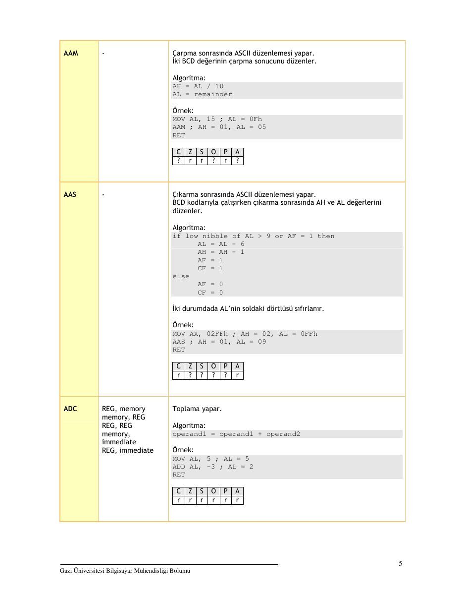
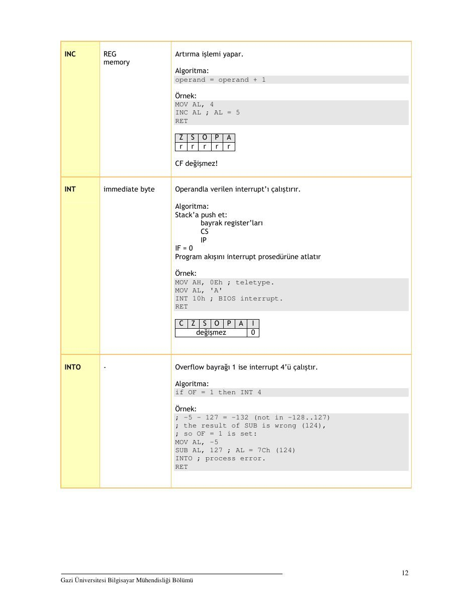

Bu yazı, Başkent Üniversitesi **EEM332 Mikroişlemciler** ders arşivindeki ilgili notları ve uygulamaları bir araya getiriyor (2007–2007). 8086 komut kümesi, operandlar ve örnek assembly işlemleri; 2007 tarihli ders notu. Kaynak: Gazi Üniversitesi, M. Ali Akcayol, 2007. Belgelerin PDF arşiv kopyaları ve varsa kaynak kodları yazının sonunda ZIP olarak indirilebilir.

*Bu içerik üçüncü taraf bir kaynağa aittir; arşiv ve nostalji amacıyla kaynak belirtilerek paylaşılmıştır. Hak sahibinin talebi hâlinde kaldırılır.*

## _8086KomutlarOrnekler

### 8086 KOMUT KÜMESİ VE ÖRNEKLER

Doç.Dr. M.Ali Akcayol

Gazi Üniversitesi Bilgisayar Mühendisliği Bölümü

(2007)

```asm
NOT: Bu doküman başta emu8086 programının yardım dosyası olmak üzere aşağıdaki
```

### kaynaklar kullanılarak hazırlanmıştır

Barry B. Brey, The Intel Microprocessors 8086/8088, 80186/80188, 80286, 80386, 80486, Pentium, Pentium Pro Processor, Pentium II, Pentium Ill, Pentium 4 Architecture, Programming, and Interfacing (7th edition), Prentice Hall, ISBN: 0131974076, 2006.

Walter A. Triebel, Avtar Singh, Avtar Singh, The 8088 and 8086 Microprocessors: Programming, Interfacing, Software, Hardware, and Applications (4th edition), Prentice Hall, 0130930814, 2002.

Muhammad Ali Mazidi, Janice Gillispie-Mazidi, Muhammad A. Mazidi, Janice Catherine Gillispie-Mazidi, 80X86 IBM PC and Compatible Computers: Assembly Language, Design, and Interfacing (4th edition), Prentice Hall, 2002.

Gazi Üniversitesi Bilgisayar Mühendisliği Bölümü

### GENEL BİLGİLER

### GENEL AMAÇLI REGİSTER'LAR

### AX, BX, CX, DX, SI, DI, BP, SP

### OZEL AMACLI REGISTER’LAR

### IP, FLAG REGISTER’LARI

### SEGMENT REGISTER’LARI

### CS, DS, ES, SS

### OPERAND TÜRLERİ

### REG : AX, BX, CX, DX, AH, AL, BL, BH, CH, CL, DH, DL, DI, SI, BP, SP.

SREG : DS, ES, SS, CS(sadece ikinci operand).

memory _ : [BX], [BX+SI+7], degisken, vb.

immediate : 5, -24, 3Fh, 10001101b, vb.

### BAYRAK DURUMLARI

1 - komut bu bayrak bitini 1 yapar.

0 - komut bu bayrak bitini O yapar.

r - bayrak değeri komutun sonucuna bağlıdır.

? - bayrak değeri tanımsızdır (1 veya 0 olabilir).

### DEĞİŞKENLER

```asm
isim DB değer
```

```asm
isim DW değer
```

isim DD değer

### Örnek

```asm
ORG 100h
```

```asm
MOV AL, varl
MOV BX, var2
```

```asm
RET i program durur
VARI DB 7
```

```asm
var2 DW 1234h
```

### DİZİLER

```asm
a DB 48h, 65h, 6Ch, 6Ch, 6Fh, 00h
b DB 'Hello', 0
```

... a[6] al1) a[2] a[3] a[4] a[5] b(6J b[1] b[2]

Gazi Üniversitesi Bilgisayar Mühendisliği Bölümü

```asm
MOV AL, a[3]
```

```asm
MOV SI, 3
```

```asm
MOV AL, a[SI]
```

DUP operatörü

adet DUP ( degerler )

```asm
c DB 5 DUP (9)
c DB 9, 9, 9, 9, 9
```

```asm
d DB 5 DUP(1, 2)
```

sh 2 0

### DEGISKENLER

```asm
isim EQU <ifade>
```

```asm
k EQU 5
MOV AX, k
```

```asm
MOV AX, 5
```

### BAYRAK BİTLERİ

C - Carry Flag

Z - Zero Flag

S - Sign Flag

O - Overflow Flag P - Parity Flag

A - Auxiliary Flag | - Interrupt Flag D - Direction Flag

### VERİ TRANSFER KOMUTLARI

```asm
PUSH, POP, LEA, LDS, LODS, LODSB, LODSW, STOS, STOSB, STOSW, MOVS, MOVSB, MOVSW, INS, INSB,
```

### INSW, OUTS, OUTSB, OUTSW, XCHG, LAHF, SAHF, XLAT, IN, OUT

### ARİTMETİK VE MANTIK KOMUTLARI

```asm
ADD, INC, ADC, SUB, DEC, SBB, CMP, MUL, IMULI DIV, IDIV, CBW, CWD, DAA, DAS, AAA, AAD, AAM, AAS,
AND, OR, XOR, TEST, NOT, NEG, SHL, SHR, SAL, SAR, ROL, RCL, RCR, ROR, SCAS, CMPS
```

### PROGRAM KONTROL KOMUTLARI

```asm
JMP, JA, JAE, JB, JBE, JC, JE, JZ, JG, JGE, JL, JLE, INC, JNE, JNZ, JNC, JNE, JNZ, JNO, JNS, JNP, JPO,
JO, JP, JPE, JS, JCXZ, LOOP, CALL, RET, INT, IRET, HLT, NOP
```

Gazi Üniversitesi Bilgisayar Mühendisliği Bölümü

### GENEL BİLGİLER

### KOMUT O OPERANDLAR TANIM VE ÖRNEK

5 Toplama sonrasında ASCII düzenlemesi yapar. BCD kodlarıyla çalışırken toplama sonrasında AH ve AL değerlerini

düzenler.

### Algoritma

if low nibble of AL > 9 or AF = 1 then

### AL = AL + 6

### AH = AH +1

AF =1 CF=1 else

### AF = 0

### CF = 0

İki durumdada AL’nin soldaki dörtlüsü sıfırlanır.

### Örnek

```asm
MOV AX, 15 ; AH = 00, AL = OFh
AAA ; AH = 01, AL = 05
RET
```

2 Bölme sonrasında ASCII düzenlemesi yapar. İki BCD değerini bölme için hazırlar.

### Algoritma

### AL = (AH * 10) + AL

### AH = 0

```asm
Ornek:
```

```asm
MOV AX, 0105h ; AH = 01, AL = 05
```

```asm
AAD ; AH = 00, AL = OFh (15)
RET
```

c|zJsJojfJrPJA ?l)rjr|2)Jr)J2

Gazi Üniversitesi Bilgisayar Mühendisliği Bol

arpma sonrasında ASCII düzenlemesi yapar. İki BCD değerinin çarpma sonucunu düzenler.

### Algoritma

### AH = AL / 10

AL = remainder

```asm
Ornek:
```

```asm
MOV AL, 15 ; AL = OFh
```

```asm
AAM ; AH = 01, AL = 05
RET
```

lol

### N

oO} >

Çıkarma sonrasında ASCII düzenlemesi yapar. BCD kodlarıyla çalışırken çıkarma sonrasında AH ve AL değerlerini düzenler.

### Algoritma

if low nibble of AL > 9 or AF - 1 then

### AL = AL - 6

### AH = AH - 1

AF =1 CE s1 else a (8)

### CE = 0

iki durumdada AL’nin soldaki dörtlüsü sıfırlanır.

### Örnek

```asm
MOV AX, O2FFh ; AH = 02, AL = OFFh
```

### AAS ; AH = 01, AL = 09

```asm
RET
```

SPAS ee rj(2J2(2)J2)r

REG, memory memory, REG

### REG, REG

memory, immediate REG, immediate

Toplama yapar.

### Algoritma

operandi = operandi + operand2

```asm
Ornek:
```

```asm
MOV AL, 5; AL = 5
ADD AL, -3 ; AL = 2
RET
```

### GEZE

rİrjrlrjrjr

Gazi Üniversitesi Bilgisayar Mühendisliği Bol

REG, memory memory, REG

### REG, REG

memory, immediate REG, immediate

iki operand arasında karşılıklı tüm bitlere mantıksal VE işlemi yapar ve sonucu soldaki operanda kaydeder.

### Doğruluk tablosu

1 AND 1=1

1 AND 0 o

### 0 AND 1 = 0

### 0 AND 0 = 0

```asm
Ornek:
```

```asm
MOV AL, 'a' ; AL = 01100001b
AND AL, 11011111b ; AL = 01000001b ('A')
```

```asm
RET
```

ae O|P olr|/r/ojr

procedure name etiket 4-byte adres

Bir prosedürü çağırır ve dönüş adresini (IP) stack'a push eder. 4 byte adres kullanılarak çağırma yapılabilir. 1234h:5678h adresinde ilk değer segment ikinci değer offset adresini belirtir. Bu far çağırmadır ve IP ile birlikte CS stack'a push edilir.

### Örnek

#make, COM$

```asm
ORG 100h Oo; for COM file.
```

```asm
CALL pl
```

```asm
ADD AX, 1
```

```asm
RET ; return to DOS.
```

```asm
pl PROC i procedure declaration.
MOV AX, 1234h
RET 7; return to caller.
```

pl ENDP

C[z{s[o[PlA degismez

Byte degeri word’e cevirir.

### Algoritma

if high bit of AL = 1 then AH = 255 (OFFh)

else

### AH = 0

```asm
Ornek:
MOV AX, 0 ; AH = 0, AL = 0
MOV AL, -5 ; AX = 000FBh (251)
```

CBW } AX = OFFFBh (-5)

```asm
RET
```

C[z{s[o[PlA degismez

Gazi Üniversitesi Bilgisayar Mühendisliği Bol

. Taşma bayrağı (Carry flag) sıfırlanır.

### Algoritma

### CE = 0

Cc

- Direction bayrağı (Direction flag) sıfırlanır. SI ve DI register'ları CMPSB,

### CMPSW, LODSB, LODSW,

```asm
MOVSB, MOVSW, STOSB, STOSW komutlarıyla ardarda yapılan
```

işlemlerde artırılır.

### Algoritma

### DF = 0

### D

s Interrup etkinleştirme bayrağı (Interrupt enable flag) sıfırlanır. Bu donanım interrupt'larını etkisiz yapar.

### Algoritma

### IF -0

### I

i Taşma bayrağı (Carry flag) terslenir(complement).

### Algoritma

if CF - 1 then CF - 0 if CF = 0 then CF - 1

Cc

### R

Gazi Üniversitesi Bilgisayar Mühendisliği Bölümü

REG, memory memory, REG

### REG, REG

memory, immediate REG, immediate

Karşılaştırma yapar. Soldaki operand’1 sağdakinden çıkartır ancak operandlar değişmez sadece bayrak bitleri değişir.

### Algoritma

öperandi - operand2

OF, SF, ZF, AF,PF, CF bayrakları sonuca göre yeniden düzenlenir.

### Örnek

```asm
MOV AL, 5
```

```asm
MOV BL, 5
```

```asm
CMP AL, BL ; AL=5, ZF=1 Çeşit)
RET
```

### GSE

rİrjrlrjrjr

ES: [DI] ile DS:JSIJ arasında bir byte karşılatırır.

### Algoritma

### DS:1SIJ — ES: [DI]

OF, SF, ZF, AF, PF, CF bayrakları sonuca göre yeniden düzenlenir. if DF = 0 then

SI =sI+1

DI =DI+1

SI=st-1 DI =DI-1

Z(s|o r[re[r[r[r[r

ES:[DI] ile DS:[SI] arasında bir word karşılatırır.

### Algoritma

### DS: [SI] - ES: [DI]

OF, SF, ZF, AF, PF, CF bayrakları sonuca göre yeniden düzenlenir. if DF = 0 then

### SI = SI + 2

### DI = DI +2

### SI = SI - 2

### DI = DI - 2

Z{[s[o rİrjrirjrjr

Gazi Üniversitesi Bilgisayar Mühendisliği Bölümü

. İşaretli sayılarda word boyutunu doubleword boyutuna genişletir.

### Algoritma

if high bit of AX = 1 then DX = 65535 (OFFFFh)

else

### DX = 0

```asm
Ornek:
MOV DX, 0 ; DX = 0
MOV AX, 0 ; AX = 0
```

```asm
MOV AX, —5 ; DX AX = 00000h:0FFFBh
```

CWD ; DX AX = OFFFFh:0FFFBh

```asm
RET
```

### CIZISTOJPTA

değişmez

2 Toplamadan sonra ondalık düzenlemesi yapar. İki BCD değerinin toplam sonucunu düzenler.

### Algoritma

if low nibble of AL > 9 or AF - 1 then

### AL = AL + 6

AF =1

if AL > 9Fh or CF = 1 then AL = AL + 60h

CF =1

```asm
Ornek:
MOV AL, OFh } AL = OFh (15)
DAA AE Gia
RET
```

a O|P

3 Çıkarmadan sonra ondalık düzenlemesi yapar. İki BCD değerinin çıkarma sonucunu düzenler.

### Algoritma

if low nibble of AL > 9 or AF - 1 then

### AL = AL - 6

AF =1

if AL > 9Fh or CF = 1 then AL = AL — 60h

Cr Si

```asm
Ornek:
MOV AL, OFFh ; OFFh (<1)
DAS 7 99h, CF -1
RET
```

c|zJsJoJPJA rİrjrirjrjr

Gazi Üniversitesi Bilgisayar Mühendisliği Bölümü

REG Azaltma işlemi yapar. memory

### Algoritma

operand = operand - 1

```asm
Ornek:
```

```asm
MOV AL, 255 ; AL = OFFh (255 or -1)
DEC AL ; AL = OFEh (254 or -2)
```

```asm
RET
```

c|zJsJofJPJA rİrjirirjrjr

CF değişmez! REG İşaretsiz bölme yapar. memory

### Algoritma

### operand byte ise

AL - AX / operand AH - remainder (kalan)

### operand word ise

AX = (DX AX) / operand DX = remainder (kalan)

```asm
Ornek:
```

‘MOV AX, 203 ; AX = 00CBh

```asm
MOV BL, 4
```

```asm
DIV BL 7 AL = 50 (32h), AH = 3
RET
```

cj|zjsJofJPJA

### İNENENENENE

- Program kapatılır.

### Örnek

```asm
MOV AX, 5
HLT
```

c(zJsJoJPJA değişmez

Gazi Üniversitesi Bilgisayar Mühendisliği Bol

REG İşaretli bölme yapar. memory

### Algoritma

### operand byte ise

AL = AX / operand

AH = remainder (kalan)

### operand word ise

AX = (DX AX) / operand

DX = remainder (kalan)

```asm
Ornek:
```

```asm
MOV AX, -203 ; AX = OFF35h
```

```asm
MOV BL, 4
```

IDIV BL ; AL = -50 (0CEh), AH = -3 (OFDh)

```asm
RET
```

c/zJsJojJrPJA

Tl?l?l?7 lel?

REG isaretli çarpma yapar. memory

### Algoritma

### operand byte ise

AX = AL * operand

### operand word ise

(DX AX) = AX * operand

```asm
Ornek:
MOV AL, -2
MOV BL, -4
```

### IMUL BL ; AX = 8

```asm
RET
```

cj(zJsJojJrPJA r|2(/2(r|J2)(2

Sonuç operandan taşmazsa CF=OF=0 sıfır olur.

AL, im.byte AL veya AX'e porttan giriş alır. AL, DX ikinci operand port numarasidir. AX, im.byte AX, DX Second operand is a port number. Eğer 255 üstündeki portlara erişim gerekiyorsa DX register’1 kullanılır.

```asm
Ornek:
IN AX, 4 ; get status of traffic lights.
IN AL, 7 ; get status of stepper-motor.
```

cj|zJsJoJPJA değişmez

Gazi Üniversitesi Bilgisayar Mühendisliği Bol

REG Artırma işlemi yapar. memory

### Algoritma

operand = operand + 1

```asm
Ornek:
```

```asm
MOV AL, 4
INC AL ; AL
RET
```

" a

### SJOJPJA

r[r[r[r[r

CF degismez!

immediate byte Operandla verilen interrupt’) çalıştırır.

### Algoritma

### Stack’a push et

bayrak register'ları cs

### IP

IF=0 Program akışını interrupt prosedürüne atlatır

### Örnek

```asm
MOV AH, OBh ; teletype.
MOV AL, 'A'
```

```asm
INT 10h ; BIOS interrupt.
RET
```

Ci[z[s[o[P[A degismez 0

2 Overflow bayrağı 1 ise interrupt 4'ü çalıştır.

### Algoritma

if OF = 1 then INT 4

```asm
Ornek:
```

} -5 - 127 = -132 (not in -128..127)

```asm
; the result of SUB is wrong (124),
ji so OF = 1 is set:
```

```asm
MOV AL, -5
```

```asm
SUB AL, 127 ; AL = 7Ch (124)
```

INTO ; process error.

```asm
RET
```

Gazi Üniversitesi Bilgisayar Mühendisliği Bol

Interrupt dönüşü.

### Algoritma

### Stack'tan pop et

### IP

cs flags register

c(zJsJoJPJA

```asm
pop edilir
```

etiket

Eğer birinci operand ikinciden büyükse kısa atlama (short jump yapar). İşaretsiz karşılaştırma yapar.

### Algoritma

if (CF = 0) and (ZF = 0) then jump

### Örnek

```asm
include ‘emu8086.inc'
```

#make_COM#

```asm
ORG 100h
```

```asm
MOV AL, 250
```

```asm
CMP AL, 5
JA etiketi
```

PRINT 'AL 5'ten büyük degil'

```asm
JMP exit
etiketi:
```

PRINT 'AL 5’ten büyük"

### exit

```asm
RET
```

CIZ[S[oO[P[A degismez

Gazi Üniversitesi Bilgisayar Mühendisliği Bol

etiket Eğer birinci operand ikinciden büyük veya eşitse kısa atlama (short

```asm
jump yapar). İşaretsiz karşılaştırma yapar.
```

### Algoritma

if CF = 0 then jump

```asm
Ornek:
include 'emu8086.inc"
```

#make_COM# ‘ORG 100h

```asm
MOV AL, 5
CMP AL, 5
JAE etiketli
```

PRINT 'AL is not above or equal to 5'

```asm
JMP exit
```

etiketi; PRINT 'AL is above or egual to 5'

### exit

```asm
RET
```

c(zJsJoJPJA değişmez

etiket Eğer birinci operand ikinciden küçükse kısa atlama (short jump yapar). İşaretsiz karşılaştırma yapar.

### Algoritma

if CF = 1 then jump

```asm
Ornek:
include 'emu8086.inc"
```

#make_COM#

```asm
ORG 100h
MOV AL, 1
CMP AL, 5
JB etiketl
```

PRINT 'AL is not below 5!

```asm
JMP exit
etiketi:
```

PRINT 'AL is below 5'

### exit

```asm
RET
```

### CELLE

değişmez

Gazi Üniversitesi Bilgisayar Mühendisliği Bölümü

etiket

Eğer birinci operand ikinciden küçük veya eşitse kısa atlama (short

```asm
jump yapar). İşaretsiz karşılaştırma yapar.
```

### Algoritma

if CF = 1 or ZF = 1 then jump

```asm
Ornek:
include 'emu8086.inc"
```

#make_COM#

‘ORG 100h

```asm
MOV AL, 5
```

### ‘CMP AL, 5

```asm
JBE etiketli
```

PRINT 'AL is not below or equal to 5' IMP exit

### etiketi

PRINT 'AL is below or egual to 5'

### exit

```asm
RET
```

c(zJsJoJPJA değişmez

etiket

Taşma bayrak biti 1 ise kısa atlama yapar.

### Algoritma

if CF = 1 then jump

### Örnek

```asm
include 'emu8086.inc'
```

#make_COM#

‘ORG 100h

```asm
MOV AL, 255
ADD AL, 1
JC etiketi
```

PRINT 'taşma yok"

```asm
JMP exit
siiketli:
```

PRINT “taşma var'

### exit

```asm
RET
```

cizJsJoJPJA değişmez

Gazi Üniversitesi Bilgisayar Mühendisliği Bölümü

etiket CX register’! 1 ise kısa atlama yapar.

### Algoritma

if CX = 0 then jump

### Örnek

```asm
include "emu8086.inc"
```

#make_COM#

```asm
ORG 100h
MOV CX, 0
JCXZ etiket1
```

PRINT 'CX sıfır de§ildir.' IMP exit

### etiketl

PRINT 'CX sıfırdır.'

### exit

```asm
RET
```

CIZ[s[O[P[A degismez

etiket Eger birinci operand ikinci operanda esitse kisa atlama (short jump yapar). İşaretli veya işaretsiz karşılaştırma yapar.

### Algoritma

if 2F = 1 then jump

### Örnek

```asm
include 'emu8086.inc'
```

#make COM#

```asm
ORG 100h
MOV AL, 5
CMP AL, 5
JE etiketl
```

PRINT 'AL 5’e eşit değil." UMP exit

### etiketli

PRINT 'AL 5’e eşit.' exits

```asm
RET
```

### CI[Z[S[O][P[A

degismez

Gazi Üniversitesi Bilgisayar Mühendisliği Bölümü

etiket

Eğer birinci operand ikinciden büyük veya eşitse kısa atlama (short

```asm
jump yapar). İşaretli karşılaştırma yapar.
```

### Algoritma

if (ZF = 0) and (SF = OF) then jump

### Örnek

```asm
include 'emu8086.inc"
```

#make_COM# ‘ORG 100h

```asm
MOV AL, 5
CMP AL, -5
JG etiketli
```

PRINT 'AL -5'ten büyük değildir.'

```asm
JMP exit
```

etiketi; PRINT ' AL -5'ten büyüktür."

### exit

```asm
RET
```

c(zJsJoJPJA değişmez

etiket

Eğer birinci operand ikinciden büyük veya eşitse kısa atlama (short

```asm
jump yapar). İşaretli karşılaştırma yapar.
```

### Algoritma

if SF - OF then jump

### Örnek

```asm
include 'emu8086.inc"
```

#make_COM#

```asm
ORG 100h
```

```asm
MOV AL, 2
```

```asm
CMP AL, -5
```

```asm
JGE etiketli
```

### PRINT 'AL < -5'

```asm
JMP exit
etiketi:
```

### PRINT 'AL >= -5'

### exit

```asm
RET
```

### CELLE

değişmez

Gazi Üniversitesi Bilgisayar Mühendisliği Bol

etiket

Eğer birinci operand ikinciden küçükse kısa atlama (short jump yapar). İşaretli karşılaştırma yapar.

### Algoritma

if SF <> OF then jump

### Örnek

```asm
include 'emu8086.inc"
```

#make_COM#

```asm
ORG 100h
```

```asm
MOV AL, -2
CMP AL, 5
JL etiketli
```

### PRINT 'AL >= 5."

UMP exit etiketi;

### PRINT 'AL < 5.'

### exit

```asm
RET
```

c(zJsJoJPJA değişmez

etiket

Eğer birinci operand ikinciden küçük veya eşitse kısa atlama (short

```asm
jump yapar). İşaretli karşılaştırma yapar.
```

### Algoritma

if SF <> OF or ZF - 1 then jump

### Örnek

```asm
include 'emu8086.inc"
```

#make_COM#

```asm
ORG 100h
```

```asm
MOV AL, -2
```

```asm
CMP AL, 5
```

```asm
JLE etiketli
```

### PRINT 'AL > 5.'

```asm
JMP exit
etiketi:
```

### PRINT 'AL <= 5.'

### exit

```asm
RET
```

### CELLE

değişmez

Gazi Üniversitesi Bilgisayar Mühendisliği Bol

etiket 4-byte adres

Şartsız atlama yapar. . 4-byte adres 1234h:5678h seklinde girilebilir. ilk deger segment ikinci offset adrestir.

### Algoritma

always jump

```asm
Ornek:
```

```asm
include 'emu8086.inc'
```

#make_COM#

```asm
ORG 100h
```

```asm
MOV AL, 5
```

UMP etiket1 ; jump over 2 lines! PRINT ‘Not Jumped!"

```asm
MOV AL, 0
```

### etiketi

PRINT 'Got Here!

```asm
RET
```

c(zJsJoJPJA değişmez

etiket

Eğer birinci operand ikinciden büyük değilse kısa atlama (short jump) yapar. İşaretsiz karşılaştırma yapar.

### Algoritma

if CF = 1 or ZF = 1 then jump

```asm
Ornek:
```

```asm
include 'emu8086.inc"
```

#make_COM#

```asm
ORG 100h
```

```asm
MOV AL, 2
```

```asm
CMP AL, 5
```

```asm
JNA etiketli
```

PRINT 'AL is above 5."

```asm
JMP exit
```

etiket lc

PRINT 'AL is not above 5."

### exit

```asm
RET
```

### CIZISTOJPTA

değişmez

Gazi Üniversitesi Bilgisayar Mühendisliği Bol

etiket

Eğer birinci operand ikinciden büyük değilse ve eşit değilse kısa atlama (short jump) yapar. İşaretsiz karşılaştırma yapar.

### Algoritma

if CF = 1 then jump

```asm
Ornek:
include 'emu8086.inc"
```

#make_COM#

```asm
ORG 100h
```

```asm
MOV AL, 2
CMP AL, 5
JNAE etiketi
```

### PRINT 'AL >= 5."

```asm
JMP exit
```

etiketi;

### PRINT 'AL < 5.'

### exit

```asm
RET
```

c(zJsJoJPJA değişmez

etiket

Eğer birinci operand ikinciden küçük değilse kısa atlama (short jump) yapar. İşaretsiz karşılaştırma yapar.

### Algoritma

if CF = 0 then jump

```asm
Ornek:
```

```asm
include 'emu8086.inc"
```

#make_COM#

```asm
ORG 100h
```

```asm
MOV AL, 7
```

```asm
CMP AL, 5
```

```asm
JNB etiket1
```

### PRINT 'AL < 5.'

```asm
JMP exit
etiketi:
```

### PRINT 'AL >= 5."

### exit

```asm
RET
```

### CELLE

değişmez

Gazi Üniversitesi Bilgisayar Mühendisliği Bol

etiket Eğer birinci operand ikinciden küçük değilse ve eşit değilse kısa atlama (short jump) yapar. İşaretsiz karşılaştırma yapar.

### Algoritma

if (CF = 0) and (ZF = 0) then jump

```asm
Ornek:
include 'emu8086.inc"
```

#make_COM# ‘ORG 100h

```asm
MOV AL, 7
CMP AL, 5
JNBE etiketi
```

### PRINT 'AL <= 5."

```asm
JMP exit
```

etiketi;

### PRINT 'AL > 5.'

### exit

```asm
RET
```

c(zJsJoJPJA değişmez

etiket Taşma bayrak biti (carry flag) O ise kısa atlama (short jump) yapar.

### Algoritma

if CF = 0 then jump

```asm
Ornek:
include 'emu8086.inc'
```

#make_COM# ‘ORG 100h

```asm
MOV AL, 2
ADD AL, 3
JNC etiketli
```

PRINT ‘has carry.' UMP exit etiketi; PRINT 'no carry.'

### exit

```asm
RET
```

cizJsJoJPJA değişmez

Gazi Üniversitesi Bilgisayar Mühendisliği Bol

etiket Eğer birinci operand ikinciye eşit değilse kısa atlama (short jump) yapar. İşaretli veya işaretsiz karşılaştırma yapar.

### Algoritma

if ZF = 0 then jump

```asm
Ornek:
include 'emu8086.inc'
```

#make_COM#

```asm
ORG 100h
MOV AL, 2
CMP AL, 3
```

INE etiketi

### PRINT 'AL = 3."

IMP exit etiketlik PRINT 'Al <> 3.'

### exit

```asm
RET
```

### CIZ[S[O[P[A

degismez

etiket Eger birinci operand ikinciden büyük değilse kısa atlama (short jump) yapar. İşaretli karşılaştırma yapar.

### Algoritma

if (ZF = 1) and (SF <> OF) then jump

### Örnek

```asm
include 'emu8086.inc"
```

#make_COM#

```asm
ORG 100h
```

```asm
MOV AL, 2
```

```asm
CMP AL, 3
```

ING etiket1

### PRINT 'AL > 3.'

```asm
JMP exit
etiketi:
```

PRINT 'Al <= 3."

### exit

```asm
RET
```

CIZJISToJPJA değişmez

Gazi Üniversitesi Bilgisayar Mühendisliği Bol

etiket Eğer birinci operand ikinciden büyük değilse ve eşit değilse kısa atlama (short jump) yapar. İşaretli karşılaştırma yapar.

### Algoritma

if SF <> OF then jump

### Örnek

```asm
include 'emu8086.inc"
```

#make_COM# ‘ORG 100h

```asm
MOV AL, 2
CMP AL, 3
JNGE etiketli
```

### PRINT 'AL >= 3.'

```asm
JMP exit
```

etiketi; PRINT 'Al < 3.'

### exit

```asm
RET
```

c(zJsJoJPJA değişmez

etiket Eğer birinci operand ikinciden küçük değilse kısa atlama (short jump) yapar. İşaretli karşılaştırma yapar.

### Algoritma

if SF - OF then jump

### Örnek

```asm
include 'emu8086.inc"
```

#make_COM#

```asm
ORG 100h
```

```asm
MOV AL, 2
```

```asm
CMP AL, -3
```

```asm
JNL etiketli
```

### PRINT 'AL < -3.'

```asm
JMP exit
```

### etiketi

PRINT 'Al >= -3.'

### exit

```asm
RET
```

### CELLE

değişmez

Gazi Üniversitesi Bilgisayar Mühendisliği Bol

etiket Eğer birinci operand ikinciden küçük değilse ve eşit değilse kısa atlama (short jump) yapar. İşaretli karşılaştırma yapar.

### Algoritma

if (SF - OF) and (ZF - 0) then jump

### Örnek

```asm
include 'emu8086.inc"
```

#make_COM#

‘ORG 100h

```asm
MOV AL, 2
```

```asm
CMP AL, -3
```

İNLE etiketi

### PRINT 'AL <= -3.'

```asm
JMP exit
etiketi:
```

PRINT 'Al > -3.'

### exit

```asm
RET
```

c(zJsJoJPJA değişmez

etiket Overflow bayrak biti 0 ise kısa atlama (short jump) yapar.

### Algoritma

if OF = 0 then jump

```asm
Ornek:
```

-5 - 2 = -7 (inside -128..127) the result of SUB is correct,

### so OF = 0

```asm
include 'emu8086.inc'
```

#make_COM#

```asm
ORG 100h
MOV AL, -5
SUB AL, 2 ; AL = 0F9h (-7)
JNO etiketli
```

PRINT 'overflow!' IMP exit etiketlik PRINT 'no overflow."

### exit

```asm
RET
```

c(zJsJoJPJA değişmez

Gazi Üniversitesi Bilgisayar Mühendisliği Bölümü

etiket Parity (eşlik) bayrak biti 0 ise (odd-tek) kısa atlama (short jump) yapar. Sadece en düşük öneme sahip 8 bit kontrol edilir. CMP, SUB, ADD,

```asm
TEST, AND, OR, XOR komutları set eder.
```

### Algoritma

if PF = 0 then jump

```asm
Ornek:
```

```asm
include 'emu8086.inc'
```

#make_COM#

```asm
ORG 100h
```

```asm
MOV AL, 00000111b ; AL = 7
OR AL, 0 ; just set flags.
```

INP etiket1

PRINT 'parity even.'

```asm
JMP exit
```

### etiketi

PRINT 'parity odd.'

### exit

```asm
RET
```

cj|zJsJoJPJAa değişmez

etiket İşaret bayrak (signed) biti 1 değilse (pozitif) kısa atlama (short jump) yapar. CMP, SUB, ADD, TEST, AND, OR, XOR komutları set eder.

### Algoritma

if SF = 0 then jump

```asm
Ornek:
include 'emu8086.inc'
```

#make_COM#

```asm
ORG 100h
MOV AL, 00000111b ; AL = 7
OR AL, 0 ; just set flags.
```

ONS etiket1 PRINT 'signed.' UMP exit

### etiketl

PRINT 'not signed.’

### exit

```asm
RET
```

C[z{s[o[PlA degismez

Gazi Üniversitesi Bilgisayar Mühendisliği Bol

etiket Sıfır bayrak (ZF) biti O ise (pozitif) kısa atlama (short jump) yapar.

```asm
CMP, SUB, ADD, TEST, AND, OR, XOR komutları set eder.
```

### Algoritma

if ZF = 0 then jump

```asm
Ornek:
```

```asm
include 'emu8086.inc"
```

#make_COM#

```asm
ORG 100h
```

```asm
MOV AL, 00000111b ; AL=7
OR AL, 0 ; just set flags.
JNZ etiket1
```

PRINT 'zero.'

UMP exit

etiketi;

PRINT 'not zero.'

### exit

```asm
RET
```

c(zJsJoJPJA değişmez

etiket Overflow bayrak (OF) biti 1 ise kısa atlama (short jump) yapar.

### Algoritma

if OF - 1 then jump

### Örnek

e iye 132 (ice in 128127)

```asm
; the result of SUB is wrong (124),
```

### i so OF = 1 is set

```asm
include 'emu8086.inc'
```

#make_COM#

```asm
org 100h
```

```asm
MOV AL, -5
```

```asm
SUB AL, 127 ; AL = 7Ch (124)
```

```asm
JO etiketi
```

PRINT 'no overflow.'

IMP exit

### etiketii

PRINT 'overflow!'

### exit

```asm
RET
```

### C[Z[S[O[P[A

degismez

Gazi Üniversitesi Bilgisayar Mühendisliği Bol

etiket

Parity (eşlik) bayrak biti 1 ise (even-çift) kısa atlama (short jump) yapar. Sadece en düşük öneme sahip 8 bit kontrol edilir. CMP, SUB,

```asm
ADD, TEST, AND, OR, XOR komutları set eder.
```

### Algoritma

if PF = 1 then jump

```asm
Ornek:
```

```asm
include 'emu8086.inc"
```

#make_COM#

```asm
ORG 100h
```

```asm
MOV AL, 00000101b ; AL = 5
OR AL, 0 ; just set flags.
JP etiketl
```

PRINT 'parity odd.'

UMP exit

### etiketi

PRINT 'parity even."

### exit

```asm
RET
```

cj|zJsJoJPJAa değişmez

etiket

Parity çift ise (even) kısa atlama (short jump) yapar. Sadece en düşük öneme sahip 8 bit kontrol edilir. CMP, SUB, ADD, TEST, AND, OR, XOR komutları set eder.

### Algoritma

if PF = 1 then jump

### Örnek

```asm
include 'emu8086.inc"
```

#make_COM#

```asm
ORG 100h
```

```asm
MOV AL, 00000101b ; AL = 5
OR AL, 0 ; just set flags.
JPE etiket1
```

PRINT 'parity odd.'

```asm
JMP exit
```

### etiketli

PRINT 'parity even.'

### exit

```asm
RET
```

c(zJsJoJPJA değişmez

Gazi Üniversitesi Bilgisayar Mühendisliği Bol

etiket Parity tek ise (odd) kısa atlama (short jump) yapar. Sadece en düşük öneme sahip 8 bit kontrol edilir. CMP, SUB, ADD, TEST, AND, OR, XOR komutları set eder.

### Algoritma

if PF = 0 then jump

```asm
Ornek:
```

```asm
include 'emu8086.inc"
```

#make_COM#

```asm
ORG 100h
```

```asm
MOV AL, 00000111b ; AL = 7
OR AL, 0 ; just set flags.
JPO etiketli
```

PRINT 'parity even.'

UMP exit

### etiketi

PRINT 'parity odd.'

### exit

```asm
RET
```

cj|zJsJoJPJAa değişmez

etiket Sign bayrak biti 1 ise (negatif) kısa atlama (short jump) yapar. CMP,

```asm
SUB, ADD, TEST, AND, OR, XOR komutları set eder.
```

### Algoritma

if SF = 1 then jump

```asm
Ornek:
include 'emu8086.inc'
```

#make_COM#

```asm
ORG 100h
MOV AL, 10000000b ; AL = -128
OR AL, 0 ; just set flags.
JS etiketi
```

PRINT 'not signed.' UMP exit

### etiketl

PRINT 'signed.'

### exit

```asm
RET
```

C[z{s[o[PlA degismez

Gazi Üniversitesi Bilgisayar Mühendisliği Bol

etiket Eğer sıfır ise (ZF-1) kısa atlama (short jump) yapar. CMP, SUB, ADD,

```asm
TEST, AND, OR, XOR komutları set eder.
```

### Algoritma

if ZF = 1 then jump

### Örnek

```asm
include 'emu8086.inc"
```

#make_COM#

```asm
ORG 100h
```

```asm
MOV AL, 5
```

```asm
CMP AL, 5
```

```asm
JZ etiketi
```

PRINT 'AL is not equal to 5.' UMP exit

etiketi;

PRINT 'AL is equal to 5.'

### exit

```asm
RET
```

c(zJsJoJPJA değişmez

2 AH register’ina bayrak register’inin (flags register) en düşük öneme sahip 8 bit’ini yükler.

### Algoritma

AH = flags register AH: 7 6 5 4 3 2 1 te)

### (SF) [ZF] [0] [AF] [0] [PF] [1] [CF]

1, 3, 5 bitleri ayrılmıştır.

CIZ[S[oO[P[A degismez

REG, memory Hafizadan alınan doubleword datayı hedef operand register’a ve DS’ye yükler.

### Algoritma

REG = first word DS = second word

```asm
Ornek:
```

#make_COM#

```asm
ORG 100h
```

LDS AX, m

```asm
RET
```

```asm
m DW 1234h
```

DW 5678h

```asm
END
```

AX is set to 1234h, DS is set to 5678h.

cJzJsJoJPJA değişmez

Gazi Üniversitesi Bilgisayar Mühendisliği Bol

REG, memory Efektif adres yükler.

### Algoritma

REG = adres of memory (offset)

### Örnek

#make_COM#

```asm
ORG 100h
LEA AX, m
RET
```

```asm
m DW 1234h
END
```

AX’e 0104h degeri atanir.

```asm
LEA komutu 3 byte, RET komutu 1 byte’tir. 0100h adresinden
```

başlandığı icin m’nin adresi 0104h olur.

### CIZJSJOJPJA

değişmez

REG, memory Hafızadan alınan doubleword datayı hedef operand register'a ve ES'ye yükler.

### Algoritma

REG = first word ES = second word

```asm
Ornek:
```

#make COM$#

```asm
ORG 100h
```

LES AX, m

```asm
RET
```

```asm
m DW 1234h
```

DW 5678h

```asm
END
```

AX register’inin değeri 1234h olur ve ES register’inin değeri 5678h olur.

CIZJSJoJPJA değişmez

Gazi Üniversitesi Bilgisayar Mühendisliği Bölümü

. AL register’ina DS:[SI] adresinden bir byte yükler. SI değeri güncellenir (1 artırılır (D=0), 1 azaltılır (D=1))

### Algoritma

### AL = DS:1SI)J

if DF = 0 then Sr = Si + 1 else

Seki sl

### Örnek

#make_COM#

```asm
ORG 100h
LEA SI, al
MOV CX, 5
MOV AH, OEh
m: LODSB
INT 10h
LOOP m
```

```asm
RET
```

```asm
al DB 'H', 'e', Cl, '1!, to!
```

CiZ[s[o[P[A degismez

i AX register'ına DS:[SI] adresinden bir word yükler. SI değeri güncellenir (2 artırılır (D=0), 2 azaltılır (D=1))

### Algoritma

### AX = DS:(SIJ

if DF = 0 then Su = si 2 else

Sh ei = 2

```asm
Ornek:
```

#make_COM#

```asm
ORG 100h
```

```asm
LEA SI, al
```

```asm
MOV CX, 5
```

```asm
REP LODSW ; finally there will be 555h in AX.
RET
```

```asm
al dw 1lih, 222h, 333h, 444h, 555h
```

CIZJSJoJPJA değişmez

Gazi Üniversitesi Bilgisayar Mühendisliği Bol

etiket CX bir azaltılır ve CX sıfır değilse etikete atlanır.

### Algoritma

ex sGX-1

if CX <> 0 then

```asm
jump
```

else

no jump, continue

### Örnek

```asm
include 'emu8086.inc"
```

#make_COM#

```asm
ORG 100h
```

```asm
MOV CX, 5
```

etiker ik

PRININ 'loop!'

```asm
LOOP etiket1
```

```asm
RET
```

### CI[Z[S[O][P[A

degismez

etiket CX bir azaltilir ve CX sifir degilse ve esitlik varsa (verilen iki operand arasinda) (ZF=1) etikete atlar.

### Algoritma

xx =

if (CX <> 0) and (ZF = 1) then

```asm
jump
```

else

no jump, continue

```asm
Ornek:
```

```asm
; Loop until result fits into AL alone,
; or 5 times. The result will be over 255
; on third loop (100+100+100),
```

```asm
; so loop will exit.
```

```asm
include 'emu8086.inc’
```

#make_COM#

```asm
ORG 100h
```

```asm
MOV AX, O
```

```asm
MOV CX, 5
```

### etiketi

### PUTC '*'

```asm
ADD AX, 100
```

```asm
CMP AH, 0
```

```asm
LOOPE etiket1l
```

```asm
RET
```

C[Z[S[O[Pl/A degismez

Gazi Üniversitesi Bilgisayar Mühendisliği Bölümü

etiket CX bir azaltılır ve CX sıfır değilse ve eşitlik yoksa (verilen iki operand arasında) (ZF=0)

### Algoritma

EK =x

if (CX <> 0) and (ZF = 0) then

```asm
jump
```

else

no jump, continue

```asm
Ornek:
```

```asm
; Loop until '7' is found,
; or 5 times.
```

```asm
include 'emu8086.inc'
```

#make_COM#

```asm
ORG 100h
```

```asm
MOV SI, 0
```

```asm
MOV CX, 5
```

### etiketi

### PUTC '4!

```asm
MOV AL, v1[SI]
```

```asm
INC SI ; next byte (SI=SI+1).
CMP AL, 7
```

```asm
LOOPNE etiketl
```

```asm
RET
```

```asm
vl db 9, 8, 7, 6, 5
```

cizJsJoJPJA değişmez

etiket CX bir azaltılır ve CX sıfır değilse ve ZF=0 ise etikete atlar.

### Algoritma

### CX = CX -— 1

if (CX <> 0) and (ZF = 0) then

```asm
jump
```

else

no jump, continue

```asm
Ornek:
```

```asm
; Loop until '7' is found,
```

7 or 5 times.

```asm
include 'emu8086.inc!
```

#make_COM#

```asm
ORG 100h
```

```asm
MOV SI, 0
```

```asm
MOV CX, 5
```

### etiketl

rege) Tet

```asm
MOV AL, v1[SI]
```

```asm
INC SI ; next byte (SI=SI+1).
```

```asm
CMP AL, 7
LOOPNZ etiketli
RET
```

```asm
vl db 9, 8, 7, 6, 5
```

cj|zJsJoJPJAa değişmez

Gazi Üniversitesi Bilgisayar Mühendisliği Bölümü

etiket CX bir azaltılır ve CX sıfır değilse ve ZF=1 ise etikete atlar.

### Algoritma

cece

if (CX <> 0) and (ZF = 1) then

```asm
jump
```

else

no jump, continue

```asm
Ornek:
```

```asm
; Loop until result fits into AL alone,
; or 5 times. The result will be over 255
; on third loop (100+100+100),
```

```asm
; so loop will exit.
```

```asm
include 'emu8086.inc'
```

#make_COM#

```asm
ORG 100h
```

```asm
MOV AX, 0
```

```asm
MOV CX, 5
```

### etiketi

Eyre 1 #

```asm
ADD AX, 100
```

```asm
CMP AH, 0
```

```asm
LOOPZ etiketl
```

```asm
RET
```

### CIZ[S[O[P[A

degismez

```asm
MOV REG, memory İkinci operand birinci operanda kopyalanır.
```

| memory, REG

### REG, REG MOV komutuyla

memory, * CS ve IP register'larına değer atanamaz. immediate * İki segment register'i arasında değer aktarılamaz (önce genel REG, immediate amaçlı register'a aktarılmalıdır). SREG, memory

### memory, SREG Algoritma

REG, SREG operandl = operand2

### SREG, REG

```asm
Ornek:
```

#make_COM#

```asm
ORG 100h
```

```asm
MOV AX, OB800h ; set AX = B800h (VGA memory).
MOV DS, AX ; copy value of AX to DS.
```

```asm
MOV CL, 'A' ; CL = 41h (ASCII code).
```

```asm
MOV CH, 01011111b ; CL = color attribute.
MOV BX, 15Eh ; BX = position on screen.
```

```asm
MOV [BX], CX ; w.[0B800h:015Eh] = CX.
```

```asm
RET ; returns to operating system.
```

cj|zJsJoJPJAa değişmez

Gazi Üniversitesi Bilgisayar Mühendisliği Bölümü

. DS:(SIJ adresinden ES:(DIJ adresine bir byte kopyalar. SI ve DI register'ları güncellenir.

### Algoritma

### ES:(DIJ = DS:[SI]

if DF = 0 then SE = Si 4 1 DI =DI+1

SI=st-1

### DI = DI-1

```asm
Ornek:
```

#make_COM#

```asm
ORG 100h
```

```asm
LEA SI, al
```

```asm
LEA DI, a2
```

```asm
MOV CX, 5
```

```asm
REP MOVSB
```

```asm
RET
```

ai Bel, 2, 3,475

```asm
a2 DB 5 DUP (0)
```

c(zJsJoJPJA değişmez

. DS:(SIJ adresinden ES: [DI] adresine bir word kopyalar. SI ve DI register'ları güncellenir.

### Algoritma

### ES:(DI] = DS:(SIJ

if DF = 0 then

### SI = SI + 2

### DI = DI + 2

### SI = SI -2

### DI = DI - 2

```asm
Ornek:
```

#make_COM#

```asm
ORG 100h
```

```asm
LEA SI, al
```

```asm
LEA DI, a2
```

```asm
MOV CX, 5
```

```asm
REP MOVSW
```

```asm
RET
```

```asm
al DW 1,2,3,4,5
a2 DW 5 DUP(0)
```

CIZ[s[O[P[A degismez

Gazi Üniversitesi Bilgisayar Mühendisliği Bol

### REG

memory

İşaretsiz çarpma yapar.

### Algoritma

### operand byte ise

AX - AL * operand.

### operand word ise

(DX AX) = AX * operand.

```asm
Ornek:
```

```asm
MOV AL, 200 ; AL = 0C8h
MOV BL, 4
```

```asm
MUL BL ; AX = 0320h (800)
RET
```

C{[Z{[s[O[PlA cl? [?[r[?[?

CF=OF=0 when high section of the result is zero.

### REG

memory

Bir sayının işaretini tersler (ikinin tümleyeni).

### Algoritma

Invert all bits of the operand

```asm
Add 1 to inverted operand
```

```asm
Ornek:
```

```asm
MOV AL, 5 ; AL = 05h
```

NEG AL ; AL = OFBh (-5) NEG AL ; AL = 05h (5)

```asm
RET
```

c|zJsJo rİrjrirjrjr

İşlem yapmaz.

### Algoritma

Do nothing

### Örnek

```asm
; do nothing, 3 times:
NOP
```

```asm
NOP
```

```asm
NOP
```

```asm
RET
```

cizJsJoJPJA değişmez

Gazi Üniversitesi Bilgisayar Mühendisliği Bol

REG Operandaki her bit terslenir (birin tümleyeni). memory

### Algoritma

if bit is 1 turn it to 0. if bit is 0 turn it to 1.

```asm
Ornek:
```

```asm
MOV AL, 00011011b
```

```asm
NOT AL ; AL = 11100100b
RET
```

CIZ[sS[O[P[A

degismez REG, memory İki operandaki karşılıklı her bit için mantıksal veya işlemi yapar. memory, REG

### REG, REG Doğruluk tablosu

memory, 1OR1=1

immediate 1 oR 0 REG, immediate OORI

### Örnek

```asm
MOV AL, 'A' ; AL = 01000001b
```

```asm
OR AL, 00100000b ; AL = 01100001b ('a')
RET
```

c|zJsJojfJrPJA olr|r/ojJrfJ2

```asm
OUT im.byte, AL AL veya AX register’1 verilen porta gönderilir.
```

im.byte, AX İlk operand port numarasıdır. Eğer 255'in üstündeki portlara erişim DX, AL gerekirse DX register’) kullanılır.

### DX, AX

### Örnek

```asm
MOV AX, OFFEh ; Turn on all
```

```asm
OUT 4, AX ; traffic lights.
```

```asm
MOV AL, 100b ; Turn on the third
```

```asm
OUT 7, AL ; magnet of the stepper-motor.
```

cj|zJsJoJPJA değişmez

Gazi Üniversitesi Bilgisayar Mühendisliği Bol

### REG

### SREG

memory

Stack’tan 16 bit değer alır ve operanda aktarır.

### Algoritma

operand = SS:[SP] (stack'ın en üstü)

### SP - SP 42

### Örnek

```asm
MOV AX, 1234h
```

```asm
PUSH AX
```

```asm
POP DX ; DX = 1234h
```

```asm
RET
```

cj|zJsJoJPJAa değişmez

Bütün genel amaçlı register'ları (DI, SI, BP, SP, BX, DX, CX, AX) stack’tan pop eder. SP değeri gözardı edilir.

```asm
Not: Bu komut sadece 80186 ve üstü lişlemcilerde kullanılır.
```

### Algoritma

```asm
POP DI
```

```asm
POP SI
```

```asm
POP BP
```

```asm
POP xx (SP gözardı edilir)
POP BX
```

```asm
POP DX
```

```asm
POP CX
```

```asm
POP AX
```

cj|zJsJoJPJA değişmez

Flag register’ina stack’tan değer pop edilir.

### Algoritma

flags = SS:(SPJ (top of the stack)

### SP = SP + 2

C[Z[s[oO[PlA

```asm
Pop edilir
```

Gazi Üniversitesi Bilgisayar Mühendisliği Bölümü

### REG

### SREG

memory immediate

16 bit değer stack'a saklanır. Store 16 bit value in the stack.

```asm
Not: PUSH immediate sadece 80186 ve üstü işlemcilerde kullanılır.
```

### Algoritma

e

SS:[SP] (top of the stack) = operand

```asm
Ornek:
```

```asm
MOV AX, 1234h
```

```asm
PUSH AX
```

```asm
POP DX ; DX = 1234h
```

```asm
RET
```

### CIZJSJOJPJA

değişmez

Tüm genel amaçlı register'ları (AX, CX, DX, BX, SP, BP, SI, DI) stack’a push eder. SP register’in1 PUSHA komutundan önceki değeri kullanılır.

```asm
Not: Bu komut sadece 80186 ve üstü işlemcilerde kullanılır.
```

### Algoritma

```asm
PUSH AX
PUSH CX
PUSH DX
PUSH BX
PUSH SP
PUSH BP
PUSH SI
PUSH DI
```

c(zJsJoJPJA değişmez

Flag register’ stack'a saklar.

### Algoritma

### SP = SP - 2

SS:[SP] (top of the stack) = flags

cj|zJsJoJPJAa değişmez

Gazi Üniversitesi Bilgisayar Mühendisliği Bölümü

memory, immediate

REG, immediate memory, CL

### REG, CL

Birinci operandi taşma bayrağı (carry flag) üzerinden sola döndürür. Bit olarak dönme sayısı ikinci operandla belirtilir.

### Algoritma

shift all bits left, the bit that goes off is set to CF and

previous value of CF is inserted to the right-most position.

### Örnek

STC ; set carry (CF=1).

```asm
MOV AL, 1Ch ; AL = 00011100b
```

```asm
RCL AL, 1 ; AL = 00111001b, CF=0.
```

```asm
RET
clo
rjr
```

OF-0 olur eğer birinci operand işaretini korursa.

memory, immediate

REG, immediate memory, CL

### REG, CL

Birinci operandi taşma bayrağı (carry flag) üzerinden sağa döndürür. Bit olarak dönme sayısı ikinci operandla belirtilir.

### Algoritma

shift all bits right, the bit that goes off is set to

### CE

```asm
and previous value of CF is inserted to the left-most
position.
```

### Örnek

STC ; set carry (CF=1).

```asm
MOV AL, 1Ch ; AL = 00011100b
```

```asm
RCR AL, 1 ; AL = 10001110b, CF=0.
```

```asm
RET
clo
rir
```

OF=0 olur eger birinci operand isaretini korursa.

tekrarlanacak komut

```asm
MOVSB, MOVSW, LODSB, LODSW, STOSB, STOSW komutlarim CX defa
tekrarlar.
```

### Algoritma

### check_cx

if CX <> 0 then

do following chain instruction cX = CX - 1

go back to check_cx

else

exit from REP cycle

Gazi Üniversitesi Bilgisayar Mühendisliği Bölümü

tekrarlanacak komut

CMPSB, CMPSW, SCASB, SCASW komutlarını ZF-1 olduğu sürece (sonuç eşit olur) ve en fazla CX değeri kadar tekrarlar.

### Algoritma

### check, cx

if CX <> 0 then

do following chain instruction

### CX = CX -— 1

if ZF = 1 then

m go back to check_cx else

m exit from REPE cycle else

exit from REPE cycle

tekrarlanacak komut

CMPSB, CMPSW, SCASB, SCASW komutlarını ZF=0 olduğu sürece (sonuç eşit değil) ve en fazla CX değeri kadar tekrarlar.

### Algoritma

### check cx

if CX <> 0 then

do following chain instruction CX = cx -1

if ZF = 0 then

go back to check_cx else

m exit from REPNE cycle else

exit from REPNE cycle

tekrarlanacak komut

CMPSB, CMPSW, SCASB, SCASW komutlarını ZF=0 olduğu sürece (sonuç sıfır değil) ve en fazla CX değeri kadar tekrarlar.

### Algoritma

### check cx

if CX <> 0 then

do following chain instruction cX = CX -1

if ZF = 0 then

m go back to check_cx else

m exit from REPNZ cycle else

exit from REPNZ cycle

Gazi Üniversitesi Bilgisayar Mühendisliği Bölümü

tekrarlanacak CMPSB, CMPSW, SCASB, SCASW komutlarını ZF-1 olduğu sürece (sonuç komut sıfır ) ve en fazla CX değeri kadar tekrarlar.

### Algoritma

check, c if CX <> 0 then

do following chain instruction

### CX = CX -— 1

if ZF = 1 then

go back to check_cx

else

exit from REPZ cycle

else

exit from REPZ cycle

z Near prosedürden dönüş yapar.

### Algoritma

```asm
Pop from stack:
```

### IP

if immediate operand is present: SP = SP + operand

```asm
Ornek:
```

#make_COM#

```asm
ORG 100h ; for COM file.
CALL pl
```

```asm
ADD AX, 1
```

```asm
RET ; return to OS.
```

```asm
pl PROC ; procedure declaration.
MOV AX, 1234h
```

```asm
RET ; return to caller,
```

pl ENDP

### CIZJSJOJPJA

değişmez

5 Far prosedürden dönüş yapar.

### Algoritma

```asm
Pop from stack:
```

### IP

cs

if immediate operand is present: SP = SP + operand

c(zJsJoJPJA değişmez

Gazi Üniversitesi Bilgisayar Mühendisliği Bölümü

memory, immediate

REG, immediate memory, CL

### REG, CL

Birinci operandi sola döndürür. Bit olarak dönme sayısı ikinci operandla belirtilir.

### Algoritma

shift all bits left, the bit that goes off is set to CF and

the same bit is inserted to the right-most position.

```asm
Ornek:
MOV AL, 1Ch ; AL = 00011100b
ROL AL, 1 ; AL = 00111000b, CF=0.
RET
o
rir
```

OF-0 olur eğer birinci operandi işaretini korursa.

memory, immediate REG, immediate memory, CL

### REG, CL

Birinci operandı sağa döndürür. Bit olarak dönme sayısı ikinci operandla belirtilir.

### Algoritma

shift all bits right, the bit that goes off is set to

### CE

```asm
and the same bit is inserted to the left-most
position.
```

### Örnek

```asm
MOV AL, 1Ch ; AL = 00011100b
ROR AL, 1 ; AL = 00001110b, CF=0.
RET
o
tier
```

OF=0 olur eğer birinci operandi işaretini korursa.

AH register'ına flag register'inın en az öneme sahip 8 bit'inin değerini yükler.

### Algoritma

flags register = AH

AH bit:7 6 5 4 2 Cs 1 o

### (SF] [ZF] [0] [AF] [0] [PF] [1] [CF]

1, 3, 5 bitler ayrilmistir.

Gazi Üniversitesi Bilgisayar Mühendisliği Bölümü

memory, immediate

REG, immediate memory, CL

### REG, CL

Birinci operandi sola aritmetik kaydırır. Kaydırma sayısı ikinci operandla belirtilir.

### Algoritma

Shift all bits left, the bit that goes off is set to Cr.

Zero bit is inserted to the right-most position.

```asm
Ornek:
```

```asm
MOV AL, OEOh ; AL = 11100000b
SAL AL, 1 ; AL = 11000000b, CF=1.
RET
```

o rjr

OF=0 eğer birinci operand işaretini korursa.

memory, immediate REG, immediate memory, CL

### REG, CL

Birinci operandı sağa aritmetik kaydırır. Kaydırma sayısı ikinci operandla belirtilir.

### Algoritma

Shift all bits right, the bit that goes off is set to

### CE.

The sign bit that is inserted to the left-most position

has the same value as before shift.

### Örnek

```asm
MOV AL, OEOh ; AL = 11100000b
SAR AL, 1 ; AL = 11110000b, CF=0.
MOV BL, 4Ch ; BL = 01001100b
```

```asm
SAR BL, 1 ; BL = 00100110b, CF=0.
```

```asm
RET
clo
rir
```

REG, memory memory, REG

### REG, REG

memory, immediate REG, immediate

Ödünç bitiyle çıkarma işlemi yapar.

### Algoritma

operandi = operandi - operand2 - CF

### Örnek

sTC

```asm
MOV AL, 5
```

### SBB AL, 3;AL-5-3-1-1

```asm
RET
```

Gazi Üniversitesi Bilgisayar Mühendisliği Bölümü

AL ile ES:(DIJ adresindeki değeri karşılaştırır.

### Algoritma

### ES:(DI] - AL

### set flags according to result

### OF, SF, ZF, AF, PF, CF

if DF = 0 then

### DI = DI +1

else

DI=DI-1

c|zJsJo rİririririr

AX ile ES:[DI] adresindeki değeri karşılaştırır.

### Algoritma

### ES:(DIJ - AX

### set flags according to result

### OF, SH, ZE, AR, PE, CE

if DF = 0 then

### DI = DI + 2

else

### DI = DI - 2

Gebimak rİririririr

memory, immediate REG, immediate memory, CL

### REG, CL

Birinci operandı sola kaydırır. Kaydırma sayısı ikinci operanla belirtilir.

### Algoritma

Shift all bits left, the bit that goes off is set to

### EE.

Zero bit is inserted to the right-most position.

### Örnek

```asm
MOV AL, 11100000b
SHL AL, 1 ; AL = 11000000b, CF=1.
```

```asm
RET
clo
rir
```

OF=0 eğer birinci operand işaretini korursa.

Gazi Üniversitesi Bilgisayar Mühendisliği Bölümü

memory, immediate

REG, immediate memory, CL

### REG, CL

Birinci operandi sağa kaydırır. Kaydırma sayısı ikinci operanla belirtilir.

### Algoritma

Shift all bits right, the bit that goes off is set to

### CE.

Zero bit is inserted to the left-most position.

### Örnek

```asm
MOV AL, 00000111b
SHR AL, 1 ; AL = 00000011b, CF=1.
```

```asm
RET
clo
rir
```

OF=0 eğer birinci operand işaretini korursa.

Taşma bayrağı (carry flag) set edilir.

### Algoritma

GE s1

Yön bayrağı (direction flag) set edilir. CMPSB, CMPSW, LODSB, LODSW,

```asm
MOVSB, MOVSW, STOSB, STOSW komutları tarafından SI ve DI azaltılır
```

(D=1) veya artırılır (D-0).

### Algoritma

### DE = 1

Kesme bayrağı (interrupt flag) set edilir. Bu donanım interrupt’ larini etkin yapar.

### Algoritma

### TE -İ

```asm
in
```

Gazi Üniversitesi Bilgisayar Mühendisliği Bölümü

AL register’inin değerini ES:[DI] adresine kopyalar. DI güncellenir.

### Algoritma

### ES: [DI]

if DF =

### DI = DI

else

### DI = DI

### AL

then

+ ol

```asm
Ornek:
```

#make_COM#

```asm
ORG 100h
```

```asm
LEA DI, al
MOV AL, 12h
MOV CX, 5
```

```asm
REP STOSB
```

```asm
RET
```

```asm
al DB 5 dup(0)
```

### CI[Z[S[O][P[A

degismez

AX register’inin değerini ES:[DI] adresine kopyalar. DI güncellenir.

### Algoritma

### ES:(DI] = AX

if DF = 0 then

### DI = DI + 2

else

### DI = DI - 2

### Örnek

#make_COM#

```asm
ORG 100h
```

```asm
LEA DI, al
MOV AX, 1234h
MOV CX, 5
```

```asm
REP STOSW
```

```asm
RET
```

```asm
al DW 5 dup(0)
```

### CIZISTOJPTA

değişmez

Gazi Üniversitesi Bilgisayar Mühendisliği Bol

REG, memory memory, REG

### REG, REG

memory, immediate REG, immediate

Cikarma yapar.

### Algoritma

operandi = operand1 — operand2

### Örnek

```asm
MOV AL, 5
```

```asm
SUB AL, 1; AL < 4
RET
```

c|zJsJo rİrjirirjrjr

REG, memory memory, REG

### REG, REG

memory, immediate REG, immediate

İk operand arsında karşılıklı bitlerin hepsine e işlemi uygular. Operandların değeri değişmez ZF, SF ve PF bayrak bitleri değişir.

### Doğruluk tablosu

1 AND 1 =1

### 1 AND

### 0 AND

### 0 AND

```asm
ore
coo
```

```asm
Ornek:
MOV AL, 00000101b
TEST AL, 1 ; ZF = 0.
```

```asm
TEST AL, 10b ; ZF 1.
```

```asm
RET
İİ
```

olr|/rJojr

REG, memory memory, REG

### REG, REG

İki operandın değerlerini yer değiştirir.

### Algoritma

operandl < — > operand2

### Örnek

```asm
MOV AL, 5
```

```asm
MOV AH, 2
```

```asm
XCHG AL, AH ; AL = 2, AH =
XCHG AL, AH ; AL = 5, AH = 2
RET
```

" a

C[z{s[o[PlA degismez

Gazi Üniversitesi Bilgisayar Mühendisliği Bol

Tablo kullanarak bir byte çevirir. DS:(BX*işaretsiz AL] adresinden bir byte bilgiyi AL register'ına kopyalar.

### Algoritma

AL = DS:(BX + unsigned AL]

```asm
Ornek:
```

#make_COM#

```asm
ORG 100h
```

```asm
LEA BX, dat
```

```asm
MOV AL, 2
```

XLATB ; AL = 33h

```asm
RET
```

```asm
dat DB 11h, 22h, 33h, 44h, 55h
```

CIZ[S[oO[P[A degismez

REG, memory memory, REG

### REG, REG

memory, immediate REG, immediate

İki operandın karşılıklı bitlerine XOR işlemi yapılır. Sonuç birinci operanda saklanır.

### Doğruluk tablosu

### 1 XOR 1 = 0

### 1X0RO-1

0 XOR1=1

### 0 XOR 0 = 0

### Örnek

```asm
MOV AL, 00000111b
XOR AL, 00000010b ; AL = 00000101b
RET
```

CIZJSJoJPJA olr|r/ojJrfJ2

Gazi Üniversitesi Bilgisayar Mühendisliği Bol

### ÖRNEKLER

hafizada yeralan ve herbirisi 20 rakamdan olusan 16'lik tabandaki iki sayinin toplamini yapar. ilk sayi 0100h-0109h

ikinci sayi 010Ah-0113h

sonuc 0114h-011Dh

m.ali akcayol

```asm
org 0100h
mov (0100h),8A76h
mov [0102h],6557h
mov [0104h],1A98h
mov [0106h],713Eh
mov [0108h],8797h
mov [010Ah],2587h
mov [010Ch],8B96h
mov [010Eh],2588h
mov [0110h],46D1h
mov [0112h],9854h
mov si, 0108h ; 1.sayinin en sagdaki 4 rakam (1 word) aliniyor
mov bx, [si]
add bx, [si+000Ah] ; 2.sayinin en sagdaki 4 rakami ile toplaniyor
mov [sit+0014h],bx ; sonuc hafizaya yaziliyor
jne atlal ; carry=0 ise atla
```

```asm
mov dx,1 ; sub isleminden once carry dx'e saklaniyor
atlal:
```

```asm
sub si,2 ; sola dogru 4 rakam (1 word) gidiliyor
dongu:
```

```asm
mov bx, [si]
```

```asm
add bx, [si+000Ah]
add bx, dx
```

```asm
xor dx,dx
```

```asm
mov [sit+0014h],bx
```

1.sayinin onceki 4 rakami (1 word) aliniyor 2.sayinin onceki 4 rakami ile toplaniyor varsa carry ekleniyor

saklanan carry degeri sifirlaniyor

sonuc hafizaya yaziliyor

```asm
inc atla2 ; carry=0 ise atla
mov di,1
atla2:
sub si,2 sola dogru 4 rakam (1 word) gidiliyor
```

```asm
cmp si, 0100h
jae dongu
```

```asm
call mesajyaz
```

hit

```asm
mesajyaz proc
mov dx, offset mesajvar
```

```asm
mov ah, 9
int 21h
ret
```

en sola gelindimi? gelinmediyse basa doner

```asm
mesajvar db "toplama islemi tamamlandi... $"
```

mesajyaz endp

Gazi Üniversitesi Bilgisayar Mühendisliği Bölümü

### NNNNNNNNNN

hafizada yeralan toplam 100 karakterden ADET ile belirtilen kadarini kendi

=

BRA RRR Be BS

### BEBE

yerinde siralayan algoritma - bubblesort

m.ali akcayol

```asm
org 0100h
diziO0 db 'v','a',
dizil db 'v','a',
dizi2 db 'v','a',
dizi3 db 'v','a',
dizi4 db 'v','a',
dizi5 db 'v','a',
dizi6 db 'v','a',
dizi7 db 'v','a',
dizi8 db 'v','a',
dizi9 db 'v','a',
ADET dw 9
```

```asm
mov dx, ADET
call ekranayazdir
```

### dongu

```asm
mov cx,0
icdongu:
mov si,cx
mov al, [dizid+si]
mov bl, [dizid+sit1]
cmp al,bl
jbe devam
call degistir
devam:
inc cx
cmp cx,dx
jnb icdongusonu
jmp icdongu
icdongusonu:
dec dx
cmp dx, 0
je bitir
jmp dongu
bitir:
call ekranayazdir
hit
```

```asm
degistir proc
mov [dizid+si],bl
mov [dizi0+si+1],al
ret
```

degistir endp

```asm
ekranayazdir proc
push dx
mov cx, 0
mov ah, 2
tekrar:
```

ilk 10

eleman

karakter siralanir

sayisi-1

toplam eleman sayisi kadar tekrar siralanmamis eleman sayisi kalan eleman sayisi kadar tekrar

soldaki sagdaki

soldaki soldaki

eleman eleman

kucukse degistrme yapma buyukse degistir

siralanmamis elemanlarda bir artir siralanmamis elemanlarin sonuna geldimi siralanmamis elemanlarin sonu siralanmamis eleman devam ediyor

ic dongude siralanmamis eleman kalmadi

sirasiz sirasiz sirasiz sirasiz

kalan eleman sayisini bir azalt eleman sayisi 0 mi?

eleman sayisi 0 ise bitir eleman varsa basa git

sirali yazdir program bitisi

yanyana

iki karakter yer degistirir

dl ye deger atanacak karakter sayaci

```asm
int 21,
```

ah=2, ekrana karakter yazdir

Gazi Üniversitesi Bilgisayar Mühendisliği Bölümü

```asm
mov
mov
int
inc
cmp
```

```asm
ja cikis
```

siyvex

dl, 21h cx cx,

```asm
jmp tekrar
cikis:
```

```asm
mov
int
mov
int
pop
ret
```

dl, 21h dı, 21h dx

ODh

OAh

[dizidtsi]

### ADET

ekranayazdir endp

```asm
int 21, ah=2, ekrana karakter yazdir
```

```asm
return
```

yeni satir

dl nin eski degeri alindi

Gazi Üniversitesi Bilgisayar Mühendisliği Bölümü

```asm
; binary search ---
```

sirali bir dizide en cok log(2)sayiadedi kadar kontrolle aranan sayinin olup olmadigini bulur m.ali akcayol

bolen aranan sayi

en kucuk adres en buyuk adres

eleman sayisi hesaplaniyor

```asm
ortadaki sayi bulunuyor
```

kalan atiliyor

```asm
ortadaki sayinin adresi
```

```asm
; ortadaki sayi arananla karsilastiriliyor
; kucukse saga gidilir
```

```asm
; buyukse sola gidilir
```

esitse bulunmustur

```asm
; eleman sayisi hesaplaniyor
```

```asm
; ortadaki sayi bulunuyor
```

```asm
; kalan atiliyor
```

```asm
org 0100h
mov (0100h), 1
mov (0101h), 2
mov [0102h], 3
mov [0103h], 4
mov [0104h], 6
mov [0105h], 8
mov [0106h], 9
mov [0107h], 10
mov [0108h], 11
mov [0109h], 13
mov [010Ah], 14
mov [010Bh], 15
mov [010Ch], 16
mov [010Dh], 17
mov [010Eh], 19
mov [010Fh], 20
mov [0110h], 22
mov [0111h], 23
mov [0112h], 25
mov [0113h], 27
mov [0114h], 28
mov [0115h], 30
mov dl,2 ;
mov dh, 28 ;
mov bx,0100h ;
mov cx,0115h ;
mov si,0100h
mov ax,cx ;
dec bx
sub ax,bx
div dl ;
xor ah,ah i
add si,ax i
dongu:
cmp [si],dh
jb sagtaraf
ja soltaraf
je bulundu
sagtaraf:
mov bx,si
mov ax,cx
sub ax,bx
div dl
cmp al,0
jz kalanall
xor ah,ah
add si,ax
```

} ortadaki sayinin adresi

Gazi Üniversitesi Bilgisayar Mühendisliği Bölümü

```asm
jmp
```

dongu

### kalanall

```asm
xchg al,ah
add si,ax
```

```asm
cmp [si],dh
je bulundu
jne sayiyok
```

### soltaraf

```asm
mov
mov
sub
div
cmp
```

cx, si ax,cx ax, bx dl al,0

```asm
jz kalanal2
```

```asm
xor
sub
jmp
```

ah,ah si,ax dongu

### kalanal2

```asm
xchg al,ah
sub si,ax
cmp [si],dh
je bulundu
jne sayiyok
```

```asm
; yazdirma islemleri
```

### bulundu

```asm
mov dx,
mov ah,
int 21h
ret
```

basa don son kalan eleman kontrol ediliyor

eleman sayisi hesaplaniyor

```asm
ortadaki sayi bulunuyor
```

kalan atiliyor

```asm
ortadaki sayinin adresi
```

basa don

son kalan eleman kontrol ediliyor

offset mesajvar

```asm
mesajvar db "sayi bulundu $"
jmp cikis
```

### sayiyok

```asm
mov dx,
mov ah,
int 21h
ret
```

offset mesajyok

```asm
mesajyok db "sayi yok $"
```

### cikis

hit

Gazi Üniversitesi Bilgisayar Mühendisliği Bölümü





*Not: PDF’in metin katmanı bozuk olduğundan metin görsellerden OCR ile aktarılmıştır; komut ve sembollerin kesin yazımı için PDF esas alınmalıdır.*

*Not: Kapakta yalnız 2007 yılı bulunduğundan arşiv sıralaması için 1 Ocak 2007 kullanılmıştır; bu tarih kesin hazırlanma günü değildir.*
