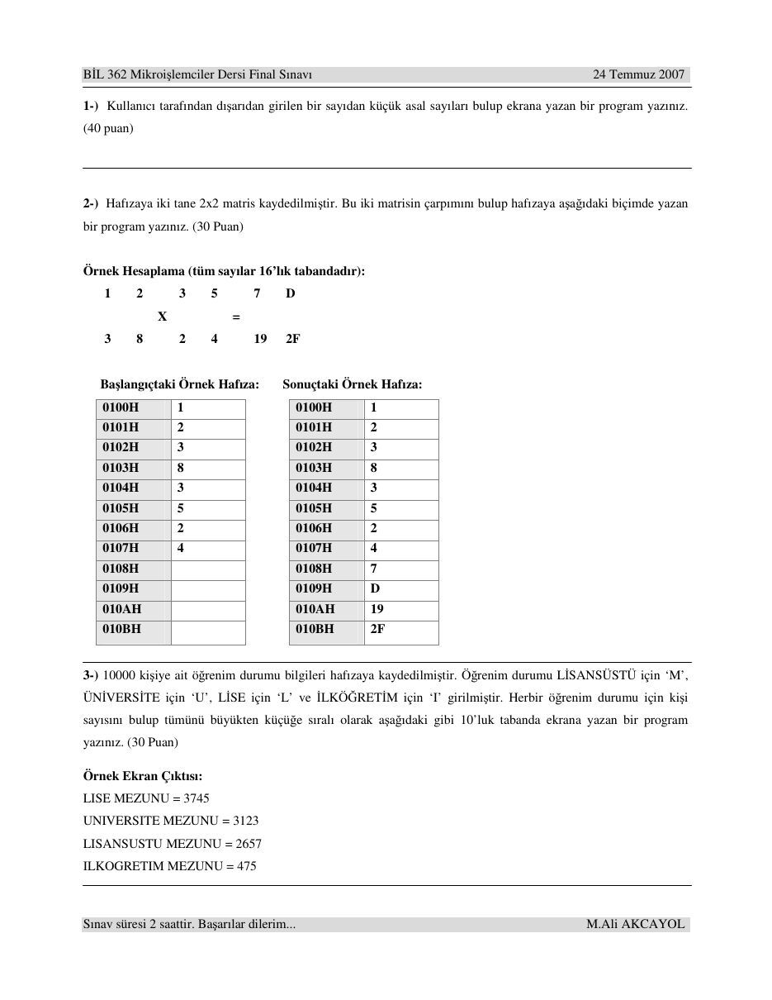
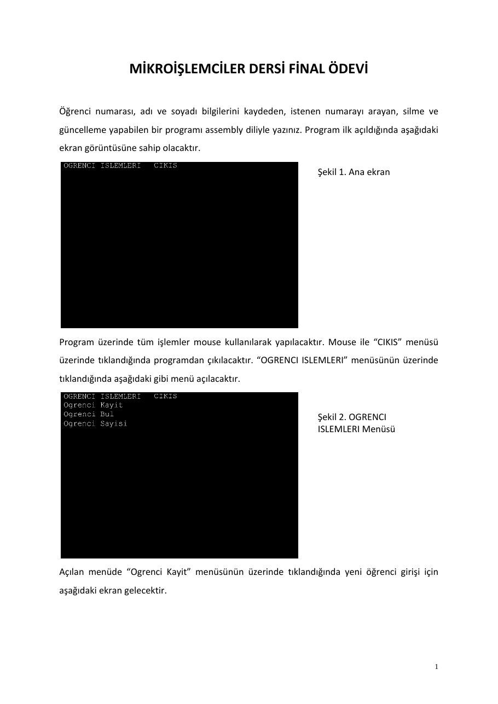
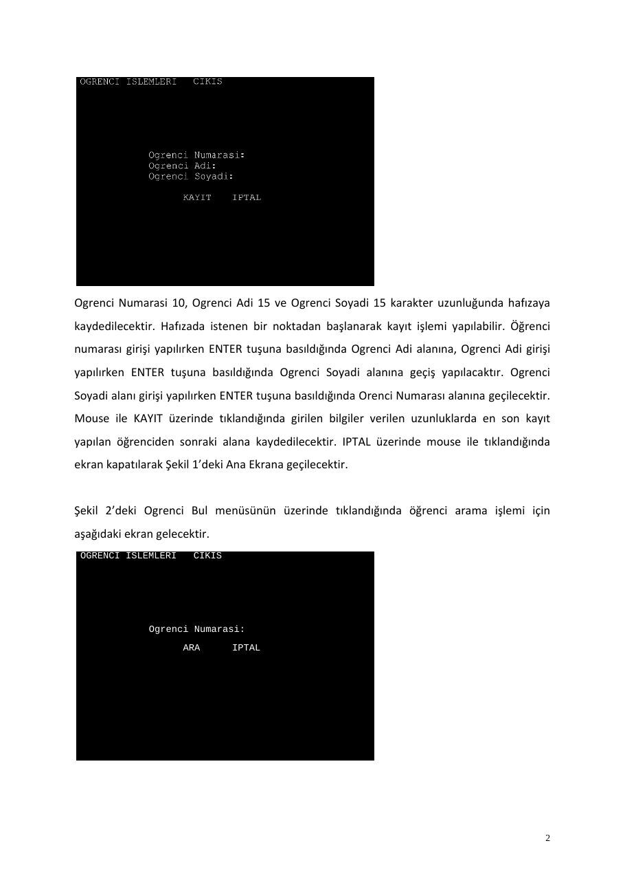
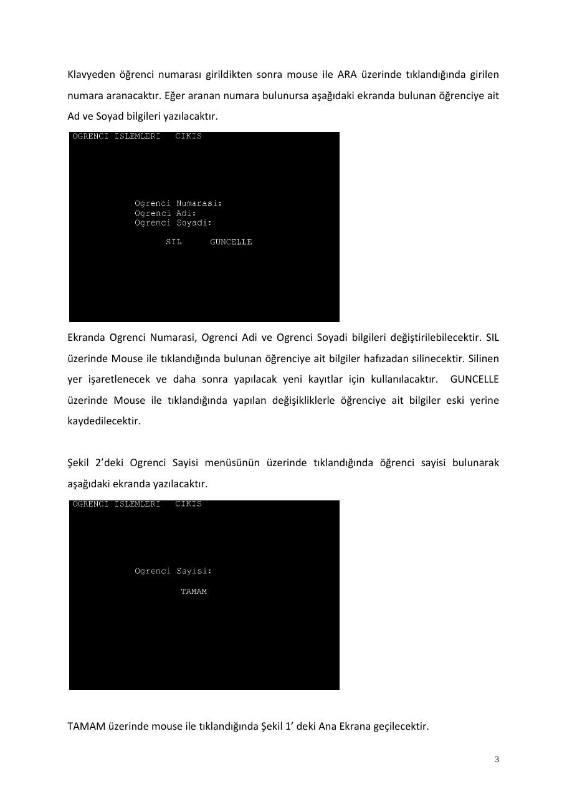

This post brings together the relevant notes and applications from the Başkent University **EEM332 Microprocessors** course archive (2008–2015). Prime number, matrix multiplication, odd-even separation solutions and a final assignment on record management with a mouse. Source: Gazi University, M. Ali Akcayol; BİL362 archive, 2007. PDF archive copies of the documents and, where available, the source code can be downloaded as a ZIP at the end of the post.

*Note: This content belongs to a third-party source; it is shared for archival and nostalgic purposes with the source credited. It will be removed at the request of the rights holder.*

## OrnekFinalCPUCevaplar

BIL 362 Microprocessors Course Final Exam Answers

1.

### MACRO YAZDIR HEXSAYI

```asm
MOV AX,HEXSAYI ; sayi 10 a bolunerek her seferinde kalan
MOV DL,10        ; alinmistir.
MOV CL,0
DONGU:
DIV DL
MOV BL,AH
XOR AH,AH
XOR BH,BH
PUSH BX      ; stack'a once birler basamagi atilir
INC CL
CMP AL,10
JNB DONGU
MOV BL,AL
XOR BH,BH
PUSH BX
INC CL
```

```asm
MOV AH,2
MOV DL,' '
INT 21H               ; bosluk verildi
DONGU2:
POP DX              ; stack'tan once yuzler basamagi alinir
ADD DX,30H          ; karakter karsiligi hesaplaniyor
MOV AH,2            ; karakter yazdirma islemi yapiliyor
INT 21H
DEC CL
CMP CL,0
JE CIKIS
JMP DONGU2
CIKIS:
ENDM YAZDIR
```

```asm
org 0100h
buffer db 4,?,4 dup(1)
```

```asm
mov bl,10
mov dx,offset buffer
mov ah,0Ah
int 21h              ; 3 basamakli bir sayi girildi
```

```asm
mov al,[buffer+2]         ; yuzler basamagi alindi
sub al,30h                ; karakter sayisal degere cevrildi
mul bl                    ; 10 la carpildi
mul bl                    ; 100 le carpildi
mov cx,ax                 ; 100 ler basamagi cx e aktarildi
```

```asm
mov al,[buffer+3]         ; onlar basamagi alindi
sub al,30h
mul bl
add cx,ax
```

```asm
mov al,[buffer+4]   ; birler basamagi alindi
sub al,30h
add cx,ax   ; cx e 3 basamakli sayi aktarildi
```

```asm
mov ah,2         ; 1 ve 2 dogrudan yazdiriliyor
mov dl,' '
```

M. Ali Akcayol

BIL 362 Microprocessors Course Final Exam Answers

```asm
int 21h
mov dl,'0'
int 21h
mov dl,'1' ; 01
int 21h
mov dl,' '
int 21h
mov dl,'0'
int 21h
mov dl,'2' ; 02
int 21h
```

```asm
mov dl,3         ; 3 ve ustu sayilar kontrol edilecek
xor dh,dh
```

disdongu:        ; her sayi icin tekrarlanir

```asm
mov bl,2     ; bolme islemi 2 ile baslar
icdongu:
mov ax,dx    ; dx kontrol edilen sayiyi tutar
div bl       ; ax bolme islemleri icin kullanildi
cmp ah,0     ; kalan kotrol edildi
je sonrakisayi     ; kalan yoksa asal degildir
inc bl       ; bolen artiriliyor
cmp bl,dl    ; bolen sayiya esitse asal sayidir
je asalsayi
jmp icdongu ; degilse yeni bolenle devam edilir
asalsayi:
push dx ; dx ve cx kullanildigi icin stack'a atildi
push cx
```

YAZDIR DX   ; sayi 10 luk tabanda yazdiriliyor

```asm
pop cx
pop dx
sonrakisayi:
inc dl       ; sonraki sayiya geciliyor
cmp dx,cx    ; girilen sayiya esitse program biter
jne disdongu
hlt
```

2.

```asm
;
; 1   2   3   5   7          D
;       X       =
; 3   8   2   4   19         2F
;
org 0100h
mov [0100h],1
mov [0101h],2
mov [0102h],3
mov [0103h],8
mov [0104h],3
mov [0105h],5
mov [0106h],2
mov [0107h],4
```

```asm
mov al,[0100h]
mul [0102h]
mov bl,al
mov al,[0101h]
mul [0106h]
add al,bl
mov [0108h],al
```

M. Ali Akcayol

BIL 362 Microprocessors Course Final Exam Answers

```asm
mov al,[0100h]
mul [0105h]
mov bl,al
mov al,[0101h]
mul [0107h]
add al,bl
mov [0109h],al
```

```asm
mov al,[0102h]
mul [0104h]
mov bl,al
mov al,[0103h]
mul [0106h]
add al,bl
mov [010Ah],al
```

```asm
mov al,[0102h]
mul [0105h]
mov bl,al
mov al,[0103h]
mul [0107h]
add al,bl
mov [010Bh],al
```

```asm
hlt
```

3.

### MACRO YAZDIR HEXSAYI

```asm
MOV AX,HEXSAYI ; sayi 10 a bolunerek her seferinde kalan
MOV DL,10        ; alinmistir.
MOV CL,0
DONGU:
DIV DL
MOV BL,AH
XOR AH,AH
XOR BH,BH
PUSH BX      ; stack'a once birler basamagi atilir
INC CL
CMP AL,10
JNB DONGU
MOV BL,AL
XOR BH,BH
PUSH BX
INC CL
```

```asm
MOV AH,2
MOV DL,' '
INT 21H               ; bosluk verildi
DONGU2:
POP DX              ; stack'tan once yuzler basamagi alinir
ADD DX,30H          ; karakter karsiligi hesaplaniyor
MOV AH,2            ; karakter yazdirma islemi yapiliyor
INT 21H
DEC CL
CMP CL,0
JE CIKIS
JMP DONGU2
CIKIS:
ENDM YAZDIR
```

```asm
org 0100h
kayitM db 2485 dup('M')
```

M. Ali Akcayol

BIL 362 Microprocessors Course Final Exam Answers

```asm
kayitU db 2459 dup('U')
kayitL db 2541 dup('L')
kayitI db 2515 dup('I')
xor bx,bx       ; lisansustu
xor cx,cx       ; universite
xor dx,dx       ; lise
xor di,di       ; ilkogretim
mov si,0
```

dongubasi:                      ; her dongude bir karakter karsilastirilir

```asm
mov al,[0100h+si]
cmp al,'M'                 ; Lisansustu
je lisansustu
cmp al,'U'                 ; Universite
je universite
cmp al,'L'                 ; Lise
je lise
cmp al,'I'                 ; Ilkogretim
je ilkogretim
lisansustu:
inc bx                ; Lisansustu sayisi artirildi
jmp devam
universite:
inc cx                ; Universite sayisi artirildi
jmp devam
lise:
inc dx                ; Lise sayisi artirildi
jmp devam
ilkogretim:
inc di                ; Ilkogretim sayisi artirildi
devam:
inc si                ; Sonraki karakter
cmp si,10000          ; Hepsi kontrol edildiyse donguden cik
jb dongubasi
mov ah,4                        ; 4 farkli karakter icin
tekrar:
xor si,si                  ; si gecici sayi tutmak icin kullanilacak
cmp bx,0                   ; her yazilan -1 yapilacak
jl atlaM                   ; -1 ise onceden yazilmistir
cmp si,bx                  ; Lisansustu degeri mevcuttan buyukse onu al
ja atlaM                   ; degilse degistirme yapma
mov si,bx                  ; yeni en buyuk lisansustu
mov al,'M'                 ; bu donguler 4 defa tekrarlanir
```

atlaM:                          ; her defasinda kalanlardan en buyugu yazilir

```asm
cmp cx,0
jl atlaU
cmp si,cx
ja atlaU
mov si,cx
mov al,'U'
atlaU:
cmp dx,0
jl atlaL
cmp si,dx
ja atlaL
mov si,dx
mov al,'L'
atlaL:
cmp di,0
jl atlaI
cmp si,di
ja atlaI
mov si,di
mov al,'I'
```

M. Ali Akcayol

BIL 362 Microprocessors Course Final Exam Answers

### atlaI

```asm
cmp al,'M'
jne MGec
mov bx,-1                  ; yazilana -1 atanir
pusha
call yenisatir
mov dx, offset msgM
mov ah, 9
int 21h                     ; lisansustu ise ilgili mesaj yazilir
popa
MGec:
cmp al,'U'
jne UGec
mov cx,-1                  ; yazilana -1 atanir
pusha
call yenisatir
mov dx, offset msgU
mov ah, 9
int 21h                     ; universite ise ilgili mesaj yazilir
popa
UGec:
cmp al,'L'
jne LGec
mov dx,-1                  ; yazilana -1 atanir
pusha
call yenisatir
mov dx, offset msgL
mov ah, 9
int 21h                     ; lise ise ilgili mesaj yazilir
popa
LGec:
cmp al,'I'
jne IGec
mov di,-1                  ; yazilana -1 atanir
pusha
call yenisatir
mov dx, offset msgI
mov ah, 9
int 21h                     ; ilkogretim ise ilgili mesaj yazilir
popa
IGec:
pusha
```

YAZDIR SI                  ; toplam adet degeri yazilir popa

```asm
dec ah
cmp ah,0
je bitis
jmp tekrar
bitis:
msgM db "LISANSUSTU = $"
msgU db "UNIVERSITE = $"
msgL db "LISE = $"
msgI db "ILKOGRETIM = $"
hlt
```

```asm
yenisatir proc
mov ah,2
mov dl, 0Dh                ; return
int 21h
mov dl, 0Ah                ; yeni satir
int 21h
ret
```

yenisatir endp M. Ali Akcayol

## OrnekFinalCPUSorular

B L 362 Microprocessors Course Final Exam                                                      24 July 2007

1-) Write a program that finds the prime numbers smaller than a number entered externally by the user and prints them to the screen. (40 points)

2-) Two 2x2 matrices have been stored in memory. Write a program that finds the product of these two matrices and writes it to memory in the format below. (30 points)

### Sample Calculation (all numbers are in hexadecimal)

### 1       2        3    5        7     D

### X             =

### 3       8        2    4        19    2F

### Initial Sample Memory:           Resulting Sample Memory

### 0100H           1                        0100H     1

### 0101H           2                        0101H     2

### 0102H           3                        0102H     3

### 0103H           8                        0103H     8

### 0104H           3                        0104H     3

### 0105H           5                        0105H     5

### 0106H           2                        0106H     2

### 0107H           4                        0107H     4

### 0108H                                    0108H     7

### 0109H                                    0109H     D

### 010AH                                    010AH     19

### 010BH                                    010BH     2F

3-) Education level information for 10000 people has been stored in memory. For the education level, ‘M’ has been entered for GRADUATE DEGREE, ‘U’ for UNIVERSITY, ‘L’ for HIGH SCHOOL, and ‘I’ for PRIMARY SCHOOL. Write a program that finds the number of people for each education level and prints all of them to the screen in base 10, sorted from largest to smallest, as below. (30 points)

### Sample Screen Output

### LISE MEZUNU = 3745

### UNIVERSITE MEZUNU = 3123

### LISANSUSTU MEZUNU = 2657

### ILKOGRETIM MEZUNU = 475

The exam duration is 2 hours. Good luck...                                                  M.Ali AKCAYOL



## OrnekVizeCPUCevaplar

BIL 362 Microprocessors Course Midterm Exam Answers        3 July 2007

1.

```asm
org 0100h
mov [0100h],'1'
mov [0101h],'4'
mov [0102h],'2'
mov [0103h],'8'
mov [0104h],'7'
mov [0105h],'3'
mov [0106h],'5'
mov [0107h],'9'
mov [0108h],'2'
mov [0109h],'6'
```

```asm
call ekranayazdir         ; baslangic durumunu yazdir
```

```asm
mov bx,0100h              ; ilk sayi
mov cx,0109h              ; son sayi
mov dl,2                  ; bolen
```

teksayidongu:       ; soldaki ilk cift sayiyi bulur

```asm
mov si, bx
mov al,[si]
xor ah,ah       ; onceki bolme sonucu atiliyor
div dl
cmp ah,0        ; bolmede kalan varmi?
jnz devamtek        ; kalan varsa tektir
jmp ciftsayidongu   ; kalan yoksa cifttir
```

### devamtek

```asm
inc bx
cmp bx,cx
je cikis
jmp teksayidongu
```

### ciftsayidongu

```asm
mov si,cx
mov al,[si]
xor ah,ah
div dl
cmp ah,0
jz devamcift
jmp degistir
```

### devamcift

```asm
dec cx
cmp bx,cx
je cikis
jmp ciftsayidongu
```

### degistir

```asm
push ax
mov al,[bx]
mov ah,[si]
mov [bx],ah
mov [si],al
pop ax
jmp teksayidongu
```

M. Ali Akcayol

BIL 362 Microprocessors Course Midterm Exam Answers                                     3 July 2007

### cikis

```asm
call ekranayazdir
hlt
```

```asm
ekranayazdir proc
mov cx, 0                        ; karakter sayaci
mov ah, 2                        ; int 21, ah=2, ekrana karakter yazdir
tekrar:
mov si,cx
mov dl, [0100h+si]
int 21h                      ; int 21, ah=2, ekrana karakter yazdir
inc cx
cmp cx,9
ja yazmacikisi
mov dl, ','
int 21h                      ; int 21, ah=2, ekrana karakter yazdir
jmp tekrar
yazmacikisi:
mov dl, 0Dh                      ; return
int 21h
mov dl, 0Ah                      ; yeni satir
int 21h
ret
```

ekranayazdir endp

### 2. The program below multiplies two numbers using addition and division. In each loop iteration, the first number is added to itself to double it, while the second number is divided by 2 to halve it. Thus, when the second number becomes 1, the first number will be the result. However, since integer division is used, the remainder at each step is added to the cx register, which stores the result value. To ensure that the value of the first number is also added when the second number is 1, the loop continues until the quotient is 0 (al=0), and at this stage the bx value is added to the cx result for the remainder (ah=1).

### Sample calculation

cx           bx         ax       remainder           explanation 0            121        235      -               ; start 121          242        117      1               ; step 1: 121 is added (remainder 1) 363          484        58       1               ; step 2: 242 is added (remainder 1) 363          968        29       0               ; step 3: no addition (remainder 0) 1331         1936       14       1               ; step 4: 968 is added (remainder 1) 1331         3872       7        0               ; step 5: no addition (remainder 0) 5203         7744       3        1               ; step 6: 3872 is added (remainder 1) 12947        15488      1        1               ; step 7: 7744 is added (remainder 1) 28435        -          0        1               ; step 8: 15488 is added (remainder 1)

```asm
org 0100h
mov [0100h], word ptr 121            ; 1.sayi
mov [0102h], word ptr 235            ; 2.sayi
mov bx,[0100h]
mov ax,[0102h]
mov dl,2                             ; bolen (2)
mov cx,0                             ; kalanlarin toplami saklanacak
cmp bx,0                             ; 1.sayi sifirmi?
jz bitis                             ; sifirsa bitir
```

M. Ali Akcayol

BIL 362 Microprocessors Course Midterm Exam Answers                         3 July 2007 dongu:                        ; her dongude 1.sayi iki katina cikar 2.sayi 2'ye bolunur

```asm
cmp ax,0                       ; 2.sayi sifirsa veya dongude sifir olduysa bitir
jz bitis
div dl                          ; 2.sayi 2'ye bolunur
cmp ah,0                        ; kalan kontrol ediliyor
jz atla                         ; kalan yoksa ekleme yapmadan devam et
add cx,bx                       ; kalan 1 ise 1.sayiyi sonuca ekle
atla:
add bx,bx                   ; 1.sayiyi iki katina cikar
xor ah,ah                   ; bir onceki islemden kalani sifirla
jmp dongu
bitis:
mov [0104h],cx                      ; sonucu bir sonraki adrese kaydet
hlt
```

3.

```asm
org 0100h
mov [0100h],'7'
mov [0101h],'5'
mov [0102h],'9'
mov [0103h],'3'
mov [0104h],'2'
mov [0105h],'7'
mov [0106h],'8'
mov [0107h],'6'
mov [0108h],'5'
mov [0109h],'1'
mov [010Ah],'3'
```

```asm
call ekranayazdir         ; baslangic durumunu yazdir
```

```asm
mov dx,0100h              ; soldaki gosterge
mov cx,0100h              ; kontrol edilen
mov bx,0100h              ; en kucuk sayinin adresi icin
```

dongu:               ; her sayinin dogru yeri bulunur

```asm
mov si, cx
mov al,[si]
cmp al,[bx]      ; bir sonraki sayi en kucukle karsilastirilir
jae atla         ; buyuk veya esitse bir sonrakine gec
mov bx,cx        ; yeni sayi en kucukten kucukse en kucuk yap
inc cx           ; bir sonrakine gec
cmp cx,010Bh     ; sona gelindimi?
je yerdegistir ; sonda ise yer degistir
jmp dongu        ; sona gelinmedi basa don
yerdegistir:
cmp bx,dx
je ayniatla ; ayni eleman yer degistirme
call degistir   ; dx ile bx yer degistirir
ayniatla:
inc dx           ; soldaki gosterge bir ilerler
cmp dx, 010Ah    ; sona gelindimi?
je cikis         ; son elemanda sirasina konduysa cikis yap
mov cx,dx        ; siralanmamis sayinin adresi cx bx e atilir
mov bx,dx
jmp dongu        ; basa don
```

atla:                ; yeni sayi buyuk veya esitse bir sonrakini sec

```asm
inc cx
cmp cx,010Bh     ; sona gelindimi?
```

M. Ali Akcayol

BIL 362 Microprocessors Course Midterm Exam Answers                         3 July 2007

```asm
je yerdegistir       ; son elemanda en kucukle karsilastirildigi
jmp dongu            ; yer degirme yapilir ve basa donulur
```

### cikis

```asm
call ekranayazdir
hlt
```

```asm
degistir proc
push ax
push si
mov si,dx
mov al,[si]
mov ah,[bx]
mov [si],ah
mov [bx],al
pop si
pop ax
ret
```

degistir endp

```asm
ekranayazdir proc
mov cx, 0                       ; karakter sayaci
mov ah, 2                       ; int 21, ah=2, ekrana karakter yazdir
tekrar:
mov si,cx
mov dl, [0100h+si]
int 21h                     ; int 21, ah=2, ekrana karakter yazdir
inc cx
cmp cx,11
je yazmacikisi
mov dl, ','
int 21h                     ; int 21, ah=2, ekrana karakter yazdir
jmp tekrar
yazmacikisi:
mov dl, 0Dh                     ; return
int 21h
mov dl, 0Ah                     ; yeni satir
int 21h
ret
```

ekranayazdir endp

Extra

```asm
org 0100h
ADET equ 1000                  ; toplam rakam sayisi
mov dl,10                      ; sayilari onluk tabanda gostermek icin
```

```asm
call baslangic                 ; baslangic degerleri atanir
call degerata                  ; iki sayinin degerleri atanir
call topla                     ; toplama islemi yapilir
call mesajyaz                  ; kullaniciya islemin bittigi bildirilir
```

```asm
hlt
```

```asm
topla proc
call baslangic
mov bx,0                   ; bl'de kalan saklanacak
mov cx,ADET                ; cx sayaci rakam sayisina esitleniyor
sonrakibasamak:
mov al,[si]                 ; ilk sayinin en sagdaki basamagi
```

M. Ali Akcayol

BIL 362 Microprocessors Course Midterm Exam Answers                3 July 2007

```asm
add al,[si+1000]    ; ikinci sayinin en sagdaki basamagiyla toplaniyor
add al,bl           ; onceki basamaktan gelen toplandi
div dl              ; toplam 10'a bolunerek kanal alinacak
mov [si+2001],ah    ; elde olursa 1001 byte gerekir o yuzden 2001
xor ah,ah           ; bir sonraki bolme icin
mov bl,al           ; kalan saklandi sonraki basamaga eklenecek
dec si              ; onceki basamaklara gecilir
loop sonrakibasamak
mov [si+2001],bl        ; elde varsa bir onceki adrese yazildi
ret
```

topla endp

```asm
baslangic proc
mov cx,ADET           ; her sayidaki rakam sayisi
mov si,1000           ; ilk dizinin en soldaki rakami
add si,cx             ; ilk dizinin en sagdaki rakami
ret
```

baslangic endp

```asm
degerata proc       ; dizilere baslangic degerleri atar
dongu:
mov ax,cx   ; her eleman (cx mod 10) ile belirleniyor
div dl
mov al,ah   ; kalan deger alinacak
xor ah,ah
mov [si],al         ; ilk diziye
mov [si+1000],al    ; ikinci diziye
dec si              ; bir soldaki rakam
loop dongu
ret
```

degerata endp

```asm
mesajyaz proc
mov dx, offset mesajvar
mov ah, 9
int 21h
ret
mesajvar db "toplama islemi tamamlandi... $"
```

mesajyaz endp

M. Ali Akcayol

## finalOdevi

### MICROPROCESSORS COURSE FINAL ASSIGNMENT

Write a program in assembly language that records student number, first name and last name information, searches for a requested number, and can perform deletion and update operations. When the program is first opened, it will have the screen appearance below.

Figure 1. Main screen

All operations in the program will be performed using the mouse. Clicking the mouse on the “CIKIS” menu will exit the program. Clicking on the “OGRENCI ISLEMLERI” menu will open a menu as below.

Figure 2. OGRENCI ISLEMLERI Menu

Clicking on the “Ogrenci Kayit” menu in the opened menu will bring up the following screen for new student entry.

Ogrenci Numarasi will be 10 characters, Ogrenci Adi 15 characters and Ogrenci Soyadi 15 characters long, and will be stored in memory. The record operation may begin at any desired point in memory. When ENTER is pressed while entering the student number, focus will move to the Ogrenci Adi field; when ENTER is pressed while entering Ogrenci Adi, focus will move to the Ogrenci Soyadi field. When ENTER is pressed while entering the Ogrenci Soyadi field, focus will return to the Orenci Numarası field. Clicking KAYIT with the mouse will store the entered information, with the given lengths, in the area following the most recently recorded student. Clicking IPTAL with the mouse will close the screen and return to the Main Screen in Figure 1.

Clicking on the Ogrenci Bul menu in Figure 2 will bring up the following screen for the student search operation.

### OGRENCI ISLEMLERI     CIKIS

### Ogrenci Numarasi

### ARA       IPTAL

After the student number is entered from the keyboard, clicking ARA with the mouse will search for the entered number. If the searched number is found, the first name and last name information of the student found will be written on the screen below.

The Ogrenci Numarasi, Ogrenci Adi and Ogrenci Soyadi information on the screen can be changed. Clicking SIL with the mouse will delete the information of the student found from memory. The deleted location will be marked and used for new records made later.       Clicking GUNCELLE with the mouse will save the information of the student with the changes made in its old location.

Clicking on the Ogrenci Sayisi menu in Figure 2 will find the number of students and write it on the screen below.

Clicking TAMAM with the mouse will return to the Main Screen in Figure 1.






