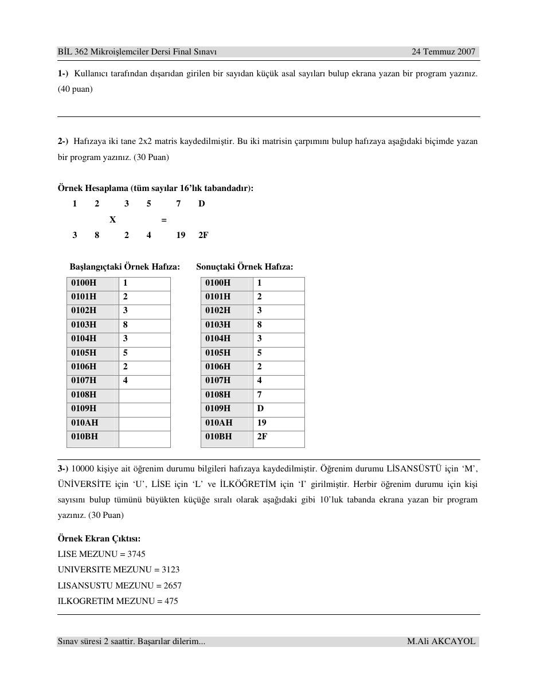
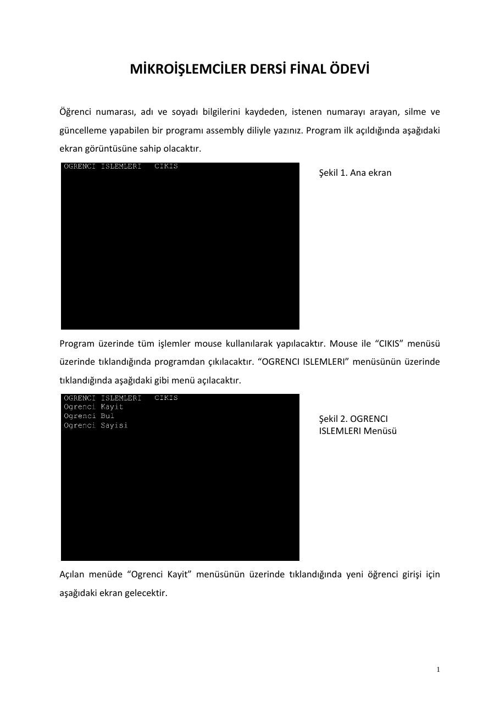
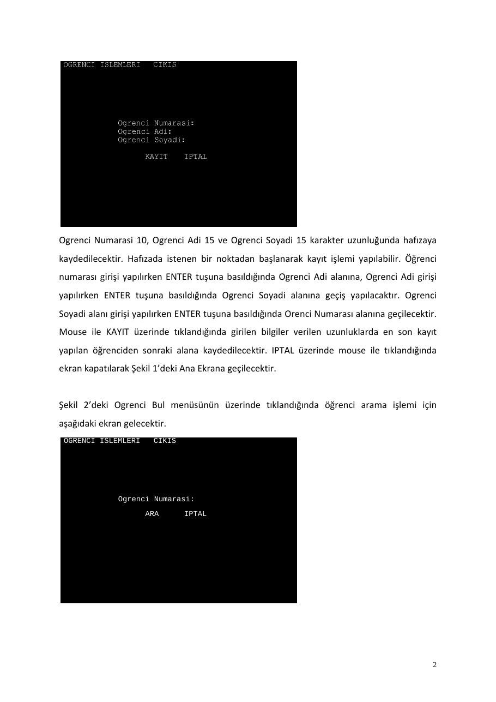
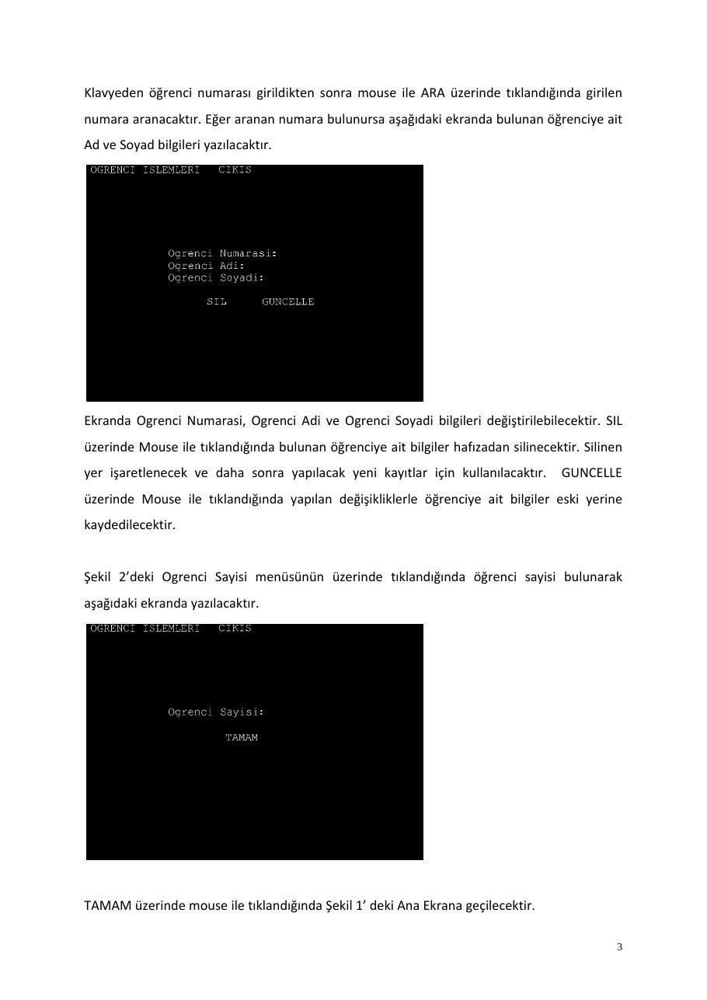

Bu yazı, Başkent Üniversitesi **EEM332 Mikroişlemciler** ders arşivindeki ilgili notları ve uygulamaları bir araya getiriyor (2008–2015). Asal sayı, matris çarpımı, tek-çift ayırma çözümleri ve fare ile kayıt yönetimi final ödevi. Kaynak: Gazi Üniversitesi, M. Ali Akcayol; BİL362 arşivi, 2007. Belgelerin PDF arşiv kopyaları ve varsa kaynak kodları yazının sonunda ZIP olarak indirilebilir.

*Bu içerik üçüncü taraf bir kaynağa aittir; arşiv ve nostalji amacıyla kaynak belirtilerek paylaşılmıştır. Hak sahibinin talebi hâlinde kaldırılır.*

## OrnekFinalCPUCevaplar

BIL 362 Mikroi lemciler Dersi Final Sınavı Cevapları

1.

### MACRO YAZDIR HEXSAYI

```asm
MOV AX,HEXSAYI ; sayi 10 a bolunerek her seferinde kalan
MOV DL,10        ; alinmistir.
MOV CL,0
DONGU:
DIV DL
MOV BL,AH
XOR AH,AH
XOR BH,BH
PUSH BX      ; stack'a once birler basamagi atilir
INC CL
CMP AL,10
JNB DONGU
MOV BL,AL
XOR BH,BH
PUSH BX
INC CL
```

```asm
MOV AH,2
MOV DL,' '
INT 21H               ; bosluk verildi
DONGU2:
POP DX              ; stack'tan once yuzler basamagi alinir
ADD DX,30H          ; karakter karsiligi hesaplaniyor
MOV AH,2            ; karakter yazdirma islemi yapiliyor
INT 21H
DEC CL
CMP CL,0
JE CIKIS
JMP DONGU2
CIKIS:
ENDM YAZDIR
```

```asm
org 0100h
buffer db 4,?,4 dup(1)
```

```asm
mov bl,10
mov dx,offset buffer
mov ah,0Ah
int 21h              ; 3 basamakli bir sayi girildi
```

```asm
mov al,[buffer+2]         ; yuzler basamagi alindi
sub al,30h                ; karakter sayisal degere cevrildi
mul bl                    ; 10 la carpildi
mul bl                    ; 100 le carpildi
mov cx,ax                 ; 100 ler basamagi cx e aktarildi
```

```asm
mov al,[buffer+3]         ; onlar basamagi alindi
sub al,30h
mul bl
add cx,ax
```

```asm
mov al,[buffer+4]   ; birler basamagi alindi
sub al,30h
add cx,ax   ; cx e 3 basamakli sayi aktarildi
```

```asm
mov ah,2         ; 1 ve 2 dogrudan yazdiriliyor
mov dl,' '
```

M. Ali Akcayol

BIL 362 Mikroi lemciler Dersi Final Sınavı Cevapları

```asm
int 21h
mov dl,'0'
int 21h
mov dl,'1' ; 01
int 21h
mov dl,' '
int 21h
mov dl,'0'
int 21h
mov dl,'2' ; 02
int 21h
```

```asm
mov dl,3         ; 3 ve ustu sayilar kontrol edilecek
xor dh,dh
```

disdongu:        ; her sayi icin tekrarlanir

```asm
mov bl,2     ; bolme islemi 2 ile baslar
icdongu:
mov ax,dx    ; dx kontrol edilen sayiyi tutar
div bl       ; ax bolme islemleri icin kullanildi
cmp ah,0     ; kalan kotrol edildi
je sonrakisayi     ; kalan yoksa asal degildir
inc bl       ; bolen artiriliyor
cmp bl,dl    ; bolen sayiya esitse asal sayidir
je asalsayi
jmp icdongu ; degilse yeni bolenle devam edilir
asalsayi:
push dx ; dx ve cx kullanildigi icin stack'a atildi
push cx
```

YAZDIR DX   ; sayi 10 luk tabanda yazdiriliyor

```asm
pop cx
pop dx
sonrakisayi:
inc dl       ; sonraki sayiya geciliyor
cmp dx,cx    ; girilen sayiya esitse program biter
jne disdongu
hlt
```

2.

```asm
;
; 1   2   3   5   7          D
;       X       =
; 3   8   2   4   19         2F
;
org 0100h
mov [0100h],1
mov [0101h],2
mov [0102h],3
mov [0103h],8
mov [0104h],3
mov [0105h],5
mov [0106h],2
mov [0107h],4
```

```asm
mov al,[0100h]
mul [0102h]
mov bl,al
mov al,[0101h]
mul [0106h]
add al,bl
mov [0108h],al
```

M. Ali Akcayol

BIL 362 Mikroi lemciler Dersi Final Sınavı Cevapları

```asm
mov al,[0100h]
mul [0105h]
mov bl,al
mov al,[0101h]
mul [0107h]
add al,bl
mov [0109h],al
```

```asm
mov al,[0102h]
mul [0104h]
mov bl,al
mov al,[0103h]
mul [0106h]
add al,bl
mov [010Ah],al
```

```asm
mov al,[0102h]
mul [0105h]
mov bl,al
mov al,[0103h]
mul [0107h]
add al,bl
mov [010Bh],al
```

```asm
hlt
```

3.

### MACRO YAZDIR HEXSAYI

```asm
MOV AX,HEXSAYI ; sayi 10 a bolunerek her seferinde kalan
MOV DL,10        ; alinmistir.
MOV CL,0
DONGU:
DIV DL
MOV BL,AH
XOR AH,AH
XOR BH,BH
PUSH BX      ; stack'a once birler basamagi atilir
INC CL
CMP AL,10
JNB DONGU
MOV BL,AL
XOR BH,BH
PUSH BX
INC CL
```

```asm
MOV AH,2
MOV DL,' '
INT 21H               ; bosluk verildi
DONGU2:
POP DX              ; stack'tan once yuzler basamagi alinir
ADD DX,30H          ; karakter karsiligi hesaplaniyor
MOV AH,2            ; karakter yazdirma islemi yapiliyor
INT 21H
DEC CL
CMP CL,0
JE CIKIS
JMP DONGU2
CIKIS:
ENDM YAZDIR
```

```asm
org 0100h
kayitM db 2485 dup('M')
```

M. Ali Akcayol

BIL 362 Mikroi lemciler Dersi Final Sınavı Cevapları

```asm
kayitU db 2459 dup('U')
kayitL db 2541 dup('L')
kayitI db 2515 dup('I')
xor bx,bx       ; lisansustu
xor cx,cx       ; universite
xor dx,dx       ; lise
xor di,di       ; ilkogretim
mov si,0
```

dongubasi:                      ; her dongude bir karakter karsilastirilir

```asm
mov al,[0100h+si]
cmp al,'M'                 ; Lisansustu
je lisansustu
cmp al,'U'                 ; Universite
je universite
cmp al,'L'                 ; Lise
je lise
cmp al,'I'                 ; Ilkogretim
je ilkogretim
lisansustu:
inc bx                ; Lisansustu sayisi artirildi
jmp devam
universite:
inc cx                ; Universite sayisi artirildi
jmp devam
lise:
inc dx                ; Lise sayisi artirildi
jmp devam
ilkogretim:
inc di                ; Ilkogretim sayisi artirildi
devam:
inc si                ; Sonraki karakter
cmp si,10000          ; Hepsi kontrol edildiyse donguden cik
jb dongubasi
mov ah,4                        ; 4 farkli karakter icin
tekrar:
xor si,si                  ; si gecici sayi tutmak icin kullanilacak
cmp bx,0                   ; her yazilan -1 yapilacak
jl atlaM                   ; -1 ise onceden yazilmistir
cmp si,bx                  ; Lisansustu degeri mevcuttan buyukse onu al
ja atlaM                   ; degilse degistirme yapma
mov si,bx                  ; yeni en buyuk lisansustu
mov al,'M'                 ; bu donguler 4 defa tekrarlanir
```

atlaM:                          ; her defasinda kalanlardan en buyugu yazilir

```asm
cmp cx,0
jl atlaU
cmp si,cx
ja atlaU
mov si,cx
mov al,'U'
atlaU:
cmp dx,0
jl atlaL
cmp si,dx
ja atlaL
mov si,dx
mov al,'L'
atlaL:
cmp di,0
jl atlaI
cmp si,di
ja atlaI
mov si,di
mov al,'I'
```

M. Ali Akcayol

BIL 362 Mikroi lemciler Dersi Final Sınavı Cevapları

### atlaI

```asm
cmp al,'M'
jne MGec
mov bx,-1                  ; yazilana -1 atanir
pusha
call yenisatir
mov dx, offset msgM
mov ah, 9
int 21h                     ; lisansustu ise ilgili mesaj yazilir
popa
MGec:
cmp al,'U'
jne UGec
mov cx,-1                  ; yazilana -1 atanir
pusha
call yenisatir
mov dx, offset msgU
mov ah, 9
int 21h                     ; universite ise ilgili mesaj yazilir
popa
UGec:
cmp al,'L'
jne LGec
mov dx,-1                  ; yazilana -1 atanir
pusha
call yenisatir
mov dx, offset msgL
mov ah, 9
int 21h                     ; lise ise ilgili mesaj yazilir
popa
LGec:
cmp al,'I'
jne IGec
mov di,-1                  ; yazilana -1 atanir
pusha
call yenisatir
mov dx, offset msgI
mov ah, 9
int 21h                     ; ilkogretim ise ilgili mesaj yazilir
popa
IGec:
pusha
```

YAZDIR SI                  ; toplam adet degeri yazilir popa

```asm
dec ah
cmp ah,0
je bitis
jmp tekrar
bitis:
msgM db "LISANSUSTU = $"
msgU db "UNIVERSITE = $"
msgL db "LISE = $"
msgI db "ILKOGRETIM = $"
hlt
```

```asm
yenisatir proc
mov ah,2
mov dl, 0Dh                ; return
int 21h
mov dl, 0Ah                ; yeni satir
int 21h
ret
```

yenisatir endp M. Ali Akcayol

## OrnekFinalCPUSorular

B L 362 Mikroi lemciler Dersi Final Sınavı                                                      24 Temmuz 2007

1-) Kullanıcı tarafından dı arıdan girilen bir sayıdan küçük asal sayıları bulup ekrana yazan bir program yazınız. (40 puan)

2-) Hafızaya iki tane 2x2 matris kaydedilmi tir. Bu iki matrisin çarpımını bulup hafızaya a a ıdaki biçimde yazan bir program yazınız. (30 Puan)

### Örnek Hesaplama (tüm sayılar 16’lık tabandadır)

### 1       2        3    5        7     D

### X             =

### 3       8        2    4        19    2F

### Ba langıçtaki Örnek Hafıza:           Sonuçtaki Örnek Hafıza

### 0100H           1                        0100H     1

### 0101H           2                        0101H     2

### 0102H           3                        0102H     3

### 0103H           8                        0103H     8

### 0104H           3                        0104H     3

### 0105H           5                        0105H     5

### 0106H           2                        0106H     2

### 0107H           4                        0107H     4

### 0108H                                    0108H     7

### 0109H                                    0109H     D

### 010AH                                    010AH     19

### 010BH                                    010BH     2F

3-) 10000 ki iye ait ö renim durumu bilgileri hafızaya kaydedilmi tir. Ö renim durumu L SANSÜSTÜ için ‘M’, ÜN VERS TE için ‘U’, L SE için ‘L’ ve LKÖ RET M için ‘I’ girilmi tir. Herbir ö renim durumu için ki i sayısını bulup tümünü büyükten küçü e sıralı olarak a a ıdaki gibi 10’luk tabanda ekrana yazan bir program yazınız. (30 Puan)

### Örnek Ekran Çıktısı

### LISE MEZUNU = 3745

### UNIVERSITE MEZUNU = 3123

### LISANSUSTU MEZUNU = 2657

### ILKOGRETIM MEZUNU = 475

Sınav süresi 2 saattir. Ba arılar dilerim...                                                  M.Ali AKCAYOL



## OrnekVizeCPUCevaplar

BIL 362 Mikroi lemciler Dersi Arasınav Cevapları        3 Temmuz 2007

1.

```asm
org 0100h
mov [0100h],'1'
mov [0101h],'4'
mov [0102h],'2'
mov [0103h],'8'
mov [0104h],'7'
mov [0105h],'3'
mov [0106h],'5'
mov [0107h],'9'
mov [0108h],'2'
mov [0109h],'6'
```

```asm
call ekranayazdir         ; baslangic durumunu yazdir
```

```asm
mov bx,0100h              ; ilk sayi
mov cx,0109h              ; son sayi
mov dl,2                  ; bolen
```

teksayidongu:       ; soldaki ilk cift sayiyi bulur

```asm
mov si, bx
mov al,[si]
xor ah,ah       ; onceki bolme sonucu atiliyor
div dl
cmp ah,0        ; bolmede kalan varmi?
jnz devamtek        ; kalan varsa tektir
jmp ciftsayidongu   ; kalan yoksa cifttir
```

### devamtek

```asm
inc bx
cmp bx,cx
je cikis
jmp teksayidongu
```

### ciftsayidongu

```asm
mov si,cx
mov al,[si]
xor ah,ah
div dl
cmp ah,0
jz devamcift
jmp degistir
```

### devamcift

```asm
dec cx
cmp bx,cx
je cikis
jmp ciftsayidongu
```

### degistir

```asm
push ax
mov al,[bx]
mov ah,[si]
mov [bx],ah
mov [si],al
pop ax
jmp teksayidongu
```

M. Ali Akcayol

BIL 362 Mikroi lemciler Dersi Arasınav Cevapları                                     3 Temmuz 2007

### cikis

```asm
call ekranayazdir
hlt
```

```asm
ekranayazdir proc
mov cx, 0                        ; karakter sayaci
mov ah, 2                        ; int 21, ah=2, ekrana karakter yazdir
tekrar:
mov si,cx
mov dl, [0100h+si]
int 21h                      ; int 21, ah=2, ekrana karakter yazdir
inc cx
cmp cx,9
ja yazmacikisi
mov dl, ','
int 21h                      ; int 21, ah=2, ekrana karakter yazdir
jmp tekrar
yazmacikisi:
mov dl, 0Dh                      ; return
int 21h
mov dl, 0Ah                      ; yeni satir
int 21h
ret
```

ekranayazdir endp

### 2. A a ıdaki program iki sayının çarpımını toplama ve bölme ile yapmaktadır. Her döngüde birinci sayı

kendisiyle toplanarak iki katına çıkarılmakta ikinci sayı ise 2’ye bölünerek yarıya dü ürülmektedir. Böylece ikinci sayi 1 oldu unda birinci sayi sonuç olacaktır. Ancak tamsayı bölme yapıldı ı için her adımdaki kalan de er sonuç de eri saklayan cx register’ına eklenmektedir. kinci sayinin 1 oldu u de erde briinci sayinin de erinin eledilmesi için bolum sonucunun 0 oldu u (al=0) duruma kadar gidilmekte ve bu a amada kalan de er (ah=1) için bx de eri cx sonucuna eklenmektedir.

### Örnek hesaplama

cx           bx         ax       kalan           açıklama 0            121        235      -               ; ba langıç 121          242        117      1               ; 1.adım 121 eklenir (kalan 1) 363          484        58       1               ; 2.adım 242 eklenir (kalan 1) 363          968        29       0               ; 3.adım ekleme yapılmaz (kalan 0) 1331         1936       14       1               ; 4.adım 968 eklenir (kalan 1) 1331         3872       7        0               ; 5.adım ekleme yapılmaz (kalan 0) 5203         7744       3        1               ; 6.adım 3872 eklenir (kalan 1) 12947        15488      1        1               ; 7.adım 7744 eklenir (kalan 1) 28435        -          0        1               ; 8.adım 15488 eklenir (kalan 1)

```asm
org 0100h
mov [0100h], word ptr 121            ; 1.sayi
mov [0102h], word ptr 235            ; 2.sayi
mov bx,[0100h]
mov ax,[0102h]
mov dl,2                             ; bolen (2)
mov cx,0                             ; kalanlarin toplami saklanacak
cmp bx,0                             ; 1.sayi sifirmi?
jz bitis                             ; sifirsa bitir
```

M. Ali Akcayol

BIL 362 Mikroi lemciler Dersi Arasınav Cevapları                         3 Temmuz 2007 dongu:                        ; her dongude 1.sayi iki katina cikar 2.sayi 2'ye bolunur

```asm
cmp ax,0                       ; 2.sayi sifirsa veya dongude sifir olduysa bitir
jz bitis
div dl                          ; 2.sayi 2'ye bolunur
cmp ah,0                        ; kalan kontrol ediliyor
jz atla                         ; kalan yoksa ekleme yapmadan devam et
add cx,bx                       ; kalan 1 ise 1.sayiyi sonuca ekle
atla:
add bx,bx                   ; 1.sayiyi iki katina cikar
xor ah,ah                   ; bir onceki islemden kalani sifirla
jmp dongu
bitis:
mov [0104h],cx                      ; sonucu bir sonraki adrese kaydet
hlt
```

3.

```asm
org 0100h
mov [0100h],'7'
mov [0101h],'5'
mov [0102h],'9'
mov [0103h],'3'
mov [0104h],'2'
mov [0105h],'7'
mov [0106h],'8'
mov [0107h],'6'
mov [0108h],'5'
mov [0109h],'1'
mov [010Ah],'3'
```

```asm
call ekranayazdir         ; baslangic durumunu yazdir
```

```asm
mov dx,0100h              ; soldaki gosterge
mov cx,0100h              ; kontrol edilen
mov bx,0100h              ; en kucuk sayinin adresi icin
```

dongu:               ; her sayinin dogru yeri bulunur

```asm
mov si, cx
mov al,[si]
cmp al,[bx]      ; bir sonraki sayi en kucukle karsilastirilir
jae atla         ; buyuk veya esitse bir sonrakine gec
mov bx,cx        ; yeni sayi en kucukten kucukse en kucuk yap
inc cx           ; bir sonrakine gec
cmp cx,010Bh     ; sona gelindimi?
je yerdegistir ; sonda ise yer degistir
jmp dongu        ; sona gelinmedi basa don
yerdegistir:
cmp bx,dx
je ayniatla ; ayni eleman yer degistirme
call degistir   ; dx ile bx yer degistirir
ayniatla:
inc dx           ; soldaki gosterge bir ilerler
cmp dx, 010Ah    ; sona gelindimi?
je cikis         ; son elemanda sirasina konduysa cikis yap
mov cx,dx        ; siralanmamis sayinin adresi cx bx e atilir
mov bx,dx
jmp dongu        ; basa don
```

atla:                ; yeni sayi buyuk veya esitse bir sonrakini sec

```asm
inc cx
cmp cx,010Bh     ; sona gelindimi?
```

M. Ali Akcayol

BIL 362 Mikroi lemciler Dersi Arasınav Cevapları                         3 Temmuz 2007

```asm
je yerdegistir       ; son elemanda en kucukle karsilastirildigi
jmp dongu            ; yer degirme yapilir ve basa donulur
```

### cikis

```asm
call ekranayazdir
hlt
```

```asm
degistir proc
push ax
push si
mov si,dx
mov al,[si]
mov ah,[bx]
mov [si],ah
mov [bx],al
pop si
pop ax
ret
```

degistir endp

```asm
ekranayazdir proc
mov cx, 0                       ; karakter sayaci
mov ah, 2                       ; int 21, ah=2, ekrana karakter yazdir
tekrar:
mov si,cx
mov dl, [0100h+si]
int 21h                     ; int 21, ah=2, ekrana karakter yazdir
inc cx
cmp cx,11
je yazmacikisi
mov dl, ','
int 21h                     ; int 21, ah=2, ekrana karakter yazdir
jmp tekrar
yazmacikisi:
mov dl, 0Dh                     ; return
int 21h
mov dl, 0Ah                     ; yeni satir
int 21h
ret
```

ekranayazdir endp

Ekstra

```asm
org 0100h
ADET equ 1000                  ; toplam rakam sayisi
mov dl,10                      ; sayilari onluk tabanda gostermek icin
```

```asm
call baslangic                 ; baslangic degerleri atanir
call degerata                  ; iki sayinin degerleri atanir
call topla                     ; toplama islemi yapilir
call mesajyaz                  ; kullaniciya islemin bittigi bildirilir
```

```asm
hlt
```

```asm
topla proc
call baslangic
mov bx,0                   ; bl'de kalan saklanacak
mov cx,ADET                ; cx sayaci rakam sayisina esitleniyor
sonrakibasamak:
mov al,[si]                 ; ilk sayinin en sagdaki basamagi
```

M. Ali Akcayol

BIL 362 Mikroi lemciler Dersi Arasınav Cevapları                3 Temmuz 2007

```asm
add al,[si+1000]    ; ikinci sayinin en sagdaki basamagiyla toplaniyor
add al,bl           ; onceki basamaktan gelen toplandi
div dl              ; toplam 10'a bolunerek kanal alinacak
mov [si+2001],ah    ; elde olursa 1001 byte gerekir o yuzden 2001
xor ah,ah           ; bir sonraki bolme icin
mov bl,al           ; kalan saklandi sonraki basamaga eklenecek
dec si              ; onceki basamaklara gecilir
loop sonrakibasamak
mov [si+2001],bl        ; elde varsa bir onceki adrese yazildi
ret
```

topla endp

```asm
baslangic proc
mov cx,ADET           ; her sayidaki rakam sayisi
mov si,1000           ; ilk dizinin en soldaki rakami
add si,cx             ; ilk dizinin en sagdaki rakami
ret
```

baslangic endp

```asm
degerata proc       ; dizilere baslangic degerleri atar
dongu:
mov ax,cx   ; her eleman (cx mod 10) ile belirleniyor
div dl
mov al,ah   ; kalan deger alinacak
xor ah,ah
mov [si],al         ; ilk diziye
mov [si+1000],al    ; ikinci diziye
dec si              ; bir soldaki rakam
loop dongu
ret
```

degerata endp

```asm
mesajyaz proc
mov dx, offset mesajvar
mov ah, 9
int 21h
ret
mesajvar db "toplama islemi tamamlandi... $"
```

mesajyaz endp

M. Ali Akcayol

## finalOdevi

### MİKROİŞLEMCİLER DERSİ FİNAL ÖDEVİ

Öğrenci numarası, adı ve soyadı bilgilerini kaydeden, istenen numarayı arayan, silme ve güncelleme yapabilen bir programı assembly diliyle yazınız. Program ilk açıldığında aşağıdaki ekran görüntüsüne sahip olacaktır.

Şekil 1. Ana ekran

Program üzerinde tüm işlemler mouse kullanılarak yapılacaktır. Mouse ile “CIKIS” menüsü üzerinde tıklandığında programdan çıkılacaktır. “OGRENCI ISLEMLERI” menüsünün üzerinde tıklandığında aşağıdaki gibi menü açılacaktır.

Şekil 2. OGRENCI ISLEMLERI Menüsü

Açılan menüde “Ogrenci Kayit” menüsünün üzerinde tıklandığında yeni öğrenci girişi için aşağıdaki ekran gelecektir.

Ogrenci Numarasi 10, Ogrenci Adi 15 ve Ogrenci Soyadi 15 karakter uzunluğunda hafızaya kaydedilecektir. Hafızada istenen bir noktadan başlanarak kayıt işlemi yapılabilir. Öğrenci numarası girişi yapılırken ENTER tuşuna basıldığında Ogrenci Adi alanına, Ogrenci Adi girişi yapılırken ENTER tuşuna basıldığında Ogrenci Soyadi alanına geçiş yapılacaktır. Ogrenci Soyadi alanı girişi yapılırken ENTER tuşuna basıldığında Orenci Numarası alanına geçilecektir. Mouse ile KAYIT üzerinde tıklandığında girilen bilgiler verilen uzunluklarda en son kayıt yapılan öğrenciden sonraki alana kaydedilecektir. IPTAL üzerinde mouse ile tıklandığında ekran kapatılarak Şekil 1’deki Ana Ekrana geçilecektir.

Şekil 2’deki Ogrenci Bul menüsünün üzerinde tıklandığında öğrenci arama işlemi için aşağıdaki ekran gelecektir.

### OGRENCI ISLEMLERI     CIKIS

### Ogrenci Numarasi

### ARA       IPTAL

Klavyeden öğrenci numarası girildikten sonra mouse ile ARA üzerinde tıklandığında girilen numara aranacaktır. Eğer aranan numara bulunursa aşağıdaki ekranda bulunan öğrenciye ait Ad ve Soyad bilgileri yazılacaktır.

Ekranda Ogrenci Numarasi, Ogrenci Adi ve Ogrenci Soyadi bilgileri değiştirilebilecektir. SIL üzerinde Mouse ile tıklandığında bulunan öğrenciye ait bilgiler hafızadan silinecektir. Silinen yer işaretlenecek ve daha sonra yapılacak yeni kayıtlar için kullanılacaktır.       GUNCELLE üzerinde Mouse ile tıklandığında yapılan değişikliklerle öğrenciye ait bilgiler eski yerine kaydedilecektir.

Şekil 2’deki Ogrenci Sayisi menüsünün üzerinde tıklandığında öğrenci sayisi bulunarak aşağıdaki ekranda yazılacaktır.

TAMAM üzerinde mouse ile tıklandığında Şekil 1’ deki Ana Ekrana geçilecektir.






