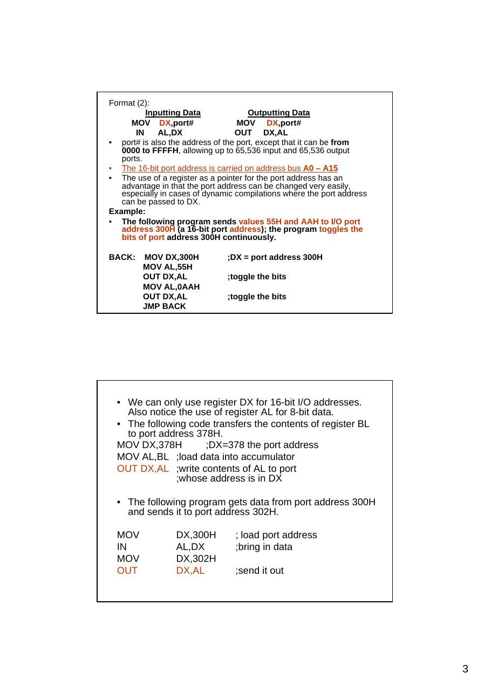
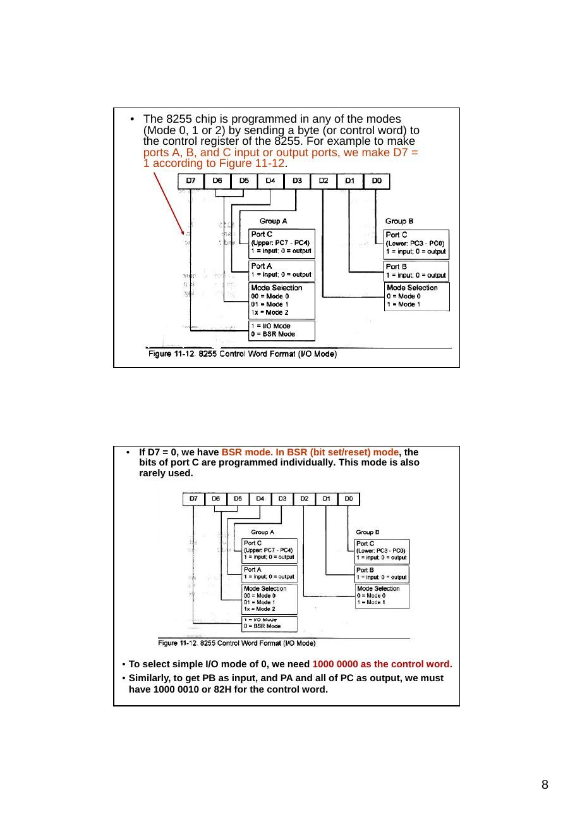

Bu yazı, Başkent Üniversitesi **EEM332 Mikroişlemciler** ders arşivindeki ilgili notları ve uygulamaları bir araya getiriyor (2005–2016). Bellek eşlemeli ve yalıtılmış giriş-çıkış, polling, kesme servis yordamları ve programlanabilir çevrebirimler. Belgelerin PDF arşiv kopyaları ve varsa kaynak kodları yazının sonunda ZIP olarak indirilebilir.

## cpu08_2013

### EEM332 Lecture8

Input/Output instructions of 8086 Polling/Interrup

Basic Input/Output Ports

Memory mapped I/O

- Devices and memory share an address space

- I/O looks just like memory read/write

- No special commands for I/O

- Large selection of memory access commands available

Isolated I/O                       • Communicating with I/O devices using IN and OUT instructions is referred to isolated I/O.

- Separate address spaces         • However, there are many microprocessors, such as the

- Need I/O or memory select lines     new RISC processors, that do not have IN and OUT inst

- Special commands for I/O        • In such cases these microprocessors use what is called

memory-mapped I/O.

- Limited set               • In memory-mapped I/O, a memory location is assigned to

be an input or output port.

8088/8086 INPUT/OUTPUT INSTRUCTIONS (Isolated)

- All x86 microprocessors, from the 8088 to the Pentium, can access external

devices called ports using I/0 instructions.

- The x86 CPU is one of the few processors that have I/O space in addition to

memory space.

- Memory can contain both opcodes and data

- I/O ports contain data only. Two instructions: “OUT” and “IN”.

- These instructions can send data from the accumulator (AL or AX) to ports

```asm
or bring data from ports into the accumulator.
```

- In accessing ports, we can use an 8-bit or 16-bit data port.

Format   Inputting data      Outputting data    Adress rang

(1)      IN dast,source      OUT dest, source   00 – FF

```asm
IN AL, port #       OUT port #, AL     A0 –A7
```

(2)      MOV DX, port #      MOV DX, port #     0000 – FFFF

```asm
IN  AL, DX          OUT DX, AL         A0- A15
```

Example : In a given 8088-based system, port

```asm
address 22H is an input port for monitoring the
```

temperature. Write Assembly language instructions to monitor that port continuously for the temperature of 100 degrees. If it reaches 100, then BH should contain ‘Y’. Solution: (format(1)..256 port)

```asm
BACK: IN AL,22H ;get the temperature from port # 22H
CMP AL,100 ;is temp = 100?
JNZ BACK ;if not, keep monitoring
MOV BH,’Y’      ;temp = 100, load ‘Y’ into BH
```

### Format (2)

Inputting Data              Outputting Data

```asm
MOV DX,port#                 MOV DX,port#
IN    AL,DX                OUT DX,AL
```

- port# is also the address of the port, except that it can be from

0000 to FFFFH, allowing up to 65,536 input and 65,536 output ports.

- The 16-bit port address is carried on address bus A0 – A15

- The use of a register as a pointer for the port address has an

advantage in that the port address can be changed very easily, especially in cases of dynamic compilations where the port address can be passed to DX.

### Example

- The following program sends values 55H and AAH to I/O port

```asm
address 300H (a 16-bit port address); the program toggles the
```

bits of port address 300H continuously.

```asm
BACK:    MOV DX,300H           ;DX = port address 300H
MOV AL,55H
OUT DX,AL             ;toggle the bits
MOV AL,0AAH
OUT DX,AL             ;toggle the bits
JMP BACK
```

- We can only use register DX for 16-bit I/O addresses.

Also notice the use of register AL for 8-bit data.

- The following code transfers the contents of register BL

to port address 378H.

```asm
MOV DX,378H         ;DX=378 the port address
MOV AL,BL ;load data into accumulator
OUT DX,AL ;write contents of AL to port
;whose address is in DX
```

- The following program gets data from port address 300H

```asm
and sends it to port address 302H.
```

```asm
MOV            DX,300H         ; load port address
IN             AL,DX           ;bring in data
MOV            DX,302H
OUT            DX,AL           ;send it out
```

```asm
ADDRESS DECODING AND DESIGN
```

- In every computer, whenever data is sent out by the CPU via the

data bus, the data must be latched by the receiving device.

- While memories have an internal latch to grab the data, a latching

system must be designed for simple I/O ports.

- The 74LS373 can be used for this purpose.

- The concept of address bus decoding for I/O instructions is exactly

### the same as for memory. The following are the steps

### 1. The control signals IOR and lOW are used along with the decoder.

### 2. For an 8-bit port address, A0 – A7 is decoded.

### 3. If the port address is 16-bit (using DX), A0 - Al5 is decoded.

Examples: Simple ports

Design for “OUT 99H,AL”

EXAMPLES:Input port By using Buffer (74LS244)

The design of “IN AL,9FH” using the 74LS244 as a tri-state buffer is depicted below.

Input port design using the Octal buffer74LS244

- When data is coming in by way of a

data bus, it must come in through a three-state (tri-state) buffer.

- A tri-state buffer is internal and

therefore invisible.

- For the simple input ports we use

the 74LS244 chip.

- 1G and 2G each control only 4 bits

of the 74LS244, they both must be activated for the 8-bit input

8255 PPI CHIP ( Parallel Peripheral Interface)

- One of the most widely used I/O

chips.

- It is a 40-pin DIP chip and has

three separately accessible ports, A, B, and C, which can be programmed, hence the name PPI (programmable peripheral interface).

- The individual ports can be

programmed to be input or output.

- They can also be changed

dynamically, in contrast to the 74LS244 and 74LS373, which are hard-wired.

Port A (PA0 – PA7) (8-bit port)                   8255 PPI CHIP

- Port A can be programmed all as I/O port.

Port B (PB0 – PB7) (8-bit port)

- Port B can be programmed all as I/O port

Port C (PC0 – PC7) (8-bit port)

- Port C can programmed all as I/O. It can also

be split into two parts, CU (upper bits PC4 - PC7) and CL (lower bits PC0 – PC3). Each can be used for I/O individually. RD and WR

- If the 8255 is using peripheral I/O design, IOR

```asm
and lOW of the system bus are connected to
```

these two pins. If the port uses memory- mapped I/O, MEMR and MEMW activate them.

### RESET

- This is an active-high signal input into the 8255

used to clear the control register. When RESET is activated, all ports are initialized as input ports. This pin must be connected to the RESET output of the system bus or ground, making it inactive. Like all IC input pins, it should not be left unconnected.

### 8255 PPI CHIP

A0, A1, and CS

- While CS (chip select) selects the

entire chip, address pins A0 and A1 select the specific port within the 8255.

- These three pins are used to access

ports A. B, C, or the control register, as shown in Table

CS   A1     A0         Selects

0     0     0    Port A 0     0     1    Port B 0     1     0    Port C 0     1     1    Control Register

1     x     x    8255 is not selected

Mode selection of the 8255A While ports A, B, and C are used for I/O data, it is the control register that must be programmed to select the operation mode of the three ports A, B, and C. The ports of the 8255 can be programmed in any of the following modes.

### 1. Mode 0, simple I/O mode. In this mode, any of the ports

A, B, CL, and CU can be programmed as input or output.

```asm
In this mode, all bits are out or all are in. In other words,
```

there is no control of individual bits. Mode 0 is the most widely used mode in current system I/O interfacing design.

### 2. Mode 1. In this mode, ports A and B can be used as input

```asm
or output ports with handshaking capabilities. This mode is
not used due to timing incompatibility with devices such as
```

the printer.

### 3. Mode 2. In this mode, port A can be used as a bidirectional

I/O port with handshaking capabilities. This mode is rarely used.

### 4. BSR mode (Bit set/reset)

- The 8255 chip is programmed in any of the modes

(Mode 0, 1 or 2) by sending a byte (or control word) to the control register of the 8255. For example to make ports A, B, and C input or output ports, we make D7 = 1 according to Figure 11-12.

- If D7 = 0, we have BSR mode. In BSR (bit set/reset) mode, the

bits of port C are programmed individually. This mode is also rarely used.

- To select simple I/O mode of 0, we need 1000 0000 as the control word.

- Similarly, to get PB as input, and PA and all of PC as output, we must

have 1000 0010 or 82H for the control word.

Example 11-4: Find the control word if PA = out, PB = in, PC0- PC3 = in, and PC4 - PC7 = out. (Mode 0)

### Solution

From Figure 11-12 we get the control word of 1000 0011 in binary or 83H

### 1 0     0   0   0   0 1    1   = 83H

(b) Find the control byte (word) for this configuration. Port A as input, B as output, and all the bits of port C as output. Solution: (Mode 0) (b) The control word is 90H, or 1001 0000.

### 1 0 0 1 0 0 0 0 = 90H

Example : The 8255 shown in Figure 11-13 is configured as follows: port A as input, B as output, and all the bits of port C as output. (Mode 0) (a) Find the port addresses assigned to A, B, C, and the control register. (b) Find the control byte (word) for this configuration. (Mode 0)

(a) Find the port addresses assigned to A, B, C, and the control register. (a) The port addresses are as follows: (See Table 11-3) CS              A1 A0 Address         Port (Mode 0) 11000100        0    0   310H         Port A 11000100        0    1   311H         Port B 11000100        1    0   312H         Port C 11000100        1    1   313H         Control register

Example 4-5 (Mode 0)

(Mode 0)

BSR Mode

BSR Example 4.7

### Homework

Polling & Interrupts

- 2 techniques are available to service external devices:

- Polling

- Interrupts

### Polling

- CPU periodically polls ALL external devices & takes

action if required

### Interrupts

- external device indicates request for attention by

sending a signal via a control line

- it stops the current CPU activity and responds to the

device that requested attention

### Polling

- if the frequency of polling is high – a significant overhead is

```asm
incurred on a CPU
```

- If, however, the frequency of polling is low - events may be

undetected - data lost due to latency etc.

Polling Run Program

Interrogate device 1

- must be written

```asm
in the main program                                   Action          Yes         Device
```

(by a programmer,                                          ?                  subroutine

```asm
in advance)                                           No
```

Interrogate device 2

Action          Yes         Device ?                  subroutine

No

Interrogate device n

Action          Yes         Device ?                  subroutine

No

Interrupts Run Program                                              Run Program

Interrupt                                               Timer interrupt 0                                  service        Timer                                 response asserted                                                Interrupt routine                                              Program

```asm
return registers                                            return
```

from stack Interrupt                                             Emergency interrupt 1                                  service     Emergency                                 response asserted                                                 button routine      interrupt                               programm

```asm
return registers                                             return
```

from stack

(a)                                                      (b)

### Three kinds

Software interrupts – initiated by the INT instruction Hardware interrupts – originate in peripheral hardware and : Internal interrupts Exceptions – occur in response to error states in the processor





## cpu09_07

Basic Input/Output Ports

Memory mapped I/O

- Devices and memory share an address space

- I/O looks just like memory read/write

- No special commands for I/O

- Large selection of memory access commands available

Isolated I/O                              •  Communicating with I/O devices using IN and OUT instructions is referred to as peripheral I/O or isolated I/O.

- Separate address spaces

- However, there are many microprocessors, such as the new

- Need I/O or memory select lines          RISC processors, that do not have IN and OUT instructions.

- Special commands for I/O              •  In such cases these microprocessors use what is called

memory-mapped I/O.

- Limited set

- In memory-mapped I/O, a memory location is assigned to be

an input or output port.

8088/8086 INPUT/OUTPUT INSTRUCTIONS (Isolated)

- All x86 microprocessors, from the 8088 to the Pentium, can access external

devices called ports using I/0 instructions.

- The x86 CPU is one of the few processors that have I/O space in addition to

memory space.

- Memory can contain both opcodes and data

- I/O ports contain data only. Two instructions: “OUT” and “IN”.

- These instructions can send data from the accumulator (AL or AX) to ports

```asm
or bring data from ports into the accumulator.
```

- In accessing ports, we can use an 8-bit or 16-bit data port.

Format       Inputting data              Outputting data            Adress rang

(1)          IN dast,source              OUT dest, source           00 – FF

```asm
IN AL, port #               OUT port #, AL             A0 –A7
```

(2)          MOV DX, port #              MOV DX, port #             0000 – FFFF

```asm
IN  AL, DX                  OUT DX, AL                 A0- A15
```

Example : In a given 8088-based system, port

```asm
address 22H is an input port for monitoring the
```

temperature. Write Assembly language instructions to monitor that port continuously for the temperature of 100 degrees. If it reaches 100, then BH should contain ‘Y’. Solution: (format(1)..256 port)

```asm
BACK: IN AL,22H ;get the temperature from port # 22H
CMP AL,100 ;is temp = 100?
JNZ BACK ;if not, keep monitoring
MOV BH,’Y’         ;temp = 100, load ‘Y’ into BH
```

### Format (2)

Inputting Data                  Outputting Data

```asm
MOV DX,port#                 MOV DX,port#
IN  AL,DX                   OUT DX,AL
```

- port# is also the address of the port, except that it can be from

0000 to FFFFH, allowing up to 65,536 input and 65,536 output ports.

- The 16-bit port address is carried on address bus A0 – A15

- The use of a register as a pointer for the port address has an advantage in

that the port address can be changed very easily, especially in cases of dynamic compilations where the port address can be passed to DX.

### Example

- The following program sends values 55H and AAH to I/O port address

300H (a 16-bit port address); the program toggles the bits of port

```asm
address 300H continuously.
BACK: MOV DX,300H ;DX = port address 300H
MOV AL,55H
OUT DX,AL                 ;toggle the bits
MOV AL,0AAH
OUT DX,AL                 ;toggle the bits
JMP BACK
```

- We can only use register DX for 16-bit I/O addresses.

Also notice the use of register AL for 8-bit data.

- The following code transfers the contents of register BL

to port address 378H.

```asm
MOV DX,378H         ;DX=378 the port address
MOV AL,BL ;load data into accumulator
OUT DX,AL ;write contents of AL to port
;whose address is in DX
```

- The following program gets data from port address 300H

```asm
and sends it to port address 302H.
MOV          DX,300H        ; load port address
IN           AL,DX          ;bring in data
MOV          DX,302H
OUT          DX,AL          ;send it out
```

```asm
ADDRESS DECODING AND DESIGN
```

- In every computer, whenever data is sent out by the CPU via the

data bus, the data must be latched by the receiving device.

- While memories have an internal latch to grab the data, a latching

system must be designed for simple I/O ports.

- The 74LS373 can be used for this purpose.

- The concept of address bus decoding for I/O instructions is exactly

### the same as for memory. The following are the steps

### 1. The control signals IOR and lOW are used along with the decoder.

### 2. For an 8-bit port address, A0 – A7 is decoded.

### 3. If the port address is 16-bit (using DX), A0 - Al5 is decoded.

Design for “OUT 99H,AL”

EXAMPLES:Input port By using Buffer (74LS244)

The design of “IN AL,9FH” using the 74LS244 as a tri-state buffer is depicted below.

Input port design using the Octal buffer74LS244

- When data is coming in by way of a

data bus, it must come in through a three-state (tri-state) buffer.

- A tri-state buffer is internal and

therefore invisible.

- For the simple input ports we use

the 74LS244 chip.

- 1G and 2G each control only 4 bits

of the 74LS244, they both must be activated for the 8-bit input

### 8255 PPI CHIP

- One of the most widely used I/O

chips.

- It is a 40-pin DIP chip and has

three separately accessible ports, A, B, and C, which can be programmed, hence the name PPI (programmable peripheral interface).

- The individual ports can be

programmed to be input or output.

- They can also be changed

dynamically, in contrast to the 74LS244 and 74LS373, which are hard-wired.

Port A (PA0 – PA7) (8-bit port)                 8255 PPI CHIP

- Port A can be programmed all as I/O port.

Port B (PB0 – PB7) (8-bit port)

- Port B can be programmed all as I/O port

Port C (PC0 – PC7) (8-bit port)

- Port C can programmed all as I/O. It can also

be split into two parts, CU (upper bits PC4 - PC7) and CL (lower bits PC0 – PC3). Each can be used for I/O individually. RD and WR

- If the 8255 is using peripheral I/O design, IOR

```asm
and lOW of the system bus are connected to
```

these two pins. If the port uses memory- mapped I/O, MEMR and MEMW activate them.

### RESET

- This is an active-high signal input into the 8255 used

to clear the control register. When RESET is activated, all ports are initialized as input ports. This pin must be connected to the RESET output of the system bus or ground, making it inactive. Like all IC input pins, it should not be left unconnected. This pin can be grounded.

- 

### 8255 PPI CHIP

A0, A1, and CS

- While CS (chip select) selects the

entire chip, address pins A0 and A1 select the specific port within the 8255.

- These three pins are used to access

ports A. B, C, or the control register, as shown in Table

CS     A1     A0            Selects

0      0      0     Port A 0      0      1     Port B 0      1      0     Port C 0      1      1     Control Register

1      x      x     8255 is not selected

Mode selection of the 8255A While ports A, B, and C are used for I/O data, it is the control register that must be programmed to select the operation mode of the three ports A, B, and C. The ports of the 8255 can be programmed in any of the following modes.

### 1. Mode 0, simple I/O mode. In this mode, any of the ports

A, B, CL, and CU can be programmed as input or output.

```asm
In this mode, all bits are out or all are in. In other words,
```

there is no control of individual bits. Mode 0 is the most widely used mode in current system I/O interfacing design.

### 2. Mode 1. In this mode, ports A and B can be used as input

```asm
or output ports with handshaking capabilities. This mode is
not used due to timing incompatibility with devices such as
```

the printer.

### 3. Mode 2. In this mode, port A can be used as a bidirectional

I/O port with handshaking capabilities. This mode is rarely used.

### 4. BSR mode (Bit set/reset)

- The 8255 chip is programmed in any of the modes

(Mode 0, 1 or 2) by sending a byte (or control word) to the control register of the 8255. For example to make ports A, B, and C input or output ports, we make D7 = 1 according to Figure 11-12.

- If D7 = 0, we have BSR mode. In BSR (bit set/reset) mode, the

bits of port C are programmed individually. This mode is also rarely used.

- To select simple I/O mode of 0, we need 1000 0000 as the control

word.

- Similarly, to get PB as input, and PA and all of PC as output, we

must have 1000 0010 or 82H for the control word.

Example 11-4: Find the control word if PA = out, PB = in, PC0- PC3 = in, and PC4 - PC7 = out.

### Solution

From Figure 11-12 we get the control word of 1000 0011 in binary or 83H

### 1 0    0    0   0   0 1     1   = 83H

(b) Find the control byte (word) for this configuration. Port A as input, B as output, and all the bits of port C as output.

### Solution

(b) The control word is 90H, or 1001 0000.

### 1 0 0 1 0 0 0 0 = 90H

Example : The 8255 shown in Figure 11-13 is configured as follows: port A as input, B as output, and all the bits of port C as output. (a) Find the port addresses assigned to A, B, C, and the control register. (b) Find the control byte (word) for this configuration.

(a) Find the port addresses assigned to A, B, C, and the control register. (a) The port addresses are as follows: (See Table 11-3) CS              A1 A0 Address         Port 11000100        0    0   310H         Port A 11000100        0    1   311H         Port B 11000100        1    0   312H         Port C 11000100        1    1   313H         Control register

Example 4-5

Example 4-6

BSR Mode

BSR Example 4.7

### Homework

Polling & Interrupts

- 2 techniques are available to service external devices:

- Polling

- Interrupts

### Polling

- CPU periodically polls ALL external devices & takes action if required

- Interrupts:

- external device indicates request for attention by sending a signal via

a control line

- it stops the current CPU activity and responds to the device that

requested attention

### Polling

- if the frequency of polling is high – a significant overhead is incurred

on a CPU

- If, however, the frequency of polling is low - events may be

undetected - data lost due to latency etc.

Polling Run Program

Interrogate device 1

- must be written

Yes

```asm
in the main
```

Action             Device ?          subroutine

program (by a                                    No

Interrogate programmer, in                                   device 2

advance)                                          Action    Yes      Device ?          subroutine

No

Interrogate device n

Action    Yes      Device ?          subroutine

No

Interrupts Run Program                                            Run Program

Interrupt                                         Timer interrupt 0                                  service       Timer                            response asserted                                               Interrupt routine                                        Program

```asm
return registers                                          return
```

from stack Interrupt                                       Emergency interrupt 1                                  service    Emergency                            response asserted                                                button routine     interrupt                          programm

```asm
return registers                                          return
```

from stack

(a)                                                    (b)

### Three kinds

Software interrupts – initiated by the INT instruction Hardware interrupts – originate in peripheral hardware Exceptions – occur in response to error states in the processor

## cpu09_06

Memory mapped I/O

- Devices and memory share an address space

- I/O looks just like memory read/write

- No special commands for I/O

- Large selection of memory access commands available

Isolated I/O                             • Communicating with I/O devices using IN and OUT instructions is referred to as peripheral I/O or isolated I/O.

- Separate address spaces

- However, there are many microprocessors, such as the new

- Need I/O or memory select lines          RISC processors, that do not have IN and OUT instructions.

- Special commands for I/O             •   In such cases these microprocessors use what is called

memory-mapped I/O.

- Limited set

- In memory-mapped I/O, a memory location is assigned to be

an input or output port.

### 8088 INPUT/OUTPUT INSTRUCTIONS

- All x86 microprocessors, from the 8088 to the Pentium, can access external

devices called ports using I/0 instructions.

- The x86 CPU is one of the few processors that have I/O space in addition to

memory space.

- Memory can contain both opcodes and data

- I/O ports contain data only. Two instructions: “OUT” and “IN”.

- These instructions can send data from the accumulator (AL or AX) to ports

```asm
or bring data from ports into the accumulator.
```

- In accessing ports, we can use an 8-bit or 16-bit data port.

Format   Inputting data      Outputting data     Adress rang

(1)      IN dast,source      OUT dest, source    00 – FF

```asm
IN AL, port #       OUT port #, AL      A0 –A7
```

(2)      MOV DX, port #      MOV DX, port #      0000 – FFFF

```asm
IN  AL, DX          OUT DX, AL          A0- A15
```

8-bit data ports

- The 8-bit port uses the D0 - D7 data bus to

communicate with I/O devices.

### Instructions OUT and IN have the following formats

Inputting Data                     Outputting Data

```asm
IN AL,port#                     OUT port#,AL
```

- 

port# is the address of the port and can be from 00 to FFH.

- This 8-bit address allows 256 input ports and 256

output ports.

- In this format, the 8-bit port address is carried on

```asm
address bus A0 - A7.
MOV AL,36H           ;AL=36H
OUT 43H,AL           ;send value 36H to port address 43H
```

Example : In a given 8088-based system, port

```asm
address 22H is an input port for monitoring the
```

temperature. Write Assembly language instructions to monitor that port continuously for the temperature of 100 degrees. If it reaches 100, then BH should contain ‘Y’.

### Solution

```asm
BACK: IN AL,22H ;get the temperature from port # 22H
CMP AL,100 ;is temp = 100?
JNZ BACK ;if not, keep monitoring
MOV BH,’Y’   ;temp = 100, load ‘Y’ into BH
```

### Format

Inputting Data                Outputting Data (2)     MOV DX,port#              MOV     DX,port#

```asm
IN AL,DX                 OUT     DX,AL
```

- port# is also the address of the port, except that it can be from

0000 to FFFFH, allowing up to 65,536 input and 65,536 output ports.

- The 16-bit port address is carried on address bus A0 – A15

- The use of a register as a pointer for the port address has an advantage in

that the port address can be changed very easily, especially in cases of dynamic compilations where the port address can be passed to DX.

### Example

- The following program sends values 55H and AAH to I/O port address

300H (a 16-bit port address); the program toggles the bits of port

```asm
address 300H continuously.
BACK: MOV DX,300H          ;DX = port address 300H
MOV AL,55H
OUT DX,AL                 ;toggle the bits
MOV AL,0AAH
OUT DX,AL                 ;toggle the bits
JMP BACK
```

- We can only use register DX for 16-bit I/O addresses.

Also notice the use of register AL for 8-bit data.

- The following code transfers the contents of register BL

to port address 378H.

```asm
MOV DX,378H         ;DX=378 the port address
MOV AL,BL ;load data into accumulator
OUT DX,AL ;write contents of AL to port
;whose address is in DX
```

- The following program gets data from port address 300H

```asm
and sends it to port address 302H.
MOV          DX,300H                ;load port address
IN           AL,DX          ;bring in data
MOV          DX,302H
OUT          DX,AL          ;send it out
```

```asm
ADDRESS DECODING AND DESIGN
```

- In every computer, whenever data is sent out by the

CPU via the data bus, the data must be latched by the receiving device.

- While memories have an internal latch to grab the data,

a latching system must be designed for simple I/O ports.

- The 74LS373 can be used for this purpose.

- The concept of address bus decoding for I/O instructions

is exactly the same as for memory. The following are the

### steps

### 1. The control signals IOR and lOW are used along with the

```asm
decoder.
```

### 2. For an 8-bit port address, A0 – A7 is decoded.

### 3. If the port address is 16-bit (using DX), A0 - Al5 is

```asm
decoded.
```

Design for “OUT 99H,AL”

### EXAMPLES

```asm
IN port design using the 74LS244
```

- When data is coming in

by way of a data bus, it must come in through a three-state buffer.

- This is referred to as

tristated, which comes from the term tri-state buffer.

- A tri-state buffer is

internal and therefore invisible.

- For the simple input ports

we use the 74LS244 chip. See Figure 11-4.

- Notice that since 1G and

2G each control only 4 bits of the 74LS244, they      74LS244 Octal Buffer both must be activated for the 8-bit input

The design of “IN AL,9FH” using the 74LS244 as a tri-state buffer is depicted below.

### 8255 PPI CHIP

- One of the most widely used I/O

chips.

- It is a 40-pin DIP chip and has

three separately accessible ports, A, B, and C, which can be programmed, hence the name PPI (programmable peripheral interface).

- The individual ports can be

programmed to be input or output.

- They can also be changed

dynamically, in contrast to the 74LS244 and 74LS373, which are hard-wired.

### 8255 PPI CHIP

Port A (PA0 – PA7) (8-bit port)

- Port A can be programmed all as

input or all as output. Port B (PB0 – PB7) (8-bit port)

- Port B can be programmed all as

input or all as output. Port C (PC0 – PC7) (8-bit port)

- Port C can be all input or all

output. It can also be split into two parts, CU (upper bits PC4 - PC7) and CL (lower bits PC0 – PC3). Each can be used for input

```asm
or output. Any of PC0 to PC7 can
```

be programmed individually.

### 8255 PPI CHIP

RD and WR

- If the 8255 is using peripheral I/O

design, IOR and lOW of the system bus are connected to these two pins.

- If the port uses memory-mapped I/O,

MEMR and MEMW activate them.

### RESET

- This is an active-high signal input

into the 8255 used to clear the control register. When RESET is activated, all ports are initialized as input ports. This pin must be connected to the RESET output of the system bus or ground, making it inactive. Like all IC input pins, it should not be left unconnected. This pin can be grounded.

### 8255 PPI CHIP

A0, A1, and CS

- While CS (chip select) selects the

entire chip, address pins A0 and A1 select the specific port within the 8255.

- These three pins are used to access

ports A. B, C, or the control register, as shown in Table

CS    A1     A0         Selects

0     0     0    Port A 0     0     1    Port B 0     1     0    Port C 0     1     1    Control Register

1     x     x    8255 is not selected

Mode selection of the 8255A While ports A, B, and C are used for I/O data, it is the control register that must be programmed to select the operation mode of the three ports A, B, and C. The ports of the 8255 can be programmed in any of the following modes.

### 1. Mode 0, simple I/O mode. In this mode, any of the ports A,

B, CL, and CU can be programmed as input or output. In this mode, all bits are out or all are in. In other words, there is no control of individual bits. Mode 0 is the most widely used mode in current system I/O interfacing design.

### 2. Mode 1. In this mode, ports A and B can be used as input

```asm
or output ports with handshaking capabilities. This mode is
not used due to timing incompatibility with devices such as
```

the printer.

### 3. Mode 2. In this mode, port A can be used as a bidirectional

I/O port with handshaking capabilities. This mode is rarely used.

- The 8255 chip is programmed in any of the modes

(Mode 0, 1 or 2) by sending a byte (or control word) to the control register of the 8255. For example to make ports A, B, and C input or output ports, we make D7 = 1 according to Figure 11-12.

- Notice from Figure 11-12 that we must set D7 = 1 to get the above

I/O modes of 0,1, and 2. If D7 = 0, we have BSR mode. In BSR (bit set/reset) mode, the bits of port C are programmed individually. This mode is also rarely used.

- To select simple I/O mode of 0, we need 1000 0000 as the control

word.

- Similarly, to get PB as input, and PA and all of PC as output, we must

have 1000 0010 or 82H for the control word.

Example 11-4: Find the control word if PA = out, PB = in, PC0- PC3 = in, and PC4 - PC7 = out.

### Solution

From Figure 11-12 we get the control word of 1000 0011 in binary or 83H

### 1 0    0   0   0   0 1   1   = 83H

(b) Find the control byte (word) for this configuration. Port A as input, B as output, and all the bits of port C as output.

### Solution

(b) The control word is 90H, or 1001 0000.

### 1 0 0 1 0 0 0 0 = 90H

Example : The 8255 shown in Figure 11-13 is configured as follows: port A as input, B as output, and all the bits of port C as output. (a) Find the port addresses assigned to A, B, C, and the control register. (b) Find the control byte (word) for this configuration.

(a) Find the port addresses assigned to A, B, C, and the control register. (a) The port addresses are as follows: (See Table 11-3) CS             A1 A0 Address         Port 11000100       0    0    310H        Port A 11000100       0    1    311H        Port B 11000100       1    0    312H        Port C 11000100       1    1    313H        Control register

Example 4-5

Example 4-6

BSR Mode

BSR Example 4.7

### Homwork

Polling & Interrupts

- 2 techniques are available to service external devices:

- Polling

- Interrupts

### Polling

- CPU periodically polls ALL external devices & takes action if required

- Interrupts:

- external device indicates request for attention by sending a signal via

a control line

- it stops the current CPU activity and responds to the device that

requested attention

### Polling

- if the frequency of polling is high – a significant overhead is incurred

on a CPU

- If, however, the frequency of polling is low - events may be

undetected - data lost due to latency etc.

Polling Run Program

Interrogate device 1

- must be written

Action       Yes       Device

```asm
in the main                                 ?         subroutine
```

program (by a                      No

Interrogate

programmer, in                   device 2

advance)                           Action       Yes       Device ?         subroutine

- high level                         No

language used                 Interrogate device n

Action       Yes       Device ?         subroutine

No

Interrupts Run Program                                               Run Program

Interrupt                                          Timer interrupt 0                                                   Timer service                                         response asserted                                                  Interrupt routine                                          Program

```asm
return registers                                          return
```

from stack Interrupt                                       Emergency interrupt 1                                                 Emergency                            response service asserted                                                    button routine                                        programm interrupt

```asm
return registers                                          return
```

from stack

(a)                                                       (b)

### Three kinds

Software interrupts – initiated by the INT instruction Hardware interrupts – originate in peripheral hardware Exceptions – occur in response to error states in the processor

## CPU11_07

Polling & Interrupts

- 2 techniques are available to service external devices:

- Polling

- Interrupts

- Polling: CPU periodically polls ALL external devices & takes

action if required. if the frequency of polling is high – a significant overhead is incurred on a CPU

- If, however, the frequency of polling is low - events may be

undetected - data lost due to latency etc.

- 

- Interrupts: external device indicates request for attention by

sending a signal via a control line it stops the current CPU activity

```asm
and responds to the device that requested attention
```

Interrupt service routine (ISR) For every interrupt there must be a program associated with it. When an interrupt is invoked it si asked to run a program to perform a certain service. This program is commonly referred to as an interrupt service routine

### (ISR).

Interrupts:   a) Non-vectored (Microchip microcontrollers)

- uses fixed address in the memory at which the interrupt service

routine (ISR) is located

- when an interrupt occurs – a Program Counter register is loaded

with this address

- on completion, the last value in the Program Counter is restored and

the control is handed over back to the CPU b) Vectored ( 8086)

- Interrupt Vector:

- Is a pointer to a memory location whose content is a start address of the ISR

- The address of the vector itself is fixed but its content may be any address

value

- It offers flexibility to a programmer

- Vector is a pointer (address) into Interrupt Vector Table, IVT

- IVT is stored in memory from 0000:0000 to 0000:03ffh

The address pointer table is located at the lowaddress end of the memory

```asm
address space. It starts at (00000)16 and ends at (003FE)16. This represents
```

the first 1 Kbytes of memory.

```asm
In 80x86 PCs, the memory location to which an interrupt goes is always four times the
```

value of the interrupt number. For example, INT 03 will go to adress 0000CH (4 x 3) = 12 = 0CH). Table is a parital list of the interrupt vactor table. For every interrupt there are allocated four bytes of memory in the interrupt vector table. Two bytes are for the IP and the other two are for the CS of the ISR. These four memory locations provide addresses of the interrupt service routine for which the interrupt was invoked. Thus the lowest 1024 bytes (256 x 4 = 1024) of memory space are set aside for the interrupt vector table and must not be used for any other function.

```asm
INT               Physical       Logical             Regardless of source, they are
```

NUMBER            Adress         Adress              handled the same Each interrupt has a unique interrupt

```asm
INT 00            00000          0000:0000           number from 0 to 255. These are
```

called interrupt vectors.

```asm
INT 01            00004          0000:0004
INT 02            00008          0000:0008           For each interrupt vector, there is an
```

entry in the interrupt vector table.

```asm
INT 03            0000C          0000:000C           The interrupt vector table is simply a
INT 04            00010          0000:0010           jump table containing segment:offset
addresses of procedures to handle
INT 05            00014          0000:0014           each interrupt
```

…                 …              …                   These procedures are called interrupt handlers or interrupt service

```asm
INT FF            003FC          0000:03FC           routines (ISR’s)
```

Run Program Interrupts                Run Program

Interrupt                                            Timer interrupt 0                                      service       Timer                             response asserted                                                  Interrupt routine                                          Program

```asm
return registers                                           return
```

from stack Interrupt                                        Emergency interrupt 1                                       service    Emergency                            response asserted                                                     button routine      interrupt                          programm

```asm
return registers                                           return
```

from stack

```asm
In general there(a)are three kindsof interrupts in 8086:                            (b)
```

- internal interrupts: – occur in response to error states in the processor

- Software interrupts – initiated by the INT instruction

- Hardware interrupts – originate in peripheral hardware

```asm
In the 8086/88 there are a total of 256 interrupts: INT 00, INT 01,                              , INT FF
```

Regardless of source, they are handled the same –Each interrupt has a unique interrupt number from 0 to 255. These are called interrupt vectors. –For each interrupt vector, there is an entry in the interrupt vector table. –The interrupt vector table is simply a jump table containing segment:offset addresses of procedures to handle each interrupt –These procedures are called interrupt handlers or interrupt service routines (ISR’s)

internal interrupts: INT 00 to INT 04 which have predefined functions. They are ‘’INT 00’’ (divide error), ‘’INT 01’’ (single step), ‘’INT 03’’ (breakpoint), and ‘’INT 04’’ (signed number overflow). Sofware interrupts If an ISR is called upon as result of the execution of an 80x86 instruction such as ‘’INT nn’’, it is referred to as a software interrupt since it was invoked from saftware, not from external hardware. IN IBM PC many of the interrupts in this category are used by the MS DOS operating system and BIOS to perform essential tasks that evey computer must provide to the system

```asm
and user.
```

“INT nn” is 2 byte instruction. The first is opcode and the second byte is the interrupt number

```
0000:0000                                                                                    IP LSB
0000:0001                   Offset
```

### IP MSB

```
0000:0002                                            Interrupt 0
```

### CS LSB

```
0000:0003                 Segment
```

### CS MSB

```
0000:0004
0000:0005                   Offset
0000:0006                                            Interrupt 1           Given a Vector, where is the
0000:0007                 Segment                                          ISR address stored in memory ?
```

Offset  Type  4

```asm
Example:                   int 36h
```

```
0000:03fc
```

Offset = (544) = 216

```
0000:03fd                   Offset                                                       = 00d8h
0000:03fe                                            Interrupt 255
```

Example

```
0000:03ff                  Segment                                          Find the physical and logical address in the interrupt
```

### vactor table associated with

(a) INT 12H     (b) INT 8 (a) The physical address for INT 12H are 00048H – 0004BH since (4 x 12H = 48H). that means that the physical memory locations 48H, 49H, 4AH, and 4BH are set aside for the CS and IP of the ISR belonging to INT 12H. the logical address is 0000:0048 –

```
0000:004BH.
```

(b) For INT 8, we have 8 x 4 = 32 = 20H; therefore, memory address 00020H, 00021H, 00022H, and 00023H in the interrupt vector table hold the CS:IP of the INT 8 ISR. The logical address is 0000:0020H – 0000:0023H.

```asm
INT 00 (divide error)
MOV    AL, 92
SUB    BL,BL
DIV   BL
```

```asm
INT 01 (single step)
INT 02 nonmaskable interrupt: It is an active high input (5 volt) Adress 0008
INT 03 ( Breakpoint interrupt) Stop after execution of a group of instruction
```

```asm
INT 04 (signed number overflow).
```

There is an instruction associated with this, INTO (interrup on overflow).If this instruction is placed after a signed number arithmatic such IMUL or

```asm
ADD, the cpu will activate INT04 if OF = 1.IN case where OF = 0 the INTO
```

is not execuated but is bypassed and acts as NOP (no operation) instruction.

```asm
MOV        AL, DATA1
MOV        BL,DATA2
ADD        AL,BL
INTO
```

### Interrupts and flag register

```asm
In flag register, there are two bits that are associated with the interrup: IF
```

(interrupt enable flag) and TF (trap flag). OF(overflow flag ) canbe used by interrupt

```asm
INT 01 (single step)
PUSHF
```

After execution of each instruction, the 8086/88 automatically

```asm
POP     AX
jumps to physical location 00004 to fetch the 4 bytes for CS:IP
```

of the interrupt service routine, whose job is, among other       AND     AX; FEFFH

things, to dump the registers onto the screen.                    PUSH    AX

Trap flag set or reset?                                           POPF

Hardware interrupts. There pins in the 80x86 that are associated with hardware interrupts.

- INTR (interrupt request),

- NMI (nonmaskable interrupt),

- INTA (interrupt acknowledge)

INTR is an input signal into the CPU which can be masked (ignored) and unmasked through the use of instructions CLI and STI. NMI, which is also an input signal into the CPU, cannot be masked and unmasked using instructions CLI and STI, and for this reason it is called a nonmaskable interrupt. When either of these interrupts is activated, the 80x86 finishes the instruction which it is executing, pushes FR and the CS:IP of the next instruction onto the stack, then jumps to a fixed location in the interrupt vector table and fetches the CS:IP for the interrupt service routine (ISR) associated with that interrupt. At the

```asm
end of the ISR, the IRET instruction causes the CPU to get (pop) back its original
```

FR and CS: IP from the stack, thereby forcing the CPU to continue at the instruction where it left off when the interrupt came in.

Processing interrupts When the 8088/86 processes any interrupt (software or hardware), it goes through the following steps.

### 1. The flag registor (FR) is pushed onto the stack

### 2. IF (interrupt enable flag) and TF (trap flag) are both cleared (IF = 0 and TF = 0).

This masks (causes the system to ignore) interrupt requests from the INTR pin and disables single-stepping while the CPU is executing the interrupt service routine. Depending on the nature of the interrupt procedure, a programmer can unmask the INTR pin by the STI instruction.

### 3. The current CS is pushed onto the stack and SP is decremented by 2.

### 4. The current IP is pushed onto the stack and SP is decremented by 2.

### 5. The INT number (type) is multiplied by 4 to get the physical address of the location

within the vector table to fetch the CS and IP of the interrupt service routine.

### 6. From the new CS: IP, the CPU starts to fetch and execute instructions belonging to

the ISR program.

### 7. The last instruction of the interrupt service routine must be IRET, to get IP, CS, and

FR back from the srack and mack the CPU run the code where it left off.

External Hardware-Interrupt Sequence

Sequences of hardware interrupts with the 8259

### 1. After an IR is activated, the 8259 will respond by putting a high on INTR, thereby signaling the CPU for an interrupt

request.

### 2. The 8288 issues the first INTA to the 8259

### 3. The 8259 receives the first INTA and does internal housekeeping, which includes resolution of priority (if more than one

IR has been activated) and resolution of cascading.

### 4. The second INTA pulse makes the 8259 to put a single interrupt vector byte on the data bus which the 8088/86 will latch

```asm
in.
```

### 5. The 8088/86 uses this byte to calculate the vector location, which is four times the value of the INT type.

### INTR and NMI

The 80x86 processors have just two hardware interrupt pins. These are labeled INTR

```asm
and NMI. NMI is nonmaskable interrupt, which means it cannot be blocked-the
```

processor must respond to it. For this reason the NMI input is usually reserved for critical system functions, for example, saving the processor state when a power failure is eminent. INTR, on the other hand, is maskable via the IF flag. The 82C59A is known as a programmable interrupt controller or PIC. The operation of the PIC is programmable under software control. The 82C59A can be cascaded to expand from 8 to 64 interrupt inputs. Programmable Interrupt Controller NMI Requesting (part of chipset) Device

### NMI

8086 CPU                                                       Intel

### INTR

Interrupt Logic                                 8259A

Divide   Single                         PIC

```asm
int      into     Error     Step
```

Software              Traps

8086 External Interrupt Connections and The 80x86 Interrupt Interface

```asm
INT Request (INTR)
```

80x86              INT Acknowledge (INTA) Some device processor Data bus

INTR and NMI. The 80x86 processors have just two hardware interrupt pins. INTR is used to expand the number of hardware interrupts and should be allowed to use any ‘’INT nn’’ which has not been previously assigned. The 8259 programmable interrupt controller (PIC) chip can be connected to INTR to expand the number of hardware interrupts up to 64.

- Device generates request signal

- Device supplies interrupt vector number on data bus

- Processor completes the execution of current instruction and

executes ISR corresponding to the interrupt vector number on the data bus

- ISR upon completion acknowledges the interrupt by asserting the

INTA signal

The 8259 PIC 1                                   •   IRQ 0: Timer (triggered 18.2/second) 2                      Interrupt    •   IRQ 1: Keyboard (keypress) 3                    outputs from   •   IRQ 2: Slave PIC peripheral    •   IRQ 3: Serial Ports (Modem, network) 8259         5                       devices

- IRQ 5: Sound card

- IRQ 6: Floppy (read/write completed)

PIC          6                                   •   IRQ 8: Real-time Clock 7                                   •   IRQ 12: Mouse INTR                                    •   IRQ 13: Math Co-Processor

- IRQ 14: IDE Hard-Drive Controller

INTA                       80x86

```asm
INT#
```

Typical System Configuration                                        0   IRQ8 Base vector is 08h                        1   IRQ9 Slave           2   IRQ10

### 0   IRQ0

### 8259            3   IRQ11

### 1   IRQ1                    4   IRQ12

Master        2                           5   IRQ13

### INTR

80x86               8259          3   IRQ3                    6   IRQ14

### 4   IRQ4                    7   IRQ15

### INTR          5   IRQ5

6   IRQ6    Base vector is 68h

### 7   IRQ7

Basic Operation.Of 8259A Before the PIC can be used, the interrupt type numbers must be programmed. In addition, the operating mode and priority scheme must be selected. These software codes are writen via the 8-bit bidirectioal data bus lines. İf an interrupt request occurs that is of a higher priority than that currently being serviced (if any), the PIC drives its INT output high. Assuming IF (the processor’s interrupts enabled flag) is set, the processor finishes the current imstruction and responds by outputting the first of two INTA pulses. This pulse freezes (stores) all interrupt requests within the PIC in a special interrupt request register (IRR). The interrupt signal can now be removed. When the second INTA pulse is received by the PIC.

The PIC then outputs a type number corresponding to the active IR input. This number is multiplied by four within the processor and then used a pointer into the interrupt vector table located.

(Servicing an Interrupt With 8259)

- Complete current instruction                   •   Execute Interrupt Service Routine

- Preserve current context                            – usually the handler immediately

re-enables the interrupt system

- PUSHF Store flags to stack                          (to allow higher priority

- Clear Trap Flag (TF) & Interrupt                    interrupts to occur) (STI

Flag (IF)                                          instruction)

- Store return address to stack                    – process the interrupt

```asm
PUSH CS, PUSH IP                           • Indicate End-Of-Interrupt (EOI) to
```

- Identify Source                                    8259 PIC

- Read 8259 PIC status register                          mov al, 20h

- Determine which device (N)                             out 20h, al

triggered                                  ;transfers the contents of AL to I/O port interrupt                                      20h

- Activate Interrupt Service Routine             • Return (IRET)

- Use N to index vector table                      – POP IP (Far Return)

- Read CS/IP from table                            – POP CS

- Jump to instruction                              – POPF (Restore Flags)

Sequence of operation in interrupt               4- Push flags, CS, and IP onto stack 1- Normal processing                             5- Branch to ISR 2- Interrupt occurs                              6- Execute ISR 3- Finish current instruction and clear IF and TF 7- Pop flags, CS, and IP from stack 8- Normal processing resumes

Interrupt Priority

- Each interrupts is given a different priority level by assigning it a type

number. Type 0 identifies the highest-priority interrupt, and type 255 identifies the

- lowest-priority interrupt.

- Lower interrupt vectors have higher priority

- Lower priority interrupts normally cannot interrupt higher priority interrupts

- ISR for INT 21h is running

- Computer gets request from device attached to IRQ8 (INT 78h)

- INT 21h procedure must finish before IRQ8 device can be serviced

- ISR for INT 21h is running

- Computer gets request from Timer 0 IRQ0 (INT 8h)

- Code for INT 21h gets interrupted, ISR for timer runs immediately, INT21h finishes

afterwards

- Priority. On the PC, the PIC is operated in the fully nested mode. This means that

the lowest numbered IRQ input has highest priority. Interrupts of a lower priority will

```asm
not be acknowledged by the PIC (and therefore not forwarded to the processor)
```

until the higher priority interrupts have been serviced.

### For example 

Difference between INT and CALL instructions

### 1. A ‘’CALL ’’ instruction can jump to any location within the 1 megabyte address

range of the 8088/86 CPU, but ‘’INT nn’’ goes to a fixed memory location in the interrupt vector table to get the address of the interrupt service routine.

### 2. A ‘’CALL’’ instruction is used by the programmer in the sequence of

instructions in the program but an externally activated hardware interrupt can come in at any time, requesting the attention of the CPU.

### 3. A ‘’CALL’’ instruction cannot be masked (disabled), but ‘’INT nn’’ belonging to

externally activated hardware interrupts can be masked.

### 4. A ‘’CALL’’ instruction automatically saves only CS:IP of the next instruction on

the stack, while ‘’INT nn’’ saves FR (flag register) in addition to CS:IP of the next instruction.

### 5. At the end of the subroutine that has been called by the ‘’CALL’’ instruction, the

```asm
RET (return) is the last instruction, whereas the last instruction in the interrupt
```

service routine (ISR) for ‘’INT nn’’ is the instruction IRET (interrupt return). The difference is that RETF pops CS, IP off the stack but the IRET pops off the FR (flag register) in addition to CS and IP.

## CPU11

Polling Run Program

- must be written in the main

Interrogate program (by a programmer, in                 device 1 advance)

Action       Yes       Device ?         subroutine

No

Interrogate device 2 Interrupts provide a mechanism for quickly changing program environment. Transfer of program                   Action       Yes       Device control is initiated by the occurrence of                   ?         subroutine

either an event internal to the MPU or             No an event in its external hardware. The Interrogate section of program to which control is device n passed is called the interrupt service routine.(ISR)                                      Action       Yes       Device ?         subroutine

No

Run Program Interrupts                Run Program

Interrupt                                           Timer interrupt 0                                                     Timer service                                          response asserted                                                   Interrupt routine                                           Program

```asm
return registers                                           return
```

from stack Interrupt                                        Emergency interrupt 1                                                  Emergency                            response service asserted                                                     button routine                                         programm interrupt

```asm
return registers                                           return
```

from stack

```asm
In general there(a)are three kindsof interrupts:           (b)
```

Software interrupts – initiated by the INT instruction internal interrupts: – occur in response to error states in the processor Hardware interrupts – originate in peripheral hardware

```asm
In the 8086/88 there are a total of 256 interrupts: INT 00, INT 01, …, INT FF
```

Regardless of source, they are handled the same –Each interrupt has a unique interrupt number from 0 to 255. These are called interrupt vectors. –For each interrupt vector, there is an entry in the interrupt vector table. –The interrupt vector table is simply a jump table containing segment:offset addresses of procedures to handle each interrupt –These procedures are called interrupt handlers or interrupt service routines (ISR’s) When an interrupt is executed, the microprocessor automatically saves the flag register (FR), the instruction pointer (IP), and the code segment register (CS) on the stack, and goes to a fixed memory location

Interrupts:    a) Non-vectored (Microchip microcontrollers)

- uses fixed address in the memory at which the interrupt service

routine (ISR) is located

- when an interrupt occurs – a Program Counter register is loaded

with this address

- on completion, the last value in the Program Counter is restored and

the control is handed over back to the CPU b) Vectored ( 8086)

- Interrupt Vector:

- Is a pointer to a memory location whose content is a start address of the ISR

- The address of the vector itself is fixed but its content may be any address

value

- It offers flexibility to a programmer

- Vector is a pointer (address) into Interrupt Vector Table, IVT

- IVT is stored in memory from 0000:0000 to 0000:03ffh

The address pointer table is located at the lowaddress end of the memory

```asm
address space. It starts at 0000016 and ends at 003FE16. This represents
```

the first 1 Kbytes of memory.

Sofware interrupts If an ISR is called upon as result of the execution of an 80x86 instruction such as ‘’INT nn’’, it is referred to as a software interrupt since it was invoked from saftware, not from external hardware. IN IBM PC many of the interrupts in this category are used by the MS DOS operating system and BIOS to perform essential tasks that evey computer must provide to the system

```asm
and user.Within this group of interrups There are also same
```

predefined functions associated with some of the interrupts. They are ‘’INT 00’’ (divide error), ‘’INT 01’’ (single step), ‘’INT 03’’ (breakpoint), and ‘’INT 04’’ (signed number overflow). So INT 00 to INT 04 hich have predefined functions, the rest of the interrupts from INT 05 to INT FF can be used to implement either software or hardware interrupts.

### Interrupts and flag register

```asm
In flag register, there are two bits that are associated with the interrup: IF
```

(interrupt enable flag) and TF (trap flag). OF(overflow flag ) canbe used by interrupt

```asm
INT 01 (single step)
PUSHF
```

After execution of each instruction, the 8086/88 automatically

```asm
POP     AX
jumps to physical location 00004 to fetch the 4 bytes for CS:IP
```

of the interrupt service routine, whose job is, among other       AND     AX; FEFFH

things, to dump the registers onto the screen.                    PUSH    AX

Trap flag set or reset?                                           POPF

```asm
In 80x86 PCs, the memory location to which an interrupt goes is always four times the
```

value of the interrupt number. For example, INT 03 will go to adress 0000CH (4 x 3) = 12 = 0CH). Table is a parital list of the interrupt vactor table. For every interrupt there are allocated four bytes of memory in the interrupt vector table. Two bytes are for the IP and the other two are for the CS of the ISR. These four memory locations provide addresses of the interrupt service routine for which the interrupt was invoked. Thus the lowest 1024 bytes (256 x 4 = 1024) of memory space are set aside for the interrupt vector table and must not be used for any other function.

```asm
INT               Physical       Logical            Regardless of source, they are
```

NUMBER            Adress         Adress             handled the same Each interrupt has a unique interrupt

```asm
INT 00            00000          0000:0000          number from 0 to 255. These are
```

called interrupt vectors.

```asm
INT 01            00004          0000:0004
INT 02            00008          0000:0008          For each interrupt vector, there is an
```

entry in the interrupt vector table.

```asm
INT 03            0000C          0000:000C          The interrupt vector table is simply a
INT 04            00010          0000:0010          jump table containing segment:offset
addresses of procedures to handle
INT 05            00014          0000:0014          each interrupt
```

…                 …              …                  These procedures are called interrupt handlers or interrupt service

```asm
INT FF            003FC          0000:03FC          routines (ISR’s)
```

```
0000:0000
```

### IP LSB

```
0000:0001                    Offset
```

### IP MSB

```
0000:0002                                              Interrupt 0
```

Segment                                                              CS LSB

```
0000:0003
```

### CS MSB

```
0000:0004
0000:0005                    Offset
```

Interrupt 1

```
0000:0006                                                                     Given a Vector, where is the
0000:0007                  Segment                                            ISR address stored in memory ?
```

Offset = Type × 4

```asm
Example:                   int 36h
```

```
0000:03fc                                                                         Offset = (54×4) = 216
```

Offset                                                      = 00d8h

```
0000:03fd
0000:03fe                                              Interrupt 255
```

Example

```
0000:03ff                   Segment                                           Find the physical and logical address in the interrupt
```

### vactor table associated with

(a) INT 12H     (b) INT 8 (a) The physical address for INT 12H are 00048H – 0004BH since (4 x 12H = 48H). that means that the physical memory locations 48H, 49H, 4AH, and 4BH are set aside for the CS and IP of the ISR belonging to INT 12H. the logical address is 0000:0048 –

```
0000:004BH.
```

(b) For INT 8, we have 8 x 4 = 32 = 20H; therefore, memory address 00020H, 00021H, 00022H, and 00023H in the interrupt vector table hold the CS:IP of the INT 8 ISR. The logical address is 0000:0020H – 0000:0023H.

Hardware interrupts. There pins in the 80x86 that are associated with hardware interrupts. They are INTR (interrupt request), NMI (nonmaskable interrupt), INTA (interrupt acknowledge) INTR is an input signal into the CPU which can be masked (ignored) and unmasked through the use of instructions CLI and STI. NMI, which is also an input signal into the CPU, cannot be masked and unmasked using instructions CLI and STI, and for this reason it is called a nonmaskable interrupt. When either of these interrupts is activated, the 80x86 finishes the instruction which it is executing, pushes FR and the CS:IP of the next instruction onto the stack, then jumps to a fixed location in the interrupt vector table and fetches the CS:IP for the interrupt service routine (ISR) associated with that interrupt. At the

```asm
end of the ISR, the IRET instruction causes the CPU to get (pop) back its original
```

FR and CS: IP from the stack, thereby forcing the CPU to continue at the instruction where it left off when the interrupt came in.

External Hardware-Interrupt Sequence

Sequences of hardware interrupts with the 8259

### 1. After an IR is activated, the 8259 will respond by putting a high on INTR, thereby signaling the CPU for an interrupt

request.

### 2. The 8288 issues the first INTA to the 8259

### 3. The 8259 receives the first INTA and does internal housekeeping, which includes resolution of priority (if more than one

IR has been activated) and resolution of cascading.

### 4. The second INTA pulse makes the 8259 to put a single interrupt vector byte on the data bus which the 8088/86 will latch

```asm
in.
```

### 5. The 8088/86 uses this byte to calculate the vector location, which is four times the value of the INT type.

### INTR and NMI

The 80x86 processors have just two hardware interrupt pins. These are labeled INTR

```asm
and NMI. NMI is nonmaskable interrupt, which means it cannot be blocked-the
```

processor must respond to it. For this reason the NMI input is usually reserved for critical system functions, for example, saving the processor state when a power failure is eminent. INTR, on the other hand, is maskable via the IF flag. The 82C59A is known as a programmable interrupt controller or PIC. The operation of the PIC is programmable under software control. The 82C59A can be cascaded to expand from 8 to 64 interrupt inputs. Programmable Interrupt Controller NMI Requesting (part of chipset) Device

### NMI

### 8086 CPU

### INTR

Intel Interrupt Logic                                  8259A

### PIC

Divide   Single

```asm
int      into
```

Error    Step

Software             Traps

8086 External Interrupt Connections and The 80x86 Interrupt Interface

```asm
INT Request (INTR)
```

80x86              INT Acknowledge (INTA) Some device processor Data bus

INTR and NMI. The 80x86 processors have just two hardware interrupt pins. INTR is used to expand the number of hardware interrupts and should be allowed to use any ‘’INT nn’’ which has not been previously assigned. The 8259 programmable interrupt controller (PIC) chip can be connected to INTR to expand the number of hardware interrupts up to 64.

- Device generates request signal

- Device supplies interrupt vector number on data bus

- Processor completes the execution of current instruction and executes ISR

corresponding to the interrupt vector number on the data bus

- ISR upon completion acknowledges the interrupt by asserting the INTA

signal

The 8259 PIC 1                                   •   IRQ 0: Timer (triggered 18.2/second) 2                      Interrupt    •   IRQ 1: Keyboard (keypress) 3                    outputs from   •   IRQ 2: Slave PIC peripheral    •   IRQ 3: Serial Ports (Modem, network) 8259                                devices      •   IRQ 5: Sound card 5                                   •   IRQ 6: Floppy (read/write completed) PIC          6                                   •   IRQ 8: Real-time Clock 7                                   •   IRQ 12: Mouse INTR                                    •   IRQ 13: Math Co-Processor 80x86        •   IRQ 14: IDE Hard-Drive Controller

### INTA

```asm
INT#
```

Typical System Configuration                                        0   IRQ8 Base vector is 08h                        1   IRQ9 Slave           2   IRQ10

### 0   IRQ0    8259            3   IRQ11

### 1   IRQ1                    4   IRQ12

Master        2                           5   IRQ13

### INTR

80x86               8259          3   IRQ3                    6   IRQ14

### 4   IRQ4                    7   IRQ15

### INTR          5   IRQ5

Base vector is 68h

### 6   IRQ6

### 7   IRQ7

Basic Operation.Of 829A Before the PIC can be used, the interrupt type numbers must be programmed. In addition, the operating mode and priority scheme must be selected. These software codes are writen via the 8-bit bidirectioal data bus lines. Ýf an interrupt request occurs that is of a higher priority than that currently being serviced (if any), the PIC drives its INT output high. Assuming IF (the processor’s interrupts enabled flag) is set, the processor finishes the current imstruction and responds by outputting the first of two INTA pulses. This pulse freezes (stores) all interrupt requests within the PIC in a special interrupt request register (IRR). The interrupt signal can now be removed. When the second INTA pulse is received by the PIC. The PIC then outputs a type number corresponding to the active IR input. This number is multiplied by four within the processor and then used a pointer into the interrupt vector table located.

Servicing an Interrupt

- Complete current instruction               •   Execute Interrupt Service Routine

- Preserve current context                        – usually the handler immediately

re-enables the interrupt system

- PUSHF Store flags to stack                      (to allow higher priority

- Clear Trap Flag (TF) & Interrupt                interrupts to occur) (STI

Flag (IF)                                      instruction)

- Store return address to stack                – process the interrupt

```asm
PUSH CS, PUSH IP                       • Indicate End-Of-Interrupt (EOI) to
```

- Identify Source                                8259 PIC

- Read 8259 PIC status register                     mov al, 20h

- Determine which device (N)                        out 20h, al

triggered                              ;transfers the contents of AL to I/O port interrupt                                  20h

- Activate Interrupt Service Routine         • Return (IRET)

- Use N to index vector table                  – POP IP (Far Return)

- Read CS/IP from table                        – POP CS

- Jump to instruction                          – POPF (Restore Flags)

Sequence of operation in interrupt     4- Push flags, CS, and IP onto stack

1- Normal processing                   5- Branch to ISR

2- Interrupt occurs                    6- Execute ISR

3- Finish current instruction          7- Pop flags, CS, and IP from stack 8- Normal processing resumes

Interrupt Priority

- Each interrupts is given a different priority level by assigning it a type

number. Type 0 identifies the highest-priority interrupt, and type 255 identifies the

- lowest-priority interrupt.

- Lower interrupt vectors have higher priority

- Lower priority interrupts normally cannot interrupt higher priority interrupts

- ISR for INT 21h is running

- Computer gets request from device attached to IRQ8 (INT 78h)

- INT 21h procedure must finish before IRQ8 device can be serviced

- ISR for INT 21h is running

- Computer gets request from Timer 0 IRQ0 (INT 8h)

- Code for INT 21h gets interrupted, ISR for timer runs immediately, INT21h finishes

afterwards

- Priority. On the PC, the PIC is operated in the fully nested mode. This means that

the lowest numbered IRQ input has highest priority. Interrupts of a lower priority will

```asm
not be acknowledged by the PIC (and therefore not forwarded to the processor)
```

until the higher priority interrupts have been serviced.

What Happens During an Interrupt ? Complete                                    push                  TEMP Current                                   Flags Instruction                                                             0

Internal YES                            Set                 Execute Interrupt                                 TEMP=TF                 ISR

### NO

YES                             IF=0                   pop NMI                                       TF=0                IP and CS

### NO

### YES                1

INTR                  IF                   push popf CS and IP

### NO

1             acknowledge     call                  Resume TF                                                            Interrupted interrupt      ISR                 Procedure

Fetch                     Read Type                 YES Next                       Code #         NMI Instruction

### NO

Difference between INT and CALL instructions

### 1. A ‘’CALL ’’ instruction can jump to any location within the 1 megabyte address

range of the 8088/86 CPU, but ‘’INT nn’’ goes to a fixed memory location in the interrupt vector table to get the address of the interrupt service routine.

### 2. A ‘’CALL’’ instruction is used by the programmer in the sequence of

instructions in the program but an externally activated hardware interrupt can come in at any time, requesting the attention of the CPU.

### 3. A ‘’CALL’’ instruction cannot be masked (disabled), but ‘’INT nn’’ belonging to

externally activated hardware interrupts can be masked. This is discussed in a later section.

### 4. A ‘’CALL’’ instruction automatically saves only CS:IP of the next instruction on

the stack, while ‘’INT nn’’ saves FR (flag register) in addition to CS:IP of the next instruction.

### 5. At the end of the subroutine that has been called by the ‘’CALL’’ instruction, the

```asm
RETF (return) is the last instruction, whereas the last instruction in the interrupt
```

service routine (ISR) for ‘’INT nn’’ is the instruction IRET (interrupt return). The difference is that RETF pops CS, IP off the stack but the IRET pops off the FR (flag register) in addition to CS and IP.

Interrupt Instructions

## CPU11_06

Polling & Interrupts

- 2 techniques are available to service external devices:

- Polling

- Interrupts

- Polling: CPU periodically polls ALL external devices & takes

action if required. if the frequency of polling is high – a significant overhead is incurred on a CPU

- If, however, the frequency of polling is low - events may be

undetected - data lost due to latency etc.

- 

- Interrupts: external device indicates request for attention by

sending a signal via a control line it stops the current CPU activity

```asm
and responds to the device that requested attention
```

Interrupt service routine (ISR) For every interrupt there must be a program associated with it. When an interrupt is invoked it si asked to run a program to perform a certain service. This program is commonly referred to as an interrupt service routine (ISR).

Interrupts:   a) Non-vectored (Microchip microcontrollers)

- uses fixed address in the memory at which the interrupt service

routine (ISR) is located

- when an interrupt occurs – a Program Counter register is loaded

with this address

- on completion, the last value in the Program Counter is restored and

the control is handed over back to the CPU b) Vectored ( 8086)

- Interrupt Vector:

- Is a pointer to a memory location whose content is a start address of the ISR

- The address of the vector itself is fixed but its content may be any address

value

- It offers flexibility to a programmer

- Vector is a pointer (address) into Interrupt Vector Table, IVT

- IVT is stored in memory from 0000:0000 to 0000:03ffh

The address pointer table is located at the lowaddress end of the memory

```asm
address space. It starts at 0000016 and ends at 003FE16. This represents
```

the first 1 Kbytes of memory.

```asm
In 80x86 PCs, the memory location to which an interrupt goes is always four times the
```

value of the interrupt number. For example, INT 03 will go to adress 0000CH (4 x 3) = 12 = 0CH). Table is a parital list of the interrupt vactor table. For every interrupt there are allocated four bytes of memory in the interrupt vector table. Two bytes are for the IP and the other two are for the CS of the ISR. These four memory locations provide addresses of the interrupt service routine for which the interrupt was invoked. Thus the lowest 1024 bytes (256 x 4 = 1024) of memory space are set aside for the interrupt vector table and must not be used for any other function.

```asm
INT                       Physical                 Logical             Regardless of source, they are
```

NUMBER                    Adress                   Adress              handled the same Each interrupt has a unique interrupt

```asm
INT 00                    00000                    0000:0000           number from 0 to 255. These are
INT 01                    00004                    0000:0004           called interrupt vectors.
```

```asm
INT 02                    00008                    0000:0008           For each interrupt vector, there is an
```

entry in the interrupt vector table.

```asm
INT 03                    0000C                    0000:000C           The interrupt vector table is simply a
INT 04                    00010                    0000:0010           jump table containing segment:offset
addresses of procedures to handle
INT 05                    00014                    0000:0014           each interrupt
```

These procedures are called

```asm
INT FF                    003FC                    0000:03FC           interrupt handlers or interrupt service
```

routines (ISR’s)

Run Program Interrupts                Run Program

Interrupt                                            Timer interrupt 0                                      service       Timer                             response asserted                                                  Interrupt routine                                          Program

```asm
return registers                                           return
```

from stack Interrupt                                        Emergency interrupt 1                                       service    Emergency                            response asserted                                                     button routine      interrupt                          programm

```asm
return registers                                           return
```

from stack

(a)                                                        (b)

```asm
In general there are three kindsof interrupts in 8086:
```

- internal interrupts: – occur in response to error states in the processor

- Software interrupts – initiated by the INT instruction

- Hardware interrupts – originate in peripheral hardware

```asm
In the 8086/88 there are a total of 256 interrupts: INT 00, INT 01, , INT FF
```

Regardless of source, they are handled the same –Each interrupt has a unique interrupt number from 0 to 255. These are called interrupt vectors. –For each interrupt vector, there is an entry in the interrupt vector table. –The interrupt vector table is simply a jump table containing segment:offset addresses of procedures to handle each interrupt –These procedures are called interrupt handlers or interrupt service routines (ISR’s)

internal interrupts: INT 00 to INT 04 which have predefined functions. They are ‘’INT 00’’ (divide error), ‘’INT 01’’ (single step), ‘’INT 03’’ (breakpoint), and ‘’INT 04’’ (signed number overflow). Sofware interrupts If an ISR is called upon as result of the execution of an 80x86 instruction such as ‘’INT nn’’, it is referred to as a software interrupt since it was invoked from saftware, not from external hardware. IN IBM PC many of the interrupts in this category are used by the MS DOS operating system and BIOS to perform essential tasks that evey computer must provide to the system

```asm
and user. “INT nn” is 2 byte instruction. The first is opcode
and the second byte is the interrupt number
```

```
0000:0000
```

### IP LSB

```
0000:0001
```

Offset Interrupt 0                             IP MSB

```
0000:0002
0000:0003
```

Segment                                                             CS LSB

### CS MSB

```
0000:0004
0000:0005
```

Offset Interrupt 1

```
0000:0006                                                                  Given a Vector, where is the
0000:0007
```

Segment                                           ISR address stored in memory ?

Offset = Type × 4

```asm
Example:                   int 36h
```

Offset = (54×4) = 216

```
0000:03fc
```

Offset                                                    = 00d8h

```
0000:03fd
0000:03fe
```

Interrupt 255 Example

```
0000:03ff
```

Segment                                          Find the physical and logical address in the interrupt

### vactor table associated with

(a) INT 12H     (b) INT 8 (a) The physical address for INT 12H are 00048H – 0004BH since (4 x 12H = 48H). that means that the physical memory locations 48H, 49H, 4AH, and 4BH are set aside for the CS and IP of the ISR belonging to INT 12H. the logical address is 0000:0048 –

```
0000:004BH.
```

(b) For INT 8, we have 8 x 4 = 32 = 20H; therefore, memory address 00020H, 00021H, 00022H, and 00023H in the interrupt vector table hold the CS:IP of the INT 8 ISR. The logical address is 0000:0020H – 0000:0023H.

```asm
INT 00 (divide error)
MOV    AL, 92
SUB    BL,BL
DIV   BL
```

```asm
INT 01 (single step)
INT 02 nonmaskable interrupt: It is an active high input (5 volt) Adress 0008
INT 03 ( Breakpoint interrupt) Stop after execution of a group of instruction
```

```asm
INT 04 (signed number overflow).
```

There is an instruction associated with this, INTO (interrup on overflow).If this instruction is placed after a signed number arithmatic such IMUL or

```asm
ADD, the cpu will activate INT04 if OF = 1.IN case where OF = 0 the INTO
```

is not execuated but is bypassed and acts as NOP (no operation) instruction.

```asm
MOV        AL, DATA1
MOV        BL,DATA2
ADD        AL,BL
INTO
```

### Interrupts and flag register

```asm
In flag register, there are two bits that are associated with the interrup: IF
```

(interrupt enable flag) and TF (trap flag). OF(overflow flag ) canbe used by interrupt

```asm
INT 01 (single step)
PUSHF
```

After execution of each instruction, the 8086/88 automatically

```asm
POP     AX
jumps to physical location 00004 to fetch the 4 bytes for CS:IP
```

of the interrupt service routine, whose job is, among other        AND     AX; FEFFH

things, to dump the registers onto the screen.                     PUSH    AX

Trap flag set or reset?                                            POPF

Hardware interrupts. There pins in the 80x86 that are associated with hardware interrupts. They are INTR (interrupt request), NMI (nonmaskable interrupt), INTA (interrupt acknowledge) INTR is an input signal into the CPU which can be masked (ignored) and unmasked through the use of instructions CLI and STI. NMI, which is also an input signal into the CPU, cannot be masked and unmasked using instructions CLI and STI, and for this reason it is called a nonmaskable interrupt. When either of these interrupts is activated, the 80x86 finishes the instruction which it is executing, pushes FR and the CS:IP of the next instruction onto the stack, then jumps to a fixed location in the interrupt vector table and fetches the CS:IP for the interrupt service routine (ISR) associated with that interrupt. At the

```asm
end of the ISR, the IRET instruction causes the CPU to get (pop) back its original
```

FR and CS: IP from the stack, thereby forcing the CPU to continue at the instruction where it left off when the interrupt came in.

Processing interrupts When the 8088/86 processes any interrupt (software or hardware), it goes through the following steps.

### 1. The flag registor (FR) is pushed onto the stack

### 2. IF (interrupt enable flag) and TF (trap flag) are both cleared (IF = 0 and TF = 0). This

masks (causes the system to ignore) interrupt requests from the INTR pin and disables single-stepping while the CPU is executing the interrupt service routine. Depending on the nature of the interrupt procedure, a programmer can unmask the INTR pin by the STI instruction.

### 3. The current CS is pushed onto the stack and SP is decremented by 2.

### 4. The current IP is pushed onto the stack and SP is decremented by 2.

### 5. The INT number (type) is multiplied by 4 to get the physical address of the location

within the vector table to fetch the CS and IP of the interrupt service routine.

### 6. From the new CS: IP, the CPU starts to fetch and execute instructions belonging to

the ISR program.

### 7. The last instruction of the interrupt service routine must be IRET, to get IP, CS, and

FR back from the srack and mack the CPU run the code where it left off.

External Hardware-Interrupt Sequence

Sequences of hardware interrupts with the 8259

### 1. After an IR is activated, the 8259 will respond by putting a high on INTR, thereby signaling the CPU for an interrupt

request.

### 2. The 8288 issues the first INTA to the 8259

### 3. The 8259 receives the first INTA and does internal housekeeping, which includes resolution of priority (if more than one

IR has been activated) and resolution of cascading.

### 4. The second INTA pulse makes the 8259 to put a single interrupt vector byte on the data bus which the 8088/86 will latch

```asm
in.
```

### 5. The 8088/86 uses this byte to calculate the vector location, which is four times the value of the INT type.

### INTR and NMI

The 80x86 processors have just two hardware interrupt pins. These are labeled INTR

```asm
and NMI. NMI is nonmaskable interrupt, which means it cannot be blocked-the
```

processor must respond to it. For this reason the NMI input is usually reserved for critical system functions, for example, saving the processor state when a power failure is eminent. INTR, on the other hand, is maskable via the IF flag. The 82C59A is known as a programmable interrupt controller or PIC. The operation of the PIC is programmable under software control. The 82C59A can be cascaded to expand from 8 to 64 interrupt inputs. Programmable Interrupt Controller NMI Requesting (part of chipset) Device

### NMI

### 8086 CPU

### INTR

Intel Interrupt Logic                                                    8259A

### PIC

Divide       Single

```asm
int         into
```

Error         Step

Software                      Traps

8086 External Interrupt Connections and The 80x86 Interrupt Interface

```asm
INT Request (INTR)
```

80x86              INT Acknowledge (INTA) Some device processor Data bus

INTR and NMI. The 80x86 processors have just two hardware interrupt pins. INTR is used to expand the number of hardware interrupts and should be allowed to use any ‘’INT nn’’ which has not been previously assigned. The 8259 programmable interrupt controller (PIC) chip can be connected to INTR to expand the number of hardware interrupts up to 64.

- Device generates request signal

- Device supplies interrupt vector number on data bus

- Processor completes the execution of current instruction and executes ISR

corresponding to the interrupt vector number on the data bus

- ISR upon completion acknowledges the interrupt by asserting the INTA

signal

0                                             The 8259 PIC 1                                        •   IRQ 0: Timer (triggered 18.2/second) 2                       Interrupt        •   IRQ 1: Keyboard (keypress) 3                     outputs from       •   IRQ 2: Slave PIC peripheral        •   IRQ 3: Serial Ports (Modem, network) 8259                                   devices

- IRQ 5: Sound card

5                                        •   IRQ 6: Floppy (read/write completed) PIC           6                                        •   IRQ 8: Real-time Clock 7                                        •   IRQ 12: Mouse INTR                                         •   IRQ 13: Math Co-Processor 80x86           •   IRQ 14: IDE Hard-Drive Controller

### INTA

```asm
INT#
```

Typical System Configuration                                             0   IRQ8 Base vector is 08h                            1   IRQ9 Slave           2   IRQ10

### 0   IRQ0   8259            3   IRQ11

### 1   IRQ1                   4   IRQ12

Master             2                          5   IRQ13

### INTR

80x86                 8259               3   IRQ3                   6   IRQ14

### 4   IRQ4                   7   IRQ15

### INTR               5   IRQ5

6          Base vector is 68h

### IRQ6

### 7   IRQ7

Basic Operation.Of 8259A Before the PIC can be used, the interrupt type numbers must be programmed. In addition, the operating mode and priority scheme must be selected. These software codes are writen via the 8-bit bidirectioal data bus lines. İf an interrupt request occurs that is of a higher priority than that currently being serviced (if any), the PIC drives its INT output high. Assuming IF (the processor’s interrupts enabled flag) is set, the processor finishes the current imstruction and responds by outputting the first of two INTA pulses. This pulse freezes (stores) all interrupt requests within the PIC in a special interrupt request register (IRR). The interrupt signal can now be removed. When the second INTA pulse is received by the PIC. The PIC then outputs a type number corresponding to the active IR input. This number is multiplied by four within the processor and then used a pointer into the interrupt vector table located.

(Servicing an Interrupt With 8259)

- Complete current instruction                   •   Execute Interrupt Service Routine

- Preserve current context                            – usually the handler immediately

re-enables the interrupt system

- PUSHF Store flags to stack                          (to allow higher priority

- Clear Trap Flag (TF) & Interrupt                    interrupts to occur) (STI

Flag (IF)                                          instruction)

- Store return address to stack                    – process the interrupt

```asm
PUSH CS, PUSH IP                           • Indicate End-Of-Interrupt (EOI) to
```

- Identify Source                                    8259 PIC

- Read 8259 PIC status register                          mov al, 20h

- Determine which device (N)                             out 20h, al

triggered                                  ;transfers the contents of AL to I/O port interrupt                                      20h

- Activate Interrupt Service Routine             • Return (IRET)

- Use N to index vector table                      – POP IP (Far Return)

- Read CS/IP from table                            – POP CS

- Jump to instruction                              – POPF (Restore Flags)

Sequence of operation in interrupt               4- Push flags, CS, and IP onto stack 1- Normal processing                             5- Branch to ISR 2- Interrupt occurs                              6- Execute ISR 3- Finish current instruction and clear IF and TF 7- Pop flags, CS, and IP from stack 8- Normal processing resumes

Interrupt Priority

- Each interrupts is given a different priority level by assigning it a type

number. Type 0 identifies the highest-priority interrupt, and type 255 identifies the

- lowest-priority interrupt.

- Lower interrupt vectors have higher priority

- Lower priority interrupts normally cannot interrupt higher priority interrupts

- ISR for INT 21h is running

- Computer gets request from device attached to IRQ8 (INT 78h)

- INT 21h procedure must finish before IRQ8 device can be serviced

- ISR for INT 21h is running

- Computer gets request from Timer 0 IRQ0 (INT 8h)

- Code for INT 21h gets interrupted, ISR for timer runs immediately, INT21h finishes

afterwards

- Priority. On the PC, the PIC is operated in the fully nested mode. This means that

the lowest numbered IRQ input has highest priority. Interrupts of a lower priority will

```asm
not be acknowledged by the PIC (and therefore not forwarded to the processor)
```

until the higher priority interrupts have been serviced.

### For example 

What Happens During an Interrupt ? Complete                                       push                     TEMP Current                                       Flags Instruction                                                                   0

Internal YES                               Set                     Execute Interrupt                                     TEMP=TF                     ISR

### NO

YES                                 IF=0                       pop NMI                                          TF=0                    IP and CS

### NO

### YES                1

INTR                  IF                      push popf CS and IP

### NO

1             acknowledge        call                     Resume TF                                                                Interrupted interrupt         ISR                    Procedure

Fetch                       Read Type

### YES

Next                        Code #            NMI Instruction

### NO

Difference between INT and CALL instructions

### 1. A ‘’CALL ’’ instruction can jump to any location within the 1 megabyte address

range of the 8088/86 CPU, but ‘’INT nn’’ goes to a fixed memory location in the interrupt vector table to get the address of the interrupt service routine.

### 2. A ‘’CALL’’ instruction is used by the programmer in the sequence of

instructions in the program but an externally activated hardware interrupt can come in at any time, requesting the attention of the CPU.

### 3. A ‘’CALL’’ instruction cannot be masked (disabled), but ‘’INT nn’’ belonging to

externally activated hardware interrupts can be masked. This is discussed in a later section.

### 4. A ‘’CALL’’ instruction automatically saves only CS:IP of the next instruction on

the stack, while ‘’INT nn’’ saves FR (flag register) in addition to CS:IP of the next instruction.

### 5. At the end of the subroutine that has been called by the ‘’CALL’’ instruction, the

```asm
RETF (return) is the last instruction, whereas the last instruction in the interrupt
```

service routine (ISR) for ‘’INT nn’’ is the instruction IRET (interrupt return). The difference is that RETF pops CS, IP off the stack but the IRET pops off the FR (flag register) in addition to CS and IP.

## EEM332_L2

### EEM332 Lecture8

Input/Output instructions of 8086 Polling/Interrup

Basic Input/Output Ports

Memory mapped I/O

- Devices and memory share an address space

- I/O looks just like memory read/write

- No special commands for I/O

- Large selection of memory access commands available

Isolated I/O                       • Communicating with I/O devices using IN and OUT instructions is referred to isolated I/O.

- Separate address spaces         • However, there are many microprocessors, such as the

- Need I/O or memory select lines     new RISC processors, that do not have IN and OUT inst

- Special commands for I/O        • In such cases these microprocessors use what is called

memory-mapped I/O.

- Limited set               • In memory-mapped I/O, a memory location is assigned to

be an input or output port.

8088/8086 INPUT/OUTPUT INSTRUCTIONS (Isolated)

- All x86 microprocessors, from the 8088 to the Pentium, can access external

devices called ports using I/0 instructions.

- The x86 CPU is one of the few processors that have I/O space in addition to

memory space.

- Memory can contain both opcodes and data

- I/O ports contain data only. Two instructions: “OUT” and “IN”.

- These instructions can send data from the accumulator (AL or AX) to ports

```asm
or bring data from ports into the accumulator.
```

- In accessing ports, we can use an 8-bit or 16-bit data port.

Format   Inputting data      Outputting data     Adress rang

(1)      IN dast,source      OUT dest, source    00 – FF

```asm
IN AL, port #       OUT port #, AL      A0 –A7
```

(2)      MOV DX, port #      MOV DX, port #      0000 – FFFF

```asm
IN  AL, DX          OUT DX, AL          A0- A15
```

Example : In a given 8088-based system, port

```asm
address 22H is an input port for monitoring the
```

temperature. Write Assembly language instructions to monitor that port continuously for the temperature of 100 degrees. If it reaches 100, then BH should contain ‘Y’. Solution: (format(1)..256 port)

```asm
BACK: IN AL,22H ;get the temperature from port # 22H
CMP AL,100 ;is temp = 100?
JNZ BACK ;if not, keep monitoring
MOV BH,’Y’       ;temp = 100, load ‘Y’ into BH
```

### Format (2)

Inputting Data              Outputting Data

```asm
MOV DX,port#                 MOV DX,port#
IN    AL,DX                OUT DX,AL
```

- port# is also the address of the port, except that it can be from

0000 to FFFFH, allowing up to 65,536 input and 65,536 output ports.

- The 16-bit port address is carried on address bus A0 – A15

- The use of a register as a pointer for the port address has an

advantage in that the port address can be changed very easily, especially in cases of dynamic compilations where the port address can be passed to DX.

### Example

- The following program sends values 55H and AAH to I/O port

```asm
address 300H (a 16-bit port address); the program toggles the
```

bits of port address 300H continuously.

```asm
BACK:    MOV DX,300H           ;DX = port address 300H
MOV AL,55H
OUT DX,AL             ;toggle the bits
MOV AL,0AAH
OUT DX,AL             ;toggle the bits
JMP BACK
```

- We can only use register DX for 16-bit I/O addresses.

Also notice the use of register AL for 8-bit data.

- The following code transfers the contents of register BL

to port address 378H.

```asm
MOV DX,378H         ;DX=378 the port address
MOV AL,BL ;load data into accumulator
OUT DX,AL ;write contents of AL to port
;whose address is in DX
```

- The following program gets data from port address 300H

```asm
and sends it to port address 302H.
```

```asm
MOV            DX,300H         ; load port address
IN             AL,DX           ;bring in data
MOV            DX,302H
OUT            DX,AL           ;send it out
```

```asm
ADDRESS DECODING AND DESIGN
```

- In every computer, whenever data is sent out by the CPU via the

data bus, the data must be latched by the receiving device.

- While memories have an internal latch to grab the data, a latching

system must be designed for simple I/O ports.

- The 74LS373 can be used for this purpose.

- The concept of address bus decoding for I/O instructions is exactly

### the same as for memory. The following are the steps

### 1. The control signals IOR and lOW are used along with the decoder.

### 2. For an 8-bit port address, A0 – A7 is decoded.

### 3. If the port address is 16-bit (using DX), A0 - Al5 is decoded.

Examples: Simple ports

Design for “OUT 99H,AL”

EXAMPLES:Input port By using Buffer (74LS244)

The design of “IN AL,9FH” using the 74LS244 as a tri-state buffer is depicted below.

Input port design using the Octal buffer74LS244

- When data is coming in by way of a

data bus, it must come in through a three-state (tri-state) buffer.

- A tri-state buffer is internal and

therefore invisible.

- For the simple input ports we use

the 74LS244 chip.

- 1G and 2G each control only 4 bits

of the 74LS244, they both must be activated for the 8-bit input

8255 PPI CHIP ( Parallel Peripheral Interface)

- One of the most widely used I/O

chips.

- It is a 40-pin DIP chip and has

three separately accessible ports, A, B, and C, which can be programmed, hence the name PPI (programmable peripheral interface).

- The individual ports can be

programmed to be input or output.

- They can also be changed

dynamically, in contrast to the 74LS244 and 74LS373, which are hard-wired.

Port A (PA0 – PA7) (8-bit port)                   8255 PPI CHIP

- Port A can be programmed all as I/O port.

Port B (PB0 – PB7) (8-bit port)

- Port B can be programmed all as I/O port

Port C (PC0 – PC7) (8-bit port)

- Port C can programmed all as I/O. It can also

be split into two parts, CU (upper bits PC4 - PC7) and CL (lower bits PC0 – PC3). Each can be used for I/O individually. RD and WR

- If the 8255 is using peripheral I/O design, IOR

```asm
and lOW of the system bus are connected to
```

these two pins. If the port uses memory- mapped I/O, MEMR and MEMW activate them.

### RESET

- This is an active-high signal input into the 8255

used to clear the control register. When RESET is activated, all ports are initialized as input ports. This pin must be connected to the RESET output of the system bus or ground, making it inactive. Like all IC input pins, it should not be left unconnected.

### 8255 PPI CHIP

A0, A1, and CS

- While CS (chip select) selects the

entire chip, address pins A0 and A1 select the specific port within the 8255.

- These three pins are used to access

ports A. B, C, or the control register, as shown in Table

CS   A1     A0         Selects

0     0     0    Port A 0     0     1    Port B 0     1     0    Port C 0     1     1    Control Register

1     x     x    8255 is not selected

Mode selection of the 8255A While ports A, B, and C are used for I/O data, it is the control register that must be programmed to select the operation mode of the three ports A, B, and C. The ports of the 8255 can be programmed in any of the following modes.

### 1. Mode 0, simple I/O mode. In this mode, any of the ports

A, B, CL, and CU can be programmed as input or output.

```asm
In this mode, all bits are out or all are in. In other words,
```

there is no control of individual bits. Mode 0 is the most widely used mode in current system I/O interfacing design.

### 2. Mode 1. In this mode, ports A and B can be used as input

```asm
or output ports with handshaking capabilities. This mode is
not used due to timing incompatibility with devices such as
```

the printer.

### 3. Mode 2. In this mode, port A can be used as a bidirectional

I/O port with handshaking capabilities. This mode is rarely used.

### 4. BSR mode (Bit set/reset)

- The 8255 chip is programmed in any of the modes

(Mode 0, 1 or 2) by sending a byte (or control word) to the control register of the 8255. For example to make ports A, B, and C input or output ports, we make D7 = 1 according to Figure 1112.

- If D7 = 0, we have BSR mode. In BSR (bit set/reset) mode, the

bits of port C are programmed individually. This mode is also rarely used.

- To select simple I/O mode of 0, we need 1000 0000 as the control word.

- Similarly, to get PB as input, and PA and all of PC as output, we must

have 1000 0010 or 82H for the control word.

Example 11-4: Find the control word if PA = out, PB = in, PC0- PC3 = in, and PC4 - PC7 = out. (Mode 0)

### Solution

From Figure 11-12 we get the control word of 1000 0011 in binary or 83H

### 1 0     0   0   0   0 1    1   = 83H

(b) Find the control byte (word) for this configuration. Port A as input, B as output, and all the bits of port C as output. Solution: (Mode 0) (b) The control word is 90H, or 1001 0000.

### 1 0 0 1 0 0 0 0 = 90H

Example : The 8255 shown in Figure 11-13 is configured as follows: port A as input, B as output, and all the bits of port C as output. (Mode 0) (a) Find the port addresses assigned to A, B, C, and the control register. (b) Find the control byte (word) for this configuration. (Mode 0)

(a) Find the port addresses assigned to A, B, C, and the control register. (a) The port addresses are as follows: (See Table 11-3) CS              A1 A0 Address         Port (Mode 0) 11000100        0    0   310H         Port A 11000100        0    1   311H         Port B 11000100        1    0   312H         Port C 11000100        1    1   313H         Control register

Example 4-5 (Mode 0)

(Mode 0)

BSR Mode

BSR Example 4.7

### Homework

Polling & Interrupts

- 2 techniques are available to service external devices:

- Polling

- Interrupts

### Polling

- CPU periodically polls ALL external devices & takes

action if required

### Interrupts

- external device indicates request for attention by

sending a signal via a control line

- it stops the current CPU activity and responds to the

device that requested attention

### Polling

- if the frequency of polling is high – a significant overhead is

```asm
incurred on a CPU
```

- If, however, the frequency of polling is low - events may be

undetected - data lost due to latency etc.

Polling Run Program

Interrogate device 1

- must be written

```asm
in the main program                                   Action          Yes         Device
```

(by a programmer,                                          ?                  subroutine

```asm
in advance)                                           No
```

Interrogate device 2

Action          Yes         Device ?                  subroutine

No

Interrogate device n

Action          Yes         Device ?                  subroutine

No

Interrupts Run Program                                              Run Program

Interrupt                                               Timer interrupt 0                                  service        Timer                                 response asserted                                                Interrupt routine                                              Program

```asm
return registers                                            return
```

from stack Interrupt                                             Emergency interrupt 1                                  service     Emergency                                 response asserted                                                 button routine      interrupt                               programm

```asm
return registers                                             return
```

from stack

(a)                                                      (b)

### Three kinds

Software interrupts – initiated by the INT instruction Hardware interrupts – originate in peripheral hardware and : Internal interrupts Exceptions – occur in response to error states in the processor

### EEM332 Lecture9

Input/Output instructions of 8086 ADC-DAC interface

Example design The heater is controlled by using an cpu and 8255 PPI chip. The output of sensor is sent to 8255 after A/D convertion . The on/off control of

### heater is down by port C (PC0)

If PC0 is 0 heater is OFF and for PC04 =1 heater is ON. Control condition: IF temp is lower then 100 the heater will be ON.

### CODE         HEAT SEGMENT

```asm
MOV AL, 90H;
MOV DX, 0FF06 H;
OUT DX, AL
;***      End of initalization of 8255 ***
```

TEMP-IN: MOV DX, 0FF00H; (port A)

```asm
IN AL, DX;
CMP AL, 100;
JAE HEAT-OFF
MOV AL, 01H;
MOV DX, 0FF04H; PortC
OUT DX, AL;
JMP TEMP-IN;
```

### HEAT OFF: MOV AL, 00H;

```asm
MOV DX, FF04H;
OUT DX. AL; (PC 0 = 0)
JMP TEMP-IN;
```

### CODE      HEAT ENDS

```asm
END
```

Example 2:                                     CODE      LIGHT SEGMENT

Control of temp with LED’s. (Port A input,          MOV DX, 0FF06H; cont.reg

```asm
MOV AL, 90H;
```

PortC output)

```asm
Out DX,AL;
```

İf temp <30 C Y LED is ON (PC0= high)      ;***     End of initalization of 8255 *** TEMP-IN: MOV DX, 0FF00H; PortA İf temp <30 C < 50 C G LED is ON (PC1= high)        IN AL, DX İf temp >50 C R LED is ON (PC1= high)               MOV DX, 0FF04H;PortC

```asm
CMP AL, 1EH;
JB YELLOW;
CMP AL, 32H;
JB GREEN;
RED:     MOV AL, 04H;
OUT DX, AL; (PC2=0)
```

```asm
JMP TEMP-IN
YELLOW: MOV AL, 01H;
OUT DX, AL;
```

### (PC0 = 1)

```asm
JMP TEMP-IN;
GREEN: MOV AL, 02H;
OUT DX, AL;
```

### (PC1 = 1)

```asm
JMP TEMP-IN
```

### CODE    LIGHT ENDS

```asm
END
```

Mode 1. In this mode, ports A and B can be used as input or output ports with handshaking capabilities. This mode is not used due to timing

```asm
incompatibility with
```

devices such as the printer.

Mode 1. In this mode, ports A and B can be used as input or output ports with handshaking capabilities. This mode is not used due to timing incompatibility with devices such as the printer.

Mode 2. In this mode, port A can be used as a bidirectional I/O port with handshaking capabilities. This mode is rarely used.

OBFa (output buffer full for port A) This is an activ-low signal going out of PC7 to indicate the fact that the CPU has written a byte of data into port A. OBF a must be connected to STROBE of the receiving equipment (such as a printer) to inform it that now it can read a byte of data from the port A latch. INTRa (interrupt request for port A): This is an active-high signal coming out PC3. the ACK signal is a signal of limited duration. When it goes active (low) it makes OBFa inactive, stays low for a small amount of time and then goes back to high (inactive). It is the rising edge of ACK that activates INTRa by making it high. This high signal on INTRa can be used to get the attention of The CPU. The CPU is informed through INTRa that the printer has received the last byte and is ready to receive another one. INTRa interrupts the CPU from whatever it is doing

```asm
and forces it to write the next byte to port A to be printed.
```

STB (storbe) : This is an active-low input signal. When an external peripheral device provides a byte of the data to an input port (A or B), it informs the 8255 through the STB pin that it can load (latch in) the data into its internal register. IBF (input buffer full) This is an active-high output signal. In response to STB, the 8255 latches into its internal register the data present PA0 – PA7 or Pb0 – PB7, and through IBF indicates that it has latched the data, but it has not been read by the CPU yet. INTR (interrupt request) : This is an active-high output signal. If INTE = 1 when IBF goes active, INTR is activated (set to high) to inform the CPU that is a byte of data in the 8255. either an interrupt or pulling the status word can be used to read the data from port A or B.

Analog Signal Conditioning Signal conditioning refers to operations performed on signals to convert them to a form suitable for interface with other elements in the digital circuits. The primary purpose for the analog signal conditioning circuitry is to modify the sensor output into a form that can be optimally converted to a digital signal. signal conditioning

### are as follows

Signal-level Changes The simplest type of signal conditioning is to change the level of a signal. To amplify or attenuate a voltage level.

- amplification: raise milivolt signals to volts

Linearization · Often the dependence that exists between input and output of sensor or system is nonlinear.· Analog signal conditioning is to maximize the linearity of a transducer’s response. Filtering and Impedance Matching It is necessary to use high-pass, low-pass, or notch filters to eliminate unwanted signals from the loop. (a) passive filters (b) active filters using op amps.– filtering remove frequencies above Nyquist Frequency Impedance matching is an important element of signal conditioning when transducer internal impedance or line impedance can cause errors in measurement of a dynamic variable.

- electrical isolation: protect microprocessor based system from high voltages

### WHAT IS AN ADC?

An analog to digital converter is a peripheral which converts analog signals in a defined range to the digital outputs. In the real world, signals are mostly available in analog form. To use a microcontroller in this type of system, an ADC is required, so that the signals can be converted to the digital values. The application software can then process the digital outputs and take decisions depending on the application or system requirements. The limitation imposed by the finite number of digital outputs decides how close the output is to the analog input. The more bits there are in the output, the closer the digital result will be to the analog signal. In other words, the resolution of the ADC is defined by the number of bits in the digital result (8 bits, 10 bits etc) Step Size =Vout = VR2-n The difference between an analogue and a digital parameter is thus exactly the same as between the mathematical "real number", which can have any value,

```asm
and the "integer", which can only have whole-number values.
```

Resolution :The number of bits that the ADC uses to represent the analog signal is its resolution. The higher the resolution, the higher the number of divisions the range is broken into, and therefore, the smaller the detectable voltage change. ( n=number of bits) Vin n

### N  INT (        2 )

Vref

Three bit ADC

### Example

The input to a 10-bit ADC with a 2.500-V reference is 1.45V.What is the hex output?

### N = INT (1.45/2.5)210

Analog digital conversion Vref/2 Relation Vin rang in ADC 804 Vref/2(V)      Vin(V) Step Size (mV)

```asm
Not connected* 0 to 5    5/256 = 19.53
```

2              0 to 4    4/255 = 15.62 1.5            0 to 3    3/256 = 11.71 1.28           0 to 2.56 2.56/256 = 10 1              0 to 2    2/256 = 7.81 0.5            0 to 1    1/256 = 3.90

The following steps must be followed for data conversion by the 804 IC

### 1. Make CS = 0 and send a low-to-high pulse to the WR pin to start the

conversion.

### 2. Keep monitoring the INTR pin. If INTR is low, the conversion is

finished and we can go to the next step. If INTR is high, keep polling until it goes low.

### 3. After the INTR has become low, we make CS = 0 and send a high-to-

low pulse to the RD pin to get the data out of the 804 IC chip. The timing for this process is shown in Figure

ADC 804 chip The 804 IC is an analog-to-digital converter in the family of the ADC800 series from National Semiconductor. It is also available from many other manufactures. It works with +5 volts and has a resolution of 8 bits. In addition to resolution, conversion time is another major factor in judging an ADC. Conversion time is defined as the time it takes the ADC to converter the analog input to a digital (binary) number. In the ADC 804, the conversion time varies depending on the clocking signals applied to the CLK R and CLK IN pins, but it cannot be faster than 110 μs. The ADC 804 pin descriptions follow. CS: Chip select is an active low input used to activate the 804 chip.to access the 804, this pin must be low. RD (read): this is an input signal and is active low. ADC converts the analog input to its binary equivalent and holds it in an internal register. RD is used to get the converted data out of the 804 chip. When CS = 0, if a high-to-low pulse is applied to the RD pin, the 8-bit digital output shows up at the D0 –D7 data pins. The RD pin is also referred to as output enable.

WR (write; a better name might be ‘’start conversion’’): This is an active low input used to inform the 804 ADC to start the conversion process. If CS = 0 when WR makes a low-to-high transition, the ADC 804 starts converting the analog input value of Vin to an 8-bit digital number. The amount of time it takes to convert varies depending on the CLK IN and CLK R values explained below. When the data conversion is complete, the INTR pin is forced low by the 804.

```asm
CLK IN and CLK r: CLK IN is an input pin connected to an external clock source
```

when an external clock is used for timing. However, the 804 has an internal

```asm
clock generator. To use the internal clock generator (also called self-clocking) of
```

the 804, the CLK IN and CLK R pins are connected to a capacitor and a resistor, as shown in Figure . In that case the clock frequency is determined by the equation: f=1/1RC. Typical values are R = 10K ohms and C = 150 pF. Substituting in the above equation, we get f = 606 KHz. In that case, the conversion time is 110 μs. INTR (interrupt; a bettr name might be ‘’end of conversion’’): It is a normally high pin and when the conversion is finished, it goes low to signal the CPU that the converted data is ready to be picked up. After INTR goes low, we make CS = 0 and send a high-to-low pulse to the RD pin to get the data out of the 804 chip. Vin(+) and Vin(-) are the differential analog inputs where Vin = Vin (+) – Vin (- ). Often the Vin (-) pin is connected to ground and the Vin (+) pin is used as the analog input to be converted to digital.

of the ADC800 series from Nwith +5 votaking a sa ADC804 Chip ADC804 IC is an analog-to-digital converter in the fa ational Semiconductor. It is also available from many other manufacturers. It works lts and has a resolution of 8 bits. Figure shows a typical timing diagram for mple of data via an

### ADC804.

- CS(chip select):

- WR(write): (Start convertion)

- INTR(interrupt): (ADC isfinished)

- RD(read): ( The digital value is read by CPU)

Interfacing ADC chip tp 8255) The 8255 in Figure is configured for mode 0, port A in, port B out, PC0 through PC3

```asm
in, and PC4 through PC7 out. The 8255 has a base address of 40H. an 8-bit analog-
```

to-digital converter (ADC0804) is connected to ports A and C. port c is used to control the RD and WR inputs on the 00804, and to read the end-of-conversion status. The 741 op-amp converts a +/- input voltage swing into a 0-5 V signal that can be digitized by the 0804. to start a conversion, the 0804’s WR line must be pulled low. This will force the INT output high until the conversion is complete. When INT goes low, the 0804 can be read by pulling the RD input low and reading port A. The following subroutine is called to perform a signal conversion and return the results

```asm
in AH:
```

Port A =40 H Port B =41 H Port C =42 H Control register =43 H ...........

### PC0=INT

### PC4 =WR

PC7=read

Port A =40 H (input) Port B =41 H (Output) Port C =42 H (control pins) Control register =43 H ...........

### PC0=INT

### PC4 =WR

PC7=read

```asm
VCON       PROC         FAR
MOV          AL, 80H    start a conversion by pulling ;WR low..PC7=high,
OUT          42H, AL    pc4=0
MOV          AL, 90H    ;; now pull WR high(pc7 and pc4 =high)
OUT          42H, AL
EOC:       IN           AL, 42H
AND          AL, 1      ;read port C (read interrupt)
JNZ          EOC        ;test bit-0 (read port C for int detection)
MOV          AL, 10H    ;wait for end of conversion (test of PC0 for INT)
OUT          42H, AL    ;enable RD
IN           AL, 40H    ;
OUT          41H, AL    ;read port A (the 0804)
MOV          AH, AL     ;echo data to port B
MOV          AL,90H
;return result in AH
OUT          42H, AL
RET                     ;get RD back to normal
```

### VCON       ENDP

```asm
MOV    AL, 91H   ;mode 0, Ain, Bout,
```

The 8255 is configured and            OUT    43H, AL   CLin, Chout initialized in this way:              MOV    AL, 90H   ;send to control port

```asm
OUT    42H, AL   ;RD and WR both high
;send to port C
```

The data read from the 0804 is sent out to the LEDs on port B. this gives a visual indication that everything is working properly. Being able to split up port C makes the interface with the 0804 easy to accomplish.

Example: ADC in microcontroller (PIC 16f877)

- Start Conversion by GO bit =high in ADCON0 register (write)

- Wait for ADC for 20 micro second (interrupt)

- The result of conversion is in ADRESH register (Read)

- Firstly send result into W (acu..), Then send result to PORT C

```asm
bsf     ADCON0,GO         ;Start A/D conversion
Wait
btfsc ADCON0,GO             ;Wait for conversion to complete
goto      Wait
movf        ADRESH,W         ;Write A/D result to PORTC
movwf PORTC                  ;LEDs     return
```

Digital-to-analog (DAC) converter The digital-to-analog converter (DAC) is a device widely used to convert digital pulses to analog signals. In this section we discuss the basics of interfacing a DAC to PC.

### Example

What is the output voltage of a 10-bit DAC with a 10.0-V reference if the input is (a) 0010110101 = 0B5H, (b) 20FH? The answers are; a) Vout = 1.767578 V b) Vout = 5.14648 V

Generating sine wave To generate a sine wave, we first need a table whose values represent the magnituda of the sine of angles between 0 and 360 degrees. The values for the sine fuction vary from –1.0 to +1.0 for 0 to 360 degree angles. Therefore, the table values are integer numbers representing the voltage magnitude for the sine of theta. This method ensures that only integer numbers are output to the DAC by the x86 processor. Table shows the angles, the sine values, the voltage magnitude, and the integer values representing the voltage magnitude for each angle with 30-degree increments. To generate Table , we assumed the full-scale voltage of 10V for DAC output (as designed in Figure ). Full-scal output of the DAC is achieved when all the data inputs of the DAC are high. Therefore. To achieve the full-scale 10V output, we use the following equation. Vout of DAC (for various sine degrees) = 5V + (5 × sin θ)                 To fined the value sent to DAC for various angles, we simply multiply the Vout voltage by 25.60 because there are 256 steps and full-scale Vout is 10 volts. Therefore, 256 steps / 10 V = 25.6 steps per volt. To further clarify this., look at Example . The following program sends the value to DAC continuously (in an infinite loop) to produce a crude sine wave. See Figure .

Thee bir DAC

Angle v. Voltage Magnitude for Sine Wave (Sine wave generation in CPU- 8bit) Angle θ          Vout (Voltage Magnitude) Values Sent to DAC (decimel) (degress) Sin θ 5V + (5V × sin θ)         (Voltage Mag x 25.6) 0         0       5                       128 30        0.5       7.5                   192 60        0.866 9.33                      238 90        1.000 10                        255 120       0.866 9.33                      238 150       0.5    7.5                      192 180       0      5                        128 210       -0.5   2.5                      64 240       -0.866 0.669                    17 270       -1.0   0                        0 300       -0.866 0.669                    17 330       -0.5   2.5                      64 360       0      5                        128

```asm
TABLE DB 128,192,238,255,192,128,64,17,0,17,64,128
;in code segment
MOV AL,80H          ;make all ports as output
MOV DX,CONPORT
OUT DX,AL
A1:              MOV CX,12           ;count
MOV BX,OFFSET TABLE
MOV DX,PORTA        ;port A address
NEXT:            MOV AL,[BX]
OUT DX,AL
INC BX
CALL DELAY          ;let DAC recover
LOOP NEXT
JMP A1              ;do it again
```

DAC circuit

### (DAC 808)

```asm
In high-speed CPU’s (30 MHz and higher), the use of two I/O instructions (IN, OUT)
```

### right after each other might not work

```asm
MOV        AL, 55H
OUT        PORT_A,AL
OUT        PORT_B,AL
```

You need to place a delay (or other code) between

```asm
subsequent OUT or IN instructions:
```

```asm
MOV AL,55H
OUT PORT_A,AL
MOV CX,5
HERE:          LOOP HERE
OUT PORT_B,AL
```

### EEM332 Lecture10

Polling & Interrupts Instructions of 8086

Polling & Interrupts

- 2 techniques are available to service external devices:

- Polling

- Interrupts

- Polling: CPU periodically polls ALL external devices & takes

action if required. if the frequency of polling is high – a significant overhead is incurred on a CPU

- If, however, the frequency of polling is low - events may be

undetected - data lost due to latency etc.

- 

- Interrupts: external device indicates request for attention by

sending a signal via a control line it stops the current CPU activity

```asm
and responds to the device that requested attention
```

Interrupt service routine (ISR) For every interrupt there must be a program associated with it. When an interrupt is invoked it si asked to run a program to perform a certain service. This program is commonly referred to as an interrupt service routine

### (ISR).

Interrupts:    a) Non-vectored (Microchip microcontrollers)

- uses fixed address in the memory at which the interrupt service

routine (ISR) is located

- when an interrupt occurs – a Program Counter register is loaded

with this address

- on completion, the last value in the Program Counter is restored and

the control is handed over back to the CPU b) Vectored ( 8086)

- Interrupt Vector:

- Is a pointer to a memory location whose content is a start address of the ISR

- The address of the vector itself is fixed but its content may be any address

value

- It offers flexibility to a programmer

- Vector is a pointer (address) into Interrupt Vector Table, IVT

- IVT is stored in memory from 0000:0000 to 0000:03ffh

The address pointer table is located at the low address end of the memory

```asm
address space. It starts at (00000)16 and ends at (003FE)16. This represents
```

the first 1 Kbytes of memory.

```asm
In 80x86 PCs, the memory location to which an interrupt goes is always four times the
```

value of the interrupt number. For example, INT 03 will go to adress 0000CH (4 x 3) = 12 = 0CH). Table is a parital list of the interrupt vactor table. For every interrupt there are allocated four bytes of memory in the interrupt vector table. Two bytes are for the IP and the other two are for the CS of the ISR. These four memory locations provide addresses of the interrupt service routine for which the interrupt was invoked. Thus the lowest 1024 bytes (256 x 4 = 1024) of memory space are set aside for the interrupt vector table and must not be used for any other function.

```asm
INT               Physical       Logical             Regardless of source, they are
```

NUMBER            Adress         Adress              handled the same Each interrupt has a unique interrupt

```asm
INT 00            00000          0000:0000           number from 0 to 255. These are
```

called interrupt vectors.

```asm
INT 01            00004          0000:0004
INT 02            00008          0000:0008           For each interrupt vector, there is an
```

entry in the interrupt vector table.

```asm
INT 03            0000C          0000:000C           The interrupt vector table is simply a
INT 04            00010          0000:0010           jump table containing segment:offset
addresses of procedures to handle
INT 05            00014          0000:0014           each interrupt
```

…                 …              …                   These procedures are called interrupt handlers or interrupt service

```asm
INT FF            003FC          0000:03FC           routines (ISR’s)
```

Run Program Interrupts                Run Program

Interrupt                                            Timer interrupt 0                                      service       Timer                             response asserted                                                  Interrupt routine                                          Program

```asm
return registers                                           return
```

from stack Interrupt                                        Emergency interrupt 1                                       service    Emergency                            response asserted                                                     button routine      interrupt                          programm

```asm
return registers                                           return
```

from stack

```asm
In general there(a)are three kindsof interrupts in 8086:                            (b)
```

- internal interrupts: – occur in response to error states in the processor

- Software interrupts – initiated by the INT instruction

- Hardware interrupts – originate in peripheral hardware

```asm
In the 8086/88 there are a total of 256 interrupts: INT 00, INT 01,                              , INT FF
```

Regardless of source, they are handled the same –Each interrupt has a unique interrupt number from 0 to 255. These are called interrupt vectors. –For each interrupt vector, there is an entry in the interrupt vector table. –The interrupt vector table is simply a jump table containing segment:offset addresses of procedures to handle each interrupt –These procedures are called interrupt handlers or interrupt service routines (ISR’s)

internal interrupts: INT 00 to INT 04 which have predefined functions. They are ‘’INT 00’’ (divide error), ‘’INT 01’’ (single step), ‘’INT 03’’ (breakpoint), and ‘’INT 04’’ (signed number overflow). Sofware interrupts If an ISR is called upon as result of the execution of an 80x86 instruction such as ‘’INT nn’’, it is referred to as a software interrupt since it was invoked from saftware, not from external hardware. IN IBM PC many of the interrupts in this category are used by the MS DOS operating system and BIOS to perform essential tasks that evey computer must provide to the system

```asm
and user.
```

“INT nn” is 2 byte instruction. The first is opcode and the second byte is the interrupt number

```
0000:0000                                                                                    IP LSB
0000:0001                   Offset
```

### IP MSB

```
0000:0002                                            Interrupt 0
```

### CS LSB

```
0000:0003                 Segment
```

### CS MSB

```
0000:0004
0000:0005                   Offset
0000:0006
```

Interrupt 1           Given a Vector, where is the

```
0000:0007                 Segment                                          ISR address stored in memory ?
```

Offset  Type  4

```asm
Example:                   int 36h
```

```
0000:03fc
```

Offset = (544) = 216

```
0000:03fd                   Offset                                                       = 00d8h
0000:03fe                                            Interrupt 255
```

Example

```
0000:03ff                  Segment                                          Find the physical and logical address in the interrupt
```

### vactor table associated with

(a) INT 12H     (b) INT 8 (a) The physical address for INT 12H are 00048H – 0004BH since (4 x 12H = 48H). that means that the physical memory locations 48H, 49H, 4AH, and 4BH are set aside for the CS and IP of the ISR belonging to INT 12H. the logical address is 0000:0048 –

```
0000:004BH.
```

(b) For INT 8, we have 8 x 4 = 32 = 20H; therefore, memory address 00020H, 00021H, 00022H, and 00023H in the interrupt vector table hold the CS:IP of the INT 8 ISR. The logical address is 0000:0020H – 0000:0023H.

```asm
INT 00 (divide error)
MOV     AL, 92
SUB     BL,BL
DIV    BL
```

Internaql interrupts

```asm
INT 01 (single step)
INT 02 nonmaskable interrupt: It is an active high input (5 volt) Adress 0008
INT 03 ( Breakpoint interrupt) Stop after execution of a group of instruction
```

```asm
INT 04 (signed number overflow).
```

There is an instruction associated with this, INTO (interrup on overflow).If this instruction is placed after a signed number arithmatic such IMUL or

```asm
ADD, the cpu will activate INT04 if OF = 1.IN case where OF = 0 the INTO
```

is not execuated but is bypassed and acts as NOP (no operation)

```asm
MOV         AL, DATA1
MOV         BL,DATA2
ADD         AL,BL
INTO
```

### Interrupts and flag register

```asm
In flag register, there are two bits that are associated with the interrup: IF
```

(interrupt enable flag) and TF (trap flag). OF(overflow flag ) canbe used by interrupt

```asm
INT 01 (single step)
PUSHF
```

After execution of each instruction, the 8086/88 automatically

```asm
POP     AX
jumps to physical location 00004 to fetch the 4 bytes for CS:IP
```

of the interrupt service routine, whose job is, among other       AND     AX; FEFFH

things, to dump the registers onto the screen.                    PUSH    AX

### POPF

Trap flag set or reset?

Hardware interrupts. There pins in the 80x86 that are associated with hardware interrupts.

- INTR (interrupt request),

- NMI (nonmaskable interrupt),

- INTA (interrupt acknowledge)

INTR is an input signal into the CPU which can be masked (ignored) and unmasked through the use of instructions CLI and STI. NMI, which is also an input signal into the CPU, cannot be masked and unmasked using instructions CLI and STI, and for this reason it is called a nonmaskable interrupt. When either of these interrupts is activated, the 80x86 finishes the instruction which it is executing, pushes FR and the CS:IP of the next instruction onto the stack, then jumps to a fixed location in the interrupt vector table and fetches the CS:IP for the interrupt service routine (ISR) associated with that interrupt. At the end of the ISR, the IRET instruction causes the CPU to get (pop) back its original FR and CS: IP from the stack, thereby forcing the CPU to continue at the instruction where it left off when the interrupt came in.

Processing interrupts When the 8088/86 processes any interrupt (software or hardware), it goes through the following steps.

### 1. The flag registor (FR) is pushed onto the stack

### 2. IF (interrupt enable flag) and TF (trap flag) are both cleared (IF = 0 and TF

= 0). This masks (causes the system to ignore) interrupt requests from the INTR pin and disables single-stepping while the CPU is executing the interrupt service routine. Depending on the nature of the interrupt procedure, a programmer can unmask the INTR pin by the STI instruction.

### 3. The current CS is pushed onto the stack and SP is decremented by 2.

### 4. The current IP is pushed onto the stack and SP is decremented by 2.

### 5. The INT number (type) is multiplied by 4 to get the physical address of the

location within the vector table to fetch the CS and IP of the interrupt service routine.

### 6. From the new CS: IP, the CPU starts to fetch and execute instructions belonging

to the ISR program.

### 7. The last instruction of the interrupt service routine must be IRET, to get IP, CS,

```asm
and FR back from the srack and mack the CPU run the code where it left off.
```

External Hardware- Interrupt Sequence

Sequences of hardware interrupts with the 8259

### 1. After an IR is activated, the 8259 will respond by putting a high on INTR, thereby signaling

the CPU for an interrupt request.

### 2. The 8288 issues the first INTA to the 8259

### 3. The 8259 receives the first INTA and does internal housekeeping, which includes

resolution of priority (if more than one IR has been activated) and resolution of cascading.

### 4. The second INTA pulse makes the 8259 to put a single interrupt vector byte on the data

bus which the 8088/86 will latch in.

### 5. The 8088/86 uses this byte to calculate the vector location, which is four times the value

of the INT type.

### INTR and NMI

The 80x86 processors have just two hardware interrupt pins. These are labeled INTR

```asm
and NMI. NMI is nonmaskable interrupt, which means it cannot be blocked-the
```

processor must respond to it. For this reason the NMI input is usually reserved for critical system functions, for example, saving the processor state when a power failure is eminent. INTR, on the other hand, is maskable via the IF flag. The 82C59A is known as a programmable interrupt controller or PIC. The operation of the PIC is programmable under software control. The 82C59A can be cascaded to expand from 8 to 64 interrupt inputs. Programmable Interrupt Controller NMI Requesting (part of chipset) Device

### NMI

8086 CPU                                                       Intel

### INTR

Interrupt Logic                                  8259A

Divide    Single                         PIC

```asm
int      into     Error      Step
```

Software              Traps

8086 External Interrupt Connections and The 80x86 Interrupt Interface

```asm
INT Request (INTR)
```

80x86                 INT Acknowledge (INTA) Some device processor Data bus

INTR and NMI. The 80x86 processors have just two hardware interrupt pins. INTR is used to expand the number of hardware interrupts and should be allowed to use any ‘’INT nn’’ which has not been previously assigned. The 8259 programmable interrupt controller (PIC) chip can be connected to INTR to expand the number of hardware interrupts up to 64.

- Device generates request signal

- Device supplies interrupt vector number on data bus

- Processor completes the execution of current instruction and

executes ISR corresponding to the interrupt vector number on the data bus

- ISR upon completion acknowledges the interrupt by asserting the

INTA signal

The 8259 PIC 1                                    •   IRQ 0: Timer (triggered 18.2/second) 2                       Interrupt    •   IRQ 1: Keyboard (keypress) 3                     outputs from   •   IRQ 2: Slave PIC peripheral    •   IRQ 3: Serial Ports (Modem, network) 8259         5                        devices

- IRQ 5: Sound card

- IRQ 6: Floppy (read/write completed)

PIC          6                                    •   IRQ 8: Real-time Clock 7                                    •   IRQ 12: Mouse INTR                                     •   IRQ 13: Math Co-Processor

- IRQ 14: IDE Hard-Drive Controller

INTA                        80x86

```asm
INT#
```

Typical System Configuration                                        0   IRQ8 Base vector is 08h                        1   IRQ9 Slave           2   IRQ10

### 0   IRQ0

### 8259            3   IRQ11

### 1   IRQ1                    4   IRQ12

Master        2                           5   IRQ13

### INTR

80x86                8259          3   IRQ3                    6   IRQ14

### 4   IRQ4                    7   IRQ15

### INTR          5   IRQ5

Base vector is 68h

### 6   IRQ6

### 7   IRQ7

Basic Operation.Of 8259A Before the PIC can be used, the interrupt type numbers must be programmed. In addition, the operating mode and priority scheme must be selected. These software codes are writen via the 8-bit bidirectioal data bus lines. İf an interrupt request occurs that is of a higher priority than that currently being serviced (if any), the PIC drives its INT output high. Assuming IF (the processor’s interrupts enabled flag) is set, the processor finishes the current imstruction and responds by outputting the first of two INTA pulses. This pulse freezes (stores) all interrupt requests within the PIC in a special interrupt request register (IRR). The interrupt signal can now be removed. When the second INTA pulse is received by the PIC.

The PIC then outputs a type number corresponding to the active IR input. This number is multiplied by four within the processor and then used a pointer into the interrupt vector table located.

(Servicing an Interrupt With 8259)

- Complete current instruction             •   Execute Interrupt Service Routine

- Preserve current context                      – usually the handler immediately

re-enables the interrupt system

- PUSHF Store flags to stack                    (to allow higher priority

- Clear Trap Flag (TF) & Interrupt              interrupts to occur) (STI

Flag (IF)                                    instruction)

- Store return address to stack              – process the interrupt

```asm
PUSH CS, PUSH IP                     • Indicate End-Of-Interrupt (EOI) to
```

- Identify Source                              8259 PIC

- Read 8259 PIC status register                    mov al, 20h

- Determine which device (N)                       out 20h, al

triggered                            ;transfers the contents of AL to I/O port interrupt                                20h

- Activate Interrupt Service Routine       • Return (IRET)

- Use N to index vector table                – POP IP (Far Return)

- Read CS/IP from table                      – POP CS

- Jump to instruction                        – POPF (Restore Flags)

Sequence of operation in interrupt            4- Push flags, CS, and IP onto stack 1- Normal processing                          5- Branch to ISR 2- Interrupt occurs                           6- Execute ISR 3- Finish current instruction and clear IF    7- Pop flags, CS, and IP from stack

```asm
and TF                                        8- Normal processing resumes
```

Interrupt Priority

- Each interrupts is given a different priority level by assigning it a type

number. Type 0 identifies the highest-priority interrupt, and type 255 identifies the lowest-priority interrupt.

- Lower interrupt vectors have higher priority

- Lower priority interrupts normally cannot interrupt higher priority interrupts

- ISR for INT 21h is running

- Computer gets request from device attached to IRQ8 (INT 78h)

- INT 21h procedure must finish before IRQ8 device can be serviced

- ISR for INT 21h is running

- Computer gets request from Timer 0 IRQ0 (INT 8h)

- Code for INT 21h gets interrupted, ISR for timer runs immediately,

INT21h finishes afterwards

- Priority. On the PC, the PIC is operated in the fully nested mode. This

means that the lowest numbered IRQ input has highest priority. Interrupts of a lower priority will not be acknowledged by the PIC (and therefore not forwarded to the processor) until the higher priority interrupts have been serviced.

### For example 

Difference between INT and CALL instructions

### 1. A ‘’CALL ’’ instruction can jump to any location within the 1 megabyte address

range of the 8088/86 CPU, but ‘’INT nn’’ goes to a fixed memory location in the interrupt vector table to get the address of the interrupt service routine.

### 2. A ‘’CALL’’ instruction is used by the programmer in the sequence of

instructions in the program but an externally activated hardware interrupt can come in at any time, requesting the attention of the CPU.

### 3. A ‘’CALL’’ instruction cannot be masked (disabled), but ‘’INT nn’’ belonging to

externally activated hardware interrupts can be masked.

### 4. A ‘’CALL’’ instruction automatically saves only CS:IP of the next instruction on

the stack, while ‘’INT nn’’ saves FR (flag register) in addition to CS:IP of the next instruction.

### 5. At the end of the subroutine that has been called by the ‘’CALL’’ instruction, the

```asm
RET (return) is the last instruction, whereas the last instruction in the interrupt
```

service routine (ISR) for ‘’INT nn’’ is the instruction IRET (interrupt return). The difference is that RETF pops CS, IP off the stack but the IRET pops off the FR (flag register) in addition to CS and IP.

### EEM332 Lecture 11

Serial Communication Interface

CPU based systems transfer data in two ways:          parallel and serial.

```asm
In parallel data transfers, often 8 or more lines (write conductors) are used to
```

transfer data to a device that is only a few feet a way. Examples of parallel transfer are printers and hard disks using cables with many wire strips. Although in such cases a lot of data can be transferred in a short amount of time by using many wires in parallel, the distance cannot be great. To transfer to a device located many meters away, the serial method is used. In serial communication, the data is sent one bit at a time, in contrast to parallel communication in which the data is sent a byte or more at a time.

Half-and full-duplex transmission

```asm
In data transmission if the data can be transmitted and received, it is a duplex
```

transmission. This is in contrast to simplex transmissions such as printers, in which the computer only sends data. Duplex transmissions can be half or full duplex, depending on whether or not the data transfer can be simultaneous. If data is transmitted one way at a time, it is referred to as half duplex. If the data can go both ways at the same time, it is full duplex. Of course, full duplex requires two wire conductors for the data lines (in addition to ground), one for transmission and one for reception, in order to transfer and receive data simultaneously. See Figure

The data coming in at the receiving end of the data line in a serial data transfer is all 0s

```asm
and 1s; it is difficult to make sense of the data unless the sender and receiving agree on
```

a set of rules, a protocol, on how the data is packed, how many bits constitute a character, and when the data beings and ends.

For serial data communication to work, the byte of data must be grabbed from the 8-bit data bus of the microprocessor and converted to serial bits using a parallel-in- serial-out shift register; then it can be transmitted over a single data line. This also means that at the receiving end there must be a serial-in-parallel-out shift register to receive the serial data and pack them into a byte and present it to the system at the receiving end. Serial data communication uses two method, Asynchronous : This method transfers a single byte at time Synchronous : This method transfers a block of data (characters) at a time ( common clock pulse)

It is possible to write software to use either of these methods, but the programs can be tedious and long. For this reason, there are special IC chips made by many manufactures for serial data communications. These chips are commonly referred to as UART (universal asynchronous receiver-transmitter) and USART (universal synchronous receiver-transmitter).

```asm
In sychronous communication, the receiver and transmitter sections must run
```

synchronously. As shown in fig ,the interface must includes a clock line. The format used for synchronous communication of data is shown in figure. 1- The transmitter first sends out synchronization characters to receiver 2- The receiver reads the synchronization bit pattern and compare it to a known sync pattern 3- The receiver begins to read charracter data of the data line

### Example

### I2C

### SPI

Asynchronous serial ;Start and stop bits Asynchronous serial data communication is widely used for character-oriented transmissions, and block-oriented data transfers use the sychnochrounous method.

```asm
In the asynchronous method, each character is put in between start and stop bits.
```

This is called framing. In data framing for asynchronous communications, the data, such as ASCII characters, are packed in between a start bit and a stop bit. The start bit is always one bit but the stop bit can be one or two bits. The start bit is always a 0 (low) and the stop bit(s) is 1 (high). For example, look at Figure where the ASCII character ‘’A’’, binary 0100 0001, is farmed in between the start bit and 2 stop bits. Notice that the LSB is out first. When there is no transfer the signal is 1 (high), which is referred to as mark. The 0 (low) is referred to as space. Notice that the transmission beings with a start bit followed by D0, the LSB, then the rest of the bits until the MSB (D7), and finally, the 2 stop bits indicating the end of the character

### ‘’A’’.

The format of a typical asynchronous character is the following ; Start bit (1 bit) : a logical 0 (also called a space) that is used to indicate the beginning of a character Data bits (7- 8 bits) : they contain the information that is being transmitted. The data wordlength can be either 7 or 8 bits Parity bit (1- 0 bits) : optional, used for error checking. If odd parity is used, the parity bit is set to 1 or 0 such that the total number of 1- bits, including the data bits and the parity bit, is odd. Stop bit (1- 2 bits) : a logical 1 (also called a mark) that is used to indicate the

```asm
end of the transmission
```

### Example 1

Calculate the total number of bits used in transferring 5 pages, each with 80x25

### characters. Assume 8 bits per character and 1 stop bit. Solution

For each character, a total of 10 bits is used, 8 bits for each character, 1 stop bit, and 1 start bit. There for, the total number of bits is 80 x 25 x 10 = 20,000 bits per. For 5 pages, 100,000 bits will be transferred. Data transfer rate The rate of data transfer in serial data communication is stated in bps (bits per second). Another widely used terminology for bps is baud rate. However, the baud and bps rates are not necessarily equal. This is due to the fact that baud rate is the modem terminology and is defined as number of signal changes per second. In modems, there are occasions when a single change of signal transfers several bits of data. As far as the conductor wire is concerned, the baud rate and bps are the same, Bits per second (bps) Measures the rate at which information flows across a data link. Bit rate reveals the actual number of data bits transferred in a given period of time

### Example 2

### Calculate the time it takes to transfer the entire 5 pages of data in last example

### for 2400 bps

100,000/2400 = 41.67 seconds

Programming the 8251 (Programmable communication interface controller )

### Control register of 8251

7          6   5        4           3     2      1         0 Number of      Parity   Parity      Character    Baud rate Stop bits               Enable      Length

00-invalid     0-0dd    0-disable   00-5 bits    00-syn mode 01-1 bit       1-even   1-enable    01-6 bits    01-x 1 clock 10-invalid                          10-7 bits    10-x 16 clock 11-2 bits                           11-8 bits    11- x 64 clock

Setting the serial port parameters, When setting up a serial port, several

### parameters must be specified. The most common are

1- Bit rate selection 2- Character length:The number of data bits/ character, usually five to eight. 3-Parity selection and generation (odd, even, or no parity) 4- Number of stop bits ( usually one).

A simple connection for interface of microcontroller and PC MAX 232 is used for voltage level converter: ( RS232 t0 TTL logic converter)

```asm
In RS 232 data communication: Logic 1 level is –3 to –25 and Logic 0 voltage
```

level is +3 to +25

### 1. CD (Carrier Detect)2. RXD

(Receive Data)3. TXD (Transmit Data)4. DTR (Data terminal Ready)5. GND (Ground)6. DSR (Data Set Ready)7. RTS (Request To Send)8. CTS (Clear To Bit rate = The number of bits of data transferred per second,   Send)9. RI (Ring Indicator)

9600 bit rate Example: The total time is observed for data transfer in a. Communication is 0.833 ms what is the baud rate? Solution = 1/0.833 = 1200 bps
