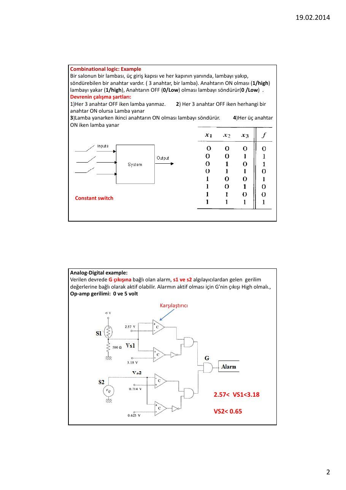
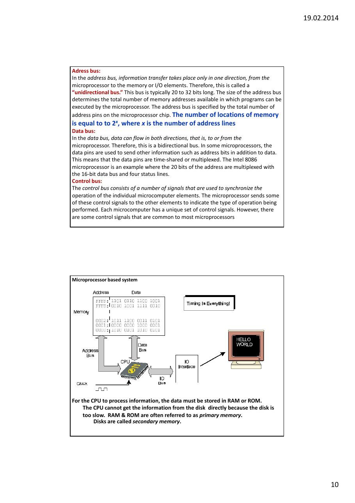
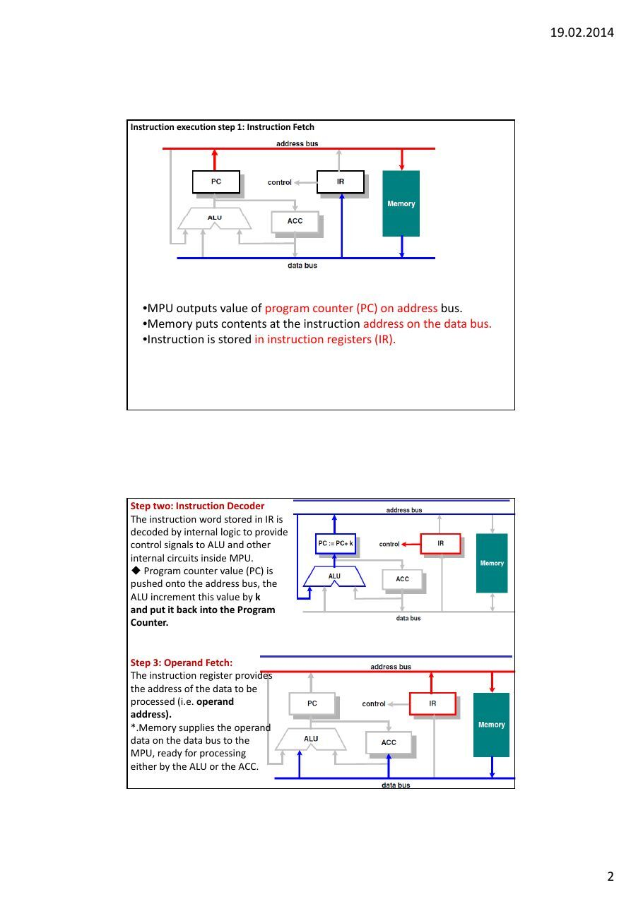
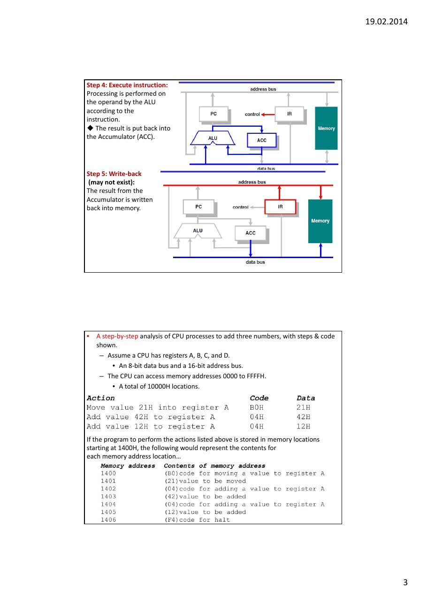

This post collects the related notes and exercises from the Başkent University **EEM332 Microprocessors** course archive (2004–2015). Logic circuits, the instruction cycle, CPU units, and address, data, and control buses; introductory notes from different years. PDF archive copies of the documents and, where available, their source code can be downloaded as a ZIP at the end of the post.

## CPU0_2013

### EEM332

Introduction to Microprocessor Review of logic circuits

### Combinational logic

Sequential logic

- Finite state machine (FAM)

- Memory

Microprocessor based system Instruction cycle Machine cycle

### Digital circuits

- Combinational circuit

- Sequential Circuits

Combinational logic: Example A hall has one lamp, three entrance doors, and a switch next to each door that can turn the lamp on and off (3 switches, one lamp). When a switch is ON (1/high), the lamp turns on (1/high); when a switch is OFF (0/Low), the lamp turns off (0/Low).

### Operating conditions of the circuit

### 1) When all 3 switches are OFF, the lamp is off.          2) When all 3 switches are OFF, if any

switch is turned ON, the lamp turns on.

### 3) While the lamp is on, turning the second switch ON turns the lamp off.           4) When all three switches

are ON, the lamp is on.

Constant switch

### Analog‐Digital example

In the given circuit, the alarm connected to the output G can be activated depending on the voltage values coming from the sensors s1 and s2. For the alarm to be activated, the output of G must be High. Op‐amp voltage: 0 and 5 volts

Comparator

### 2.57< VS1<3.18

### VS2< 0.65

Sequential logic (Flip Flop: Memory element)                   Input Switch : Momentary Switch

ON                                  Latching with a D-Flip Flop

### SET1

### U2:A

### 74S74

### R4               2

### S

### D          Q

470                                                    330

### 3                         LED-RED

```asm
CLK
```

### Q

### R

### LED-GREEN

10k

### RESET1

### OFF

Elevator Example (FSM) The elevator can be at one of two floors: Ground or First. There is one button that controls the elevator, and it has two values: Up or Down. Also, there are two lights in the elevator that indicate the current floor: Red for Ground, and Green for First. At each time step, the controller checks the current floor and current input, changes floors and lights in the obvious way. FSM diagram

### State diagram

State Machines A state machine is a digital circuit composed of "n" flip‐flops that are interconnected to one another and to other inputs, with Boolean logic, in order to generate 2n internal states. The movement from one state to another is determined by a combination of the Boolean logic interconnecting the flip‐flops and the inputs to the state machine. The internal states are then decoded with additional Boolean logic to provide useful outputs at required time intervals. A counter is therefore a very simple state machine.

Memory

### Access to memory

Adress, Data, control Read cycle, Write cycle


State machine and Microprocessor State machines are now most commonly used where microprocessor solutions are too expensive ( on very‐high‐volume, very‐low‐cost systems) or where it is necessary to perform very specific functions directly in hardware at a very high speed. The state machine is also of importance to us because it is really the basis of the modern microprocessor. In other words, a microprocessor is a generalised state machine that can be programmed to perform a specific sequence of functions. This is analogous to the PAL which is a generalised Boolean logic device that can be programmed to produce a required logic.

The design of state machines can become rather complex when a large number of internal states need to be produced and it is fair to say that most modern designers would prefer to apply microprocessors or Digital Signal Processors Microprocessor System: software‐programmable state machine.

```asm
In general, we refer to a microprocessor as being a single chip that is used as
```

the CPU of a computer or computer‐based system.

The microprocessor may be considered as a sophisticated state machine, A program instruction is nothing more than a specific bit pattern of ones and zeros that appears at the data port of the microprocessor. The state machine within the microprocessor has been designed to move from one state to another based upon those specific bit patterns.

The hardware design of the state machine within the microprocessor defines the course of events that will take place whenever a specific bit pattern arrives at the data port of the microprocessor. The hardware "programs" that are developed by the semiconductor manufacturers are known as micro‐code. Micro‐code is the lowest possible form of programming in microprocessors and it is the micro‐code that defines the characteristics of the processor that end‐users would recognise. Micro‐code is analogous to PAL programming in that it instils the logic that defines the operational sequence for a state machine and defines how it will move from one state to another, based upon bit patterns entering via the data bus.

Each cycle (tick) of the clock causes the microprocessor to jump from one internal state to another. As with other state machines, the "next state" of the microprocessor is determined by a logical combination of its current internal state, together with the condition of all the various input lines connected to it.

The microprocessor is a device composed of all the other elements of

### the Combinational and Sequential logic . These elements include

- State machines

- Counters

- Registers

- Numerical circuits (Addition, Subtraction, etc ALU)

- Boolean logic circuits (OR, AND, etc.)

- Combinational Boolean logic.

By utilizing these elements, at each cycle of the system clock, a microprocessor can execute a very simple operation ‐ read data in; write data out; store data in an internal register; add data contained in internal registers; compare data in internal registers and so on. So, The number of bits that a microprocessor can handle as data or instructions defines the "bit‐size" of the microprocessor. Typical sizes are 8, 16, 32 and 64 bits. Since both data and program instructions appear at the data bus of the microprocessor as a collection of ones and zeros, the microprocessor cannot differentiate between them in any way other than the sequence in which they arrive.

### The microprocessor

(i) It is a device based upon a state machine (ii) It contains a number of registers for temporary storage of data (iii) It contains numerical and logical circuits that can perform simple data manipulations between registers (eg: ADD, OR, etc.) (iv) It contains one input port for data (the data bus) and two output ports for data (the data bus and address bus) (v) The state machine has been designed (through micro‐coding) to respond to particular bit patterns entering the data port. The specific bit patterns are the instruction set for the microprocessor (vi) The microprocessor moves from state to state at a speed determined by a "system clock" which is generally provided by another external chip (vii) It takes one or more clock cycles to execute each instruction. The number of

```asm
clock cycles depends upon the architecture of the microprocessor (and its
```

micro‐coding) and the complexity of the instructions.

Points (vi) and (vii) are most important, since they are directly related to the performance of the microprocessor.

Microprocessor based system                 Address Bus ; Data Bus, Control Bus

CPU function is to execute (process) information stored in memory. I/O devices, such as keyboard & monitor provide a means of communicating with the

### CPU.

The CPU is connected to memory and I/O through a group of wires called a bus. Allows signals to carry information from place to place.

```asm
In every computer there are three types of buses: Address bus; Data bus; Control bus.
```

The microcontrollers are typically used for dedicated applications such as automotive systems, home appliances,

```asm
and home entertainment systems.
```

A microprocessor does not know anything about "C"

```asm
or Assembly Language.
```

- For a device (memory or I/O) to be recognized by the CPU, it must be assigned

an address.

- The address assigned to a given device must be unique.

- The CPU puts the address (in binary) on the address bus & decoding circuitry

finds the device.

- The CPU then uses the data bus either to get data from that device or to

send data to it.

- Control buses provide device read/write signals.

- To indicate if the CPU is asking for, or sending information.

### Adress bus

```asm
In the address bus, information transfer takes place only in one direction, from the
```

microprocessor to the memory or I/O elements. Therefore, this is called a unidirectional bus. This bus is typically 20 to 32 bits long. The size of the address bus determines the total number of memory addresses available in which programs can be executed by the microprocessor. The address bus is specified by the total number of

```asm
address pins on the microprocessor chip. The number of locations of memory
```

is equal to to 2x, where x is the number of address lines

### Data bus

```asm
In the data bus, data can flow in both directions, that is, to or from the
```

microprocessor. Therefore, this is a bidirectional bus. In some microprocessors, the data pins are used to send other information such as address bits in addition to data. This means that the data pins are time‐shared or multiplexed. The Intel 8086 microprocessor is an example where the 20 bits of the address are multiplexed with the 16‐bit data bus and four status lines.

### Control bus

The control bus consists of a number of signals that are used to synchronize the operation of the individual microcomputer elements. The microprocessor sends some of these control signals to the other elements to indicate the type of operation being performed. Each microcomputer has a unique set of control signals. However, there are some control signals that are common to most microprocessors

Microprocessor based system

For the CPU to process information, the data must be stored in RAM or ROM. The CPU cannot get the information from the disk directly because the disk is too slow. RAM & ROM are often referred to as primary memory. Disks are called secondary memory.

All common microprocessor follows this sequence

Microprocessor:??? The microprocessor is typically a single VLSI (Very Large‐Scale Integration) chip that contains all the registers, control unit, and arithmetic/ logic circuits of the microcomputer.

Machine instruction

```asm
Clock Signals
```

The system clock signals are contained in the control bus. These signals generate the appropriate clock periods during which instruction executions are carried out by the microprocessor. The clock signals vary from one microprocessor to another. Some microprocessors have an internal clock generator circuit to generate a clock signal.

A microprocessor chip with the main functional elements

Register Section The number, size, and types of registers vary from one microprocessor to another. However, the various registers in all microprocessors carry out similar operations. The register structures of microprocessors play a major role in designing the microprocessor architectures. Also, the register structures for a specific microprocessor determine how convenient and easy it is to program this microprocessor.

### Basic Microprocessor Registers

Instruction Register (IR). The instruction register stores instructions. The contents of an instruction register are always decoded by the microprocessor as an instruction.

Program Counter (PC). The program counter contains the address of the instruction

```asm
or operation code (op‐code). The program counter normally contains the address of
```

the next instruction to be executed.

- Upon activating the microprocessors RESET input, the address of the first instruction

to be executed is loaded into the program counter.

- The program counter contents are automatically incremented by the

microprocessors internal logic.

- The size of the program counter is determined by the size of the address bus.

- Many instructions, such as JUMP and conditional JUMP, change the contents of the

program counter from its normal sequential address value.

Memory Address Register (MAR). The memory address register contains the address of data. The microprocessor uses the address, which is stored in the memory

```asm
address register, as a direct pointer to memory.
```

Accumulator (A). For an 8 bit microprocessor, the accumulator is typically an 8bit register. It is used to store the result after most ALU operations.

Control Unit The main purpose of the control unit is to read and decode instructions from the program memory. To execute an instruction, the control unit steps through the appropriate blocks of the ALU based on the op‐codes contained in the instruction register. The op‐codes define the operations to be performed by the control unit in

```asm
order to execute an instruction. The control unit interprets the contents of the
```

instruction register and then responds to the instruction by generating a sequence of enable signals

RESET. This input is common to all microprocessors. When this input pin is driven to HIGH or LOW (depending on the microprocessor), the program counter is loaded with a predefined address specified by the manufacturer. For example, in the 80486, upon hardware reset, the program counter is loaded with FFFFFFF0

READ/WRITE: This output line is common to all microprocessors. The status of this line tells the other microcomputer elements whether the microprocessor is performing a READ or a WRITE operation. A HIGH signal on this line indicates a READ operation and a LOW indicates a WRITE operation. Some microprocessors have separate READ and WRITE pins.

READY. This is an input to the microprocessor. Slow devices (memory and I/O) use this signal to gain extra time to transfer data to or receive data from a microprocessor. The READY signal is usually an active low signal, that is, LOW means that the microprocessor is ready

Interrupt Request (INT or IRQ). The external I/O devices can interrupt the microprocessor via this input pin on the microprocessor chip. When this signal is activated by the external devices, the microprocessor jumps to a special program, called the interrupt service routine.

### Inside of Microprocessor : Arithmetic and Logic Unit (ALU)

The ALU performs all the data manipulations, such as arithmetic and logic operations, inside the microprocessor. The size of the ALU conforms to the word length of the microcomputer. This means that a 32‐bit microprocessor will have a 32‐bit ALU.

### Typically, the ALU performs the following functions

Arithmetic and Logic Unit (ALU)

### 1. Binary addition and logic operations

### 2. Finding the ones complement of data

### 3. Shifting or rotating the contents of a general‐purpose register 1 bit to the left or

right through carry

An assembler translates a program written in assembly language into a machine language program. A compiler or interpreter, on the other hand, converts a high‐level language program such as C or C++ into a machine language program. Assembly or high level language programs are called source codes. Machine language programs are known as object codes.

To increase the programmers efficiency in writing a machine language program, hexadecimal numbers rather than binary numbers are used Assembly Language The next programming level is to use the assembly language. Each line in an assembly

### language program includes four fields

### 1. Label field

### 2. Instruction,

mnemonic,

```asm
or op‐code field
```

3 . Operand field

### 4. Comment field

Assembly language


An Assembly language instruction consists of a mnemonic, optionally followed by one

```asm
or two operands.
```

Operands are the data items being manipulated. Mnemonics are commands to the CPU, telling it what to do with those items. Advantages of Assembly Language

1.Shows how program interfaces with the processor, operating system, and BIOS. 2.Shows how data is represented and stored in memory and on external devices. 3.Clarifies how processor accesses and executes instructions and how instructions access and process data. 4.Clarifies how a program accesses external devices.

### Reasons for using Assembly Language

### 1.    A program written in Assembly Language requires considerably less memory

```asm
and execution time than one written in a high –level language.
```

### 2. Assembly Language gives a programmer the ability to perform higly technical

tasks that would be difficult, if not impossible in a high‐level language.

### 3. Although most software specialists develop new applications in high‐level

languages, which are easier to write and maintain, a common practice is to recode in assembly language those sections that are time‐critical.

### 4. Resident programs (that reside in memory while other program execute) and

interrupt service routines (that handle input and output) are almost always develop in Assembly Language.

## CPU0_2013

### EEM332

Introduction to Microprocessors. Review of logic circuits

### Combinational logic

Sequential logic

- Finite state machine (FSM)

- Memory

Microprocessor-based system. Instruction cycle. Machine cycle

### Digital circuits

- Combinational circuits

- Sequential circuits

Combinational logic: Example. A hall has one lamp and three entrance doors, and next to each door there is a switch that can turn the lamp on and off (3 switches, one lamp). A switch being ON (1/high) turns the lamp on (1/high); a switch being OFF (0/low) turns the lamp off (0/low).

### Operating conditions of the circuit

### 1) When all 3 switches are OFF, the lamp is off.          2) When all 3 switches are OFF, if any

switch is turned ON, the lamp turns on.

### 3) While the lamp is on, turning the second switch ON turns the lamp off.           4) When all three switches are

ON, the lamp is on.

Constant switch

### Analog-digital example

In the given circuit, the alarm connected to output G can be activated depending on the voltage values coming from sensors s1 and s2. For the alarm to be activated, the output of G must be High. Op-amp voltage: 0 and 5 volts

Comparator

### 2.57 < VS1 < 3.18

### VS2 < 0.65

Sequential logic (Flip-flop: memory element)                   Input switch: momentary switch

ON                                  Latching with a D flip-flop

### SET1

### U2:A

### 74S74

### R4               2

### S

### D          Q

470                                                    330

### 3                         LED-RED

```asm
CLK
```

### Q

### R

### LED-GREEN

10k

### RESET1

### OFF

Elevator Example (FSM) The elevator can be at one of two floors: Ground or First. There is one button that controls the elevator, and it has two values: Up or Down. Also, there are two lights in the elevator that indicate the current floor: Red for Ground, and Green for First. At each time step, the controller checks the current floor and current input, changes floors and lights in the obvious way. FSM diagram

### State diagram

State Machines A state machine is a digital circuit composed of "n" flip‐flops that are interconnected to one another and to other inputs, with Boolean logic, in order to generate 2n internal states. The movement from one state to another is determined by a combination of the Boolean logic interconnecting the flip‐flops and the inputs to the state machine. The internal states are then decoded with additional Boolean logic to provide useful outputs at required time intervals. A counter is therefore a very simple state machine.

Memory

### Access to memory

Address, Data, Control. Read cycle, Write cycle


State machine and Microprocessor State machines are now most commonly used where microprocessor solutions are too expensive ( on very‐high‐volume, very‐low‐cost systems) or where it is necessary to perform very specific functions directly in hardware at a very high speed. The state machine is also of importance to us because it is really the basis of the modern microprocessor. In other words, a microprocessor is a generalised state machine that can be programmed to perform a specific sequence of functions. This is analogous to the PAL which is a generalised Boolean logic device that can be programmed to produce a required logic.

The design of state machines can become rather complex when a large number of internal states need to be produced and it is fair to say that most modern designers would prefer to apply microprocessors or Digital Signal Processors Microprocessor System: software‐programmable state machine.

```asm
In general, we refer to a microprocessor as being a single chip that is used as
```

the CPU of a computer or computer‐based system.

The microprocessor may be considered as a sophisticated state machine, A program instruction is nothing more than a specific bit pattern of ones and zeros that appears at the data port of the microprocessor. The state machine within the microprocessor has been designed to move from one state to another based upon those specific bit patterns.

The hardware design of the state machine within the microprocessor defines the course of events that will take place whenever a specific bit pattern arrives at the data port of the microprocessor. The hardware "programs" that are developed by the semiconductor manufacturers are known as micro‐code. Micro‐code is the lowest possible form of programming in microprocessors and it is the micro‐code that defines the characteristics of the processor that end‐users would recognise. Micro‐code is analogous to PAL programming in that it instils the logic that defines the operational sequence for a state machine and defines how it will move from one state to another, based upon bit patterns entering via the data bus.

Each cycle (tick) of the clock causes the microprocessor to jump from one internal state to another. As with other state machines, the "next state" of the microprocessor is determined by a logical combination of its current internal state, together with the condition of all the various input lines connected to it.

The microprocessor is a device composed of all the other elements of

### the Combinational and Sequential logic . These elements include

- State machines

- Counters

- Registers

- Numerical circuits (Addition, Subtraction, etc ALU)

- Boolean logic circuits (OR, AND, etc.)

- Combinational Boolean logic.

By utilizing these elements, at each cycle of the system clock, a microprocessor can execute a very simple operation ‐ read data in; write data out; store data in an internal register; add data contained in internal registers; compare data in internal registers and so on. So, The number of bits that a microprocessor can handle as data or instructions defines the "bit‐size" of the microprocessor. Typical sizes are 8, 16, 32 and 64 bits. Since both data and program instructions appear at the data bus of the microprocessor as a collection of ones and zeros, the microprocessor cannot differentiate between them in any way other than the sequence in which they arrive.

### The microprocessor

(i) It is a device based upon a state machine (ii) It contains a number of registers for temporary storage of data (iii) It contains numerical and logical circuits that can perform simple data manipulations between registers (eg: ADD, OR, etc.) (iv) It contains one input port for data (the data bus) and two output ports for data (the data bus and address bus) (v) The state machine has been designed (through micro‐coding) to respond to particular bit patterns entering the data port. The specific bit patterns are the instruction set for the microprocessor (vi) The microprocessor moves from state to state at a speed determined by a "system clock" which is generally provided by another external chip (vii) It takes one or more clock cycles to execute each instruction. The number of

```asm
clock cycles depends upon the architecture of the microprocessor (and its
```

micro‐coding) and the complexity of the instructions.

Points (vi) and (vii) are most important, since they are directly related to the performance of the microprocessor.

Microprocessor based system                 Address Bus ; Data Bus, Control Bus

CPU function is to execute (process) information stored in memory. I/O devices, such as keyboard & monitor provide a means of communicating with the

### CPU.

The CPU is connected to memory and I/O through a group of wires called a bus. Allows signals to carry information from place to place.

```asm
In every computer there are three types of buses: Address bus; Data bus; Control bus.
```

The microcontrollers are typically used for dedicated applications such as automotive systems, home appliances,

```asm
and home entertainment systems.
```

A microprocessor does not know anything about "C"

```asm
or Assembly Language.
```

- For a device (memory or I/O) to be recognized by the CPU, it must be assigned

an address.

- The address assigned to a given device must be unique.

- The CPU puts the address (in binary) on the address bus & decoding circuitry

finds the device.

- The CPU then uses the data bus either to get data from that device or to

send data to it.

- Control buses provide device read/write signals.

- To indicate if the CPU is asking for, or sending information.

### Address bus

```asm
In the address bus, information transfer takes place only in one direction, from the
```

microprocessor to the memory or I/O elements. Therefore, this is called a unidirectional bus. This bus is typically 20 to 32 bits long. The size of the address bus determines the total number of memory addresses available in which programs can be executed by the microprocessor. The address bus is specified by the total number of

```asm
address pins on the microprocessor chip. The number of locations of memory
```

is equal to to 2x, where x is the number of address lines

### Data bus

```asm
In the data bus, data can flow in both directions, that is, to or from the
```

microprocessor. Therefore, this is a bidirectional bus. In some microprocessors, the data pins are used to send other information such as address bits in addition to data. This means that the data pins are time‐shared or multiplexed. The Intel 8086 microprocessor is an example where the 20 bits of the address are multiplexed with the 16‐bit data bus and four status lines.

### Control bus

The control bus consists of a number of signals that are used to synchronize the operation of the individual microcomputer elements. The microprocessor sends some of these control signals to the other elements to indicate the type of operation being performed. Each microcomputer has a unique set of control signals. However, there are some control signals that are common to most microprocessors

Microprocessor based system

For the CPU to process information, the data must be stored in RAM or ROM. The CPU cannot get the information from the disk directly because the disk is too slow. RAM & ROM are often referred to as primary memory. Disks are called secondary memory.

All common microprocessor follows this sequence

Microprocessor:??? The microprocessor is typically a single VLSI (Very Large‐Scale Integration) chip that contains all the registers, control unit, and arithmetic/ logic circuits of the microcomputer.

Machine instruction

```asm
Clock Signals
```

The system clock signals are contained in the control bus. These signals generate the appropriate clock periods during which instruction executions are carried out by the microprocessor. The clock signals vary from one microprocessor to another. Some microprocessors have an internal clock generator circuit to generate a clock signal.

A microprocessor chip with the main functional elements

Register Section The number, size, and types of registers vary from one microprocessor to another. However, the various registers in all microprocessors carry out similar operations. The register structures of microprocessors play a major role in designing the microprocessor architectures. Also, the register structures for a specific microprocessor determine how convenient and easy it is to program this microprocessor.

### Basic Microprocessor Registers

Instruction Register (IR). The instruction register stores instructions. The contents of an instruction register are always decoded by the microprocessor as an instruction.

Program Counter (PC). The program counter contains the address of the instruction

```asm
or operation code (op‐code). The program counter normally contains the address of
```

the next instruction to be executed.

- Upon activating the microprocessors RESET input, the address of the first instruction

to be executed is loaded into the program counter.

- The program counter contents are automatically incremented by the

microprocessors internal logic.

- The size of the program counter is determined by the size of the address bus.

- Many instructions, such as JUMP and conditional JUMP, change the contents of the

program counter from its normal sequential address value.

Memory Address Register (MAR). The memory address register contains the address of data. The microprocessor uses the address, which is stored in the memory

```asm
address register, as a direct pointer to memory.
```

Accumulator (A). For an 8 bit microprocessor, the accumulator is typically an 8bit register. It is used to store the result after most ALU operations.

Control Unit The main purpose of the control unit is to read and decode instructions from the program memory. To execute an instruction, the control unit steps through the appropriate blocks of the ALU based on the op‐codes contained in the instruction register. The op‐codes define the operations to be performed by the control unit in

```asm
order to execute an instruction. The control unit interprets the contents of the
```

instruction register and then responds to the instruction by generating a sequence of enable signals

RESET. This input is common to all microprocessors. When this input pin is driven to HIGH or LOW (depending on the microprocessor), the program counter is loaded with a predefined address specified by the manufacturer. For example, in the 80486, upon hardware reset, the program counter is loaded with FFFFFFF0

READ/WRITE: This output line is common to all microprocessors. The status of this line tells the other microcomputer elements whether the microprocessor is performing a READ or a WRITE operation. A HIGH signal on this line indicates a READ operation and a LOW indicates a WRITE operation. Some microprocessors have separate READ and WRITE pins.

READY. This is an input to the microprocessor. Slow devices (memory and I/O) use this signal to gain extra time to transfer data to or receive data from a microprocessor. The READY signal is usually an active low signal, that is, LOW means that the microprocessor is ready

Interrupt Request (INT or IRQ). The external I/O devices can interrupt the microprocessor via this input pin on the microprocessor chip. When this signal is activated by the external devices, the microprocessor jumps to a special program, called the interrupt service routine.

### Inside of Microprocessor : Arithmetic and Logic Unit (ALU)

The ALU performs all the data manipulations, such as arithmetic and logic operations, inside the microprocessor. The size of the ALU conforms to the word length of the microcomputer. This means that a 32‐bit microprocessor will have a 32‐bit ALU.

### Typically, the ALU performs the following functions

Arithmetic and Logic Unit (ALU)

### 1. Binary addition and logic operations

### 2. Finding the ones complement of data

### 3. Shifting or rotating the contents of a general‐purpose register 1 bit to the left or

right through carry

An assembler translates a program written in assembly language into a machine language program. A compiler or interpreter, on the other hand, converts a high‐level language program such as C or C++ into a machine language program. Assembly or high level language programs are called source codes. Machine language programs are known as object codes.

To increase the programmers efficiency in writing a machine language program, hexadecimal numbers rather than binary numbers are used Assembly Language The next programming level is to use the assembly language. Each line in an assembly

### language program includes four fields

### 1. Label field

### 2. Instruction,

mnemonic,

```asm
or op‐code field
```

3 . Operand field

### 4. Comment field

Assembly language


An Assembly language instruction consists of a mnemonic, optionally followed by one

```asm
or two operands.
```

Operands are the data items being manipulated. Mnemonics are commands to the CPU, telling it what to do with those items. Advantages of Assembly Language

1.Shows how program interfaces with the processor, operating system, and BIOS. 2.Shows how data is represented and stored in memory and on external devices. 3.Clarifies how processor accesses and executes instructions and how instructions access and process data. 4.Clarifies how a program accesses external devices.

### Reasons for using Assembly Language

### 1.    A program written in Assembly Language requires considerably less memory

```asm
and execution time than one written in a high –level language.
```

### 2. Assembly Language gives a programmer the ability to perform higly technical

tasks that would be difficult, if not impossible in a high‐level language.

### 3. Although most software specialists develop new applications in high‐level

languages, which are easier to write and maintain, a common practice is to recode in assembly language those sections that are time‐critical.

### 4. Resident programs (that reside in memory while other program execute) and

interrupt service routines (that handle input and output) are almost always develop in Assembly Language.





## CPU01_2013

EEM332 Lecture 1. Design a simple CPU, Read/Write Steps, Machine cycle

Design a simple CPU

Instruction execution, step 1: Instruction Fetch

- The MPU outputs the value of the program counter (PC) on the address bus.

- Memory puts the contents at the instruction address on the data bus.

- The instruction is stored in the instruction register (IR).

Step two: Instruction Decoder. The instruction word stored in the IR is

```asm
decoded by internal logic to provide
```

control signals to the ALU and other internal circuits inside the MPU. ◆ The program counter value (PC) is pushed onto the address bus, the ALU increments this value by k

```asm
and puts it back into the Program
Counter.
```

### Step 3: Operand Fetch

The instruction register provides the address of the data to be processed (i.e. the operand

```asm
address).
```

*Memory supplies the operand data on the data bus to the MPU, ready for processing either by the ALU or the ACC.

### Step 4: Execute instruction

Processing is performed on the operand by the ALU according to the instruction. ◆ The result is put back into the Accumulator (ACC).

Step 5: Write‐back

### (may not exist)

The result from the Accumulator is written back into memory.

- A step‐by‐step analysis of the CPU processes to add three numbers, with steps and code

shown.

- Assume a CPU has registers A, B, C, and D.

- An 8‐bit data bus and a 16‐bit address bus.

- The CPU can access memory addresses 0000 to FFFFH.

- A total of 10000H locations.

If the program to perform the actions listed above is stored in memory locations starting at 1400H, the following would represent the contents for each memory address location…

The CPU puts the address 1400H on the address bus and sends it out. Memory finds the location while the CPU activates the READ signal, indicating it wants the byte at 1400H. The content (B0) is put on the data bus and brought to the CPU.

The CPU decodes the instruction B0 with the help of its instruction decoder dictionary. Bring the byte of the next memory location into CPU Register A.

From memory location 1401H, the CPU fetches code 21H directly into Register A. After completing the instruction, the program counter points to the address of the next instruction ‐ 1402H. Address 1402H is sent out on the address bus to fetch the next instruction.

From 1402H, the CPU fetches code 04H. After decoding, the CPU knows it must add the byte at the next address (1403) to the contents of Register A. After it brings the value (42H) into the CPU, it provides the contents of Register A, along with this value, to the ALU to perform the addition. The program counter becomes 1404, the next instruction address.

```asm
Address 1404H is put on the address bus and the code is fetched, decoded, and
```

executed. Again a value is added to Register A. The program counter is updated to

### 1406H

The contents of address 1406 (HALT code) are fetched and executed. The HALT instruction tells the CPU to stop incrementing the program counter and asking for the next instruction. Without HALT, the CPU would continue updating the program counter

```asm
and fetching instructions.
```

◆ Microprocessors perform operations depending on instruction codes stored in memory.

### ◆ An instruction usually has two parts

❖ Opcode ‐ determines what is to be done ❖ Operand ‐ specifies where/what the data is ◆ Program Counter (PC) ‐ address of the current instruction code ◆ The PC is incremented automatically each time it is used. ◆ The number of clock cycles taken by an instruction is the same as the number of memory accesses it makes. Memory contains both program and data. A peek into memory will tell you very little except a bunch of '1's and '0's. ◆ The program area and data area in memory are usually well separated. ◆ The ALU is responsible for arithmetic and logic functions. ◆ There is always at least one register known as the accumulator, where the result from the ALU is stored. ◆ There are usually one or more general purpose registers for storing results or memory addresses. ◆ Fetching data from inside the CPU is much faster than from external memory. ◆ The processor must start from a known state. Therefore, there is always a reset signal to initialise the processor on power‐up.

A Simplified view of MPU program execution. An MPU program is stored in memory as a sequence of binary values. These binary values represent instructions. Each instruction has a unique binary value. The MPU operation is controlled by reading and executing each instruction one at a time.

### 1. The MPU places an address on the

```asm
ADDRESS BUS.
```

The address is a binary value which

```asm
represents a unique
```

memory location.

### 2. The Memory places the contents of the addressed

location onto the DATA BUS. The contents is a binary value.

### 3. The MPU reads the binary

value from the DATA BUS.

### 4. The MPU interprets

what operation the BINARY value represents and completes (executes) this operation.

### 5. The MPU has completed its first instruction of the

program stored as binary values in the memory.

The MPU needs to be told what to do next. The next instruction is in the next memory location. Stages

### 1. through 4. are repeated,

Note. At Stage 1, the MPU places a new binary value onto the ADDRESS BUS. This is the memory location of the next instruction. The binary value on the ADDRESS BUS has only changed by 1.

How the MPU writes data to Memory

This instruction is

```asm
decoded as
```

### SEND TEMP2

contents to

```asm
ADDRESS
```

The MPU instruction decode logic now needs to execute this instruction: SEND TEMP2 to an ADDRESS

### TO WHAT ADDRESS …

This particular MPU instruction decodes as saying that the DESTINATION ADDRESS will be in the next memory location. The MPU then fetches the binary value from the next location, as this will be the

```asm
ADDRESS where TEMP2 contents will be SENT.
```

The Destination ADDRESS data has been fetched from memory and stored in a TEMP register.

The TEMP register holds the DESTINATION ADDRESS where we wish to SEND our DATA (binary value), which is stored in the TEMP2 register.

We do not try to decode the contents of TEMP because it is not an instruction; it is data associated with a specific operation, known as an OPERAND.

WHAT HAPPENS NEXT .. Remember we want the TEMP2 contents to be sent to the MEMORY ADDRESS which is currently held in TEMP.

The contents of the TEMP register are placed on the

```asm
ADDRESS BUS.
```

The MEMORY WRITE part of our instruction has started. In this phase, since we are sending DATA to MEMORY, or WRITING TO MEMORY, we must be accessing a MEMORY store which allows us to do so.

ROM is read only memory, where our program is stored; we cannot write to it. The RAM, random access memory (read/write memory), is where our DATA will be written. Notice the control signal lines on each of the memory types.

The ADDRESS is a memory location within the RAM, and the TEMP2 register places its contents onto the DATA BUS.

The RAM reads the DATA BUS value and stores it at the location which the ADDRESS value is accessing. NOTICE THE WR signal is ACTIVE.

The instruction has now completed executing. The result of this operation is that the contents of the TEMP2 register have been WRITTEN to RAM memory location 11111111.

Prior to the DATA WRITE, the contents of the RAM location were 00001111. After the MEMORY WRITE, RAM memory location now contains 11110000; the previous DATA value has been overwritten.

### A Quick Review 

The MPU fetches instructions one at a time from memory. The instruction is interpreted by the MPU and then this operation is executed. This is called the FETCH-DECODE-EXECUTE CYCLE. The program, a sequence of instructions, is held in consecutive memory locations.

We have seen that not every binary value read from memory is an instruction. Some of the values can be DATA associated with an instruction.

Read cycle (Machine cycle)

Simple Read Cycle

### 1. Address onto Address Bus

### 2. READ (RD) Control Signal Asserted by MPU

### 3. Data Placed from Memory onto the Data Bus

### 4. RD signal De-Asserted, Data into MPU temp register.

### 5. Read Cycle Ends

Write Cycle

### 1. Address placed on ADDRESS BUS

### 2. Data placed onto DATA BUS

### 3. Write (WR) Control Signal Asserted by MPU

### 4. Write (WR) Control Signal De-Asserted and Data

Written into Memory

### 5. Write Cycle completes.

Write cycle (Machine cycle)

Pipeline Timing Diagram

Figure 1‐2 Pipelined vs Nonpipelined Execution

Abstract

- The CPU clock frequency determines the speed of the microcomputer.

- The number of data and address pins on the microprocessor chip make up the

microcomputer's word size and maximum memory size. The microcomputer's I/O

```asm
and interfacing capabilities are determined by the control pins on the
```

microprocessor chip.

- The microprocessor is a single chip which is capable of processing data and

controlling all of the components which make up the microcomputer system. It contains all of the circuits needed to create the 'brain of the microcomputer'.

- 1. Temporary storage locations in the form of a number

- of registers which can hold binary values (information),

- representing program instructions or data.

- 2. The Arithmetic Logic Unit (ALU). This part of the MPU

- performs both arithmetic and logical operations.

- 3. Timing and Control Circuits: that keep all of the other

- parts of the system (memory & I/O) working together in the right time sequence.

- A Bus is a common communications pathway used to carry information between

the various elements of a computer system. The term BUS refers

- to a group of wires or conduction tracks on a printed circuit board (PCB)

- through which binary information is transferred from one part of the microcomputer

to another.

### Data Bus

The Data Bus carries the data which is transferred throughout the system (bi‐directional).

```asm
Address Bus:
```

An address is a binary number that identifies a specific memory storage location or I/O port involved in a data transfer.

The Address Bus is used to transmit the address of the location to the memory or the I/O port. The Address Bus is unidirectional (one way): addresses are always issued by the

### MPU.

The Control Bus: is another group of signals whose functions are to provide synchronization (timing control) between the MPU and the other system components. Control signals are unidirectional, and are mainly outputs from the MPU. Example Control signals

- Registers ‐ to store information temporarily. 8, 16, or 32 bits, depending on the CPU.

- Program counter ‐ to point to the address of the

next instruction to be executed.

- In the IBM PC, a register called IP, or instruction pointer.

- Instruction decoder ‐ to interpret the instruction

fetched into the CPU.

Bus Sizes: Buses are specified in width, the number of bits. The width of the external Data bus generally gives a very good indication of the internal MPU architecture, particularly the register size and the ALU. The Data Bus width limits the bandwidth of the data that can be transferred per bus operation.

```asm
Address Bus :
```

The MPU Address bus size specifies how many memory and I/O locations may be accessed. Number of locations = 2^N, where N is the number of Address lines. The Address Bus may be specified as follows: 16 Bits Wide (A15 to A0), 16 Address Lines: In this instance 2^N = 2^16 = 65536 locations. Microprocessors are classified by

- The semiconductor technology of their design (TTL, transistor‐transistor logic;

CMOS, complementary‐metal‐oxide semiconductor; or ECL, emitter‐coupled logic),

- The width of the data format (4‐bit, 8‐bit, 16‐bit, 32‐bit, or 64‐bit) they process; and

by their

- instruction set (CISC, complex‐instruction‐set computer, or RISC, reduced‐

instruction‐set computer; see RISC processor). Von Neumann or Harvard (memory usage)

What is a Microprocessor? It is a program controlled semiconductor device (IC), which fetches,

```asm
decodes and executes instructions.
```

What is the function of a microprocessor in a system? The microprocessor is the master in the system, which controls all the activity of the system. It issues address and control signals and fetches the instructions

```asm
and data from memory. Then it executes the instruction to take appropriate
action.
```

What are the basic units of a microprocessor? The basic units or blocks of a microprocessor are the ALU, an array of registers and the control unit. What are Software and Hardware? Software is a set of instructions or commands needed for performing a specific task by a programmable device or a computing machine. Without software, the Hardware is an idle machine.

What is assembly language? The language in which mnemonics (short-hand forms of instructions) are used to write a program is called assembly language. The manufacturers of microprocessors give the mnemonics. What are machine language and assembly language programs? Software developed using 1's and 0's is called machine language programs. Software developed using mnemonics is called assembly language programs. What is the drawback of machine language and assembly language programs? Machine language and assembly language programs are machine dependent. Programs developed using these languages for a particular machine cannot be directly run on another machine. Assembly language is referred to as a low‐level language because it deals directly with the internal structure of the CPU.

Define opcode and operand. Opcode (operation code) is the part of an instruction / directive that identifies a specific operation. Operand is a part of an instruction / directive that represents a value on which the instruction acts. What is pipelined architecture?

```asm
In pipelined architecture the processor will have a number of functional
```

units and the execution times of the functional units are overlapped. Each functional unit works independently most of the time. What are the fetch and execute cycles?

```asm
In general, the instruction cycle of an instruction can be divided into
```

fetch and execute cycles. The fetch cycle is executed to fetch the opcode from memory. The execute cycle is executed to decode the instruction and to perform the work instructed by the instruction. Assembly language is referred to as a low‐level language because it deals directly with the internal structure of the CPU.

Define machine cycle. A machine cycle is defined as the time required to complete one operation of accessing memory or I/O, or acknowledging an external request. This cycle may consist of three to six T-states. What is the processor cycle (machine cycle)? The processor cycle or machine cycle is the basic operation performed by the processor. To execute an instruction, the processor will run one or more machine cycles in a particular order. What is the Instruction cycle? The sequence of operations that a processor has to carry out while executing an instruction is called the Instruction cycle. Each instruction cycle of a processor consists of a number of machine cycles. What is the opcode fetch cycle? The opcode fetch cycle is a machine cycle executed to fetch the opcode of an instruction stored in memory. Every instruction starts with an opcode fetch machine cycle.

Why is interfacing needed for I/O devices? Generally, I/O devices are slow devices. Therefore, the speed of I/O devices does not match the speed of the microprocessor, and so an interface is provided between the system bus and I/O devices. What is the need for a Port? I/O devices are generally slow devices and their timing characteristics do not match processor timings. Hence the I/O devices are connected to the system bus through ports. What is a port? A port is a buffered I/O, which is used to hold the data transmitted from the microprocessor to an I/O device or vice-versa. Flip-Flop: A flip‐flop stores one bit of information. Register: When a set of n flip‐flops is used to store n bits of information, such as an n‐bit number, we refer to these flip‐flops as a register. A common clock is used for each flip‐flop in a register. Shift register: A register that provides the ability to shift its contents is called a shift register.





## cpu01_08

Microprocessor based system

```asm
Address Bus
```

Data Bus Control Bus

The CPU is a unit that fetches and processes a set of general-purpose instructions

A microprocessor does not know anything about "C" or Assembly Language.

Microprocessor based system

Bus Arbitration

```asm
Address Bus
```

CPU            Interrupt System Data Bus

Control Signals                           Status Lines

All Microcomputers consist of:        Clock         Power Supply

### 1. Microprocessor Unit (MPU)

### 2. Program Memory (ROM)

### 3. Data Memory (RAM)

### 4. Input / Output System

### 5. Bus System

(and Software)

The microprocessor is a single chip which is capable of processing data and controlling all of the components which make up the microcomputer system. It contains all of the circuits needed to create the ‘brain of the microcomputer’.

### 1. Temporary storage locations in the form of a number

of registers which can hold binary values (information),

```asm
representing program instruction or data.
```

### 2. The Arithmetic Logic unit (ALU). This part of the MPU

performs both arithmetic and logical operations

### 3. Timing and Control Circuits : that keep all of the other

parts of system (memory & I/O) working together in the right time sequence.

A Bus is a common communications pathway used to carry information between the various elements of a computer system The term BUS refers to a group of wires or conduction tracks on a printed circuit board

### (PCB)

though which binary information is transferred from one part of the microcomputer to another

There are three main bus groups

### 1. ADDRESS BUS

### 2. DATA BUS

### 3. CONTROL BUS

### Data Bus

The Data Bus carries the data which is transferred throughout the system. ( bi-directional)

```asm
Address Bus:
```

An address is a binary number that identifies a specific memory storage location or I/O port involved in a data transfer

The Address Bus is used to transmit the address of the location to the memory or the I/O port. The Address Bus is unidirectional ( one way ): addresses are always issued by the MPU.

The Control Bus: is another group of signals whose functions are to provide synchronization ( timing control ) between the MPU and the other system components. Control signals are unidirectional, and are mainly outputs from the MPU. Example Control signals RD read signal asserted to read data into MPU WR write signal asserted to write data from MPU

Bus Sizes: Buses are specified in width, number of bits.

The width of the external Data bus generally gives a very good indication of the internal MPU architecture, particularly the registers size and the ALU.

The Data Bus width limits the bandwidth of the data that can be transferred per bus operation.

```asm
Address Bus :
```

The MPU Address bus size specifies how much memory

```asm
and I/O locations may accessed.
```

Number of locations = 2N where N is number of Address lines The Address Bus may be specified using the following 16 Bits Wide, ( A15 to A0 ), 16 Address Lines

```asm
In this instance 2N = 216 = 65536 locations
```

Microprocessors are classified by

- The semiconductor technology of their design (TTL, transistor-

transistor logic; CMOS, complementary-metal-oxide semiconductor;

```asm
or ECL, emitter-coupled logic),
```

- The width of the data format (4-bit, 8-bit, 16-bit, 32-bit, or 64-bit)

they process; and by their

- instruction set (CISC, complex-instruction-set computer, or RISC,

reduced-instruction-set computer; see RISC processor). von Neumann or Harvard (Memory usage)

von Neumann

Harvard architecture

All common microprocessor follows this sequence

Get Instruction from memory

### FETCH

Next              Decode Instruction     DECODE Instruction

Execute       EXECUTE Instruction

Instruction Main Main Memory Memory                                         Cycle

Control Unit Fetch             2    Decode

Execution CPU                     Cycle

### RAM

3       Execute 4   Store

Arithmetic/Logic Unit

```asm
Includes Cache
```

(very fast memory)

A Simplified view of MPU program execution A MPU program is stored in memory as a sequence of binary values. These binary values represent instructions. Each instruction has an unique binary value. The MPU operation is controlled by reading and executing each instruction one at a time.

### 1. The MPU places an

```asm
address on the ADDRESS
BUS.
```

The address is a binary value which represents a unique memory location.

### 2. The Memory places the contents of the addressed

location onto the DATA BUS. The contents is a binary value.

### 3. The MPU reads the binary

value from the DATA BUS.

### 4. The MPU interprets

what operation the BINARY Value represents and completes (executes) this operation

### 5. The MPU has completed its first instruction of the

program stored as binary values in the memory.

The MPU needs to be told what to do next. The next instruction is in the next memory location. Stages

### 1. through 4. are repeated,

Note. At Stage 1. The MPU places a new binary value onto the ADDRESS BUS. This is the memory location of the next instruction. The binary value on the ADDRESS BUS has only changed by 1.

How the MPU writes data to Memory

This instruction is

```asm
decoded as
```

### SEND TEMP2

contents to

```asm
ADDRESS
```

The MPU instruction decode logic now need to execute this instruction SEND TEMP2 to an ADDRESS

### TO WHAT ADDRESS …

This particular MPU instruction decodes as saying that the DESTINATION ADDRESS will be in the next memory location. The MPU then fetches the binary value from the next location, as this will be the

```asm
ADDRESS where TEMP2 contents will be SENT.
```

The Destination ADDRESS data has been fetched from memory and stored in a TEMP register.

### WHAT HAPPENS NEXT ?

The TEMP register holds the DESTINATION ADDRESS where we wish the SEND our DATA (Binary Value) which is stored in TEMP2 register.

We do not try to decode the contents of TEMP because it is not an instruction, it is data associated with a specific operation, it is known as an OPERAND

### WHAT HAPPENS NEXT ..

Remember we want TEMP2 contents to be sent to the MEMORY ADDRESS which is currently held in

### TEMP.

The contents of TEMP register are placed on the

```asm
ADDRESS BUS.
```

The MEMORY WRITE part of our instruction has started. In this phase, since we are sending DATA to MEMORY or WRITING TO MEMORY we must be accessing a MEMORY store which allows us to do so.

ROM is read only memory, where our program is stored, we cannot write to it.

The RAM random access memory ,(read/write memory) is where our DATA will be written.

Notice the control signal lines on each of the memory types.

The ADDRESS is a memory location within the RAM, the TEMP2 register places its contents onto the DATA BUS.

The RAM reads the DATA BUS value and stores it at the location which the ADDRESS value is accessing. NOTICE THE WR signal is ACTIVE

The instruction has now completed executing The result of this operation is that the contents of TEMP2 register have been WRITTEN to a RAM Memory location 11111111.

Prior to the DATA WRITE the contents of RAM location was 00001111. After the MEMORY WRITE RAM Memory location now contains 11110000 the previous DATA value has been overwritten.

### A Quick Review 

The MPU fetches instructions one at a time from memory The instruction is interpreted by MPU and then this operation is executed. This called the FETCH DECODE EXECUTE CYCLE. The program, sequence of instructions are held in consecutive memory locations.

We have seen that not every binary value read from memory is an instruction. Some of the values can be DATA associated with an instruction.

Read cycle (Machine cycle)

Simple Read Cycle

### 1. Address onto Address Bus

### 2. READ (RD) Control Signal Asserted by MPU

### 3. Data Placed from Memory onto the Data Bus

### 4. RD signal De-Asserted, Data into MPU temp register.

### 5. Read Cycle Ends

Write Cycle

### 1. Address placed on ADDRESS BUS

### 2. Data placed onto DATA BUS

### 3. Write (WR) Control Signal Asserted by MPU

### 4. Write (WR) Control Signal De-Asserted and Data

Written into Memory

### 5. Write Cycles completes.

Write cycle (Machine cycle)

Pipeline Timing Diagram

Pipeline Stages

- Different architectures use different number of stages

- smaller pipelines have less complexity

- larger pipelines are generally faster

- here, we decompose the fetch-execute cycle into 6 stages:

- FI – fetch instruction

- DI – decode instruction

- CO – calculate operand addresses

- FO – fetch operands (from registers)

- EI – execute instruction (includes computing branch

results and all ALU operations)

- WO – write or store result in registers (or memory)

- the design of the pipeline stages has a major impact on the

architecture’s performance

Levels of Programming Languages

### 1) Machine Language

- Consists of individual instructions that will be executed by the CPU one at

a time

### 2) Assembly Language (Low Level Language)

- Designed for a specific family of processors (different processor

groups/family has different Assembly Language)

- Consists of symbolic instructions directly related to machine language

instructions one-for-one and are assembled into machine language. ) High Level Languages

- e.g. : C, C++ and Vbasic

- Designed to eliminate the technicalities of a particular computer.

- Statements compiled in a high level language typically generate many low-

level instructions.

Advantages of Assembly Language

### 1. Shows how program interfaces with the

processor, operating system, and BIOS.

### 2. Shows how data is represented and stored

```asm
in memory and on external devices.
```

### 3. Clarifies how processor accesses and

executes instructions and how instructions access and process data.

### 4. Clarifies how a program accesses external

devices.

Reasons for using Assembly Language

### 1.    A program written in Assembly Language requires

considerably less memory and execution time than one written

```asm
in a high –level language.
```

### 2.   Assembly Language gives a programmer the ability to perform

higly technical tasks that would be difficult, if not impossible in a high-level language.

### 3.   Although most software specialists develop new applications in

high-level languages, which are easier to write and maintain, a common practice is to recode in assembly language those sections that are time-critical.

### 4.   Resident programs (that reside in memory while other program

execute) and interrupt service routines (that handle input and output) are almost always develop in Assembly Language.

High Level Language Level Language

Assembly Language for Language for A:=B+C

Machine Code for Code for A:=B+C

Instruction Execution Cycle

- The sequence of steps the processor goes through to

do the complete instruction and to get ready for the next, until the program is finished or stopped

- Specific steps (simplified)

- IF: instruction fetched

- ID: instruction decoded, control signals asserted

- RT/EX: register transfer and/or execution

- PC: increment program counter

- These steps are repeated for each instruction execution

cycle until the program is done, or until something is done to make the program stop

- Opcodes are represented by abbreviations,

called mnemonics, that indicate the

### operation. Coomon examples

- ADD Add

- SUB      Subtract

- DIV      Divide

- LOAD Load data from memory

- STOR Store data to memory

Y = (A-B) / (C+D x E) Instruction             Comment

- SUB Y, A, B           • Y        A-B

- MPY T, D, E           • T        DxE

- ADD T, T, C           • T        T+C

- DIV Y, Y, T           • Y        Y/ T

Three-address instructions

Y = (A-B) / (C+D x E)

- MOVE Y, A

- SUB Y, B

- MOVE T, D

- MPY T, E

- ADD T, C

- DIV Y, T

Two-address instructions

Y = (A-B) / (C+D x E) iNSTRUCTIONS                  Comment

- LOAD D                      • AC      D

- MPY E

- AC      AC x E

- ADD C

- STOR Y

- AC      AC + C

- LOAD A                      • Y       AC

- SUB B                       • AC      A

- DIV Y                       • AC      AC – B

- STOR Y                      • AC      AC / Y

- Y       AC

One-address Instructions

The basic function as stated is to perform logic and maths operations. The Accumulator and the Flags registers play an important role in the operation of the ALU.

The Accumulator is used in all ALU operations.

The Flags or Status Register is a group of bits representing the result of the ALU operation. The Flags register contains bits such as (OV) representing an overflow flag. If the result of an

```asm
addition is greater than 255 then the OV is set to indicate
```

this condition. More Details to come. The type of functions performed by the ALUs of MPU

```asm
include
```

```asm
Addition   Shift Left Subtraction             Shift Right
```

Logical AND      Decrement Logical OR     Increment Logical XOR

What is Microprocessor ? It is a program controlled semiconductor device (IC}, which fetches, decode and executes instructions. What is the function of microprocessor in a system? The microprocessor is the master in the system, which controls all the activity of the system. It issues address and control signals and fetches the instruction and data from memory. Then it executes the instruction to take appropriate action.

What are the basic units of a microprocessor ? The basic units or blocks of a microprocessor are ALU, an array of registers and control unit. what is Software and Hardware? The Software is a set of instructions or commands needed for performing a specific task by a programmable device or a computing machine. Without software the Hardware is an idle machine.

What is assembly language? The language in which the mnemonics (short -hand form of instructions) are used to write a program is called assembly language. The manufacturers of microprocessor give the mnemonics. What are machine language and assembly language programs? The software developed using 1's and 0's are called machine language, programs. The software developed using mnemonics are called assembly language programs. What is the drawback in machine language and assembly language, programs? The machine language and assembly language programs are machine dependent. The programs developed using these languages for a particular machine cannot be directly run on another machine .

Define opcode and operand. Opcode (Operation code) is the part of an instruction / directive that identifies a specific operation. Operand is a part of an instruction / directive that represents a value on which the instruction acts. What is pipelined architecture?

```asm
In pipelined architecture the processor will have number of functional
```

units and the execution time of functional units are overlapped. Each functional unit works independently most of the time. What is fetch and execute cycle?

```asm
In general, the instruction cycle of an instruction can be divided into
```

fetch and execute cycles. The fetch cycle is executed to fetch the opcode from memory. The execute cycle is executed to decode the instruction and to perform the work instructed by the instruction.

Define machine cycle. Machine cycle is defined as the time required to complete one operation of accessing memory, I/O, or acknowledging an external request. This cycle may consist of three to six T-states. What is processor cycle (Machine cycle)? The processor cycle or machine cycle is the basic operation performed by the processor. To execute an instruction, the processor will run one or more machine cycles in a particular order. What is Instruction cycle? The sequence of operations that a processor has to carry out while executing the instruction is called Instruction cycle. Each instructioncycle of a processor indium consists of a number of machine cycles. What is opcode fetch cycle? The opcode fetch cycle is a machine cycle executed to fetch the opcode of an instruction stored in memory. Every instruction starts with opcode fetch machine cycle.

Why interfacing is needed for 1/0 devices? Generally I/O devices are slow devices. Therefore the speed of I/O devices does not match with the speed of microprocessor. And so an interface is provided between system bus and I/O devices.

What is the need for Port? The I/O devices are generally slow devices and their timing characteristics do not match with processor timings. Hence the I/O devices are connected to system bus through the ports. .What is a port? The port is a buffered I/O, which is used to hold the data transmitted from the microprocessor to I/O device or vice-versa.

## cpu01_06

Microprocessor based system

```asm
Address Bus
```

Data Bus Control Bus

Bus Arbitration

```asm
Address Bus
```

CPU                Interrupt System Data Bus

Control Signals                                Status Lines

All Microcomputers consist of:       Clock         Power Supply

### 1. Microprocessor Unit (MPU)

### 2. Program Memory (ROM)

### 3. Data Memory (RAM)

### 4. Input / Output System

### 5. Bus System

(and Software)

The microprocessor is a single chip which is capable of processing data and controlling all of the components which make up the microcomputer system. It contains all of the circuits needed to create the ‘brain of the microcomputer’.

### 1. Temporary storage locations in the form of a number

of registers which can hold binary values (information),

```asm
representing program instruction or data.
```

### 2. The Arithmetic Logic unit (ALU). This part of the MPU

performs both arithmetic and logical operations

### 3. Timing and Control Circuits : that keep all of the other

parts of system (memory & I/O) working together in the right time sequence.

A Bus is a common communications pathway used to carry information between the various elements of a computer system The term BUS refers to a group of wires or conduction tracks on a printed circuit board

### (PCB)

though which binary information is transferred from one part of the microcomputer to another

There are three main bus groups

### 1. ADDRESS BUS

### 2. DATA BUS

### 3. CONTROL BUS

### Data Bus

The Data Bus carries the data which is transferred throughout the system. ( bi-directional)

```asm
Address Bus:
```

An address is a binary number that identifies a specific memory storage location or I/O port involved in a data transfer

The Address Bus is used to transmit the address of the location to the memory or the I/O port. The Address Bus is unidirectional ( one way ): addresses are always issued by the MPU.

The Control Bus: is another group of signals whose functions are to provide synchronization ( timing control ) between the MPU and the other system components. Control signals are unidirectional, and are mainly outputs from the MPU. Example Control signals RD read signal asserted to read data into MPU WR write signal asserted to write data from MPU

A Simplified view of MPU program execution A MPU program is stored in memory as a sequence of binary values. These binary values represent instructions. Each instruction has an unique binary value. The MPU operation is controlled by reading and executing each instruction one at a time.

### 1. The MPU places an

```asm
address on the ADDRESS
BUS.
```

The address is a binary value which represents a unique memory location.

### 2. The Memory places the contents of the addressed

location onto the DATA BUS. The contents is a binary value.

### 3. The MPU reads the binary

value from the DATA BUS.

### 4. The MPU interprets

what operation the BINARY Value represents and completes (executes) this operation

### 5. The MPU has completed its first instruction of the

program stored as binary values in the memory.

The MPU needs to be told what to do next. The next instruction is in the next memory location. Stages

### 1. through 4. are repeated,

Note. At Stage 1. The MPU places a new binary value onto the ADDRESS BUS. This is the memory location of the next instruction. The binary value on the ADDRESS BUS has only changed by 1.

All common microprocessor follows this sequence

Get Instruction from memory

### FETCH

Next                  Decode Instruction      DECODE Instruction

Execute         EXECUTE Instruction

Instruction Main Main Memory Memory                                                       Cycle

Control Unit Fetch                 2    Decode

Execution CPU                       Cycle

### RAM

3       Execute 4   Store

Arithmetic/Logic Unit

```asm
Includes Cache
```

(very fast memory)

CPU Activities

- CPU is in charge of the fetch-execute cycle to execute all program

instructions

- This is not quite true, I/O operations are initiated by the CPU but

the actual sequence of operations is often left up to I/O modules such as I/O channels or I/O processors

- Fetch-execute cycle:

- Fetch instruction – CPU reads next program instruction from

memory

- Interpret (decode) instruction – control unit determines what

machine actions are required including what data to fetch

- Fetch data – data is fetched from memory or I/O

- Process data – ALU operation or data movement

- Write data – if needed, result stored in memory or I/O

Pipeline Timing Diagram

Pipeline Stages

- Different architectures use different number of stages

- smaller pipelines have less complexity

- larger pipelines are generally faster

- here, we decompose the fetch-execute cycle into 6 stages:

- FI – fetch instruction

- DI – decode instruction

- CO – calculate operand addresses

- FO – fetch operands (from registers)

- EI – execute instruction (includes computing branch results and all ALU

operations)

- WO – write or store result in registers (or memory)

- the design of the pipeline stages has a major impact on the architecture’s

performance

How the MPU writes data to Memory

This instruction is

```asm
decoded as
```

### SEND TEMP2

contents to

```asm
ADDRESS
```

The MPU instruction decode logic now need to execute this instruction SEND TEMP2 to an ADDRESS

### TO WHAT ADDRESS …

This particular MPU instruction decodes as saying that the DESTINATION ADDRESS will be in the next memory location. The MPU then fetches the binary value from the next location, as this will be the

```asm
ADDRESS where TEMP2 contents will be SENT.
```

The Destination ADDRESS data has been fetched from memory and stored in a TEMP register.

### WHAT HAPPENS NEXT ?

The TEMP register holds the DESTINATION ADDRESS where we wish the SEND our DATA (Binary Value) which is stored in TEMP2 register.

We do not try to decode the contents of TEMP because it is not an instruction, it is data associated with a specific operation, it is known as an OPERAND

### WHAT HAPPENS NEXT ..

Remember we want TEMP2 contents to be sent to the MEMORY ADDRESS which is currently held in

### TEMP.

The contents of TEMP register are placed on the

```asm
ADDRESS BUS.
```

The MEMORY WRITE part of our instruction has started. In this phase, since we are sending DATA to MEMORY or WRITING TO MEMORY we must be accessing a MEMORY store which allows us to do so.

ROM is read only memory, where our program is stored, we cannot write to it.

The RAM random access memory ,(read/write memory) is where our DATA will be written.

Notice the control signal lines on each of the memory types.

The ADDRESS is a memory location within the RAM, the TEMP2 register places its contents onto the DATA BUS.

The RAM reads the DATA BUS value and stores it at the location which the ADDRESS value is accessing. NOTICE THE WR signal is ACTIVE

The instruction has now completed executing The result of this operation is that the contents of TEMP2 register have been WRITTEN to a RAM Memory location 11111111.

Prior to the DATA WRITE the contents of RAM location was 00001111. After the MEMORY WRITE RAM Memory location now contains 11110000 the previous DATA value has been overwritten.

### A Quick Review 

The MPU fetches instructions one at a time from memory The instruction is interpreted by MPU and then this operation is executed. This called the FETCH DECODE EXECUTE CYCLE. The program, sequence of instructions are held in consecutive memory locations.

We have seen that not every binary value read from memory is an instruction. Some of the values can be DATA associated with an instruction.

The instructions are known as Operation Codes

### OPCODES.

The Data and Registers associated with a specific OPCODE are called OPERANDS.

The format of these OPCODES and OPERANDS are directly related to the internal architecture of the MPU. The question is what does the MPU do next, we have seen that a single instruction can cause several BUS accesses. But we have completed the current instruction. The MPU needs to get the NEXT instruction from memory where our program resides.

Bus Sizes: Buses are specified in width, number of bits. There are other parameters which can also used to characterise a Bus but for this presentation they are not relevant.

```asm
Address Bus :
```

The MPU Address bus size specifies how much memory

```asm
and I/O locations may accessed.
```

Number of locations = 2N where N is number of Address lines

The Address Bus may be specified using the following 16 Bits Wide, ( A15 to A0 ), 16 Address Lines

```asm
In this instance 2N = 216 = 65536 locations
```

The Address Range starts at 0 and ends at a maximum 65535. Notice that the highest address location is one less than the Number of locations given by 2N .

This is due to the number 0 being a valid memory location.

```asm
Addresses are general expressed in the Hexadecimal
```

numbering system. Which will be covered later. This number system is base 16. So that a typical 16 bit address will use values such as 1234H or 123416 or FFFFH or FFFF16 more later.

The Data Bus is similarly characterised by its width, number of bits. The width of the external Data bus generally gives a very good indication of the internal MPU architecture, particularly the registers size and the ALU. However, there are exceptions

The Data Bus width limits the bandwidth of the data that can be transferred per bus operation.

Data Bus 8 Bits , tends to represent a 8 bit internal architecture.

Hi Z means High Impedance or floating bus / signal.

VALID INFO means either a group of BUS signals or an individual signal is Stable at this time.

Simple Read Cycle

### 1. Address onto Address Bus

### 2. READ (RD) Control Signal Asserted by MPU

### 3. Data Placed from Memory onto the Data Bus

### 4. RD signal De-Asserted, Data into MPU temp register.

### 5. Read Cycle Ends

Write Cycle

### 1. Address placed on ADDRESS BUS

### 2. Data placed onto DATA BUS

### 3. Write (WR) Control Signal Asserted by MPU

### 4. Write (WR) Control Signal De-Asserted and Data

Written into Memory

### 5. Write Cycles completes.

–CPU has four key parts that we will examine:                      The MPU architectural The MPU architecture can be viewed both

- Control Unit                  externally or internally. (

The MPU architecture refers to both its

- Arithmetic & Logic Unit       Hardware and

Software features

- Registers

- Clock

—CONTROL UNIT (CU): circuitry for coordinating machine’s activities. —ARITHMETIC & LOGIC UNIT (ALU): circuitry to perform data manipulation (arithmetic & logic). —Registers: Temporary holding places. Holds information applicable to the ___________________ —Clock: Times all CPU operations. (store, retrieve, compare,

```asm
and mathematical operations)
```

The basic function as stated is to perform logic and maths operations. The Accumulator and the Flags registers play an important role in the operation of the ALU.

The Accumulator is used in all ALU operations.

The Flags or Status Register is a group of bits representing the result of the ALU operation. The Flags register contains bits such as OV representing an overflow flag. If the result of an

```asm
addition is greater than 255 then the OV is set to indicate
```

this condition. More Details to come. The type of functions performed by the ALUs of MPU

```asm
include
```

```asm
Addition   Shift Left Subtraction                   Shift Right
```

Logical AND       Decrement Logical OR        Increment Logical XOR

## What Is a Microprocessor and What Units Does It Consist Of

What is a microprocessor and what units does it consist of?

When you want to learn a high-level programming language, you can start working without needing to examine the internal structure of the computer you are using. When you want to learn assembly language, however, before going into all the details of the language, you need to learn what a microcomputer is and what its internal structure looks like.

A microcomputer, which goes by various names such as personal computer, PC, office computer, or desktop computer, is, as its name suggests, a small computer. However, it would be wrong to conclude from this definition that microcomputers are inadequate or have limited capabilities. Today's microcomputers, although still called "micro", have the power of the minicomputers and mainframes of a few years ago. Creating a microcomputer equal in power to the large computers of a few years earlier was made possible by chips containing the functional power of thousands of transistors, namely the chips called the 8088 or 8086 microprocessor.

A microprocessor is a chip that forms the basic structure of a microcomputer. This basic structure determines the functional power of the computer. The basic components of a microprocessor system are the following.

### 1-CPU

2-Memory 3-I/O devices 4-Buses The CPU (Central Processing Unit), the central processing unit, is the microprocessor itself. The memory and the input/output units are connected to the CPU through electronic lines called buses. The CPU communicates with all peripheral devices (such as the monitor, disk, keyboard, and printer) and enables the exchange of information among them.

The instruction set of the 8088 microprocessor consists of 92 basic instruction types. It allows several different addressing methods to be used to access data in various regions of memory. Combining the 92 instruction types, the addressing modes, and the various types of data in different combinations yields thousands of instructions that can be executed by the 8088.

Whether the 8088 is an 8-bit or a 16-bit microprocessor is debatable. According to standard industry terminology, the 8088 should be called an 8-bit microprocessor, because at any given moment a processor transfers 8 bits of information over 8-bit data lines. However, the internal paths of the 8088 are 16 bits wide, and the numbers it operates on can be 8 or 16 bits long. For this reason, it would not be wrong to call the 8088 a 16-bit processor. The 8088 is a 16-bit processor with 8-bit data lines.

The INTEL 8086/8088 family

Intel produced its first commercially manufactured microprocessor in 1972. This processor, which was organized as a calculator, ... The microprocessor named 8080, an upgraded version of its predecessor, was produced in 1973. The 8080 processor has more addresses, I/O ports, and instructions. The execution time of instructions is shorter. The internal

```asm
organization is more powerful.
```

The microprocessor released in 1976 was named the 8085. With the 8085, Intel secured a place in the 8-bit microprocessor market, and in 1978 it made an important leap by producing the 8086. This 16-bit processor is 10 times faster than the 8080. The 8086 and 8080 are software compatible at the assembly language level. The difference between them is small. 8080 programs can be executed on the 8086.

Intel produced a new processor which it named the 8088. Like the 8086, this processor had 16-bit internal data paths. However, the data lines coming from outside the chip are 8 bits wide. The 8086 and the 8088 are identical. The 8088 microprocessor performs 16-bit data transfers in a longer time, because 16-bit operations are carried out as two separate 8-bit operations.

The 80186 and 80188 processors are upgraded versions of the 8086 and 8088. These processors include additional hardware features such as timers. They also have 10 new instructions that differ from the 8086 and 8088. Intel's later processors, known as the x86 group, are the 80286, 80386, 80486, the Pentium, the Pentium Pro (with MMX support), and finally the Pentium II series. The CPU chips of these processors are more advanced than those of the other members of the family. The main reason for this advancement is the operations on the memory space, and these improvements allow the microcomputer to be used by more than one user at the same time.

CPU registers

The microprocessor contains 14 special locations called registers. We can think of these locations, each 16 bits wide, as special memory units. Registers are used by the microprocessor for special purposes. They are also used to temporarily store various data and to perform operations on this data. Since registers are located on the CPU chip, operations performed with registers are much faster than operations performed on memory locations. The registers of the 8086/8088 microprocessor can be divided into the following groups:

Segment registers (4) General-purpose registers a) Data registers (4) b) Pointer and index registers (4) Instruction Pointer (1) Program Status Word (1) Of the 14 registers shown above, 4 are the CS, DS, SS, and ES registers, which hold the starting addresses of the CODE, DATA, STACK, and EXTRA segments. These four registers are generally called segment registers. Of the remaining ones, 8 are general-purpose registers, 1 is the instruction pointer register, and the last is known as the program status word (status indicator) register. We will call the program status word register the flag register. The general-purpose registers are divided into two groups among themselves. Each group consists of 4 registers. The first four of these are called data registers, and the other 4 are called pointer and index registers.

Data registers

The DATA registers, used mostly for arithmetic operations, are AX, BX, CX, and DX. Unlike the other registers, each DATA register can be used either as a whole or in two parts. A DATA register can be divided into two subfields, so we can use the register either as a single 16-bit register or as two separate 8-bit registers. This feature is shown in the figure. For example, we treat AX as a 16-bit register for 16-bit operations, and AH and AL, which make up AX, for 8-bit operations. The high-order part of any 16-bit data register is denoted by the register name and the first letter of the word "High", and the low-order part is denoted by the register name and the first letter of the word "Low". Thus we obtain the 8-bit registers named AH and AL for AX, BH and BL for BX, CH and CL for CX, and DH and DL for DX. It is clear that changing the value of one of these 8-bit registers will also change the value of the 16-bit register containing it, and vice versa. However, an operation performed on either half of a 16-bit register will not cause any change in the other half. The figure also shows that registers other than the data registers cannot be divided into subfields in this way. For the flag register, however, there is an even different kind of usage.

Any of the DATA registers can be used for general program purposes. On the other hand, certain data registers must be used as operands during certain operations. In such a case, the programmer has no choice. The AX register, which can be called the accumulator, is used with word length in multiplication, division, input, output, and some string operations. The AL register is byte-length and is used as the counter register of some operations or as the transfer area (destination register) in decimal-oriented arithmetic operations. The AH register is used in byte-length division and multiplication. BX, which can be called the base register, is mostly used for addressing data in memory. CX is the counter register; it is used as the counter register for LOOP instructions or repeated string operations. The CL register can be used as the shift and rotate counter. DX, called the data register, is used in word-length multiplication and division operations, and also to specify the port number for input/output operations.

Segment registers

Computers using the 8088 and 8086 processors place programs and data in two separate areas of memory. These program and data areas are at most 64 K in size and are called segments. The 8088 processor can have 4 separate segments at the same time. These segments are called the CODE, DATA, STACK, and EXTRA segments. Four separate registers are used to indicate the first byte of these segments, in other words the starting address of the segment. These are, respectively, CS, DS, SS, and ES, and they are called segment registers. The code segment register, CS, indicates the starting address of the segment containing the program being executed. In other words, machine language instructions are located in the segment addressed by CS. The stack segment register, SS, contains the starting address of the current stack segment. The stack segment is a block of memory in which various data are temporarily stored. The data segment register, DS, is the starting address of the current data segment. This segment is generally used by program variables. In other words, the information subjected to data processing operations is located in locations within the data segment. The extra segment register, ES, contains the starting address of the current extra segment. The extra segment is generally used for string operations. In systems with sufficient memory, these 4 segments are different parts of memory. In systems without large memory, these segments may overlap.

Pointer and index registers

As also shown in the figure above, the pointer and index registers are SP, BP, SI, and DI. However, it is also possible to regard the IP and BX registers as pointer or index registers. Pointer and index registers, like the data registers, can be used for arithmetic operations. However, the main purpose of using these registers is to treat them as address pointers in order to access data in various memory regions. To indicate the address of a location in memory, two separate address values are used. The first value is the address of the segment that contains the location being pointed to; here the segment registers are used. The second address value, which indicates the position of the location within the segment, is known as the offset address. The pointer and index registers are used to specify offset addresses.

The microprocessor uses the CS and IP registers to access locations within the code segment. To access data located in the stack segment, one of the SP or BP registers must be used together with the SS register. To access locations within the data segment, the DS register, which is the start of the data segment, is used, and BX, SI, or DI is used to indicate the offset address of the location. To access locations within the extra segment or an arbitrarily chosen segment, we can make use of CS, DS, and SS. For example, we can transfer the value in ES to SS and the offset address of the location within the extra segment to BP.

Instruction pointer register

The IP register, which we can call the instruction pointer, contains the offset address of the next instruction to be executed by the execution unit of the 8088. The memory location whose offset address is indicated by IP is within the code segment, because the instructions that make up programs are located in this segment. Since the IP register is a special-purpose register, it cannot be used directly by the programmer. However, it is possible to change the value of this register indirectly through information on the stack.

Program status word register

We can abbreviate the program status word register as PSW. We will call this register the flag register. The flag register is quite different from the other registers. First of all, the notation "PSW" is not an operand; it is only an abbreviation used to refer to this register. The flag register cannot be considered as a whole, or as a 16-bit or 8-bit number, because it is not the numerical value of the flag register that matters, but the value of each of the bits that make it up. However, there is also a restriction here: of the 16 bits that make up the register, only 9 are used. The current value of each of these 9 bits affects how various control instructions are executed or gives information about the result of arithmetic or logical operations. For example, bit 6 of the flag register is called the zero flag. After an operation, by checking the value of this bit, we can check whether the result of the operation was 0. If the value of this bit is 1, the result of the operation is 0; otherwise it is nonzero.

Memory, Segment, Offset

Memory is the unit that contains or stores the instructions that make up programs and the data on which the program will perform information processing. Instructions and data are located in the computer's memory as numbers of one byte each. Everything in memory consists of numbers. To prevent instructions from being treated as data, or data as instructions, during execution, a quite orderly memory organization is required. This is normally the responsibility of the programmer.

We can think of computer memory as consisting of thousands of small cells. Each cell is 8 bits long, and as is known, each 8-bit unit is called a byte. Each byte in memory, in other words each memory location, has an address. These addresses are positive integers starting from 0. The address of the first byte of memory is 0, and the address of the last byte is one less than the number indicating the size of the memory.

The memory of each computer can be of different sizes. The maximum memory size that can be used with the 8086/8088 microprocessor is 1,048,576 bytes, or simply 1 Megabyte. The figure below can give a rough idea of the cells that make up the memory and their corresponding memory addresses. To address any location in memory, unsigned integers 2 bytes long are used. The smallest unsigned number that can be expressed with 2 bytes is 0, and the largest unsigned number is 65535. Thus, with a number 2 bytes long, only the first 65536 bytes of memory can be addressed. Yet we know that for the 8086/8088 microprocessor, memory can exceed this number and consist of 1,048,576 bytes. It is clear that with numbers 2 bytes long, not all locations of a memory of this size can be addressed.

## MICROPROCESSOR COURSE FOR ELECTRONICS STUDENTS

When talking about the features of the computers we use today, the processor is mentioned in particular, and it is clear that its operating frequency is an important criterion in determining the speed of that computer. The 80286, 80386, 80486 and finally the Pentium series produced by Intel, which are in use today, are all microprocessors. Processors are not very useful on their own and need memory and input/output units. If we bring these three structures (CPU, RAM and I/O) together and enclose them in a single package, the resulting structure is called a microcontroller.

Microcontrollers, which are designed for use in applications that require computer technology, are simpler and cheaper than microprocessors. Today, microcontrollers are found inside many products. For example, take a close look at newly released air conditioners and refrigerators. They surely have a liquid crystal display, and we control these machines with buttons. Microcontrollers make this control possible. Or, in our cars, especially newer ones, there is certainly a microcontroller. This microcontroller controls the central locking system, the instrument panel and/or the air conditioning, and conveys information about them to us on a screen or through indicators. The examples can be multiplied. We can use microcontrollers for exactly this kind of control and computation. If we wish, we can even build a robot.

Today there are many microcontroller manufacturers, and they produce different microcontrollers according to the processing needed. But when we get down to basics, there is very little variation in microcontroller architecture, and these microcontrollers are almost the same in structure.

Before starting a project, when choosing a microcontroller, one must thoroughly understand what features the microcontroller to be used in the application should have. These features include:

### 1. Number of interrupts

### 2. Number of I/O ports

### 3. Programmable digital parallel input / output

### 4. Programmable analog input / output

### 5. Internal memory type and capacity

### 6. Floating-point computation

It is possible to extend this list. I have listed only the basic features.

### A microcontroller generally consists of the following units

### 1. CPU (Central Processing Unit)

### 2. RAM (Random Access Memory)

### 3. EPROM/PROM/ROM (Erasable Programmable Read

Only Memory)

### 4. I/O (Input/Output) - serial and parallel

### 5. Timers

### 6. Interrupt controller (Interrupts)

Microcontrollers are special-purpose computers and do what they are programmed for in the best possible way. Their general characteristics are:

### 1. Microcontrollers are programmed for only one task and run only and only that

program, and the program they use is kept inside the chip or in a place called program memory.

### 2. Microcontrollers consume only about 50 mW of power.

### 3. Microcontrollers do not only take input; they can also produce output. With LED

displays, liquid crystal displays, warning sounds, etc.

### 4. Microcontrollers are cheap. They let you easily reduce a complex circuit made of many parts to a small size and low cost.

PIC is a microcontroller whose name comes from the initial letters of the words in the English phrase Peripheral Interface Controller. If we translate this phrase into Turkish, it means something like "an interface that controls peripheral units". PIC is indeed a chip designed to control I/O elements called peripherals, such as lamps, motors, relays, and temperature and light sensors, very quickly.

Since they are produced using a method called RISC architecture, the instructions used to program a PIC are quite simple and few in number. The basic idea of the RISC (Reduced Instruction Set Computer) architecture, a design method applied since the early 1980s, is to use simpler and fewer instructions. For example, the PIC16F84 microcontroller can be programmed using a total of 35 instructions.

For those starting to work with a microcontroller, the most suitable option is the PIC16F84. Because the PIC16F84 has Flash memory, being able to program it, use it in experiments, then erase it and write a new program is a great convenience for those new to PIC. Thus, beginners will not have to throw away the chip because of programming mistakes. Admittedly, it is also possible to rewrite chips with EPROM program memory, but in that case an EPROM eraser is needed. Even if an eraser is available, one has to wait at least 10 - 15 min. to erase the program from memory. This feature of the PIC16F84 makes it an ideal choice for those who are just starting to use microcontrollers.

Another advantage of using the PIC16F84 is that the programming hardware is very cheap and practical, and can even be built by most hobbyist electronics users.

Now, let us look at the features of the PIC16F84 microcontroller.

### High-Performance RISC CPU Features

- Only 35 single-word instructions to learn

- All instructions are single-cycle (400 ns @ 10 MHz) except for program branches, which are two-cycle

- Operating speed: DC-10 MHz clock input. DC-400 ns instruction cycle

- 14-bit wide instructions

- 8-bit wide data bus

- 1K*14 EEPROM program memory

- 36*8 general-purpose registers (SRAM)

- 64*8 on-chip EEPROM data memory

- 15 special-function hardware registers · Direct, indirect and relative addressing modes

- Four interrupt sources

- External RB0/INT pin

- TMR0 timer overflow

- PORTB <7:4> interrupt on change

- Data EEPROM write complete

- 1,000,000 EEPROM data memory ERASE/WRITE cycles

- EEPROM data retention of more than 40 years

- 13 I/O pins with individual direction control

- High current sink/source for direct LED drive

- Max. 25 mA sink per pin

- Max. 20 mA source per pin

- TMR0: 8-bit timer/counter with 8-bit programmable prescaler

### Special Microcontroller Features

- Power-on Reset (POR)

- Power-up Timer (PWRT)

- Oscillator Start-up Timer (OST)

- Watchdog Timer (WDT) with on-chip RC oscillator for reliable operation

- Code protection

- Power-saving SLEEP mode

- Selectable oscillator options

- Serial in-circuit programming (via two pins)

### CMOS Technology

- Low-power, high-speed CMOS EEPROM technology

- Fully static design

- Wide operating voltage range:

- Commercial: 2.0V-6.0V

- Industrial: 2.0V-6.0V

- Low power consumption

< 2mA typical @ 5V, 4MHz 60 mA typical @ 2V, 32 kHz 26 mA typical standby current @ 2V

The PIC is programmed in a programming language called assembler language, which consists of a total of 35 instructions. To write these instructions we can use a simple editor. This can be Notepad in Windows or the edit program in DOS. What really matters is translating the instructions we write into machine language. There are versions of MPASM, which translates assembly language instructions saved as a text file into machine language, that run under both DOS and Windows. This program can be downloaded from http://www.microchip.com. In the MPLAB program we will use, both the text editor and the MPASM assembler program are integrated.

If you like, let us now start looking at the assembler instructions for the PIC. Before starting, it is worth noting the following. The PIC divides the clock frequency it uses by four and executes the instruction in that time. That is, if the crystal or any oscillator producing the clock pulses for the PIC generates pulses at a frequency of 4 MHz, the PIC executes each instruction in 1 µs (microsecond). Generally, 4 MHz crystals are used for the PIC16F84. After giving this brief information, we can start explaining the assembly instructions.

For the MPASM assembler program to correctly interpret the instructions written and convert them into hex codes the PIC can understand, the following information must be written into the program in a special format:

- Which PIC16XX the instructions are written for,

- At which memory address the program will start,

- What the instructions and labels are,

- Where the program ends.

Now let us examine the instructions one by one.

### Abbreviations Used

Abbreviation         Meaning                                     Example n            Constant value                                such as h'20', d'10', b'00001100'... f            The register we create

```asm
ADDWF durum1,f ; W ile
```

direction (d), the value can be 0 (w) or 1       AND durum1 with W, since it is f, write to the durum1 register. Flags affected in the Status Register

### S.R.E.B

Flags Carry, borrow bit. Becomes 1 when there is a carry out of bit 7, the last bit.

### C

Carry, borrow bit. Becomes 1 when there is a carry out of bit 3.

### DC

Zero bit. Becomes 1 when the result of an arithmetic or Z          logical instruction is 0 (zero). These bits will be covered when the status register is explained, TO and PD. PIC Programming Instructions...

Instruction S.R.E.B                                  Meaning

```asm
ADDLW n C,DC,Z The value n is added to W. The result is written to W.
ADDWF    C,CD,Z Adds the f register to the contents of W and places the result in W or the f register depending on the value of destination d.
```

f,d              

```asm
Example: ADDWF DAT_IN,W
ANDLW n        Z      The value n is ANDed with the W register and the result is written to the W register.
```

```asm
Example: ANDLW B'00000011'turns off all bits except the lowest two.
ANDWF          Z      ANDs W and the f file and places the result in W or the f register depending on the value of destination d.
```

f,d                   

```asm
Example: ANDWF TEMP W leaves the contents of the TEMP file unchanged and places the result of the AND
```

function in the W register.

```asm
BCF f,b        none    Set bit b of the file register at address F to 0.
```

```asm
Example: BCF STATUS , ZERO
BSF f,b        none    Set bit b of the file register at address F to 1.
```

```asm
Example: BSF PORTA , BITO
```

BTSFC f,b      none    Test bit b of the register at address F and, if it is 0, skip the next instruction. If it is 1, proceed to the following instruction.

```asm
Example: BTFSC PORTB , SWITCH1
BTFSS f,b      none    Test bit b of the register at address F and, if it is 1, skip the next instruction. If it is 0, proceed to the following instruction.
```

```asm
Example: BTFSS STATUS , CARRY
CALL k         none    A call is made to a subroutine labeled k. The contents of the W register will be transferred for use inside a subroutine when needed.
```

```asm
Example: CALL TEMP_CONVERT.
CLRF f      Z   Clear or reset the contents at address f so that they become zero
CLRW        Z   Clear or reset the contents of the W register so that they become zero
CLRWDT    TO,PD The watchdog timer register is set to zero.
```

COMF f,d    Z   Complements (inverts) the contents of file F and places the result in W or the f register depending on the value of destination d.

```asm
DECF f,d    Z   Subtracts 1 from file F and places the result in W or the f register depending on the value of destination d.
```

```asm
DECFSZ     none Decrements the contents of file F by one and, if the result is zero, skips the following instruction; the result is placed in W or the f register depending on the value of destination d.
```

f,d             

```asm
GOTO k     none The program jumps to label / address k.
INCF f,d    Z   Increments the contents of file F by 1 and places the result in W or the f register depending on the value of destination d.
```

```asm
INCFSZ f,d none Increments the contents of file F by 1 and places the result in W or the f register depending on the value of destination d; if the result is zero, skips the next instruction.
```

IORLW n        Z    The value N is ORed with the W register and the result is written to the W register.

Example: " IORLW h'C4' " IORWF f,d      Z    ORs the contents of the W register and file f and places the result in W or the f register depending on the value of destination d.

Example: "IORWF COUNT, F" places the result of the function in the COUNT file.

```asm
MOVLW n       none   The value N is moved to W.
```

```asm
Example: MOVLW 36II
MOVF f,d       Z    Moves/copies the contents of file F and places the result in W or the f register depending on the value of destination d.
```

```asm
MOVWF f       none   Copy the contents of the W register to the register at address f.
```

```asm
Example: MOVWF TEMP
NOP           none   Do nothing
```

```asm
Example: NOP ; consumes 1 clock cycle
RETFIE        none   Return from an interrupt.
RETLW n       none   Return from a subroutine with a value n in the W register.
```

Example: RTLW 20H; returns to the call address +1 with 20H in the W register.

```asm
Example: RETLW 20H; returns to the address the subroutine was called from +1, carrying the value 20H in the W register
```

```asm
RETURN        none   Returns from a subroutine, leaving the contents of the W register as they are.
RLF f,d        C    Shift or rotate all bits left by one. Bit 7 goes into the carry bit, and the carry bit becomes bit 0. The result is placed in d.
```

```asm
RRF f,d     C    Shift or rotate all bits right by one. Bit 0 goes into the carry bit, and the carry bit becomes bit 7.
```

SLEEP     TO,PD The PIC is put into sleep or standby mode. Register contents are frozen and the PIC draws a fraction of its operating current. When going from sleep mode to run mode, the 16C5x family jumps to the reset vector. The 16Cxx family continues at the following line of code.

```asm
SUBLW n C,DC,Z The value of W is subtracted from n and the result is placed in W.
SUBWF f,d C,DC,Z Subtracts the contents of the W register from file F and places the result in W or the f register depending on the value of destination d.
```

```asm
SWAPF f,d none Swaps the first four bits and the last four bits within the f register.
```

The result is written to the W or f register according to the value of d. XORLW        Z   XORs the contents of W with the value. The result is written to W. XORWF f,d    Z   XORs the contents of W and file f and places the result in W or the f register depending on the value of destination d.
