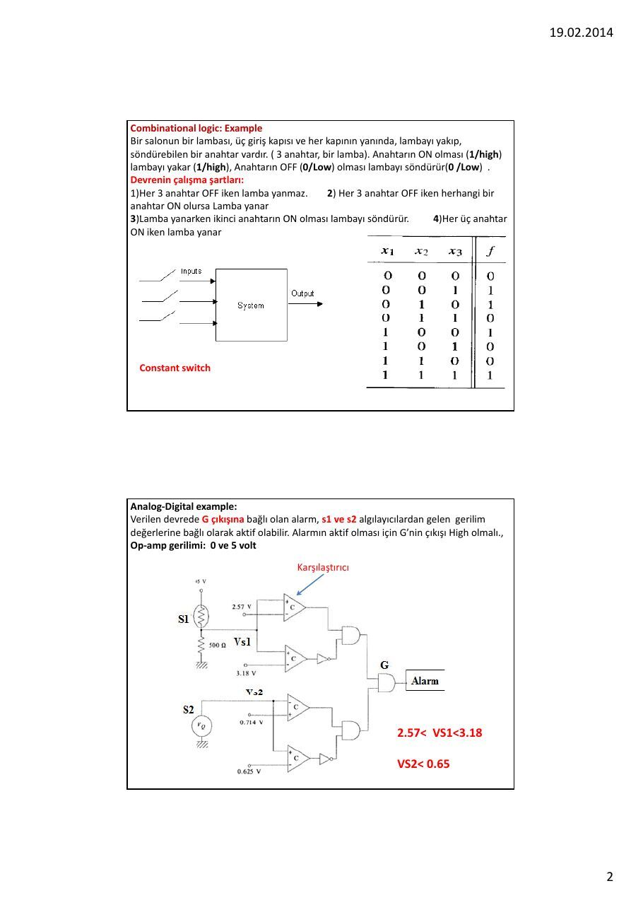
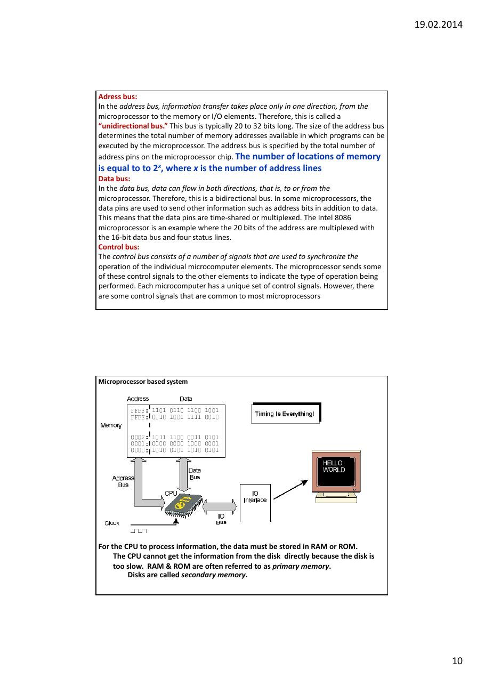
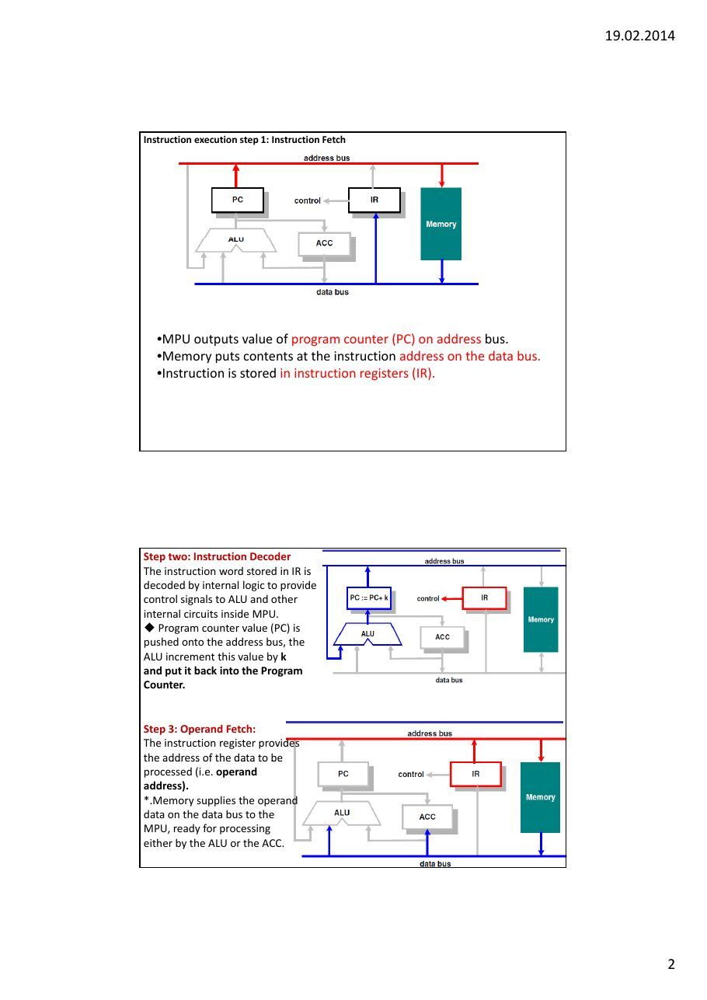
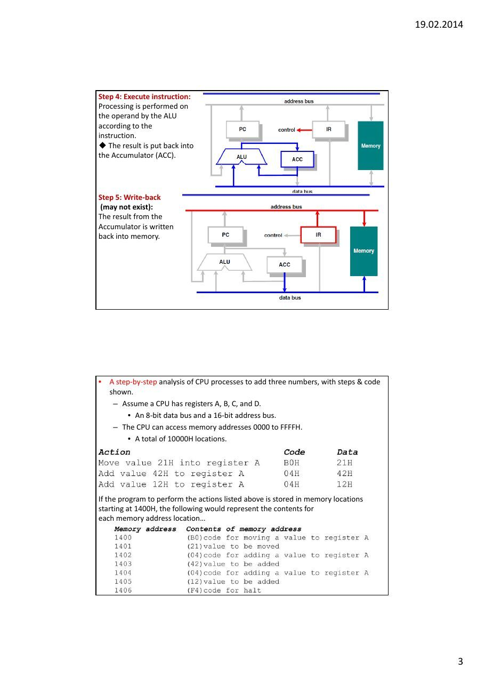

Bu yazı, Başkent Üniversitesi **EEM332 Mikroişlemciler** ders arşivindeki ilgili notları ve uygulamaları bir araya getiriyor (2004–2015). Mantık devreleri, komut çevrimi, CPU birimleri ve adres, veri, kontrol yolları; farklı yılların giriş notları. Belgelerin PDF arşiv kopyaları ve varsa kaynak kodları yazının sonunda ZIP olarak indirilebilir.

## CPU0_2013

### EEM332

Introduction to Microprocessor Review of logic circuits

### Combinational logic

Sequential logic

- Finite state machine (FAM)

- Memory

Microprocessor based system Instruction cycle Machine cycle

### Digital circuits

- Combinational circuit

- Sequential Circuits

Combinational logic: Example Bir salonun bir lambası, üç giriş kapısı ve her kapının yanında, lambayı yakıp, söndürebilen bir anahtar vardır. ( 3 anahtar, bir lamba). Anahtarın ON olması (1/high) lambayı yakar (1/high), Anahtarın OFF (0/Low) olması lambayı söndürür(0 /Low) .

### Devrenin çalışma şartları

### 1)Her 3 anahtar OFF iken lamba yanmaz.          2) Her 3 anahtar OFF iken herhangi bir

anahtar ON olursa Lamba yanar

### 3)Lamba yanarken ikinci anahtarın ON olması lambayı söndürür.           4)Her üç anahtar

ON iken lamba yanar

Constant switch

### Analog‐Digital example

Verilen devrede G çıkışına bağlı olan alarm, s1 ve s2 algılayıcılardan gelen gerilim değerlerine bağlı olarak aktif olabilir. Alarmın aktif olması için G’nin çıkışı High olmalı., Op‐amp gerilimi: 0 ve 5 volt

Karşılaştırıcı

### 2.57< VS1<3.18

### VS2< 0.65

Sequential logic (Flip Flop: Memory element)                   Input Switch : Momentary Switch

ON                                  D-Flip Flop ile kilitleme

### SET1

### U2:A

### 74S74

### R4               2

### S

### D          Q

470                                                    330

### 3                         LED-RED

```asm
CLK
```

### Q

### R

### LED-GREEN

10k

### RESET1

### OFF

Elevator Example (FSM) The elevator can be at one of two floors: Ground or First. There is one button that controls the elevator, and it has two values: Up or Down. Also, there are two lights in the elevator that indicate the current floor: Red for Ground, and Green for First. At each time step, the controller checks the current floor and current input, changes floors and lights in the obvious way. FSM diagram

### State diagram

State Machines A state machine is a digital circuit composed of "n" flip‐flops that are interconnected to one another and to other inputs, with Boolean logic, in order to generate 2n internal states. The movement from one state to another is determined by a combination of the Boolean logic interconnecting the flip‐flops and the inputs to the state machine. The internal states are then decoded with additional Boolean logic to provide useful outputs at required time intervals. A counter is therefore a very simple state machine.

Memory

### Access to memory

Adress, Data, control Read cycle, Write cycle


State machine and Microprocessor State machines are now most commonly used where microprocessor solutions are too expensive ( on very‐high‐volume, very‐low‐cost systems) or where it is necessary to perform very specific functions directly in hardware at a very high speed. The state machine is also of importance to us because it is really the basis of the modern microprocessor. In other words, a microprocessor is a generalised state machine that can be programmed to perform a specific sequence of functions. This is analogous to the PAL which is a generalised Boolean logic device that can be programmed to produce a required logic.

The design of state machines can become rather complex when a large number of internal states need to be produced and it is fair to say that most modern designers would prefer to apply microprocessors or Digital Signal Processors Microprocessor System: software‐programmable state machine.

```asm
In general, we refer to a microprocessor as being a single chip that is used as
```

the CPU of a computer or computer‐based system.

The microprocessor may be considered as a sophisticated state machine, A program instruction is nothing more than a specific bit pattern of ones and zeros that appears at the data port of the microprocessor. The state machine within the microprocessor has been designed to move from one state to another based upon those specific bit patterns.

The hardware design of the state machine within the microprocessor defines the course of events that will take place whenever a specific bit pattern arrives at the data port of the microprocessor. The hardware "programs" that are developed by the semiconductor manufacturers are known as micro‐code. Micro‐code is the lowest possible form of programming in microprocessors and it is the micro‐code that defines the characteristics of the processor that end‐users would recognise. Micro‐code is analogous to PAL programming in that it instils the logic that defines the operational sequence for a state machine and defines how it will move from one state to another, based upon bit patterns entering via the data bus.

Each cycle (tick) of the clock causes the microprocessor to jump from one internal state to another. As with other state machines, the "next state" of the microprocessor is determined by a logical combination of its current internal state, together with the condition of all the various input lines connected to it.

The microprocessor is a device composed of all the other elements of

### the Combinational and Sequential logic . These elements include

- State machines

- Counters

- Registers

- Numerical circuits (Addition, Subtraction, etc ALU)

- Boolean logic circuits (OR, AND, etc.)

- Combinational Boolean logic.

By utilizing these elements, at each cycle of the system clock, a microprocessor can execute a very simple operation ‐ read data in; write data out; store data in an internal register; add data contained in internal registers; compare data in internal registers and so on. So, The number of bits that a microprocessor can handle as data or instructions defines the "bit‐size" of the microprocessor. Typical sizes are 8, 16, 32 and 64 bits. Since both data and program instructions appear at the data bus of the microprocessor as a collection of ones and zeros, the microprocessor cannot differentiate between them in any way other than the sequence in which they arrive.

### The microprocessor

(i) It is a device based upon a state machine (ii) It contains a number of registers for temporary storage of data (iii) It contains numerical and logical circuits that can perform simple data manipulations between registers (eg: ADD, OR, etc.) (iv) It contains one input port for data (the data bus) and two output ports for data (the data bus and address bus) (v) The state machine has been designed (through micro‐coding) to respond to particular bit patterns entering the data port. The specific bit patterns are the instruction set for the microprocessor (vi) The microprocessor moves from state to state at a speed determined by a "system clock" which is generally provided by another external chip (vii) It takes one or more clock cycles to execute each instruction. The number of

```asm
clock cycles depends upon the architecture of the microprocessor (and its
```

micro‐coding) and the complexity of the instructions.

Points (vi) and (vii) are most important, since they are directly related to the performance of the microprocessor.

Microprocessor based system                 Address Bus ; Data Bus, Control Bus

CPU function is to execute (process) information stored in memory. I/O devices, such as keyboard & monitor provide a means of communicating with the

### CPU.

The CPU is connected to memory and I/O through a group of wires called a bus. Allows signals to carry information from place to place.

```asm
In every computer there are three types of buses: Address bus; Data bus; Control bus.
```

The microcontrollers are typically used for dedicated applications such as automotive systems, home appliances,

```asm
and home entertainment systems.
```

A microprocessor does not know anything about "C"

```asm
or Assembly Language.
```

- For a device (memory or I/O) to be recognized by the CPU, it must be assigned

an address.

- The address assigned to a given device must be unique.

- The CPU puts the address (in binary) on the address bus & decoding circuitry

finds the device.

- The CPU then uses the data bus either to get data from that device or to

send data to it.

- Control buses provide device read/write signals.

- To indicate if the CPU is asking for, or sending information.

### Adress bus

```asm
In the address bus, information transfer takes place only in one direction, from the
```

microprocessor to the memory or I/O elements. Therefore, this is called a “unidirectional bus.” This bus is typically 20 to 32 bits long. The size of the address bus determines the total number of memory addresses available in which programs can be executed by the microprocessor. The address bus is specified by the total number of

```asm
address pins on the microprocessor chip. The number of locations of memory
```

is equal to to 2x, where x is the number of address lines

### Data bus

```asm
In the data bus, data can flow in both directions, that is, to or from the
```

microprocessor. Therefore, this is a bidirectional bus. In some microprocessors, the data pins are used to send other information such as address bits in addition to data. This means that the data pins are time‐shared or multiplexed. The Intel 8086 microprocessor is an example where the 20 bits of the address are multiplexed with the 16‐bit data bus and four status lines.

### Control bus

The control bus consists of a number of signals that are used to synchronize the operation of the individual microcomputer elements. The microprocessor sends some of these control signals to the other elements to indicate the type of operation being performed. Each microcomputer has a unique set of control signals. However, there are some control signals that are common to most microprocessors

Microprocessor based system

For the CPU to process information, the data must be stored in RAM or ROM. The CPU cannot get the information from the disk directly because the disk is too slow. RAM & ROM are often referred to as primary memory. Disks are called secondary memory.

All common microprocessor follows this sequence

Microprocessor:??? The microprocessor is typically a single VLSI (Very Large‐Scale Integration) chip that contains all the registers, control unit, and arithmetic/ logic circuits of the microcomputer.

Machine instruction

```asm
Clock Signals
```

The system clock signals are contained in the control bus. These signals generate the appropriate clock periods during which instruction executions are carried out by the microprocessor. The clock signals vary from one microprocessor to another. Some microprocessors have an internal clock generator circuit to generate a clock signal.

A microprocessor chip with the main functional elements

Register Section The number, size, and types of registers vary from one microprocessor to another. However, the various registers in all microprocessors carry out similar operations. The register structures of microprocessors play a major role in designing the microprocessor architectures. Also, the register structures for a specific microprocessor determine how convenient and easy it is to program this microprocessor.

### Basic Microprocessor Registers

Instruction Register (IR). The instruction register stores instructions. The contents of an instruction register are always decoded by the microprocessor as an instruction.

Program Counter (PC). The program counter contains the address of the instruction

```asm
or operation code (op‐code). The program counter normally contains the address of
```

the next instruction to be executed.

- Upon activating the microprocessor’s RESET input, the address of the first instruction

to be executed is loaded into the program counter.

- The program counter contents are automatically incremented by the

microprocessor’s internal logic.

- The size of the program counter is determined by the size of the address bus.

- Many instructions, such as JUMP and conditional JUMP, change the contents of the

program counter from its normal sequential address value.

Memory Address Register (MAR). The memory address register contains the address of data. The microprocessor uses the address, which is stored in the memory

```asm
address register, as a direct pointer to memory.
```

Accumulator (A). For an 8 bit microprocessor, the accumulator is typically an 8bit register. It is used to store the result after most ALU operations.

Control Unit The main purpose of the control unit is to read and decode instructions from the program memory. To execute an instruction, the control unit steps through the appropriate blocks of the ALU based on the op‐codes contained in the instruction register. The op‐codes define the operations to be performed by the control unit in

```asm
order to execute an instruction. The control unit interprets the contents of the
```

instruction register and then responds to the instruction by generating a sequence of enable signals

RESET. This input is common to all microprocessors. When this input pin is driven to HIGH or LOW (depending on the microprocessor), the program counter is loaded with a predefined address specified by the manufacturer. For example, in the 80486, upon hardware reset, the program counter is loaded with FFFFFFF0

READ/WRITE: This output line is common to all microprocessors. The status of this line tells the other microcomputer elements whether the microprocessor is performing a READ or a WRITE operation. A HIGH signal on this line indicates a READ operation and a LOW indicates a WRITE operation. Some microprocessors have separate READ and WRITE pins.

READY. This is an input to the microprocessor. Slow devices (memory and I/O) use this signal to gain extra time to transfer data to or receive data from a microprocessor. The READY signal is usually an active low signal, that is, LOW means that the microprocessor is ready

Interrupt Request (INT or IRQ). The external I/O devices can interrupt the microprocessor via this input pin on the microprocessor chip. When this signal is activated by the external devices, the microprocessor jumps to a special program, called the “interrupt service routine.”

### Inside of Microprocessor : Arithmetic and Logic Unit (ALU)

The ALU performs all the data manipulations, such as arithmetic and logic operations, inside the microprocessor. The size of the ALU conforms to the word length of the microcomputer. This means that a 32‐bit microprocessor will have a 32‐bit ALU.

### Typically, the ALU performs the following functions

Arithmetic and Logic Unit (ALU)

### 1. Binary addition and logic operations

### 2. Finding the ones complement of data

### 3. Shifting or rotating the contents of a general‐purpose register 1 bit to the left or

right through carry

An assembler translates a program written in assembly language into a machine language program. A compiler or interpreter, on the other hand, converts a high‐level language program such as C or C++ into a machine language program. Assembly or high level language programs are called “source codes.” Machine language programs are known as “object codes.”

To increase the programmer’s efficiency in writing a machine language program, hexadecimal numbers rather than binary numbers are used Assembly Language The next programming level is to use the assembly language. Each line in an assembly

### language program includes four fields

### 1. Label field

### 2. Instruction,

mnemonic,

```asm
or op‐code field
```

3 . Operand field

### 4. Comment field

Assembly language


An Assembly language instruction consists of a mnemonic, optionally followed by one

```asm
or two operands.
```

Operands are the data items being manipulated. Mnemonics are commands to the CPU, telling it what to do with those items. Advantages of Assembly Language

1.Shows how program interfaces with the processor, operating system, and BIOS. 2.Shows how data is represented and stored in memory and on external devices. 3.Clarifies how processor accesses and executes instructions and how instructions access and process data. 4.Clarifies how a program accesses external devices.

### Reasons for using Assembly Language

### 1.    A program written in Assembly Language requires considerably less memory

```asm
and execution time than one written in a high –level language.
```

### 2. Assembly Language gives a programmer the ability to perform higly technical

tasks that would be difficult, if not impossible in a high‐level language.

### 3. Although most software specialists develop new applications in high‐level

languages, which are easier to write and maintain, a common practice is to recode in assembly language those sections that are time‐critical.

### 4. Resident programs (that reside in memory while other program execute) and

interrupt service routines (that handle input and output) are almost always develop in Assembly Language.

## CPU0_2013

### EEM332

Introduction to Microprocessor Review of logic circuits

### Combinational logic

Sequential logic

- Finite state machine (FAM)

- Memory

Microprocessor based system Instruction cycle Machine cycle

### Digital circuits

- Combinational circuit

- Sequential Circuits

Combinational logic: Example Bir salonun bir lambası, üç giriş kapısı ve her kapının yanında, lambayı yakıp, söndürebilen bir anahtar vardır. ( 3 anahtar, bir lamba). Anahtarın ON olması (1/high) lambayı yakar (1/high), Anahtarın OFF (0/Low) olması lambayı söndürür(0 /Low) .

### Devrenin çalışma şartları

### 1)Her 3 anahtar OFF iken lamba yanmaz.          2) Her 3 anahtar OFF iken herhangi bir

anahtar ON olursa Lamba yanar

### 3)Lamba yanarken ikinci anahtarın ON olması lambayı söndürür.           4)Her üç anahtar

ON iken lamba yanar

Constant switch

### Analog‐Digital example

Verilen devrede G çıkışına bağlı olan alarm, s1 ve s2 algılayıcılardan gelen gerilim değerlerine bağlı olarak aktif olabilir. Alarmın aktif olması için G’nin çıkışı High olmalı., Op‐amp gerilimi: 0 ve 5 volt

Karşılaştırıcı

### 2.57< VS1<3.18

### VS2< 0.65

Sequential logic (Flip Flop: Memory element)                   Input Switch : Momentary Switch

ON                                  D-Flip Flop ile kilitleme

### SET1

### U2:A

### 74S74

### R4               2

### S

### D          Q

470                                                    330

### 3                         LED-RED

```asm
CLK
```

### Q

### R

### LED-GREEN

10k

### RESET1

### OFF

Elevator Example (FSM) The elevator can be at one of two floors: Ground or First. There is one button that controls the elevator, and it has two values: Up or Down. Also, there are two lights in the elevator that indicate the current floor: Red for Ground, and Green for First. At each time step, the controller checks the current floor and current input, changes floors and lights in the obvious way. FSM diagram

### State diagram

State Machines A state machine is a digital circuit composed of "n" flip‐flops that are interconnected to one another and to other inputs, with Boolean logic, in order to generate 2n internal states. The movement from one state to another is determined by a combination of the Boolean logic interconnecting the flip‐flops and the inputs to the state machine. The internal states are then decoded with additional Boolean logic to provide useful outputs at required time intervals. A counter is therefore a very simple state machine.

Memory

### Access to memory

Adress, Data, control Read cycle, Write cycle


State machine and Microprocessor State machines are now most commonly used where microprocessor solutions are too expensive ( on very‐high‐volume, very‐low‐cost systems) or where it is necessary to perform very specific functions directly in hardware at a very high speed. The state machine is also of importance to us because it is really the basis of the modern microprocessor. In other words, a microprocessor is a generalised state machine that can be programmed to perform a specific sequence of functions. This is analogous to the PAL which is a generalised Boolean logic device that can be programmed to produce a required logic.

The design of state machines can become rather complex when a large number of internal states need to be produced and it is fair to say that most modern designers would prefer to apply microprocessors or Digital Signal Processors Microprocessor System: software‐programmable state machine.

```asm
In general, we refer to a microprocessor as being a single chip that is used as
```

the CPU of a computer or computer‐based system.

The microprocessor may be considered as a sophisticated state machine, A program instruction is nothing more than a specific bit pattern of ones and zeros that appears at the data port of the microprocessor. The state machine within the microprocessor has been designed to move from one state to another based upon those specific bit patterns.

The hardware design of the state machine within the microprocessor defines the course of events that will take place whenever a specific bit pattern arrives at the data port of the microprocessor. The hardware "programs" that are developed by the semiconductor manufacturers are known as micro‐code. Micro‐code is the lowest possible form of programming in microprocessors and it is the micro‐code that defines the characteristics of the processor that end‐users would recognise. Micro‐code is analogous to PAL programming in that it instils the logic that defines the operational sequence for a state machine and defines how it will move from one state to another, based upon bit patterns entering via the data bus.

Each cycle (tick) of the clock causes the microprocessor to jump from one internal state to another. As with other state machines, the "next state" of the microprocessor is determined by a logical combination of its current internal state, together with the condition of all the various input lines connected to it.

The microprocessor is a device composed of all the other elements of

### the Combinational and Sequential logic . These elements include

- State machines

- Counters

- Registers

- Numerical circuits (Addition, Subtraction, etc ALU)

- Boolean logic circuits (OR, AND, etc.)

- Combinational Boolean logic.

By utilizing these elements, at each cycle of the system clock, a microprocessor can execute a very simple operation ‐ read data in; write data out; store data in an internal register; add data contained in internal registers; compare data in internal registers and so on. So, The number of bits that a microprocessor can handle as data or instructions defines the "bit‐size" of the microprocessor. Typical sizes are 8, 16, 32 and 64 bits. Since both data and program instructions appear at the data bus of the microprocessor as a collection of ones and zeros, the microprocessor cannot differentiate between them in any way other than the sequence in which they arrive.

### The microprocessor

(i) It is a device based upon a state machine (ii) It contains a number of registers for temporary storage of data (iii) It contains numerical and logical circuits that can perform simple data manipulations between registers (eg: ADD, OR, etc.) (iv) It contains one input port for data (the data bus) and two output ports for data (the data bus and address bus) (v) The state machine has been designed (through micro‐coding) to respond to particular bit patterns entering the data port. The specific bit patterns are the instruction set for the microprocessor (vi) The microprocessor moves from state to state at a speed determined by a "system clock" which is generally provided by another external chip (vii) It takes one or more clock cycles to execute each instruction. The number of

```asm
clock cycles depends upon the architecture of the microprocessor (and its
```

micro‐coding) and the complexity of the instructions.

Points (vi) and (vii) are most important, since they are directly related to the performance of the microprocessor.

Microprocessor based system                 Address Bus ; Data Bus, Control Bus

CPU function is to execute (process) information stored in memory. I/O devices, such as keyboard & monitor provide a means of communicating with the

### CPU.

The CPU is connected to memory and I/O through a group of wires called a bus. Allows signals to carry information from place to place.

```asm
In every computer there are three types of buses: Address bus; Data bus; Control bus.
```

The microcontrollers are typically used for dedicated applications such as automotive systems, home appliances,

```asm
and home entertainment systems.
```

A microprocessor does not know anything about "C"

```asm
or Assembly Language.
```

- For a device (memory or I/O) to be recognized by the CPU, it must be assigned

an address.

- The address assigned to a given device must be unique.

- The CPU puts the address (in binary) on the address bus & decoding circuitry

finds the device.

- The CPU then uses the data bus either to get data from that device or to

send data to it.

- Control buses provide device read/write signals.

- To indicate if the CPU is asking for, or sending information.

### Adress bus

```asm
In the address bus, information transfer takes place only in one direction, from the
```

microprocessor to the memory or I/O elements. Therefore, this is called a “unidirectional bus.” This bus is typically 20 to 32 bits long. The size of the address bus determines the total number of memory addresses available in which programs can be executed by the microprocessor. The address bus is specified by the total number of

```asm
address pins on the microprocessor chip. The number of locations of memory
```

is equal to to 2x, where x is the number of address lines

### Data bus

```asm
In the data bus, data can flow in both directions, that is, to or from the
```

microprocessor. Therefore, this is a bidirectional bus. In some microprocessors, the data pins are used to send other information such as address bits in addition to data. This means that the data pins are time‐shared or multiplexed. The Intel 8086 microprocessor is an example where the 20 bits of the address are multiplexed with the 16‐bit data bus and four status lines.

### Control bus

The control bus consists of a number of signals that are used to synchronize the operation of the individual microcomputer elements. The microprocessor sends some of these control signals to the other elements to indicate the type of operation being performed. Each microcomputer has a unique set of control signals. However, there are some control signals that are common to most microprocessors

Microprocessor based system

For the CPU to process information, the data must be stored in RAM or ROM. The CPU cannot get the information from the disk directly because the disk is too slow. RAM & ROM are often referred to as primary memory. Disks are called secondary memory.

All common microprocessor follows this sequence

Microprocessor:??? The microprocessor is typically a single VLSI (Very Large‐Scale Integration) chip that contains all the registers, control unit, and arithmetic/ logic circuits of the microcomputer.

Machine instruction

```asm
Clock Signals
```

The system clock signals are contained in the control bus. These signals generate the appropriate clock periods during which instruction executions are carried out by the microprocessor. The clock signals vary from one microprocessor to another. Some microprocessors have an internal clock generator circuit to generate a clock signal.

A microprocessor chip with the main functional elements

Register Section The number, size, and types of registers vary from one microprocessor to another. However, the various registers in all microprocessors carry out similar operations. The register structures of microprocessors play a major role in designing the microprocessor architectures. Also, the register structures for a specific microprocessor determine how convenient and easy it is to program this microprocessor.

### Basic Microprocessor Registers

Instruction Register (IR). The instruction register stores instructions. The contents of an instruction register are always decoded by the microprocessor as an instruction.

Program Counter (PC). The program counter contains the address of the instruction

```asm
or operation code (op‐code). The program counter normally contains the address of
```

the next instruction to be executed.

- Upon activating the microprocessor’s RESET input, the address of the first instruction

to be executed is loaded into the program counter.

- The program counter contents are automatically incremented by the

microprocessor’s internal logic.

- The size of the program counter is determined by the size of the address bus.

- Many instructions, such as JUMP and conditional JUMP, change the contents of the

program counter from its normal sequential address value.

Memory Address Register (MAR). The memory address register contains the address of data. The microprocessor uses the address, which is stored in the memory

```asm
address register, as a direct pointer to memory.
```

Accumulator (A). For an 8 bit microprocessor, the accumulator is typically an 8bit register. It is used to store the result after most ALU operations.

Control Unit The main purpose of the control unit is to read and decode instructions from the program memory. To execute an instruction, the control unit steps through the appropriate blocks of the ALU based on the op‐codes contained in the instruction register. The op‐codes define the operations to be performed by the control unit in

```asm
order to execute an instruction. The control unit interprets the contents of the
```

instruction register and then responds to the instruction by generating a sequence of enable signals

RESET. This input is common to all microprocessors. When this input pin is driven to HIGH or LOW (depending on the microprocessor), the program counter is loaded with a predefined address specified by the manufacturer. For example, in the 80486, upon hardware reset, the program counter is loaded with FFFFFFF0

READ/WRITE: This output line is common to all microprocessors. The status of this line tells the other microcomputer elements whether the microprocessor is performing a READ or a WRITE operation. A HIGH signal on this line indicates a READ operation and a LOW indicates a WRITE operation. Some microprocessors have separate READ and WRITE pins.

READY. This is an input to the microprocessor. Slow devices (memory and I/O) use this signal to gain extra time to transfer data to or receive data from a microprocessor. The READY signal is usually an active low signal, that is, LOW means that the microprocessor is ready

Interrupt Request (INT or IRQ). The external I/O devices can interrupt the microprocessor via this input pin on the microprocessor chip. When this signal is activated by the external devices, the microprocessor jumps to a special program, called the “interrupt service routine.”

### Inside of Microprocessor : Arithmetic and Logic Unit (ALU)

The ALU performs all the data manipulations, such as arithmetic and logic operations, inside the microprocessor. The size of the ALU conforms to the word length of the microcomputer. This means that a 32‐bit microprocessor will have a 32‐bit ALU.

### Typically, the ALU performs the following functions

Arithmetic and Logic Unit (ALU)

### 1. Binary addition and logic operations

### 2. Finding the ones complement of data

### 3. Shifting or rotating the contents of a general‐purpose register 1 bit to the left or

right through carry

An assembler translates a program written in assembly language into a machine language program. A compiler or interpreter, on the other hand, converts a high‐level language program such as C or C++ into a machine language program. Assembly or high level language programs are called “source codes.” Machine language programs are known as “object codes.”

To increase the programmer’s efficiency in writing a machine language program, hexadecimal numbers rather than binary numbers are used Assembly Language The next programming level is to use the assembly language. Each line in an assembly

### language program includes four fields

### 1. Label field

### 2. Instruction,

mnemonic,

```asm
or op‐code field
```

3 . Operand field

### 4. Comment field

Assembly language


An Assembly language instruction consists of a mnemonic, optionally followed by one

```asm
or two operands.
```

Operands are the data items being manipulated. Mnemonics are commands to the CPU, telling it what to do with those items. Advantages of Assembly Language

1.Shows how program interfaces with the processor, operating system, and BIOS. 2.Shows how data is represented and stored in memory and on external devices. 3.Clarifies how processor accesses and executes instructions and how instructions access and process data. 4.Clarifies how a program accesses external devices.

### Reasons for using Assembly Language

### 1.    A program written in Assembly Language requires considerably less memory

```asm
and execution time than one written in a high –level language.
```

### 2. Assembly Language gives a programmer the ability to perform higly technical

tasks that would be difficult, if not impossible in a high‐level language.

### 3. Although most software specialists develop new applications in high‐level

languages, which are easier to write and maintain, a common practice is to recode in assembly language those sections that are time‐critical.

### 4. Resident programs (that reside in memory while other program execute) and

interrupt service routines (that handle input and output) are almost always develop in Assembly Language.





## CPU01_2013

EEM332 Lecture1. Design a simple CPU Read/Write Steps Machine cycle

Design a simple CPU

Instruction execution step 1: Instruction Fetch

- MPU outputs value of program counter (PC) on address bus.

- Memory puts contents at the instruction address on the data bus.

- Instruction is stored in instruction registers (IR).

Step two: Instruction Decoder The instruction word stored in IR is

```asm
decoded by internal logic to provide
```

control signals to ALU and other internal circuits inside MPU. ◆ Program counter value (PC) is pushed onto the address bus, the ALU increment this value by k

```asm
and put it back into the Program
Counter.
```

### Step 3: Operand Fetch

The instruction register provides the address of the data to be processed (i.e. operand

```asm
address).
```

*.Memory supplies the operand data on the data bus to the MPU, ready for processing either by the ALU or the ACC.

### Step 4: Execute instruction

Processing is performed on the operand by the ALU according to the instruction. ◆ The result is put back into the Accumulator (ACC).

Step 5: Write‐back

### (may not exist)

The result from the Accumulator is written back into memory.

- A step‐by‐step analysis of CPU processes to add three numbers, with steps & code

shown.

- Assume a CPU has registers A, B, C, and D.

- An 8‐bit data bus and a 16‐bit address bus.

- The CPU can access memory addresses 0000 to FFFFH.

- A total of 10000H locations.

If the program to perform the actions listed above is stored in memory locations starting at 1400H, the following would represent the contents for each memory address location…

The CPU puts the address 1400H on the address bus and sends it out.Memory finds the location while the CPU activates the READ signal, indicating it wants the byte at 1400H. The content (B0) is put on the data bus & brought to the CPU.

The CPU decodes the instruction B0 with the help of its instruction decoder dictionary. Bring the byte of the next memory location into CPU Register A.

From memory location 1401H, the CPU fetches code 21H directly to Register A.After completing the instruction, the program counter points to the address of the next instruction ‐ 1402H.Address 1402H is sent out on the address bus, to fetch the next instruction

From 1402H, the CPU fetches code 04H. After decoding, the CPU knows it must add the byte at the next address (1403) to the contents of register A. After it brings the value (42H) into the CPU, it provides the contents of Register A, along with this value to the ALU to perform the addition. Program counter becomes 1404, the next instruction address

```asm
Address 1404H is put on the address bus and the code is fetched, decoded, and
```

executed. Again adding a value to Register A. The program counter is updated to

### 1406H

The contents of address 1406 (HALT code) are fetched in and executed.The HALT instruction tells the CPU to stop incrementing the program counter and asking for the next instruction. Without HALT, the CPU would continue updating the program counter

```asm
and fetching instructions.
```

◆ Microprocessors performs operations depending on instruction codes stored in memory.

### ◆ Instruction usually has two parts

❖ Opcode ‐ determines what is to be done ❖ Operand ‐ specifies where/what is the data ◆ Program Counter (PC) ‐ address of current instruction code ◆ PC incremented automatically each time it is used. ◆ The number of clock cycles taken by an instruction is the same as the number of memory access it makes. Memory contains both program and data. A peek into memory will tell you very little except a bunch of ‘1’s and ‘0’s. ◆ Program area and data area in memory are usually well separated. ◆ ALU is responsible for arithmetic and logic functions. ◆ There is always at least one register known as accumulator where the result from ALU is stored. ◆ There is usually one or more general purpose register for storing results or memory addresses. ◆ Fetching data from inside the CPU is much faster than from external memory. ◆ The processor must start from a known state. Therefore, there is always a reset signal to initialise the processor on power‐up.

A Simplified view of MPU program execution A MPU program is stored in memory as a sequence of binary values. These binary values represent instructions. Each instruction has an unique binary value. The MPU operation is controlled by reading and executing each instruction one at a time.

### 1.   The MPU places an address on the

```asm
ADDRESS BUS.
```

The address is a binary value which

```asm
represents a unique
```

memory location.

### 2. The Memory places the contents of the addressed

location onto the DATA BUS. The contents is a binary value.

### 3. The MPU reads the binary

value from the DATA BUS.

### 4. The MPU interprets

what operation the BINARY Value represents and completes (executes) this operation

### 5. The MPU has completed its first instruction of the

program stored as binary values in the memory.

The MPU needs to be told what to do next. The next instruction is in the next memory location. Stages

### 1. through 4. are repeated,

Note. At Stage 1. The MPU places a new binary value onto the ADDRESS BUS. This is the memory location of the next instruction. The binary value on the ADDRESS BUS has only changed by 1.

How the MPU writes data to Memory

This instruction is

```asm
decoded as
```

### SEND TEMP2

contents to

```asm
ADDRESS
```

The MPU instruction decode logic now need to execute this instruction SEND TEMP2 to an ADDRESS

### TO WHAT ADDRESS …

This particular MPU instruction decodes as saying that the DESTINATION ADDRESS will be in the next memory location. The MPU then fetches the binary value from the next location, as this will be the

```asm
ADDRESS where TEMP2 contents will be SENT.
```

The Destination ADDRESS data has been fetched from memory and stored in a TEMP register.

The TEMP register holds the DESTINATION ADDRESS where we wish the SEND our DATA (Binary Value) which is stored in TEMP2 register.

We do not try to decode the contents of TEMP because it is not an instruction, it is data associated with a specific operation, it is known as an OPERAND

WHAT HAPPENS NEXT .. Remember we want TEMP2 contents to be sent to the MEMORY ADDRESS which is currently held in TEMP.

The contents of TEMP register are placed on the

```asm
ADDRESS BUS.
```

The MEMORY WRITE part of our instruction has started. In this phase, since we are sending DATA to MEMORY or WRITING TO MEMORY we must be accessing a MEMORY store which allows us to do so.

ROM is read only memory, where our program is stored, we cannot write to it. The RAM random access memory ,(read/write memory) is where our DATA will be written. Notice the control signal lines on each of the memory types.

The ADDRESS is a memory location within the RAM, the TEMP2 register places its contents onto the DATA BUS.

The RAM reads the DATA BUS value and stores it at the location which the ADDRESS value is accessing. NOTICE THE WR signal is ACTIVE

The instruction has now completed executing The result of this operation is that the contents of TEMP2 register have been WRITTEN to a RAM Memory location 11111111.

Prior to the DATA WRITE the contents of RAM location was 00001111. After the MEMORY WRITE RAM Memory location now contains 11110000 the previous DATA value has been overwritten.

### A Quick Review 

The MPU fetches instructions one at a time from memory The instruction is interpreted by MPU and then this operation is executed. This called the FETCH DECODE EXECUTE CYCLE. The program, sequence of instructions are held in consecutive memory locations.

We have seen that not every binary value read from memory is an instruction. Some of the values can be DATA associated with an instruction.

Read cycle (Machine cycle)

Simple Read Cycle

### 1. Address onto Address Bus

### 2. READ (RD) Control Signal Asserted by MPU

### 3. Data Placed from Memory onto the Data Bus

### 4. RD signal De-Asserted, Data into MPU temp register.

### 5. Read Cycle Ends

Write Cycle

### 1. Address placed on ADDRESS BUS

### 2. Data placed onto DATA BUS

### 3. Write (WR) Control Signal Asserted by MPU

### 4. Write (WR) Control Signal De-Asserted and Data

Written into Memory

### 5. Write Cycles completes.

Write cycle (Machine cycle)

Pipeline Timing Diagram

Figure 1‐2 Pipelined vs Nonpipelined Execution

Abstract

- CPU clock frequency determines the speed of the microcomputer.

- The number of data and address pins on the microprocessor chip make up the

microcomputer’s word size and maximum memory size. The microcomputer’s I/O

```asm
and interfacing capabilities are determined by the control pins on the
```

microprocessor chip.

- The microprocessor is a single chip which is capable of processing data and

controlling all of the components which make up the microcomputer system. It contains all of the circuits needed to create the ‘brain of the microcomputer’.

- 1. Temporary storage locations in the form of a number

- of registers which can hold binary values (information),

- representing program instruction or data.

- 2. The Arithmetic Logic unit (ALU). This part of the MPU

- performs both arithmetic and logical operations

- 3. Timing and Control Circuits : that keep all of the other

- parts of system (memory & I/O) working together in the right time sequence.

- A Bus is a common communications pathway used to carry information between

the various elements of a computer system The term BUS refers

- to a group of wires or conduction tracks on a printed circuit board (PCB)

- though which binary information is transferred from one part of the microcomputer

to another

### Data Bus

The Data Bus carries the data which is transferred throughout the system. ( bi‐ directional)

```asm
Address Bus:
```

An address is a binary number that identifies a specific memory storage location or I/O port involved in a data transfer

The Address Bus is used to transmit the address of the location to the memory or the I/O port. The Address Bus is unidirectional ( one way ): addresses are always issued by the

### MPU.

The Control Bus: is another group of signals whose functions are to provide synchronization ( timing control ) between the MPU and the other system components. Control signals are unidirectional, and are mainly outputs from the MPU. Example Control signals

- Registers ‐ to store information temporarily. 8, 16, 32, bit, depending on CPU.

- Program counter ‐ to point to the address of the

next instruction to be executed.

- In the IBM PC, a register called IP or instruction pointer.

- Instruction decoder ‐ to interpret the instruction

fetched into the CPU.

Bus Sizes: Buses are specified in width, number of bits. The width of the external Data bus generally gives a very good indication of the internal MPU architecture, particularly the registers size and the ALU. The Data Bus width limits the bandwidth of the data that can be transferred per bus operation.

```asm
Address Bus :
```

The MPU Address bus size specifies how much memory and I/O locations may accessed. Number of locations = 2N where N is number of Address lines The Address Bus may be specified using the following 16 Bits Wide, ( A15 to A0 ), 16 Address Lines : In this instance 2N = 216 = 65536 locations Microprocessors are classified by

- The semiconductor technology of their design (TTL, transistor‐transistor logic;

CMOS, complementary‐metal‐oxide semiconductor; or ECL, emitter‐coupled logic),

- The width of the data format (4‐bit, 8‐bit, 16‐bit, 32‐bit, or 64‐bit) they process; and

by their

- instruction set (CISC, complex‐instruction‐set computer, or RISC, reduced‐

instruction‐set computer; see RISC processor). Von Neumann or Harvard (Memory usage)

What is Microprocessor ? It is a program controlled semiconductor device (IC}, which fetches,

```asm
decode and executes instructions.
```

What is the function of microprocessor in a system? The microprocessor is the master in the system, which controls all the activity of the system. It issues address and control signals and fetches the instruction

```asm
and data from memory. Then it executes the instruction to take appropriate
action.
```

What are the basic units of a microprocessor ? The basic units or blocks of a microprocessor are ALU, an array of registers and control unit. what is Software and Hardware? The Software is a set of instructions or commands needed for performing a specific task by a programmable device or a computing machine. Without software the Hardware is an idle machine.

What is assembly language? The language in which the mnemonics (short -hand form of instructions) are used to write a program is called assembly language. The manufacturers of microprocessor give the mnemonics. What are machine language and assembly language programs? The software developed using 1's and 0's are called machine language, programs. The software developed using mnemonics are called assembly language programs. What is the drawback in machine language and assembly language, programs? The machine language and assembly language programs are machine dependent. The programs developed using these languages for a particular machine cannot be directly run on another machine . Assembly language is referred to as a low‐level language because it deals directly with the internal structure of the CPU.

Define opcode and operand. Opcode (Operation code) is the part of an instruction / directive that identifies a specific operation. Operand is a part of an instruction / directive that represents a value on which the instruction acts. What is pipelined architecture?

```asm
In pipelined architecture the processor will have number of functional
```

units and the execution time of functional units are overlapped. Each functional unit works independently most of the time. What is fetch and execute cycle?

```asm
In general, the instruction cycle of an instruction can be divided into
```

fetch and execute cycles. The fetch cycle is executed to fetch the opcode from memory. The execute cycle is executed to decode the instruction and to perform the work instructed by the instruction. Assembly language is referred to as a low‐level language because it deals directly with the internal structure of the CPU.

Define machine cycle. Machine cycle is defined as the time required to complete one operation of accessing memory, I/O, or acknowledging an external request. This cycle may consist of three to six T-states. What is processor cycle (Machine cycle)? The processor cycle or machine cycle is the basic operation performed by the processor. To execute an instruction, the processor will run one or more machine cycles in a particular order. What is Instruction cycle? The sequence of operations that a processor has to carry out while executing the instruction is called Instruction cycle. Each instructioncycle of a processor indium consists of a number of machine cycles. What is opcode fetch cycle? The opcode fetch cycle is a machine cycle executed to fetch the opcode of an instruction stored in memory. Every instruction starts with opcode fetch machine cycle.

Why interfacing is needed for 1/0 devices? Generally I/O devices are slow devices. Therefore the speed of I/O devices does not match with the speed of microprocessor. And so an interface is provided between system bus and I/O devices. What is the need for Port? The I/O devices are generally slow devices and their timing characteristics do not match with processor timings. Hence the I/O devices are connected to system bus through the ports. .What is a port? The port is a buffered I/O, which is used to hold the data transmitted from the microprocessor to I/O device or vice-versa. Flip Flop: A flip‐flop stores one bit of information. Register: When a set of n flip‐flops is used to store n bits of information, such as an n‐ bit number, we refer to these flip‐flops as a register. A common clock is used for each flip‐flop in a register, shift register.:A register that provides the ability to shift its contents is called a shift register.





## cpu01_08

Microprocessor based system

```asm
Address Bus
```

Data Bus Control Bus

The CPU is a unit that fetches and processes a set of general-purpose instructions

A microprocessor does not know anything about "C" or Assembly Language.

Microprocessor based system

Bus Arbitration

```asm
Address Bus
```

CPU            Interrupt System Data Bus

Control Signals                           Status Lines

All Microcomputers consist of:        Clock         Power Supply

### 1. Microprocessor Unit (MPU)

### 2. Program Memory (ROM)

### 3. Data Memory (RAM)

### 4. Input / Output System

### 5. Bus System

(and Software)

The microprocessor is a single chip which is capable of processing data and controlling all of the components which make up the microcomputer system. It contains all of the circuits needed to create the ‘brain of the microcomputer’.

### 1. Temporary storage locations in the form of a number

of registers which can hold binary values (information),

```asm
representing program instruction or data.
```

### 2. The Arithmetic Logic unit (ALU). This part of the MPU

performs both arithmetic and logical operations

### 3. Timing and Control Circuits : that keep all of the other

parts of system (memory & I/O) working together in the right time sequence.

A Bus is a common communications pathway used to carry information between the various elements of a computer system The term BUS refers to a group of wires or conduction tracks on a printed circuit board

### (PCB)

though which binary information is transferred from one part of the microcomputer to another

There are three main bus groups

### 1. ADDRESS BUS

### 2. DATA BUS

### 3. CONTROL BUS

### Data Bus

The Data Bus carries the data which is transferred throughout the system. ( bi-directional)

```asm
Address Bus:
```

An address is a binary number that identifies a specific memory storage location or I/O port involved in a data transfer

The Address Bus is used to transmit the address of the location to the memory or the I/O port. The Address Bus is unidirectional ( one way ): addresses are always issued by the MPU.

The Control Bus: is another group of signals whose functions are to provide synchronization ( timing control ) between the MPU and the other system components. Control signals are unidirectional, and are mainly outputs from the MPU. Example Control signals RD read signal asserted to read data into MPU WR write signal asserted to write data from MPU

Bus Sizes: Buses are specified in width, number of bits.

The width of the external Data bus generally gives a very good indication of the internal MPU architecture, particularly the registers size and the ALU.

The Data Bus width limits the bandwidth of the data that can be transferred per bus operation.

```asm
Address Bus :
```

The MPU Address bus size specifies how much memory

```asm
and I/O locations may accessed.
```

Number of locations = 2N where N is number of Address lines The Address Bus may be specified using the following 16 Bits Wide, ( A15 to A0 ), 16 Address Lines

```asm
In this instance 2N = 216 = 65536 locations
```

Microprocessors are classified by

- The semiconductor technology of their design (TTL, transistor-

transistor logic; CMOS, complementary-metal-oxide semiconductor;

```asm
or ECL, emitter-coupled logic),
```

- The width of the data format (4-bit, 8-bit, 16-bit, 32-bit, or 64-bit)

they process; and by their

- instruction set (CISC, complex-instruction-set computer, or RISC,

reduced-instruction-set computer; see RISC processor). von Neumann or Harvard (Memory usage)

von Neumann

Harvard architecture

All common microprocessor follows this sequence

Get Instruction from memory

### FETCH

Next              Decode Instruction     DECODE Instruction

Execute       EXECUTE Instruction

Instruction Main Main Memory Memory                                         Cycle

Control Unit Fetch             2    Decode

Execution CPU                     Cycle

### RAM

3       Execute 4   Store

Arithmetic/Logic Unit

```asm
Includes Cache
```

(very fast memory)

A Simplified view of MPU program execution A MPU program is stored in memory as a sequence of binary values. These binary values represent instructions. Each instruction has an unique binary value. The MPU operation is controlled by reading and executing each instruction one at a time.

### 1. The MPU places an

```asm
address on the ADDRESS
BUS.
```

The address is a binary value which represents a unique memory location.

### 2. The Memory places the contents of the addressed

location onto the DATA BUS. The contents is a binary value.

### 3. The MPU reads the binary

value from the DATA BUS.

### 4. The MPU interprets

what operation the BINARY Value represents and completes (executes) this operation

### 5. The MPU has completed its first instruction of the

program stored as binary values in the memory.

The MPU needs to be told what to do next. The next instruction is in the next memory location. Stages

### 1. through 4. are repeated,

Note. At Stage 1. The MPU places a new binary value onto the ADDRESS BUS. This is the memory location of the next instruction. The binary value on the ADDRESS BUS has only changed by 1.

How the MPU writes data to Memory

This instruction is

```asm
decoded as
```

### SEND TEMP2

contents to

```asm
ADDRESS
```

The MPU instruction decode logic now need to execute this instruction SEND TEMP2 to an ADDRESS

### TO WHAT ADDRESS …

This particular MPU instruction decodes as saying that the DESTINATION ADDRESS will be in the next memory location. The MPU then fetches the binary value from the next location, as this will be the

```asm
ADDRESS where TEMP2 contents will be SENT.
```

The Destination ADDRESS data has been fetched from memory and stored in a TEMP register.

### WHAT HAPPENS NEXT ?

The TEMP register holds the DESTINATION ADDRESS where we wish the SEND our DATA (Binary Value) which is stored in TEMP2 register.

We do not try to decode the contents of TEMP because it is not an instruction, it is data associated with a specific operation, it is known as an OPERAND

### WHAT HAPPENS NEXT ..

Remember we want TEMP2 contents to be sent to the MEMORY ADDRESS which is currently held in

### TEMP.

The contents of TEMP register are placed on the

```asm
ADDRESS BUS.
```

The MEMORY WRITE part of our instruction has started. In this phase, since we are sending DATA to MEMORY or WRITING TO MEMORY we must be accessing a MEMORY store which allows us to do so.

ROM is read only memory, where our program is stored, we cannot write to it.

The RAM random access memory ,(read/write memory) is where our DATA will be written.

Notice the control signal lines on each of the memory types.

The ADDRESS is a memory location within the RAM, the TEMP2 register places its contents onto the DATA BUS.

The RAM reads the DATA BUS value and stores it at the location which the ADDRESS value is accessing. NOTICE THE WR signal is ACTIVE

The instruction has now completed executing The result of this operation is that the contents of TEMP2 register have been WRITTEN to a RAM Memory location 11111111.

Prior to the DATA WRITE the contents of RAM location was 00001111. After the MEMORY WRITE RAM Memory location now contains 11110000 the previous DATA value has been overwritten.

### A Quick Review 

The MPU fetches instructions one at a time from memory The instruction is interpreted by MPU and then this operation is executed. This called the FETCH DECODE EXECUTE CYCLE. The program, sequence of instructions are held in consecutive memory locations.

We have seen that not every binary value read from memory is an instruction. Some of the values can be DATA associated with an instruction.

Read cycle (Machine cycle)

Simple Read Cycle

### 1. Address onto Address Bus

### 2. READ (RD) Control Signal Asserted by MPU

### 3. Data Placed from Memory onto the Data Bus

### 4. RD signal De-Asserted, Data into MPU temp register.

### 5. Read Cycle Ends

Write Cycle

### 1. Address placed on ADDRESS BUS

### 2. Data placed onto DATA BUS

### 3. Write (WR) Control Signal Asserted by MPU

### 4. Write (WR) Control Signal De-Asserted and Data

Written into Memory

### 5. Write Cycles completes.

Write cycle (Machine cycle)

Pipeline Timing Diagram

Pipeline Stages

- Different architectures use different number of stages

- smaller pipelines have less complexity

- larger pipelines are generally faster

- here, we decompose the fetch-execute cycle into 6 stages:

- FI – fetch instruction

- DI – decode instruction

- CO – calculate operand addresses

- FO – fetch operands (from registers)

- EI – execute instruction (includes computing branch

results and all ALU operations)

- WO – write or store result in registers (or memory)

- the design of the pipeline stages has a major impact on the

architecture’s performance

Levels of Programming Languages

### 1) Machine Language

- Consists of individual instructions that will be executed by the CPU one at

a time

### 2) Assembly Language (Low Level Language)

- Designed for a specific family of processors (different processor

groups/family has different Assembly Language)

- Consists of symbolic instructions directly related to machine language

instructions one-for-one and are assembled into machine language. ) High Level Languages

- e.g. : C, C++ and Vbasic

- Designed to eliminate the technicalities of a particular computer.

- Statements compiled in a high level language typically generate many low-

level instructions.

Advantages of Assembly Language

### 1. Shows how program interfaces with the

processor, operating system, and BIOS.

### 2. Shows how data is represented and stored

```asm
in memory and on external devices.
```

### 3. Clarifies how processor accesses and

executes instructions and how instructions access and process data.

### 4. Clarifies how a program accesses external

devices.

Reasons for using Assembly Language

### 1.    A program written in Assembly Language requires

considerably less memory and execution time than one written

```asm
in a high –level language.
```

### 2.   Assembly Language gives a programmer the ability to perform

higly technical tasks that would be difficult, if not impossible in a high-level language.

### 3.   Although most software specialists develop new applications in

high-level languages, which are easier to write and maintain, a common practice is to recode in assembly language those sections that are time-critical.

### 4.   Resident programs (that reside in memory while other program

execute) and interrupt service routines (that handle input and output) are almost always develop in Assembly Language.

High Level Language Level Language

Assembly Language for Language for A:=B+C

Machine Code for Code for A:=B+C

Instruction Execution Cycle

- The sequence of steps the processor goes through to

do the complete instruction and to get ready for the next, until the program is finished or stopped

- Specific steps (simplified)

- IF: instruction fetched

- ID: instruction decoded, control signals asserted

- RT/EX: register transfer and/or execution

- PC: increment program counter

- These steps are repeated for each instruction execution

cycle until the program is done, or until something is done to make the program stop

- Opcodes are represented by abbreviations,

called mnemonics, that indicate the

### operation. Coomon examples

- ADD Add

- SUB      Subtract

- DIV      Divide

- LOAD Load data from memory

- STOR Store data to memory

Y = (A-B) / (C+D x E) Instruction             Comment

- SUB Y, A, B           • Y        A-B

- MPY T, D, E           • T        DxE

- ADD T, T, C           • T        T+C

- DIV Y, Y, T           • Y        Y/ T

Three-address instructions

Y = (A-B) / (C+D x E)

- MOVE Y, A

- SUB Y, B

- MOVE T, D

- MPY T, E

- ADD T, C

- DIV Y, T

Two-address instructions

Y = (A-B) / (C+D x E) iNSTRUCTIONS                  Comment

- LOAD D                      • AC      D

- MPY E

- AC      AC x E

- ADD C

- STOR Y

- AC      AC + C

- LOAD A                      • Y       AC

- SUB B                       • AC      A

- DIV Y                       • AC      AC – B

- STOR Y                      • AC      AC / Y

- Y       AC

One-address Instructions

The basic function as stated is to perform logic and maths operations. The Accumulator and the Flags registers play an important role in the operation of the ALU.

The Accumulator is used in all ALU operations.

The Flags or Status Register is a group of bits representing the result of the ALU operation. The Flags register contains bits such as (OV) representing an overflow flag. If the result of an

```asm
addition is greater than 255 then the OV is set to indicate
```

this condition. More Details to come. The type of functions performed by the ALUs of MPU

```asm
include
```

```asm
Addition   Shift Left Subtraction             Shift Right
```

Logical AND      Decrement Logical OR     Increment Logical XOR

What is Microprocessor ? It is a program controlled semiconductor device (IC}, which fetches, decode and executes instructions. What is the function of microprocessor in a system? The microprocessor is the master in the system, which controls all the activity of the system. It issues address and control signals and fetches the instruction and data from memory. Then it executes the instruction to take appropriate action.

What are the basic units of a microprocessor ? The basic units or blocks of a microprocessor are ALU, an array of registers and control unit. what is Software and Hardware? The Software is a set of instructions or commands needed for performing a specific task by a programmable device or a computing machine. Without software the Hardware is an idle machine.

What is assembly language? The language in which the mnemonics (short -hand form of instructions) are used to write a program is called assembly language. The manufacturers of microprocessor give the mnemonics. What are machine language and assembly language programs? The software developed using 1's and 0's are called machine language, programs. The software developed using mnemonics are called assembly language programs. What is the drawback in machine language and assembly language, programs? The machine language and assembly language programs are machine dependent. The programs developed using these languages for a particular machine cannot be directly run on another machine .

Define opcode and operand. Opcode (Operation code) is the part of an instruction / directive that identifies a specific operation. Operand is a part of an instruction / directive that represents a value on which the instruction acts. What is pipelined architecture?

```asm
In pipelined architecture the processor will have number of functional
```

units and the execution time of functional units are overlapped. Each functional unit works independently most of the time. What is fetch and execute cycle?

```asm
In general, the instruction cycle of an instruction can be divided into
```

fetch and execute cycles. The fetch cycle is executed to fetch the opcode from memory. The execute cycle is executed to decode the instruction and to perform the work instructed by the instruction.

Define machine cycle. Machine cycle is defined as the time required to complete one operation of accessing memory, I/O, or acknowledging an external request. This cycle may consist of three to six T-states. What is processor cycle (Machine cycle)? The processor cycle or machine cycle is the basic operation performed by the processor. To execute an instruction, the processor will run one or more machine cycles in a particular order. What is Instruction cycle? The sequence of operations that a processor has to carry out while executing the instruction is called Instruction cycle. Each instructioncycle of a processor indium consists of a number of machine cycles. What is opcode fetch cycle? The opcode fetch cycle is a machine cycle executed to fetch the opcode of an instruction stored in memory. Every instruction starts with opcode fetch machine cycle.

Why interfacing is needed for 1/0 devices? Generally I/O devices are slow devices. Therefore the speed of I/O devices does not match with the speed of microprocessor. And so an interface is provided between system bus and I/O devices.

What is the need for Port? The I/O devices are generally slow devices and their timing characteristics do not match with processor timings. Hence the I/O devices are connected to system bus through the ports. .What is a port? The port is a buffered I/O, which is used to hold the data transmitted from the microprocessor to I/O device or vice-versa.

## cpu01_06

Microprocessor based system

```asm
Address Bus
```

Data Bus Control Bus

Bus Arbitration

```asm
Address Bus
```

CPU                Interrupt System Data Bus

Control Signals                                Status Lines

All Microcomputers consist of:       Clock         Power Supply

### 1. Microprocessor Unit (MPU)

### 2. Program Memory (ROM)

### 3. Data Memory (RAM)

### 4. Input / Output System

### 5. Bus System

(and Software)

The microprocessor is a single chip which is capable of processing data and controlling all of the components which make up the microcomputer system. It contains all of the circuits needed to create the ‘brain of the microcomputer’.

### 1. Temporary storage locations in the form of a number

of registers which can hold binary values (information),

```asm
representing program instruction or data.
```

### 2. The Arithmetic Logic unit (ALU). This part of the MPU

performs both arithmetic and logical operations

### 3. Timing and Control Circuits : that keep all of the other

parts of system (memory & I/O) working together in the right time sequence.

A Bus is a common communications pathway used to carry information between the various elements of a computer system The term BUS refers to a group of wires or conduction tracks on a printed circuit board

### (PCB)

though which binary information is transferred from one part of the microcomputer to another

There are three main bus groups

### 1. ADDRESS BUS

### 2. DATA BUS

### 3. CONTROL BUS

### Data Bus

The Data Bus carries the data which is transferred throughout the system. ( bi-directional)

```asm
Address Bus:
```

An address is a binary number that identifies a specific memory storage location or I/O port involved in a data transfer

The Address Bus is used to transmit the address of the location to the memory or the I/O port. The Address Bus is unidirectional ( one way ): addresses are always issued by the MPU.

The Control Bus: is another group of signals whose functions are to provide synchronization ( timing control ) between the MPU and the other system components. Control signals are unidirectional, and are mainly outputs from the MPU. Example Control signals RD read signal asserted to read data into MPU WR write signal asserted to write data from MPU

A Simplified view of MPU program execution A MPU program is stored in memory as a sequence of binary values. These binary values represent instructions. Each instruction has an unique binary value. The MPU operation is controlled by reading and executing each instruction one at a time.

### 1. The MPU places an

```asm
address on the ADDRESS
BUS.
```

The address is a binary value which represents a unique memory location.

### 2. The Memory places the contents of the addressed

location onto the DATA BUS. The contents is a binary value.

### 3. The MPU reads the binary

value from the DATA BUS.

### 4. The MPU interprets

what operation the BINARY Value represents and completes (executes) this operation

### 5. The MPU has completed its first instruction of the

program stored as binary values in the memory.

The MPU needs to be told what to do next. The next instruction is in the next memory location. Stages

### 1. through 4. are repeated,

Note. At Stage 1. The MPU places a new binary value onto the ADDRESS BUS. This is the memory location of the next instruction. The binary value on the ADDRESS BUS has only changed by 1.

All common microprocessor follows this sequence

Get Instruction from memory

### FETCH

Next                  Decode Instruction      DECODE Instruction

Execute         EXECUTE Instruction

Instruction Main Main Memory Memory                                                       Cycle

Control Unit Fetch                 2    Decode

Execution CPU                       Cycle

### RAM

3       Execute 4   Store

Arithmetic/Logic Unit

```asm
Includes Cache
```

(very fast memory)

CPU Activities

- CPU is in charge of the fetch-execute cycle to execute all program

instructions

- This is not quite true, I/O operations are initiated by the CPU but

the actual sequence of operations is often left up to I/O modules such as I/O channels or I/O processors

- Fetch-execute cycle:

- Fetch instruction – CPU reads next program instruction from

memory

- Interpret (decode) instruction – control unit determines what

machine actions are required including what data to fetch

- Fetch data – data is fetched from memory or I/O

- Process data – ALU operation or data movement

- Write data – if needed, result stored in memory or I/O

Pipeline Timing Diagram

Pipeline Stages

- Different architectures use different number of stages

- smaller pipelines have less complexity

- larger pipelines are generally faster

- here, we decompose the fetch-execute cycle into 6 stages:

- FI – fetch instruction

- DI – decode instruction

- CO – calculate operand addresses

- FO – fetch operands (from registers)

- EI – execute instruction (includes computing branch results and all ALU

operations)

- WO – write or store result in registers (or memory)

- the design of the pipeline stages has a major impact on the architecture’s

performance

How the MPU writes data to Memory

This instruction is

```asm
decoded as
```

### SEND TEMP2

contents to

```asm
ADDRESS
```

The MPU instruction decode logic now need to execute this instruction SEND TEMP2 to an ADDRESS

### TO WHAT ADDRESS …

This particular MPU instruction decodes as saying that the DESTINATION ADDRESS will be in the next memory location. The MPU then fetches the binary value from the next location, as this will be the

```asm
ADDRESS where TEMP2 contents will be SENT.
```

The Destination ADDRESS data has been fetched from memory and stored in a TEMP register.

### WHAT HAPPENS NEXT ?

The TEMP register holds the DESTINATION ADDRESS where we wish the SEND our DATA (Binary Value) which is stored in TEMP2 register.

We do not try to decode the contents of TEMP because it is not an instruction, it is data associated with a specific operation, it is known as an OPERAND

### WHAT HAPPENS NEXT ..

Remember we want TEMP2 contents to be sent to the MEMORY ADDRESS which is currently held in

### TEMP.

The contents of TEMP register are placed on the

```asm
ADDRESS BUS.
```

The MEMORY WRITE part of our instruction has started. In this phase, since we are sending DATA to MEMORY or WRITING TO MEMORY we must be accessing a MEMORY store which allows us to do so.

ROM is read only memory, where our program is stored, we cannot write to it.

The RAM random access memory ,(read/write memory) is where our DATA will be written.

Notice the control signal lines on each of the memory types.

The ADDRESS is a memory location within the RAM, the TEMP2 register places its contents onto the DATA BUS.

The RAM reads the DATA BUS value and stores it at the location which the ADDRESS value is accessing. NOTICE THE WR signal is ACTIVE

The instruction has now completed executing The result of this operation is that the contents of TEMP2 register have been WRITTEN to a RAM Memory location 11111111.

Prior to the DATA WRITE the contents of RAM location was 00001111. After the MEMORY WRITE RAM Memory location now contains 11110000 the previous DATA value has been overwritten.

### A Quick Review 

The MPU fetches instructions one at a time from memory The instruction is interpreted by MPU and then this operation is executed. This called the FETCH DECODE EXECUTE CYCLE. The program, sequence of instructions are held in consecutive memory locations.

We have seen that not every binary value read from memory is an instruction. Some of the values can be DATA associated with an instruction.

The instructions are known as Operation Codes

### OPCODES.

The Data and Registers associated with a specific OPCODE are called OPERANDS.

The format of these OPCODES and OPERANDS are directly related to the internal architecture of the MPU. The question is what does the MPU do next, we have seen that a single instruction can cause several BUS accesses. But we have completed the current instruction. The MPU needs to get the NEXT instruction from memory where our program resides.

Bus Sizes: Buses are specified in width, number of bits. There are other parameters which can also used to characterise a Bus but for this presentation they are not relevant.

```asm
Address Bus :
```

The MPU Address bus size specifies how much memory

```asm
and I/O locations may accessed.
```

Number of locations = 2N where N is number of Address lines

The Address Bus may be specified using the following 16 Bits Wide, ( A15 to A0 ), 16 Address Lines

```asm
In this instance 2N = 216 = 65536 locations
```

The Address Range starts at 0 and ends at a maximum 65535. Notice that the highest address location is one less than the Number of locations given by 2N .

This is due to the number 0 being a valid memory location.

```asm
Addresses are general expressed in the Hexadecimal
```

numbering system. Which will be covered later. This number system is base 16. So that a typical 16 bit address will use values such as 1234H or 123416 or FFFFH or FFFF16 more later.

The Data Bus is similarly characterised by its width, number of bits. The width of the external Data bus generally gives a very good indication of the internal MPU architecture, particularly the registers size and the ALU. However, there are exceptions

The Data Bus width limits the bandwidth of the data that can be transferred per bus operation.

Data Bus 8 Bits , tends to represent a 8 bit internal architecture.

Hi Z means High Impedance or floating bus / signal.

VALID INFO means either a group of BUS signals or an individual signal is Stable at this time.

Simple Read Cycle

### 1. Address onto Address Bus

### 2. READ (RD) Control Signal Asserted by MPU

### 3. Data Placed from Memory onto the Data Bus

### 4. RD signal De-Asserted, Data into MPU temp register.

### 5. Read Cycle Ends

Write Cycle

### 1. Address placed on ADDRESS BUS

### 2. Data placed onto DATA BUS

### 3. Write (WR) Control Signal Asserted by MPU

### 4. Write (WR) Control Signal De-Asserted and Data

Written into Memory

### 5. Write Cycles completes.

–CPU has four key parts that we will examine:                      The MPU architectural The MPU architecture can be viewed both

- Control Unit                  externally or internally. (

The MPU architecture refers to both its

- Arithmetic & Logic Unit       Hardware and

Software features

- Registers

- Clock

—CONTROL UNIT (CU): circuitry for coordinating machine’s activities. —ARITHMETIC & LOGIC UNIT (ALU): circuitry to perform data manipulation (arithmetic & logic). —Registers: Temporary holding places. Holds information applicable to the ___________________ —Clock: Times all CPU operations. (store, retrieve, compare,

```asm
and mathematical operations)
```

The basic function as stated is to perform logic and maths operations. The Accumulator and the Flags registers play an important role in the operation of the ALU.

The Accumulator is used in all ALU operations.

The Flags or Status Register is a group of bits representing the result of the ALU operation. The Flags register contains bits such as OV representing an overflow flag. If the result of an

```asm
addition is greater than 255 then the OV is set to indicate
```

this condition. More Details to come. The type of functions performed by the ALUs of MPU

```asm
include
```

```asm
Addition   Shift Left Subtraction                   Shift Right
```

Logical AND       Decrement Logical OR        Increment Logical XOR

## Mikroişlemci nedir ve hangi birimlerden oluşur

Mikroişlemci nedir ve hangi birimlerden oluşur?

Yüksek seviyeli bir programlama dilini öğrenmek istediğinizde, kullandığınız bilgisayarın dahili yapısını incelemeye gerek duymadan, çalışmalarınıza başlayabilirsiniz. Assemby dilini öğrenmek istediğinizde ise dilin bütün detaylarına geçmeden önce, bir mikro bilgisayarın ne olup ne olmadığını, mikro bilgisayarın dahilil yapısını öğrenmek gerekir.

Personel computer, PC, büro bilgisayarı yada kişisel bilgisayar olmak üzere çeşitli isimlere sahip olan bir mikro bilgisayar adından da anlaşılacağı gibi küçük bir bilgisayardır. Ancak bu tanımlamadan mikro bilgisayarların yetersiz ya da az yetenekli olduğu sonucunu çıkartmak yanlıştır. Bugünün mikro bilgisayarları, her ne kadar mikro olarak isimlendirilirlese de , bir kaç yıl öncesinin mini ve mainframe bilgisayarlarının gücüne sahiptir. Birkaç yıl öncesindeki büyük bilgisayarların gücüne eşit olan bir mikro bilgisayarın yaratılması, binlerce tranzistör’ün fonksiyonel gücüne sahip olan chipler, 8088 veya 8086 mikroişlemcisi olarak adlandırılan chipler olacaktır.

Bir mikroişlemci, mikro bilgisayarın temel yapısını oluşturan bir chiptir. Bu temel yapı, bilgisayarın fonksiyonel gücünü belirler. Bir mikro işlemcinin temel bileşenleri şunlardır.

### 1-CPU

2-Bellek 3-I/O aygıtları 4-Bus’lar Kısa gösterimi CPU (Central Proccessing Unit) olan, merkezi işlem ünitesi, mikro işlemcinin kendisidir. Bellek ve giriş/çıkış üniteleri, buss adı verilen elektronik hatlar ile CPU’ya bağlanmaktadır. CPU tüm çevre aygıtları (mönitör, disk, klavye, printer gibi) ile iletişim kurarak bunlar arasındaki bilgi alış verişinin gerçekleşmesini sağlar.

8088 mikro işlemcisinin komut seti 92 adet temel komut tipinden oluşur. Belleğin çeşitli bölgelerindeki verilerine ulaşmak için birkaçfarklı adresleme yönteminin kullanılmasına olanak verir. 92 komut tipinin, adresleme modlarının ve çeşitli tipteki verilerin, çeşitli kombinasyonlar altında bir araya getirilmesi, 8088 tarafından icra ettirilebilecek binlerce komutun elde edilmesine sebep olur.

8088’in 8 bit yada 16 bit bir mikro işlemciolup olmadığı tartışılabilir. Standart endüstri terminolojisine göre 8088’in 8 bitlik bir mikro işlemci olduğunu söylemek gerekir. Çünkü bir işlemci herhangi bir anda, 8 bitlik data hatları üzerinde 8 bitlik bilgi transferi yapar. Bununla birlikte 8088’in dahili hatları 16 bit genişliğindedir ve operasyona tabi tutacağı sayılar 8 veya 16 bituzunluğunda olabilir. Bu nedenle, 8088’in 16 bit işlemci olarak isimlendirilmesi yanlış olmaz. 8088, 8 bitlik data hatlarına sahip 16 bitlik işlemcidir.

INTEL 8086/8088 ailesi

İntel firması, ticari amaçlı üretilen ilk mikro işlemcisini 1972 yılında yapmıştı. 8088 olarak bilinen bu işlemci bir hesaplayıcı olarak düzenlenmişti. 8088 olarak isimlendirilen ve 8088’in birüst versiyonu olan mikro işlemci 1973 yılında üretildi. 8080 işlemcisi daha fazla adrese , giriş çıkış portuna ve komuta sahiptir. Komutların icra hızı kısa sürelidir. Dahili

```asm
organizasyon daha güçlüdür.
```

1976 yılında piyasaya sürülen mikro işlemci , 8085 olarak isimlendirildi. 8085’in yapılması ile birlikte, 8 bitlik mikro işlemci pazarında yer sahibi olan İntel firması, 1978 yılında önemli bir atılımla 8086’yı yaptı. 16 bitlik bu işlemci 8080’den 10 kez daha hızlıdır. 8086 ve 8080 assembly dili düzeyinde yazılım uyumluluğuna sahiptir. Aradaki fark azdır. 8080programları 8086 üzerinde icra ettirilebilir.

İntel firması, 8088 adını verdiği yeni bir işlemci üretti. Bu işlemci 8086 gibi 16 bitlik dahili data yollarına sahipti. Fakat chip’in dışından gelen data hatları 8 bit genişliğindedir. 8086 ile 8088 özdeştir. 8088 mikro işlemcisi 16 bitlik veri transferini daha fazla zamanda yapar. Çünkü 16 bit operasyonlar iki ayrı 8 bit üzerinde yürütülür.

80186 ve 80188 İşlemcileri, 8086 ve 8088’in birüst uyarlamasıdır. Bu işlemciler zamanlayıcılar gibi eksen dananım özellikleri içermektedir. Ayrıca 8086 ve 8088’den farklı olan 10 adet yeni komuta sahiptirler. İntel firmasının son olarak x86 gurubu olarak bilinenen 80286, 80386, 80486 ve Pentium, Pentium Pro (MMX desteği)ve sonunda Pentium II serisiolarak bilinir. Bu işlemcilere ait CPU chip’i ailenin diğer üyelerinin sahip olduğu CPU chiplerinden daha fazla gelişmiş düzeydedir. Bu gelişmenin temel nedeni, bellek alanı üzerindeki işlemlerdir ve gelişmeler, mikro bilgisayarın birden fazla kullanıcı tarafından aynı anda kullanabilmesine olanak tanır.

CPU registerları

Mikro işlemci, register adı verilen 14 adet özel lokasyon içerir. Herbiri 16 bit genişliğinde olan bu lokasyonları özel bellek birimleri olarak düşünebiliriz. Registerler, mikro işlemci tarafından özel amaçlar için kullanılır. Ayrıca, çeşitli verilerin geçici süreler için saklanması ve bu veriler üzerinde işlem yapılması için registerlerden yararlanılır. Registerler CPU chip’inin üzerinde yer aldıklarından, registerle yapılan işlemler, bellek bölgeleri üzerinde yapılan işlemlere nazaran çokdahahızlıdır. 8086/8088 mikro işlemcisinin sahip olduğu registerleri aşağıdaki gibi guruplara ayırmamız mümkün;

Segment registerleri (4 adet ) Genel amaçlı registerler a) Data registerleri (4 adet ) b) Pointer ve index registerleri (4 adet ) Instruction Pointer (1 adet ) Program Status word (1 adet ) Yukarıda gösterilen 14 adet registerin 4 tanesi CODE, DATA, STACK VE EXTRA segmentlerin başlangıç adreslerini saklayan CS,DS,SS ve ES registerleridir. Bu dört registere genel olarak segment registerleri denilmektedir. Geriye kalanlardan 8 tanesi genel amaçlı register, 1 tanesi instruction pointer (komut göstergeci ) registeri ve sonuncusu da program status word (durum göstergeci) registeri olarak bilinmektedir. Program status word registerine flag registeri adını vereceğiz. Genel amaçlı registerler, kendi aralaronda iki guruba ayrılırlar. Her iki gurup, 4 adet registerden oluşur. Bunlardan ilk dört registere data, diğer 4 adet registereise pointer ve index registerleri adı verlir.

Data registerları

Daha çok, aritmetiksel işlemler için kullanılan DATA registerleri AX,BX,CX ve DX’dir. Herbir DATA registeri diğer registerlerden farklı olarak, bir bütün halinde veya iki parça halinde kullanılabilmektedir. Bir DATA registerini iki alt alana bölebilir, böylece registeri 16 bitlik birtek register halinde veya 8 bitlik iki ayrı register halinde kullanma imkanına sahip olabiliriz. Bu özellik şekil üzerinde gösterilmiştir. Örneğin AX registerini 16 bitlik işlemler için AX’i oluşturan AH ve AL yi ise 8 bitlik işlemler için ele alırız. 16 bit uzunluğundaki data registerlerinden herhangi birisinin yüksek seviyeli kısmı (high order) register isminin ve ‘High’ kelimesinin ilk harfi ile , alçak seviyeli kısmı (Low order) ise ,yine register isminin ve ‘Low’ kelimesinin ilk harfi ile gösterilir. Böylece AX için AH ve AL, BX için BH ve BL ,CX için CH ve CL, DX için DH ve DL olarak isimlendirilen 8-bitlik registerler elde edilir. Bu 8 bit registerlerden birinin değerinin değiştirilmesi ile, kendisini ihtiva eden 16 bit registerinin değerinin de değişeceği ve bunun tersinin de mümkün olacağı açıktır. Fakat bir 16-bit registerin herhangi bir yarımı üzerinde yapılan işlem diğer yarımı üzerinde değişikliğe yol açmayacaktır. Data registerlerinin dışında kalan registerlerinin dışında kalan registerlerin,

bu şekilde alt alanlara bölenemeyeceği şekil üzerinde de gösterilmiştir. Ancak flag registerleri için daha da farklı bir kullanım söz konusudur.

DATA registerlerinin herhangibiri genel program amaçları için kullanılabilir. Diğer taraftan belirli data registerlerlerinin belirli işlemler sırasında operand olarak kullanılması zorunludur. Böyle bir durumda, programcının bir seçim yapması söz konusu değildir. Akümülatör olarak isimlendirilebilen AX registeri ; çarpa, bölme, giriş, çıkış, bazı string operasyonlarında word uzunluklu olarak kullanılır. AL registeri byte uzunluklu olup, bazı operasyonların sayaç registeri olarak veya desimal amaçlı aritmetiksel işlemlerde transfer alanı (alıcı alan registeri ) olorak kullanılır. Ah registeri byte uzunluklu bölme ve çarpmalarda kullanılır. Base registerolarak isimlendirilebilen BX , daha çok bellek içindeki verilerin adreslanmesinde kullanılır. CX sayaç registeridir, LOOP komutlarının veya tekrarlı! ; string operasyonlarının sayaç registeri olarak kullanılır. CL registeri shift ve rotate sayacı olarak kullanılabilir. Data registeri ismi verilen DX , word uzunluklu çarpma ve bölme operasyonlarında ,ayrıca giriş çıkış operasyonları için port numarası göstermede kullanılır.

Segment registerları

8088 ve 8086 işlemcisi kullanan bilgisayarlar, programların veya dataların belleğin iki ayrı alanına yerleştirirler. Bu program ve data alanları maximum 64 K büyüklüğnde olup segment olarak isimlendirilir. 8088 işlemcisi aynı anda 4 ayrı segmente sahip olabilir. Bu segmentler CODE, DATA, STACK ve EXTRA segment olarak isimlendirilir. Bu segmentlere ait ilk byte’ın diğer bir deyişle segmentin başlangıç adresinin gösterilmesi için 4 ayrı register kullanılır. Bunlar; sırası ile CS, DS, SS ve ES olup segment registerleri olarak isimlendirilirler. Code segment registeri olan CS icra gören programı içeren segmentin başlangıç adresini gösterir. Diğer bir deyişle, CS ile adreslenen segment içinde makine dili komutları yer almaktadır. Stack segment registeri olan SS, geçerli stack segmentin başlangıç adresini içerir. Stack segmen! t,çeşitli verilerin geçici olarak saklandığı bir bellek bloğudur. Data segment registeri olan DS ,geçerli data segmentinin başlangıç adresidir. Bu segment genel olarak program değişkenleri tarafından kullanılır. Diğer bir deyişle, bilgi işlem operasyonlarına tabi tutulan bilgiler, data segment içindeki lokasyonlarda yer alırlar. Ekstra segment registeri olan ES geçerli ekstra segmentin başlangıç adresini içerir. Ekstra segment, genel olarak string operasyonları için kullanılır. Yeterli bellek büyüklüğüne sahip olan sistemlerde bu 4 segment, belleğin farklı parçalarıdır. Geniş belleğe sahip olmayan sistemlerde ise, bu segmentler üstüste gelebilir.

Pointer ve index registerları

Yukardaki şekil üzerinde degösterildiği gibi; pointer ve indeks registerleri SP, BP, SI ve DI ’dir. Ancak, IP ve BX registerlerini de birer pointer ya da indeks registeri olarak kabul etmek mümkündür. Pointer ve indeks registerleri de, data registerleri gibi aritmetiksel işlemler için kullanılabilmektedirler. Fakat bu registerlerin kullanımındaki asıl amaç çeşitli bellek bölgelerindeki verilere ulaşabilmek için adres göstericisi olarak ele alınmalarıdır. Bellek içindeki bir lokasyonun adresini gösterebilmek için, iki ayrı adres değeri kullanılır. İlk değer, işaret edilen lokasyonu içinde barındıran segmentin adresidir . bu noktada segment registerlerinden yararlanılır. Lokasyonun segment içindeki yerini gösteren ikinci adres değeri ise offset adresi olarak bilinir. Offset adreslerinin gösterilmesi için de , pointer ve indeks registerlerinden yararlan! 05;lır.

Mikro işlemci, code segment içindeki lokasyonlara erişebilmek için CS ve IP registerlerini kullanır. Stack segment içinde bulunan bir veriye ulaşmak için SS registeri ile birlikte SP ya da BP registerlerinden birini kullanmak gerekir. Data segment içindeki lokasyonlara erişmek için, data segmentin başlangıcı olan DS registerinden, lokasyonun offset adresini göstermesi için de BX, SI veya DI registerlerinden yararlanılır. Ekstra segment ya da gelişigüzel seçilen bir segment içerisindeki lokasyonlara erişebilmek için CS, DS, SS’ten yararlanabiliriz. Örneğin ES’deki değeri SS’ e ve ekstra segment içindeki lokasyonun

offset adreslerini BP’ ye aktarabiliriz.

Instruction pointer registerı

Komut göstergeci olarak isimlendirebileceğimiz IP registeri, 8088’in icra ünitesi tarafundan icra ettirilecek olan bir sonraki komutun offset adresini içerir. Offset adersi IP ile gösterilen bellek bölgesi code segmenti içindedir. Çünkü programları oluşturan komutlar bu segment içinde bulunur. IP registeri özel amaçlı bir register olması nedeniyle, programcı tarafından direkt olarak kullanılamaz. Ancak bu registerin değerini, stack üzerindeki bilgiler ile dolaylı olarak değiştirmek mümkündür.

Program status word registerı

Program status word registeri, kısaca PSW şeklinde gösterebiliriz. Bu registere flag registeri adını vereceğiz. Flag registeri diğer registerlerden oldukça farklıdır. Herşeyden önce, ‘PSW’ gösterimi bir operand değil, sadece bu registerden bahsetmek için kullanılan bir kısaltmadır. Flag registerinin bir bütün olarak veya 16 bitlik, 8 bitlik bir sayı olarak değerlendirilmesi söz konusu değildir. Çünkü flag registerinin sayısal değeri değil, kendisini oluşturan bitlerin herbirinin değeri önem taşımaktadır. Ancak, burada da bir kısıtlama olacak ve registeri oluşturan 16 bitten sadece 9 tanesi kullanılacaktır. Bu 9 bitin herbirinin mevcut değeri çeşitli kontrol komutların icra şekline etki etmekte ya da aritmetiksel veya mantıksal işlemlerin sonucu hakkında bilgi vermektedir. Örneğin ! flag registerinin 6.biti zero flağı olarak isimlendirilir. Bu işlem sonrasında , bu bitin değerini kontrol ederek , işlem sonucunun 0 olup olmadığını kontrol edebiliriz. Bu bitin değeri 1 ise , işlemin sonucu 0 , aksi taktirde 0’dan farklıdır.

Bellek, Segment, Offset

Bellek programları oluşturan komutları ve program tarafından , üzerinde bilgi işlem yapılacak verileri içeren ya da saklayan ünitedir. Komutlar ve veriler, bilgisayarın belleğinde birer byte’lık sayılar halinde yeralır. Bellekteki her şey sayılardan ibarettir. İcra anında , komutların veri olarak ya da verilerin komut olarak değerlendirilmemesi için, oldukça düzenli bir bellek organizasyonu gerekmektedir. Bu da normal olarak programcının sorumluluğu altındadır.

Bilgisayar belleğinin binlerce ufak hücreden meydana geldiğini düşünebiliriz. Her bir hücre, 8 bit uzunluğundadır ve bilindiği gibi 8 bitlik her bir birim byte olarak isimlendirilmiştir. Bellekteki her bir byte’nin , diğer bir deyişle her bir bellek bölgesinin bir adresi vardır. Bu adresler 0’dan başlayan pozitif tamsayılardır. Belleğin ilk byte’nin adresi 0, son byte’nin adresi ise , belleğin büyüklüğünü gösteren sayının bir eksiğidir.

Her bilgisayarın belleği değişik büyüklüklerde olabilir. 8086/8088 Mikro işlemcisi ile kullanılabilecek maximum bellek büyüklüğü 1,048,576 byte ya da kısaca 1 Megabyte’dir. Aşağıdaki şekil,belleği oluşturan hücreler ve bunlara karşılık gelen bellek adresleri hakkında kabaca bir fikir verebilir; Bellek içindeki herhangi bir lokasyonun adreslenmesinde ,2 byte uzunluğundaki işaretsiz tamsayılar kullanılır.2 byte ile ifade edilebilecek en küçük işaretsiz sayı 0,en büyük işaretsiz sayı ise 65535’dir. O halde, 2 byte uzunluğundaki bir sayı ile ,belleğin sadece ilk 65536 byte’ı adreslenebilecektir.Oysa, 8086/8088 mikro işlemcisi için, belleğin bu sayıyı aşarak 1,048,576 byte’dan oluşabileceğini biliyoruz.2 byte uzunluğundaki sayılar ile, bu genişliğindeki bir belleğin, tüm lokasyonlarının adreslenemeyeceği açıktır.

## ELEKTRONIK ÖĞRENCILERI IÇIN MICRO IŞLEMCI DERSI

Günümüzde kullandığımız bilgisayarların özelliklerinden bahsederken özellikle işlemcisinden bahsedilir ve bunların çalışma frekansları o bilgisayarın hızını belirlemede ön önemli kıstas olduğu açıktır. Şu an kullanılan, Intel firmasının ürettiği 80286, 80386, 80486 ve nihayetinde Pentium serisi birer mikroişlemcilerdir. (Microprocessor). İşlemciler kendi başlarına pek işe yaramazlar ve bellek, giriş-çıkış ünitelerine ihtiyaç duyarlar.Eğer bu üç yapıyı ( CPU, RAM ve I/O ) bir araya getirip bir kılıf içine aldığımızda ortaya çıkan yapıya mikro denetleyici (microcontroller) denir.

Bilgisayar teknolojisi gerektiren uygulamalarda kullanılmak üzere tasarlanmış olan mikro denetleyiciler, mikroişlemcilere göre basit ve ucuzdur. Artık günümüzde birçok ürünün içinde mikro denetleyiciler yer almaktadır. Mesela yeni çıkan klimaları ve buzdolaplarını yakından inceleyin. Mutlaka sıvı kristal bir gösterge ekranına sahiptir ve tuşlarla bu makineleri kontrol etmekteyiz. Bu kontrol etme olayını bize mikro denetleyiciler sağlar. Veya arabamızda özellikle yeni olanlarında mutlaka bir tane mikro denetleyici vardır. Bu mikro denetleyici merkezi kilit sistemini ve gösterge panelini ve/veya klimayı kontrol eder ve bunlar hakkındaki bilgileri bize ekranda veya göstergelerle bize anlatır. örnekleri arttırmak mümkün. ışte bu tür kontrol ve hesaplama olayları için mikro denetleyicileri kullanabiliriz. ıstersek bir robot bile yapabiliriz.

Günümüzde birçok mikrodenetleyici üreticisi mevcuttur ve bunlar ihtiyaç duyulan işleme göre farklı mikro denetleyiciler üretmektedirler. Ama basite indiğimizde mikro denetleyici mimarisinde çok az bir değişim vardır ve bu mikro denetleyiciler yapı itibariyle hemen hemen aynıdır.

Bir projeye başlamadan önce mikro denetleyiciyi seçerken, uygulamada kullanacağımız mikro denetleyicinin ne tür özelliklerinin olması gerektiği iyice kavranmalıdır. Bu tür özellikler,

### 1. Kesme sayısı

### 2. I/O port sayısı

### 3. Programlanabilir dijital paralel giriş / çıkış

### 4. Programlanabilir analog giriş / çıkış

### 5. Dahili belek tipi ve kapasitesi

### 6. Kayan nokta hesaplaması

Bu özellikleri arttırmak mümkün. Ben sadece temel özellikleri saydım.

### Bir mikrodenetleyici genel olarak aşağıdaki birimlerden oluşur

### 1. CPU (Merkezi işlem ünitesi - central processing unit)

### 2. RAM (Rastgele erişimli bellek-Random Access Memory)

### 3. EPROM/PROM/ROM (Silinir, yazılır sadece okunur bellek-Erasable Programmable Read

Only Memory)

### 4. I/O (Girdi/çıktı - input/output) - seri ve paralel

### 5. Timers (Zamanlayıcılar)

### 6. Interrupt controller (Kesmeler)

Mikro denetleyiciler özel amaçlı bilgisayarlardır ve programlandıkları şeyi en iyi şekilde yaparlar.Genel olarak özellikleri ise;

### 1. Mikro denetleyiciler sadece bir iş için programlanmışlardır ve sadece ve sadece bu

programı işlerler ve kullandıkları program çipin içinde veya program hafızası denilen yerde saklı tutulur.

### 2. Mikro denetleyiciler sadece 50 mW civarında güç harcarlar.

### 3. Mikro denetleyicilere sadece girdi yapılmaz aynı zamanda çıktı da alınabilir. LED

göstergelerle, sıvı kristal göstergelerle, ikaz sesleriyle vb..

### 4. Mikro denetleyiciler ucuzdur. Bir çok parçadan oluşan kompleks bir devreyi kolayca küçük

boyutlara ve maliyete indirmenizi sağlar.

PIC, adını İngilizce'deki Peripheral Interface Controller cümlesindeki kelimelerin baş harflerinden almış olan bir mikrodenetleyicidir. Eğer bu cümleyi Türkçe'ye çevirirsek, çevresel üniteleri denetleyici arabirim gibi bir anlam çıkacaktır.PIC gerçekten de çevresel üniteler adı verilen lamba,motor,role,ısı ve Işık sensörü gibi I/O elemanların denetimini çok hızlı olarak yapabilecek şekilde dizayn edilmiş bir chip'tir.

RICS mimarisi adı verilen bir yöntem kullanılarak üretildiklerinden bir PIC'i programlamak için kullanılacak olan komutlar oldukça basit ve sayı olarak da azdır. 1980'lerin başından itibaren uygulanan bir tasarım yöntemi olan RISC (Reduced Instruction Set Computer) mimarisindeki temel düşünce, daha basit ve daha az komut kullanılmasıdır. örneğin PIC16F84 mikrodenetleyicisi toplam 35 komut kullanılarak programlanabilmektedir.

Bir mikrodenetleyici ile çalışmaya başlayanlar için en uygun seçenek PIC16F84 denetleyicisidir. çünkü Flash belleğe sahip olan PIC16F84'i programlayıp ve deneylerde kullandıktan sonra, silip yeniden program yazmak PIC ile yeni çalışmaya başlayanlar için büyük kolaylıktır. Böylece işe yeni başlayanlar yaptıkları programlama hataları nedeniyle chip'i atmak zorunda kalmayacaklardır. Gerçi EPROM program belleği olan chip'lere de yeniden yazmak mümkündür ama, bu durumda bir EPROM silici cihazına ihtiyaç vardır. Bir silici cihaz bulunsa bile proramı bellekten silmek için en azından 10 - 15 dk. Beklemek zorunda kalınacaktır. ışte PIC16F84'ün bu özelliği mikrodenetleyici kullanmaya yeni başlayanlar için ideal bir seçenektir.

PIC16F84'ü kullanmanın bir diğer avantajı da, programlama donanımının çok ucuz ve kullanışlı olması ve hatta çoğu meraklı elektronik kullanıcı tarafından bile üretilebilmesidir.

Şimdi de isterseniz PIC16F84 mikro denetleyicinin özelliklerine değinelim.

### Yüksek Performanslı RISC CPU özellikleri

- Öğrenmek için yalnızca 35 tek kelime komutları

- İki dönüşümlü program komutları haricindeki bütün komutlar tek dönüşümde (400 ns

@ 10 MHz)

- İşletim hızı DC-10 MHz saat girişi. DC-400 ns komut dönüşümü

- 14 bitlik geniş komutlar

- 8 bitlik geniş veriyolu

- 1K*14 EEPROM program hafızası

- 36*8 genel amaçlı register (SRAM)

- 64*8 chip üstünde EEPROM data hafızası

- 15 özel fonksiyonlu donanım registeri · Direkt,endirekt ve bağımlı adresleme modları

- Dört kesinti kaynağı

- Harici RB0/INT pini

- TMRO zamanlayıcı taşması

- PORTB <7:4> değişim kesintisi

- Data EEPROM yazma taşması

- 1.000.000 EEPROM data hafızası ERASE/WRITE döngüleri

- EEPROM hafıza geçerliliği 40 yıldan fazla

- 13 I/O pini ile bağımsız komut kontrolu

- Direkt LED sürücüsü için yüksek akımda indirme/çıkarma

- Her pin için max. 25 mA'lik indirme

- Her pin için max. 20 mA'lik bindirme

- TMRO: 8 bitlik programlanabilir ön derecelendirici ile 8 bitlik zamanlayıcı/sayac

### Özel Mikrokontrolör özellikleri

- Power-on Reset (POR)

- Power-up Timer (PWRT)

- Oscillator Start-up Timer (OST)

- Güvenli işlemler için chip üstünde olan RC osilatör ile Watchdog Timer (WDT)

- Kod koruması

- Güç korumalı SLEEP modu

- Seçilebilir osilatör seçenekleri

- Seri sistem içi programlama (iki pin yolu ile)

### CMOS Teknolojisi

- Düşük güç,yüksek hız CMOS EEPROM teknolojisi

- Bütünüyle statik dizayn

- Geniş aralıklı işletme voltajı:

- Ticari : 2.0V-6.0V

- Endüstriyel : 2.0V-6.0V

- Düşük güç tüketimi

< 2mA tipik @ 5V,4MHz 60 mA tipik @ 2V,32 kHz 26 mA tipik standby akımı @ 2V

PIC, assembler dili adı verilen ve toplam 35 komuttan oluşan programlama diliyle programlanır. Bu komuları yazmak için basit bir editör kullanabiliriz. Bu Windows'da notpad, DOS'da edit programları olabilir. Asıl önemli olan yazdığımız bu komutları makine diline çevirmektir. Text dosyası biçiminde kaydedilmiş olan assembly dili komutlarını makine diline çeviren MPASM'nin hem DOS altında hemde windows altında çalışan versiyonu bulunmaktadır. Bu program http://www.microchip.com adresinden download edilebilir. Bizim kullanacağımız MPLAB programında hem metin editörü hem de MPASM assembler programı tümleşik olarak bulunur.

İsterseniz şimdi PIC e assembler komularını görmeye başlıyalım. Başlamadan önce şunu belirtmekte fayda var. PIC kullanılan saat (clock) frekansını dörde bölüp, bu sürede komutu işler. Yani PIC'e saat darbelerini üreten Kristal veya herhangibir zamanlayıcı 4 MHz frekanslı darbeler üretiyorsa, PIC herbir komutu 1 usn (mikrosaniye) de işliyor demektir. Genelde PIC16F84 için 4 MHz lik kristaller kullanılır. Bu kısa bilgiyi verdikten sonra assembly komutlarını anlatmaya başlayabiliriz.

MPASM assembler programının yazılan komutları doğru olarak algılayıp, PIC'in anlayabileceği hex kodlarına dönüştürebilmesi için şu bilgiler program içine özel formatta yazılması gerekir;

- Komutyların hangi PIC16XX için yazıldığı,

- Programın bellekteki hangi adresten başlayacağı,

- Komutların ve etiketlerin neler olduğu,

- Programın bitiş yeri.

Şimdide kodları tek tek inceleyelim,

### Kullanılan Kısaltmalar

Kısaltma         Anlamı                                     Örnek n            Sabit değer                                h'20', d'10', b'00001100' gibi... f            Bizim oluşturduğumuz saklayıcı

```asm
ADDWF durum1,f ; W ile
```

yön (direction), değeri 0 (w) veya 1       durum1'i AND işlemine tut, değeri d (f)olabilir.                               f olduğu için durum1 saklayıcısına yaz. Status Registerinde Etkilenen

### S.R.E.B

Bayraklar Taşma,ödünç biti. En sondaki 7. bitde

### C

taşma olduğunda 1 olur. Taşma, ödünç biti. 3. bitde taşma

### DC

olduğunda 1 olur. Zero(Sıfır) biti. Bir aritmetik veya Z          mantıksal komutun sonucu 0 (sıfır) olduğunda=1 olur. Bu bitler status reg. anlatılırken TO ve PD işlenecek. PIC Programlama Komutları...

Komut S.R.E.B                                  Anlamı

```asm
ADDLW n C,DC,Z W' ya n değeri eklenir. Sonuç W'ye yazılır.
ADDWF    C,CD,Z W içeriğine f saklayıcısını ekler ve sonucu hedef d'nin değerine bağlı
```

f,d              olarak W veya f saklayıcısına yerleştirilir.

```asm
Örnek: ADDWF DAT_IN,W
ANDLW n        Z      n değeri W yazmacıyla AND'lenir Ve sonuç W yazmacına yazılır.
```

```asm
Örnek: ANDLW B'00000011'en alttaki iki bit hariç bütün bitleri kapatır.
ANDWF          Z      W ve f dosyasını AND işlemine tabi tutar ve sonucu hedef d'nin
```

f,d                   değerine bağlı olarak W veya f saklayıcısına yerleştirilir.

```asm
Örnek: ANDWF TEMP W TEMP dosyasının içeriğini yalnız bırakarak AND
```

fonksiyonunun sonucunu W yazmacına yerleştirir.

```asm
BCF f,b        yok    F adresinde bulunan dosya yazmacındaki b bitini 0 yap.
```

```asm
Örnek: BCF STATUS , ZERO
BSF f,b        yok    F adresinde bulunan dosya yazmacındaki b bitini 1 yap.
```

```asm
Örnek: BSF PORTA , BITO
```

BTSFC f,b      yok    F adresindeki yazmaçla b bit'ini test et ve eğer 0'sa bir sonraki komuta atla . 1'se izleyen komuta geç.

```asm
Örnek: BTFSC PORTB , SWITCH1
BTFSS f,b      yok    F adresindeki yazmaçta b bit'ini test et ve eğer 1'se bir sonraki komuta
```

atla. Eğer 0'sa onu izleyen komuta geç.

```asm
Örnek: BTFSS STATUS , CARRY
CALL k         yok    k etiketli bir alt rutine bir çağrı yapılmıştır. W yazmacının içeriği
```

gerektiğinde bir alt rutin içinde kullanılmak üzere transfer edilecektir.

```asm
Örnek: CALL TEMP_CONVERT.
CLRF f      Z   f adresindeki içeriği yazmacın sıfırlanacak şekilde temizle veya reset et
CLRW        Z   W yazmacının içeriğini sıfırlayacak şekilde temizle veya reset et
CLRWDT    TO,PD Watchdog zamanlayıcı yazmacı sıfıra ayarlanmıştır.
```

COMF f,d    Z   F dosyasının içeriğini tersine alır ve sonucunu hedef d'nin değerine bağlı olarak W veya f saklayıcısına yerleştirilir.

```asm
DECF f,d    Z   F dosyasından 1 çıkarır ve sonucu hedef d'nin değerine bağlı olarak W
```

veya f saklayıcısına yerleştirilir.

```asm
DECFSZ     yok F dosyasını içeriğini bir azalt ve sonuç sıfırsa izleyen komutu
```

f,d             atla,sonucu hedef d'nin değerine bağlı olarak W veya f saklayıcısına yerleştirilir.

```asm
GOTO k     yok Program k etiket / adresine sıçrar.
INCF f,d    Z   F dosyasının içeriğini 1 artırır ve sonucu hedef d'nin değerine bağlı
```

olarak W veya f saklayıcısına yerleştirilir.

```asm
INCFSZ f,d yok F dosyasının içeriğini 1 artır ve sonucu hedef d'nin değerine bağlı olarak
```

W veya f saklayıcısına yerleştirilir.,sonuç sıfırsa bir sonraki komutu atla.

IORLW n        Z    N değeri W yazmacıyla OR'lanır Ve sonuç w yazmacıyla yazılır.

Örnek:" IORLW h'C4' " IORWF f,d      Z    W yazmacının içeriği ve f dosyasını OR işlemine tabi tutar ve sonucu hedef d'nin değerine bağlı olarak W veya f saklayıcısına yerleştirilir.

Örnek: "IORWF COUNT, F" fonksiyonunun sonucunu COUNT dosyasına yerleştirir.

```asm
MOVLW n       yok   N değeri W'ya taşınır.
```

```asm
Örnek: MOVLW 36II
MOVF f,d       Z    F dosyasının içeriğini taşır/kopyalar ve sonucu hedef d'nin değerine
```

bağlı olarak W veya f saklayıcısına yerleştirilir.

```asm
MOVWF f       yok   W yazmacının içeriğini f adresindeki yazmaca kopyala.
```

```asm
Örnek: MOVWF TEMP
NOP           yok   Hiçbir şey yapma
```

```asm
Örnek: NOP ; 1saat çevrimi harcar
RETFIE        yok   Bir kesmeden geri döner.
RETLW n       yok   W yazmacında bir n değeriyle alt rutinden geri dön.
```

Örnek: RTLW 20H; W yazmacında 20H ile +1 adresini çağırmaya geri döner.

```asm
Örnek: RETLW 20H; alt rutinin çağrıldığı adres +1 adresine W yazmacında 20H
```

değerini taşıyarak geri döner

```asm
RETURN        yok   W yazmacının içeriğini olduğu gibi bırakarak bir alt rutinden geri döner.
RLF f,d        C    Tüm bit'leri birer sola kaydır veya taşı. Bit 7 taşıma bit'i de ve taşıma
```

bit'i 0 bit'i olacaktır. Sonuç hedef d'ye yerleştirilir.

```asm
RRF f,d     C    Tüm bitleri birer sağa kaydır veya taşı.0 bit'i taşıma bit'i taşıma
```

SLEEP     TO,PD PIC uyuma veya bekleme durumuna getirilmiştir. Yazmaç içerikleri dondurulmuştur ve PIC işletim akımının bir kısmını çeker. Uyuma durumundan çalışma durumuna geçerken 16C5x ailesi reset vektörüne atlar. 16Cxx ailesiyse izleyen kod hattında devam eder.

```asm
SUBLW n C,DC,Z W değeri n'den çıkarılır ve sonuç W' ya yerleştirilir.
SUBWF f,d C,DC,Z F dosyasından W yazmacı içeriğini çıkarır ve sonucu hedef d'nin
```

değerine bağlı olarak W veya f saklayıcısına yerleştirilir.

```asm
SWAPF f,d yok f saklayıcısının içerisindeki ilk dört bit ile son dört biti yer değiştirir.
```

d'nin değerine göre sonuç W veya f saklayıcılarına yazılır. XORLW        Z   W içeriğini deger ile birlikte XOR işlemine tabi tut. sonuç w ye yazılır. deger XORWF f,d    Z   W içeriği ve f dosyasını XOR işlemine tabi tutar Ve sonucu hedef d'nin değerine bağlı olarak W veya f saklayıcısına yerleştirilir.
